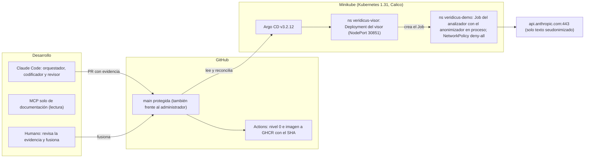

# Veridicus

Grupo: Felipe Reyes Palacio | Fecha de presentación: 28 de noviembre de 2026

**Presentación:** <https://claude.ai/artifact/1b1qbSiCarRWvrsfhGzw6D>. Son 23 diapositivas con las notas
del orador; se descarga como .pptx o PDF desde la misma página.

Veridicus es un analizador que propone las contradicciones internas de un testimonio. Cada
contradicción lleva dos citas literales verificadas y nunca un veredicto de veracidad. Corre en
Kubernetes local, y un humano decide. Es el analizador de incoherencias del Trabajo de Grado
*Diálogos para la Memoria* (cambio 01, DT27, [`docs/iteracion2.md`](./docs/iteracion2.md)).

Este README sigue la [guía de entrega del curso](https://github.com/lfarizav/topicos-especiales/blob/main/modulo8/guia-entrega-proyecto-final.md).

**Qué está construido y qué no.** Hoy corren:

- la biblioteca del analizador y su CLI (`libs/incoherence_analyzer/`);
- el anonimizador (`libs/anonymizer/`);
- un Job en Minikube;
- un visor web reconciliado por Argo CD.

Los microservicios, la consola completa y la evaluación de nivel 2 del diseño de AI-DLC **no** están
construidos (sección 8).

---

## 1. Problema

- **Usuario:** el analista que lee testimonios largos. Por ejemplo, investigadores y juristas de la
  JEP, la Unidad de Víctimas y el CNMH ([`specs/prd.md`](./specs/prd.md), Segmento 1).
- **Dolor de hoy:**
  - cotejar a mano una entrevista contra sí misma «puede tomar días»;
  - el relato traumático desgasta al analista;
  - dos analistas no marcan lo mismo.

  La Comisión de la Verdad recogió más de 14 000 testimonios (`specs/prd.md`, Segmento 1; `pvb.md`).
- **Costo de hoy:** por hora de entrevista, 4–6 h para transcribir y 1,5–3 h para codificar, antes de
  cotejar. Las cifras vienen de la literatura de análisis cualitativo:
  [courses2.cit.cornell.edu/fit117/CP_T.htm](https://courses2.cit.cornell.edu/fit117/CP_T.htm) y
  [PMC12021444](https://pmc.ncbi.nlm.nih.gov/articles/PMC12021444) (consulta 2026-11-27). Nuestra línea
  base propia no está medida; el PRD la marca como no verificada.
- **Métrica de éxito:**
  - el 100 % de las citas emitidas existen literalmente en el turno que indican;
  - el 0 % de las salidas JSON está mal formado;
  - menos de 10 minutos por transcripción sintética (MTTV, meta interna).

  Las metas de adopción del PRD son hipótesis, no criterios del MVP.
- **Qué cambió desde el PVB (cambio 01):**

  | Antes | Ahora |
  |---|---|
  | Se contrastaba el relato con un «marco de verdad» documental. | Se buscan contradicciones dentro del propio relato, con dos citas. |
  | El anonimizador era condicional. | El anonimizador es obligatorio. |

  En ningún caso hay una etiqueta de veracidad sobre la persona (AUTONOMIA-03).

## 2. Arquitectura en Kubernetes

### Diagrama real (lo que corre hoy)



En texto: los agentes de Claude Code proponen por PR, y el humano fusiona en `main` protegida. Argo CD
lee `main` y reconcilia el visor. El visor lanza el Job del analizador, y ese Job es el único pod que sale
a internet, solo hacia el proveedor y solo con texto seudonimizado. Ningún agente ni la CI hace
`kubectl apply` (AUTONOMIA-01).

### Objetos y manifiestos

| Pieza | Objeto de Kubernetes | Manifiesto |
|---|---|---|
| Análisis de un caso | Job, ConfigMap de entrada | [`deploy/demo-analyzer/job.yaml`](./deploy/demo-analyzer/job.yaml), [`kustomization.yaml`](./deploy/demo-analyzer/kustomization.yaml) |
| Aislamiento de red | NetworkPolicy (deny-all y salida 443) | [`deploy/demo-analyzer/networkpolicy.yaml`](./deploy/demo-analyzer/networkpolicy.yaml) |
| Clave del proveedor | Secret, que crea el humano | [`scripts/humano/crear-secret-anthropic.sh`](./scripts/humano/crear-secret-anthropic.sh) |
| Espacio y política | Namespace con Pod Security `restricted` | [`deploy/demo-analyzer/namespace.yaml`](./deploy/demo-analyzer/namespace.yaml) |
| Visor web | Deployment, Service NodePort, ConfigMaps | [`deploy/demo-visor/`](./deploy/demo-visor/) |
| Identidad del visor | ServiceAccount, Role, ClusterRole | [`deploy/demo-visor/rbac.yaml`](./deploy/demo-visor/rbac.yaml) |
| GitOps | Application de Argo CD | [`deploy/argocd/veridicus-visor.yaml`](./deploy/argocd/veridicus-visor.yaml) |
| Políticas | 4 ClusterPolicy de Kyverno, **solo en la CI** | [`deploy/policies/`](./deploy/policies/) |

### Seguridad, con evidencia

- **RBAC de mínimo privilegio.** La cuenta `veridicus-visor` hace lo que hace el humano con el visor, y nada más:
  - crea, lee y borra el Job;
  - aplica su ConfigMap, su ServiceAccount y su NetworkPolicy;
  - lee los pods y sus logs;
  - lee por nombre los dos Secrets, solo para saber que existen.

  No hay comodines. La cuenta del Job no tiene RBAC y lleva `automountServiceAccountToken: false`.
  La evidencia en vivo se obtiene con
  [`scripts/humano/rbac-evidencia.sh`](./scripts/humano/rbac-evidencia.sh), que solo lee. El script corre:

  ```bash
  kubectl auth can-i --list --namespace veridicus-demo \
    --as=system:serviceaccount:veridicus-visor:veridicus-visor
  ```

  Después comprueba, una por una, cosas que la cuenta no puede hacer: crear pods, listar Secrets, leer
  `kube-system` o tocar Argo CD. Las pruebas de [`deploy/tests/test_visor_pod.py`](./deploy/tests/test_visor_pod.py)
  fallan si alguien agrega un comodín.
- **Pod Security `restricted`** en los dos namespaces:
  - sin root ni escalada de privilegios;
  - sin capabilities;
  - raíz de solo lectura;
  - seccomp `RuntimeDefault`.
- **Red.** `veridicus-deny-all` cierra el namespace `veridicus-demo`. Solo el Job sale, por 443 y DNS, y nunca
  hacia rangos privados. `demo-analyzer.sh` lo comprueba con un pod `curl` que debe fallar.
- **La CI no despliega:** no tiene kubeconfig, sus permisos son `contents: read` y las acciones están fijadas
  por SHA. [`scripts/check-no-cluster-apply.sh`](./scripts/check-no-cluster-apply.sh) falla la CI si un script o
  un workflow fuera de `scripts/humano/` contiene un `apply`.

### El bucle GitOps

Argo CD reconcilia `deploy/demo-visor` desde `main`, con `prune` y `selfHeal`. Hay dos demos:

- un PR agrega un ejemplo a `deploy/demo-visor/ejemplos.json`;
- [`scripts/humano/gitops-color.sh`](./scripts/humano/gitops-color.sh) cambia el color de la barra superior
  (`deploy/demo-visor/apariencia.properties`), y luego `--revertir` lo devuelve.

Al fusionar el PR, Argo CD aplica el ConfigMap con un sufijo nuevo y el pod se renueva.
[`scripts/humano/gitops-observar.sh`](./scripts/humano/gitops-observar.sh) espera a que la Application esté
`Synced`/`Healthy` en el commit de `main` y comprueba que la página sirve el cambio. Nadie ejecuta un `apply`
a mano. El paso a paso está en [`deploy/demo-visor/README.md`](./deploy/demo-visor/README.md).

## 3. Loop de agentes

Es el loop con el que se construyó el producto ([`docs/loop/README.md`](./docs/loop/README.md)):

- **Entrada:** un archivo de tarea con su alcance, el hash de git de partida y un
  `Verificación: <comando>` por criterio. Una tarea sin comando no entra al loop (AUTONOMIA-02).
- **Codificador (Sonnet):**
  - confirma el hash;
  - escribe primero la prueba que falla y después el código, en su propio worktree;
  - responde cada hallazgo con «Corregido», «No es un defecto» o «Fuera de alcance».
- **Revisor (Opus):** no tiene Write ni Edit, así que no puede corregir lo que juzga.
  - Corre él mismo los criterios.
  - Emite hallazgos ROJO, NARANJA o AMARILLO.
  - Da VERDE solo si no hay ROJO ni NARANJA.
- **Cuándo se detiene:**
  - con VERDE, sigue la tarea siguiente;
  - a la tercera ronda NO-VERDE (ML-5), para y lleva el caso al humano;
  - con un hash distinto, no empieza.
- **Salida:** un PR con la salida de cada comando. El humano lo revisa y lo fusiona.

**Herramientas permitidas.** Los límites viven en la herramienta, no en el prompt:

| Actor | Puede | No puede |
|---|---|---|
| Codificador | Bash, Read, Edit, Write, Grep y Glob en su worktree | Agent, fusionar, `kubectl apply`, `helm`, `sbatch` |
| Revisor | Bash, Read, Grep, Glob | Write, Edit, Agent |
| MCP | Documentación de solo lectura (claude-platform docs, context7), con términos genéricos | Toda herramienta que escriba o envíe datos pide aprobación |
| Hooks de AI-DLC | `plan-approval-guard`, `write-audit-log`, `run-sensors` | Escribir código sin el `Approve Plan` del humano |

Fuentes: [`.claude/agents/codificador.md`](./.claude/agents/codificador.md),
[`.claude/agents/revisor.md`](./.claude/agents/revisor.md), [`.claude/settings.json`](./.claude/settings.json).

**En cifras (U1 contracts):**

- 45 tareas: 33 del plan y 12 correctivas (PR #5 a #41);
- 2,4 rondas de revisión por tarea, en promedio;
- 76 informes NO-VERDE frente a 54 VERDE;
- unas 39 h y unos 501 USD equivalentes de uso de modelos (registro propio).

Fuente: [`docs/loop/DECISIONES-LOOP.md`](./docs/loop/DECISIONES-LOOP.md).

**Casos de fallo:**

- **Anonimizador caído:** el analizador devuelve `estado: error` con hallazgos vacíos y no sale ninguna
  llamada (pruebas en `libs/anonymizer/tests/guards/`).
- **Sin plan aprobado:** el hook `plan-approval-guard` rechazó toda escritura.
- **K-98, un límite que falló:** el codificador llamó al proveedor real porque la clave estaba en su entorno.
  Ver [`docs/loop/CANDIDATAS.md`](./docs/loop/CANDIDATAS.md) y la sección 8.

**El agente del producto.** El analizador del clúster recibe un caso, llama al juez y al verificador con
texto seudonimizado y verifica cada cita con código determinista. Un hallazgo sin sus dos citas verificadas
no sale (AUTONOMIA-05). Lo que entrega es una sugerencia de revisión.

## 4. Comparación (con fuentes)

| Alternativa | Tiempo | Seguridad | Costo | Adopción |
|---|---|---|---|---|
| A mano | 4–6 h para transcribir y 1,5–3 h para codificar, por hora de entrevista | Nada sale del equipo | USD 0 en software; horas de analista | Exige pericia |
| NVivo, ATLAS.ti o MAXQDA con IA | Resúmenes y códigos sugeridos; no documentan detección de contradicciones | IA por API (OpenAI o Bedrock), sin entrenamiento | NVivo estudiante: USD 118 al año; IA aparte | Media: curva de aprendizaje |
| Chat de IA genérico | Minutos | Los planes de consumo pueden entrenar con los datos; citas sin verificar (18–55 % de referencias inventadas) | USD 20 al mes | Muy fácil |
| Reglas y PLN clásico | Segundos | Local | USD 0 | Alta: hay que programar; falla en la inferencia |
| **Veridicus** | ≈ 10 s por caso sintético de 8 turnos (CLI con Sonnet 5.5) | Seudonimiza antes de salir; falla cerrado | ≈ USD 0,012 por caso con Sonnet 5.5; ≈ 0,022 con Opus 5.5 | Alta: Kubernetes y perfil |

Fuentes (consulta 2026-11-27):

- trabajo a mano: [courses2.cit.cornell.edu/fit117/CP_T.htm](https://courses2.cit.cornell.edu/fit117/CP_T.htm)
  y [PMC12021444](https://pmc.ncbi.nlm.nih.gov/articles/PMC12021444);
- herramientas QDA: [library.virginia.edu/node/2208](https://library.virginia.edu/node/2208),
  [atlasti.com/ai-data-security-and-privacy](https://atlasti.com/ai-data-security-and-privacy) y
  [help.maxqda.com](https://help.maxqda.com);
- chat genérico: [claude.com/pricing](https://claude.com/pricing), [chatgpt.com/pricing](https://chatgpt.com/pricing)
  y Walters y Wilder 2023 ([PMC10484980](https://pmc.ncbi.nlm.nih.gov/articles/PMC10484980));
- PLN clásico: [aclanthology.org/P08-1118](https://aclanthology.org/P08-1118);
- Veridicus: corrida de `scripts/humano/cambio-modelo.sh` del 2026-11-27.
  - 12 casos con Sonnet: 122 s, 42 614 tokens de entrada y 6 077 de salida.
  - 12 casos con Opus: 39 114 y 5 126.
  - Precios USD 2 / 10 (Sonnet 5.5) y USD 4 / 20 (Opus 5.5) por millón de tokens, de
    [platform.claude.com/docs/en/models/sonnet-5-5/overview](https://platform.claude.com/docs/en/models/sonnet-5-5/overview).
  - Las cifras de Veridicus son de casos sintéticos cortos: una entrevista real es mucho más larga y cuesta más.

**Dónde perdemos:**

- **Frente a las QDA:** tienen más de 20 años de madurez, soporte, trabajo en equipo y aceptación académica,
  y nosotros no tenemos consola todavía.
- **Frente al chat genérico:** se adopta en minutos. Nosotros exigimos un clúster, un perfil aprobado por PR
  y una clave en un Secret.
- **Frente al analista:** el juicio contextual es suyo; por eso proponemos y no decidimos.
- **Frente a reglas y PLN:** tienen costo cero y son deterministas, y nuestro juez no lo es.

## 5. Vigencia ante nuevos modelos

| Lo que un modelo mejor absorberá | Lo que es nuestro |
|---|---|
| Encontrar la contradicción y redactar el hecho | Verificación determinista de cada cita en su turno |
| Clasificarla en uno de los 7 tipos | Anonimizador que falla cerrado, delante de todo proveedor |
| Leer relatos más largos sin fragmentar | Contrato común con el TG y su esquema de hallazgo |
| | Revisión humana: sugerencias, nunca veredictos (AUTONOMIA-03) |
| | RBAC, NetworkPolicy, Pod Security y entrega por GitOps |
| | Pruebas: 100 % de ramas en los módulos guardia |

Por eso el trabajo del modelo vive en un prompt y un perfil
([`libs/execution_profiles/config/profiles.yaml`](./libs/execution_profiles/config/profiles.yaml)), no en código.

**Prueba de cambio de modelo.** El cambio de modelo se hace solo por configuración: el perfil
`demo-anthropic-opus` cambia `claude-sonnet-5-5` por `claude-opus-5-5`, sin tocar código.
[`scripts/humano/cambio-modelo.sh`](./scripts/humano/cambio-modelo.sh) corre los 12 casos sintéticos de
[`evaluation/cambio-modelo/`](./evaluation/cambio-modelo/) (7 con una contradicción sembrada y 5 coherentes o
trampa) contra los dos perfiles y los compara. Resultado del 2026-11-27, una corrida por modelo:

| | Sonnet 5.5 | Opus 5.5 |
|---|---|---|
| Contradicciones detectadas | 6/7 | 3/7 |
| … con el tipo esperado | 5/7 | 3/7 |
| … con los turnos esperados | 6/7 | 3/7 |
| Hallazgos de más en casos sin contradicción | 1/5 | 0/5 |
| Errores | 0/12 | 1/12 (`salida_invalida`, sin resultado parcial) |
| Citas verificadas | 14/14 | 6/6 |
| Llamadas | 28 | 24 |
| Segundos | 122 | 151 |

El sistema siguió funcionando con los dos modelos. Toda cita emitida quedó verificada. El error de Opus en
SINT-EVAL-07 falló cerrado, como exige AUTONOMIA-05. El caso de lugar (SINT-EVAL-03) no lo detectó ninguno de
los dos. Con 12 casos y una sola corrida por modelo, esto es una comparación y no una medición, y no dice que
un modelo sea mejor en general.

## 6. Moat

> «Un competidor con el mismo modelo tardaría **lo que cuesta un trabajo de grado completo, unas 1 200 h**,
> en igualarnos porque Veridicus es una pieza del TG *Diálogos para la Memoria*: la verificación de citas, el
> anonimizador con fallo cerrado y la validación contra la codificación humana del piloto se apoyan en ese
> trabajo, que no es público».

Las 1 200 h son una proyección propia: es la última estimación del esfuerzo total del TG. El PVB estimó
6 semanas para copiar solo la aplicación con la misma API (`pvb.md`). Lo que no se copia en ese tiempo es lo
que hay debajo:

- **Datos:** la validación contra la codificación humana del piloto, fuera del repositorio.
- **Confianza:** las reglas AUTONOMIA-01 a 05 ([`docs/limite-autonomia.md`](./docs/limite-autonomia.md)), con
  pruebas que fallan la CI, y la adenda ética VE-01 a VE-17.
- **Integración:** el contrato común con la app del TG; el mismo código sirve a los dos.

## 7. Cómo reproducirlo desde cero

Todo lo que toca el clúster lo ejecuta el humano (AUTONOMIA-01).

1. **Pruebas sin clúster ni red**, desde la raíz:

   ```bash
   uv run --frozen --offline --directory deploy pytest --cov=veridicus_demo --cov-branch --cov-fail-under=100
   ```

2. **Minikube con Calico** (sin Calico, la NetworkPolicy no se cumple):

   ```bash
   minikube start --cni=calico --memory=8g --cpus=4
   kubectl get pods -n kube-system -l k8s-app=calico-node   # deben estar en Running
   ```

3. **Secrets.** Se crean desde un `.env` que nunca se versiona, con `VERIDICUS_ANTHROPIC_API_KEY`,
   `VERIDICUS_GHCR_USER` y `VERIDICUS_GHCR_TOKEN`:

   ```bash
   bash scripts/humano/crear-secret-anthropic.sh ~/.env
   bash scripts/humano/crear-pull-secret-ghcr.sh ~/.env
   ```

4. **Análisis como Job:** `bash scripts/humano/demo-analyzer.sh`. El script aplica el Job, muestra los
   hallazgos y comprueba que la red está cerrada. Detalle en
   [`deploy/demo-analyzer/README.md`](./deploy/demo-analyzer/README.md).
5. **Visor y GitOps:**
   - `bash scripts/humano/visor-pod.sh` construye la imagen en Minikube y despliega el visor;
   - `bash scripts/humano/argocd-instalar.sh` instala Argo CD y registra la Application.

   Detalle en [`deploy/demo-visor/README.md`](./deploy/demo-visor/README.md).
6. **Prueba de cambio de modelo:** `bash scripts/humano/cambio-modelo.sh`. Ver
   [`evaluation/cambio-modelo/README.md`](./evaluation/cambio-modelo/README.md).
7. **Evidencia de RBAC:** `bash scripts/humano/rbac-evidencia.sh`.

Reversión: `kubectl delete -k deploy/demo-analyzer`, `kubectl delete -k deploy/demo-visor` y
`kubectl delete namespace argocd`.

## 8. Riesgos y cómo los mitigamos

| Riesgo | Mitigación |
|---|---|
| El NER deja pasar un nombre real (R12) | Solo datos sintéticos en el repositorio y la CI; anonimizador con fallo cerrado |
| La clave estaba en el entorno del agente (K-98) | El punto de entrada solo corre en pytest y los agentes no usan la red. Queda pendiente que la clave no exista en el entorno de desarrollo |
| Kyverno no corre como admisión en el clúster | Las políticas bloquean en la CI antes de fusionar |
| La NetworkPolicy no excluye 100.64.0.0/10 (K-100) | Registrado en `docs/loop/CANDIDATAS.md` para un PR propio |
| Microservicios, consola y nivel 2 sin construir | Primero la rebanada mínima (CLI y Job); el resto va en B11b y siguientes |
| Un solo proveedor de modelos (solo existe el adaptador de Anthropic) | Los perfiles y el esquema están listos para otros adaptadores |
| Un CI lento durante la demo en vivo del bucle GitOps | Se usa una grabación de respaldo |

Fuentes: [`risk-and-sequencing-rationale.md`](./aidlc/spaces/default/intents/261002-veridicus-mvp/inception/delivery-planning/risk-and-sequencing-rationale.md),
[`docs/loop/CANDIDATAS.md`](./docs/loop/CANDIDATAS.md).

---

# Anexo: curso, entregables previos y flujo AI-DLC

## Datos del curso

| Campo | Valor |
|---|---|
| Curso | Tópicos Especiales en Informática |
| Semestre | 2026-3 |
| Profesor | Luis Felipe Ariza Vesga |
| Universidad | Pontificia Universidad Javeriana |
| Ciudad | Bogotá, Colombia |
| Repositorio del curso | [`lfarizav/topicos-especiales`](https://github.com/lfarizav/topicos-especiales) |

## Autor

| Campo | Valor |
|---|---|
| Nombre | Felipe Reyes Palacio |
| Correo | freyes@javeriana.edu.co |
| Programa | Maestría en Ingeniería de Sistemas y Maestría en Inteligencia Artificial |

> **Nota de contexto:** `docs/pvb.md` señala que Veridicus está alineado con el Trabajo
> de Grado de Maestría del autor, *"Diálogos para la Memoria"*, dirigido por el
> **Dr. Luis Gabriel Moreno**. Ese director de tesis es una persona distinta del profesor
> de este curso, **Luis Felipe Ariza Vesga** — no confundir los dos roles al leer los
> documentos de `docs/` y `research/06-documentacion-propia/`.

---

## Entregables y de dónde salen sus reglas

El curso especifica, en su propio repositorio, exactamente qué se entrega y cómo se
evalúa. Esta tabla conecta cada entregable de este repo con la página del curso que lo
exige:

| Entregable | Archivo en este repo | Especificado en (repo del curso) |
|---|---|---|
| Product Vision Board (PVB) | [`pvb.md`](./pvb.md) (copia en [`docs/pvb.md`](./docs/pvb.md)) | [`modulo2/README.md`](https://github.com/lfarizav/topicos-especiales/blob/main/modulo2/README.md) · [`modulo2/INSTRUCCIONES-ENTREGA.md`](https://github.com/lfarizav/topicos-especiales/blob/main/modulo2/INSTRUCCIONES-ENTREGA.md) |
| Product Requirements Document (PRD) | [`specs/prd.md`](./specs/prd.md) | [`modulo3/README.md`](https://github.com/lfarizav/topicos-especiales/blob/main/modulo3/README.md) · [`modulo3/prompts-para-especificacion.md`](https://github.com/lfarizav/topicos-especiales/blob/main/modulo3/prompts-para-especificacion.md) (Prompt 1) |
| Investigación de validación | [`docs/overview.md`](./docs/overview.md), [`docs/mercado.md`](./docs/mercado.md), [`docs/icp.md`](./docs/icp.md) | [`modulo2/INSTRUCCIONES-ENTREGA.md`](https://github.com/lfarizav/topicos-especiales/blob/main/modulo2/INSTRUCCIONES-ENTREGA.md) (Paso 2) |
| Investigación de crítica (adversarial) | [`docs/critica.md`](./docs/critica.md) | ídem (Paso 2) |
| Regla de evidencia y caso de alucinación de IA a estudiar | Anexo de auditoría en [`docs/pvb.md`](./docs/pvb.md) | [`modulo3/research/README.md`](https://github.com/lfarizav/topicos-especiales/blob/main/modulo3/research/README.md) del repo del curso — **no confundir con [`research/README.md`](./research/README.md) de este repo**, que es el índice de nuestro propio corpus documental, no el caso de estudio del curso |
| Análisis de conflictos (Paso 0) entre PVB e insumos | [`docs/iteracion1.md`](./docs/iteracion1.md) | [`modulo3/prompts-para-especificacion.md`](https://github.com/lfarizav/topicos-especiales/blob/main/modulo3/prompts-para-especificacion.md) (sección "PASO 0") |
| Cronograma y fecha de cada entregable | — | [`README.md`](https://github.com/lfarizav/topicos-especiales/blob/main/README.md) del repo del curso ("Cronograma — 16 sesiones"), fuente de verdad de fechas |

Reglas del curso que gobiernan todo lo anterior (ver `INSTRUCCIONES-ENTREGA.md` y el
README raíz del curso): toda cifra lleva fuente con enlace y fecha; las proyecciones
propias se marcan `[INTERNO]` y lo no verificado `[VERIFICAR]`; y **el agente propone,
el humano aprueba** — ninguna decisión de alcance o de PVB/PRD se delega a la IA sin
revisión explícita.

---

## Estructura del repositorio

```
tai/
├── pvb.md              ← Entregable 1 (Product Vision Board)
├── plan-aidlc.md         plan propio para AI-DLC v2.10.0: de PVB/PRD a unidades y tareas
├── docker/               contenedor aislado (tai-aidlc; tg-veridicus desde el cambio 01), ver docker/README.md
├── docs/                 insumos del PRD
│   ├── pvb.md             copia del PVB
│   ├── overview.md        panorama del dominio (justicia transicional, PLN forense)
│   ├── mercado.md         análisis de mercado y competencia
│   ├── icp.md             perfil de cliente ideal y buyer personas
│   ├── critica.md         investigación adversarial
│   ├── limite-autonomia.md  reglas AUTONOMIA-01..05 (PRD Segmento 6) para la memoria de AI-DLC
│   ├── iteracion1.md      bitácora del Paso 0 (análisis de conflictos, aprobado por el autor)
│   └── iteracion2.md      análisis de impacto del cambio 01 (analizador de incoherencias del TG), aprobado
├── specs/
│   └── prd.md           ← Entregable 2 (Product Requirements Document, 13 segmentos)
├── research/             corpus documental citado por docs/ y specs/
│   ├── README.md          índice del corpus: qué cita cada documento y por qué
│   ├── 01-marco-legal-colombiano/       Ley 1448/2011, Ley 2421/2024, Ley 1581/2012
│   ├── 02-memoria-historica-y-conflicto/  CEV, CNMH, Patiño, minería de texto JEP Caso 03
│   ├── 03-llm-as-a-judge/                 MT-Bench, Themis, JudgeBlender, Preference Leakage
│   ├── 04-analisis-forense-del-testimonio/ LieXBerta, codificación de preguntas forenses
│   ├── 05-etica-sesgos-y-riesgos/          Stochastic Parrots, UNESCO, NLP en trauma
│   └── 06-documentacion-propia/            propuesta y hoja de ruta del TG del autor
└── presentations/        material de apoyo para mostrar el avance en clase
    ├── Veridicus_PVB_PRD.pptx  resumen visual del PVB + PRD (12 diapositivas, ~10 min, con notas del orador)
    └── Veridicus_AIDLC_avance.pptx  avance con AI-DLC v2: etapas, interfaz, arquitectura, unidades e infraestructura, con el plan de U1 en Code Generation (8 diapositivas, con notas del orador)
```

## Avance del flujo AI-DLC

El MVP se especifica con AI-DLC (scope `classic`). Los artefactos viven en
[`aidlc/spaces/default/intents/261002-veridicus-mvp/`](./aidlc/spaces/default/intents/261002-veridicus-mvp/)
(`I/` abajo); cada etapa se cierra con aprobación humana y un commit `aidlc(<etapa>): …`.

**Cambio 01 (2026-10-30):** Veridicus pasa a ser el analizador de incoherencias del TG (DT27). El
análisis de impacto y sus decisiones están en [`docs/iteracion2.md`](./docs/iteracion2.md); PVB, PRD
(iteración 6), reglas AUTONOMIA y `plan-aidlc.md` ya están corregidos. El flujo volvió a
**Requirements Analysis (2.3)** para revisar en este intent las etapas 2.3 a 3.5; la tabla de abajo
muestra lo aprobado **antes** del cambio, que cada etapa revisada actualizará (Requirements Analysis, User Stories, Refined Mockups y Domain Design y Units Generation ya están revisadas, junto con la adenda 02 del protocolo ético; los modelos locales se validaron en el clúster Ing. Sistemas antes de Domain Design, FR16.3; Contract Design y Delivery Planning también están revisadas, e Inception queda cerrada; el 2026-11-09 se volvió a Requirements Analysis para revalidar las etapas de Inception con deriva; User Stories, Refined Mockups, Domain Design, Units Generation, Contract Design y Delivery Planning quedaron revalidadas el 2026-11-21, Inception vuelve a quedar cerrada y sigue Functional Design). El plan de U1 nunca se
aprobó y se regenerará con el contrato común; desde entonces, el autor elige `Approve Plan` y se
construye por Bolts.

| Fase | Etapa | Estado | Documentos principales |
|---|---|---|---|
| Inception | Practices Discovery | Aprobada | [`team-practices.md`](./aidlc/spaces/default/intents/261002-veridicus-mvp/inception/practices-discovery/team-practices.md) |
| Inception | Requirements Analysis | Aprobada (revisión 3, revalidación del 2026-11-09) | [`requirements.md`](./aidlc/spaces/default/intents/261002-veridicus-mvp/inception/requirements-analysis/requirements.md): la revisión 3 ratifica en bloque las precisiones de User Stories, Refined Mockups, Domain Design (A-1 a A-4) y Contract Design (CD-02, CD-04); la adenda 02 sigue aparte y el cambio 04 (DT30) no toca requisitos (preguntas 17–19). Revisión 3 en [`reviews/review-03.md`](./aidlc/spaces/default/intents/261002-veridicus-mvp/inception/requirements-analysis/reviews/review-03.md) (READY; R-01 a R-06 aceptados como riesgo). Base: revisión 2 con el contrato común v0.1 del analizador (FR4.1–FR4.9: 7 tipos, dos citas verificadas, `error` ⇒ hallazgos vacíos), anonimizador obligatorio (FR11.3–FR11.4), biblioteca y CLI (FR13), perfiles por papel (FR14), `ModelGateway` (FR15) y lotes en ZINE (FR16); retirados FR2, FR5, FR11.1 y NFR9. Revisión en [`reviews/review-02.md`](./aidlc/spaces/default/intents/261002-veridicus-mvp/inception/requirements-analysis/reviews/review-02.md) (READY; R-01 a R-06 aceptados como riesgo) |
| Inception | User Stories | Aprobada (revisión 3, revalidación del 2026-11-21) | [`stories.md`](./aidlc/spaces/default/intents/261002-veridicus-mvp/inception/user-stories/stories.md): la revisión 3 ratifica las precisiones de Domain Design (A-1 a A-4) y Contract Design (CD-02, CD-04), cambia el código a `anonimizador_no_disponible` y corrige AC3.2.5, AC11.3.3, AC11.3.7, AC11.6.2 y AC13.3.1, además de añadir AC11.6.4, sin cambiar ninguna historia. Revisión 3 en [`reviews/review-04.md`](./aidlc/spaces/default/intents/261002-veridicus-mvp/inception/user-stories/reviews/review-04.md) (READY; R-01 a R-03 cerrados en los originales tras la aprobación: FR4.2 suma `incidente_anonimizacion`, su causa queda fijada en AC3.2.5 y AC11.3.3 y AC11.6.4 nombran los componentes). Base: 62 historias activas en 14 épicas (US12.6 y US12.7 entran por Refined Mockups), con las retiradas marcadas sin renumerar; épicas nuevas 12 (biblioteca y CLI), 13 (perfiles y modelos) y 14 (ZINE, con US14.1 MUST: validación de modelos locales antes de Domain Design). [`personas.md`](./aidlc/spaces/default/intents/261002-veridicus-mvp/inception/user-stories/personas.md) suma P4, Investigador del TG. Revisión en [`reviews/review-03.md`](./aidlc/spaces/default/intents/261002-veridicus-mvp/inception/user-stories/reviews/review-03.md) (READY; R-01 a R-05 resueltos) |
| Inception | Refined Mockups | Aprobada (revisión 3, revalidación del 2026-11-21) | [`mockups.md`](./aidlc/spaces/default/intents/261002-veridicus-mvp/inception/refined-mockups/mockups.md): la revisión 3 ratifica en bloque CD-02/CD-08, AC3.2.5 y la adenda 02 (preguntas 12–14): estado «Sesión bloqueada por incidente» en M4, desliz M2 → M4 de US15.2 y §11 que ubica cada elemento de la épica 15 sin redibujar; los textos propuestos por la etapa quedan en la tabla de precisiones. Revisiones en [`reviews/review-05.md`](./aidlc/spaces/default/intents/261002-veridicus-mvp/inception/refined-mockups/reviews/review-05.md) a [`reviews/review-08.md`](./aidlc/spaces/default/intents/261002-veridicus-mvp/inception/refined-mockups/reviews/review-08.md) (READY; R-01 a R-10 resueltos). Base (revisión 2, cambio 01): M0–M8 (M2 retirada); nuevas M7 importar transcripción y M8 reportes del investigador (rol `investigador`, FR1.2 y FR13.5). Sesión con perfil, citas A/B con contexto, franja del modo final y registro de modelos por corrida. [`interaction-spec.md`](./aidlc/spaces/default/intents/261002-veridicus-mvp/inception/refined-mockups/interaction-spec.md), [`design-system-mapping.md`](./aidlc/spaces/default/intents/261002-veridicus-mvp/inception/refined-mockups/design-system-mapping.md), [`accessibility-checklist.md`](./aidlc/spaces/default/intents/261002-veridicus-mvp/inception/refined-mockups/accessibility-checklist.md). Lienzo visual: <https://claude.ai/artifact/5D2otJRp5fh6YsccE6m8iw>. Revisión en [`reviews/review-04.md`](./aidlc/spaces/default/intents/261002-veridicus-mvp/inception/refined-mockups/reviews/review-04.md) (READY) |
| Inception | Domain Design | Aprobada (revisión 3, revalidación del 2026-11-21) | La revisión 3 ratifica en bloque las precisiones de Contract Design (CD-01, CD-03, CD-04, CD-06, CD-09) y alinea con ellas ADR-005, ADR-006, ADR-011, ADR-013 y ADR-014, sin cambiar componentes, entidades ni aristas; ConsoleApi devuelve el estado de sesión bloqueada a la consola. Revisiones [`review-04.md`](./aidlc/spaces/default/intents/261002-veridicus-mvp/inception/domain-design/reviews/review-04.md) y [`review-05.md`](./aidlc/spaces/default/intents/261002-veridicus-mvp/inception/domain-design/reviews/review-05.md) (READY; R-06 y R-07 resueltos, R-08 queda para Functional Design de U4). Revisión 2: [`components.md`](./aidlc/spaces/default/intents/261002-veridicus-mvp/inception/domain-design/components.md): 16 componentes; salen TruthFrame y SemanticEvaluation, ForensicReport pasa a ReviewReport y entran IncoherenceAnalyzer y AnalyzerCli (biblioteca y CLI), AnalysisWorker, Anonymizer, ExecutionProfiles, ResearchReports y EthicsGovernance. El analizador cumple las reglas éticas del TG sin rebaja, y la consola demuestra el resto de la adenda 02 sin compuertas (VE-04, VE-11, VE-12, VE-15 y VE-16 pasan a demostración). Retención en orden de referencias, incidente de anonimización cortado en la biblioteca. [`decisions.md`](./aidlc/spaces/default/intents/261002-veridicus-mvp/inception/domain-design/decisions.md): ADR-001 a ADR-017. Las precisiones DD-01 a DD-10 se llevaron a la adenda 02, a `requirements.md` (A-1 a A-4), a `stories.md`, a `team.md` y a `docs/iteracion2.md`. Revisión en [`reviews/review-03.md`](./aidlc/spaces/default/intents/261002-veridicus-mvp/inception/domain-design/reviews/review-03.md) (READY; 5 Minor anotados) |
| Inception | Units Generation | Aprobada (revisión 3, revalidación del 2026-11-21) | La revisión 3 lleva CD-04 a las unidades: U10 suma los adaptadores comerciales con sus claves (solo en `anonymizer-proxy`) y pasa de M a L; ModelGateway de U11 queda con el adaptador local y la prueba compuesta de AC11.3.3 y AC11.3.7; AC11.6.4 se reparte entre U2 y U4. El grafo, los ID y el mapa de historias no cambian. Revisiones [`review-07.md`](./aidlc/spaces/default/intents/261002-veridicus-mvp/inception/units-generation/reviews/review-07.md) y [`review-08.md`](./aidlc/spaces/default/intents/261002-veridicus-mvp/inception/units-generation/reviews/review-08.md) (READY; R-03 queda para Functional Design). Revisión 2: [`unit-of-work.md`](./aidlc/spaces/default/intents/261002-veridicus-mvp/inception/units-generation/unit-of-work.md): 13 unidades; U1–U10 conservan su ID y entran U11 `incoherence-analyzer` (biblioteca y CLI, con los scripts `sbatch` de ZINE), U12 `research-reports` y U13 `ethics-governance` (demostración); U10 `anonymizer` pasa a MUST y AnalysisWorker vive en U4. [`unit-of-work-dependency.md`](./aidlc/spaces/default/intents/261002-veridicus-mvp/inception/units-generation/unit-of-work-dependency.md): grafo acíclico de 22 aristas. [`unit-of-work-story-map.md`](./aidlc/spaces/default/intents/261002-veridicus-mvp/inception/units-generation/unit-of-work-story-map.md): 71 historias con unidad dueña. Las precisiones UG-03, UG-04, UG-05 y UG-09 se llevaron a `components.md`, ADR-016 y AC15.8.2. Revisión final en [`reviews/review-06.md`](./aidlc/spaces/default/intents/261002-veridicus-mvp/inception/units-generation/reviews/review-06.md) (READY, sin hallazgos) |
| Inception | Contract Design | Aprobada (revisión 3, revalidación del 2026-11-21) | La revisión 3 ratifica en bloque las revisiones 3 de User Stories, Refined Mockups, Domain Design y Units Generation (preguntas 15 a 17): una corrida nueva sobre una sesión bloqueada se rechaza con `409` `session.blocked` (precisión CD-11); los adaptadores comerciales van en un subpaquete de `libs/anonymizer/`; el ModelGateway recibe el `AnonymizingProvider` por inyección, `semantic-agent` usa un cliente HTTP de C21 y queda sin `libs-anonymizer` (import-linter, *extra* `cli`, lockfile e imagen); la prueba compuesta de AUTONOMIA-04 es de U11. Revisión final en [`reviews/review-07.md`](./aidlc/spaces/default/intents/261002-veridicus-mvp/inception/contract-design/reviews/review-07.md) (READY). Revisión 2 (cambio 01 y adenda 02): [`contract-summary.md`](./aidlc/spaces/default/intents/261002-veridicus-mvp/inception/contract-design/contract-summary.md): C1–C16 conservan su número, C4 y C9 quedan «Retirado» y entran C17–C25: contrato común del analizador v1.0.0 con su bloque `consentimiento` (incluidos `requiere_mandato` y `constancia_mandato`), códigos de error en español traducidos uno a uno a Problem Details (`anonimizador_no_disponible`, `incidente_anonimizacion`), API de la biblioteca y de la CLI, reporte de la CLI sin campos de texto libre, perfiles de ejecución, `anonymizer-proxy` como única salida del clúster (C22) con los adaptadores comerciales y sus claves, cancelación de corridas por clave de Redis y catálogo único de límites `contracts/limits.v1.yaml` (C25). Decisiones P1–P14. Las precisiones CD-01 a CD-10 se llevaron a `components.md`, `unit-of-work.md`, `unit-of-work-dependency.md`, `requirements.md` (FR4.2, FR15.1), la adenda 02 (A-4), `team.md` e `interaction-spec.md`. Revisión final en [`reviews/review-04.md`](./aidlc/spaces/default/intents/261002-veridicus-mvp/inception/contract-design/reviews/review-04.md) (READY) |
| Inception | Delivery Planning | Aprobada (revisión 3, revalidación del 2026-11-21) | La revisión 3 ratifica en bloque las revisiones 3 de Inception (pregunta 15): ningún Bolt cambia de número, unidad ni orden; cambian las definiciones de terminado de B1 (`AnonymizingProvider` en `contracts/`), B10 (adaptadores comerciales en un subpaquete de `libs/anonymizer/` y transporte *fake*; U10 pasa a L, riesgo R14), B11 (prueba compuesta de AUTONOMIA-04, raíz de composición y *extra* `cli`), B3 (`semantic-agent` sin `libs-anonymizer` y `409` `session.blocked`) y B4 (Secret solo en `anonymizer-proxy`). El cierre de Inception sigue en PASA. Revisión 2: [`bolt-plan.md`](./aidlc/spaces/default/intents/261002-veridicus-mvp/inception/delivery-planning/bolt-plan.md): 13 Bolts, uno por unidad y un PR con squash cada uno. Tras la tarea previa P0.1 (GitHub), la primera rebanada de valor es B1 contratos → B10 anonimizador (ahora MUST) → B11 analizador (biblioteca y CLI con un proveedor comercial). Siguen la demo de la sesión 16 (B2 acceso → B3 flujo de texto → B4 plataforma → B5 revisión → B6 reporte) y el resto de las MUST (B12 reportes del investigador → B7 ciclo de vida → B13 ética); después del corte, B8 y B9. P0.2 (Golden Dataset) queda «Retirado»: el conjunto sintético se construye en B11. Si falta tiempo se recorta B13 primero; nunca B1, B10, B11 ni la demo. [`risk-and-sequencing-rationale.md`](./aidlc/spaces/default/intents/261002-veridicus-mvp/inception/delivery-planning/risk-and-sequencing-rationale.md) (R1–R13), [`team-allocation.md`](./aidlc/spaces/default/intents/261002-veridicus-mvp/inception/delivery-planning/team-allocation.md), [`external-dependency-map.md`](./aidlc/spaces/default/intents/261002-veridicus-mvp/inception/delivery-planning/external-dependency-map.md) (calendario, clave del proveedor, ZINE, modelos locales). Cierre de Inception: [`phase-check-inception.md`](./aidlc/spaces/default/intents/261002-veridicus-mvp/verification/phase-check-inception.md) (PASA). Precisión DP-01 (`research.upload_ok` frente a CD-03) pendiente para Functional Design de U12 |
| Construction | Functional Design | Aprobada (segunda pasada, cambio 01, 2026-11-22) | [`construction/<unidad>/functional-design/`](./aidlc/spaces/default/intents/261002-veridicus-mvp/construction/): entidades, reglas, especificación funcional y trazabilidad de las 12 unidades que la llevan (todas menos platform). Revisión 2 de contracts, identity-access, text-flow, human-review, session-lifecycle, assistant-extras, anonymizer, forensic-report y voice; revisión 1 de las nuevas incoherence-analyzer, research-reports y ethics-governance. Lo retirado conserva su ID como «Retirado». Claves: aclaraciones neutras deterministas y lectura en ambos órdenes en todos los perfiles (U8); el texto de control de un reporte del investigador da `422` sin eco (U12); exportación con marca de agua y huella, y «Descargar reporte» siempre exporta (U7); corridas que esperan la transcripción de voz anterior y audio autorizado conservado hasta la retención (U9); retención de 90 días desde la creación con Job y acta, y demostraciones éticas sin compuertas (U13). Las precisiones a documentos aprobados quedan en la tabla FD-Ux de cada `functional-spec.md`, pendientes de llevarse al original antes de Code Generation |
| Construction | NFR Requirements | Aprobada (segunda pasada, cambio 01, 2026-11-22) | [`construction/<unidad>/nfr-requirements/`](./aidlc/spaces/default/intents/261002-veridicus-mvp/construction/): requisitos de rendimiento, seguridad, escalado, fiabilidad y observabilidad, decisiones de pila y trazabilidad de las 13 unidades. Revisión 2 de U1–U10; revisión 1 de las nuevas incoherence-analyzer, research-reports y ethics-governance. Claves: Anthropic como proveedor comercial de la primera rebanada y verificador local gpt-oss-20b (solo un proveedor externo recibe datos seudonimizados); nivel 2 con precisión ≥ 0,70, sensibilidad ≥ 0,60 y acuerdo ≥ 0,60 sobre 40 transcripciones sintéticas; transcripción de hasta 250 000 caracteres y turnos de hasta 20 000; `limits.exceeded` siempre `413`; humo en 300 s y p95 incremental ≤ 180 s (estimados); Argo CD con salida declarada solo hacia `github.com`. Las precisiones a documentos aprobados quedan en la tabla NFR-Ux de cada `security-requirements.md`, y las cifras nuevas de `contracts/limits.v1.yaml` entran por PR de U1 antes de cada Bolt |
| Construction | NFR Design | Aprobada (segunda pasada, cambio 01, 2026-11-23) | [`construction/<unidad>/nfr-design/`](./aidlc/spaces/default/intents/261002-veridicus-mvp/construction/): diseño de rendimiento, seguridad, escalado, fiabilidad, observabilidad y componentes lógicos, más trazabilidad, de las 13 unidades. Revisión 2 de U1–U10; revisión 1 de incoherence-analyzer, research-reports y ethics-governance. Claves: proyección del esquema hacia Anthropic con validación contra el esquema completo; reentrega acotada a 3 envíos, declarada en el ADR; latencia por llamada solo como agregados en C19 v2 (C6 no cambia); plazo de inactividad por transacción (`SET LOCAL`, 5 s / 15 s); Redis caído deja la consola fuera de servicio; purga con funciones de bloqueo `SECURITY DEFINER`. Las precisiones a documentos aprobados y las peticiones entre unidades quedan en la tabla NFRD-Ux de cada `security-design.md`, pendientes de llevar a sus originales antes de Code Generation |
| Construction | Infrastructure Design | Aprobada (segunda pasada, cambio 01, 2026-11-23) | [`construction/<unidad>/infrastructure-design/`](./aidlc/spaces/default/intents/261002-veridicus-mvp/construction/): especificación de infraestructura, monitoreo, pipeline de CI/CD y trazabilidad de las 13 unidades (las de tipo library solo `cicd-pipeline.md`). Claves: un solo equipo de 64 GB sin GPU para desarrollo y demostración (WSL2 56 GB y 20 procesadores, Minikube 50 GiB y 16 CPU); juez de `todo-local` Qwen3.6-35B-A3B Q4_K_M y verificador gpt-oss-20b Q8_0, que nunca generan a la vez; consumidores de la cola con `Recreate`; `connectionLimit` 30; proxy del anonimizador con cupo solo en `POST /v1/generate`; evidencia de nivel 2 versionada en `evaluation/reports/level2/`; la CI nunca despliega; revisiones en `reviews/` |
| Construction | Code Generation | En curso. **U1 contracts cerrada**: Bolt B1 fusionado en `main` (PR #42, 2026-11-25), con la etiqueta `contracts-v0.1.0` | U1: [`code-generation-plan.md`](./aidlc/spaces/default/intents/261002-veridicus-mvp/construction/contracts/code-generation/code-generation-plan.md), [`code-summary.md`](./aidlc/spaces/default/intents/261002-veridicus-mvp/construction/contracts/code-generation/code-summary.md), [`traceability.json`](./aidlc/spaces/default/intents/261002-veridicus-mvp/construction/contracts/code-generation/traceability.json) (116 IDs, sensor en verde) y [`decisiones-humano.md`](./aidlc/spaces/default/intents/261002-veridicus-mvp/construction/contracts/code-generation/decisiones-humano.md). Se construyó con el loop de agentes: 33 tareas del plan y 12 correctivas, todas con revisión adversarial VERDE ([`docs/loop/`](./docs/loop/), [`DECISIONES-LOOP.md`](./docs/loop/DECISIONES-LOOP.md)). Contiene los contratos vigentes, el paquete `veridicus-contracts` en Python y TypeScript, `libs/errors/`, las guardias AUTONOMIA y de repositorio público, y la CI `contracts-level0`, `errors-level0` y `repo-level0`. Siguiente (cambio 06, DT31): corte delgado del MVP, con B10a, el anonimizador mínimo con fallo cerrado, y luego B11a, la CLI del analizador con un proveedor comercial, en modo liviano |

Los hallazgos abiertos de las revisiones de Functional Design, NFR Requirements, NFR Design e Infrastructure Design quedaron
aceptados como riesgo en la aprobación; están en `reviews/` de cada unidad. Las precisiones a artefactos aprobados
están en §6 de cada `security-requirements.md` y en las tablas «Precisiones a artefactos ya aprobados» de cada diseño de NFR. Los cambios propuestos a contratos y a otras unidades están en la tabla
«Cambios entre unidades» de cada `functional-spec.md`.

### Qué es Veridicus, en una línea

> Un sistema multiagente de entrevista asistida por IA que detecta contradicciones
> dentro del relato de un compareciente sobre hechos centrales, con dos citas literales
> verificadas —nunca veredictos de veracidad—, para analistas de justicia transicional,
> desplegado en un clúster Kubernetes local del que ningún dato sin seudonimizar sale.

Ver `pvb.md` (visión) y `specs/prd.md` (los 13 segmentos de requisitos, incluido el
alcance MoSCoW del MVP académico) para el detalle completo.

---

> **Nota de mantenimiento:** este README debe **revisarse y actualizarse siempre que se
> agregue documentación nueva** al repositorio (un archivo a `docs/`, una fuente a
> `research/`, un segmento nuevo a `specs/prd.md`). Un README desactualizado es, para
> efectos de coherencia del proyecto, tan problemático como una cita sin fuente.
