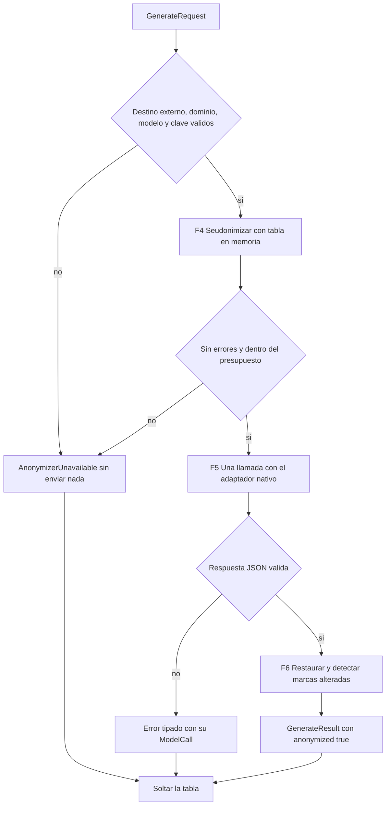
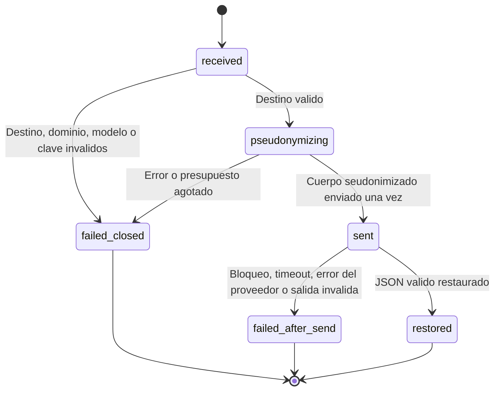
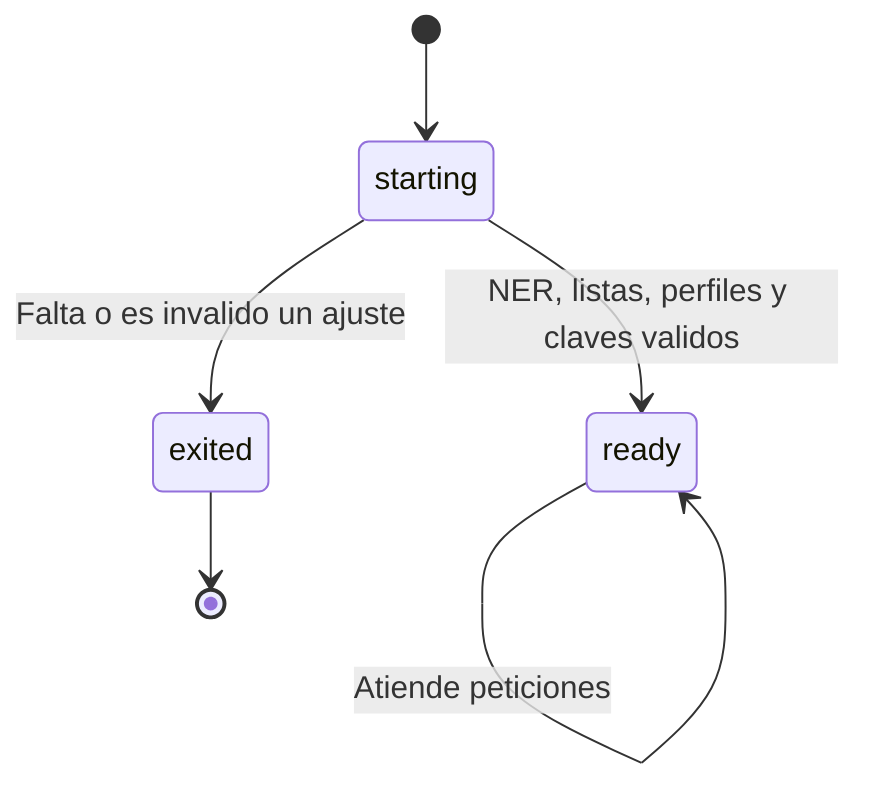
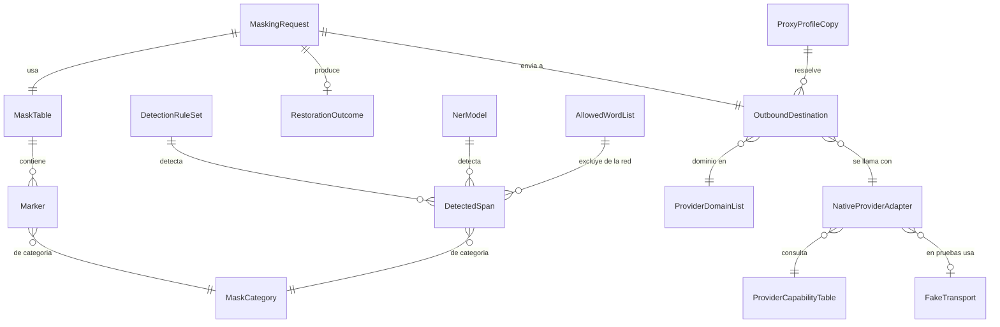

# Especificación funcional — U10 anonymizer

**Revisión 2 (2026-11-21), segunda pasada por el cambio 01 (DT27), la adenda 02 y las revisiones 3 de
Inception.** Sustituye a la revisión 1 del 2026-10-02. Los flujos, estados y escenarios conservan su
número; lo que sale queda «Retirado» sin renumerar (regla de `project.md`), y lo nuevo empieza en F4 y E9.
- **Siguen**, con cambios: F1 (ahora la operación única `generate` de C20, en el mismo proceso o detrás
  del proxy), F3 (arranque del proxy y construcción del módulo), la máquina de estados de una llamada
  (§3.1) y los escenarios E1, E2, E3, E5 y E6.
- **Salen**: F2 (`embed`, que sale de C13), E4 (fallo al cargar la lista del escenario, que el cambio 01
  retira), E7 (manifiesto con salida, que pasa a U2) y E8 (URL del juez sin proxy, que pasa a U11). Sale
  también la precisión de la revisión 1 sobre `scenario_version_id`.
- **Entran**: F4–F9 (seudonimizar, llamar con el adaptador nativo, restaurar y detectar marcas
  alteradas, fallo cerrado, proxy de C21 y comprobación de dominios), la máquina de estados del proxy
  (§3.2), los escenarios E9–E34 y la tabla de precisiones FD-U10-01 a FD-U10-17 (§9). Origen: C20, C21,
  C22, US11.3, US11.5 y las respuestas P3–P8 = A.

**Insumos.**
- Unidad U10 de `inception/units-generation/unit-of-work.md` (unit-of-work, revisión 3: U10 MUST, tamaño
  L) y su mapa `unit-of-work-story-map.md` (unit-of-work-story-map): US11.3 → US11.5, y las historias que
  la cruzan (US13.3, US13.6, US9.1 y US11.6).
- FR4.4, FR11.3, FR11.4, FR12.3, FR12.4, FR14.3, FR15.1–FR15.4, NFR1 y NFR10 de
  `inception/requirements-analysis/requirements.md` (requirements, revisión 3), y VE-14 de
  `requirements-adenda-02.md`.
- Componente Anonymizer de `inception/domain-design/components.md` (components, revisión 3), ADR-011 y
  ADR-013 de `decisions.md`.
- C13, C16, C18, C20, C21, C22 y C25 de `inception/contract-design/contract-summary.md`
  (contract-summary, revisión 3), con CD-01, CD-02, CD-04 y CD-09.
- US11.3 (AC11.3.1–AC11.3.7) de `inception/user-stories/stories.md` y AC11.3.8 de
  `stories-adenda-02.md`; US11.5 (AC11.5.1–AC11.5.2).
- B10 y el riesgo R14 de `inception/delivery-planning/bolt-plan.md`.
- De U1 (`construction/contracts/functional-design/`, revisión 3): §1, §7–§9 y su regla del `Protocol` `AnonymizingProvider`
  (citada por descripción, para no mezclar ID de reglas entre unidades).
- Respuestas P1–P2 (revisión 1) y P3–P8 = A de `functional-design-questions.md`.

Las entidades están en `entities.md` y las reglas en `rules.md` (fuentes de verdad). Este documento es la
fuente de verdad de los **flujos** y de las **máquinas de estado**.

## 1. Qué hace la unidad

U10 entrega el módulo `Anonymizer` (C20), que implementa el `Protocol` `AnonymizingProvider` de U1 con una
sola operación, `generate`: comprueba el destino, seudonimiza los mensajes, llama una vez al proveedor
comercial con su adaptador nativo, restaura la respuesta, informa las marcas alteradas y registra la
llamada. La CLI lo usa en el mismo proceso; `anonymizer-proxy` lo expone por HTTP dentro del clúster (C21)
y es el único pod con salida a internet. Con un perfil todo local no interviene.

| Pieza | Ruta | Proceso | Dentro / fuera del clúster | Datos que cruzan la frontera |
|---|---|---|---|---|
| API del módulo (`Anonymizer.generate`) | `libs/anonymizer/api.py` | `anonymizer-proxy` o la CLI | Dentro (o la máquina local de la CLI) | Ninguno por sí misma |
| Seudonimización (NER, reglas, red de seguridad, tabla, restauración, marcas alteradas) | `libs/anonymizer/` (`domain/`, `application/`) | Igual | Igual | Ninguno; la tabla no sale del proceso |
| Adaptadores nativos de Anthropic, Google y OpenAI | `libs/anonymizer/providers/` (FD-U10-03) | Igual | Igual; abren la única conexión externa | Cuerpo seudonimizado y esquema de salida, HTTPS 443, solo a los tres dominios de C22 |
| Listas y tablas del módulo (reglas, palabras permitidas, dominios, capacidades) | `libs/anonymizer/data/` | Igual | Igual | Ninguno |
| `anonymizer-proxy` (`POST /v1/generate`, `/healthz`, `/readyz`) | `services/anonymizer-proxy/` | Pod propio | Dentro; único con salida (la `NetworkPolicy` es de U2) | Lo mismo que los adaptadores |
| Transporte HTTP *fake* y *fixture* del control negativo | `libs/anonymizer/testing/` | Solo pruebas | Ninguno, sin red | Ninguno |

Las claves de API viven en un `Secret` que crea el humano y que U2 monta solo en `anonymizer-proxy`; en la
CLI, en variables de entorno de la máquina (C22, FR12.4).

## 2. Flujos

### F1 — `generate` hacia un destino externo · cambia

Antes: `ModelGateway.judge` a través del proxy. Ahora: la operación única de C20, igual en la CLI y en el
proxy (en el proxy, F8 la envuelve).

1. Recibe un `GenerateRequest` (U1) con `deadline = ahora + timeout_s`.
2. **Comprueba el destino** (paso 1 de C20): `scope` externo, proveedor comercial, dominio en
   `ProviderDomainList`, modelo en `ProviderCapabilityTable` y clave presente en el entorno (BR1.6,
   BR3.1, BR5.2, BR5.4). Si algo falla → F7, sin seudonimizar.
3. **Seudonimiza** los mensajes con F4 y crea la `MaskTable` solo en memoria (BR1.1, BR1.2, BR1.5,
   BR1.7). Si algo falla o se agota su presupuesto del plazo → F7.
4. **Llama una sola vez** con el adaptador nativo (F5; BR2.4, BR5.2). Desde aquí, todo error lleva el
   `ModelCall` (BR2.6).
5. **Restaura** y **detecta marcas alteradas** con F6 (BR1.3, BR4.1, BR4.2).
6. **Devuelve** el `GenerateResult` con `content`, `altered_markers` y `call` (`anonymized: true`,
   BR2.5).
7. **Suelta la tabla** en todos los finales, con éxito o con error (BR1.8), y registra solo IDs y cifras
   (BR2.3).



<!-- Texto alternativo: el módulo recibe la petición; si el destino, el dominio, el modelo o la clave no son válidos, lanza AnonymizerUnavailable sin enviar nada; si no, seudonimiza; si la seudonimización falla o se pasa de su presupuesto, también falla cerrado; si no, hace una sola llamada con el adaptador nativo; si la respuesta no es JSON válido, lanza el error tipado con su registro de llamada; si lo es, restaura, detecta marcas alteradas y devuelve el resultado con anonymized true. En todos los finales suelta la tabla. -->

### F2 — Embeddings externos (`embed`) · Retirado

Sale `embed` de C13 con el cambio 01 (BR1.4 Retirado).

### F3 — Arranque · cambia

Antes: el proxy validaba reglas, destino HTTPS y credencial, y los servicios validaban su destino (esto
último pasa a U11, BR3.2 Retirado).

**3a. Proxy (`anonymizer-proxy`).**
1. Carga y valida el NER por su `sha256`, `DetectionRuleSet`, `AllowedWordList`, `ProviderDomainList` y
   `ProviderCapabilityTable` (BR2.2).
2. Lee `config/profiles.yaml` montado por U2 y lo valida con `profiles.validate(kind: base,
   key_prefix="VERIDICUS_")` de U1; calcula la huella JCS de cada entrada (`ProxyProfileCopy`, FD-U10-12).
3. Comprueba que cada `api_key_ref` de un destino externo existe en el entorno y que cada modelo externo
   está en la tabla de capacidades (BR2.2, BR5.2).
4. Si todo pasa, `/readyz` responde 200 (BR6.4). Si algo falla, el proceso termina con código ≠ 0 y el
   log nombra el ajuste sin su valor.

**3b. Módulo en la CLI.** La raíz de composición de la CLI (U11) construye el módulo con el entorno de la
máquina y el transporte real. Los pasos 1 se repiten; los perfiles los valida U11 (ExecutionProfiles),
porque en la CLI `req.destination` ya llega resuelto (C20). Si algo falla, la construcción lanza el error
de configuración y la CLI termina con código ≠ 0 antes de cualquier llamada (U11, AC13.3.2).

### F4 — Seudonimizar los mensajes · nuevo

1. **Recorrer** los mensajes en orden. Si el contenido de un mensaje es JSON, se trabaja sobre sus valores
   de cadena ya decodificados, en orden de documento; si no, sobre el texto completo. Las claves y los
   números del JSON no se tocan (BR1.1). Así, un nombre cuya «é» viene escrita con una secuencia de escape
   Unicode del JSON (barra invertida, `u` y cuatro dígitos hexadecimales) se ve como «Pérez».
2. **Detectar** en cada valor de texto (BR1.2, BR1.5, BR1.7):
   - el NER, con su umbral;
   - las reglas de `DetectionRuleSet` (tratamientos, prefijos de lugar, expedientes, identificadores);
   - las cadenas que ya tienen forma de marca (`input_marker`, como `ENTIDAD`);
   - en mensajes `user` y `assistant`, la red de seguridad (`ENTIDAD`).
3. **Fusionar** los tramos que se solapan o se tocan en su unión, con la categoría de menor precedencia.
4. **Propagar por forma exacta**: cada forma detectada se busca en todos los valores, con límites de
   palabra Unicode («Ana» no toca «Anabel»), y se marca allí también (`exact_form`).
5. **Numerar**: por orden de primera aparición, una marca nueva por forma exacta y categoría (P4 = A,
   P5 = A). La misma entrada da siempre la misma tabla.
6. **Reemplazar** de derecha a izquierda en cada valor y volver a serializar el JSON sin escapar
   caracteres no ASCII. El esquema de salida (`req.schema`) no se toca: es configuración y no trae
   testimonio.
7. **Comprobar el presupuesto**: si se consumió más que la fracción del plazo que fija NFR Requirements
   (FD-U10-13), no se envía (F7).

Ejemplo sintético (mensaje `user`): «doña Ana Pérez vivía en la vereda La Esperanza; Ana dijo que el
radicado 110016000-2019-00123 era de Pérez» → «doña [PERSONA_1] vivía en la vereda [LUGAR_1]; [PERSONA_2]
dijo que el radicado [EXPEDIENTE_1] era de [PERSONA_3]». «Ana» y «Pérez» sueltos tienen su propia marca
(P4 = A); si el NER no los marca, la red de seguridad sí, porque no abren oración.

### F5 — Llamar con el adaptador nativo (C22) · nuevo

1. Elegir el adaptador por `destination.provider`; la URL base es una constante del adaptador (BR3.5).
2. Construir el cuerpo nativo con los mensajes seudonimizados y la salida estructurada (P8 = A, BR5.2):

   | Proveedor | Operación | Salida JSON forzada | Esfuerzo |
   |---|---|---|---|
   | Anthropic | Messages API | Salida estructurada por esquema JSON; si el modelo no la admite (según `ProviderCapabilityTable`), una herramienta forzada cuyo esquema es el de la respuesta | Parámetro de razonamiento del proveedor; con herramienta forzada no se admite y se rechaza al arrancar |
   | Google | `generateContent` | Salida JSON con `responseSchema` | Parámetro de razonamiento del proveedor |
   | OpenAI | Responses API | `json_schema` estricto | Parámetro de razonamiento del proveedor |

   Los nombres exactos de los parámetros siguen la documentación vigente del proveedor; la prueba de
   contrato con respuestas grabadas sintéticas es la que lo fija (AC13.6.1).
3. Leer la clave por `api_key_ref` y ponerla solo en la cabecera de autenticación (BR5.4).
4. Enviar **una vez** por el transporte inyectado (real o `FakeTransport`), por HTTPS 443, sin seguir
   redirecciones, con un *timeout* igual al plazo restante (BR2.4, BR3.5).
5. Interpretar la respuesta (BR5.3): JSON estricto que valida contra `req.schema` → F6; no JSON o que no
   valida → `InvalidOutput`; bloqueo de contenido → `ContentBlocked`; plazo agotado → `Timeout`; otro
   error, redirección o corte → `ProviderError`. Todos con su `ModelCall` (BR2.6).
6. Armar el `ModelCall` (BR2.5): tokens que informa el proveedor (0 si no), `seed` solo si el proveedor la
   admite, `fallback_provider` si la ranura es `fallback`, `anonymized: true`.

Como la numeración de marcas es por primera aparición y el mensaje `system` no trae testimonio, el prefijo
del *prompt* es estable entre llamadas y la caché de *prompts* del proveedor puede reutilizarlo (FR15.1).

### F6 — Restaurar y detectar marcas alteradas · nuevo

1. Recorrer todos los valores de cadena del JSON ya parseado y validado, con su puntero JSON (RFC 6901).
2. En cada cadena, buscar marcas canónicas y formas de marca (`Marker`, ver el recuadro).
3. Cada marca canónica que está en la tabla se reemplaza por su forma original exacta (BR1.3).
4. Toda forma de marca que no es exactamente una marca de la tabla queda sin restaurar y el puntero de esa
   cadena entra en `altered_markers`, sin repetidos y en orden de recorrido (BR4.1).
5. Devolver `RestorationOutcome`. El módulo no sabe qué es un hallazgo: U11 descarta el que contiene una
   ruta listada con motivo `marca_alterada`, y rechaza la cita que perdió una marca al verificarla contra
   el turno original (BR4.2; AC11.3.4 caso d).

```text
# Forma de marca (pseudocódigo, sin distinguir mayúsculas)
CAT        = PERSONA | LUGAR | EXPEDIENTE | IDENTIFICADOR | ENTIDAD
canónica   = "[" CAT "_" n "]"                 # n >= 1, sin ceros a la izquierda
forma      = CAT "_" dígitos                   # PERSONA_3, persona_3, PERSONA_3]
           | "[" espacios CAT sep dígitos espacios "]"   # [PERSONA 3], [Persona-3]
           | "[" MAYÚSCULAS "_" dígitos "]"    # categoría inventada: [NOMBRE_1]
alterada   = forma que no es, carácter por carácter, una canónica de la tabla
```

### F7 — Fallo cerrado · nuevo

| Punto de fallo | Antes o después del envío | Resultado del módulo | Llamadas externas |
|---|---|---|---|
| Destino local o proveedor desconocido | Antes | `AnonymizerUnavailable` (BR1.6) | 0 |
| Dominio fuera de la lista, otro puerto | Antes | `AnonymizerUnavailable` (BR3.1) | 0 |
| Modelo fuera de la tabla de capacidades o combinación no admitida | Antes | `AnonymizerUnavailable` (BR5.2) | 0 |
| Clave referenciada ausente | Antes | `AnonymizerUnavailable` (BR2.1) | 0 |
| NER, regla, red de seguridad, tabla o serialización lanzan un error | Antes | `AnonymizerUnavailable` (BR2.1) | 0 |
| Presupuesto de la seudonimización agotado | Antes | `AnonymizerUnavailable` (BR2.1) | 0 |
| Excepción inesperada antes de enviar | Antes | `AnonymizerUnavailable` (BR2.1) | 0 |
| Bloqueo de contenido del proveedor | Después | `ContentBlocked` con `ModelCall` (BR5.3) | 1 |
| Plazo agotado esperando al proveedor | Después | `Timeout` con `ModelCall` | 1 |
| Error del proveedor, redirección o corte | Después | `ProviderError` con `ModelCall` | 1 |
| Respuesta no JSON o que no valida contra el esquema | Después | `InvalidOutput` con `ModelCall` (P7 = A) | 1 |
| Excepción inesperada después de enviar (p. ej., al restaurar) | Después | `ProviderError` con `ModelCall` (precisión CG-U10-07, 2026-11-25: la llamada ya salió y debe contar, BR2.6) | 1 |

En todas las filas la tabla se suelta y ningún log lleva texto (BR1.8, BR2.3). U11 traduce
`AnonymizerUnavailable` a `codigo: anonimizador_no_disponible` (CD-01, CD-02); el efecto en la sesión lo
decide U4 (UG-02).

### F8 — Petición al proxy (C21) · nuevo

1. Validar el cuerpo contra C21 y su tamaño máximo (BR6.1). Si no cumple → `422`
   `anonymizer.destination_rejected`.
2. Buscar el perfil en `ProxyProfileCopy` y comparar `profile_sha256` (BR6.2). Si no coincide → `409`
   `anonymizer.profile_mismatch`.
3. Resolver el papel (con su alias, como `verifier_permuted → verifier`) y la ranura: `primary` → destino
   del papel; `fallback` → `fallback_provider`. Perfil o papel inexistente, papel local, o `fallback` sin
   alterno o con alterno local → `422` `anonymizer.destination_rejected`.
4. Armar el `GenerateRequest` con el destino resuelto y llamar a F1. El `run_id` solo va a los logs.
5. Traducir el resultado (BR6.3):

   | Resultado de F1 | HTTP | `code` | Cuerpo | ¿Salió la llamada? |
   |---|---|---|---|---|
   | `GenerateResult` | 200 | — | `content`, `altered_markers`, `call` | Sí |
   | `AnonymizerUnavailable` (también plazo agotado antes de enviar) | 503 | `analysis.anonymizer_unavailable` | `code` | No |
   | `ContentBlocked` | 451 | `analysis.content_blocked` | `code` y `call` | Sí |
   | `ProviderError` | 502 | `analysis.provider` | `code` y `call` | Sí |
   | `InvalidOutput` | 502 | `analysis.invalid_output` (P7 = A) | `code` y `call` | Sí |
   | `Timeout` después de enviar | 504 | `analysis.timeout` | `code` y `call` | Sí |

   Los rechazos de los pasos 1–3 (`409`, `422`) no llevan `call`. El cliente HTTP de C21 (U11) traduce
   cada fila a los errores tipados según C13 y P7 = A (FD-U10-04).
6. Cada petición tiene su propia tabla; nada se comparte entre peticiones ni réplicas (BR6.5).

### F9 — Comprobar la lista de dominios contra CoreDNS · nuevo

1. Leer `ProviderDomainList` (archivo versionado del módulo) y comprobar que tiene exactamente los tres
   dominios de C22.
2. Leer la lista blanca de CoreDNS que se le pasa (en U10, un Corefile sintético; en U2, el renderizado).
3. Comparar los dos conjuntos de dominios. Si hay un dominio en una lista y no en la otra, la comprobación
   falla y nombra el dominio (BR3.6).
4. Control negativo: un Corefile sintético con un dominio de más hace fallar la comprobación.

## 3. Máquinas de estado

### 3.1 Una llamada `generate` · cambia

Antes: `masking → sent → restored | failed | failed_closed`. Ahora se separa la validación del destino y
la restauración informa las marcas alteradas.



<!-- Texto alternativo: una llamada empieza recibida; si el destino, el dominio, el modelo o la clave no son válidos, termina en fallo cerrado sin enviar; si no, se seudonimiza; si eso falla o se agota el presupuesto, también termina en fallo cerrado; si no, se envía una vez; si el proveedor bloquea, se agota el tiempo, falla o devuelve salida inválida, termina en fallo después del envío con su registro; si devuelve JSON válido, se restaura y termina. En todos los finales la tabla se suelta. -->

| Estado | Llamadas externas | Error | ¿Lleva `ModelCall`? |
|---|---|---|---|
| `failed_closed` | 0 | `AnonymizerUnavailable` | No |
| `failed_after_send` | 1 | `ContentBlocked`, `Timeout`, `ProviderError` o `InvalidOutput` | Sí (BR2.6) |
| `restored` | 1 | — (las marcas alteradas no son error: van en `altered_markers`) | Sí, en `GenerateResult.call` |

### 3.2 Proceso `anonymizer-proxy` · nuevo



<!-- Texto alternativo: el proxy arranca; si el NER, las listas, los perfiles y las claves son válidos, queda listo y atiende peticiones; si falta o es inválido un ajuste, termina con código distinto de cero. Mientras arranca, /readyz responde 503; listo, 200. -->

No hay transición de `ready` a otro estado por la configuración: los perfiles y las listas son inmutables
mientras el proceso vive, y un cambio entra por PR y un reinicio del pod (ProxyProfileCopy).

## 4. Vista derivada: entidades y relaciones

Derivada de `entities.md` (el YAML de allí es la fuente de verdad).



<!-- Texto alternativo: cada llamada usa su propia tabla, envía a un destino resuelto y puede producir un resultado restaurado. La tabla contiene marcas de una categoría. Los tramos detectados tienen categoría y los producen las reglas y el NER; la lista de palabras permitidas los excluye de la red de seguridad. Cada destino tiene su dominio en la lista y se llama con su adaptador nativo, que consulta la tabla de capacidades y en pruebas usa el transporte falso. La copia de perfiles del proxy resuelve los destinos. -->

## 5. Vista derivada: reglas

Derivada de `rules.md`.

| Grupo | Reglas vigentes | Retiradas | Flujos |
|---|---|---|---|
| BR1 Seudonimización | BR1.1, BR1.2, BR1.3, BR1.5, BR1.6, BR1.7, BR1.8 | BR1.4 | F1, F4, F6 |
| BR2 Fallo cerrado y registro | BR2.1–BR2.6 | — | F1, F3, F5, F7 |
| BR3 Red y destinos | BR3.1, BR3.5, BR3.6 | BR3.2, BR3.3, BR3.4 | F1, F5, F9 |
| BR4 Marcas alteradas | BR4.1, BR4.2 | — | F6 |
| BR5 Adaptadores nativos | BR5.1–BR5.5 | — | F5, F7 |
| BR6 `anonymizer-proxy` | BR6.1–BR6.5 | — | F3, F8 |

## 6. Escenarios de negocio y casos límite

Todos con datos sintéticos, en nivel 0 con el `FakeTransport` salvo que se diga otra cosa.

| # | Estado | Escenario | Resultado esperado | Regla |
|---|---|---|---|---|
| E1 | cambia | Mensaje `user` con «doña Ana Pérez», «vereda La Esperanza», «110016000-2019-00123» y la cédula «1.234.567.890» sembrados | El cuerpo capturado no contiene ninguno; lleva `[PERSONA_1]`, `[LUGAR_1]`, `[EXPEDIENTE_1]`, `[IDENTIFICADOR_1]` | BR1.1, BR1.5 |
| E2 | cambia | «Ana Pérez» en los turnos 3 y 17, y «Ana» sola en el 20 | Las dos «Ana Pérez» llevan la misma marca; «Ana» lleva otra (P4 = A) | BR1.1 |
| E3 | sigue | «San José» (persona o lugar) | Seudonimizado con una sola categoría, nunca visible | BR1.2 |
| E4 | Retirado | Falla la carga de la lista del escenario | — (el cambio 01 retira los escenarios) | — |
| E5 | sigue | Respuesta con `[PERSONA_1]` en `cita_a` | Restaurada a «Ana Pérez» byte a byte igual al turno | BR1.3 |
| E6 | sigue | *Canary* sembrado como nombre en el testimonio | No aparece en ningún log, archivo ni texto de excepción, con éxito y en cada rama de error | BR1.8, BR2.3 |
| E7 | Retirado | Manifiesto que da salida a `semantic-agent` | — (pasa a U2, AC9.1.1) | — |
| E8 | Retirado | URL del juez externa sin pasar por el proxy | — (pasa a U11, US13.3) | — |
| E9 | nuevo | Entidades con y sin tilde, y con sus tildes escritas como secuencias de escape Unicode dentro del JSON del mensaje `user` | 0 fugas en el cuerpo capturado (AC11.3.1) | BR1.1 |
| E10 | nuevo | Un nombre suelto y un apodo («el Mono») que no detecta ninguna regla, a mitad de oración | `[ENTIDAD_n]` por la red de seguridad | BR1.5 |
| E11 | nuevo | «Fiscalía», «Ejército» y «marzo» a mitad de oración | Quedan visibles (lista de palabras permitidas) | BR1.5 |
| E12 | nuevo | Fecha «12 de marzo de 2003» y cifra «tres hombres» | Quedan visibles: son hechos que el juez compara | BR1.5 |
| E13 | nuevo | El mensaje `system` contiene «Fecha», «Número», «Persona» (tipos de C6) | La red de seguridad no se aplica; quedan visibles | BR1.5 |
| E14 | nuevo | Destino `local` en el `GenerateRequest` | `AnonymizerUnavailable`; 0 peticiones (AC11.3.6, lado de U10) | BR1.6 |
| E15 | nuevo | Testimonio que ya contiene el texto «[PERSONA_1]» | Recibe su propia marca y vuelve intacto; no cuenta como marca alterada | BR1.7 |
| E16 | nuevo | NER que lanza una excepción; regla con error; presupuesto agotado | `AnonymizerUnavailable`; 0 peticiones en cada caso (AC11.3.3 a, b y c, lado de U10) | BR2.1 |
| E17 | nuevo | `api_key_ref` ausente en el entorno del proxy | El proxy termina con código ≠ 0 y no pasa `/readyz`; el log nombra el ajuste sin su valor (AC13.3.1 c) | BR2.2, BR6.4 |
| E18 | nuevo | NER con `sha256` distinto | El proxy no arranca; en la CLI la construcción falla antes de cualquier llamada (AC13.3.2) | BR2.2 |
| E19 | nuevo | El proveedor responde 503 | 1 sola petición; `ProviderError` con su `ModelCall` | BR2.4, BR2.6, BR5.3 |
| E20 | nuevo | Respuesta que no es JSON | `InvalidOutput` con su `ModelCall`; el proxy da `502` `analysis.invalid_output` con `call` (AC13.6.2) | BR5.3, BR6.3 |
| E21 | nuevo | Respuesta JSON que no valida contra `req.schema` | `InvalidOutput` con su `ModelCall` (AC13.6.2) | BR5.3 |
| E22 | nuevo | Dominio fuera de la lista o puerto 8443 | `AnonymizerUnavailable`; 0 conexiones (AC11.5.1) | BR3.1 |
| E23 | nuevo | El proveedor responde `307` hacia otro *host* | No se sigue; `ProviderError`; ninguna petición al otro *host* | BR3.5 |
| E24 | nuevo | Corefile sintético con un dominio de más | La comprobación falla y nombra el dominio (AC11.5.2, control negativo) | BR3.6 |
| E25 | nuevo | `[Persona_1]` y `[PERSONA_9]` (inexistente) en `cita_b` y en `observaciones` | Sin restaurar; los dos punteros en `altered_markers` (AC11.3.4 b y c) | BR4.1, BR4.2 |
| E26 | nuevo | Una cadena con `[PERSONA_1]` válida y `[PERSONA_9]` inventada | `[PERSONA_1]` se restaura, `[PERSONA_9]` no, y la ruta entra en `altered_markers` | BR4.1 |
| E27 | nuevo | Respuestas grabadas de cada proveedor, en modo estructurado | Las tres devuelven la misma estructura validada (AC13.6.1) | BR5.2 |
| E28 | nuevo | Modelo de Anthropic sin salida estructurada, con esfuerzo en el perfil | El proxy no arranca; en la CLI, `AnonymizerUnavailable` sin enviar | BR5.2 |
| E29 | nuevo | Perfil comercial y transcripción sintética con entidades; juez, verificador y verificador permutado | Ningún cuerpo capturado contiene una entidad sembrada y todos llevan `[PERSONA_n]`; con el paso 2 puenteado en el *fixture*, la prueba falla (AC11.3.7, lado de U10) | BR1.1, BR5.5 |
| E30 | nuevo | Petición a C21 con un campo `api_key_ref` | `422` `anonymizer.destination_rejected`; 0 peticiones | BR6.1 |
| E31 | nuevo | `profile_sha256` alterado | `409` `anonymizer.profile_mismatch`; 0 peticiones | BR6.2 |
| E32 | nuevo | `destination_slot: fallback` con alterno externo | Se llama al alterno, no al destino del papel; `fallback_provider: true` | BR6.2, BR2.5 |
| E33 | nuevo | Dos peticiones concurrentes al proxy con transcripciones distintas | Cada respuesta se restaura solo con sus formas | BR6.5 |
| E34 | nuevo | *Canary* como valor de una clave de API | No aparece en logs, errores, `ModelCall`, respuesta ni cabeceras capturadas | BR5.4 |

**Casos límite.**
- Una forma de marca legítima del testimonio dicha por el modelo sin que viniera de la tabla (por
  ejemplo, «PERSONA_3» como texto) invalida el hallazgo: se prefiere perder un hallazgo a restaurar mal.
- «persona 3» sin corchetes ni guion bajo no es forma de marca y no invalida nada.
- Un nombre que **abre oración**, que el NER no marca y que no aparece en otro lugar a mitad de oración no
  lo atrapa la red de seguridad; es el riesgo residual que queda (§8).
- Una respuesta vacía pero válida contra el esquema (`hallazgos: []`) se restaura sin cambios.

## 7. Integración con otras unidades

| Unidad | Relación |
|---|---|
| U1 contracts | U10 importa `model_calls` (implementa `AnonymizingProvider`, con un solo `generate`; usa los errores tipados y `ModelCall`), `profile-base` y `profiles.validate(kind: base, key_prefix="VERIDICUS_")`, `registry`, `model-call.v1.yaml` y el *fixture* de huella JCS de C18. El contrato `anonymizer-independent` impide importar `libs.model_gateway`, `libs.execution_profiles` o `libs.incoherence_analyzer` |
| U11 incoherence-analyzer | La raíz de composición de la CLI construye el módulo y lo inyecta en el ModelGateway; el cliente HTTP de C21 (`libs/model_gateway/adapters/anonymizer_http.py`) traduce las respuestas del proxy. U11 reutiliza el `FakeTransport` en su prueba compuesta de AC11.3.3 y AC11.3.7, descarta los hallazgos de `altered_markers`, verifica las citas restauradas contra el turno original y detecta el incidente de `anonymized: false` (VE-14, ADR-013) |
| U4 text-flow | `semantic-agent` arma el gateway con el cliente HTTP de C21 y llama a `check_ready()`; configura el contrato `semantic-agent-no-anonymizer` de import-linter (AC11.6.4). Decide el efecto de `anonimizador_no_disponible` en la sesión (UG-02) y bloquea la sesión ante el incidente |
| U2 platform | `NetworkPolicy` que solo da salida a `anonymizer-proxy` (443 y DNS) y solo le admite entrada desde `semantic-agent`; `Secret` de las claves montado solo en el proxy; montaje de `config/profiles.yaml` del mismo commit; sondas de C16; ejecuta F9 sobre su Corefile renderizado |

**Orden interno del plan de tareas de B10 (mitigación de R14, P9 = B de Delivery Planning).** Primero los
datos de contrato y las pruebas guardia en rojo (team.md), luego el módulo de seudonimización (F4, F6), el
`FakeTransport` y el adaptador del proveedor de la primera rebanada (F5), después el proxy (F8, F3a) y la
comprobación de dominios (F9), y por último los otros dos adaptadores. El proveedor de la primera rebanada
lo fija NFR Requirements (C18, pregunta abierta).

## 8. Errores y bordes

- **Riesgo residual de detección.** Un nombre que abre oración, que el NER no reconoce y que no se repite
  a mitad de oración puede salir del clúster. La red de seguridad cubre el resto de nombres con mayúscula
  (hallazgo R-02 de la revisión 1, P3 = A). La prueba de fuga cero del conjunto sintético (AC11.3.1)
  incluye nombres al inicio de turno; si el NER elegido en NFR Requirements no los atrapa, la prueba falla
  y no se baja el umbral (team.md).
- **Entre llamadas, la misma persona puede tener otro número** (P5 = A). Nada depende de ello: cada
  respuesta se restaura en su propia llamada, y ningún dato del módulo pasa de una llamada a otra.
- **Las claves del JSON de entrada no se seudonimizan.** El contrato común no pone testimonio en claves;
  si algún día lo hiciera, este diseño debe revisarse.
- **Toda E/S lleva *timeout* explícito** y ningún reintento automático hacia el proveedor (BR2.4). Un
  `ProviderError` no se repite porque la llamada ya salió y repetirla duplicaría la salida y el costo
  (C13); el reintento es humano.
- **Errores en fronteras.** El proxy responde con Problem Details de C1 (`code` estable, `detail` en
  español sin datos del testimonio); el módulo lanza solo los errores tipados de U1.
- **Logs.** Solo IDs y cifras (BR2.3); los conteos de reemplazos por categoría no permiten reconstruir
  ningún valor.

## 9. Decisiones que precisan artefactos ya aprobados

No edité ningún artefacto aprobado de otra etapa ni de otra unidad (regla de `project.md`). En la
aprobación decides cuáles se llevan al original, cada una en su propio commit.

| ID | Artefacto aprobado | Precisión propuesta | Origen |
|---|---|---|---|
| FD-U10-01 | `requirements-analysis/requirements.md` (FR11.3), `domain-design/components.md` (Anonymizer) y `user-stories/stories.md` (AC11.3.2) | «Marcas coherentes en toda la entrevista» se cumple **dentro de cada llamada**, que lleva la transcripción que analiza: la tabla vive solo durante la llamada (C20) y la numeración es determinista por primera aparición. Entre llamadas, la misma persona puede llevar otro número. **Precisión CG-U10-05 (Code Generation, 2026-11-25; K-58):** como la numeración es por primera aparición, el **prefijo es estable**: un texto T y el mismo T con turnos nuevos al final dan los mismos números a las entidades de T. Así se cumple V-2 de `veridicus-03`, y lo cubre una prueba de nivel 0. Entre papeles que reciben contenido distinto (juez, verificador y verificador permutado), la misma persona puede llevar otra marca; cada llamada se restaura con su propia tabla antes de verificar las citas. **Precisión CG-U10-10 (Code Generation, 2026-11-25; K-84 = A):** el prefijo es estable salvo en un caso. Si `system` contiene una forma de tramo completo que aparece por primera vez en un turno posterior, `system` cambia de texto y los turnos anteriores se renumeran. La forma queda enmascarada igual, así que no hay riesgo de privacidad; solo se pierde la caché de esa llamada. Por eso, `system` lleva instrucciones fijas, sin testimonio (lo exige U11) | P5 = A; CG-U10-05; CG-U10-10 |
| FD-U10-02 | `requirements-analysis/requirements.md` (FR11.3) y `domain-design/components.md` (Anonymizer) | Se seudonimizan cuatro categorías (`PERSONA` con apodos y alias, `LUGAR`, `EXPEDIENTE`, `IDENTIFICADOR`) y una red de seguridad `ENTIDAD` para toda palabra con mayúscula inicial que no abre oración, no se clasifica y no está en la lista versionada de palabras permitidas. Las organizaciones, las fechas y las cifras no se seudonimizan. La red de seguridad no se aplica a los mensajes `system` (configuración versionada sin testimonio, FR4.6) y el esquema de salida sale tal cual | P3 = A; esta etapa |
| FD-U10-03 | `contract-design/contract-summary.md` (C20, pregunta abierta) y `units-generation/unit-of-work.md` (U10, «el nombre lo fija Functional Design») | El subpaquete de adaptadores nativos es `libs/anonymizer/providers/`. Contratos de import-linter: `anonymizer-layers` (U10: los adaptadores y la seudonimización no se importan entre sí, y fuera de `libs.anonymizer` nadie importa `libs.anonymizer.providers`) y `semantic-agent-no-anonymizer` (U4, AC11.6.4: el paquete de `semantic-agent` no importa `libs.anonymizer` ni sus subpaquetes, que es el segundo contrato `forbidden` de C13 con nombre) | Esta etapa (propuesta) |
| FD-U10-04 | `contract-design/contract-summary.md` (C13 errores tipados y tabla de reintentos; C21 respuestas) y U1 (`model_calls`, errores tipados) | `ContentBlocked`, `Timeout`, `ProviderError` e `InvalidOutput` llevan el `ModelCall` de la llamada (tokens del proveedor, 0 si no los informa); `AnonymizerUnavailable` nunca. Los cuerpos de `451`, `502` y `504` de C21 incluyen `call`. Una salida que no es JSON o no valida da `502` `analysis.invalid_output`, y el cliente de C21 la traduce a `InvalidOutput`. Lo deciden U1 (tipos) y U11 (cliente y registro en `registro.llamadas`, FR15.3, FR15.4) | P7 = A |
| FD-U10-05 | `contract-design/contract-summary.md` (C22, reglas) | Ningún adaptador nativo sigue redirecciones, acepta otra URL base para un proveedor ni desactiva la verificación de TLS | Esta etapa (propuesta) |
| FD-U10-06 | `contract-design/contract-summary.md` (C22) y `units-generation/unit-of-work.md` (U2, US11.6) | La lista de dominios es un archivo versionado del módulo (`libs/anonymizer/data/allowed-domains.v1.yaml`) con una función de comparación publicada. U10 la prueba con Corefiles sintéticos (AC11.5.2); U2 ejecuta la misma función sobre su Corefile renderizado en B4 | Esta etapa (propuesta) |
| FD-U10-07 | `contract-design/contract-summary.md` (C20, paso 4) | Un texto de entrada que ya trae algo con forma de marca (`[PERSONA_1]`) se trata como un valor más de la tabla, recibe su propia marca y vuelve intacto | Hallazgo R-05 de la revisión 1; esta etapa |
| FD-U10-08 | `contract-design/contract-summary.md` (C13 `altered_markers`, C21 respuesta `200`) | Las «rutas JSON» son punteros JSON (RFC 6901) a la cadena afectada, sin repetidos y en orden de recorrido | P6 = A |
| FD-U10-09 | `contract-design/contract-summary.md` (C22, pregunta abierta y columna «Operación usada») | Cierra la pregunta abierta: Google `generateContent` con `responseSchema`; OpenAI **Responses API** con `json_schema` estricto (sale Chat Completions); Anthropic con su salida estructurada por esquema o una herramienta forzada si el modelo no la admite. El esfuerzo va al parámetro de razonamiento de cada proveedor. Una tabla versionada de capacidades por modelo decide el modo; un modelo fuera de la tabla, o Anthropic con herramienta forzada y esfuerzo, no se llama | P8 = A; esta etapa (tabla de capacidades) |
| FD-U10-10 | `contract-design/contract-summary.md` (C13, `GenerateResult.content`: «quien llama lo valida contra su esquema») | Además, el adaptador nativo valida la respuesta contra `req.schema` y lanza `InvalidOutput` si no cumple (AC13.6.2); el núcleo (U11) la sigue validando contra C6 | AC13.6.2; esta etapa |
| FD-U10-11 | `contract-design/contract-summary.md` (C16 `/readyz`) | Para `anonymizer-proxy`, `/readyz` comprueba perfiles, claves, NER (por `sha256`), listas y tabla de capacidades, y **nunca** llama a un proveedor. El NER se carga al arrancar; sin él, el proxy no pasa `/readyz` y la CLI termina con código ≠ 0 | Esta etapa (propuesta) |
| FD-U10-12 | `contract-design/contract-summary.md` (C18, C21) y U1 (FD-U1-10, `profiles`) | El proxy calcula `profile_sha256` como el SHA-256 de la forma JCS (RFC 8785) de la entrada, igual que C18 y el *fixture* de U1. Para que no haya dos implementaciones (U10 y U11) que puedan divergir y dar `409` en todas las llamadas, se propone que U1 publique esa función pura junto a `profiles.validate` | Esta etapa |
| FD-U10-13 | `contract-design/contract-summary.md` (C25) | Dos cifras nuevas del catálogo, con valor de NFR Requirements: `anonymizer_request_max_bytes` (tamaño máximo del cuerpo de C21) y `anonymizer_masking_budget_ratio` (fracción de `timeout_s` que puede consumir la seudonimización antes de fallar cerrado) | Esta etapa |
| FD-U10-14 | `contract-design/contract-summary.md` (C21, logs) | Los logs del proxy suman a `run_id`, perfil, papel, proveedor y códigos: ranura, modelo, número de reemplazos por categoría, tokens y duración; nunca texto | Esta etapa |
| FD-U10-15 | `contract-design/contract-summary.md` (C20, pasos 2 y 4) | Si el contenido de un mensaje es JSON, se seudonimizan sus valores de cadena ya decodificados y se vuelve a serializar sin escapar caracteres no ASCII (un nombre con sus tildes escritas como secuencias de escape Unicode del JSON no se le escapa al NER). La restauración solo toca valores de cadena del JSON ya parseado | Esta etapa (propuesta) |
| FD-U10-16 | `units-generation/unit-of-work.md` (U10, «Qué entrega»: «incidente cuando una respuesta llega con `anonimizado: false`») y `delivery-planning/bolt-plan.md` (B10, terminado punto 3) | U10 garantiza que toda llamada que sale por él lleva `anonymized: true` y que no puede producir otra cosa; **detectar** un registro con `anonymized: false` y abortar con `incidente_anonimizacion` es de U11, y bloquear la sesión, de U4 (ADR-013). La prueba de AC11.3.8 vive allí | ADR-013; brief de la segunda pasada |
| FD-U10-17 | `contract-design/contract-summary.md` (C13, C20, C21) | Los nombres de U1 siguen sus precisiones FD-U1-01 a FD-U1-04: `veridicus_contracts.model_calls` en lugar de `contracts.python.model_calls`, y `Role` como texto con patrón; el proxy valida el papel contra `roles` y `role_aliases` de su copia. Si no se aprueban, valen los nombres de C13 | FD-U1-01 a FD-U1-04 |
