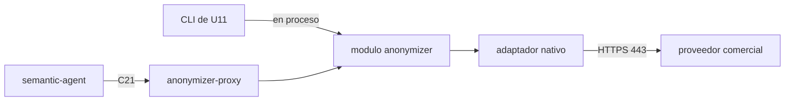

# Componentes lógicos — U10 anonymizer

**Revisión 2 (2026-11-22): segunda pasada por el cambio 01, la adenda 02 y el NFR Requirements revisión
2.** Sustituye a la revisión 1 del 2026-10-03. Salen `AnonymizerGateway` y `anonymizer_route.py` de
`libs/model_gateway` (pasan a U11), las políticas Kyverno de U10 (pasan a U2) y `embed`. Entran el módulo
en `libs/anonymizer/` con sus adaptadores nativos, la verificación final y la CLI como segundo anfitrión.

**Insumos.** `nfr-requirements/security-requirements.md` (security-requirements),
`reliability-requirements.md` (reliability-requirements), `performance-requirements.md`
(performance-requirements), `scalability-requirements.md` (scalability-requirements),
`observability-requirements.md` (observability-requirements) y `tech-stack-decisions.md`
(tech-stack-decisions) de esta unidad; §1, F1–F9 y §7 de `functional-design/functional-spec.md`
(functional-spec); C13, C16, C20, C21 y C22 de `inception/contract-design/contract-summary.md`
(contract-summary); NFR de U2 (red, Secret y montajes) y de U11 (cliente de C21 y raíz de composición de la
CLI).

## 1. Inventario

| Componente | Ruta | Proceso | Dentro / fuera | Patrones NFR que aplica |
|---|---|---|---|---|
| API del módulo | `libs/anonymizer/api.py` | `anonymizer-proxy` o CLI | Dentro o máquina local | Fallo cerrado con un solo punto de envío, plazo total |
| Seudonimización | `libs/anonymizer/domain/` | Igual | Igual | Código puro, 100 % de ramas, normalización, verificación final |
| Puerto del NER | `libs/anonymizer/application/ner_port.py` | Igual | Igual | Hilo no abandonable, limitador de 1, ventanas |
| Adaptadores nativos | `libs/anonymizer/providers/` | Igual | Igual; única conexión externa | TLS fijo, sin redirecciones, sin reintentos, tope de respuesta, proyección del esquema |
| Datos versionados | `libs/anonymizer/data/` | Igual | Igual | `SHA256SUMS` al arrancar |
| Utilería de pruebas | `libs/anonymizer/testing/` | Solo pruebas | Ninguno | Prohibido fuera de las pruebas (import-linter) |
| `anonymizer-proxy` | `services/anonymizer-proxy/` | Pod propio | Dentro; único con salida con datos | Mamparo de 4, rechazo por tamaño, sondas, métricas |

## 2. Componentes en YAML

```yaml
components:
  - name: anonymizer-module
    path: libs/anonymizer
    hosts: [anonymizer-proxy, cli]
    boundary: inside
    data_out: none
    guard: true
  - name: anonymizer-providers
    path: libs/anonymizer/providers
    hosts: [anonymizer-proxy, cli]
    boundary: inside
    data_out: pseudonymized_body_https_443
    allowed_domains: [api.anthropic.com, generativelanguage.googleapis.com, api.openai.com]
    guard: true
  - name: anonymizer-proxy
    path: services/anonymizer-proxy
    hosts: [anonymizer-proxy]
    boundary: inside
    ingress_from: [semantic-agent, prometheus-metrics-port]
    replicas: 1
    guard: true
  - name: anonymizer-testing
    path: libs/anonymizer/testing
    hosts: [tests]
    boundary: none
    data_out: none
    guard: false
```

## 3. Dominios de fallo y radio de impacto



<!-- Texto alternativo: semantic-agent llama al proxy por C21 dentro del clúster; la CLI usa el módulo en el mismo proceso; el proxy envuelve el mismo módulo; el módulo usa el adaptador nativo, que es lo único que abre una conexión HTTPS 443 hacia el proveedor comercial. -->

| Falla | Radio de impacto | Contención |
|---|---|---|
| Proxy caído | Las corridas con destino externo en el clúster terminan en error; `todo-local` y la consola siguen | Sin estado; Kubernetes lo reinicia; `/readyz` lo saca del servicio |
| NER lento o colgado | Solo la petición en curso | Presupuesto de seudonimización y limitador de 1 |
| Proveedor caído o con límite de tasa | Las llamadas a ese proveedor | Error tipado sin reintento; U11 decide el alterno ante `451` |
| Datos o NER con otro SHA-256 | Ninguna llamada sale | El proxy no arranca; la CLI no construye el módulo |
| Error de seudonimización | Esa llamada | `AnonymizerUnavailable` con 0 peticiones |
| Ráfaga de peticiones | Las que pasan de 4 | `503` inmediato sin leer el cuerpo |

## 4. Aislamiento y recursos compartidos

- **Claves.** Solo el proceso que construye el módulo con un destino externo las tiene: el pod del proxy
  (Secret `veridicus-provider-keys`, U2) o la máquina de la CLI. `semantic-agent` no las tiene ni importa
  `libs.anonymizer` (contrato de U4).
- **Recursos compartidos.** Ninguno de escritura. De solo lectura: el NER (volumen de U2), el `ConfigMap`
  `veridicus-profiles` y el catálogo de límites empaquetado de U1.
- **Red.** La `NetworkPolicy` de salida (443 y DNS), la de entrada (desde `semantic-agent`, más Prometheus
  en el puerto 9090, NFRD-U10-09) y la lista blanca de CoreDNS son de U2. U10 impone los dominios dentro del
  proceso y publica la comparación de F9.

## 5. Lo que se entrega a Infrastructure Design (U2)

| Tema | Qué fija U10 | Qué decide U2 |
|---|---|---|
| Recursos del pod | Pico de RSS ≤ 1,5 GiB; `VERIDICUS_ANONYMIZER_NER_THREADS` = 2 | `requests`/`limits` de CPU y memoria |
| Sondas | `/healthz` y `/readyz` en 8080; arranque ≤ 60 s | `startupProbe` que tolere 60 s |
| Métricas | Puerto 9090 y panel versionado | Regla de entrada y raspado de Prometheus |
| NER | Directorio `safetensors` sin `.py`, `.bin` ni `.pkl`, y su SHA-256 | El modelo concreto, su volumen de solo lectura |
| Sistema de archivos | El proceso no escribe nada | `readOnlyRootFilesystem`, sin PVC de escritura, sin *core dumps* en el nodo |
