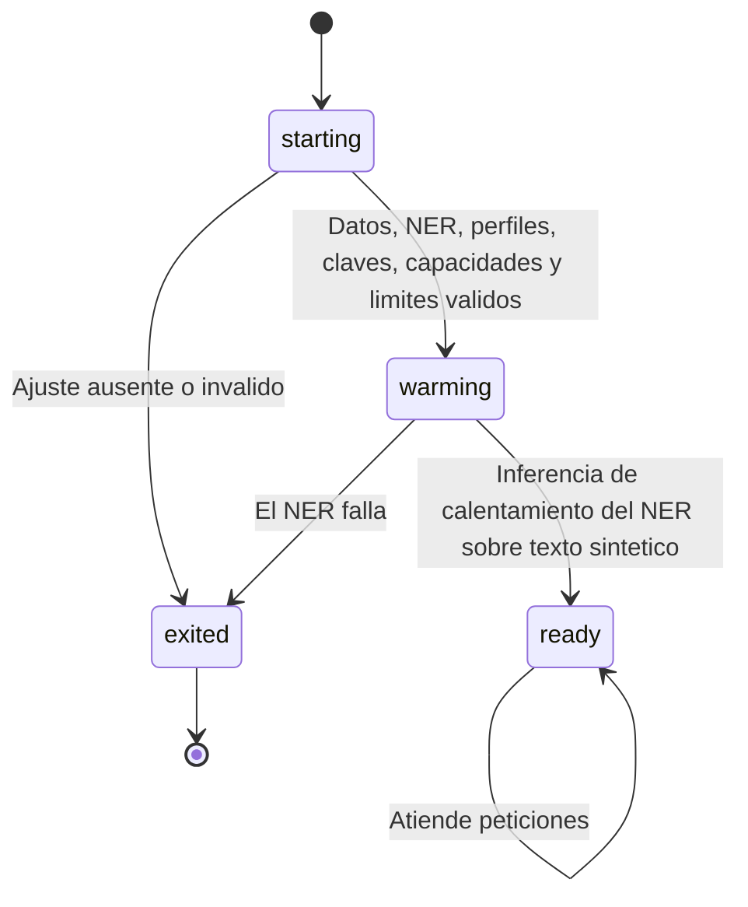

# Diseño de fiabilidad — U10 anonymizer

**Revisión 2 (2026-11-22): segunda pasada por el cambio 01, la adenda 02 y el NFR Requirements revisión
2.** Sustituye a la revisión 1 del 2026-10-03. Las secciones conservan su tema; la de reintento acotado
de U4 sale porque C13 ya no reintenta llamadas comerciales. Cierra los hallazgos R-03 (§3) y R-05 (§2) de la
revisión 1 de esta etapa; R-04 lo cierra §5.

**Insumos.** `nfr-requirements/reliability-requirements.md` (reliability-requirements: NFR10.1, NFR10.4,
NFR10.7, NFR6.1, NFR6.2, NFR4.1–NFR4.3), `security-requirements.md` (security-requirements),
`performance-requirements.md` (performance-requirements), `scalability-requirements.md`
(scalability-requirements), `observability-requirements.md` (observability-requirements) y
`tech-stack-decisions.md` (tech-stack-decisions) de esta unidad; F1, F3, F5–F8, §3.1–§3.2 y E11–E34 de
`functional-design/functional-spec.md` (functional-spec); C13 (tabla de errores), C16, C20 y C21 de
`inception/contract-design/contract-summary.md` (contract-summary); P3 = A de `nfr-design-questions.md`;
NFR-U4-12 de U4.

**Objetivo único: ante cualquier duda, no sale nada.** Como máximo una llamada externa por `generate`,
sin reintentos ni en U10 ni en el cliente de C21. Sin objetivo de disponibilidad propio en el MVP: una
réplica en una máquina.

## 1. Fallo cerrado por construcción (NFR10.1)

`generate` tiene **un solo** punto de envío, `adapter.send(prepared)`, fuera del bloque que cubre
validar, seudonimizar, verificar y armar el cuerpo. Todo lo anterior está dentro de un
`try/except BaseException` que convierte cualquier error en `AnonymizerUnavailable` sin `ModelCall`.

```python
async def generate(self, req: GenerateRequest) -> GenerateResult:
    table = MaskTable()
    try:
        with anyio.fail_after(effective_timeout(req)):
            try:
                prepared = await self._prepare(req, table)   # destino, F4, §3, cuerpo nativo
            except Exception as exc:
                raise AnonymizerUnavailable(step_of(exc)) from None
            raw = await self._adapter.send(prepared)          # único envío
            return self._finish(raw, table, prepared)         # validar, F6, ModelCall
    finally:
        table.clear()                                         # BR1.8
```

`from None` evita que el mensaje de la excepción original, que podría traer texto, quede encadenado. Si
`fail_after` vence durante `_prepare`, la cancelación se convierte en `AnonymizerUnavailable`; si vence
durante `send` o después, en `Timeout` con su `ModelCall`. El `FakeTransport` cuenta las peticiones: **0**
en cada rama de F7 anterior al envío, también ante una excepción no prevista inyectada en cada paso.

| Estado de §3.1 | Llamadas | Resultado | `ModelCall` |
|---|---|---|---|
| `failed_closed` | 0 | `AnonymizerUnavailable` (proxy: `503`) | No |
| `failed_after_send` | 1 | `ContentBlocked` (451), `ProviderError` (502), `InvalidOutput` (502), `Timeout` (504) | Sí |
| `restored` | 1 | `GenerateResult` | Sí |

Los rechazos del proxy antes de `generate` (`409`, `413`, `422`) no tocan el módulo ni abren conexión.

## 2. Plazos y concurrencia sin hilos huérfanos (NFR10.4, NFR3.5; cierra R-05)

- **Plazo efectivo.** `min(req.timeout_s, model_call_timeout_s efectivo)`. Cubre seudonimizar, enviar,
  leer, validar y restaurar. Conexión ≤ 10 s dentro de ese plazo (`httpx.Timeout(connect=10, …)`).
- **Presupuesto de seudonimización.** 0,15 × plazo efectivo (`anonymizer_masking_budget_ratio`). Se mide
  desde que empieza `_prepare` hasta que termina la verificación final, **incluida la espera del NER**.
  Pasarlo da `AnonymizerUnavailable` antes del envío.
- **NER en un hilo que no se abandona.** El NER corre con `anyio.to_thread.run_sync(..., limiter=ner_limiter,
  abandon_on_cancel=False)` y un `CapacityLimiter(1)` por proceso. Si el plazo vence mientras el hilo
  trabaja, la cancelación espera a que el hilo termine y solo entonces se libera el cupo del semáforo de 4
  peticiones (NFR8.2). Así nunca hay más hilos del NER vivos que cupos, y la tabla se vacía cuando ningún
  hilo la usa (NFRD-U10-07).
- **Pruebas.** Un NER *fake* que tarda más que el presupuesto: `AnonymizerUnavailable`, 0 peticiones, y
  tras la llamada 0 hilos del NER activos y el cupo libre. Cinco llamadas con NER lento: nunca más de un
  hilo del NER a la vez y nunca más de 4 peticiones en curso.

## 3. Errores después del envío y sin reintentos (NFR10.4; cierra R-03)

| Qué pasa | Antes o después de escribir el cuerpo | Resultado | ¿Se reintenta? |
|---|---|---|---|
| `ConnectError`, `ConnectTimeout`, fallo de TLS | Antes | `AnonymizerUnavailable` (no salió nada) | No |
| `WriteError`, `ReadError`, `RemoteProtocolError`, `ReadTimeout` | Después | `ProviderError` o `Timeout` con su `ModelCall` | No |
| `429`, `5xx`, `529` | Después | `ProviderError` | No |
| `3xx` | Después | `ProviderError`, sin seguir la redirección | No |
| `stop_reason: refusal` | Después | `ContentBlocked` | No; el alterno lo decide U11 (FR15.2) |
| `stop_reason: max_tokens`, no JSON, JSON con claves repetidas o `NaN`, o que no valida | Después | `InvalidOutput` | No |
| Respuesta más grande que `anonymizer_response_max_bytes` | Después | `ProviderError` | No |

«Después» empieza cuando el transporte empieza a escribir el cuerpo: desde ahí la llamada puede haber
salido y no se repite (C13). La prueba con el `FakeTransport` lento, que devuelve 500, 429 o 529, que corta
la conexión a mitad de respuesta y que redirige da **exactamente 1** petición en cada caso.

**Reentrega de la cola (NFRD-U10-14).** Si `semantic-agent` cae después de que el proxy envió, U4 puede
reentregar la corrida (`run_max_deliveries` = 3) y el mismo cuerpo seudonimizado puede salir otra vez.
U10 no puede verlo, porque no guarda estado entre llamadas (NFR8.4). Se declara en el ADR como riesgo
residual. El trabajador hace una corrida a la vez (NFR-U4-12).

**Cliente de C21 (NFRD-U10-10).** El cliente de U11 espera el plazo efectivo más 10 s, para que el proxy
alcance a responder `504` con su `call`. `409`, `413`, `422`, `503` y la conexión rechazada terminan en
`AnonymizerUnavailable` (NFRD-U10-17).

**Sin disyuntor (*circuit breaker*).** Con una sola réplica, sin reintentos y una corrida a la vez, un
disyuntor solo añadiría estado compartido entre llamadas. Un proveedor caído ya falla rápido por
`ConnectError` o `5xx`, y la corrida termina en error. Se descarta para el MVP.

## 4. Arranque y sondas (NFR10.7, NFR15.3)



<!-- Texto alternativo: el proxy arranca y comprueba datos, NER, perfiles, claves, tabla de capacidades y límites; si falta o falla algo, termina con código distinto de cero. Si todo es válido, hace una inferencia de calentamiento del NER sobre un texto sintético; si falla, termina; si pasa, queda listo y atiende peticiones. -->

- **Comprobaciones al arrancar**, en este orden, cada una con su nombre de *check*: `data_files`
  (SHA-256 de los cuatro archivos), `ner` (manifiesto y SHA-256, carga sin red), `capabilities` (cada
  entrada con su ADR y una combinación de modo, esfuerzo, temperatura y `max_output_tokens` admitida),
  `profiles` (`profiles.validate` y huellas), `api_keys` (presencia de cada `api_key_ref` externa),
  `limits` (`limits.load`) y `settings` (`VERIDICUS_ANONYMIZER_MAX_CONCURRENCY` y `_NER_THREADS` en
  rango). Si una falla, el proceso termina con código ≠ 0 y una línea `anonymizer.startup_failed` con el
  nombre del *check* y del ajuste, nunca su valor (E17, E18, E28).
- **Calentamiento.** Una inferencia del NER sobre un texto sintético fijo del paquete, dentro de los 60 s
  de NFR3.3, para que la primera petición real no pague la carga perezosa.
- **`/healthz`** responde 200 mientras el proceso vive. **`/readyz`** responde 200 solo en `ready`; en
  `starting` o `warming`, 503 con la lista de *checks* que faltan, por nombre y sin valores. Ninguna de las
  dos abre conexiones hacia fuera: la prueba de nivel 1 sustituye `socket.create_connection` por una
  función que falla y llama a las dos.
- **CLI.** `Anonymizer.build(...)` hace las mismas comprobaciones salvo `profiles` (las hace U11) y lanza
  el error de configuración antes de cualquier llamada (AC13.3.2).

## 5. Restauración exacta y marcas alteradas (NFR6.1, NFR6.2, NFR10.12; cierra R-04)

- **Sobre el JSON ya validado.** `domain/restore.py` recorre los valores de cadena con su puntero RFC
  6901. Una expresión de `re2` encuentra las formas de marca (F6). Una forma que es, carácter por
  carácter, una marca canónica **de esta tabla** se reemplaza por su forma original exacta. Cualquier otra,
  incluida una canónica que no está en la tabla, queda sin restaurar y su puntero entra en
  `altered_markers`, sin repetidos y en orden de recorrido. Solo se restauran marcas de la tabla de la
  llamada: un modelo que inventa `[PERSONA_9]` no recibe ningún nombre.
- **Marcas de entrada (BR1.7).** Una forma de marca que ya venía en el testimonio tiene su propia marca
  en la tabla y vuelve intacta (E15).
- **Pruebas.** Con Hypothesis, sobre textos sintéticos sin formas de marca, seudonimizar y restaurar
  devuelve el mismo texto byte a byte. Sobre respuestas grabadas: 0 marcas conocidas quedan, las seis
  variantes de NFR10.12 caen en `altered_markers` con punteros válidos, y «persona 3» no se informa
  (E25, E26). U11 invalida los hallazgos afectados (BR4.2), así que nunca llegan a la calificación Likert
  (NFR6.2).
- **Repetibilidad (NFR4.2, NFR4.3).** La misma entrada da la misma tabla y el mismo cuerpo, byte a byte. El
  módulo nunca inventa una semilla: si `supports_seed` es falso (Anthropic), `ModelCall.seed` queda nula y
  la del perfil no se envía.

## 6. Calidad de la IA con el anonimizador en el camino (NFR4.1)

U10 aporta al reporte de nivel 2 de B11 `altered_markers_count` por corrida y la tasa de llamadas en
`InvalidOutput`. Los umbrales de NFR4 son de U11 y no se bajan. Si la proyección del esquema (§6 de
`security-design.md`) hace que el modelo viole restricciones numéricas, aparece como `InvalidOutput` y la
mide la misma tasa.

## 7. Fallos y recuperación

| Fallo | Qué se pierde | Cómo se recupera |
|---|---|---|
| Error antes del envío | Nada salió; la corrida termina con `anonimizador_no_disponible` | El analista relanza; si se repite, es un hallazgo de configuración |
| Error o plazo después del envío | La llamada; U11 registra su `ModelCall` | Relanzar a mano; ante `451`, U11 usa el alterno si el perfil lo tiene |
| Salida inválida o marcas alteradas | Esa llamada o esos hallazgos | U11 invalida lo afectado; nunca un resultado parcial |
| Proxy saturado (5.ª petición) | Nada salió | `503` inmediato; la corrida termina en error |
| Caída o reinicio del proxy | La llamada en curso; la tabla desaparece con el proceso | El cliente ve conexión rechazada → `AnonymizerUnavailable`; Kubernetes reinicia el pod y `/readyz` lo saca del servicio hasta `ready` |
| Proveedor que deja de cumplir su ADR | — | PR que saca sus modelos de la tabla; el proxy no arranca con un perfil que los use |

No hay modo degradado que deje salir texto sin seudonimizar. Con el proxy caído, la consola sigue
respondiendo y un perfil todo local sigue funcionando, porque no pasa por U10.
