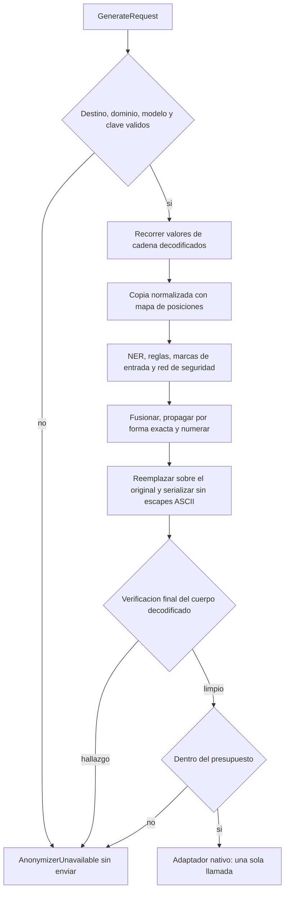

# Diseño de seguridad — U10 anonymizer

**Revisión 2 (2026-11-22): segunda pasada por el cambio 01 (DT27), la adenda 02 y el NFR Requirements
revisión 2.** Sustituye a la revisión 1 del 2026-10-03, que queda en el historial de Git.
- **Qué cambia.** La revisión 1 diseñaba un proxy COULD, apagado, delante del juez y de `embed`, con la
  lista de nombres del escenario. Ahora U10 es MUST y está en el camino de **toda** llamada comercial: en
  la CLI, como módulo en el mismo proceso, y en el clúster, detrás de `anonymizer-proxy` (C20, C21).
- **Numeración.** Las secciones §1–§11 conservan su número y tema cuando siguen. §5 (políticas de red) y
  §9 (validación de destinos en ModelGateway) quedan «Retirado» y nombran a su nuevo dueño. Lo nuevo
  empieza en §12. Las decisiones de diseño son DS1–DS12 (§13) y las precisiones, NFRD-U10-01 a
  NFRD-U10-17 (§15).
- **Respuesta de esta pasada.** P3 = A de `nfr-design-questions.md`: un cuerpo de C21 que pasa de su tope
  responde `413` `limits.exceeded` (§7, NFRD-U10-17).
- **Hallazgos de la revisión 1 de esta etapa.** R-01 y R-07 desaparecen con la lista del escenario. R-02 se
  cierra en §2 y §3. R-03 y R-05 se cierran en `reliability-design.md` §3 y §2. R-04 lo cierra BR4.1 (solo se
  restauran marcas de la tabla). R-06 pasa a U2 con la lista blanca de CoreDNS (NFR1.4 de U2). R-08 se
  cierra en `observability-design.md` §1.

**Insumos.**
- De esta unidad: `nfr-requirements/security-requirements.md` (security-requirements, amenazas T1–T17,
  tabla NFR-U10-01 a NFR-U10-12), `reliability-requirements.md` (reliability-requirements),
  `performance-requirements.md` (performance-requirements), `scalability-requirements.md`
  (scalability-requirements), `observability-requirements.md` (observability-requirements) y
  `tech-stack-decisions.md` (tech-stack-decisions, D1–D13).
- `functional-design/functional-spec.md` (functional-spec: F1–F9, §3.1–§3.2, E1–E34, FD-U10-01 a
  FD-U10-17), `functional-design/rules.md` (BR1–BR6) y `functional-design/entities.md`.
- C13, C16, C20, C21, C22 y C25 de `inception/contract-design/contract-summary.md` (contract-summary).
- De U1, `construction/contracts/nfr-design/security-design.md`: C25 v1 (§5), respuesta a un tope (§4.3),
  funciones puras (§4.15), C21 cerrado (§4.17), métricas en archivos propios (NFRD-U1-05), catálogo como
  techo (NFRD-U1-09) y subconjunto portátil de patrones (NFRD-U1-14).
- Lo que piden otras unidades: NFR-U4-02 y NFR-U4-12 de U4; NFR1.4, NFR1.5, NFR10.12, NFR10.15, NFR10.17 y
  NFR15.2 de U2; NFR1.2–NFR1.7, NFR5.1 y NFR-U11-01 de U11.
- La documentación vigente de la API de Anthropic (Messages API, salida estructurada en
  `output_config.format`, sus límites de esquema y `stop_reason: refusal`), consultada el 2026-11-22.
- Respuestas P1 = A y P2 = A de la revisión 1 y P3 = A de la segunda pasada, en `nfr-design-questions.md`.
  Reglas AUTONOMIA-01..05 de `team.md` y prohibiciones de `project.md`.

Todo U10 es guardia de AUTONOMIA-04. Salvo que se diga otra cosa, cada control se prueba en **nivel 0**,
sin red, con el `FakeTransport` y datos sintéticos, y con su control negativo. Los comandos son los de
`tech-stack-decisions.md` §5.

## 1. Frontera (AUTONOMIA-04)

| Componente | Dónde corre | Datos sin seudonimizar | Qué cruza la frontera | Destino permitido |
|---|---|---|---|---|
| `Anonymizer.generate` (`libs/anonymizer/api.py`) | Pod `anonymizer-proxy` o proceso de la CLI (máquina local) | Mensajes con testimonio, solo en memoria durante la llamada | Nada por sí mismo | — |
| Seudonimización y restauración (`domain/`, `application/`) | Igual | Igual, más la `MaskTable` | Nada; la tabla no sale del proceso (BR1.8) | — |
| Verificación final del cuerpo (`domain/outbound_check.py`, §3) | Igual | El cuerpo seudonimizado y las formas de la tabla | Nada | — |
| Adaptadores nativos (`libs/anonymizer/providers/`) | Igual | Ninguno: reciben el cuerpo ya verificado | **Sí**: cuerpo seudonimizado, proyección del esquema (§6) y parámetros del perfil, por HTTPS 443 | Solo los tres dominios de `allowed-domains.v1.yaml`; en la primera rebanada, `api.anthropic.com` |
| `anonymizer-proxy` (`services/anonymizer-proxy/`) | Dentro del clúster; único pod con salida con datos (U2) | Lo que llega de `semantic-agent` por C21 y la respuesta restaurada | Lo mismo que los adaptadores | Igual |
| `FakeTransport` (`libs/anonymizer/testing/`) | Solo pruebas | Datos sintéticos | Nada; nunca abre red | — |
| Audio, Whisper y TTS | — | — | **Nunca** pasan por U10 (C13, C14) | — |

Con un perfil todo local, el módulo no interviene: U11 no lo llama (NFR1.6 de U11). En el clúster, la
`NetworkPolicy`, el Secret y el endurecimiento del pod son de U2; U10 garantiza lo que pasa dentro del
proceso.

## 2. Cadena de seudonimización sobre valores decodificados (P2 = A; NFR1.3, NFR10.14)

La seudonimización nunca trabaja sobre texto serializado. Recorre los mensajes en orden. Si un `content`
es JSON, visita sus valores de cadena ya decodificados; si no, el texto completo (F4, BR1.1).



<!-- Texto alternativo: la petición se valida; si el destino, el dominio, el modelo o la clave no sirven, termina en AnonymizerUnavailable sin enviar nada. Si sirven, se recorren los valores de cadena ya decodificados, se crea una copia normalizada con su mapa de posiciones, se detecta con el NER, las reglas, las marcas de entrada y la red de seguridad, se fusionan los tramos, se propaga cada forma exacta y se numera; se reemplaza sobre el texto original y se serializa sin escapar caracteres no ASCII. Una verificación final sobre el cuerpo decodificado busca formas de la tabla o tramos de reglas; si encuentra alguno, falla cerrado. Si el cuerpo está limpio y la seudonimización cabe en su presupuesto, el adaptador nativo hace una sola llamada. -->

| Paso | Módulo (`libs/anonymizer/`) | Control | Requisito |
|---|---|---|---|
| Recorrido | `domain/payload_walker.py` | Visita solo valores de cadena; claves, números, booleanos y `null` salen idénticos. Profundidad ≤ 32 y ≤ 50 000 hojas por mensaje; si no, `AnonymizerUnavailable` (tabla incoherente, BR2.1) | NFR10.14, NFR10.1 |
| Normalización | `domain/normalize.py` | Copia de cada valor para **detectar**: NFKC, sin caracteres de formato Unicode (categoría `Cf`: ancho cero, guion blando, marcas de dirección), espacios Unicode a espacio simple. Un mapa de posiciones devuelve cada tramo al texto **original**, que es el único que se reemplaza (NFRD-U10-05) | NFR1.3, NFR6.1 |
| Detección | `domain/detect/` | NER (`application/ner_port.py`, `performance-design.md` §2), reglas con `google-re2`, formas de marca de entrada (BR1.7) y red de seguridad en `user` y `assistant` (BR1.5) | NFR1.3, NFR1.10, NFR3.4 |
| Fusión y propagación | `domain/spans.py` | Unión de solapes con la precedencia de D3; cada forma exacta se busca en todos los valores con límites de palabra Unicode comprobados en código (§4) | BR1.1, BR1.2 |
| Numeración y reemplazo | `domain/mask_table.py` | Por primera aparición; reemplazo de derecha a izquierda; `json.dumps(…, ensure_ascii=False)` y nuevo parseo que debe dar la misma forma | NFR4.3, NFR10.14 |
| Verificación final | `domain/outbound_check.py` | §3 | NFR1.3, NFR10.1 |
| Restauración | `domain/restore.py` | `reliability-design.md` §5 | NFR6.1, NFR10.12 |

**Verificación (NFR1.3).** A las pruebas de E1, E9, E10 y E29 se suman, con Hypothesis, entidades
sembradas con espacio de ancho cero entre letras, guion blando, letras de ancho completo, tildes
compuestas y descompuestas, y escapes `\uXXXX` dentro del JSON del mensaje. Métrica: **0 apariciones** de
los valores sembrados en los cuerpos que captura el `FakeTransport`, comparando sin mayúsculas, sin tildes
y tras NFKC y quitar `Cf`. Control negativo: el *fixture* que puentea el paso 2 hace fallar la prueba.

## 3. Verificación final del cuerpo saliente (cierra R-02 de la revisión 1)

Es la segunda barrera, **antes** del adaptador. No reutiliza el detector: recibe solo el cuerpo ya
serializado y la lista de formas originales de la tabla.

1. Parsea el cuerpo seudonimizado y recorre **todos** sus valores de cadena, también los que no son
   `content`.
2. Normaliza cada valor con su propia función (casefold, sin tildes, NFKC y sin `Cf`), escrita aparte de
   `normalize.py`, para que un defecto de normalización no sea de modo común.
3. Falla si encuentra: (a) una forma original de la tabla, normalizada, con límites de palabra; (b) un
   tramo que las reglas de `EXPEDIENTE` o `IDENTIFICADOR` marcarían; (c) una secuencia de 6 o más dígitos
   seguidos con o sin separadores, fuera de una marca.
4. Si falla, `AnonymizerUnavailable` con 0 peticiones y el paso `outbound_check` en el log, sin valores.

```python
def outbound_check(body: bytes, forms: frozenset[str]) -> None:
    for text in iter_all_strings(json.loads(body)):      # claves incluidas
        norm = check_normalize(text)                      # implementación propia
        if contains_form(norm, forms) or id_rules.search(norm) or long_digits(norm):
            raise AnonymizerUnavailable("outbound_check")  # nada se envía
```

**Pruebas.** (i) Un detector defectuoso que deja pasar «Ana Pérez» y otro que deja pasar una cédula: 0
peticiones. (ii) Una normalización defectuosa en `normalize.py` (sin NFKC): la verificación sigue
encontrando la forma. (iii) Control positivo: E12 («12 de marzo de 2003») pasa. La verificación cuenta
dentro del presupuesto de seudonimización (NFR3.5).

**Límite declarado.** La verificación final solo conoce las formas que algún detector encontró. Un nombre
que ningún detector marca (riesgo residual de FD-U10 §8) no lo atrapa; lo mide NFR1.10.

## 4. Reglas de detección, datos y riesgo residual (NFR1.10, NFR3.4, NFR10.11)

- **Archivos de datos.** `libs/anonymizer/data/` con `detection-rules.v1.yaml`, `allowed-words.v1.yaml`,
  `allowed-domains.v1.yaml` (la `ProviderDomainList`, nombre de FD-U10-06 y de U2) y
  `provider-capabilities.v1.yaml`. Cada uno con `schema_version` semver y su línea en `data/SHA256SUMS`.
  Se cargan con `importlib.resources` y `yaml.safe_load`; al arrancar se comparan los SHA-256 y, si uno
  no coincide, el proxy no arranca y la CLI no construye el módulo (E18).
- **NER.** Directorio de solo lectura en `VERIDICUS_ANONYMIZER_NER_PATH`, comprobado contra
  `VERIDICUS_ANONYMIZER_NER_SHA256` sobre un manifiesto de sus archivos. Se rechaza si contiene `.py`,
  `.bin` o `.pkl`. Se carga con `trust_remote_code=False` y `local_files_only=True` (NFR-U10-05).
- **Reglas con `google-re2`.** Se compilan al arrancar con `re2`. Como en RE2 `\b`, `\w` y `\d` son solo
  ASCII, las reglas usan clases explícitas (`\p{L}`, `[0-9]`) y los límites de palabra Unicode se
  comprueban en código sobre el carácter anterior y el siguiente (NFRD-U10-15). Una regla con
  *lookbehind*, referencia hacia atrás o `\b` no carga y su PR falla en nivel 0.
- **Riesgo residual.** La prueba `-m "integration and leakage"` corre con el NER real y también con cada
  detector solo, y deja las tasas en `out/anonymizer-residual.json`, que cita el ADR (NFR1.10).

## 5. Políticas de red y de manifiestos · Retirado

Retirado: la `NetworkPolicy`, la lista blanca de CoreDNS, el Secret y el endurecimiento del pod pasan a U2
(NFR1.1, NFR1.4, NFR1.5, NFR10.12 de U2; NFR-U10-10). Del lado de U10 quedan la lista de dominios del
módulo (§6) y la función de comparación de F9, que U2 ejecuta sobre su Corefile renderizado (NFR1.12).

## 6. Superficie del proxy y de los adaptadores (NFR1.8, NFR1.11, NFR1.13, NFR10.5)

- **Rutas.** `POST /v1/generate`, `GET /healthz` y `GET /readyz` en el puerto 8080; `/metrics` en el puerto
  interno 9090. Toda otra ruta responde `404` con Problem Details y no lee el cuerpo.
- **Destino.** El proxy resuelve proveedor, modelo, parámetros y `api_key_ref` en `ProxyProfileCopy` (§8).
  El módulo comprueba, en este orden y antes de seudonimizar: `scope: external`, proveedor en
  `{anthropic, google, openai}`, dominio del proveedor en `allowed-domains.v1.yaml`, modelo en la tabla de
  capacidades con su combinación de modo y esfuerzo, y clave presente (BR1.6, BR3.1, BR5.2, BR5.4).
- **URL base.** Constante del adaptador (`https://api.anthropic.com/v1/messages`); ni el perfil ni C21 la
  cambian. Antes de construir el cliente se comprueba que su *host* está en la lista y su puerto es 443.
- **TLS.** `ssl.create_default_context()` con `minimum_version = TLSv1_2`, `check_hostname = True` y
  `verify_mode = CERT_REQUIRED`; no hay ajuste para desactivarlo. `httpx.AsyncClient` con
  `follow_redirects=False`, `HTTPTransport(retries=0)`, `trust_env=False` (ignora `HTTPS_PROXY` y
  `SSL_CERT_FILE` del entorno) y sin cabeceras por defecto.
- **Cabeceras salientes (lista permitida).** Para Anthropic: `x-api-key`, `anthropic-version` (constante
  del adaptador, la que fija la prueba de contrato con respuestas grabadas), `content-type:
  application/json`, `accept: application/json` y `user-agent: veridicus-anonymizer`. Las de Google y
  OpenAI siguen la misma regla con su cabecera de autenticación y de versión. Nunca salen `X-Request-Id`,
  `Cookie`, `Authorization` del cliente, `X-Forwarded-*` ni el `run_id` (NFR-U10-09).
- **Cuerpo saliente de Anthropic.** Solo `model` (de la copia del perfil), `max_tokens` (de la tabla de
  capacidades, NFRD-U10-04), `system` (los mensajes `system` unidos), `messages` (`user` y `assistant`),
  `output_config.format` con `type: json_schema` y la **proyección** del esquema, o la herramienta forzada
  si la tabla lo dice, el parámetro de esfuerzo si el perfil lo pide y la tabla lo admite, y `temperature`
  si la tabla la admite. Nada que venga de quien llama sale fuera de esos campos.
- **Proyección del esquema (NFRD-U10-03).** La salida estructurada de Anthropic no admite `minimum`,
  `maximum`, `minLength`, `maxLength`, `if`/`then`/`else`, `not`, `oneOf` ni `additionalProperties`
  distinto de `false`, y el esquema de C6 usa varios. `providers/schema_projection.py` es una función pura
  y versionada: quita esas palabras clave, cambia `oneOf` por `anyOf` y pone `additionalProperties: false`
  en cada objeto. Nunca añade texto. Un esquema recursivo o con `$ref` externo no se puede proyectar y
  termina en `AnonymizerUnavailable` sin enviar (BR2.1). La respuesta se valida contra `req.schema`
  **completo** (D11, NFR10.16). El esquema que recibe el módulo no se toca (NFR10.14).
- **Caché de *prompts* (FR15.1; NFRD-U10-12).** El adaptador de Anthropic pone `cache_control` solo en el
  último bloque de `system`, que no trae testimonio (F5; NFR5.4 de U11). Ningún bloque `user` lleva
  punto de caché.
- **Pruebas.** Una petición con 10 cabeceras de entrada y campos extra llega al `FakeTransport` con
  exactamente las 5 cabeceras de la lista y solo los campos permitidos. Un dominio fuera de la lista, el
  puerto 8443 o `http://` dan 0 peticiones (E22). Un `307` da 1 petición y `ProviderError` (E23). En nivel
  1, un servidor local con TLS 1.1 y otro con un certificado que no corresponde al nombre fallan sin
  enviar el cuerpo. La proyección tiene un caso por palabra clave quitada, uno de `oneOf` y uno de
  esquema recursivo.

## 7. Límites de entrada y de salida (NFR10.8, NFR10.9; P3 = A)

- **Cifras.** Las tres de C25 v1 (§5 de U1): `anonymizer_request_max_bytes` = 2 097 152,
  `anonymizer_response_max_bytes` = 2 097 152 y `anonymizer_masking_budget_ratio` = 0,15, más
  `model_call_timeout_s`. Se cargan con `limits.load(os.environ)` de U1; una `VERIDICUS_LIMIT_<NOMBRE>`
  solo puede bajarlas (NFRD-U1-09).
- **Cuerpo de C21 (P3 = A).** Un *middleware* ASGI rechaza por `Content-Length` antes de leer y, si no lo
  hay, lee por bloques con un contador. El exceso responde **`413` `limits.exceeded`** como Problem
  Details, sin parsear, sin seudonimizar y con 0 peticiones, igual que el resto del sistema (§4.3 de U1).
  `422` `anonymizer.destination_rejected` queda para el cuerpo que no valida contra C21, el perfil o el
  papel inexistente, la ranura `fallback` sin alterno y el destino local (NFRD-U10-17).
- **Respuesta del proveedor.** Se lee con `client.stream` por bloques hasta
  `anonymizer_response_max_bytes`; pasarse corta la conexión y da `ProviderError` con su `ModelCall`.
- **Cifras atadas (NFR-U10-04, NFR-U4-02).** La prueba `-m limits` comprueba con 250 000 caracteres: (a)
  el cuerpo de C21, con el *prompt*, el esquema de C6 y la transcripción como JSON dentro de `content`,
  cabe en `anonymizer_request_max_bytes`, también con un 30 % de caracteres no ASCII escritos como
  `\uXXXX`; (b) el p95 de seudonimizarla es ≤ 0,5 × 0,15 × `model_call_timeout_s`, que con 270 s da
  20,25 s frente a la meta de 20 s (`performance-design.md` §1).
- **Errores.** Problem Details desde la jerarquía de `libs/`, con los siete `code` de NFR10.9 más
  `limits.exceeded`, el estado HTTP único del catálogo de U1 y el `detail` del catálogo, sin texto de la
  petición, de la respuesta ni de la excepción. 451, 502 y 504 llevan `call`; 409, 413, 422 y 503 no.

## 8. Copia de perfiles, claves y huella (NFR10.6, NFR10.15)

- **Perfiles.** El proxy lee `VERIDICUS_ANONYMIZER_PROFILES_PATH`, que apunta al `ConfigMap`
  `veridicus-profiles` que U2 monta de solo lectura (NFR10.15 de U2). Lo valida con
  `profiles.validate(data, key_prefix="VERIDICUS_", kind="base")` y calcula la huella de cada entrada con
  `canonical.sha256_jcs` de U1 (D12). No hay una segunda implementación de JCS.
- **Resolución.** `role` pasa por `role_aliases` (`verifier_permuted → verifier`); `destination_slot`
  elige el destino del papel o el `fallback_provider`. Los seis casos negativos de C21 dan `409` o `422`
  con 0 peticiones; E32 llama al alterno.
- **Claves.** Se leen del entorno por `api_key_ref` al arrancar (presencia) y en cada llamada (valor), y se
  guardan en un `SecretStr` que solo se abre al construir la cabecera. En el proxy vienen del Secret
  `veridicus-provider-keys`, montado solo en ese pod (NFR10.12 de U2); en la CLI, de variables de la
  máquina. Ningún log, error, `ModelCall`, respuesta ni `/readyz` las contiene; el `FakeTransport` guarda
  las cabeceras con la de autenticación oculta. Prueba con *canary* (E34) y `gitleaks` en pre-commit y CI.

## 9. Validación de destinos en ModelGateway · Retirado

Retirado: la validación de destinos pasa a U11 (NFR1.6 de U11, FR14.3) y la dirección del proxy en
`semantic-agent`, a U4 (NFR1.1 de U4). Sale `libs/model_gateway/anonymizer_route.py` de la revisión 1; la
puerta de 100 % de ramas de U10 cubre solo código de U10 (NFR13.2).

## 10. ADR del proveedor, auditoría y adversarios (NFR1.2, NFR1.14, NFR5.1, NFR5.2, NFR11.1, NFR12.1)

- **ADR.** `scripts/check-provider-adr.py` (D8) lee `provider-capabilities.v1.yaml` y comprueba que cada
  `provider_adr` exista con sus secciones de NFR1.2. En la primera rebanada solo hay entradas de Anthropic
  y solo se exige el ADR de Anthropic en `docs/adr/`. La sección «Riesgo residual» cita las tasas de
  NFR1.10 y suma dos riesgos de este diseño: la reentrega de la cola de U4 (NFRD-U10-14) y la caché del
  esquema compilado en el proveedor, que no trae testimonio.
- **`anonymized: true` (NFR1.14).** `ModelCall` se arma en un único constructor del adaptador,
  `build_model_call(...)`, que no acepta el campo `anonymized` y lo fija en `True`. Una prueba de
  propiedades recorre todos los caminos después del envío; otra, por AST, comprueba que ningún módulo de
  `providers/` instancia `ModelCall` fuera de esa función.
- **Registro al arrancar (NFR11.1).** Una línea `anonymizer.startup` con los `schema_version` y SHA-256 de
  los cuatro archivos de datos, el SHA-256 del NER y la versión de la API de cada adaptador.
- **Escenarios A y B (NFR5.1, NFR5.2).** La variante «escribe los nombres reales detrás de cada marca» la
  corre U11 en el nivel 2 de B11 con el perfil de la primera rebanada. U10 aporta la cuenta de valores
  sembrados en las respuestas **antes** de restaurar, que el `FakeTransport` y el transporte real exponen
  por un gancho de pruebas, y la familia de cada modelo en la tabla de capacidades.
- **Datos sintéticos (NFR12.1).** Las respuestas grabadas se escriben a mano sobre la forma documentada;
  la comprobación de U1 corre sobre `libs/anonymizer/tests/`, `libs/anonymizer/testing/` y
  `services/anonymizer-proxy/tests/` con 0 hallazgos.

## 11. Amenazas y controles

| Amenaza | Controles de este diseño |
|---|---|
| T1 Entidad no detectada | §2, §3 (formas de la tabla y reglas), §4 (riesgo residual medido) |
| T2 Error a mitad de la seudonimización | §2, §3 y `reliability-design.md` §1 |
| T3 Escapes Unicode y caracteres invisibles | §2 (decodificado, NFKC, sin `Cf`) y §3 |
| T4 Otro destino, dominio o puerto | §6 (lista, URL constante, puerto 443) |
| T5 Quien llama elige proveedor, modelo o clave | §6, §8 (copia propia, huella, `additionalProperties: false`) |
| T6 Texto en logs, métricas o errores | §7, §8 y `observability-design.md` §1–§2 |
| T7 Tabla persistente | `reliability-design.md` §5; proceso sin escritura (§12) |
| T8 Redirección o certificado falso | §6 (TLS, sin redirecciones, `trust_env=False`) |
| T9 Fuga de una clave | §8 |
| T10 Proveedor que entrena o retiene | §10 (ADR), §6 (caché solo en `system`) |
| T11 Importar adaptadores o el `FakeTransport` | §12 (import-linter) |
| T12 ReDoS o cuerpo enorme | §4 (`re2`), §7 y `performance-design.md` §3 |
| T13 Inyección que pide los nombres reales | §10 (Escenario A); el juez solo tiene marcas |
| T14 Cambio silencioso de reglas, listas o NER | §4 y §10 |
| T15 Marca alterada restaurada mal | `reliability-design.md` §5 |
| T16 Llamada registrada con `anonymized: false` | §10 |
| T17 Cabeceras del cliente al proveedor | §6 |

## 12. Fronteras de código y proceso sin escritura (NFR10.10, NFR10.13)

- **import-linter** en `libs/anonymizer/.importlinter`: `anonymizer-independent` (no importa
  `libs.model_gateway`, `libs.execution_profiles` ni `libs.incoherence_analyzer`); `anonymizer-layers`
  (`domain` no importa `application`, `providers` ni `httpx`; fuera de `libs.anonymizer` nadie importa
  `libs.anonymizer.providers`); y `anonymizer-testing-forbidden` (nada fuera de `tests/` importa
  `libs.anonymizer.testing`). Cada contrato con un módulo de prueba que lo viola. El de `semantic-agent`
  es de U4.
- **Inyección del transporte.** `Anonymizer.build(transport=…)` exige el transporte; la raíz de
  composición del proxy y la de la CLI pasan el real. No hay variable de entorno que elija el *fake*.
- **Sin escritura.** El proceso no abre archivos para escribir: los logs van a `stdout`, el NER y los
  datos se leen de solo lectura, y `HF_HUB_OFFLINE=1`, `TRANSFORMERS_OFFLINE=1` y
  `HF_HUB_DISABLE_TELEMETRY=1` se fijan antes de importar `transformers`, para que no busque red ni
  escriba caché. La prueba de NFR10.10 sustituye `open` en escritura, `tempfile` y `os.replace` por
  funciones que fallan durante el arranque, `generate` y las sondas.

## 13. Decisiones de diseño y alternativas

| # | Estado | Decisión | Alternativas descartadas | Consecuencias |
|---|---|---|---|---|
| DS1 | cambia | Seudonimizar y restaurar sobre valores de cadena decodificados (P2 = A) | Texto serializado; rechazar todo `\u` | Un escape no deja pasar un nombre y la restauración no rompe el JSON; a cambio, un recorrido más |
| DS2 | Retirado | Numeración estable por versión de escenario (P1 = A) | — | Retirado con la lista del escenario y `embed` (cambio 01, FD-U10-01) |
| DS3 | nuevo | Normalización NFKC sin `Cf` solo en la copia de detección, con mapa de posiciones | Normalizar el texto que sale; no normalizar | Atrapa nombres con caracteres invisibles y la restauración sigue siendo exacta (NFR6.1); a cambio, mantener el mapa |
| DS4 | nuevo | Verificación final con su propia normalización, sobre todo el cuerpo | Confiar en el detector; repetir el NER | Defensa en profundidad sin modo común y sin el costo del NER; no atrapa lo que ningún detector vio |
| DS5 | nuevo | Proyección determinista del esquema por proveedor y validación local completa | Enviar el esquema tal cual (400 del proveedor); simplificar C6 | Compatible con Anthropic sin tocar C6; a cambio, el modelo no ve las restricciones numéricas y algún fallo llega como `InvalidOutput` |
| DS6 | nuevo | Punto de caché solo en `system` | Cachear también la transcripción; sin caché | Cumple FR15.1 sin que el proveedor guarde testimonio en caché; a cambio, menos ahorro de *tokens* |
| DS7 | nuevo | `ModelCall` con constructor único que fija `anonymized: true` | Fijarlo en cada adaptador | Imposible producir `false` desde U10, comprobado por AST |
| DS8 | se mantiene | httpx directo con TLS fijo y sin redirecciones (D6) | SDK oficiales | Control total de cabeceras, reintentos y URL base |
| DS9 | nuevo | `trust_env=False` en el cliente y variables de Hugging Face fuera de línea | Confiar en el entorno del pod | Un `HTTPS_PROXY` o una caché de modelos del entorno no cambian el destino ni escriben en disco |
| DS10 | nuevo | Límites de palabra Unicode comprobados en código y no con `\b` de RE2 | `\b` de RE2 (solo ASCII); `regex` de Python (con retroceso) | Tiempo lineal y «Ana» no toca «Anabel»; a cambio, reglas algo más largas |
| DS11 | nuevo | Rechazo por `Content-Length` en un *middleware* antes de leer, con `413` `limits.exceeded` (P3 = A) | Leer el cuerpo y luego medir; `422` propio | Un cuerpo enorme no ocupa memoria ni cupo, y el código es el mismo de todo el sistema |
| DS12 | nuevo | Un archivo de datos por tabla, con `SHA256SUMS` comprobado al arrancar | Tablas en código | Cambiar una regla es un PR visible y probado (AUTONOMIA-01) |

## 14. Correspondencia con AUTONOMIA

| Regla | Qué aporta este diseño | Secciones |
|---|---|---|
| AUTONOMIA-01 | Datos, perfiles y ADR cambian solo por PR; U10 no aplica nada al clúster | §4, §10 |
| AUTONOMIA-02 | Cada control nombra su prueba y su umbral; comandos en `tech-stack-decisions.md` §5 | §2–§12 |
| AUTONOMIA-03 | No aplica: U10 no califica ni cambia el contenido de un hallazgo | — |
| AUTONOMIA-04 | Frontera por componente, fallo cerrado, verificación final, lista de dominios, TLS fijo, claves por referencia, caché sin testimonio | §1–§8, §12 |
| AUTONOMIA-05 | Restauración exacta antes de la verificación de citas de U11, y marcas alteradas | `reliability-design.md` §5 |

## 15. Precisiones a artefactos ya aprobados (NFRD-U10-xx)

No edité ningún artefacto aprobado (regla de `project.md`). En la aprobación decides cuáles se llevan al
original, cada una en su propio commit. NFRD-U10-17 es la respuesta P3 = A; las demás se aplicaron sin
preguntar porque salen de las fuentes o de hallazgos que un experto cierra. Ninguna deja salir del clúster
algo que hoy no sale.

| ID | Artefacto aprobado | Precisión | Origen |
|---|---|---|---|
| NFRD-U10-01 | `nfr-requirements/performance-requirements.md` (NFR3.1), `scalability-requirements.md` (NFR8.3) y NFR-U10-04 | Las mediciones suman un cuarto tamaño de **250 000** caracteres. A 0,8 s por cada 10 000, su p95 de seudonimización es ≤ **20 s**; el pico de RSS de NFR8.3 se mide con 4 peticiones de 250 000. La comprobación (a) de NFR-U10-04 usa 250 000 y un 30 % de caracteres escritos como `\uXXXX`. La razón de linealidad entre 250 000 y 10 000 es ≤ 33,5 (25 × 250 000 / 186 000). Se mantienen los umbrales de 186 000 | NFR-U4-02 (P6 = A) |
| NFRD-U10-02 | `nfr-requirements/observability-requirements.md` (NFR15.1 y §2) y NFR-U10-11 | La etiqueta `code` pasa a `error_code`, el nombre de la lista cerrada de U1, con valores del catálogo más `ok` (incluido `limits.exceeded`, por P3 = A). `outcome` suma `rejected` para los `409`, `413` y `422` previos a `generate`. Las métricas van en `contracts/metrics/anonymizer.v1.yaml`, no en C15 | NFRD-U1-05 |
| NFRD-U10-03 | `nfr-requirements/security-requirements.md` (NFR10.14), `functional-design/rules.md` (BR1.1, «el esquema sale tal cual») y `functional-spec.md` (F4 paso 6, F5 paso 2) | El esquema que recibe el módulo no se toca, y lo que sale es una proyección determinista por proveedor que solo quita palabras clave que el proveedor no admite, cambia `oneOf` por `anyOf` y cierra los objetos. La respuesta se valida contra el esquema completo. Un esquema que no se puede proyectar falla cerrado | Documentación vigente de la salida estructurada de Anthropic; D11 |
| NFRD-U10-04 | `functional-design/entities.md` (ProviderCapabilityTable) | Cada entrada suma `max_output_tokens` (obligatorio en Anthropic), `supports_seed`, `supports_temperature`, `family`, `schema_projection` (versión de la proyección) y `provider_adr` (NFR-U10-06). Una combinación inválida impide arrancar | F5; NFR4.2; NFR5.2 |
| NFRD-U10-05 | `functional-design/functional-spec.md` (F4 pasos 1–2) y NFR1.3 | La detección trabaja sobre una copia normalizada con NFKC y sin caracteres de formato `Cf`, con un mapa de posiciones al original, que es lo único que se reemplaza. Las pruebas de NFR1.3 suman caracteres invisibles, guion blando y ancho completo | R-02 de la revisión 1 de esta etapa |
| NFRD-U10-06 | `functional-design/functional-spec.md` (F4, paso nuevo entre 6 y 7; F7, fila nueva) | Verificación final del cuerpo serializado con su propia normalización: una forma de la tabla, un tramo de `EXPEDIENTE` o `IDENTIFICADOR` o 6 o más dígitos fuera de una marca dan `AnonymizerUnavailable` con 0 peticiones. Cuenta dentro del presupuesto | R-02 de la revisión 1; BR2.1 |
| NFRD-U10-07 | `nfr-requirements/tech-stack-decisions.md` (§2) y NFR3.5 | El NER corre en un hilo con un `CapacityLimiter(1)` y sin abandonar el hilo al cancelar: el cupo del semáforo se libera cuando el hilo termina. `masking_ms` incluye la espera del NER. Ajuste nuevo `VERIDICUS_ANONYMIZER_NER_THREADS` (por defecto 2, entre 1 y 8; fuera de rango impide arrancar) | R-05 de la revisión 1 de esta etapa |
| NFRD-U10-08 | `nfr-requirements/reliability-requirements.md` (NFR10.4) | Errores de transporte después de empezar a escribir el cuerpo (`WriteError`, `ReadError`, `RemoteProtocolError`, `ReadTimeout`, corte por tope de respuesta) son finales, con su `ModelCall`, y nunca se reintentan. `ConnectError` y `ConnectTimeout` antes de escribir el cuerpo son `AnonymizerUnavailable` (no salió nada) | R-03 de la revisión 1 de esta etapa |
| NFRD-U10-09 | NFR Requirements de U2 (`platform/nfr-requirements/`, NFR1.5 y NFR15.2) | U2 admite entrada a `anonymizer-proxy` desde Prometheus solo en el puerto de métricas 9090, lo añade a su raspado y empaqueta el panel de NFR15.4 copiado de `services/anonymizer-proxy/observability/grafana-dashboard.json`, con el mismo SHA-256, como hace con los perfiles (NFR10.15 de U2) | NFR15.1, NFR15.4 |
| NFRD-U10-10 | NFR Requirements de U11 (cliente de C21) y `contract-summary.md` (C21) | El plazo efectivo del proxy es el menor entre `timeout_s` de la petición y `model_call_timeout_s` efectivo. El cliente de C21 espera ese plazo más 10 s, para que el proxy alcance a responder `504` con su `call` antes de que el cliente corte y pierda el registro | NFR10.4; FR15.3 |
| NFRD-U10-11 | `nfr-requirements/tech-stack-decisions.md` (§2) | Nombres de U2 y de FD-U10-06: `ProviderDomainList` es `libs/anonymizer/data/allowed-domains.v1.yaml`; las claves vienen del Secret `veridicus-provider-keys`; `VERIDICUS_ANONYMIZER_PROFILES_PATH` apunta al `ConfigMap` `veridicus-profiles`; `/metrics` va en el puerto 9090 | NFR1.4, NFR10.12, NFR10.15 de U2 |
| NFRD-U10-12 | `functional-design/functional-spec.md` (F5, párrafo de caché) | El adaptador de Anthropic pone `cache_control` solo en el bloque `system`; ningún bloque con testimonio lleva punto de caché. Los de Google y OpenAI siguen la misma regla con su mecanismo | FR15.1; F5 |
| NFRD-U10-13 | `functional-design/functional-spec.md` (F5 paso 5) y `contract-summary.md` (C22) | Con Anthropic: `stop_reason: refusal` → `ContentBlocked` (451); `stop_reason: max_tokens` o una salida que no valida → `InvalidOutput` (502); `429`, `5xx` y `529` → `ProviderError` (502); `3xx` → `ProviderError` sin seguirlo. Los *tokens* salen de `usage`; la prueba de contrato con respuestas grabadas fija los nombres | Documentación vigente de Anthropic; BR5.3 |
| NFRD-U10-14 | `nfr-requirements/security-requirements.md` (NFR1.2, sección «Riesgo residual» del ADR) | Si `semantic-agent` cae después de que el proxy envió, U4 reentrega la corrida (`run_max_deliveries` = 3 de C25) y el mismo cuerpo seudonimizado puede salir hasta 3 veces. Se declara en el ADR; no cambia lo que sale, solo cuántas veces | R-03 de la revisión 1; C25 |
| NFRD-U10-15 | `functional-design/entities.md` (DetectionRuleSet) | Los patrones no usan `\b`, `\w` ni `\d`, que en RE2 son solo ASCII; usan clases explícitas y los límites de palabra se comprueban en código | NFRD-U1-14 (mismo criterio); NFR3.4 |
| NFRD-U10-16 | Revisión 1 de esta etapa (§12) | Se retira entera la tabla de precisiones de la revisión 1: numeración por la lista del escenario, `veridicus_masking`, sección «Seudónimos estables», políticas Kyverno de U10, `anonymizer_route.py`, cabeceras `X-Veridicus-*`, límites `anonymizer.*` antiguos y el `SELECT` de `veridicus_judge_ro`. Las superan el cambio 01, el Functional Design revisión 2 y NFR-U10-12 | Cambio 01 |
| NFRD-U10-17 | `nfr-requirements/security-requirements.md` (NFR10.8, NFR10.9), `functional-design/rules.md` (BR6.1), `functional-spec.md` (F8 paso 1), `contract-summary.md` (C21, respuesta `413` nueva) y NFR Requirements de U11 (cliente de C21) | **P3 = A.** Un cuerpo de C21 que pasa de `anonymizer_request_max_bytes` responde `413` `limits.exceeded`, sin parsear ni enviar. `422` `anonymizer.destination_rejected` queda para el cuerpo que no valida, el perfil o papel inexistente, la ranura `fallback` sin alterno y el destino local. C21 declara `413` con `$ref` a `Problem` (lo comprueba `checks/limits_match.py` de U1). El cliente de C21 de U11 traduce `413` a `AnonymizerUnavailable` (no salió ninguna llamada) | P3 = A; §4.3 y §4.17 de U1 |
