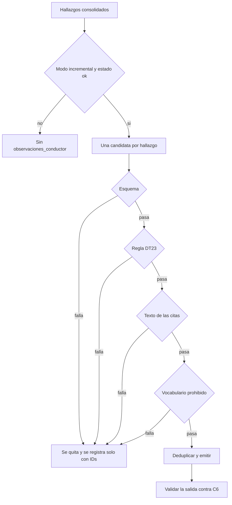
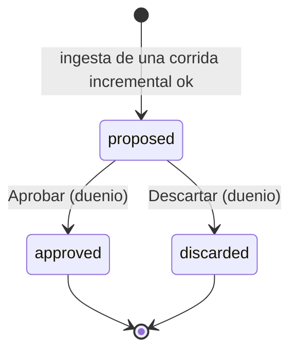
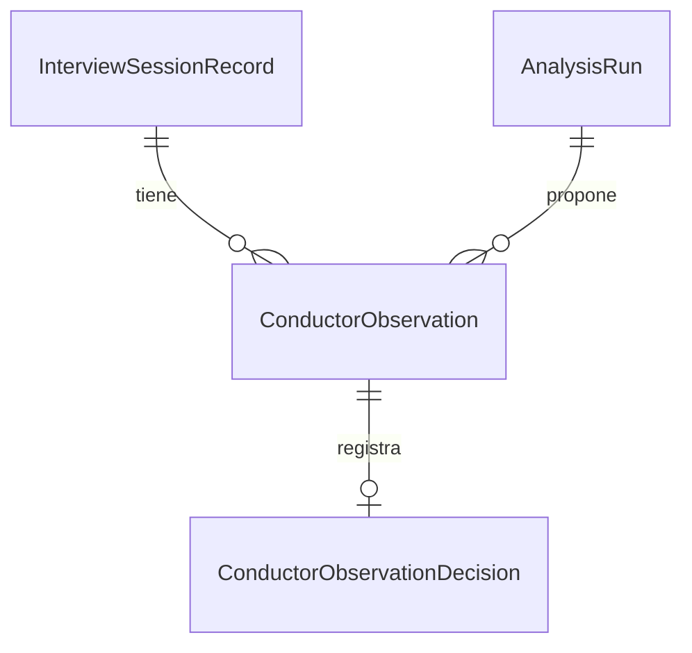

# Especificación funcional — U8 assistant-extras

**Revisión 2 (2026-11-22), segunda pasada por el cambio 01 y la adenda 02** (y las revisiones 3 de
Inception). Sustituye a la revisión 1 del 2026-10-02.
- **Sigue:** la unidad sigue entregando US10.3 y US10.5, y sigue cruzando US5.5 y US5.6.
- **Sale:** F1–F3 (segunda lectura del juez, pregunta sugerida e indicio afectivo) y los escenarios E1–E10
  quedan «Retirado» sin renumerar.
- **Entra:** F4–F9, la máquina de estados de ConductorObservation, los estados y textos del panel (§6),
  los escenarios desde E11 y la tabla de precisiones FD-U8-01… (§11).
- Origen: respuestas P4 = A, P5 = A y P6 = A, y los puntos 1–10 de «Lo que el diseño resolverá sin
  preguntar» de `functional-design-questions.md`. Ningún original se editó.

**Insumos.**
- Unidad U8 de `inception/units-generation/unit-of-work.md` (unit-of-work, revisión 3) y su mapa
  `unit-of-work-story-map.md` (unit-of-work-story-map): US10.3 → US10.5, más los cruces de US5.5 y US5.6.
- FR10.3, FR10.5, FR4.5, NFR3, NFR4 y NFR8 de `inception/requirements-analysis/requirements.md`
  (requirements, revisión 3) y VE-05 y VE-10 de `requirements-adenda-02.md`.
- InterviewSession, IncoherenceAnalyzer, IntegrityPolicy, ConsoleApi y AnalystConsole de
  `inception/domain-design/components.md` (components, revisión 3); ADR-003 y ADR-009.
- C1, C3, C6, C8 y C18 de `inception/contract-design/contract-summary.md` (contract-summary, revisión 3).
- Mockups §6.11 e interaction-spec §4.9 (Refined Mockups, revisión 3).
- Diseños de U11 (F4, F5, F7, §8), U4 (F6, §3, §7), U3 (F2, F8) y U1 (regla de aclaración neutra, casos de
  escaneo), citados por descripción. Las entidades están en `entities.md` y las reglas en `rules.md`; este
  documento es la fuente de verdad de los flujos y de la máquina de estados.

## 1. Qué hace la unidad

U8 (SHOULD, Bolt B8, después de la línea de corte de las MUST) entrega dos cosas:

- **Aclaraciones neutras (US10.3).** En cada corrida incremental, la biblioteca arma una aclaración por
  hallazgo emitido, sin llamar a ningún modelo (P4 = A), la valida con cuatro reglas y emite las que pasan
  en `observaciones_conductor`. `session-api` las vuelve a validar, las guarda como ConductorObservation y
  las muestra en M4 como «Aclaración sugerida · requiere tu decisión». Solo el analista dueño las aprueba o
  las descarta. Ninguna entra en el reporte (P6 = A).
- **Confirmación en ambos órdenes en producción (US10.5).** La lógica es la de la biblioteca (U11). U8 la
  activa en todos los perfiles (P5 = A), la prueba por el camino del producto y mide su costo.

Ningún MUST depende de U8.

### Frontera AUTONOMIA-04 por componente

| Componente | Proceso | Dentro o fuera del clúster | Datos que cruzan la frontera |
|---|---|---|---|
| IncoherenceAnalyzer (módulo de aclaraciones) en `semantic-agent` | `semantic-agent` | Dentro, con la salida a internet negada | Ninguno nuevo: arma el tema con el `hecho` ya restaurado que le devolvió `anonymizer-proxy` o el servidor local. No hay llamada nueva a un modelo |
| IncoherenceAnalyzer (módulo de aclaraciones) en la CLI | Máquina local o nodo de ZINE | Fuera del clúster, como la CLI | Ninguno nuevo: arma el tema en memoria con el hallazgo restaurado por el módulo de U10 en proceso. Las salidas siguen las reglas de la CLI (fuera de Git con el corpus) |
| InterviewSession (ConductorObservation) | `session-api` | Dentro | Ninguno sale |
| ConsoleApi (`/conductor-observations/*/decision`) | `session-api` | Dentro | Tema, turnos y estado hacia el navegador, dentro del clúster |
| AnalystConsole (panel de aclaraciones) | `frontend` | Dentro | Solo habla con ConsoleApi |
| Perfiles (`permutation`) | Archivo `config/profiles.yaml` | — | La llamada `verifier_permuted` sale por el mismo camino que la directa: `anonymizer-proxy` ante un destino externo y el servidor local en `todo-local` |

## 2. Flujos

### F1 — Evaluar con permutación (segunda lectura del juez) · Retirado

Sale con los pasajes y el marco de verdad (cambio 01). La permutación de producción es F8.

### F2 — Sugerir una pregunta · Retirado

Sale con el Paquete de Contexto de Traspaso (cambio 01). La sustituyen F4–F7.

### F3 — Indicio afectivo · Retirado

Sale con US11.1 (WON'T por DT15).

### F4 — Armar y validar las aclaraciones en la biblioteca (US10.3) · nuevo

Se inserta en la consolidación de la salida de la biblioteca: después de numerar los hallazgos y armar el
registro, y antes de validar la salida contra C6 (precisión FD-U8-01).

1. Si la corrida es de modo final, o si ya terminó en error, no hay aclaraciones (BR5.2).
2. Por cada hallazgo emitido, en orden de `id`, se arma una candidata: `tema` = el `hecho` con los espacios
   normalizados, `turnos` = los turnos de `cita_a` y `cita_b` sin repetir y en orden (BR5.1).
3. Cada candidata pasa cuatro validaciones, en este orden, y se detiene en la primera que falla:
   esquema (BR5.3) → regla de DT23 (BR5.4) → texto de las citas de la salida (BR5.5) → vocabulario
   prohibido (BR5.6).
4. Una candidata que falla se quita y deja un ClarificationDiscardEvent con `run_id`, el `id` del hallazgo
   y la regla, sin texto (BR5.7). Los hallazgos no cambian.
5. Las válidas se deduplican por turnos y tema normalizado (BR5.8) y forman `observaciones_conductor`
   (vacío si no queda ninguna).
6. La salida completa se valida contra C6, como ya hace la biblioteca. Si no valida, la salida en error no
   lleva el campo (BR5.2).

*Texto alternativo:* con hallazgos consolidados, si la corrida no es incremental con estado ok no hay
aclaraciones. Si lo es, se arma una candidata por hallazgo y pasa por cuatro comprobaciones en orden:
esquema, regla de DT23, texto de las citas y vocabulario prohibido. La primera que falla quita la
candidata y la registra solo con IDs. Las que pasan todas se deduplican, se emiten y la salida completa se
valida contra C6.

### F5 — Ingerir y guardar (`session-api`, C3) · nuevo

Se inserta en el flujo de ingesta de U4 (precisión FD-U8-07):

1. Después de validar la salida contra C6, la ingesta repite BR5.3–BR5.6 sobre cada elemento de
   `observaciones_conductor`, comparando con las citas de todos los hallazgos de la salida (BR5.9). Si
   alguno falla, la corrida entera queda en `analysis.invalid_output`, sin sugerencias ni aclaraciones.
2. En la misma transacción de la ingesta, con el orden sesión → fila, inserta cada aclaración como
   ConductorObservation `proposed`, salvo que ya exista una con la misma `(session_id, turnos, tema_key)`
   (BR5.10).
3. El `change_cursor` de la sesión ya lo mueve la ingesta, así que el siguiente sondeo de M4 trae las
   aclaraciones nuevas en `SessionView.conductor_observations`.
4. Un resultado que la ingesta descarta (intento viejo, corrida cancelada o vencida) no guarda aclaraciones.

### F6 — Decidir una aclaración (`POST /conductor-observations/{observation_id}/decision`) · nuevo

1. ConsoleApi valida la petición con el mecanismo de U3: sesión de usuario, CSRF, rol `analista` y dueño
   por el resolvedor `observation_id → sesión` que registra U8. Un identificador inexistente da `404`
   `conductor_observation.not_found` (BR5.11).
2. En una transacción: `change_cursor.bump` sobre la sesión y después bloqueo de la fila de la aclaración
   (orden sesión → fila).
3. Comprueba el estado y la sesión (BR5.12): ya decidida → `409` `conductor_observation.already_decided`;
   sesión que no admite la decisión pedida → `409` `conductor_observation.session_closed`.
4. Cambia `status` e inserta ConductorObservationDecision con actor y hora (BR5.13).
5. Responde `200` con la ConductorObservation. Ningún rechazo crea filas.

### F7 — Presentar en la consola (M4, mockups §6.11) · nuevo

1. M4 lee `SessionView.conductor_observations` en cada sondeo y pinta el panel al pie de la columna derecha
   (BR5.15). La aclaración va fuera de la lista de sugerencias de revisión y sin rótulos de resultado
   (BR4.5).
2. Si cambió el número de pendientes, la región `aria-live="polite"` anuncia el contador una vez, sin mover
   el foco (BR4.7).
3. «Aprobar» y «Descartar» llaman a F6. Si la sesión no admite una decisión, el botón queda con
   `aria-disabled` y su motivo (BR4.6).
4. Una aclaración aprobada muestra «Escuchar audio», que construye U9 y que solo suena al pulsarlo
   (BR5.14).

### F8 — Permutación en producción (US10.5) · nuevo

1. `config/profiles.yaml` lleva `permutation: true` en todos sus perfiles, también en `todo-local` (BR6.1,
   P5 = A).
2. Con eso, `semantic-agent` hace en cada candidato la llamada directa y la permutada que diseñó U11. Un
   candidato confirmado en un solo orden no sale y queda como `rechazado_permutacion` (BR6.2).
3. La ingesta guarda las dos llamadas y el descarte. El registro de llamadas de la corrida (vista de U4) las
   muestra sin pantalla propia (BR6.3).
4. U8 no toca la lógica de la biblioteca (BR6.4). Si NFR Requirements muestra que `todo-local` rompe la
   latencia en CPU, se apaga allí por PR (BR6.1).

### F9 — Mediciones de nivel 2 y de costo (B8) · nuevo

1. **AC10.3.2 en nivel 2 (BR5.17).** Por entrevista del conjunto sintético, una corrida de la CLI en modo
   incremental que cubre todos los turnos. Una comprobación independiente busca cada fragmento de cita en
   cada tema emitido (0 coincidencias) y el reporte lleva solo conteos (precisión FD-U8-09).
2. **Costo de la permutación (BR6.5).** El conjunto con `todo-local` y con un perfil comercial, con y sin
   permutación: llamadas al verificador, tokens y duración por entrevista, frente a NFR3 y NFR8.
3. Los dos reportes se adjuntan al PR de B8. Los corre el humano fuera de la CI, como todo el nivel 2.

## 3. Máquina de estados de ConductorObservation

*Texto alternativo:* una aclaración nace `proposed` cuando la ingesta confirma una corrida incremental con
estado ok. El dueño la aprueba o la descarta. Los dos estados son finales y no vuelven.

| Estado de la sesión | Aprobar | Descartar |
|---|---|---|
| `open`, `paused`, `suspended` | Sí | Sí |
| `blocked` (incidente) | Sí | Sí |
| Consentimiento retirado (sin estado final) | `409` `conductor_observation.session_closed` | Sí |
| `finalized`, `terminated`, `consolidated` | `409` `conductor_observation.session_closed` | `409` `conductor_observation.session_closed` |

Cada transición deja una fila de ConductorObservationDecision con el actor y la hora. El estado vigente es
`status` de la fila, que solo cambia en esa misma transacción (BR5.13).

## 4. Vista derivada: entidades y relaciones

Derivada de `entities.md` (el YAML de allí es la fuente de verdad).

*Texto alternativo:* una sesión tiene cero o más aclaraciones; cada aclaración nace de una corrida; cada
aclaración tiene como mucho una decisión registrada. ClarificationCandidate y ClarificationDiscardEvent
viven solo en memoria y en los logs de la biblioteca, así que no aparecen en el diagrama.

## 5. Vista derivada: reglas

Derivada de `rules.md`.

| Grupo | Reglas | Flujo |
|---|---|---|
| Segunda lectura, pregunta, indicio (Retirado) | BR1.1–BR1.6, BR2.1–BR2.6, BR3.1–BR3.3, BR4.3 | F1–F3 (Retirado) |
| Armado y validación en la biblioteca | BR5.1–BR5.8, BR4.1, BR4.2 | F4 |
| Ingesta y persistencia | BR5.9, BR5.10 | F5 |
| Decisión y auditoría | BR5.11–BR5.13 | F6 |
| Consola | BR5.14, BR5.15, BR4.4–BR4.7 | F7 |
| Casos de escaneo y nivel 2 | BR5.16, BR5.17 | F4, F9 |
| Permutación en producción | BR6.1–BR6.5 | F8, F9 |

## 6. Pantalla: estados y textos del panel (M4)

U8 es de tipo `service` y no produce `frontend-components.md`. Lo que añade a M4 queda aquí. Los textos que
no fijan los criterios aprobados son **propuestas** de esta etapa y están en FD-U8-10 y FD-U8-11; entran al
catálogo de mensajes en español y pasan su escaneo (BR4.1).

| Estado | Qué se ve | Origen del texto |
|---|---|---|
| Sin aclaraciones | El panel no aparece | — |
| Pendiente | «Aclaración sugerida · requiere tu decisión»; «Tema: <tema>»; «Turnos 3 y 7»; «◷ Pendiente»; «Aprobar» y «Descartar» | Rótulo y botones: AC10.3.3 y mockups §6.11. «Turnos…» y el estado: propuesta |
| Aprobada | Igual, con «✓ Aprobada» y «Escuchar audio» (de U9) | Estado: propuesta; botón: AC10.4.1 |
| Descartada | Igual, con «✕ Descartada» y sin botones | Propuesta |
| Pendiente con el consentimiento retirado | «Aprobar» con `aria-disabled` y el motivo «No se puede aprobar: se retiró el consentimiento»; «Descartar» activo | Propuesta |
| Sesión cerrada (finalizada, terminada o consolidada) | Solo lectura; los dos botones con `aria-disabled` y el motivo «La sesión está cerrada. Las aclaraciones quedan en solo lectura» | Propuesta |
| Anuncio | Región `aria-live="polite"`: «Aclaraciones sugeridas pendientes: N» | Propuesta (FD-U8-10) |
| Error al decidir | `already_decided`: «Esta aclaración ya tiene una decisión». `session_closed`: «La sesión ya no admite esta decisión». `not_found`: «La aclaración no existe». Tras el error, el panel se recarga con el siguiente sondeo | Propuesta |

El tema se muestra tal como llegó, como texto (nunca HTML). Los turnos se muestran con su número y son un
enlace que lleva el foco al turno de la transcripción. Nunca se muestran las citas ni el hallazgo de origen.

## 7. Escenarios de negocio y casos límite

E1–E10 (revisión 1): **Retirado** con F1–F3.

| # | Escenario | Resultado esperado | Regla |
|---|---|---|---|
| E11 | Corrida incremental con un hallazgo de `hecho` «hora de llegada al caserío» y citas en T4 y T9 | Una aclaración con tema «hora de llegada al caserío» y turnos `T4`, `T9`; el gateway *fake* registra las mismas llamadas que sin el módulo | BR5.1 |
| E12 | La misma corrida en modo final | Sin `observaciones_conductor` | BR5.2 |
| E13 | Corrida incremental en error por el juez | Sin `observaciones_conductor` y `hallazgos` vacío | BR5.2 |
| E14 | `hecho` «Contradicción sobre la hora» | La aclaración se quita (`mentions_contradiction`); el hallazgo sale | BR5.4, BR5.7 |
| E15 | `hecho` «lo que antes mencionó sobre la hora» | Se quita (`phrases`) | BR5.4 |
| E16 | `hecho` «número de familias del turno 3» | Se quita (`cites_turn`); con «tercer día» sale | BR5.4 |
| E17 | `hecho` que contiene literal la `cita_a` «éramos tres familias» | Se quita (`quote_text`) | BR5.5 |
| E18 | `hecho` con 5 palabras seguidas de una cita, con otras tildes | Se quita (`quote_overlap`); con 4 palabras sale | BR5.5 |
| E19 | `hecho` que contiene la cita de otro hallazgo de la salida | Se quita | BR5.5 |
| E20 | `hecho` «el compareciente miente» (si llegara al armado) | Se quita (`forbidden_vocabulary`) | BR5.6, BR4.1 |
| E21 | Log de E14–E20 | Cada evento trae `run_id`, `id` del hallazgo y regla; el tema sembrado no aparece en el log | BR5.7 |
| E22 | Dos hallazgos con el mismo hecho y los mismos turnos | Una aclaración | BR5.8 |
| E23 | Resultado inyectado en la ingesta con un tema que dice «antes dijo» | Corrida entera en `analysis.invalid_output`, 0 sugerencias y 0 aclaraciones | BR5.9 |
| E24 | Resultado inyectado con `is_truthful` en un elemento | Igual que E23 (no cumple C6) | BR4.2 |
| E25 | Dos corridas incrementales que repiten la misma aclaración | Una sola fila | BR5.10 |
| E26 | Fallo forzado a mitad de la ingesta | 0 aclaraciones; el mensaje queda pendiente | BR5.10 |
| E27 | Otro analista decide | `403` `session.not_owner`, 0 filas | BR5.11 |
| E28 | Decisión sin token CSRF | `403` `auth.csrf`, 0 filas | BR5.11 |
| E29 | `observation_id` inexistente | `404` `conductor_observation.not_found` | BR5.11 |
| E30 | Segunda decisión sobre la misma aclaración | `409` `conductor_observation.already_decided` | BR5.12 |
| E31 | Dos decisiones concurrentes | Una `200` y la otra `409`; una sola fila de historial | BR5.12, BR5.13 |
| E32 | Aprobar con el consentimiento retirado | `409` `conductor_observation.session_closed`; descartar responde `200` | BR5.12 |
| E33 | Decidir en una sesión bloqueada por incidente | `200` | BR5.12 |
| E34 | Decidir en una sesión finalizada | `409` `conductor_observation.session_closed` | BR5.12 |
| E35 | Fallo forzado al insertar el historial | `status` sigue `proposed` | BR5.13 |
| E36 | Aclaración pendiente o descartada | Sin «Escuchar audio»; la ruta de audio responde `409` `conductor_observation.not_approved` | BR5.14 |
| E37 | Sesión con aclaraciones aprobadas que se consolida | El reporte no las lista | BR5.14 |
| E38 | Panel con una aclaración cuyo hallazgo tiene citas conocidas | Las citas no están en el DOM | BR5.15 |
| E39 | Un sondeo trae tres aclaraciones nuevas | Un anuncio «Aclaraciones sugeridas pendientes: 3»; el foco no se mueve | BR4.7 |
| E40 | Caso de escaneo de aclaración de U1 modificado para esperar lo contrario | La suite de U8 falla | BR5.16 |
| E41 | Perfil de demostración con `permutation: false` | La prueba de nivel 0 de BR6.1 falla | BR6.1 |
| E42 | `semantic-agent` con verificador *fake* que confirma solo en el orden directo | Sin hallazgo; registro con `verifier` y `verifier_permuted`; descarte `rechazado_permutacion`. Sin permutación, una llamada | BR6.2 |
| E43 | `GET /runs/{run_id}/model-calls` de la corrida de E42 | Las dos llamadas con su papel | BR6.3 |

## 8. Integración con otras unidades

| Unidad | Relación |
|---|---|
| U11 incoherence-analyzer | U8 añade el módulo de aclaraciones en la consolidación de la salida, sin cambiar su contrato (FD-U8-01). Usa el escáner de C8 y la permutación tal como están. La suite de U11 deja de exigir que ninguna salida traiga `observaciones_conductor` y pasa a exigirlo solo en modo final y en error |
| U4 text-flow | U8 añade la segunda línea de validación y el guardado en la ingesta (FD-U8-07), llena `SessionView.conductor_observations` y entra el panel en la suite `axe` de M4 |
| U3 identity-access | Aporta el mecanismo de dueño, la validación de CSRF y la convención de auditoría. U8 registra el resolvedor `observation_id → sesión` y marca sus dos tablas |
| U1 contracts | Aporta C6, C8 (lista y regla de aclaración neutra) y los casos de escaneo, que ejecuta la suite de U8. Recibe las precisiones FD-U8-02, FD-U8-04 y FD-U8-09 |
| U9 voice | Construye «Escuchar audio» y la ruta de audio, que solo acepta una aclaración aprobada |
| U7 forensic-report | Sin cambios: las aclaraciones no entran en el reporte (P6 = A) |
| U13 | La retención purga ConductorObservation y su historial con la sesión (FD-U8-07) |
| U2 platform | Sin cambios: no hay pod, `Secret` ni salida nuevos |

## 9. Errores y bordes

- Un fallo del módulo de aclaraciones es un fallo del propio código de la biblioteca: se propaga como
  cualquier otro (CLI con código 5, `analysis.system` en el producto). Nunca se emite una salida parcial.
- Una aclaración que no pasa no es un error: se quita y la corrida sigue `ok` (BR5.7). En la ingesta, en
  cambio, es una salida inválida (BR5.9), porque la biblioteca ya debería haberla quitado.
- Una cita de una sola palabra que aparece en el tema quita la aclaración (BR5.5). Es el costo de la meta
  del 0 %, y su frecuencia se mide en F9.
- Un hallazgo cuyo `hecho` describe la contradicción pierde su aclaración (BR5.4). Es el costo de P4 = A, y
  su frecuencia también se mide en F9.
- Los logs llevan solo `session_id`, `run_id`, `observation_id`, el `id` del hallazgo, la regla y el `code`;
  nunca el tema, las citas ni texto de turnos.
- La permutación duplica las llamadas al verificador en todos los perfiles (BR6.1). El plazo de la corrida
  es el de U11, y un plazo agotado en la llamada permutada da `tiempo_agotado` sin hallazgos, como
  cualquier otra llamada.

## 10. Pruebas y módulos guardia

- Guardias con 100 % de ramas: la validación de la aclaración (BR5.3–BR5.8) y la máquina de estados de
  ConductorObservation (BR5.12). Se escriben primero y se ejecutan en rojo (team.md, Ordering).
- Mapa AUTONOMIA: **03** → BR4.1, BR4.2, BR4.5, BR5.6, BR5.11–BR5.14 (decisión humana con quién y cuándo,
  sin campos de veracidad); **04** → §1 (sin datos nuevos fuera del clúster ni llamadas nuevas), BR5.1;
  **05** → BR5.2 (`estado: error` sin aclaraciones), BR6.2, BR6.3; **02** → cada regla nombra su prueba;
  **01** → ninguna tarea de U8 toca el clúster: los perfiles y las migraciones de sus dos tablas entran
  por PR (la migración, en su propio PR).
- Niveles: 0 sin red ni GPU (biblioteca, trabajador, consola); 1 contra PostgreSQL y Redis reales (ingesta,
  decisión, auditoría); 2 con la CLI fuera de la CI (BR5.17, BR6.4, BR6.5); 3 con la suite `axe` y el E2E
  del panel.

## 11. Decisiones que precisan artefactos ya aprobados

No se editó ningún artefacto aprobado. En la aprobación decides cuáles se llevan al original, cada una en su
propio commit. Las tres filas de la revisión 1 (C3 con las dos calificaciones, la lista de palabras
emocionales y el motivo de la CoT interrumpida) quedan **Superado** con el cambio 01.

| ID | Artefacto | Precisión | Origen |
|---|---|---|---|
| FD-U8-01 | Functional Design de U11 (regla de que la biblioteca no emite `observaciones_conductor`, F5, F7 y §8) | La biblioteca emite `observaciones_conductor` en modo incremental con `estado: ok` (vacío si no hay), armadas por el módulo de U8 entre el armado del registro y la validación contra C6; en modo final y en error el campo no se emite. La prueba de U11 «ninguna salida trae el campo» pasa a «ninguna salida final ni en error lo trae» | P4 = A; punto 2 |
| FD-U8-02 | `contract-summary.md` (C1, `/conductor-observations/{id}/decision` y `ErrorCode`) | La operación documenta `403` (`session.not_owner`, `auth.forbidden`, `auth.csrf`), `404` `conductor_observation.not_found`, `409` `conductor_observation.already_decided` y `409` `conductor_observation.session_closed`, y el catálogo `ErrorCode` suma los tres códigos nuevos. Cierra R-04 | Punto 6 |
| FD-U8-03 | `components.md` (ConductorObservation) | Los atributos se llaman como en C1 (`tema`, `turnos`; CD-05) en lugar de `topic` y `turns`; sale `discarded_by_rule`, porque una aclaración descartada nunca se guarda; `decided_by` y `decided_at` se derivan de la entidad nueva ConductorObservationDecision; entra `created_at` | Puntos 4 y 5 |
| FD-U8-04 | `contract-summary.md` (C8 `neutral-clarification.v1.yaml`) | `phrases` suma «antes mencionó» y «había dicho», que AC10.3.4 nombra como variantes y la versión 1.0.0 no trae (versión 1.1.0, por PR de U1 con un caso de escaneo negativo por frase) | AC10.3.4 |
| FD-U8-05 | `stories.md` (AC10.3.2) | «El tema no contiene el texto de ninguna de las dos citas» se mide con espacios normalizados, sin mayúsculas ni tildes, por fragmento de « […] », y también rechaza 5 o más palabras seguidas en común; se compara con las citas de todos los hallazgos de la salida, no solo con el de origen, para que la biblioteca y la ingesta apliquen la misma regla | Punto 3 |
| FD-U8-06 | `stories-adenda-02.md` (AC10.3.4) | «Se registra como descartada» se lee como un evento de log estructurado con `run_id`, `id` del hallazgo y regla, no como una fila. «Contiene una cita de cualquier turno» se lee como la regla `cites_turn` de C8 más el texto de las citas de la salida; el tema no se compara con el texto completo de todos los turnos | Puntos 3 y 4 |
| FD-U8-07 | Functional Design de U4 (F6 de la ingesta, §7, borrado de la sesión) | La ingesta repite BR5.3–BR5.6 después de validar contra C6 (un fallo es `analysis.invalid_output`) y guarda ConductorObservation en su misma transacción, deduplicada; el borrado de la sesión por la retención incluye ConductorObservation y ConductorObservationDecision | Puntos 4 y 5 |
| FD-U8-08 | Functional Design de U11 (perfiles iniciales de `config/profiles.yaml`) y bolt-plan B8 | `permutation: true` en todos los perfiles, también en `todo-local`; la prueba de U8 lo exige y se cambia en el mismo PR si NFR Requirements obliga a apagarla en `todo-local` | P5 = A |
| FD-U8-09 | `contract-summary.md` (C19) | La medición de nivel 2 de AC10.3.2 suma al reporte de la CLI una sección opcional `clarifications` con solo enteros: aclaraciones emitidas, descartadas por regla y coincidencias de cita encontradas (cambio menor, PR de U1). Alternativa, si prefieres no tocar C19: un reporte aparte del arnés de `evaluation/` con los mismos conteos | BR5.17 |
| FD-U8-10 | `stories.md` (AC5.6.5), interaction-spec §4.9 | La llegada de aclaraciones se anuncia como contador agregado («Aclaraciones sugeridas pendientes: N», texto propuesto), no una por una, para cumplir AC5.6.5 sin perder el anuncio del punto 8 | BR4.7 |
| FD-U8-11 | interaction-spec §6 (catálogo de mensajes) | Textos propuestos del panel: «Turnos 3 y 7», «◷ Pendiente», «✓ Aprobada», «✕ Descartada», los dos motivos de botón deshabilitado y los tres mensajes de error de §6. Son propuestas de esta etapa, no texto fijado por un criterio aprobado | §6 |

## 12. Preguntas abiertas para NFR Requirements

- Cifras de latencia y costo de la llamada `verifier_permuted` en `todo-local` (CPU) y en el perfil
  comercial frente a NFR3 y NFR8, y el umbral a partir del cual se apaga en `todo-local` (P5 = A).
- Tasa aceptable de aclaraciones descartadas por regla sobre el conjunto sintético (el costo de P4 = A y de
  la regla de 5 palabras de BR5.5). Hoy solo se reporta.
- Si hace falta un tope de aclaraciones por sesión en el panel o una longitud máxima del tema en el
  catálogo de límites de C25. Hoy no hay tope.
