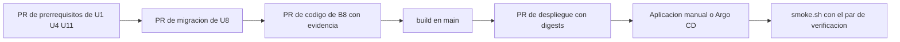

# Pipeline de CI/CD — U8 assistant-extras

**Revisión 2 (2026-11-23): segunda pasada por el cambio 01 (DT27), la adenda 02 y el NFR Design
revisión 2.** Sustituye a la revisión 1 del 2026-10-03, que queda en el historial de Git.
- **Qué cambia.** Salen las ampliaciones de `ai-eval-gate.yml` y `deploy-level0.yml`,
  `check-extras-values.py`, el render con `values-extras.yaml`, el PR de activación y las reglas de
  `promtool` de los extras (IDS-U8-01). Las pruebas de U8 se reparten ahora entre `analyzer.yml` (la
  biblioteca), `session-api.yml`, `semantic-agent.yml` y `frontend.yml`. El nivel 2 de B8 lo exige
  `analyzer-level2-gate.yml` (IDS-U8-07).
- **Numeración.** §1–§6 conservan su tema. §1.1 queda «Retirado». Lo nuevo es §7.

**Insumos.**
- Comandos de `nfr-requirements/tech-stack-decisions.md` (§5), trabajo en otras unidades (§4) y D3, D8, D13.
- Del `nfr-design/` de esta unidad:
  - calidad, cobertura y fronteras de `nfr-design/logical-components.md` (logical-components §5);
  - pruebas de `nfr-design/security-design.md` (security-design §1–§7);
  - pruebas de `nfr-design/reliability-design.md` (reliability-design §1, §4–§6, §9, §10);
  - pruebas de `nfr-design/performance-design.md` (performance-design §1, §4, §5, §8);
  - pruebas de `nfr-design/scalability-design.md` (scalability-design §1–§4);
  - logs y métricas de `nfr-design/observability-design.md` (observability-design §1, §2).
- Escenarios E11–E43 de `functional-design/functional-spec.md` (functional-spec).
- Procesos de `inception/domain-design/components.md` (components).
- C1, C3, C6, C8 y C19 de `inception/contract-design/contract-summary.md` (contract-summary).
- `cicd-pipeline.md` revisión 2 de U2, U4 y U11, e `infrastructure-specification.md` de esta carpeta.
- `## Testing Posture` y `## Deployment` de `team.md`.

U8 **no crea *workflows***: amplía los de U3, U4 y U11, y pide a U11 un *job* en su puerta de nivel 2. Todos
siguen el patrón de esos *workflows*:
- `permissions: contents: read`, acciones fijadas por SHA, sin `kubeconfig` ni claves de proveedores;
- solo el *job* `build` publica, y solo en `main` (AUTONOMIA-01);
- ninguna prueba de los niveles 0 y 1 descarga un modelo, abre un *socket* hacia fuera, exige GPU ni se
  reintenta (NFR2.1). El `ModelGateway` *fake* de U11 cubre la llamada directa y la permutada, y PostgreSQL 16 y
  Redis 7.2 son reales en contenedor.

Las pruebas de los dos módulos guardia, de los contratos (esquema de la aclaración, C1 y C19 v2) y de
AUTONOMIA-03 y -05 se escriben primero y se ven en rojo antes de implementar (`team.md`, Ordering).

## 1. *Workflows* que cambian

| *Workflow* | Rutas que activan el trabajo | *Job* | Lo que añade U8, con comando y umbral (AUTONOMIA-02) | Bloquea |
|---|---|---|---|---|
| `analyzer.yml` (U11) | `libs/incoherence_analyzer/**`, `libs/integrity_policy/**`, `contracts/**`, `config/**`, `evaluation/**` | `test-level0` | `uv run --directory libs/incoherence_analyzer pytest -m "not integration and not perf"`: una prueba por regla con su control negativo (E14–E20, E22); modo final y error sin el campo (E12, E13); el módulo forzado a lanzar da código 5 (reliability-design §10); sin E/S (funciones de E/S sustituidas y comprobación AST); propiedad de que el tema solo depende del `hecho`; centinela en la CLI (E21); mismas llamadas con el módulo y sin él (E11); 2 llamadas por candidato con `permutation: true` (E42); `profiles_permutation` y `profiles_permutation_same_destination` (E41) | Sí |
| | | `test-perf` dentro de `test-level0` | `uv run --directory libs/incoherence_analyzer pytest -m perf -k clarification`: mediana de 20 repeticiones con 50 hallazgos y citas de 2 000 caracteres ≤ 150 ms en la CI (3 × 50 ms, NFR3.2); memoria del módulo ≤ 5 MiB con `tracemalloc` | Sí |
| | | `guards` | `clarification.py` con 100 % de ramas, en la lista de `scripts/check-guard-coverage.py` (petición a U11, IDS-U8-11) | Sí |
| | | `checks` | Comprobación de datos sintéticos de U1 sobre los `tests/` de U8 y `evaluation/clarifications/` (NFR12.1); `check_quotes.py` con un tema sembrado con una cita en un *fixture*: falla (DS8) | Sí |
| `session-api.yml` (U3, con *jobs* de U4) | `services/session-api/**`, `libs/**`, `contracts/**`, `config/**` | `test-level0` | `uv run --directory services/session-api pytest -m "not integration and not perf"`: máquina de estados de la decisión, puerto `is_observation_approved` con sus tres estados y la inexistente, la misma suite BR5.16 que la biblioteca (E40), regla `neutral-clarification` rota que impide arrancar, métricas dentro de `assistant-extras.v1.yaml` | Sí |
| | | `guards` | `conductor_observation_state.py` con 100 % de ramas en `.coveragerc-guards` (NFR13.2) | Sí |
| | | `test-level1` | `uv run --directory services/session-api pytest -m integration -k conductor_observation`: la tabla 403/404/409/413 con 0 filas (E27–E34); dos decisiones simultáneas (una `200`, una `409`) (E31); corte antes del `COMMIT`; disparadores y `UPDATE` sin historial que no confirma (E35); ingesta idempotente y ante un fallo forzado (E25, E26); resultado inyectado por regla que invalida la corrida (E23, E24); `purge_session` con `veridicus_retention` y con `veridicus_app`; prueba común de auditoría de U3; centinela en los logs; reporte de U7 sin temas (E37); `/readyz` en `503` con la regla rota | Sí |
| | | `test-perf` | `uv run --directory services/session-api pytest -m perf -k conductor_observation`: p95 ≤ 300 ms con 100 decisiones (NFR3.8); p95 ≤ 200 ms con `since` y ≤ 1 s sin él (NFR3.9) | Sí |
| | | `lock-boundary` (petición a U3 y U4, IDS-U8-03) | 0 apariciones de `libs-anonymizer` en `services/session-api/uv.lock`, con un control negativo; `lint-imports` con el contrato que solo deja importar `libs.incoherence_analyzer.domain.clarification` desde `interview/application`, con un módulo de prueba que lo viola | Sí |
| | | `build` | Además de lo de U3: `python -c "import libs.anonymizer"` en la imagen termina en `ModuleNotFoundError` (IDS-U8-03) | Sí |
| `semantic-agent.yml` (U4) | `services/semantic-agent/**`, `libs/**`, `contracts/**` | `test-level0` y `test-level1` | Nivel 0: CLI y trabajador con la misma entrada incremental dan las mismas aclaraciones, campo a campo (NFR4.5). Nivel 1 con `uv run --directory services/semantic-agent pytest -m integration -k permutation`: propiedad «hallazgos con permutación ⊆ sin ella» con un verificador *fake* y su control negativo (NFR4.1); centinela en los logs de `semantic-agent`; regla rota que deja `/readyz` en `503` | Sí |
| `frontend.yml` (U4) | `frontend/**`, `contracts/**` | `test` | `npm --prefix frontend run test -- --coverage`: panel con servidor *fake* (red caída, `503`, los dos `409`), sin reintento automático, botones con `aria-disabled`, tema con `<script>` pintado literal, textos del catálogo de U1 y escáner de C8 sobre ellos con «prueba» como control negativo; `npm --prefix frontend run typecheck` | Sí |
| `analyzer-level2-gate.yml` (U11) | Todo PR | `clarifications` (petición a U11, IDS-U8-07) | `scripts/check-clarifications-reports.py` (§3) | Sí (nivel 2) |
| `deploy-level0.yml` (U2) | `deploy/**`, `scripts/**`, `config/**`, `.github/**` | — | Sin cambios de U8: no hay plantillas ni *values* nuevos. La copia del panel de U4 con los dos paneles de U8 la compara `check-config-copy.sh` (IDS-U8-05) | Sí |
| `ai-eval-gate.yml` | — | — | **Retirado** (IDS-U4-12); su ampliación de la revisión 1 sale con él (IDS-U8-01) | — |

Cobertura: ≥ 80 % de líneas en `libs/incoherence_analyzer`, `services/semantic-agent`, `services/session-api`
y `frontend`, con U8 incluido (NFR13.1), en los *jobs* `coverage` de cada *workflow*. Tipos, *lint* y
fronteras: `mypy --strict`, `ruff check` y `lint-imports` con 0 errores en cada paquete.

### 1.1 `scripts/check-extras-values.py` · Retirado

Retirado con `values-extras.yaml` (IDS-U8-01; cierra R-03 de la revisión 1).

## 2. Puertas con comando y umbral (AUTONOMIA-02)

| Puerta | Comando | Umbral | Nivel |
|---|---|---|---|
| Unitarias, contratos y guardias | `uv run --directory libs/incoherence_analyzer pytest -m "not integration and not perf"`, y lo mismo en `services/semantic-agent` y `services/session-api` | Verde | 0 |
| Ramas de los módulos guardia | `uv run --directory libs/incoherence_analyzer pytest --cov-branch --cov-config=.coveragerc-guards` y lo mismo en `services/session-api` | 100 % en `clarification.py` y `conductor_observation_state.py` (NFR13.2) | 0 |
| Permutación en todos los perfiles | `uv run --directory libs/incoherence_analyzer pytest -k profiles_permutation` | Verde; rojo con el *fixture* de E41 | 0 |
| Frontera de `session-api` | *Job* `lock-boundary` (IDS-U8-03) | 0 apariciones de `libs-anonymizer` | 0 |
| Integración | `uv run --directory services/session-api pytest -m integration -k conductor_observation` y `uv run --directory services/semantic-agent pytest -m integration -k permutation` | Verde | 1 |
| Rendimiento en proceso | `uv run --directory services/session-api pytest -m perf -k conductor_observation` y `uv run --directory libs/incoherence_analyzer pytest -m perf -k clarification` | NFR3.8 ≤ 300 ms; NFR3.9 ≤ 200 ms y ≤ 1 s; NFR3.2 ≤ 150 ms en la CI | 1 y 0 |
| Consola | `npm --prefix frontend run test -- --coverage` y `npm --prefix frontend run typecheck` | Verde; ≥ 80 % de líneas | 0 |
| Aclaraciones en nivel 2 | `uv run --directory evaluation python -m clarifications.run --profile comercial-piloto --report out/u8-clarifications.json` | 0 coincidencias de cita, vocabulario y regla (NFR4.3, NFR10.5 (d)); tasa de descarte reportada (NFR4.6) | 2 |
| Costo de la permutación | `uv run --directory evaluation python -m clarifications.permutation_cost --profiles todo-local,comercial-piloto --report out/u8-permutation-cost.json` | p95 ≤ 180 s con `comercial-piloto` (NFR3.1); ≥ 98 % sin `tiempo_agotado` con `todo-local` y 100 % `done` o `error` con `code` (NFR8.7); `verifier_permuted` siempre local y sin anonimizar; `VmHWM` ≤ 1 % (NFR8.3) | 2 |
| Evidencia de B8 | `python scripts/check-clarifications-reports.py` | Código 0 (§3) | 2 (CI) |
| Carga | `uv run --directory evaluation python -m load.run_batches --sessions 50 --concurrency 3 --prometheus-url <url> --report out/nfr8.json` (U4, opción de U8) | ≥ 98 % con la permutación activa (NFR8.1); picos de `semantic-agent` y trabajador dentro de 1,2 × pico ≤ límite (NFR8.3) | A demanda |
| E2E del panel | `npx --prefix frontend playwright test e2e/conductor-observations.spec.ts` | Verde; panel ≤ 3 s (NFR3.10); `axe` sin violaciones (BR4.4) | 3 |
| Humo | `scripts/smoke.sh https://veridicus.local:8443` | Código 0 en ≤ 300 s por caso, con el par `verifier` y `verifier_permuted` presente (NFR3.12, IDS-U8-10) | 3 |

Las mediciones de nivel 2 y la carga las lanza el humano en WSL2 (procedimiento en §7 de
`infrastructure-specification.md`). Nada de esto aplica cambios al clúster: los arneses solo usan la CLI,
HTTP y `port-forward` de solo lectura.

## 3. Evidencia de nivel 2 de B8 (`scripts/check-clarifications-reports.py`)

La comprobación corre en el *job* `clarifications` que U8 pide a U11 en `analyzer-level2-gate.yml`
(IDS-U8-07). Se ejecuta sin modelos ni red.

| Paso | Comprueba | Falla si |
|---|---|---|
| 1 | Si el PR cambia alguna **ruta de U8**: `libs/incoherence_analyzer/domain/clarification.py`, `contracts/integrity/neutral-clarification*`, la clave `permutation` de cualquier perfil de `config/profiles.yaml` o `evaluation/clarifications/**` | — (sin cambios, verde) |
| 2 | El trío `evaluation/clarifications/reports/<slug>.clarifications.json`, `<slug>.permutation-cost.json` y `<slug>.evidence.yaml` | Falta alguno |
| 3 | Los dos resúmenes validan contra sus esquemas cerrados de solo números y booleanos de `evaluation/clarifications/schemas/` (NFRD-U8-09) | Una cadena, un campo extra o un tipo distinto |
| 4 | La evidencia valida contra `scripts/schemas/level2-evidence.v1.json` de U11, con `host: maquina-64gb` y los digests de `model-verifier` y `model-judge` iguales a los de `values-cpu.yaml` y `deploy/models.lock` | Otro digest u otro modelo |
| 5 | `evaluated_commit` es antecesor del *head* y `git diff --quiet <evaluated_commit> HEAD --` sobre las rutas del paso 1 no muestra cambios | Lo medido no es lo que se fusiona |
| 6 | Las cifras se comparan otra vez con los umbrales de §2, sin confiar en ningún `passes`: `quote_matches = 0`, p95 ≤ 180 s, ≥ 98 %, 100 % con `code` y `VmHWM` ≤ 1 % | Una cifra fuera de umbral |
| 7 | `gitleaks` sobre los tres archivos | Un hallazgo |

Además, un PR que cambia `clarification.py` toca `libs/incoherence_analyzer/domain/**`, que ya es ruta de IA
de U11. Por eso también le exige el par de nivel 2 de `evaluacion-comercial` (§4 de U11). Las dos evidencias
son independientes.

## 4. Del PR al clúster

| Paso | Qué pasa |
|---|---|
| 1 | **Prerrequisitos** en el PR de su unidad, antes del código de B8 (tech-stack-decisions §4): `code` de FD-U8-02 y regla 1.1.0, esquema de `ConductorObservation`, `assistant-extras.v1.yaml` y sección `clarifications` de C19 v2 (U1); punto de inserción del módulo (U11); segunda línea, guardado, `purge_session` y lectura del sondeo (U4) |
| 2 | **PR de migración de U8**, después de las de U3 y U4 (IDS-U8-04). Corre solo en el `Job` de migraciones de U2 con `veridicus_owner` y solo avanza |
| 3 | PR de código de B8 con los *workflows* de §1 en verde, el trío de evidencia de §3 y el par de nivel 2 de U11 |
| 4 | En `main`, `build` publica `session-api`, `semantic-agent` y `frontend` por SHA |
| 5 | PR de despliegue de U2 con los digests en `values-cpu.yaml` y el panel copiado. `deploy-level0.yml` valida el render. La fusión en `main` protegida es la aprobación registrada |
| 6 | Antes del módulo 8, el humano aplica el chart ya fusionado (instalación en dos pasos de U2). Después, Argo CD sincroniza. `semantic-agent` y el trabajador usan `Recreate`, sin corridas en `processing` (IDS-U4-04) |
| 7 | `scripts/smoke.sh https://veridicus.local:8443`. Si falla, reversión de §5 |

<!-- Texto alternativo: primero entran los PR de prerrequisitos de U1, U4 y U11; después el PR de migración de U8; luego el PR de código de B8 con su evidencia de nivel 2; el build en main publica las imágenes; el PR de despliegue fija los digests; el humano aplica o Argo CD sincroniza; y por último corre smoke.sh, que comprueba también el par verifier y verifier_permuted. -->

## 5. Reversión

| Qué falló | Cómo se revierte |
|---|---|
| `smoke.sh` o la suite E2E tras desplegar | `git revert` del PR de despliegue en un PR, fusión y nueva aplicación o sincronización (`team.md`) |
| El humo no encuentra el par `verifier` y `verifier_permuted` | Es un perfil sin permutación o una biblioteca que no la ejecuta: `git revert` del PR que lo cambió. Nunca se quita la comprobación |
| La permutación con `todo-local` incumple NFR8.7 | PR que pone `permutation: false` en `todo-local` y cambia en el mismo PR la lista de excepciones de `profiles_permutation`, con el reporte de §3 (security-design §3) |
| La regla `neutral-clarification` impide arrancar | `/readyz` en `503`; `git revert` del PR de U1 que la cambió y nuevo despliegue |
| La migración | Solo avanza; se corrige con una migración nueva |
| Una aclaración que no debía emitirse llegó al panel | Queda `proposed` hasta que el analista la descarta; no entra en el reporte (BR5.14). La corrección es por PR de la regla o del módulo, con su caso negativo |

## 6. Secretos en CI/CD

- **U8 no añade Secrets.** En el clúster usa los que ya referencian `session-api` (`veridicus-db-app`,
  `veridicus-redis-auth`) y `semantic-agent` (`veridicus-redis-auth`, `veridicus-model-api-key`), con la lista de
  IDS-U4-10.
- **La CI no tiene ningún Secret del clúster.** Las pruebas de nivel 1 usan contraseñas efímeras generadas en el
  propio *job*.
- **Medición en la anfitriona.** `VERIDICUS_ANTHROPIC_API_KEY` se carga desde el `.env` no versionado. Los
  servidores de la anfitriona solo escuchan en `127.0.0.1` y los levanta `host-verifier.sh` (IDS-U11-05).
- **Revisión de los archivos versionados.** Los resúmenes y la evidencia solo llevan cifras, *hashes* y
  versiones. `gitleaks` (`secrets-scan.yml` de U2) los revisa como al resto del repositorio.

## 7. Correspondencia con AUTONOMIA

| Regla | Comprobación | Dónde |
|---|---|---|
| AUTONOMIA-01 | Ningún *workflow* ni *script* de U8 aplica cambios al clúster. `minikube stop` y `start` solo viven en el runbook del humano (§7 de `infrastructure-specification.md`). `check-no-cluster-apply.sh` de U2 cubre `scripts/` y `evaluation/` | `deploy-level0.yml`, `analyzer.yml` (`checks`) |
| AUTONOMIA-02 | Cada *job* y cada medición nombran su comando y su umbral (§1, §2, §3) | Este documento |
| AUTONOMIA-03 | Esquemas sin campos de veracidad; escáner de C8 sin tramos excluidos sobre los temas y los textos del panel; decisión solo del dueño, con historial exigido por la base | `analyzer.yml`, `session-api.yml`, `frontend.yml` |
| AUTONOMIA-04 | Mismas llamadas y mismo destino con la permutación; `session-api` sin `libs-anonymizer` (IDS-U8-03); `verifier_permuted` local y sin anonimizar en `permutation_cost`; centinela en logs y métricas | `analyzer.yml`, `session-api.yml`, §3 |
| AUTONOMIA-05 | `estado: error` y modo final sin aclaraciones; la permutación solo quita hallazgos y deja `rechazado_permutacion`; fallo del módulo sin salida parcial | `analyzer.yml`, `session-api.yml` (`test-level1`) |
