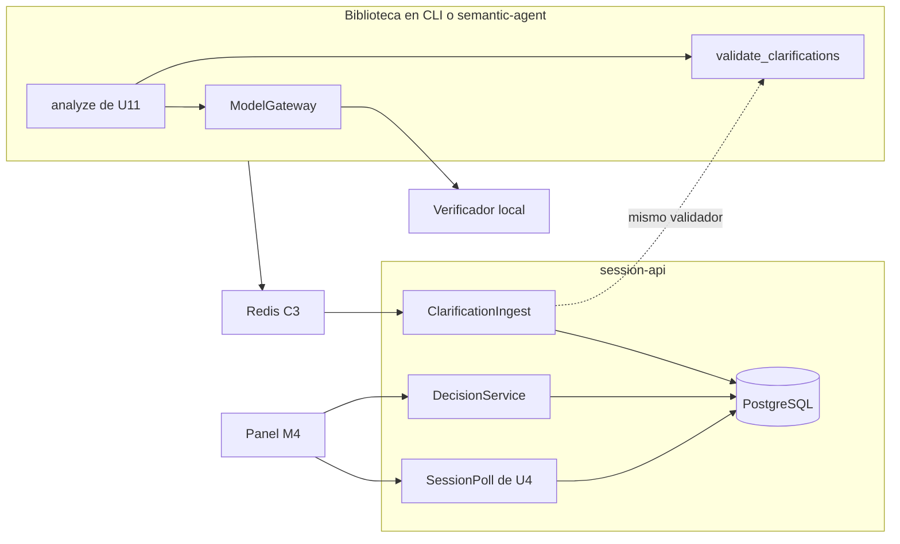

# Componentes lógicos — U8 assistant-extras

**Revisión 2 (2026-11-22): segunda pasada por el cambio 01 (DT27), la adenda 02 y el NFR Requirements
revisión 2.** Sustituye a la revisión 1 del 2026-10-03.
- **Qué cambia.** Salen `ExtrasSettings`, `PermutationStep`, `QuestionStep`, `AffectiveNoteDetector` y los
  `ConfigMap` del *prompt* y de la lista. Entran el módulo de aclaraciones de la biblioteca, la ingesta y la
  decisión en `session-api`, el panel de M4 y los arneses de nivel 2.
- **Numeración.** §1–§5 conservan su tema.

**Insumos.** `nfr-requirements/performance-requirements.md` (performance-requirements),
`security-requirements.md` (security-requirements), `scalability-requirements.md` (scalability-requirements),
`reliability-requirements.md` (reliability-requirements), `observability-requirements.md`
(observability-requirements) y `tech-stack-decisions.md` (tech-stack-decisions: D3, D8, D9, D11–D14, NFR2,
NFR13, NFR14); `functional-design/functional-spec.md` (functional-spec); C1, C3, C6, C8, C18 y C19 de
`inception/contract-design/contract-summary.md` (contract-summary); los demás documentos de diseño de esta
carpeta.

## 1. Inventario

| Componente lógico | Proceso y ruta | Dentro o fuera del clúster | Responsabilidad | Patrones de NFR |
|---|---|---|---|---|
| `validate_clarifications` | `libs/incoherence_analyzer/domain/clarification.py`, en la CLI y en `semantic-agent` | CLI fuera; `semantic-agent` dentro | Armar, validar (BR5.3–BR5.6), deduplicar y devolver eventos | Código puro, 100 % de ramas, sin E/S, precálculo por salida |
| Punto de inserción | Consolidación de la salida de U11 (FD-U8-01) | Igual | Llamar al módulo entre el armado del registro y la validación contra C6 | Solo en incremental con `estado: ok` |
| Regla `neutral-clarification` normalizada | Objeto inmutable cargado al arrancar | Igual y en `session-api` | Términos y frases de DT23 | Cargador seguro de U1; versión conocida o no arranca |
| Plantillas `clarification.*` | `libs/incoherence_analyzer/cli/messages.py` | CLI | Eventos de descarte y resumen en la CLI | Catálogo cerrado con tipos |
| `ClarificationIngest` | `services/session-api/.../interview/application/` | Dentro | Segunda línea y guardado en la transacción de U4 | Mismo validador; `ON CONFLICT DO NOTHING`; `change_seq` |
| `ConductorObservationDecisionService` | `services/session-api/.../interview/application/` | Dentro | Decisión del dueño | `GuardedRoute` de U3; orden sesión → fila; disparadores |
| `conductor_observation_state.py` | `services/session-api/.../interview/domain/` | Dentro | Máquina de estados de BR5.12 | Código puro, 100 % de ramas |
| `OwnerResolver` de la decisión | `services/session-api/.../interview/api/` | Dentro | `observation_id` → dueño | Registro de U3; sin bloqueo |
| `is_observation_approved` | `services/session-api/.../interview/application/ports.py` | Dentro | Puerto de solo lectura para U9 | — |
| Tablas `conductor_observation` y `conductor_observation_decision` | PostgreSQL (CloudNativePG de U2) | Dentro | Estado e historial | Marcas `mutable` e `history`; disparadores; `purgeable` |
| `ConductorObservationPanel` | `frontend/src/…/session/` (M4) | Navegador del analista | Mostrar y decidir | Sondeo de U4; texto, nunca HTML; `aria-live` agregado |
| Prueba `profiles_permutation` | `libs/incoherence_analyzer/tests/` | CI | BR6.1 y NFR1.2 | Cargador único de U11 |
| `clarifications.run` y `check_quotes.py` | `evaluation/clarifications/` | Máquina del humano | Nivel 2 de BR5.17 | Comprobador independiente; solo enteros |
| `clarifications.permutation_cost` | `evaluation/clarifications/` | Máquina del humano | Nivel 2 de BR6.5 | Por papel en la misma corrida |

Los componentes de U11 (`analyze`, `ModelGateway`, permutación, escáner de C8), de U4 (`AnalysisWorker`,
`ResultIngestor`, `SessionPoll`, supervisor) y de U3 (`GuardedRoute`, convención de auditoría) se reutilizan
sin cambios de responsabilidad.

<!-- Texto alternativo: dentro de la biblioteca, que corre en la CLI o en semantic-agent, analyze de U11 llama al módulo de aclaraciones y al ModelGateway, que llama al verificador local con la llamada directa y la permutada. El resultado viaja por Redis en C3 hasta ClarificationIngest de session-api, que usa el mismo validador y guarda en PostgreSQL. El servicio de decisión y la lectura del sondeo de U4 también usan PostgreSQL. El panel de M4 lee el sondeo y llama al servicio de decisión. -->

## 2. Dominios de falla y radio de impacto

| Falla | Qué deja de funcionar | Qué sigue | Radio |
|---|---|---|---|
| Una aclaración no pasa una regla | Esa aclaración | Hallazgos, estado y demás aclaraciones de la corrida | Una aclaración |
| Excepción en el módulo | Esa corrida (`analysis.system` o código 5) | Las demás corridas; la consola | Una corrida |
| Aclaración inválida en la ingesta | Esa corrida entera (`analysis.invalid_output`) | Las demás corridas | Una corrida |
| Regla `neutral-clarification` rota | `semantic-agent`, `session-api` y la CLI no arrancan | Nada de la evaluación ni de la consola | Todo el sistema, hasta el PR que la corrige |
| PostgreSQL | Ingesta, decisión y todo `session-api` | — | Todo el sistema (U4) |
| Verificador local caído | Las corridas que lo usan (con la directa y con la permutada) | Consola y revisión de lo ya emitido | Corridas en curso (U11) |

## 3. Recursos compartidos

| Recurso | Compartido con | Aislamiento |
|---|---|---|
| Ranura del verificador local | U11 y todas las corridas | Directa y permutada en serie; una corrida a la vez (U4) |
| Transacción de ingesta de U4 | U4, U5 | Mismo orden sesión → fila; ≤ 50 filas por corrida |
| Fila de la sesión (`change_cursor`) | U3–U7, U9, U13 | `change_cursor.bump` primero; transacciones cortas |
| Base PostgreSQL | Todas las unidades | Tablas propias con marca de auditoría; sin `DELETE` de la aplicación |
| Proceso de `session-api` | U3–U7, U9, U12, U13 | Capas e import-linter; la decisión es una transacción corta |

## 4. Entrega a Infrastructure Design

- **Sin cambios de despliegue.** No hay `Deployment`, puerto, `Secret`, `ConfigMap` ni regla de
  `NetworkPolicy` nuevos. La regla `neutral-clarification` viaja en el paquete `veridicus_contracts` de la
  imagen, y la permutación en el `ConfigMap` `veridicus-profiles` de U2, ya existente.
- **Migración.** Las dos tablas, sus disparadores e índices y la llamada a `veridicus_apply_audit_grants()`,
  como `Job` aparte en su propio PR (AUTONOMIA-01). Va después de la migración de U3 y de las tablas de U4.
- **Paneles.** Dos paneles en el JSON del panel de U4 (`observability-design.md` §4).
- **Recursos.** Dentro de los `requests` y `limits` de U4 (`scalability-design.md` §2).

## 5. Calidad, pruebas y textos (NFR2.1, NFR2.2, NFR13.1, NFR13.2, NFR14.1)

- **Dobles de prueba (NFR2.1).** El `ModelGateway` *fake* de U11 cubre la llamada directa y la permutada.
  Puede confirmar en un solo orden, contar llamadas y tardar con un reloj simulado. PostgreSQL y Redis son
  reales en nivel 1. Ninguna prueba de los niveles 0 y 1 descarga un modelo, abre un *socket* hacia fuera ni
  pide GPU.
- **Perfil CPU (NFR2.2).** La medición de BR6.5 corre `todo-local` en la máquina de desarrollo sin GPU
  (`performance-design.md` §8). Las aclaraciones no dependen del perfil.
- **Cobertura (NFR13.1).** ≥ 80 % de líneas en `libs/incoherence_analyzer`, `services/semantic-agent`,
  `services/session-api` y `frontend`, con U8 incluido, medido en la CI y bloqueante.
- **Ramas (NFR13.2).** 100 % en `clarification.py` y `conductor_observation_state.py`, añadidos a
  `.coveragerc-guards` (`--cov-branch`, `fail_under = 100`). Sus pruebas, las de los contratos (esquema de la
  aclaración, C1 y C19 v2) y las de AUTONOMIA-03 y -05 se escriben primero y se ejecutan en rojo (`team.md`,
  Ordering).
- **Textos (NFR14.1).** El rótulo «Aclaración sugerida · requiere tu decisión», los estados, los botones, los
  motivos y los mensajes de error del panel salen del catálogo de U1 (FD-U8-11). La prueba de literales de U4
  cubre el panel, y el escáner de C8 recorre esas cadenas sin tramos excluidos, con «prueba» como control
  negativo (NFR10.5 (b)).
- **Identificadores del glosario.** `conductor_observation`, `clarification_candidate`,
  `clarification_discard_event` y `NeutralClarification`. `tema` y `turnos` no se traducen (CD-05).
- **Fronteras.** El import-linter de U11 sigue igual: `domain` no importa `application`, `adapters`, `cli` ni
  `httpx`. En `session-api`, `interview/application` puede importar
  `libs.incoherence_analyzer.domain.clarification` y nada más de la biblioteca. Un contrato nuevo lo
  comprueba, con un módulo de prueba que lo viola.
