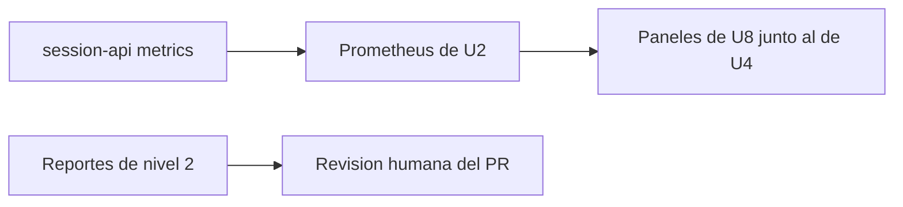

# Diseño de observabilidad — U8 assistant-extras

**Revisión 2 (2026-11-22): segunda pasada por el cambio 01 (DT27), la adenda 02 y el NFR Requirements
revisión 2.** Sustituye a la revisión 1 del 2026-10-03.
- **Qué cambia.** Salen los eventos y las seis métricas de los extras. Entran los eventos de la aclaración y
  dos contadores en `contracts/metrics/assistant-extras.v1.yaml` (NFRD-U8-06). Las reglas informativas de la
  revisión 1 salen: el MVP no tiene Alertmanager y las cifras de nivel 2 se revisan en el PR.
- **Numeración.** §1–§4 conservan su tema.

**Insumos.** `nfr-requirements/observability-requirements.md` (observability-requirements: NFR15.1–NFR15.4,
SLI de §3, panel de §4), `security-requirements.md` (security-requirements: NFR10.8), `reliability-requirements.md`
(reliability-requirements), `performance-requirements.md` (performance-requirements),
`scalability-requirements.md` (scalability-requirements) y `tech-stack-decisions.md` (tech-stack-decisions);
`functional-design/functional-spec.md` (functional-spec: F4–F6, §9) y `functional-design/rules.md` (BR5.7,
BR5.10, BR5.13, BR5.17, BR6.3); C15, C16 y C19 de `inception/contract-design/contract-summary.md`
(contract-summary); diseños de hoy de U1 (métricas en archivos propios, etiquetas cerradas), U3 (formateador
con lista blanca), U4 (métricas de la cola y del registro) y U11 (la biblioteca no exporta métricas; catálogo
cerrado de la CLI).

## 1. Logs (NFR15.2–NFR15.4)

- **Formato.** El de U4: JSON por el formateador de lista blanca de U3, en `stdout`. Campos nuevos solo para
  los eventos de U8 (NFRD-U8-07): `observation_id`, `source_finding_id`, `rule`, `state`, `emitted`,
  `discarded`, `inserted` y `existing`, además de `session_id`, `run_id` y `code` de U4. Nunca el tema, las
  citas, el `hecho` ni el texto de los turnos (NFR10.8).
- **CLI.** Los mismos eventos con dos plantillas del catálogo cerrado de U11, con parámetros tipados
  (`security-design.md` §7).

| Evento | Dónde | Nivel | Campos además de los comunes |
|---|---|---|---|
| `clarification.discarded` | Biblioteca, emitido por la CLI y por `semantic-agent` | `INFO` | `run_id`, `source_finding_id`, `rule` ∈ {`schema`, `mentions_contradiction`, `phrases`, `cites_turn`, `quote_text`, `quote_overlap`, `forbidden_vocabulary`} |
| `clarification.summary` | Igual, uno por corrida incremental `ok` | `INFO` | `run_id`, `emitted`, `discarded` |
| `conductor_observation.ingested` | Trabajador de `session-api`, tras el `COMMIT` | `INFO` | `run_id`, `session_id`, `inserted`, `existing` |
| `conductor_observation.invalid` | Trabajador de `session-api` | `WARNING` | `run_id`, `session_id`, `code` = `analysis.invalid_output`, `rule` |
| `conductor_observation.decided` | API de `session-api`, tras el `COMMIT` | `INFO` | `observation_id`, `session_id`, `state`, `user_id` |
| Excepción del módulo | Biblioteca, por el manejador de quien llama | `ERROR` | `run_id`, `exc_type`; nunca el mensaje |

- **Descartes no son errores.** Un descarte es un resultado normal (functional-spec §9), así que es `INFO`.
  Una aclaración inválida en la ingesta es `WARNING`, porque la biblioteca ya debería haberla quitado.
- **Correlación.** `run_id` une la corrida en `semantic-agent` o en la CLI con la ingesta; `observation_id`
  y `session_id` unen la ingesta con la decisión. Sin trazas distribuidas.
- **Prueba de nivel 1 (NFR15.3).** Sigue una aclaración desde la corrida (`clarification.summary`) hasta la
  ingesta y la decisión, solo por sus logs capturados. Otra prueba comprueba el nivel de cada evento.

## 2. Métricas (NFR15.1)

En `contracts/metrics/assistant-extras.v1.yaml` (NFRD-U8-06), con la forma de C15 y la comprobación
`checks/metrics.py` de U1. Se exponen en `/metrics` del puerto interno de cada proceso de `session-api` con
`prometheus-client`.

| Métrica | Tipo | Etiquetas | Dónde se suma |
|---|---|---|---|
| `veridicus_conductor_observations_ingested_total` | counter | ninguna | Tras el `COMMIT` de la ingesta, por cada fila insertada |
| `veridicus_conductor_observation_decisions_total` | counter | `state` (`approved`, `discarded`) | Tras el `COMMIT` de la decisión |

- **Sin métricas en la biblioteca.** Los descartes por regla no van a Prometheus, porque la biblioteca no
  exporta métricas (U11). Se cuentan en la sección `clarifications` de C19 v2 y en los logs.
- **Permutación.** No tiene métrica propia: las de *tokens* y llamadas por papel de U4 ya distinguen
  `verificador_permutado` con la etiqueta `role`.
- **Prueba de nivel 0.** Recorre `/metrics` tras una ingesta y una decisión de cada estado: los nombres y las
  etiquetas coinciden con el archivo de métricas y ninguna etiqueta tiene un valor fuera de su enum.

## 3. Indicadores (SLI) y objetivos

| SLI | Cálculo | Objetivo | Dónde se mide |
|---|---|---|---|
| Citas en los temas | Coincidencias del comprobador independiente sobre los temas emitidos | **0**; bloquea (NFR4.3) | Nivel 2, `clarifications.run` |
| Vocabulario y regla de DT23 en los temas | Coincidencias del mismo comprobador | **0** (NFR10.5 (d)) | Nivel 2 |
| Tasa de descarte por regla | descartadas / (emitidas + descartadas) | Se reporta; > 0,50 pone `review_signal: true` (NFR4.6) | Nivel 2 |
| Latencia incremental con la permutación | p95 de la duración de la corrida con `comercial-piloto` | ≤ 180 s (NFR3.1) | Nivel 2, `clarifications.permutation_cost` |
| Corridas completas con `todo-local` | Fracción sin `tiempo_agotado` | ≥ 98 % (NFR8.7) | Igual |
| Decisión | p95 de `POST /conductor-observations/{id}/decision` | ≤ 300 ms (NFR3.8) | Nivel 1, prueba `perf` |

## 4. Panel y alertas

<!-- Texto alternativo: los procesos de session-api exponen sus métricas, Prometheus de U2 las recoge y alimenta dos paneles de U8 junto al panel de U4. Los reportes de nivel 2 no pasan por Prometheus: los revisa el humano en el PR. -->

- **Panel de Grafana (SHOULD, U2).** Dos paneles en el JSON del panel de U4: aclaraciones ingeridas por
  minuto, y decisiones por `state`. Entran por el PR de B8 y U2 los empaqueta con el panel de U4. Se validan
  con la comprobación de JSON de paneles de U2.
- **Sin alertas.** El MVP no tiene Alertmanager y no notifica a nadie (U2). Las cifras de nivel 2 se revisan
  en el PR.
- **Trazas distribuidas.** No: la correlación por `run_id`, `session_id` y `observation_id` basta.
