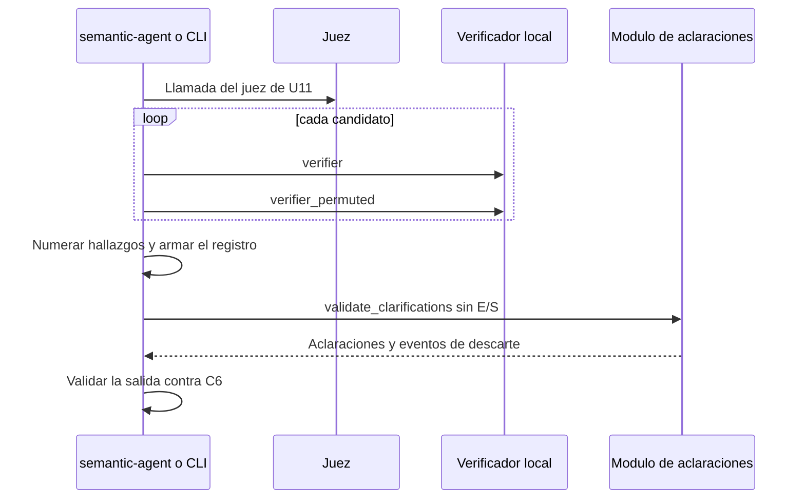

# Diseño de rendimiento — U8 assistant-extras

**Revisión 2 (2026-11-22): segunda pasada por el cambio 01 (DT27), la adenda 02 y el NFR Requirements
revisión 2.** Sustituye a la revisión 1 del 2026-10-03.
- **Qué cambia.** Ya no hay extras que encender. La aclaración no llama a ningún modelo (P4 = A) y la
  permutación del verificador está activa en todos los perfiles (P5 = A). U8 no fija metas propias de
  latencia de la corrida: cabe en las de U11 y U4.
- **Numeración.** §1 y §3–§6 siguen con su tema. §2 (tamaño de los *prompts*) queda «Retirado». §7 pasa a
  `security-design.md` §9. Lo nuevo es §8.

**Insumos.** `nfr-requirements/performance-requirements.md` (performance-requirements: NFR3.1–NFR3.13 y
recursos de §6), `scalability-requirements.md` (scalability-requirements), `reliability-requirements.md`
(reliability-requirements), `security-requirements.md` (security-requirements), `observability-requirements.md`
(observability-requirements) y `tech-stack-decisions.md` (tech-stack-decisions: D3, D9, D12, D13, D14);
`functional-design/functional-spec.md` (functional-spec: F4–F9, §9); C1, C3, C6, C19 y C25 de
`inception/contract-design/contract-summary.md` (contract-summary); diseños de hoy de U4 (transacción de
ingesta de 5 s, sondeo en una instantánea, `statement_timeout` de 2 s) y de U11 (p95 incremental ≤ 180 s,
*N* = 300 s, plazo incremental de 900 s en desarrollo, verificador local con una ranura).

Todas las metas se miden en la **máquina de desarrollo con CPU** (NFR2). Una prueba de rendimiento inestable
se arregla o se pone en cuarentena con un *issue*; nunca se reintenta ni se baja su umbral (`team.md`).

## 1. Camino de la corrida con la aclaración y la permutación (NFR3.1, NFR3.2, NFR3.3)



<!-- Texto alternativo: la corrida llama al juez de U11; por cada candidato hace la llamada al verificador y la permutada, las dos al mismo verificador local. Después numera los hallazgos y arma el registro, llama al módulo de aclaraciones sin entrada ni salida, que devuelve las aclaraciones y los eventos de descarte, y por último valida la salida completa contra C6. -->

| Tramo | Presupuesto | Técnica | Requisito |
|---|---|---|---|
| Juez y verificación con la permutación | p95 ≤ 180 s de la corrida incremental con `comercial-piloto` (meta de U11) | La de U11; la permutada va en serie en la misma ranura que la directa | NFR3.1 |
| Llamadas al verificador por candidato | Exactamente 2 con `permutation: true`; 1 con `false` | Las decide U11 por el perfil; U8 no toca el código (BR6.4) | NFR3.3 |
| Módulo de aclaraciones | **≤ 50 ms** con 50 hallazgos y citas de 2 000 caracteres (margen de 3× en la CI); **0 llamadas** | Función pura, precálculo por salida (abajo) | NFR3.2 |

**Algoritmo del módulo (DS2).** Por salida, una sola vez:
1. Se normalizan todas las citas de todos los hallazgos con las funciones del escáner de C8 (sin mayúsculas,
   sin tildes, espacios colapsados). Se parten por « […] » y se tokenizan en palabras.
2. Se arma el conjunto de 5-gramas de palabras de todos los fragmentos, unos 30 000 como máximo con 100
   citas de 2 000 caracteres.
3. Los términos y las frases de la regla de DT23 ya vienen normalizados desde el arranque (§3 de
   `security-design.md`).

Por candidata:
- `quote_text` busca cada fragmento como palabras completas en `" " + tema + " "`, solo los fragmentos que
  no son más largos que el tema.
- `quote_overlap` intersecta los 5-gramas del tema con el conjunto.
- El escáner de C8 corre una vez por tema.

El costo es lineal en el tamaño de la salida.

```python
def quote_index(findings: Sequence[Finding]) -> QuoteIndex:
    frags = [norm_words(f) for h in findings for c in (h.cita_a, h.cita_b)
             for f in split_fragments(c.texto)]
    grams = {tuple(w[i:i + 5]) for w in frags for i in range(len(w) - 4)}
    return QuoteIndex(fragments=frags, five_grams=frozenset(grams))
```

**Pruebas.**
- Nivel 0 con un `ModelGateway` *fake* que cuenta llamadas: con el módulo y sin él, las mismas llamadas (E11);
  con `permutation: true`, 2 por candidato; con `false`, 1 (E42).
- `pytest -m perf -k clarification` mide la mediana de 20 repeticiones con 50 hallazgos y citas de 2 000
  caracteres: ≤ 150 ms en la CI (3 × 50 ms). La meta de 50 ms se mide en la máquina de desarrollo y se anota
  en el PR.

## 2. Tamaño de los *prompts* · Retirado

Retirado: U8 ya no tiene *prompt* (NFR3.4 y NFR3.5 Retirado). El *prompt* y su tamaño son de U11.

## 3. Plazo con la permutación (NFR3.6)

- **Plazo.** La corrida incremental vive dentro de `run_deadline_incremental_s` (900 s en desarrollo), que
  administra U11 con `timeout_s = min(model_call_timeout_s, restante − 10 s)` por llamada. La permutada es una
  llamada más dentro de esa cuenta. U8 no añade plazo ni reintento.
- **Sin resultado parcial.** Un plazo agotado en la llamada permutada da `estado: error` con
  `tiempo_agotado`, sin hallazgos y sin `observaciones_conductor` (BR5.2). Prueba de nivel 0 con reloj simulado
  y un verificador *fake* que tarda en la segunda llamada: `tiempo_agotado`, 0 hallazgos y sin el campo.
- **`todo-local`.** No tiene meta de latencia propia (NFR-U8-01). El criterio para mantener la permutación es
  NFR8.7 (98 % de corridas sin `tiempo_agotado`), medido en §8.

## 4. Base de datos y consola (NFR3.8, NFR3.9, NFR3.10)

| Operación | Diseño | Meta |
|---|---|---|
| `POST /conductor-observations/{id}/decision` | Una transacción de U3 (`READ COMMITTED`): resolvedor por clave primaria sin bloqueo; `change_cursor.bump` (bloquea la sesión y devuelve su estado y la marca de consentimiento); `SELECT … FOR UPDATE` de la aclaración por clave primaria; máquina de estados pura; `UPDATE status`; `INSERT` del historial con `change_seq`; `COMMIT` (comprueba el disparador diferido) | p95 ≤ 300 ms con 100 decisiones sobre aclaraciones distintas (NFR3.8) |
| Ingesta de aclaraciones | Un único `INSERT … VALUES (…), (…) ON CONFLICT (session_id, turnos, tema_sha256) DO NOTHING RETURNING observation_id` dentro de la transacción de 5 s de U4, después de su `change_cursor.bump` | Sin transacción ni ida y vuelta extra; ≤ 50 filas por corrida |
| Sondeo de la sesión | Las dos tablas llevan `change_seq` con índice `(session_id, change_seq)`. La lectura de U4, en la misma instantánea `REPEATABLE READ`, une las aclaraciones con `change_seq > n` y las de una decisión con `change_seq > n` (dos exploraciones de índice y `UNION`), con su estado vigente (NFRD-U8-02) | p95 ≤ 200 ms con `since` y ≤ 1 s sin él (NFR3.9) |
| Panel en M4 | Lee `SessionView.conductor_observations` del sondeo de 2 s de U4, sin sondeo propio (D14); aplica cada respuesta como *upsert* por `observation_id`. Tras «Aprobar» o «Descartar», la mutación escribe en la caché la `ConductorObservation` de la respuesta `200` (`setQueryData`) sin esperar al sondeo | ≤ 3 s desde el *commit* de la ingesta (NFR3.10) |

**Índices de U8** (migración en su propio PR): clave primaria `observation_id`; único `(session_id, turnos,
tema_sha256)`; `(session_id, change_seq)` en las dos tablas; único `(observation_id)` en
`conductor_observation_decision`.

**Pruebas.**
- `pytest -m perf -k conductor_observation` (nivel 1, en proceso, PostgreSQL real):
  - 100 decisiones sobre aclaraciones distintas, p95 ≤ 300 ms;
  - 200 sondeos con la carga de U4 (2 000 turnos, 100 sugerencias, 20 corridas, 200 llamadas) más 100
    aclaraciones con temas de 2 000 caracteres y sus decisiones: p95 ≤ 200 ms con `since` y ≤ 1 s sin él.
- NFR3.10: Playwright de nivel 3 con el *fake* de C17 y Vitest para la actualización con la respuesta.

## 5. Prueba de humo (NFR3.12)

- `scripts/smoke.sh <url-base>` corre con *N* = 300 s (U11) contra los perfiles tal como están, con
  `permutation: true`. U8 no añade casos ni tiempo: el módulo cuesta ≤ 50 ms y las aclaraciones viajan en el
  mismo resultado.
- **Permutación activa (NFRD-U8-10).** Antes de los casos, `frontend/e2e/smoke.spec.ts` comprueba, en la
  corrida del caso con la contradicción sembrada, que `GET /runs/{run_id}/model-calls` trae al menos un par
  `verifier` y `verifier_permuted`. Si no, falla con un mensaje propio antes de medir.

## 6. Recursos

U8 no añade procesos, servidores ni réplicas.

| Pieza | Presupuesto | Medición |
|---|---|---|
| Módulo de aclaraciones en `semantic-agent` o la CLI | ≤ 5 MiB sobre el pico de U4 (768 MiB en `semantic-agent`) con 50 hallazgos | Nivel 0 con `tracemalloc` (pico de la llamada a `validate_clarifications`) |
| Ingesta en el trabajador de `session-api` | Dentro de los 512 MiB de U4 con un `RunResult` de 2 MiB | Nivel 1 con el caso máximo y el pico de RSS del proceso |
| Servidor local del verificador | Misma ranura y memoria que con la llamada directa | `scalability-design.md` §2 (NFRD-U8-11) |

## 7. Precisiones a artefactos ya aprobados · Superado

Las cuatro filas de la revisión 1 quedan **Superado** (NFRD-U8-01). Las precisiones vigentes están en
`security-design.md` §9.

## 8. Medición del costo de la permutación (NFR3.13, BR6.5)

`uv run --directory evaluation python -m clarifications.permutation_cost --profiles todo-local,comercial-piloto
--report out/u8-permutation-cost.json`, fuera de la CI, en la máquina de desarrollo. La lanza el humano antes
de fusionar B8.

1. Por perfil, por cada una de las 40 entrevistas del conjunto sintético, llama a `veridicus analyze` en modo
   incremental de todos los turnos, con el perfil aprobado tal como está (permutación activa).
2. Lee de cada reporte C19 v2, **por papel en la misma corrida** (NFR-U8-09): llamadas, *tokens* de entrada y
   salida, latencia p50 y p95 de `verificador` y `verificador_permutado`, duración de la corrida y estado
   final.
3. Calcula por perfil:
   - la duración de cada corrida con su suma de llamadas permutadas y sin ella;
   - el p95 de la duración con `comercial-piloto`, frente a 180 s (NFR3.1);
   - la fracción de corridas terminadas sin `tiempo_agotado`, frente al 98 % (NFR8.7);
   - la fracción terminada `done` o `error` con un `code` del catálogo, frente al 100 %.
4. Comprueba que toda llamada `verificador_permutado` registra `anonimizado: false` y un proveedor local, y
   que no suma *tokens* comerciales ni costo. Si una no lo cumple, la medición termina con código distinto
   de 0.
5. Escribe el resumen con el esquema cerrado de solo números y booleanos (NFRD-U8-09). Sin el reporte
   adjunto, el PR de B8 no se fusiona.

Si `todo-local` queda por debajo del 98 %, la permutación se apaga allí por PR, cambiando el perfil y la
prueba de BR6.1 (NFR-U8-01). Nunca se suben los plazos ni se baja el umbral.
