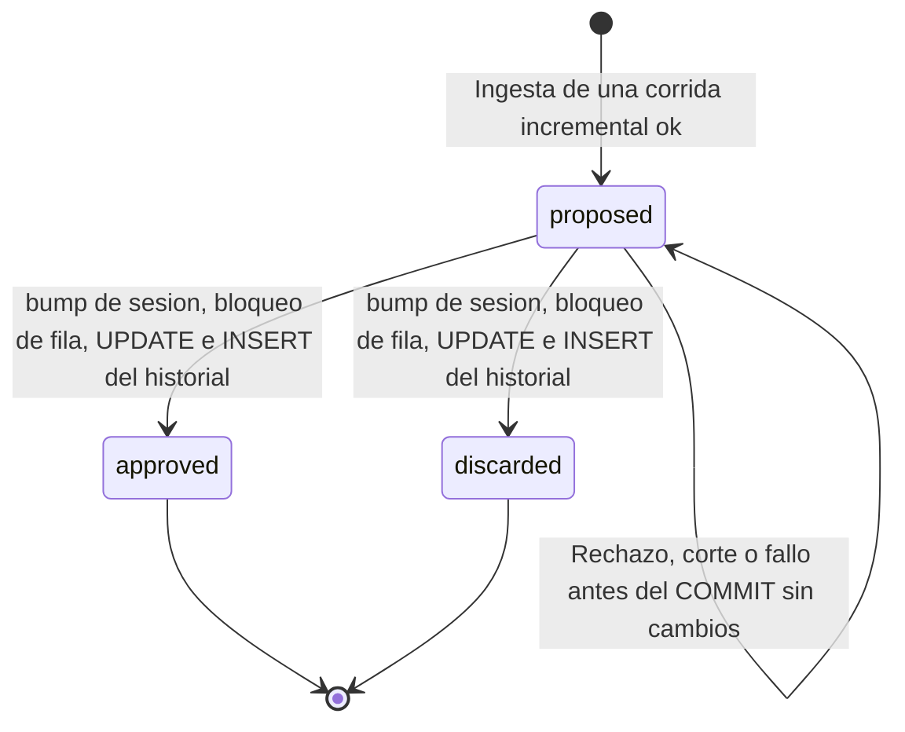

# Diseño de fiabilidad — U8 assistant-extras

**Revisión 2 (2026-11-22): segunda pasada por el cambio 01 (DT27), la adenda 02 y el NFR Requirements
revisión 2.** Sustituye a la revisión 1 del 2026-10-03.
- **Qué cambia.** Sale el juez de los extras. El objetivo de U8 es **no romper la corrida ni la ingesta**.
  Una aclaración que no pasa se quita sin tocar los hallazgos. Un fallo del propio módulo es un fallo de la
  biblioteca, nunca una salida parcial.
- **Numeración.** §1 y §4–§7 siguen con su tema. §2 (fallos del juez por llamada) y §3 (plazo de la pregunta)
  quedan «Retirado», porque P1 = A y P2 = A de la revisión 1 pierden su objeto. §8 pasa a `security-design.md`
  §9. Lo nuevo es §9 y §10.

**Insumos.** `nfr-requirements/reliability-requirements.md` (reliability-requirements: NFR8.6, NFR8.7,
NFR10.11–NFR10.17, NFR4.1–NFR4.6, NFR6.1 y la tabla de recuperación de §4), `performance-requirements.md`
(performance-requirements), `scalability-requirements.md` (scalability-requirements), `security-requirements.md`
(security-requirements), `observability-requirements.md` (observability-requirements) y
`tech-stack-decisions.md` (tech-stack-decisions: D3, D9, D11, D12, D14); `functional-design/functional-spec.md`
(functional-spec: F4–F8, §3, §9, E12–E13, E22–E35, E41–E43) y `functional-design/rules.md` (BR5.1–BR5.13,
BR6.1–BR6.4); C1, C3, C6 y C16 de `inception/contract-design/contract-summary.md` (contract-summary); diseños
de hoy de U4 (*timeouts*, entrega al menos una vez, ingesta idempotente, tratamiento de cada fallo) y de U11
(plazo por llamada, códigos de salida de la CLI).

## 1. *Timeouts* (NFR10.11)

| E/S | *Timeout* | Dónde se fija | Al vencer |
|---|---|---|---|
| Módulo de aclaraciones | No hace E/S | — | — |
| Llamada `verifier_permuted` | `min(model_call_timeout_s, restante − 10 s)` de U11, sin plazo propio | U11 | `estado: error` con `tiempo_agotado` y 0 hallazgos |
| Sentencias de la decisión | 2 s (`statement_timeout` de U4) | `session_api/shared/db.py` | `503` `system.unavailable`; la aclaración sigue `proposed` |
| Inserción en la ingesta | Dentro de la transacción de 5 s de U4 | `interview/application/ingest.py` | *Rollback*; el mensaje de C3 queda pendiente |
| Petición de la consola | La de TanStack Query de U4 | `frontend` | §5 |

**Prueba de que el módulo no hace E/S.** En nivel 0, `validate_clarifications` corre con `builtins.open`,
`socket.socket` y `socket.create_connection` sustituidos por funciones que fallan: el resultado es el
esperado y ninguna se llama. Una comprobación AST, además, falla si
`libs/incoherence_analyzer/domain/clarification.py` importa `io`, `socket`, `httpx`, `os` o `pathlib`.

## 2. Fallos del juez por llamada · Retirado

Retirado: P1 = A de la revisión 1 pierde su objeto. U8 no llama al juez; los reintentos de transporte son de
U11 y la reentrega de la cola es de U4.

## 3. Plazo de la pregunta opcional · Retirado

Retirado: P2 = A de la revisión 1 pierde su objeto con la pregunta sugerida. El plazo de la permutada está en
`performance-design.md` §3.

## 4. Configuración al arrancar y salud (NFR10.14)

| Proceso | Valida al arrancar | Si falla |
|---|---|---|
| CLI de U11 | Regla `neutral-clarification` con el cargador seguro de U1 y `schema_version` conocido; perfiles con la validación de U11 | Código 3, con un mensaje del catálogo que nombra el archivo, nunca su contenido |
| `semantic-agent` | Igual | Termina con código distinto de 0; `/readyz` en `503` (C16) mientras arranca o si falla |
| `session-api` (API y trabajador) | La misma regla, porque la segunda línea la usa (NFRD-U8-12) | Igual |

- La regla se carga una vez y se guarda normalizada en un objeto inmutable que reciben el validador y la
  ingesta. No se relee en cada corrida.
- Pruebas de nivel 0: regla ausente, YAML inválido, versión desconocida (por ejemplo `2.0.0`) y frase vacía,
  cada una con su código de salida. Prueba de nivel 1 de `/readyz` en `503` con la regla rota.
- **BR6.1 en la CI.** La prueba `profiles_permutation` corre en nivel 0 en cada PR. Un perfil con
  `permutation: false` la pone en rojo (E41).

## 5. Decisión atómica y consola (NFR10.15, NFR10.16)

<!-- Texto alternativo: una aclaración nace proposed en la ingesta de una corrida incremental con estado ok. Pasa a approved o a discarded solo con una transacción que mueve el cursor de la sesión, bloquea la fila, actualiza el estado e inserta el historial. Un rechazo, un corte de conexión o un fallo antes del COMMIT la dejan proposed sin cambios. approved y discarded son finales. -->

- **Transacción** (`performance-design.md` §4, D9):
  1. `change_cursor.bump(session_id)` bloquea la sesión;
  2. `SELECT … FOR UPDATE` de la aclaración (orden sesión → fila);
  3. máquina de estados pura (`security-design.md` §5);
  4. `UPDATE status` e `INSERT` del historial;
  5. `COMMIT`, que también comprueba el disparador diferido del historial.

  Un rechazo lanza la excepción de su `code` y el manejador único de U3 revierte todo: 0 filas.
- **Concurrencia.** Dos decisiones simultáneas sobre la misma aclaración van en serie por la sesión. La
  segunda lee `status` ya cambiado y responde `409` `conductor_observation.already_decided`. Prueba de nivel 1
  con dos conexiones y una barrera (E31): una `200`, una `409` y una sola fila de historial.
- **Corte antes de confirmar.** Prueba de nivel 1 que cierra la conexión después del `INSERT` del historial y
  antes del `COMMIT`: `proposed` y 0 filas de historial.
- **Consola.** La mutación de TanStack Query no reintenta sola (`retry: 0`).
  - Ante red o `5xx`, el panel conserva la aclaración pendiente, muestra el mensaje del catálogo y deja
    «Aprobar» y «Descartar» activos.
  - Ante un `409`, muestra su mensaje (functional-spec §6) e invalida la consulta de la sesión, así que el
    siguiente sondeo trae el estado vigente.
  - Mientras hay una petición en curso, los dos botones llevan `aria-disabled` y se ignora un segundo clic.

  Vitest con un servidor *fake* que responde red caída, `503`, `409 already_decided` y `409 session_closed`.

## 6. Calidad de la IA con U8 (NFR4.1–NFR4.6, NFR6.1)

| Requisito | Diseño | Verificación |
|---|---|---|
| NFR4.1 | La permutación es la de U11, sin cambios (BR6.4); U8 la prueba por el camino del producto | Propiedad con Hypothesis del trabajador con un verificador *fake* que decide al azar por orden: hallazgos con permutación ⊆ hallazgos sin ella, y todo candidato confirmado en un solo orden queda `rechazado_permutacion`. Control negativo: un verificador que confirma en los dos órdenes deja salir el hallazgo |
| NFR4.2 | La ingesta guarda los dos `ModelCall` con su papel y el descarte (BR6.3) | Nivel 1: con `permutation: true`, el 100 % de los candidatos verificados tiene dos llamadas, y `GET /runs/{run_id}/model-calls` las devuelve con su papel (E43) |
| NFR4.3 | Comprobador independiente `evaluation/clarifications/check_quotes.py` (D13, DS8): su propia normalización (`casefold`, NFD sin marcas diacríticas, espacios colapsados) y búsqueda directa de cada fragmento de cita en cada tema emitido; busca también los términos de C8 y de la regla de DT23 con su propia comparación por palabra | Nivel 2 por el arnés `clarifications.run`: **0 coincidencias**; bloquea los PR que tocan la aclaración o la IA y toda entrega etiquetada. Nivel 0: un tema sembrado con una cita en un *fixture* hace fallar el comprobador |
| NFR4.4 | Lo mide la evaluación de U11 (40 muestras × 3 corridas) | U8 adjunta ese reporte al PR de B8 y comprueba que su diff no toca el código de la permutación: `git diff --stat` sobre las rutas de U11 que nombra el plan de tareas da 0 líneas |
| NFR4.5 | Función pura sin reloj ni azar; orden por `id` del hallazgo; deduplicación estable que conserva el de menor `id` (BR5.8) | Propiedad: la misma salida da las mismas `observaciones_conductor` en el mismo orden. Nivel 0: CLI y trabajador con la misma entrada incremental dan aclaraciones iguales campo a campo |
| NFR4.6 | La CLI cuenta emitidas y descartadas por regla en la sección `clarifications` de C19 v2 (NFRD-U8-09) | Nivel 2: tasa = descartadas / (emitidas + descartadas) sobre el conjunto, con el conteo por regla. **No bloquea**; por encima de 0,50, el resumen pone `review_signal: true` y la revisión humana del PR nombra la cifra y decide (NFR-U8-02) |
| NFR6.1 | El módulo no toca los hallazgos: lee el `hecho` y las citas y no los modifica | Nivel 0: con un verificador que confirma en los dos órdenes, la salida con y sin permutación es igual salvo el registro; el objeto de hallazgos es el mismo antes y después del módulo (comparación profunda) |

## 7. Recuperación y objetivos (NFR8.6, NFR8.7)

| Falla | Qué se pierde | Cómo se recupera |
|---|---|---|
| Todas las aclaraciones de una corrida no pasan | Las aclaraciones de esa corrida | Nada que recuperar: la corrida sigue `ok` con sus hallazgos (§10) |
| Excepción en el módulo | La corrida | CLI con código 5; el trabajador publica la corrida en error con `analysis.system` y 0 hallazgos; el analista reintenta (reintento de U4, `attempt` + 1) |
| La regla de aclaración neutra no carga | Nada; el proceso no arranca | `/readyz` en `503` hasta el PR que lo corrige (§4) |
| PostgreSQL cae al ingerir | Nada | *Rollback*; el mensaje de C3 queda pendiente y vuelve por la cola de U4 (§9) |
| PostgreSQL cae al decidir | La decisión | La aclaración sigue `proposed`; el analista decide de nuevo (§5) |
| Plazo agotado en la llamada permutada | Los hallazgos de esa corrida | `tiempo_agotado` sin hallazgos; el analista reintenta |

**Objetivos.**
- 0 fallos atribuibles a U8 en cada corrida de `scripts/smoke.sh` con la permutación activa (NFR8.6).
- En la medición de BR6.5 (`performance-design.md` §8), el 100 % de las corridas termina `done` o `error` con
  un `code` del catálogo, y con `todo-local` al menos el 98 % termina sin `tiempo_agotado` (NFR8.7).

Una aclaración que el analista no decide se queda `proposed`: no bloquea la consolidación ni entra en el
reporte (BR5.14).

## 8. Precisiones a artefactos ya aprobados · Superado

Las tres filas de la revisión 1 quedan **Superado** (NFRD-U8-01). Las precisiones vigentes están en
`security-design.md` §9.

## 9. Ingesta atómica e idempotente (NFR10.17, BR5.10)

Se inserta en el flujo de ingesta de U4 (FD-U8-07), dentro de su transacción y después de que U4 compruebe
la vigencia del intento y de la corrida:

1. U4 valida la salida contra C6 y aplica su segunda línea a los hallazgos.
2. `ClarificationIngest` aplica `validate_clarifications` en modo estricto: un elemento que no pasa lanza
   `InvalidOutput` y U4 deja la corrida en `analysis.invalid_output`, con 0 sugerencias y 0 aclaraciones
   (BR5.9).
3. Si la salida es incremental con `estado: ok` y trae aclaraciones, un único `INSERT … ON CONFLICT
   (session_id, turnos, tema_sha256) DO NOTHING` con `status = 'proposed'`, `run_id` de la corrida y
   `change_seq` = el cursor que acaba de fijar el `change_cursor.bump` de U4.
4. El `COMMIT` de U4 confirma todo junto; después, `XACK` y `XDEL` de C3.

| Caso | Resultado | Prueba (nivel 1, PostgreSQL y Redis reales) |
|---|---|---|
| Dos corridas con la misma aclaración | Una fila; la segunda corrida la cuenta como `existing` | E25 |
| Reintento de una corrida (`attempt` + 1) que repite la aclaración | Una fila | E25, variante |
| Segundo `RunResult` del mismo intento | Choca con la clave única de U4 y se confirma sin efectos: 0 filas nuevas | Reentrega de C3 |
| Resultado de una corrida cancelada, vencida o de un intento viejo | 0 filas: U4 lo descarta antes del paso 2 | E26, variante |
| Fallo forzado entre el `INSERT` y el `COMMIT` | 0 filas; el mensaje queda pendiente y se reprocesa | E26 |
| Dos ingestas simultáneas de la misma sesión | Van en serie por la sesión; una fila | NFR8.4 |

## 10. Aclaración que no pasa y fallo del módulo (NFR10.13, BR5.2, BR5.7)

- **Descarte normal.** En la biblioteca, una candidata que falla una regla se quita y deja su evento. Los
  hallazgos, el `estado` y el registro no cambian. No es un error: el evento es `INFO`
  (`observability-design.md` §1).
- **Fallo del módulo.** `validate_clarifications` no captura excepciones propias. Si lanza, la excepción
  sube como cualquier otra de la biblioteca:
  - la CLI termina con código 5 y no escribe salida ni reporte parcial;
  - el `AnalysisWorker` de U4 publica la corrida en error con `analysis.system`, sin hallazgos ni
    aclaraciones.
- **Modo final y error.** En modo final, o con `estado: error` (incluida una salida armada que no cumple C6),
  la salida no trae el campo (BR5.2). La regla 7 de C6 lo refuerza en la ingesta.

**Pruebas de nivel 0.**
- (a) Una salida de dos hallazgos donde la aclaración de uno falla cada regla: salen los dos hallazgos y la
  otra aclaración, `estado: ok`, y un evento por regla.
- (b) El módulo forzado a lanzar: código 5 en la CLI y `analysis.system` en el trabajador, con 0 hallazgos y
  0 aclaraciones.
- (c) Modo final, error por el juez y salida que no cumple C6: sin el campo (E12, E13).
