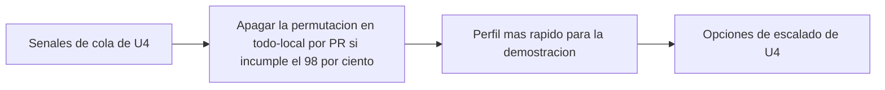

# Diseño de escalado — U8 assistant-extras

**Revisión 2 (2026-11-22): segunda pasada por el cambio 01 (DT27), la adenda 02 y el NFR Requirements
revisión 2.** Sustituye a la revisión 1 del 2026-10-03.
- **Qué cambia.** Ya no hay extras que activar ni un límite propio de turnos en cola. La permutación está
  activa en todos los perfiles y su costo ya lo cuentan U11 y U4. U8 no añade réplicas, colas ni estado en
  memoria.
- **Numeración.** §1–§5 conservan su tema.

**Insumos.** `nfr-requirements/scalability-requirements.md` (scalability-requirements: NFR8.1–NFR8.5 y la
carga esperada de §1), `reliability-requirements.md` (reliability-requirements: NFR8.7),
`performance-requirements.md` (performance-requirements), `security-requirements.md` (security-requirements),
`observability-requirements.md` (observability-requirements) y `tech-stack-decisions.md`
(tech-stack-decisions: D9, D12); `functional-design/functional-spec.md` (functional-spec: F5, F6, F8, §9);
C3, C6 y C25 de `inception/contract-design/contract-summary.md` (contract-summary); diseño de escalabilidad
de U4 de hoy (una corrida a la vez, cola FIFO única, 60 incrementales por delante) y decisión de U11 (verificador
local con una ranura).

## 1. Modelo de capacidad (NFR8.1, NFR8.2)

| Dimensión | Valor | Origen |
|---|---|---|
| Corridas en paralelo | 1 en todo el sistema (U4) | Diseño de U4 |
| Llamadas al verificador por candidato | 2 en serie, en la misma ranura del servidor local | BR6.2; U11 |
| Aclaraciones por corrida | ≤ hallazgos emitidos, deduplicadas | BR5.1, BR5.8 |
| Aclaraciones por sesión | ≤ hallazgos distintos de la sesión; se prueba con 100 | BR5.10; NFR-U8-03 |
| Llamadas nuevas al juez o corridas nuevas por U8 | 0 | BR5.1 |

- **Cola.** La capacidad de U4 (60 incrementales por delante con el p95 de 180 s de U11) ya cuenta la
  permutación. U8 no añade un tope propio. La cifra es **orientativa**, porque toma el p95 como media; el
  criterio medible es NFR8.7 y 0 corridas vencidas por plazo en la prueba de carga (NFR8.2).
- **Prueba de carga con la permutación (NFR8.1).** `evaluation/load/run_batches.py` de U4 corre 50 sesiones
  en tandas de 3 con `comercial-piloto`, registra `config_sha256` y el perfil de cada sesión, y falla si
  alguna usa un perfil con `permutation: false` (ya en el diseño de U4). El umbral de ≥ 98 % se mide así. La
  lanza el humano.

## 2. Memoria (NFR8.3)

| Pieza | Tope | Cómo se mide |
|---|---|---|
| `semantic-agent` | ≤ 768 MiB (U4) | En la prueba de carga: `run_batches.py --prometheus-url <url>` consulta en modo lectura `max_over_time(container_memory_working_set_bytes{pod=~"veridicus-semantic-agent.*"}[<ventana>])` y escribe el pico en su reporte (NFRD-U8-11) |
| Trabajador de `session-api` | ≤ 512 MiB (U4) | Igual, con su pod |
| Servidor local del verificador | Sin cambio entre la llamada directa y la permutada | En la medición de BR6.5 (`performance-design.md` §8): `VmHWM` del proceso después de una llamada de calentamiento y al final; crecimiento ≤ 1 %. La caché de la ranura la reserva el arranque del servidor (`--parallel 1` y tamaño de contexto fijo), así que no depende del número de llamadas |
| CLI | Se registra el pico de RSS (`resource.getrusage`) | En la medición de BR6.5 |

Superar un tope es un hallazgo que se corrige por PR, nunca un ajuste del tope. La consulta a Prometheus es de
solo lectura y la ejecuta el humano; ningún *script* cambia el clúster (AUTONOMIA-01).

## 3. Sin estado en memoria (NFR8.4)

- **Biblioteca.** `validate_clarifications` es pura. Lo que precalcula (fragmentos y 5-gramas) vive solo
  durante la llamada.
- **`session-api`.** No guarda aclaraciones en memoria. La deduplicación por sesión la hace la base con el
  índice único `(session_id, turnos, tema_sha256)` (NFRD-U8-03). La decisión bloquea la sesión y la fila.
  Más réplicas de la API o del trabajador no necesitan coordinarse.
- **Pruebas de nivel 1.** Dos ingestas simultáneas de corridas con la misma aclaración dejan una fila. Dos
  decisiones simultáneas dan una `200` y una `409` `conductor_observation.already_decided`, con una sola fila
  de historial.

## 4. Datos y crecimiento (NFR8.5)

| Tabla | Crecimiento máximo | Retención |
|---|---|---|
| `conductor_observation` | 1 por hallazgo distinto de la sesión | Historial; la purga la retención con la sesión (NFR11.5) |
| `conductor_observation_decision` | 1 por aclaración (`UNIQUE (observation_id)`) | Igual |

- Estimado < 5 MB en el MVP: 100 aclaraciones por sesión con temas de 2 000 caracteres son unos 250 KB,
  contando índices.
- Sin particiones. Las dos tablas entran en `purge_session` de U4 (NFRD-U8-08).
- Prueba de nivel 1: tras el `Job` de retención sobre una sesión con aclaraciones y decisiones, 0 filas de
  las dos tablas para esa sesión.

## 5. Señales para escalar

<!-- Texto alternativo: con las señales de la cola de U4, el primer paso es apagar la permutación en todo-local por PR si incumple el 98 por ciento; si no alcanza, usar en la demostración un perfil más rápido, GPU o comercial; y por último las opciones de escalado de U4. -->

- **Señales.** Las de U4: `veridicus_run_queue_depth` sostenido por encima de 10 y
  `veridicus_run_queue_wait_seconds` cerca de su tope. No hay métrica propia de U8 para la cola.
- **Qué hacer**, en este orden y cada paso por PR con su medición:
  1. apagar la permutación en `todo-local` si incumple NFR8.7 (NFR-U8-01);
  2. usar en la demostración un perfil más rápido (GPU o comercial);
  3. las opciones de escalado de U4.
- Nunca se suben los plazos ni se baja el 98 % para que una corrida pase.
