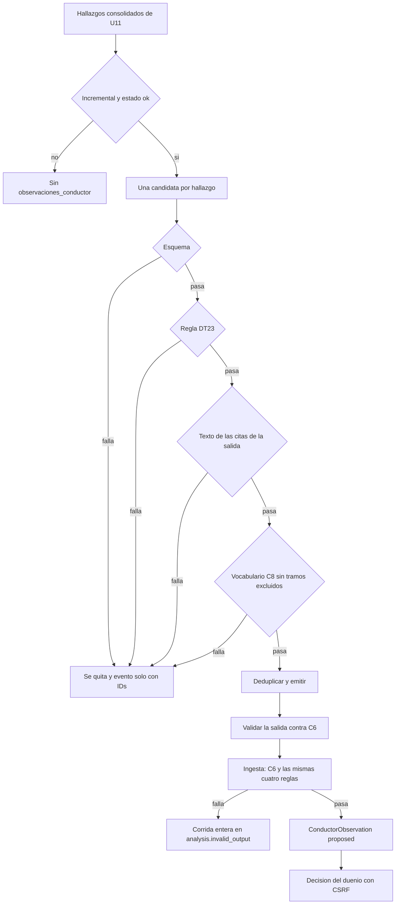

# Diseño de seguridad — U8 assistant-extras

**Revisión 2 (2026-11-22): segunda pasada por el cambio 01 (DT27), la adenda 02 y el NFR Requirements
revisión 2.** Sustituye a la revisión 1 del 2026-10-03, que queda en el historial de Git.
- **Qué cambia.** La revisión 1 diseñaba tres extras apagados: segunda lectura del juez, pregunta sugerida e
  indicio afectivo. Ahora U8 entrega las **aclaraciones neutras** (US10.3), que la biblioteca arma del `hecho`
  sin llamar a ningún modelo. También entrega la **permutación del verificador activa en todos los perfiles**
  (US10.5, P5 = A).
- **Numeración.** §1–§9 conservan su número y su tema. §3 pasa de «*prompt*, esquema y lista» a «esquema y
  regla». Lo nuevo empieza en §10. Las decisiones de diseño son DS1–DS9 (§10) y las precisiones, NFRD-U8-01
  a NFRD-U8-12 (§9).
- **Respuestas.** P1 = A y P2 = A de la revisión 1 pierden su objeto. La segunda pasada no tiene preguntas
  (`nfr-design-questions.md`).
- **Hallazgos de la revisión 1 de esta etapa.** R-04 se cierra en §6. R-01, R-02, R-03 y R-05 desaparecen
  con los extras (§12).

**Insumos.**
- De esta unidad: `nfr-requirements/security-requirements.md` (security-requirements: amenazas T14–T25 y
  tabla NFR-U8-01 a NFR-U8-09), `reliability-requirements.md` (reliability-requirements),
  `performance-requirements.md` (performance-requirements), `scalability-requirements.md`
  (scalability-requirements), `observability-requirements.md` (observability-requirements) y
  `tech-stack-decisions.md` (tech-stack-decisions: D3, D8, D9, D11–D14).
- `functional-design/functional-spec.md` (functional-spec: F4–F9, §3, §6, E11–E43, FD-U8-01 a FD-U8-11),
  `functional-design/rules.md` (BR4.1–BR6.5) y `functional-design/entities.md`.
- C1, C3, C6, C8, C18, C19 y C25 de `inception/contract-design/contract-summary.md` (contract-summary).
- Diseños de hoy, citados por descripción:
  - **U1:** respuesta `413` a un tope, métricas en archivos propios con etiquetas cerradas, catálogo como
    techo y C19 v2 cerrado.
  - **U3:** ruta protegida en orden fijo, registro de resolvedores de dueño, anti-CSRF derivado, marca de
    auditoría en el `COMMENT` y permisos por marca.
  - **U4:** ingesta en una transacción de 5 s, sondeo en una instantánea `REPEATABLE READ` con
    `change_seq`, orden sesión → corrida → ronda y `purge_session`.
  - **U10:** alias `verifier_permuted → verifier` en la copia de perfiles.
  - **U11:** catálogo cerrado de mensajes de la CLI, la biblioteca no exporta métricas y único cargador de
    `config/profiles.yaml`.
- Reglas AUTONOMIA-01..05 de `team.md` y prohibiciones de `project.md`.

U8 reutiliza sin repetirlos los controles de U3 (sesión, rol, anti-CSRF, auditoría), de U4 (validación de C6
en la ingesta, logs solo con IDs) y de U11 (escáner de C8, validación de la salida, permutación). Este
documento fija dónde se insertan los suyos. Salvo que se diga otra cosa, cada control se prueba en
**nivel 0**, sin red ni GPU, con su control negativo. Los comandos son los de `tech-stack-decisions.md` §5.

## 1. Frontera (AUTONOMIA-04; NFR1.1, NFR1.2)

| Componente | Proceso | Dentro o fuera del clúster | Qué cruza su frontera | Hacia dónde |
|---|---|---|---|---|
| `domain/clarification.py` (armado y validación) | `semantic-agent` | Dentro, bajo la `NetworkPolicy` de salida denegada de U2 | Nada: arma el tema en memoria con el `hecho` ya restaurado | — |
| `domain/clarification.py` | CLI de U11 | Fuera (máquina local o nodo de ZINE), como la CLI | Nada nuevo: la salida sigue las reglas de la CLI (corpus fuera de Git) | — |
| Llamada `verifier_permuted` (F8) | `semantic-agent` o CLI | El mismo destino que `verifier` | `hecho`, `tipo` y las dos citas, hacia el servidor local del verificador; **nada sale** con los perfiles actuales | Servidor local; con un verificador externo futuro, `anonymizer-proxy` como la llamada directa |
| `ClarificationIngest` (segunda línea y guardado) | Trabajador de `session-api` | Dentro | Nada sale; filas en PostgreSQL interno | PostgreSQL |
| `ConductorObservationDecisionService` | API de `session-api` | Dentro | Tema, turnos y estado hacia el navegador por el Ingress con TLS de U2 | Navegador del analista |
| `ConductorObservationPanel` (M4) | Navegador, servido por `frontend` | Equipo del analista, como toda la consola | Solo lo que devuelve ConsoleApi; nunca las citas (BR5.15) | ConsoleApi |
| `config/profiles.yaml` (`permutation`) | Archivo versionado | — | Nada | — |
| Arneses de nivel 2 (`evaluation/clarifications/`) | Máquina del humano | Fuera | Solo enteros, *hashes* y versiones en los reportes adjuntos al PR (§6, NFRD-U8-09) | PR |

**U8 no añade destinos ni llamadas a modelos (NFR1.1).**
- Una prueba con un `ModelGateway` *fake* que cuenta llamadas corre la misma entrada incremental con el
  módulo y sin él: mismas llamadas, en el mismo orden (E11).
- U8 no tiene ajustes propios (tech-stack-decisions §2), así que no puede tener un campo URL.
- La tabla anterior va al README de `libs/incoherence_analyzer/domain/` y de `services/session-api/`.
  Un componente nuevo entra con su fila en el mismo PR (lo comprueba la revisión).

**La llamada permutada sale por el mismo camino que la directa (NFR1.2).** La prueba
`profiles_permutation_same_destination` carga cada perfil con el único cargador de U11 y resuelve
`verifier_permuted` y `verifier`. Deben dar el mismo proveedor, modelo, alcance y `base_url`. Control
negativo: un *fixture* de perfil que da a `verifier_permuted` otro destino. En la corrida de E42, los dos
`ModelCall` llevan el mismo `proveedor`, `modelo` y `anonimizado`. La verificación manual de la
`NetworkPolicy` es la de U2, sin pasos propios.

## 2. Cadena de defensa de la aclaración (AUTONOMIA-03, AUTONOMIA-05; NFR10.1, NFR10.5)



<!-- Texto alternativo: con los hallazgos consolidados de U11, si la corrida no es incremental con estado ok no hay aclaraciones. Si lo es, se arma una candidata por hallazgo y pasa cuatro comprobaciones en orden: esquema, regla de DT23, texto de las citas de toda la salida y vocabulario de C8 sin tramos excluidos. La primera que falla quita la candidata y deja un evento solo con identificadores. Las que pasan se deduplican y se emiten, y la salida completa se valida contra C6. En la ingesta se repiten C6 y las cuatro reglas; si una falla, la corrida entera queda en analysis.invalid_output. Si pasan, la aclaración se guarda como proposed y solo el analista dueño la decide, con anti-CSRF. -->

| Paso | Módulo | Control | Requisito |
|---|---|---|---|
| Armado | `libs/incoherence_analyzer/domain/clarification.py` (guardia, 100 % de ramas) | `tema` = `hecho` con espacios normalizados; `turnos` de `cita_a` y `cita_b`; solo en modo incremental con `estado: ok` (BR5.1, BR5.2) | NFR5.1, NFR4.5 |
| Esquema | Igual | Exactamente `tipo`, `tema` y `turnos`, con el esquema de C6; un campo extra se quita con `schema` (BR5.3) | NFR10.4 |
| Regla de DT23 | Igual, con la regla `neutral-clarification` leída por el cargador seguro de U1 (§3) | Términos de contradicción, frases y cita de turno, con la normalización del escáner (BR5.4, D11) | NFR10.5 |
| Texto de las citas | Igual | Fragmentos de todas las citas de la salida, como palabras completas, y 5 palabras seguidas en común (BR5.5; algoritmo en `performance-design.md` §1) | NFR4.3 |
| Vocabulario | `scan(tema, literal_sources=[])` de `libs/integrity_policy` | Sin tramos excluidos: una palabra prohibida entre comillas también quita (BR5.6) | NFR10.5 |
| Segunda línea | `ClarificationIngest` en el trabajador de `session-api` | Después de C6, el mismo validador de D3 contra las citas de todos los hallazgos; un fallo deja la corrida entera en `analysis.invalid_output`, con 0 sugerencias y 0 aclaraciones (BR5.9) | NFR10.1 (b) |
| Decisión | `ConductorObservationDecisionService` | Ruta protegida de U3 y máquina de estados pura (§5) | NFR10.6 |

**Una sola implementación.** La ingesta importa `validate_clarifications` de
`libs/incoherence_analyzer/domain/clarification.py` (D3). No hay una segunda versión que pueda divergir.
La independencia la aporta el comprobador de nivel 2 (§6, D13). La prueba BR5.16 corre en las dos suites
(biblioteca y `session-api`) los casos de aclaración neutra de `contracts/integrity/scan-cases`. Un caso
invertido pone las dos en rojo (E40).

**Pruebas.** Una por regla en nivel 0, con su control negativo (E14–E20, E22). Un resultado inyectado por
regla en nivel 1 contra PostgreSQL real (E23, E24): corrida en `analysis.invalid_output`, 0 filas de
sugerencia y 0 de aclaración.

## 3. Esquema y regla inmutables (NFR10.4, NFR10.5, NFR10.9)

- **Esquema de la aclaración.** El elemento de `observaciones_conductor` es el de C6 (`additionalProperties:
  false`; `tipo`, `tema`, `turnos`). El esquema `ConductorObservation` de C1 suma `additionalProperties:
  false` y `created_at` (NFR-U8-04, en el PR de U1). La prueba de la huella de seguridad de U1 recorre los
  dos y ninguna propiedad cae en `categories_forbidden_in_schemas` de C8. Un elemento con `is_truthful` se
  quita en la biblioteca y, si llega a la ingesta, invalida la corrida (E24).
- **Regla de DT23.** `contracts/integrity/neutral-clarification.v1.yaml` en su versión 1.1.0 (FD-U8-04, PR de
  U1) llega en el paquete `veridicus_contracts`. Se carga al arrancar con el cargador YAML seguro de U1
  (`importlib.resources`, sin ruta del disco). Se acepta solo un `schema_version` conocido. Los términos se
  normalizan una vez con las funciones del escáner de C8 (palabra completa, sin mayúsculas ni tildes,
  espacios colapsados; D11). La lista cambia solo por PR de U1 con un caso negativo por frase.
- **Permutación por archivo (NFR10.9).** `permutation` vive en `config/profiles.yaml` y solo lo abre el
  cargador de U11 (comprobación AST de U11). La prueba `profiles_permutation` falla si algún perfil tiene
  `permutation: false` (BR6.1, E41). Apagarla en un perfil exige cambiar en el mismo PR el perfil y la lista
  de excepciones de esa prueba, con el reporte de BR6.5 adjunto (NFR11.4). Ninguna ruta de C1 escribe
  perfiles: lo comprueba la suite de U1 sobre la especificación OpenAPI.

## 4. Inyección desde el testimonio (NFR5.1; T23)

U8 no tiene *prompt*: la inyección solo puede llegar al tema por el `hecho` que escribió el juez de U11, y
U11 mide el Escenario A sobre los `hecho` emitidos.

- **Propiedad.** Una prueba con Hypothesis comprueba que el tema de cada aclaración es función solo del
  `hecho` de su hallazgo de origen. Con turnos, citas, `observaciones` y `tipo` cambiados, el tema no
  cambia. Así, el 0 de marcas del Escenario A que mide U11 vale para los temas.
- **Marca sembrada.** Una aclaración cuyo `hecho` lleva la marca de inyección (fuera de una cita) sigue el
  mismo camino de §2: ni cambia de regla de descarte ni se salta una regla.
- **Presentación.** El panel pinta el tema como texto (`{tema}` de React, nunca HTML), con
  `react/no-danger` como error en ESLint (`team.md`). Un tema con `<script>` y `` se muestra
  literal en Vitest.

## 5. Autorización de la decisión (NFR10.1 (a), NFR10.6, NFR10.7)

- **Ruta.** `POST /conductor-observations/{observation_id}/decision` de C1 declara `x-veridicus-roles:
  [analista]`, `x-veridicus-owner-only: true` y `X-CSRF-Token`. Se suman `x-veridicus-max-bytes:
  review_body_max_bytes` y la respuesta `413` `limits.exceeded`, en el PR de U1 que ya lleva FD-U8-02
  (NFRD-U8-05). La ruta corre en `GuardedRoute` de U3, en su orden fijo: sesión → CSRF → bloqueo compartido
  del usuario → rol → identificador y dueño → cuerpo.
- **Resolvedor.** U8 registra al arrancar `OwnerResolver` para el `operationId` de la ruta:
  `SELECT session.owner_user_id FROM conductor_observation JOIN interview_session …` por clave primaria y
  sin bloqueo. Si no hay fila, lanza la excepción `ConductorObservationNotFound` (`404`
  `conductor_observation.not_found`). Sin el resolvedor, ConsoleApi no arranca (comprobación de U3).
- **Cuerpo.** El validador compilado de U3 sobre el esquema de C1 (`status` ∈ {`approved`, `discarded`}, sin
  otros campos) y `observation_id` UUID. Si no cumple, `422` `validation.invalid_request` sin el valor de
  entrada.
- **Máquina de estados** (`services/session-api/src/session_api/interview/domain/conductor_observation_state.py`,
  guardia, 100 % de ramas). Es una función pura: recibe el estado de la aclaración, la decisión pedida, el
  estado de la sesión y la marca de consentimiento retirado, y devuelve el nuevo estado o el `code` del
  rechazo (BR5.12, tabla de functional-spec §3). Los datos de la sesión se leen de la fila que acaba de
  bloquear `change_cursor.bump`, así que una retirada del consentimiento concurrente queda antes o después,
  nunca a medias (T24).

```python
def decide(obs: ObservationStatus, wanted: Decision, session: SessionState,
           consent_withdrawn: bool) -> Decision | ErrorCode:
    if obs is not ObservationStatus.PROPOSED:
        return ErrorCode.CONDUCTOR_OBSERVATION_ALREADY_DECIDED
    if session in CLOSED_STATES:                       # finalized, terminated, consolidated
        return ErrorCode.CONDUCTOR_OBSERVATION_SESSION_CLOSED
    if wanted is Decision.APPROVED and consent_withdrawn:
        return ErrorCode.CONDUCTOR_OBSERVATION_SESSION_CLOSED
    return wanted                                      # open, paused, suspended, blocked
```

| Petición | Respuesta | Filas nuevas |
|---|---|---|
| Otro analista | `403` `session.not_owner` | 0 |
| `admin` | `403` `auth.forbidden` | 0 |
| Sin anti-CSRF o con uno que no coincide | `403` `auth.csrf` | 0 |
| `observation_id` inexistente | `404` `conductor_observation.not_found` | 0 |
| Ya decidida | `409` `conductor_observation.already_decided` | 0 |
| Aprobar con el consentimiento retirado, o decidir en una sesión cerrada | `409` `conductor_observation.session_closed` | 0 |
| Cuerpo de más de `review_body_max_bytes` | `413` `limits.exceeded` | 0 |

Nivel 1, E27–E34: cada fila con el recuento de filas antes y después.

- **Puerto de aprobación (NFR10.7).** `is_observation_approved(observation_id) -> bool | None` en
  `interview/application/ports.py`. Es de solo lectura y devuelve `None` si la aclaración no existe. U9 lo
  consulta antes de llamar a `audio-worker`. Su prueba de nivel 1 de la ruta de audio es de U9 en B9
  (NFR-U8-07). La prueba de nivel 0 de U8 cubre los tres estados y la inexistente.
- **Fuera del reporte (BR5.14).** El reporte de U7 no lee `conductor_observation`. El escaneo de contenido
  del reporte de U7 corre sobre un *fixture* de sesión con aclaraciones aprobadas y no encuentra ningún tema
  (E37, nivel 1).

## 6. Integridad y auditoría (NFR11.1–NFR11.5, NFR12.1, NFR12.2; cierra R-04 de la revisión 1)

| Control | Diseño | Verificación |
|---|---|---|
| Marcas de auditoría | `COMMENT ON TABLE conductor_observation` con `veridicus-audit: {"kind":"mutable","purgeable":true,"owner_unit":"U8"}`; `conductor_observation_decision` con `{"kind":"history","purgeable":true,"owner_unit":"U8","actor_user_column":"actor_user_id","at_column":"at"}`. La migración llama al final a `veridicus_apply_audit_grants()` de U3 | Prueba común de nivel 1 de U3 con las dos tablas (NFR11.1) |
| Historial completo | `conductor_observation_decision` lleva `actor_kind`, `actor_user_id`, `actor_system` (dominio de U3, siempre nulo aquí), `at` `NOT NULL` y la restricción de actor de U3; además `CHECK (actor_kind = 'user')`, `CHECK (status IN ('approved','discarded'))` y `UNIQUE (observation_id)` (NFRD-U8-04) | Nivel 1: una inserción con `actor_kind = 'system'` o sin `actor_user_id` falla |
| Aclaración que no cambia de nuevo | Disparador `BEFORE UPDATE` en `conductor_observation`: rechaza si `OLD.status <> 'proposed'`, si `NEW.status` no es `approved` ni `discarded` o si cambia cualquier otra columna. Así el permiso de tabla `UPDATE` de la marca `mutable` queda en la práctica solo para `status` | Nivel 1: cambiar una `approved`, pasar a `proposed`, tocar `tema` y borrar una `discarded` con `veridicus_app` fallan (NFR11.2) |
| Quién y cuándo, siempre | Disparador de restricción `DEFERRABLE INITIALLY DEFERRED` en `conductor_observation`: al confirmar, toda fila cuyo `status` cambió tiene exactamente una `conductor_observation_decision` con ese mismo `status`. Un `UPDATE` sin historial no se puede confirmar (cierra R-04 de la revisión 1) | Nivel 1: `UPDATE` directo sin `INSERT` → el `COMMIT` falla; fallo forzado en el `INSERT` del historial → `status` sigue `proposed` (E35) |
| Sin borrado por la aplicación | `veridicus_app` no tiene `DELETE` (marca `purgeable`); claves foráneas `conductor_observation_decision → conductor_observation` y `conductor_observation → interview_session` con `ON DELETE RESTRICT` | Nivel 1 |
| Solo la retención borra (NFR11.5) | `purge_session` de U4 borra, como `veridicus_retention`, primero `conductor_observation_decision` y después `conductor_observation` de la sesión, antes que la sesión (NFRD-U8-08) | Prueba de nivel 1 común con U13: con `veridicus_retention` el borrado funciona; con `veridicus_app` falla |
| Permutación sin reescritura (NFR11.3) | Las llamadas `verificador` y `verificador_permutado` y el descarte `rechazado_permutacion` quedan en las tablas `history` del registro de U4 | Nivel 1 con el resultado de E42: dos `ModelCall`, un descarte, 0 sugerencias de ese candidato; un `UPDATE` sobre esas filas falla |
| Permutación versionada (NFR11.4) | `permutation` entra en `config_sha256` de cada corrida (huella JCS de U1) | Nivel 0: cambiar `permutation` en un *fixture* cambia la huella |
| Datos sintéticos (NFR12.1) | Hallazgos, citas, temas y resultados inyectados con el catálogo de nombres y las marcas sintéticas de U1 | Comprobación de U1 sobre las carpetas de pruebas de U8, con 0 hallazgos |
| Mediciones solo sintéticas (NFR12.2) | Los arneses de `evaluation/clarifications/` solo aceptan entradas de `evaluation/` con `origen: sintetico` y llaman a la CLI, que termina con código 2 ante una entrada de corpus. Escriben reportes C19 v2 validados y un resumen con esquema cerrado de solo números (NFRD-U8-09) | Nivel 0: una entrada de corpus da código 2 y ningún archivo; un resumen con una cadena no valida |

Las migraciones de las dos tablas, de los disparadores y de los índices corren como `Job` aparte en su
propio PR (`team.md`, AUTONOMIA-01). Ninguna corre al arrancar un pod (`project.md`).

## 7. Datos sensibles en logs, métricas y eventos (NFR10.8; T20)

- **Biblioteca.** `validate_clarifications` es pura y devuelve las aclaraciones y los `ClarificationDiscardEvent`
  (solo `run_id`, `source_finding_id` y `rule`). No escribe logs. Quien la llama los emite por su vía
  tipada:
  - en la CLI, con dos plantillas nuevas del catálogo cerrado `cli/messages.py`
    (`clarification.discarded` y `clarification.summary`), con parámetros `RunId`, `FindingId`,
    `ClarificationRule` e `int`;
  - en `semantic-agent` y en `session-api`, con el formateador JSON de lista blanca de U3, ampliado con
    campos tipados solo para los eventos de U8 (NFRD-U8-07).

  Ningún tipo admite `str` libre: `FindingId` exige el patrón del `id` de hallazgo de C6.
- **Excepciones.** Una excepción del módulo se registra con su tipo y su `code`, nunca con su mensaje ni su
  `repr` (regla de U4 y U11; `exc_info` prohibido en los módulos que tocan testimonio).
- **Métricas.** Las dos de `observability-design.md` §2, sin etiquetas de texto.
- **Prueba del centinela.** Se siembra una cadena centinela en un `hecho`, en las dos citas y en un turno, y
  se ejecutan una corrida que emite, otra que descarta por cada regla y otra con el módulo forzado a fallar.
  Debe haber **0 apariciones** en los logs de `semantic-agent` y de `session-api` (también en los de error),
  en la salida de error de la CLI, en `/metrics` y en cada `ClarificationDiscardEvent` capturado (E21).
  Nivel 0 en la biblioteca y la CLI; nivel 1 en los servicios.

## 8. Amenazas y controles

T1–T13 de la revisión 1: **Retirado** con F1–F3 (security-requirements §2).

| Amenaza | Controles de este diseño |
|---|---|
| T14 El tema revela la contradicción u orienta la respuesta | §2 (regla de DT23 en la biblioteca y en la ingesta), §3 (regla versionada) |
| T15 El tema contiene una cita | §2 (texto de las citas de toda la salida), §6 (comprobador independiente de nivel 2) |
| T16 Etiqueta o campo de veracidad | §2 (esquema y escáner), §3 (esquemas estrictos y huella de U1) |
| T17 Aclaración que suena o entra al reporte sin aprobación | §5 (puerto `is_observation_approved`; fuera del reporte) |
| T18 Decisión ajena, de `admin` o sin anti-CSRF | §5 (`GuardedRoute` de U3 y resolvedor) |
| T19 Reescribir o borrar una decisión | §6 (disparadores, historial `history`, sin `DELETE`) |
| T20 Texto en logs, métricas o eventos | §7 |
| T21 Resultado inyectado en la cola | §2 (segunda línea que invalida la corrida entera) |
| T22 Permutación apagada sin rastro | §3 (prueba de BR6.1), §6 (huella `config_sha256`) |
| T23 Inyección que acaba en el tema | §4 |
| T24 Aprobar tras la retirada del consentimiento | §5 (estado leído de la fila bloqueada) |
| T25 Muchas aclaraciones frenan el sondeo | `performance-design.md` §4 (índices y sondeo incremental) |

**Límite declarado.** La ingesta no comprueba que los `turnos` de una aclaración existan en la
transcripción: ninguna regla aprobada lo pide. Un resultado inyectado con un turno inexistente necesita la
contraseña de Redis (Secret de U2). Si llegara, el enlace del panel no encuentra el turno y no muestra nada.

## 9. Precisiones a artefactos ya aprobados (NFRD-U8-xx)

No edité ningún artefacto aprobado (regla de `project.md`). En la aprobación decides cuáles se llevan al
original, cada una en su propio commit. Todas se aplicaron sin preguntar, porque salen de las fuentes o de
hallazgos que un experto cierra. Ninguna deja salir del clúster algo que hoy no sale. Las que piden algo a
U1, U3 o U4 son **peticiones**: no se dan por aplicadas hasta que esa unidad las acepte.

| ID | Artefacto aprobado | Precisión | Origen |
|---|---|---|---|
| NFRD-U8-01 | Revisión 1 de esta etapa (`security-design.md` §9, `performance-design.md` §7, `reliability-design.md` §8) | Se retiran enteras las tablas de precisiones de la revisión 1: límite `question_decision_body`, campos de log de los extras, reclamo de 510 s, `call_judge_with_retry` por llamada, comprobación de plazo de la pregunta y `change_seq` de `suggested_question`. Las supera el cambio 01 | Cambio 01 |
| NFRD-U8-02 | `functional-design/entities.md` (ConductorObservation, ConductorObservationDecision) y, como **petición**, el diseño de fiabilidad de U4 (lectura del sondeo) | Las dos tablas llevan `change_seq` = el `change_cursor` de la sesión tras `change_cursor.bump`, fijado al insertar, con índice `(session_id, change_seq)` en cada una. El `change_seq` de la aclaración no cambia al decidir; el de su decisión dice cuándo cambió. U4 suma a su lectura en la misma instantánea las aclaraciones con `change_seq > n` o cuya decisión tenga `change_seq > n`, y las devuelve en `SessionView.conductor_observations` con su estado vigente | NFR3.9; F5 paso 3; sondeo de U4 |
| NFRD-U8-03 | `nfr-requirements/tech-stack-decisions.md` (D12) y `entities.md` (restricción única) | El índice único es `(session_id, turnos, tema_sha256)`. `tema_sha256` es una columna generada `sha256(convert_to(tema_key, 'UTF8'))`, porque un tema de varios KB no cabe en una entrada de índice *B-tree* de PostgreSQL. `tema_key` se guarda igual. La inserción usa `ON CONFLICT (session_id, turnos, tema_sha256) DO NOTHING` | D12; NFR-U8-03 (el `hecho` no tiene tope propio) |
| NFRD-U8-04 | `entities.md` (ConductorObservationDecision) y `security-requirements.md` (NFR11.2) | El historial suma `actor_system` (dominio de U3, siempre nulo) para cumplir la restricción común de actor, con `CHECK (actor_kind = 'user')` y `UNIQUE (observation_id)`. «Solo puede actualizar `status`» se aplica con el disparador `BEFORE UPDATE`, porque los permisos de U3 son por tabla según la marca. Un disparador diferido exige la fila de historial al confirmar. Cierra R-04 de la revisión 1 | Convención de auditoría de U3; R-04 de la revisión 1 |
| NFRD-U8-05 | `contract-summary.md` (C1, ruta de la decisión) y, como **petición**, el NFR Design de U1 | La ruta declara `x-veridicus-max-bytes: review_body_max_bytes` (65 536, ya en C25) y la respuesta `413` `limits.exceeded`, en el PR de U1 que lleva FD-U8-02. No hay cifra nueva en C25 | NFR10.1; regla de `413` de U1; NFR-U8-03 (sin cifras nuevas) |
| NFRD-U8-06 | `security-requirements.md` (NFR-U8-05: «C15») y `observability-requirements.md` (§2) | Las dos métricas van en `contracts/metrics/assistant-extras.v1.yaml`, con la forma de C15 y la etiqueta `state` de la lista cerrada de U1. C15 sigue siendo de U5 | Decisión de U1 de hoy (métricas en archivos propios) |
| NFRD-U8-07 | Como **petición**, el diseño de observabilidad de U3 (lista blanca del formateador) | Campos tipados solo para los eventos `clarification.*` y `conductor_observation.*`: `observation_id` (UUID), `source_finding_id` (patrón del `id` de C6), `rule` (enum de 7), `state` (`approved`, `discarded`), y `emitted`, `discarded`, `inserted` y `existing` (enteros ≥ 0). Las plantillas `clarification.discarded` y `clarification.summary` de la CLI las escribe U8 en B8 sobre el catálogo de U11 | NFR15.2, NFR15.3; formateador de U3; catálogo de U11 |
| NFRD-U8-08 | Como **petición**, el diseño de U4 (`purge_session`) | `purge_session` borra, en la misma transacción y como `veridicus_retention`, `conductor_observation_decision` y después `conductor_observation` de la sesión, antes de las filas de la sesión. Las claves foráneas son `ON DELETE RESTRICT` | NFR11.5; FD-U8-07 |
| NFRD-U8-09 | `security-requirements.md` (NFR12.2), `tech-stack-decisions.md` (§5, D13) y, como **petición**, C19 v2 de U1 | La sección `clarifications` de C19 v2 trae `emitted`, `discarded` por cada una de las 7 reglas y `quote_matches` opcional. La CLI escribe las dos primeras desde sus eventos. El arnés `clarifications.run` añade `quote_matches` con el resultado del comprobador independiente y vuelve a validar contra C19 v2. Los reportes por entrevista van en `out/u8-clarifications/`. `out/u8-clarifications.json` y `out/u8-permutation-cost.json` son resúmenes con un esquema cerrado de solo números y booleanos en `evaluation/clarifications/schemas/` | NFR4.3, NFR4.6, NFR3.13; FD-U8-09 |
| NFRD-U8-10 | `performance-requirements.md` (NFR3.12: «el perfil de la sesión declara la permutación activa») | `frontend/e2e/smoke.spec.ts` lo comprueba por el comportamiento: en la corrida del caso con contradicción sembrada, `GET /runs/{run_id}/model-calls` trae al menos un par `verifier` y `verifier_permuted`; si no, falla antes de los casos. La vista de la sesión no expone el perfil y no se añade un campo a C1 | NFR3.12; BR6.3 |
| NFRD-U8-11 | `scalability-requirements.md` (NFR8.3) | Los picos de los pods se toman en la prueba de carga: `run_batches.py` (U4, opción que añade U8 en B8) consulta en modo lectura `max_over_time` de `container_memory_working_set_bytes` por pod en Prometheus, en la URL que pasa el humano. En la medición de BR6.5 por la CLI se registran el pico de RSS de la CLI y el `VmHWM` del servidor local del verificador después de una llamada de calentamiento y al final. «Sin cambio de memoria» significa un crecimiento ≤ 1 % | NFR8.3; medición de BR6.5 fuera del clúster |
| NFRD-U8-12 | `reliability-requirements.md` (NFR10.14) | `session-api` (API y trabajador) también carga y valida al arrancar la regla `neutral-clarification`, porque la segunda línea la usa. Si falta o su versión es desconocida, no arranca y `/readyz` responde `503` | NFR10.14; BR5.9 |

## 10. Decisiones de diseño y alternativas

| # | Estado | Decisión | Alternativas descartadas | Consecuencias |
|---|---|---|---|---|
| DS1 | nuevo | Un solo validador puro en la biblioteca, importado por la ingesta (D3) | Reglas propias en `session-api`; validar con el LLM | La biblioteca y la ingesta no pueden divergir. A cambio, un defecto del validador es de modo común; lo atrapa el comprobador independiente (DS8) |
| DS2 | nuevo | Fragmentos normalizados y conjunto de 5-gramas precalculados una vez por salida | Comparar cada tema con cada cita en bruto | ≤ 50 ms con 50 hallazgos (`performance-design.md` §1). A cambio, unos cientos de KB en memoria durante la corrida |
| DS3 | nuevo | Decisión con `change_cursor.bump` de la sesión, bloqueo de la fila y estado de la sesión leído de la fila bloqueada | `UPDATE … WHERE status = 'proposed'` sin bloquear la sesión (revisión 1); bloqueo optimista | Sin carreras con la retirada ni con la ingesta, y el cursor del sondeo se mueve en la misma transacción. A cambio, dos decisiones de la misma sesión van en serie |
| DS4 | nuevo | Disparador diferido que exige el historial al confirmar | Confiar en el orden del código; columnas `decided_by` en la fila | Imposible confirmar un cambio de estado sin quién y cuándo (AUTONOMIA-03). A cambio, un disparador más que probar |
| DS5 | nuevo | `change_seq` en las dos tablas; el de la aclaración fijo, el de la decisión al decidir | Permitir actualizar `change_seq` en la aclaración | Se respeta «solo cambia `status`» (NFR11.2). A cambio, la lectura del sondeo une dos índices |
| DS6 | nuevo | Índice único sobre el SHA-256 de `tema_key` | Índice sobre `tema_key`; tope de longitud del tema en C25 | Funciona con cualquier largo, sin cifra nueva (NFR-U8-03). A cambio, una columna generada |
| DS7 | nuevo | La prueba de humo comprueba la permutación en el registro de llamadas | Exponer el perfil en `SessionView` | Mide lo que de verdad ocurre, sin tocar C1. A cambio, depende de que el caso sembrado llegue a verificarse |
| DS8 | nuevo | Comprobador de nivel 2 con su propia normalización y búsqueda directa de subcadenas (D13) | Reutilizar el validador de D3 | Defensa sin modo común para la meta del 0 %. A cambio, dos normalizaciones que mantener |
| DS9 | nuevo | Tope del cuerpo de la decisión con `review_body_max_bytes` | Cifra propia en C25; sin tope | Un cuerpo enorme no se lee y no hay cifra nueva. A cambio, el tope depende de una cifra de U5 |

## 11. Correspondencia con AUTONOMIA

| Regla | Qué aporta este diseño | Secciones |
|---|---|---|
| AUTONOMIA-01 | Perfiles, regla y migraciones solo por PR; la migración en su propio `Job` y PR; los arneses de nivel 2 los lanza el humano | §3, §6 |
| AUTONOMIA-02 | Cada control nombra su prueba y su umbral; comandos en `tech-stack-decisions.md` §5 | §1–§7 |
| AUTONOMIA-03 | Esquemas sin campos de veracidad, escáner sin tramos excluidos, decisión solo del dueño con quién y cuándo exigidos por la base, nada sin aprobación | §2, §3, §5, §6 |
| AUTONOMIA-04 | Frontera por componente, sin destinos ni llamadas nuevas, llamada permutada por el mismo camino, logs solo con IDs | §1, §7 |
| AUTONOMIA-05 | `estado: error` sin aclaraciones; la permutación solo quita hallazgos y queda registrada | §2, §6; `reliability-design.md` §6 |

## 12. Hallazgos de la revisión 1 de esta etapa

| Hallazgo | Cierre |
|---|---|
| R-01 (presupuesto tras el reclamo con extras) | Desaparece: no hay segunda lectura del juez; la entrega y el plazo son de U4 y U11 |
| R-02 (presupuesto de reintento fijo) | Desaparece con el reintento por llamada de U8 |
| R-03 (margen de la pregunta opcional) | Desaparece con la pregunta sugerida |
| R-04 (disparador sin estado final ni quién y cuándo) | §6: el disparador exige `approved` o `discarded`, rechaza otras columnas y un disparador diferido exige el historial (NFRD-U8-04) |
| R-05 (métrica de extras activos y campos globales de logs) | Desaparece la métrica; los campos nuevos quedan acotados a los eventos de U8 (NFRD-U8-07) |
