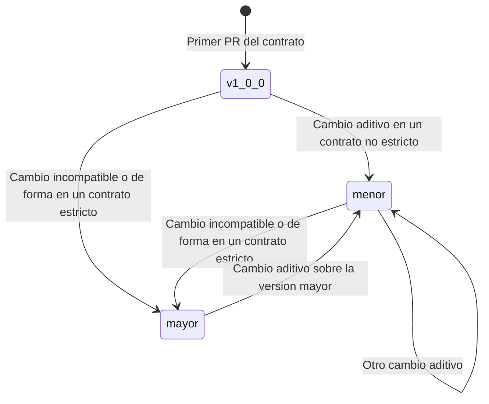
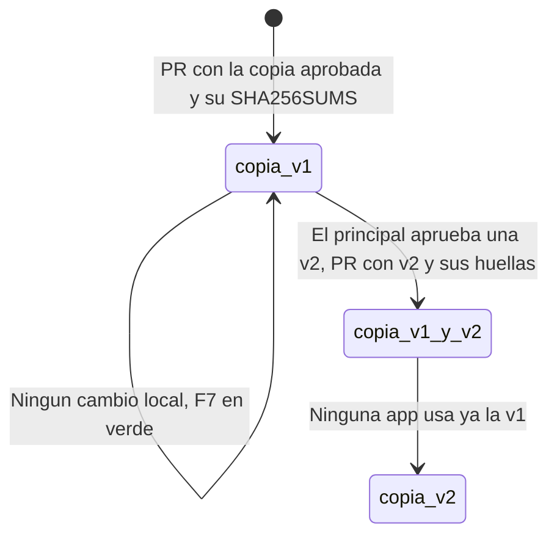
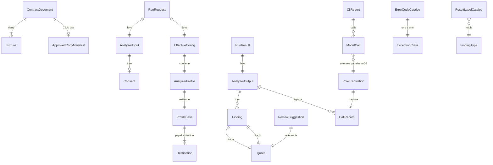

# Especificación funcional — U1 contracts

**Revisión 2 (2026-11-09), segunda pasada por el cambio 01 (DT27), la adenda 02 y el cambio 03.**
Sustituye a la revisión 1 del 2026-10-03. Los flujos F1–F6 y los escenarios E1–E17 conservan su número;
lo que sale queda «Retirado». Lo nuevo empieza en F7 y E18.

**Insumos.**
- Unidad U1 de `inception/units-generation/unit-of-work.md` (unit-of-work, revisión 2) y su mapa de
  historias `unit-of-work-story-map.md` (unit-of-work-story-map).
- Contratos C1–C25 de `inception/contract-design/contract-summary.md` (contract-summary, revisión 2).
- Requisitos de `inception/requirements-analysis/requirements.md` (requirements).
- IntegrityPolicy, ExecutionProfiles y ModelGateway de `inception/domain-design/components.md`
  (components).
- Contrato común v1.0.0 aprobado en el principal (`/insumos/app/contratos/analizador/v1/`) y el cambio 03
  (`/insumos/app/cambios/veridicus-03_reutilizacion_en_sistema.md`).
- Respuestas P1–P8 y V-1 = A de `functional-design-questions.md`.

Las entidades están en `entities.md` y las reglas en `rules.md` (fuentes de verdad). Este documento es la
fuente de verdad de los **flujos**.

## 1. Qué hace la unidad

U1 entrega los contratos versionados de `contracts/`, la jerarquía declarativa de excepciones de `libs/` y
la **suite de validación de nivel 0** que los ejercita con *fixtures* positivos y negativos. No tiene
comportamiento en ejecución. Los servicios, la biblioteca y el proxy importan los contratos y los validan
en sus fronteras. U1 guarda, versiona y prueba los contratos; la unidad dueña de cada uno (columna Owner
de contract-summary) decide sus cambios.

**Lo nuevo en esta pasada:**
- **El contrato común v1.0.0 (C6)** es una copia sin editar de lo aprobado en el principal. Una prueba
  compara sus bytes con huellas versionadas (P5).
- **Los tipos de llamadas a modelos (C13), los perfiles (C18), el registro de llamadas (C19) y la
  petición del proxy (C21)** dejan abiertos los papeles (V-1).
- **Los contratos** se instalan como paquete propio, que `sistema` puede fijar a una etiqueta (V-3, P6).

**Frontera AUTONOMIA-04.** U1 no corre en el clúster ni fuera de él: son archivos del repositorio y una
suite que corre en CI con datos sintéticos (BR1.6). No transporta datos.

### Inventario que entrega U1

| Archivo en `contracts/` | Contrato | Tipo | Reglas |
|---|---|---|---|
| `api/console.v2.yaml` | C1 | OpenAPI | BR7.1–BR7.3, BR8.1 |
| `errors/error-codes.v2.yaml` y `libs/errors/` | Catálogo de `code` y sus excepciones | Catálogo | BR3.4, BR7.2, BR7.4 |
| `queues/runs.v2.yaml` | C2 | AsyncAPI | BR1.2, BR2.1, BR8.1 |
| `queues/results.v2.yaml` | C3 | AsyncAPI | BR1.2, BR2.3 |
| `queues/indexing.v1.yaml` | C4 | **Retirado** (no se entrega) | — |
| `queues/speech.v2.yaml` | C5 (SHOULD) | AsyncAPI | BR1.1, BR1.2 |
| `analyzer/v1/entrada.schema.json`, `salida.schema.json` | C6 (copia sin editar) | JSON Schema estricto | BR1.7, BR1.8, BR3.1–BR3.6 |
| `analyzer/v1/SHA256SUMS` | Huellas aprobadas (P5) | Manifiesto | BR1.7 |
| `analyzer/v1/fixtures/` | *Fixtures* de C6 | Datos sintéticos | BR1.6, BR3.1–BR3.6 |
| `integrity/review-suggestion.v2.json` | C7 | JSON Schema estricto | BR4.1–BR4.3 |
| `integrity/forbidden-vocabulary.v2.yaml` | C8 | Lista | BR5.1–BR5.5 |
| `integrity/neutral-clarification.v1.yaml` | C8 (VE-05) | Reglas | BR5.6 |
| `integrity/notice.v1.yaml` | C8 (VE-01) | Texto versionado | BR5.7 |
| `ui/result-labels.v2.yaml` | Catálogo de rótulos (P3, P8) | Catálogo | BR6.1–BR6.3 |
| `db/truthframe-read.v1.yaml` | C9 | **Retirado** (no se entrega) | — |
| `python/human_review.py`, `report_ports.py`, `identity.py`, `access_log.py`, `retention.py` | C10–C12, C23, C24 | `Protocol` | Verificación de tipos |
| `python/model_calls.py` | Tipos de C13 | Tipos | BR9.1 |
| `model_calls/model-call.v1.yaml`, `model_calls/role-translation.v1.yaml` | Registro de llamadas y tabla de papeles | JSON Schema estricto, tabla | BR9.1, BR9.6 |
| `profiles/profile-base.schema.v1.yaml` | Perfil genérico (V-1) | Esquema | BR9.2, BR9.4, BR9.5 |
| `profiles/profiles.schema.v1.yaml` | Perfil del analizador (V-1) | Esquema estricto | BR9.3 |
| `profiles/effective-config.v1.yaml`, `prices.schema.v1.yaml` | C18 | Esquemas estrictos | BR9.7 |
| `cli/report.schema.v1.yaml` | C19 | Esquema estricto | BR10.1, BR10.2 |
| `metrics/review.v2.yaml` | C15 | Métricas | BR8.2 |
| `health/health.v2.yaml` | C16 | OpenAPI | BR1.1 |
| `limits.v1.yaml` | C25 | Catálogo | BR11.1 |
| `format/datetime.v1.yaml` | Formato de fecha (P4) | Formato | BR8.1 |
| `pyproject.toml` (distribución `veridicus-contracts`) | Paquete (V-3, P6) | Empaquetado | BR12.1, BR12.2 |

C13, C17 y C20 son `Protocol` que viven en `libs/` y pertenecen a U11 y U10; U1 solo entrega los tipos
compartidos (`model_calls.py`). C14 y C22 son API externas; U1 no guarda copia de ellas.

## 2. Flujos

### F1 — Validar los contratos y sus *fixtures* (suite de nivel 0, cada PR) · cambia

1. La suite carga cada `ContractDocument` con el validador estricto (BR1.9) y comprueba que tiene versión
   semántica (BR1.1).
2. Corre F7 sobre la copia de C6 antes que nada: si la copia no es la aprobada, el resto no tiene
   sentido.
3. Para cada `Fixture` con `expectation: accept`, valida el *payload* contra su contrato y exige que
   pase.
4. Para cada `Fixture` con `expectation: reject`, exige que falle **por la regla que nombra
   `reject_reason`**. Un *fixture* que falla por otra causa no cuenta como control negativo.
5. Corre las reglas transversales:
   - ningún campo de veracidad (BR3.3);
   - los enum de C6 iguales en todos los contratos que los copian (BR3.2);
   - catálogo de `code` y excepciones uno a uno (BR3.4, BR7.2, BR7.4);
   - ninguna ruta que escriba configuración (BR7.1) y cuerpos de C1 estrictos (BR7.3);
   - fechas en la forma única (BR8.1) y métricas con prefijo y etiquetas seguras (BR8.2);
   - rótulos exactos (BR6.1–BR6.3);
   - papeles abiertos donde corresponde y cerrados en C6 y C19 (BR9.1, BR9.6, BR10.2);
   - reporte de la CLI sin texto libre (BR10.1) y catálogo de límites completo (BR11.1).
6. Corre F8 sobre los *fixtures* de perfiles y F9 sobre el paquete construido.
7. Comprueba que ningún *fixture* contiene datos reales ni nombres de `sistema` (BR1.6).
8. Termina en verde solo si todos los pasos pasan. La salida del comando es la evidencia del PR.

### F2 — Validar un mensaje de cola · cambia

Lo ejecutan el productor y el consumidor con el contrato de U1.

1. Leer `schema_version`. Si el mayor no se conoce, el mensaje va a `<cola>:failed` sin filas (BR1.2).
2. Validar el sobre (C2, C3 o C5). Los campos desconocidos del sobre se ignoran (BR1.3).
3. En C2, validar `entrada` contra la copia de C6 y `effective_config` contra C18 (BR2.1, BR9.7). En
   C3, validar `salida` contra la copia de C6 (BR2.3).
4. Si algo falla, el mensaje es inválido. C2 va a fallidos sin analizarse; C3 deja la corrida en `error`
   con `analysis.invalid_output`, lo que aplica U4.

### F3 — Validar una salida del analizador · cambia

Antes era «la salida del juez»; ahora es la salida de C6 con el escaneo de C8. La ejecuta U11 antes de
emitir, y U4 en la ingesta, con lo que publica U1.

1. Validar la salida contra la copia de C6: campos, enum y la relación entre `estado`, `error`,
   `hallazgos` y `observaciones_conductor` (BR3.1, BR3.2, BR3.6).
2. Para cada hallazgo, escanear `hecho` y `observaciones`, y para cada aclaración, `tema`. Antes se
   excluyen los tramos entre «…» que aparecen literales en un turno de la entrada (BR5.3). Las citas
   (`cita_a`, `cita_b`) se excluyen enteras (BR5.5).
3. Si el escaneo encuentra un término de la lista, se aplica BR5.4: el candidato no llega al analista.
4. Para cada aclaración, aplicar la regla de VE-05 (BR5.6).
5. Las reglas que el esquema no puede expresar (verificación de las citas contra su turno, tramo
   incremental, huella de la configuración) son de U11. U1 solo publica las listas y la tabla de
   traducción que usan.

### F4 — Validar una sugerencia de revisión · cambia

Antes se validaba la alerta (C7 v1); ahora la sugerencia (C7 v2). Se valida en dos puntos: cuando
HumanReview la guarda y cuando la consola la muestra.

1. Validar contra C7: los cinco campos del hallazgo obligatorios y no vacíos (BR4.1), sin campos
   adicionales (BR4.2).
2. Las citas son las de la copia de C6, por referencia (BR4.3).
3. Si falla, se rechaza. Ninguna sugerencia parcial llega a la consola.

### F5 — Cambiar un contrato (flujo de PR) · cambia

1. La unidad dueña propone el cambio en un PR que solo toca ese contrato (BR1.5).
2. **Si es C6**, no se edita aquí: el cambio se aprueba en el principal y llega como copia nueva, con su
   `SHA256SUMS`. Un cambio de forma abre `v2/` y conserva la v1 (BR1.8).
3. **En los demás contratos**, se clasifica el cambio:
   - un cambio aditivo en un contrato no estricto sube el menor (BR1.3);
   - un cambio de forma en un contrato estricto, o uno incompatible, sube el mayor y cambia el `$id`,
     con productor y consumidores en el mismo PR (BR1.4).
4. Añadir al menos un *fixture* que ejercite el cambio. En C8, cada término nuevo trae su control
   negativo (BR5.1).
5. La suite F1 corre en CI; en un cambio menor, los *fixtures* anteriores siguen aceptándose.
6. El autor revisa y fusiona con *squash-merge* (team.md).

### F6 — Resolver un rótulo visible · cambia

La ejecuta la consola con el catálogo de U1.

1. La consola recibe una sugerencia con su `tipo`.
2. La tarjeta lleva el rótulo «Sugerencia de revisión · Contradicción en el relato» y el rótulo del tipo
   que da `result-labels.v2.yaml`, por ejemplo `negacion` → «Negación» (BR6.1, BR6.2).
3. Un tipo sin fila no se muestra con un texto propio: la consola no inventa rótulos (BR6.1).

### F7 — Comprobar la copia del contrato común · nuevo (P5)

1. Leer `contracts/analyzer/v1/SHA256SUMS`. Debe tener exactamente dos líneas, `entrada.schema.json` y
   `salida.schema.json` (BR1.7).
2. Recalcular el SHA-256 de los bytes de cada archivo y compararlo con su línea.
3. Comprobar que los dos esquemas declaran `contrato: { const: "1.0.0" }`.
4. Si algo no coincide, la suite falla y lo dice: «La copia del contrato común no es la aprobada; los
   cambios se proponen en el repositorio principal».
5. **Cómo entra una versión nueva:** el humano copia los archivos aprobados desde `/insumos` y pega las
   huellas que publica el principal, en su propio PR (BR1.8). El agente no edita la copia.

### F8 — Validar un archivo de perfiles · nuevo (V-1)

U1 publica el esquema y una función de validación pura. Los cargadores de U11 (ExecutionProfiles) y de
U10 (proxy) la usan; `sistema` la usa con su propio prefijo.

1. Validar el archivo contra `profile-base.schema.v1.yaml`: al menos un papel, nombres con el patrón de
   RoleName, `api_key_ref` con la forma genérica y como mucho un `fallback_provider` (BR9.1, BR9.2, BR9.4,
   BR9.5).
2. Comprobar las referencias cruzadas que el esquema no expresa: cada alias apunta a un papel declarado,
   un alias no apunta a otro alias, y un alias no tiene el nombre de un papel (BR9.2).
3. Comprobar que cada `api_key_ref` empieza por el prefijo que recibe la función como argumento (BR9.4).
   Veridicus pasa `VERIDICUS_`.
4. Si quien llama es el analizador, validar además contra `profiles.schema.v1.yaml`: exactamente `judge`
   y `verifier`, y el alias `verifier_permuted → verifier` (BR9.3).
5. Cualquier fallo es un perfil inválido. El servicio no arranca, y la CLI termina con código 3 antes de
   cualquier llamada (AC13.3.1 y AC13.3.2; las reglas de anonimizador y de claves presentes son de U11).
   Los mensajes nombran el ajuste, nunca su valor.

### F9 — Construir el paquete de contratos · nuevo (V-3, P6)

1. Construir la distribución `veridicus-contracts` desde `contracts/`.
2. Instalarla en un entorno limpio, sin Redis, Kubernetes ni base de datos, y comprobar que
   `veridicus_contracts` se importa y que cada esquema y catálogo se lee como dato del paquete (BR12.1).
3. Comprobar que ningún módulo del repositorio importa `contracts.` como nombre de primer nivel
   (BR12.1).
4. Al cerrar B1, el autor etiqueta `vX.Y.Z` (BR12.2). `sistema` fija esa etiqueta y no copia ni edita el
   código.

## 3. Máquinas de estado

U1 no tiene entidades con ciclo de vida en ejecución. Hay dos ciclos de versión que gobiernan F5.

**Contratos propios de Veridicus:**

<!-- Texto alternativo: un contrato nace en 1.0.0; un cambio aditivo en un contrato no estricto sube la versión menor y puede repetirse; un cambio incompatible, o cualquier cambio de forma en un contrato estricto, sube la versión mayor; sobre una versión mayor nueva vuelven a caber cambios aditivos. -->

**Copia del contrato común (C6):**

<!-- Texto alternativo: la copia nace con la versión aprobada y sus huellas; no se cambia localmente; cuando el principal aprueba una versión 2, entra en su propio PR junto a la v1, que se conserva hasta que ninguna app la use. -->

## 4. Vista derivada: entidades y relaciones

Derivada de `entities.md`; manda el YAML de allá. Las entidades retiradas no aparecen.

<!-- Texto alternativo: cada contrato tiene fixtures, y C6 además un manifiesto de huellas. La corrida lleva la entrada de C6 y la configuración efectiva, y el resultado lleva la salida de C6. La entrada trae el consentimiento; la salida trae hallazgos con dos citas y el registro de llamadas. La sugerencia referencia la cita de C6. La configuración efectiva contiene un perfil del analizador, que extiende el perfil genérico, que asocia papeles a destinos. Solo tres papeles se traducen a la fila de llamadas de C6. El reporte de la CLI lleva registros de llamadas. Cada código tiene una excepción y cada tipo de hallazgo un rótulo. -->

## 5. Vista derivada: reglas

Derivada de `rules.md`; manda el YAML de allá.

| Grupo | Vigentes | Retiradas | Flujos |
|---|---|---|---|
| Versión y cambio | BR1.1–BR1.9 | — | F1, F2, F5, F7 |
| Mensajes de cola | BR2.1, BR2.3 | BR2.2, BR2.4, BR2.5 | F2 |
| Contrato común | BR3.1–BR3.6 | — | F1, F2, F3 |
| Sugerencia | BR4.1–BR4.3 | — | F4 |
| Vocabulario, aclaraciones y aviso | BR5.1–BR5.7 | — | F1, F3, F5 |
| Rótulos | BR6.1–BR6.3 | — | F1, F6 |
| API y errores | BR7.1–BR7.4 | — | F1 |
| Fecha y métricas | BR8.1–BR8.2 | — | F1, F2 |
| Papeles y perfiles | BR9.1–BR9.7 | — | F1, F2, F8 |
| Reporte de la CLI | BR10.1–BR10.2 | — | F1 |
| Límites | BR11.1 | — | F1 |
| Paquete | BR12.1–BR12.2 | — | F9 |

## 6. Escenarios de negocio y casos límite

Cada escenario es un *fixture* o una prueba de nivel 0. Todos los datos son sintéticos.

| # | Caso | Resultado esperado | Regla |
|---|---|---|---|
| E1 | Mensaje de corrida sin `entrada` | Rechazado a `veridicus:runs:failed`, sin filas | BR2.1 |
| E2 | Mensaje con `schema_version: 3.0.0` y consumidor en 2.x | Rechazado sin procesar | BR1.2 |
| E3 | Mensaje 2.1.0 con un campo nuevo opcional en el sobre | Aceptado; el campo se ignora | BR1.3 |
| E4 | Umbral 1.2 en el mensaje | **Retirado** (sale el umbral) | BR2.2 |
| E5 | Salida con `estado: error` y un hallazgo | Inválida | BR3.6 |
| E6 | Alerta sobre afirmación `congruente` | **Retirado** (salen las calificaciones) | BR2.4 |
| E7 | Salida con `is_truthful` en un hallazgo | Inválida | BR3.1, BR3.3 |
| E8 | Hallazgo con `tipo: falso` | Inválido: fuera del enum | BR3.2 |
| E9 | Sugerencia sin `observaciones` (y una por cada uno de los 5 campos) | Rechazada | BR4.1 |
| E10 | `observaciones`: «el compareciente miente» | El candidato no llega al analista | BR5.4 |
| E11 | `observaciones` con «falso» dentro de «…» que aparece literal en un turno | Válida | BR5.3 |
| E12 | `observaciones` con «miente» dentro de «…» que no aparece en ningún turno | El candidato no llega al analista | BR5.3, BR5.4 |
| E13 | `hecho` con «MIENTE» o «mintio» (sin tilde) | El candidato no llega al analista | BR5.2 |
| E14 | `hecho` con «falsete» o «mienten» | Pasa: palabra completa y lista de 9 términos (limitación conocida) | BR5.1, BR5.2 |
| E15 | Copia del OpenAPI con `PUT /profiles` | Suite en rojo | BR7.1 |
| E16 | Fecha `2026-10-02T21:40:00.123Z` o `2026-10-02T16:40:00-05:00` en un contrato propio | Rechazada | BR8.1 |
| E17 | Catálogo de rótulos con un décimo rótulo | Suite en rojo | BR6.1 |
| E18 | Copia de `salida.schema.json` con un byte cambiado en una `description` | Suite en rojo (F7) | BR1.7 |
| E19 | Entrada `origen: corpus` sin consentimiento / `origen: sintetico` sin él | Rechazada / aceptada | BR3.5 |
| E20 | Consentimiento con `requiere_mandato: true` sin `constancia_mandato` | Rechazado | BR3.5 |
| E21 | Perfil genérico con papeles `prueba_a` y `prueba_b` y destinos locales | Válido | BR9.1, BR9.2 |
| E22 | Perfil del analizador con un papel extra `prueba_a` | Inválido | BR9.3 |
| E23 | Alias `verifier_permuted → verificador_x` sin ese papel, o alias que apunta a otro alias | Inválido | BR9.2 |
| E24 | `api_key_ref: OTRO_CLAVE` cargado con prefijo `VERIDICUS_` / con prefijo `OTRO_` | Rechazado / aceptado | BR9.4 |
| E25 | Esquema de perfil que fija `pattern: ^VERIDICUS_` en `api_key_ref` | Suite en rojo | BR9.4 |
| E26 | Un papel con su propio `fallback` | Inválido | BR9.5 |
| E27 | Registro de llamada con `role: "Prueba A"` | Rechazado | BR9.1 |
| E28 | Reporte de la CLI con una llamada de papel `prueba_a` | Rechazado | BR10.2 |
| E29 | Reporte de la CLI con una frase en `model` o en `price_table_version` | Rechazado | BR10.1 |
| E30 | Aclaración con `tema` «lo que antes dijo en T3» | Inválida | BR5.6 |
| E31 | `code` del catálogo sin clase de excepción | Suite en rojo | BR7.4 |
| E32 | Módulo que importa `contracts.model_calls` | Suite en rojo | BR12.1 |
| E33 | Variable de entorno que sube `turn_max_chars` por encima del catálogo | Rechazada | BR11.1 |
| E34 | `error.codigo: proveedor` sin traducción a `analysis.provider` | Suite en rojo | BR3.4 |

## 7. Integración con otras unidades

| Consumidor | Qué usa de U1 | Cómo lo verifica |
|---|---|---|
| U3 identity-access | C1 (`/auth/*`, `/users*`), C12, catálogo de `code` | Pruebas de contrato del productor |
| U4 text-flow | C1, C2, C3, C6, C7, C8, C25, rótulos, fecha | Valida en sus fronteras con los mismos esquemas |
| U5, U6, U7 | C1, C7, C10, C11, C15, C23, C24, C8 (reporte), fecha | Pruebas de contrato |
| U8, U9 | C1, C5, C8 (VE-05) | Pruebas de contrato cuando se construyan |
| U10 anonymizer | `model_calls`, `profile-base`, función de validación de perfiles con su prefijo, `model-call.v1.yaml` | Pruebas de contrato del módulo y del proxy (C20, C21) |
| U11 incoherence-analyzer | C6, `model_calls`, perfiles (genérico y del analizador), configuración efectiva, tabla de papeles, C8, C19, C25 | Valida su salida y su reporte con estos esquemas |
| U12 research-reports | C19 | Rechaza con `422` lo que no cumple el esquema |
| U2 platform | C15, C16 | Regla de Prometheus y `scripts/smoke.sh` |
| `sistema` (externo) | Paquete `veridicus-contracts` en una etiqueta: `model_calls`, `profile-base` y su función de validación con prefijo propio | Fija la etiqueta; no copia ni edita (cambio 03 V-3) |

## 8. Errores y bordes

- Un *fixture* negativo que falla por una causa distinta de su `reject_reason` hace fallar la suite. Así
  un control negativo no queda «verde por accidente».
- F7 corre primero. Si la copia de C6 no es la aprobada, los *fixtures* de C6 no se evalúan, para no
  esconder la causa.
- La comparación «literal» de BR5.3 solo normaliza espacios, con la regla del piloto. Una cita con una
  palabra cambiada ya no es literal y se escanea.
- La función de validación de perfiles nunca escribe en el log el valor de una clave. Solo nombra
  `api_key_ref` y el papel.
- La suite no necesita red, base de datos ni GPU: corre en CPU en CI (team.md, nivel 0).

## 9. Decisiones que precisan artefactos ya aprobados

No edité ningún artefacto aprobado (regla de `project.md`). En la aprobación decides cuáles se llevan al
original, cada una en su propio commit.

| ID | Artefacto aprobado | Precisión propuesta | Origen |
|---|---|---|---|
| FD-U1-01 | `contract-design/contract-summary.md` (C13) y `domain-design/components.md` (ModelGateway) | `Role` deja de ser `Literal["judge", "verifier", "verifier_permuted"]` y pasa a ser `str` con el patrón `^[a-z][a-z0-9_]{0,31}$`; quien valida el papel contra el perfil es el que carga el perfil | Cambio 03 V-1; V-1 = A |
| FD-U1-02 | `contract-design/contract-summary.md` (C18) y `domain-design/components.md` (ExecutionProfiles) | El esquema de perfiles se parte en `profile-base.schema.v1.yaml` (`roles`, `role_aliases`, un `fallback_provider`) y `profiles.schema.v1.yaml`, la especialización del analizador (exactamente `judge`, `verifier` y el alias `verifier_permuted → verifier`). `api_key_ref` pasa de `^VERIDICUS_[A-Z0-9_]+$` a `^[A-Z][A-Z0-9_]{2,63}$`, y el prefijo es un argumento de la función de validación (Veridicus: `VERIDICUS_`). Las reglas del proxy «la petición nombra un perfil y un papel que existen» se leen sobre `roles` y `role_aliases` | Cambio 03 V-1; V-1 = A; P7 = A |
| FD-U1-03 | `contract-design/contract-summary.md` (C19 `model-call.v1.yaml`, C21 petición) | `role` pasa de `enum` a `pattern`; el reporte de la CLI (C19) restringe sus llamadas a los tres papeles del analizador con un `allOf` | Cambio 03 V-1; V-1 = A |
| FD-U1-04 | `contract-design/contract-summary.md` (C10–C13, C17, C20, C23, C24) | Las importaciones `contracts.python.<módulo>` y `contracts.analyzer.v1` pasan a `veridicus_contracts.<módulo>` y `veridicus_contracts.analyzer.v1`, de la distribución `veridicus-contracts`; la carpeta del repositorio sigue siendo `contracts/` | Cambio 03 V-3; P6 = A |
| FD-U1-05 | `user-stories/stories.md` (AC12.6.1) | AC12.6.1 espera `201` y que el texto «se descartó», pero CD-03 decidió rechazar con `422 research.invalid_report` un reporte que trae texto o no cumple C19. Propuesta: el *canary* en un reporte da `422`, 0 filas, y no aparece en ningún log. Es la misma diferencia que DP-01 (`interaction-spec.md`); U1 la cubre con BR10.1 en cualquier caso, y se cierra en el Functional Design de U12 | CD-03; DP-01 |
| FD-U1-06 | `contract-design/contract-summary.md` (C6 y regla 3) | La prueba de nivel 0 compara el **contenido** de la copia con `SHA256SUMS`, no solo la versión; solo se copian los dos esquemas, sin el `README.md` del principal | Cambio 03 §1; P5 = A |
| FD-U1-07 | `contract-design/contract-summary.md` (Preguntas abiertas, C6) | La pregunta «aprobación de la v1.0.0 en el repositorio principal» queda cerrada: se aprobó el 2026-11-09 sin cambios frente a C6 | Cambio 03 §1 |
| FD-U1-08 | `refined-mockups/interaction-spec.md` (catálogo de mensajes) | Los rótulos de los 7 tipos son «Fecha», «Número», «Lugar», «Persona», «Negación», «Secuencia» y «Otro», y viven en `ui/result-labels.v2.yaml` | P8 = A; AC5.5.4 |
| FD-U1-09 | `contract-design/contract-summary.md` (C8 y tabla de contratos) | Siguen abiertas las precisiones de la primera pasada: `quote_delimiters: [«, »]` con la regla de cita literal (ahora sobre `hecho`, `observaciones` y `tema`), el catálogo de rótulos y el formato de fecha como contratos de U1 | P1, P3 y P4 de la primera pasada |
