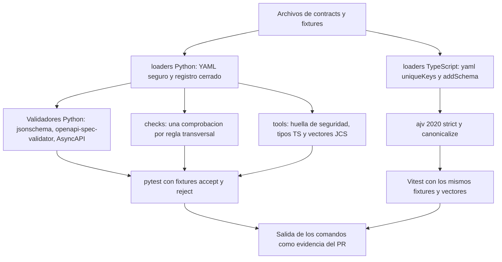

# Diseño de seguridad — U1 contracts

**Revisión 2 (2026-11-22), segunda pasada por el cambio 01 (DT27), la adenda 02 y NFR Requirements
revisión 2.** Sustituye a la revisión 1 del 2026-10-03, que queda en el historial de Git.
- **Numeración.** Los controles §4.1–§4.13 y las decisiones DS1–DS5 conservan su número. Lo nuevo empieza
  en §4.14 y DS6. Lo que sale queda «Retirado» sin renumerar.
- **Qué entra.** La mitad TypeScript `contracts/ts/` (P8 = A), `limits.exceeded` siempre `413`
  (P7 = A), las extensiones `x-veridicus-limit` y `x-veridicus-max-bytes`, los decimales en `ratio` y `s`,
  el paso del paquete con 180 s, las tres funciones puras, la huella JCS y lo que las demás unidades
  piden a U1 en sus tablas NFR-U3 a NFR-U13.
- **Hallazgos.** Se cierran R-01 a R-08 de la revisión 1 de esta etapa (`reviews/review-01.md`).
- **Preguntas.** Ninguna en esta pasada (`nfr-design-questions.md`, segunda pasada). Las decisiones que
  precisan artefactos aprobados están en la tabla NFRD-U1-xx (§10).

**Insumos.**
- NFR1.1–NFR15.1, amenazas T1–T16, riesgos residuales y tabla NFR-U1-01 a NFR-U1-08 de
  `nfr-requirements/security-requirements.md` (security-requirements, revisión 2).
- D1–D16 y los comandos de §4 de `nfr-requirements/tech-stack-decisions.md` (tech-stack-decisions,
  revisión 2).
- Inventario, tabla de rutas del paquete y flujos F1–F9 de `functional-design/functional-spec.md`
  (functional-spec, revisión 3); reglas BR1.1–BR12.3 de `functional-design/rules.md`.
- C1–C25, la tabla «Datos sensibles por contrato» y las reglas de propiedad de
  `inception/contract-design/contract-summary.md` (contract-summary, revisión 3).
- Las tablas de precisiones de NFR Requirements de U3 a U13, aprobadas el 2026-11-22: NFR-U3-01,
  NFR-U4-01, -04, -05, -07, -08, NFR-U5-01, -04, -05, NFR-U6-01, -03, -09, -12, NFR-U7-01, -02,
  NFR-U8-04, -05, NFR-U9-01 a -04, -08, NFR-U10-01 a -03, -11, NFR-U11-05, -06, -14, NFR-U12-01 a -04,
  NFR-U13-01 a -03, -10, y `tech-stack-decisions.md` §3 de U11.
- Respuestas P1–P3 de `nfr-design-questions.md`; prácticas de `team.md` y `project.md`.

U1 es una unidad `spec`: no corre en ejecución. Su seguridad es la **integridad de los contratos** con que
todos los servicios validan sus fronteras, la de la suite y las funciones puras que los protegen, y la
ausencia de datos reales en el repositorio. Este documento diseña los controles que la suite de nivel 0
hace cumplir; el código completo es de Code Generation. Por ser `spec`, la etapa no produce diseño de
rendimiento, escalado, fiabilidad, observabilidad ni componentes lógicos.

## 1. Alcance y frontera (AUTONOMIA-04)

| Componente | Dónde corre | Qué datos cruzan su frontera | Red |
|---|---|---|---|
| Archivos de `contracts/` | En ningún sitio: son archivos del repositorio | Ninguno; describen datos, no los transportan | — |
| Suite Python (`contracts/tests/`, `src/veridicus_contracts/checks/`) | CI y máquina de desarrollo, CPU | Solo *fixtures* sintéticos (NFR12.1) | Bloqueada (`--disable-socket`) |
| Mitad TypeScript (`contracts/ts/`) | CI y máquina de desarrollo, CPU | Los mismos *fixtures* | Bloqueada (*setup* de Vitest, §4.14) |
| Generadores (`tools/gen_ts.py`, `tools/security_surface.py`, `tools/gen_jcs_vectors.py`) | CI (solo `--check`) y máquina de desarrollo | Solo los contratos | Bloqueada |
| Funciones puras `profiles.validate`, `limits.load`, `registry`, `canonical.sha256_jcs` | En el proceso de quien importa el paquete: `session-api`, `semantic-agent`, `anonymizer-proxy`, la CLI y la consola (mitad TypeScript) | Ninguno propio: sin E/S (§4.15) | No |
| Instalación, auditorías y paso del paquete | CI, pasos aparte | Nombres y versiones de paquetes hacia PyPI y npm | Sí, solo estos pasos (§4.13) |

Ningún componente de U1 maneja datos sin seudonimizar. Lo que transporta cada contrato en ejecución sale
de la tabla de contract-summary y de security-requirements §1: C1, C2, C3, C5, C17, C20 y C21 llevan dato
restringido dentro del clúster o del proceso; C19 sale del clúster sin texto; C15, C16, C23, C24 y C25 son
internos. U1 aporta cuatro garantías: ningún contrato declara un destino de internet (§4.9), una sola
puerta al anonimizador (§4.17), la petición del proxy cerrada (§4.17) y el reporte de la CLI sin texto
libre (§4.18).

## 2. Arquitectura de la suite de seguridad

Las dos mitades comparten los archivos de `contracts/` y los *fixtures*; ninguna lee la salida de la
otra. La concordancia sale de que las dos comparan con el veredicto que declara cada *fixture* (§4.14).



<!-- Texto alternativo: los archivos de contracts y sus fixtures se cargan por dos caminos. En Python, loaders aplica YAML seguro y un registro de referencias cerrado; sobre él trabajan los validadores estándar, los módulos checks y las herramientas que generan la huella de seguridad, los tipos TypeScript y los vectores JCS; pytest ejercita todo con fixtures accept y reject. En TypeScript, los loaders usan yaml con uniqueKeys y addSchema; ajv 2020 en modo strict y canonicalize validan los mismos fixtures y vectores con Vitest. La salida de los dos comandos es la evidencia del PR. -->

| Capa | Módulo | Responsabilidad de seguridad |
|---|---|---|
| Carga | `loaders.py`, `ts/src/loaders.ts` | Único punto que lee YAML y JSON en cada mitad (§4.1) |
| Registro | `registry.py`, `ts/src/registry.ts` | Resuelve `$ref` por `$id` con base `https://veridicus.invalid/`, sin red (§4.2) |
| Validación estándar | `validators.py`, `ts/src/validate.ts` | OpenAPI 3.1, AsyncAPI 3.0 y JSON Schema 2020-12 con formatos |
| Reglas | `checks/*.py` | Reglas transversales de §4, una por archivo, sin estado; entrada = documentos ya cargados |
| Funciones puras | `profiles.py`, `limits.py`, `canonical.py`, `registry.py` y sus pares en `ts/src/` | §4.15; módulos guardia con 100 % de ramas (NFR13.1) |
| Herramientas | `tools/security_surface.py`, `tools/gen_ts.py`, `tools/gen_jcs_vectors.py`, `tools/check_package.py`, `tools/audit_gate.py` | Proyecciones deterministas que la CI compara con lo versionado (`--check`) |

Cada comprobación de `checks/` devuelve una lista de hallazgos con el ID de la regla que viola. La prueba
falla si la lista no está vacía; así un *fixture* `reject` exige fallar **por** su `reject_reason`
(NFR10.10).

## 3. Amenazas y controles de diseño

| Amenaza (security-requirements §2) | Controles de diseño | Sección |
|---|---|---|
| T1 Cambio que relaja una regla | Reglas en `checks/`; huella de seguridad versionada; contratos estrictos solo cambian con versión mayor | §4.3, §4.8, §4.11 |
| T2 *Fixture* negativo verde por accidente | Rechazo exigido por la regla declarada; un positivo y un negativo por regla | §4.10 |
| T3 Datos reales en un *fixture* | `synthetic: true`, `mentions` contra catálogo, patrones de cédula y radicado, `gitleaks` | §4.10 |
| T4 `$ref` remoto o descarga | Registro cerrado por `$id`; red bloqueada en las dos mitades | §4.2, §4.14 |
| T5 YAML con etiquetas o claves duplicadas | Cargador único seguro por mitad; prueba AST | §4.1 |
| T6 `pattern` con retroceso catastrófico | Recorrido completo del árbol, subconjunto portátil y prueba de 1 s | §4.5 |
| T7 Campo o cuerpo sin límite o con otro valor | C25 con dueño y usos; `x-veridicus-limit` y `x-veridicus-max-bytes` iguales al catálogo | §4.3, §4.4 |
| T8 Petición sin sesión, anti-CSRF o rol | Superficie de C1 por operación; extensiones cerradas; huella | §4.6, §4.11 |
| T9 Dependencia vulnerable | Lockfiles con *hashes*, `pip-audit` con compuerta, `npm audit`, `SHA256SUMS` de `vendor/` | §4.13 |
| T10 Destino externo al clúster | `servers` internos en todo OpenAPI y AsyncAPI | §4.9 |
| T11 Copia del contrato común editada | F7 antes que todo; `SHA256SUMS` de dos líneas | §4.19 |
| T12 Segundo camino hacia un destino externo | `Protocol` de un solo método, comprobado por AST y por mypy | §4.17 |
| T13 Petición del proxy con destino o clave elegidos | C21 estricto en todos los niveles | §4.17 |
| T14 Testimonio en el reporte de la CLI | C19 v2 sin texto libre | §4.18 |
| T15 Cifra subida o clave fuera del prefijo | `limits.load` solo baja y respeta relaciones; `profiles.validate` con prefijo obligatorio | §4.15 |
| T16 Veredictos distintos entre mitades | Mismos *fixtures* y vectores JCS; subconjunto portátil de patrones | §4.14, §4.5 |

## 4. Diseño de los controles

### 4.1 Carga segura de YAML (NFR10.4)

- **Python.** `loaders.py` es el único módulo que crea `ruamel.yaml.YAML(typ="safe", pure=True)`, con
  `allow_duplicate_keys = False` y YAML 1.2 (D5). Devuelve estructuras simples, nunca objetos con
  etiqueta.
- **Prueba AST** (`checks/loader_usage.py`). Recorre los `.py` de `src/`, `python/` y `tests/`, y falla
  ante `import yaml` (PyYAML), una llamada `YAML(...)` fuera de `loaders.py`, cualquier `typ` distinto de
  `"safe"`, `load_all` o `Loader=`. Es la evidencia del criterio. Ruff `S506` queda como segunda línea,
  como ya dice NFR10.4 revisión 2. La misma prueba se publica como función
  (`veridicus_contracts.checks.loader_usage.scan(paths)`) para que U11 la reutilice (NFR10.9 de U11).
- **TypeScript.** `ts/src/loaders.ts` es el único que importa `yaml`, con `parse(text, { uniqueKeys: true,
  customTags: [], schema: "core" })`. Una regla de ESLint (`no-restricted-imports`) prohíbe importar
  `yaml` fuera de ese archivo.
- **Controles negativos en las dos mitades:** un C8 con un término repetido, un YAML con
  `!!python/object` y, solo en Python, un módulo sintético con `YAML(typ="unsafe")`.

### 4.2 Referencias cerradas y suite sin red (NFR10.5)

- `registry.py` construye un registro de `referencing` con cada esquema de `contracts/` y de `vendor/`,
  indexado por `https://veridicus.invalid/` + su `$id` (BR12.3, FD-U1-11). La función de recuperación
  lanza un error ante cualquier URI que no esté en el registro: no hay descarga posible.
- `ts/src/registry.ts` hace lo mismo con `ajv.addSchema(schema, base + $id)`, con `loadSchema` sin
  definir: ajv falla ante una referencia desconocida en vez de buscarla.
- `checks/refs.py` falla ante un `$ref` entre archivos que no empieza por `/veridicus/contracts/`, ante
  un esquema `http:`, `https:` o `file:` y ante una ruta relativa como
  `contracts/analyzer/v1/salida.schema.json#/$defs/cita` (E36).
- Red bloqueada: `pytest-socket` con `--disable-socket` en la configuración de `pytest` (D6), y el
  *setup* de Vitest de §4.14.
- **Subprocesos** (R-06 de la revisión 1). `--disable-socket` no alcanza a un subproceso, así que
  `checks/loader_usage.py` también falla si `checks/`, `tests/` o `python/` importan `subprocess`,
  `multiprocessing` o `os.system`. Solo `tools/check_package.py` los usa, y corre en su propio paso
  (§4.16).

### 4.3 Estrictez de cuerpos, mensajes y archivos (NFR10.1, NFR10.2, NFR10.7)

| Superficie | Regla de diseño | Comprobación |
|---|---|---|
| Cuerpo `application/json` de C1 | `additionalProperties: false` en el objeto raíz y en cada objeto anidado | `checks/strict_bodies.py` |
| Cuerpo `multipart/form-data` de C1 (importación, voz, reporte de la CLI) | `additionalProperties: false`; cada parte no binaria con `maxLength` y `x-veridicus-limit`, o con `format` o `pattern` acotados; el cuerpo declara `x-veridicus-max-bytes: <nombre de C25>`. `encoding.<parte>.contentType` no es obligatorio, porque U6 y U12 deciden por el contenido (NFRD-U1-10); si se declara, es una lista cerrada | `checks/strict_bodies.py`, `checks/limits_match.py` |
| Cuerpo JSON con tope de bytes (`review_body_max_bytes`, `ethics_body_max_bytes`, `anonymizer_request_max_bytes`) | El `requestBody` declara `x-veridicus-max-bytes: <nombre>` (NFRD-U1-04) | `checks/limits_match.py` |
| Respuesta a un tope superado | Toda operación con `x-veridicus-max-bytes` o con un campo de `x-veridicus-limit` declara `413` con `limits.exceeded`; toda `multipart` declara además `415` con su `<dominio>.invalid_type` (`import.invalid_type`, `research.invalid_type`, NFR-U12-02). Las dos con `$ref` a `Problem` | `checks/limits_match.py`, `checks/error_codes.py` |
| Contratos estrictos: C6 (copia), C7, C18 (configuración efectiva), C19 con `model-call.v1.yaml`, C21 y la ruta interna de voz | Cada objeto declara `additionalProperties: false` o `unevaluatedProperties: false` (BR1.4) | `checks/strict_bodies.py`; *fixtures* E1, E5, E7–E9, E19, E20, E35 |
| Sobres de cola C2, C3 y C5 | Obligatorios, tipos, `minLength` y rangos; los campos desconocidos se ignoran (BR1.3). Cambios menores: C3 2.1.0 y C5 1.2.0, con *fixtures* de la versión anterior que siguen pasando | Validación de la carga extraída del AsyncAPI |
| Entradas de mensajes fallidos de C2, C3 y C5 | Esquema **estricto**, solo `message_id`, el ID de la corrida o del audio, `attempt` y `code`, sin campos de texto (NFR-U4-07, NFR-U9-03; NFRD-U1-07) | `checks/strict_bodies.py`; *fixture* `reject` con un campo `text` |

### 4.4 Catálogo único de límites C25 (NFR10.7, NFR10.14; cierra R-05 de la revisión 1)

`contracts/limits.v1.yaml` es la única fuente de cada cifra. La forma de cada entrada y el contenido de
la versión entregada están en §5. Reglas de diseño:

- **Forma.** Cada entrada lleva `value` (no nulo), `unit` de la lista cerrada (`chars`, `turns`, `bytes`,
  `s`, `ms`, `deliveries`, `suggestions`, `words`, `ratio`, `days`, `levels`), `owner` (la unidad que
  fijó la cifra) y `used_in` (los contratos donde aparece marcada; puede estar vacía si la cifra solo la
  usan los servicios). `derived_from` es opcional. Una sección `relations` declara las desigualdades
  entre cifras.
- **Tipo del valor.** Entero en todas las unidades salvo `ratio` (decimal en (0, 1]) y `s` (decimal > 0)
  (NFR-U1-01). En `ms` y en el resto, entero ≥ 1.
- **Marcas en los contratos.** Todo `maxLength`, `maxItems` o tope de bytes de C1, C2, C5, C19, C21 y la
  ruta interna de voz lleva `x-veridicus-limit: <nombre>` (en un esquema) o
  `x-veridicus-max-bytes: <nombre>` (en un `requestBody` o en el contenido de una respuesta).
  `checks/limits_match.py` exige: (a) que todo campo de texto de un cuerpo de C1, de un mensaje de C2 o
  C5 y de C21 tenga su marca; (b) que el valor del contrato sea igual al del catálogo; (c) que la unidad
  del nombre sea coherente con la palabra clave (`chars` con `maxLength`, `bytes` con
  `x-veridicus-max-bytes`, `turns` con `maxItems`).
- **Comprobación inversa** (R-05 b). Toda entrada con `used_in: [Cn]` aparece marcada al menos una vez en
  `Cn`, y toda marca nombra una entrada que la incluye en `used_in`. Un límite huérfano pone la suite en
  rojo.
- **Derivadas.** `audio_base64_max_chars` = 4 × ⌈`audio_max_bytes` / 3⌉ = 8 000 000.
- **Relaciones.** La suite comprueba cada relación sobre el catálogo, y `limits.load` la vuelve a
  comprobar después de bajar cifras por entorno (§4.15): bajar la ventana por debajo del solapamiento no
  arranca.
- **Cookie de sesión** (R-02 y R-05 a de la revisión 1). El esquema `sessionCookie` de C1 declara
  `x-veridicus-cookie: { http_only: true, secure: true, same_site: Strict, path: /, max_age_limit:
  web_session_max_s, idle_limit: web_session_idle_s }`. Así la inactividad tiene un lugar en el contrato
  y `limits_match` comprueba los dos nombres.
- **Lo que C25 no guarda.** Los mínimos condicionados por el tipo de perfil, como
  `model_call_timeout_s` ≥ 270 s con perfil comercial (NFR-U4-02), no son topes: los comprueban al
  arrancar U4 y U11 con la cifra ya cargada. El umbral 0,25 de la alerta de descartes vive en la regla de
  U2 (C15).
- **Cambiar una cifra** es un cambio menor del catálogo y del contrato que la usa, en un PR de U1 que
  propone la unidad dueña antes del código de su Bolt. La huella (§4.11) lo muestra como diferencia.

### 4.5 Patrones sin retroceso catastrófico (NFR10.6; cierra R-01 de la revisión 1)

`checks/redos.py` hace tres comprobaciones deterministas y una de propiedades:

1. **Recorrido completo del árbol.** Compila cada `pattern` con `re._parser.parse` y desciende por
   `SUBPATTERN`, cada rama de `BRANCH`, `ASSERT`, `ASSERT_NOT`, `ATOMIC_GROUP` y las dos ramas de
   `GROUPREF_EXISTS`. Rechaza: (a) una repetición ilimitada (`*`, `+`, `{n,}`) dentro de otra repetición
   ilimitada; (b) cualquier `BRANCH` dentro de una repetición ilimitada, que se reescribe como clase de
   caracteres (sustituye la regla de «ramas que empiezan igual», que el parser no permite evaluar porque
   factoriza prefijos); (c) `GROUPREF` y `GROUPREF_EXISTS` (referencias hacia atrás).
2. **Subconjunto portátil** (amenaza T16). Como la mitad TypeScript valida los mismos patrones con el
   motor de JavaScript, se permiten solo anclas `^…$`, literales, clases con rangos explícitos (`[0-9]`,
   `[a-z]`), grupos `(?:…)` y cuantificadores. Se rechazan `\d`, `\w`, `\s` y `\b` (en Python casan
   Unicode y en JavaScript no), los grupos con nombre `(?P<…>)`, las banderas en línea y las miradas
   atrás. Todo patrón va anclado.
3. **Entrada acotada.** Un `pattern` sin repetición ilimitada se acota solo. Uno con repetición
   ilimitada exige `maxLength` con su `x-veridicus-limit` (§4.4). Sale la regla de la revisión 1 de
   «`maxLength` ≤ 256 con excepción en `limits.v1.yaml`», que no tenía dónde declararse (R-04 punto 4).
4. **Propiedades.** Hypothesis genera, para cada patrón, cadenas válidas e inválidas y una entrada
   adversaria de 10 000 caracteres; la validación responde en < 1 s (NFR10.6, D8). Es un techo amplio,
   no una medida fina: el control real son los puntos 1 a 3.

Ilustración del descenso (la versión completa es de Code Generation):

```python
CONTAINERS = {SUBPATTERN, ATOMIC_GROUP, ASSERT, ASSERT_NOT}

def violations(node, in_unbounded=False):
    for op, arg in node:
        if op in (GROUPREF, GROUPREF_EXISTS):
            yield "backref"
        if op in (MAX_REPEAT, MIN_REPEAT, POSSESSIVE_REPEAT):
            lo, hi, sub = arg
            unbounded = hi == MAXREPEAT
            if unbounded and in_unbounded:
                yield "nested_unbounded"
            yield from violations(sub, in_unbounded or unbounded)
        elif op == BRANCH:
            if in_unbounded:
                yield "branch_in_unbounded"
            for branch in arg[1]:
                yield from violations(branch, in_unbounded)
        elif op in CONTAINERS:
            yield from violations(arg[-1], in_unbounded)
```

- **Dependencia de API privada.** Una prueba exige `sys.version_info[:2] == (3, 12)` y que los
  controles conocidos se detecten. Si cambia la versión de Python, la suite falla antes de dar un falso
  verde.
- **Controles negativos:** `^(a+)+$`, `^(a|aa)*$`, `^(x|(a+)+)$`, `^(?:a|(?:b+)+)*$`, `^(\w+)\1$`,
  `^[a-z]+$` sin `maxLength` y `^\d{6}$` (no portátil).

### 4.6 Sesión, anti-CSRF, roles e inmutabilidad en C1 (NFR10.11, NFR10.12, NFR11.1, NFR3.1)

`checks/auth_surface.py` recorre cada operación de C1 y comprueba:

| Regla | Excepciones permitidas, cada una con su motivo | Hallazgo |
|---|---|---|
| Seguridad efectiva = `sessionCookie` | Lista pública: `POST /auth/login` y, si se aprueba FD-U4-08, `GET /notice` | Una ruta pública nueva |
| Toda POST o PATCH referencia `CsrfToken` (`minLength: 32`) | `POST /auth/login` | Escritura sin anti-CSRF |
| Toda operación declara `x-veridicus-roles` con valores de `Role` (`analista`, `admin`, `investigador`) | `/auth/login`, `/auth/logout`, `/auth/me` y la lista pública | Ruta que la negación por defecto de U3 rechazaría siempre (NFRD-U1-12) |
| Toda operación con seguridad declara `401`; la que declara roles, además `403`; las dos con `$ref` a `Problem` | `/auth/logout` y `/auth/me` declaran `401` y no `403` (R-07 de la revisión 1) | Error sin Problem Details |
| Sin DELETE ni PUT. PATCH solo en `/users/{user_id}`, `/sessions/{session_id}/analysis` y `/sessions/{session_id}/retention` | — | Operación que borra o reemplaza |
| Las operaciones que encolan trabajo de IA solo declaran `202` como 2xx | — | Interfaz bloqueante |

- **Lista de operaciones que encolan** (R-07). Es una constante del módulo, por `operationId`, con las
  seis de NFR3.1: turno, bloque pegado, reintento de corrida, modo final, «Reanudar análisis»
  (`PATCH /sessions/{session_id}/analysis`, coherente con NFR-U6-03) y turno de voz. Los `operationId` se
  fijan en el PR de B1 con C1 v2. Sumar una ruta que publica en C2 o C5 exige añadirla a la constante
  en el mismo PR, y la huella lo muestra.
- **Extensiones cerradas.** Solo se admiten estas `x-veridicus-*` (NFRD-U1-03):

| Extensión | Dónde | Valores |
|---|---|---|
| `x-veridicus-roles` | Operación | Lista no vacía de `Role` |
| `x-veridicus-owner-only` | Operación | Booleano, solo junto a `x-veridicus-roles` |
| `x-veridicus-owner-only-for-role` | Operación | Un valor de `Role` presente en `x-veridicus-roles` (FD-U13-05) |
| `x-veridicus-access-log` | Operación | `session`, `suggestion` o `report_version` (FD-U3-05) |
| `x-veridicus-demo` | Operación | Booleano (ADR-016) |
| `x-veridicus-priority` | Operación | `MUST` o `SHOULD` (contract-summary) |
| `x-veridicus-limit` | Esquema | Nombre de C25 |
| `x-veridicus-max-bytes` | `requestBody` o contenido de respuesta | Nombre de C25 con unidad `bytes` |
| `x-veridicus-cookie` | Esquema de seguridad `sessionCookie` | Objeto de §4.4 |

- **C16.** `/healthz` y `/readyz` son públicas dentro del clúster y no llevan cookie.
- **Ruta interna de voz** (FD-U9-04, NFR-U9-04; NFRD-U1-08). `POST /internal/v1/speech` de
  `audio-worker` vive en `contracts/api/speech-internal.v1.yaml`, no en C1 ni en C16. La comprobación
  propia exige `bearerAuth` en la operación (sin cookie ni CSRF), cuerpo estricto, `401`, `422` con
  `rule_id` de una lista cerrada (`template_version`, `dt23`, `vocabulary`, `length`), `503`, y una
  respuesta `audio/wav` con `x-veridicus-max-bytes: speech_audio_max_bytes`.

### 4.7 Errores con Problem Details y catálogo único (NFR10.3)

- `errors/error-codes.v2.yaml` declara, por `code`, un solo `status` HTTP, su `class` en `libs/errors/`,
  la unidad dueña y `http: true|false`. Los de arranque (`config.invalid_profile`,
  `config.invalid_limit`) y los de log (`run.publish_failed`) llevan `http: false` y ningún estado.
  `limits.exceeded` es `413` (P7 = A, D16).
- `checks/error_codes.py` exige: (a) que el enum `ErrorCode` de C1 y el catálogo coincidan exactamente;
  (b) que todo `code` usado en C1, C2, C3, C5, C17, C21 y la ruta interna de voz exista; (c) que una
  respuesta que nombra un `code` lo haga con el estado del catálogo (si no, rojo); (d) que toda 4xx y
  5xx de C1 sea `$ref: '#/components/responses/Problem'`; (e) que cada `code` tenga exactamente una
  clase sin lógica (BR7.4).
- **Respuestas que piden otras unidades** (cambios menores de documentación de C1): NFR-U5-05 (`403`,
  `404`, `413`, `422` en `decisions`; `403` y `404` en `observation-views`), NFR-U7-02 (rutas de
  reportes), NFR-U12-02 (`415` `research.invalid_type`) y NFR-U13-03 (`413` en las tres rutas de U13).
  Cada una entra con los `code` de NFR10.3 en el PR de U1 que precede al código de su unidad (§6).
- El `detail` vive en el catálogo de mensajes: el contrato no lleva textos con datos, y los ejemplos de
  error pasan por §4.10.

### 4.8 Integridad frente a AUTONOMIA-03 (NFR11.3, NFR10.8, NFR11.5)

- `checks/veracity.py`: ningún nombre de propiedad, parámetro, valor de enum o rótulo coincide (sin
  mayúsculas ni tildes) con `categories_forbidden_in_schemas` ni tiene un segmento igual a un término de
  C8 (BR3.3). Los enum de C6 son iguales en C1, C7 y C19 (BR3.2). C8 v2 tiene exactamente la lista
  aprobada (BR5.1). Hay exactamente nueve rótulos (BR6.1–BR6.3). El aviso de VE-01, las reglas de uso
  (`integrity/usage-rules.v1.yaml`) y el texto de `integrity/clarification-speech.v1.yaml` quedan fuera
  del escaneo (BR5.5).
- `checks/threshold.py` queda **«Retirado»**: el umbral de similitud salió con el cambio 01. Lo sustituye
  `checks/config_write.py`: 0 operaciones POST, PUT, PATCH o DELETE que nombren `profile`, `provider`,
  `prompt`, `price` o `limit` (y sus formas en español) en la ruta, un parámetro o el cuerpo, sin
  distinguir mayúsculas ni tildes. La excepción explícita es `profile_name` al crear o importar una
  sesión. Control negativo: E15 (`PUT /profiles`).
- `checks/suggestion_conditions.py` (NFR11.5): C7 declara las cuatro condiciones `if/then` de FD-U1-13 y
  hay un *fixture* negativo por condición (E35).

### 4.9 Soberanía de datos (NFR1.1)

`checks/servers.py` recorre `servers[].url` y cada `variables.*.default` de C1, C16, C21 y la ruta interna
de voz, y los `servers` de los AsyncAPI. Acepta solo: una ruta relativa (`/api/v1`), el nombre corto
`http://veridicus-<nombre>:<puerto>` (NFR-U1-06) o un *host* que termina en `.svc.cluster.local` con
puerto opcional, siempre con esquema `http`. C14 y C22 no se copian a `contracts/`. Control negativo: una
copia de C21 con `https://api.openai.com`. La comprobación en ejecución de que la URL configurada es
interna es de U11 y U10, no de U1.

### 4.10 Datos sintéticos y controles negativos (NFR12.1, NFR12.2, NFR10.10)

- Cada *fixture* declara `synthetic: true`, `expectation` (`accept` o `reject`), `reject_reason` con un
  ID de regla si es `reject`, y `mentions`. `checks/synthetic.py` exige que cada mención esté en
  `fixtures/synthetic-names.yaml` y aparezca en el texto, y rechaza en todo campo de texto y en todo
  `example` secuencias de 6 a 10 dígitos y de 23 dígitos con o sin separadores.
- El alcance incluye los ejemplos de `transcript/speaker-markers.v1.yaml` (FD-U6-08),
  `integrity/clarification-speech.v1.yaml` (FD-U9-05), las `literal_sources` de
  `integrity/scan-cases.v1.yaml` y los casos nuevos de `integrity/testimony-warning-cases.v1.yaml`
  (NFR-U13-10). La función se publica como `veridicus_contracts.checks.synthetic.scan(paths)` para que
  U10, U11 y las demás unidades la corran sobre sus `tests/` (NFR12.1 de U10 y de U11).
- `checks/fixture_coverage.py` exige un `accept` y un `reject` por cada regla de nivel 0 de U1, y falla
  si un `reject` no falla o falla por otra regla. Quedan fuera BR5.2–BR5.6 (forma solamente, BR5.8),
  BR1.5, BR1.8 y BR12.2 (revisión del PR).
- `gitleaks` corre en pre-commit y en CI sobre todo el repositorio (NFR12.2).

### 4.11 Huella de seguridad versionada (P3 = A; cierra R-02 de la revisión 1)

`tools/security_surface.py` genera `contracts/security-surface.json`, una proyección de lo que importa a la
seguridad:

| Sección | Qué registra por elemento |
|---|---|
| `operations` | Método y ruta de C1, C16, C21 y la ruta interna de voz; seguridad efectiva; extensiones `x-veridicus-*`; anti-CSRF; códigos de respuesta; marcas de límite |
| `schemas` | Por esquema: estrictez, obligatorios, campos de texto y su marca de límite |
| `cookie` | `x-veridicus-cookie` |
| `servers` | Cada URL o valor por defecto |
| `limits` | Cada entrada de C25 con valor, unidad, dueño y usos, y las relaciones |
| `metrics` | Cada métrica y sus etiquetas (§4.12) |
| `integrity` | Huella de C8, del catálogo de rótulos, de `error-codes`, de C25 y de `analyzer/v1/SHA256SUMS` |

**Reproducible entre WSL y la CI:**
- cada huella de `integrity` es el SHA-256 de la forma JCS (RFC 8785, `canonical.sha256_jcs`) del
  documento **ya cargado**, no de sus bytes: los comentarios, los espacios y los finales de línea del
  YAML no la cambian; la de C6 es la de `SHA256SUMS`, sobre bytes, porque así lo fija BR1.7;
- las listas sin orden semántico (roles, códigos de respuesta, etiquetas, usos) se ordenan; no hay
  listas con orden semántico en la huella;
- el archivo se escribe con `json.dumps(obj, ensure_ascii=False, sort_keys=True, indent=2)` + `\n`, en
  UTF-8 sin BOM;
- `.gitattributes` fija `contracts/** text eol=lf` y `*.json` y `*.yaml` sin conversión;
- una prueba de idempotencia genera la huella dos veces y exige bytes idénticos.

`test_security_surface.py` regenera la huella en memoria y falla si difiere del archivo, mostrando la
diferencia. Regenerarla es un acto explícito
(`uv run --frozen --directory contracts python -m veridicus_contracts.tools.security_surface --write`) que
la CI **nunca** ejecuta: `checks/ci_workflows.py` falla si un *workflow* de `.github/workflows/` contiene
`--write` o un comando que aplique cambios al clúster (AUTONOMIA-01). La plantilla
`.github/pull_request_template.md` pide justificar todo cambio de `security-surface.json`; U1 la entrega
en B1 y una prueba comprueba que existe y conserva ese apartado (NFRD-U1-13).

### 4.12 Fechas, idioma y métricas (NFR11.2, NFR14.1, NFR15.1)

- `checks/datetime_format.py`: todo `date-time` de un contrato propio lleva el `pattern` de
  `format/datetime.v1.yaml` (`AAAA-MM-DDTHH:MM:SSZ`) y la validación de formato rechaza fechas
  imposibles (E16). La copia de C6 no se toca.
- `checks/naming.py`: propiedades, parámetros y métricas en ASCII `snake_case`, salvo los bloques de C6
  que nombra la regla 8 de contract-summary (CD-05); `code` en `dominio.motivo`.
- **Métricas** (NFRD-U1-05). C15 sigue siendo el contrato de U5 (`metrics/review.v2.yaml`). Las métricas
  que piden registrar U4 (NFR-U4-08), U6 (NFR-U6-09), U8 (NFR-U8-05), U9 (NFR-U9-08) y U10 (NFR-U10-11)
  van en `contracts/metrics/<slug-de-la-unidad>.v1.yaml`, con la forma de C15. Las de U3 y U7 son
  internas y no entran (NFR-U3-03, NFR-U7-04). `checks/metrics.py` corre sobre todos los archivos de
  `metrics/`:
  - todo nombre empieza por `veridicus_` y es único entre archivos;
  - las etiquetas salen de la lista cerrada `state`, `session_id`, `mode`, `outcome`, `error_code`,
    `provider`, `role`, `slot`, `category` y `origin`;
  - toda etiqueta salvo `session_id` declara sus `values` (enum); `error_code` toma valores del
    catálogo y `session_id` declara el patrón de un UUID;
  - 0 etiquetas de texto libre.

### 4.13 Cadena de suministro y CI (NFR10.9, NFR2.1, NFR2.2, NFR13.1, NFR13.2; cierra R-03 y R-06 de la revisión 1)

El *job* `contracts-level0` separa los pasos con red de los que no la tienen. Los pasos sin red usan
`--frozen --offline` para que `uv` no vuelva a resolver el lockfile.

| Paso | Red | Comando | Umbral |
|---|---|---|---|
| 1 Instalar Python | Sí | `uv sync --frozen --directory contracts` | Lockfile con *hashes*; falla si no coincide |
| 2 Auditar Python | Sí | `uv run --frozen --directory contracts pip-audit --format json --output build/pip-audit.json` | Termina; el umbral es el paso 3 |
| 3 Compuerta de auditoría | No | `uv run --frozen --offline --directory contracts python -m veridicus_contracts.tools.audit_gate build/pip-audit.json --ignore .pip-audit-ignore.yaml` | Código 0 solo si no hay ninguna vulnerabilidad **con versión corregida** fuera de la lista de excepciones vigentes |
| 4 Suite Python | No | `timeout 60 uv run --frozen --offline --directory contracts pytest` (con `--disable-socket` y cobertura de líneas ≥ 80 %) | Verde en ≤ 60 s |
| 5 Ramas guardia | No | `uv run --frozen --offline --directory contracts coverage report --include="src/veridicus_contracts/checks/*,python/profiles.py,python/limits.py,python/canonical.py,python/registry.py" --fail-under=100` | 100 %; lee el `.coverage` del paso 4, en el mismo *job* y directorio |
| 6 Tipos y *lint* Python | No | `uv run --frozen --offline --directory contracts mypy --strict src python` y `uv run --frozen --offline --directory contracts ruff check .` | 0 errores |
| 7 Generados al día | No | `uv run --frozen --offline --directory contracts python -m veridicus_contracts.tools.gen_ts --check` y `uv run --frozen --offline --directory contracts python -m veridicus_contracts.tools.gen_jcs_vectors --check` | Sin diferencias |
| 8 Instalar TypeScript | Sí | `npm --prefix contracts/ts ci` | Termina sin error |
| 9 Auditar TypeScript | Sí | `npm --prefix contracts/ts audit --audit-level=high` | 0 `HIGH`+ con corrección |
| 10 Mitad TypeScript | No | `timeout 60 npm --prefix contracts/ts test` | Verde en ≤ 60 s, ≥ 80 % de líneas |
| 11 Tipos, *lint* y generados TS | No | `npm --prefix contracts/ts run typecheck`, `npm --prefix contracts/ts run lint` y `npm --prefix contracts/ts run gen:check` | 0 errores, sin diferencias |
| 12 Paquete en entorno limpio | Sí, solo para instalar | `timeout 180 uv run --frozen --directory contracts python -m veridicus_contracts.tools.check_package` | Verde en ≤ 180 s (§4.16) |

- **Umbral de `pip-audit`** (R-03). `pip-audit` no filtra por severidad, así que la compuerta es más
  estricta que `HIGH`+: falla con toda vulnerabilidad que tenga `fix_versions`. Una excepción va en
  `contracts/.pip-audit-ignore.yaml` con el ID, el motivo y la fecha de caducidad; una excepción vencida
  hace fallar el paso, igual que `.trivyignore` en team.md (NFRD-U1-11).
- Los meta-esquemas de `vendor/` se verifican contra `vendor/SHA256SUMS` dentro de la suite.
- El *workflow* declara `permissions: contents: read`, fija cada acción por SHA y no tiene credenciales
  del clúster (team.md, AUTONOMIA-01). `checks/ci_workflows.py` lo comprueba (§4.11).
- Los 60 s son techos. La meta de diseño es ≤ 20 s por mitad, para que la carga de la CI no los acerque.

### 4.14 Mitad TypeScript `contracts/ts/` (NFR10.15, NFR10.16, NFR2.1; P8 = A)

- **Pila** (D13). Node 22 LTS fijado en `engines` y `.nvmrc`; `Ajv2020` con `strict: true`,
  `allErrors: false`, `unicodeRegExp: true` y `ajv-formats`; `yaml`; `canonicalize`; Vitest con
  cobertura v8.
- **Sin red.** `vitest.config.ts` carga un *setup* que sustituye `globalThis.fetch`, `net.connect`,
  `net.createConnection`, `http.request`, `https.request` y `dns.lookup` por funciones que lanzan un
  error. Una prueba de control intenta un `fetch` y espera el error.
- **Mismos veredictos** (NFR10.16). Las dos mitades recorren la misma lista de *fixtures*
  (`contracts/**/fixtures/`, excluidos los de forma YAML que solo valida Python) y comparan su resultado
  con el `expectation` que declara cada uno. Si las dos coinciden con lo declarado, coinciden entre sí, y
  no hace falta que una lea la salida de la otra. Un *fixture* que una mitad no sabe validar es un
  fallo, no un salto.
- **Carga estricta** (BR1.9). Cada esquema de `contracts/` se compila con ajv `strict`; una palabra
  clave desconocida o una `description` mal escrita que deja una clave suelta falla. Las extensiones
  `x-veridicus-*` se registran con `ajv.addKeyword` solo con los nombres de §4.6.
- **Huella JCS en las dos mitades** (NFR10.15). `tools/gen_jcs_vectors.py` genera, con una semilla fija
  de Hypothesis, `contracts/fixtures/jcs-vectors.json`: 200 objetos sintéticos con números límite
  (`1e21`, `-0`, `5e-324`, `0.1`), claves Unicode y anidamiento, y su SHA-256 esperado. La CI comprueba
  que el archivo está al día (paso 7). Python y TypeScript recalculan cada huella y la de
  `effective-config.valid.json` (BR9.7); una sola diferencia pone las dos suites en rojo.
- **Tipos generados** (D9). `openapi-typescript` genera los tipos de C1 en `ts/generated/`; `gen_ts`
  genera las constantes `as const` del catálogo de `code`, los rótulos, C8 y las listas de §4.6.
- **Consumo.** La consola importa `contracts/ts/` como paquete local; no copia esquemas ni reimplementa
  la huella.

### 4.15 Funciones puras del paquete (NFR10.13, NFR10.14; FD-U1-10)

| Función | Entrada | Salida o error | Pureza comprobada por |
|---|---|---|---|
| `profiles.validate(data, *, key_prefix, kind)` | El documento ya cargado, el prefijo (obligatorio, sin valor por omisión) y el tipo de perfil | El perfil validado o `ProfileConfigError` (`config.invalid_profile`) que nombra perfil, papel y ajuste | Prueba que sustituye `open`, `os.environ` y `socket.socket` por funciones que fallan |
| `limits.load(environ)` | Un mapa con las variables `VERIDICUS_LIMIT_<NOMBRE>` | Las cifras efectivas o `LimitsConfigError` (`config.invalid_limit`) | La misma prueba; lee el catálogo empaquetado con `importlib.resources` una vez, al importar |
| `registry` | — | El registro de §4.2 | Red bloqueada |
| `canonical.sha256_jcs(obj)` | Un objeto JSON | 64 hex | Vectores de §4.14 |

- **`limits.load` rechaza** una variable que sube la cifra, que nombra un límite inexistente, que no es
  un número válido para su unidad (§4.4) o que rompe una relación de C25. Una variable
  `VERIDICUS_LIMIT_*` que no se reconoce también es un error, para que un nombre mal escrito no pase en
  silencio (E33, E37).
- **El catálogo empaquetado es siempre el techo** (NFRD-U1-09). `VERIDICUS_LIMITS_PATH`, que nombra la
  tabla de configuración de U11, no reemplaza el catálogo: si U11 lo mantiene, convierte su archivo en
  entradas `VERIDICUS_LIMIT_<NOMBRE>` y las pasa por `limits.load`, que solo deja bajar. El nombre de las
  variables es el de BR11.1 (`VERIDICUS_LIMIT_<NOMBRE>`), no `VERIDICUS_<AJUSTE>`.
- **Claves.** Un *canary* sembrado en `api_key_ref` no aparece en ningún mensaje de error; el esquema no
  fija el prefijo (E25) y `key_prefix` no tiene valor por omisión (E39).
- Los cuatro módulos son módulos guardia: 100 % de ramas (paso 5).

### 4.16 Paso del paquete en entorno limpio (NFR2.2; F9, BR12.1–BR12.3)

`tools/check_package.py` corre en su propio paso, bajo `timeout 180`:
1. `uv build` construye la rueda y el `sdist` (D15) en un directorio temporal.
2. Compara la lista de archivos de la rueda con la tabla de rutas de functional-spec §1: falla si falta
   un esquema o catálogo, o si aparece `fixtures/`, `tests/`, `.env*`, `*.pem` o `*.key`.
3. Crea un entorno nuevo con `uv venv`, sin Redis, Kubernetes ni base de datos, e instala la rueda (aquí
   hay red, solo para las dependencias).
4. Ejecuta en ese entorno, con `python -I` y con `socket.socket` sustituido por una función que falla,
   un guion que importa `veridicus_contracts`, lee cada dato de la tabla de rutas con
   `importlib.resources` y valida sin red los *fixtures* de C7, C1 y C19, que el guion recibe por ruta.
- La suite (paso 4) añade la prueba AST de E32: ningún módulo del repositorio importa `contracts.` como
  nombre de primer nivel.

### 4.17 Una sola puerta al exterior y petición del proxy cerrada (NFR1.2, NFR1.3)

- `checks/protocol_surface.py` analiza `python/model_calls.py` con `ast`: el `Protocol`
  `AnonymizingProvider` declara solo `generate(self, request: GenerateRequest) -> GenerateResult`; el
  módulo solo importa de `veridicus_contracts`, `typing`, `dataclasses`, `enum` y `datetime`; existen
  `ModelCallError` y sus cinco subclases, y `ContentBlocked`, `Timeout`, `ProviderError` e
  `InvalidOutput` llevan el campo `call: ModelCall`, que `AnonymizerUnavailable` no tiene (FD-U10-04).
- **Controles con mypy.** `tests/typing/` tiene dos dobles: uno con solo `generate` y otro sin él. La
  prueba los pasa por `mypy.api.run` con `--strict`, en el mismo proceso, y exige 0 errores en el primero
  y el error de tipo esperado en el segundo. Añadir `check_ready()` al `Protocol` pone en rojo la
  comprobación AST.
- **C21** (`api/anonymizer-proxy.v1.yaml`). Petición y respuesta con `additionalProperties: false` en
  todos los niveles; `role` con el patrón de BR9.1; `profile_sha256` `^[0-9a-f]{64}$`; el `requestBody`
  declara `x-veridicus-max-bytes: anonymizer_request_max_bytes` y la respuesta
  `x-veridicus-max-bytes: anonymizer_response_max_bytes`. *Fixtures* `reject` con `destination` y con
  `api_key_ref`.
- **C13.** Los métodos de voz los añade U9 al puerto de U11; los tipos de `model_calls.py` no cambian
  (NFR-U9-01). U1 no tiene trabajo sobre C13 en esta pasada.

### 4.18 Reporte de la CLI sin texto libre (NFR1.4, NFR12.3)

`checks/report_closed.py` recorre C19 v2 (`cli/report.schema.v2.yaml`, con `model-call.v1.yaml`):
- toda propiedad `string` es `enum`, `const` o un `pattern` portátil sin espacios, con
  `maxLength: 128` y `x-veridicus-limit: report_token_max_chars` (cifra de U1 en C25, §5);
- todo entero declara `minimum` y `maximum` dentro de 0..2^53 − 1 (`seed` también negativo) y
  `estimated_cost` ≤ 10^9 (NFR-U12-03; NFRD-U1-06);
- entran `origin` (FD-U12-07), `blocking` (booleano), la latencia p50 y p95 por papel en milisegundos
  enteros (NFR-U11-14) y la sección opcional `clarifications`, solo con enteros (FD-U8-09). Todo es
  parte de C19 v2, un cambio mayor (NFR-U1-05);
- se rechazan `report.testimony-in-model.json`, `report.testimony-in-price-table.json` y los papeles
  fuera de los tres del analizador (E28, E29). Límite declarado: un *canary* de una palabra cabe en un
  patrón; lo cierra U12 (FD-U12-01).

### 4.19 Copia del contrato común (NFR11.4; BR1.7, BR1.8)

- F7 corre **antes** que todo: `conftest.py` lo ejecuta en `pytest_sessionstart` y aborta la sesión si
  falla, para que ninguna otra prueba se apoye en una copia alterada.
- `analyzer/v1/SHA256SUMS` tiene exactamente dos líneas; el SHA-256 de los bytes de cada esquema coincide
  con la suya y los dos declaran `contrato: { const: "1.0.0" }`. Control negativo: E18 (un byte cambiado
  en una `description`).
- El ancla frente al repositorio principal es la revisión humana del PR de copia (BR1.8).

## 5. Catálogo C25 v1 (contenido entregado)

Cada entrada lleva la forma de §4.4. Ejemplo de la forma (no es la lista completa):

```yaml
schema_version: 1.0.0
limits:
  turn_max_chars: { value: 20000, unit: chars, owner: U4, used_in: [C1, C2] }
  audio_base64_max_chars: { value: 8000000, unit: chars, owner: U9, used_in: [C5], derived_from: audio_max_bytes }
  anonymizer_masking_budget_ratio: { value: 0.15, unit: ratio, owner: U10, used_in: [] }
relations:
  - [fragment_overlap_turns, "<", fragment_window_turns]
  - [retention_min_days, "<=", retention_max_days]
```

Contenido, con la fuente de cada cifra. Los `used_in` exactos se fijan en el PR de cada unidad.

| Nombre | Valor | Unidad | Dueña | Fuente |
|---|---|---|---|---|
| `web_session_max_s` | 43 200 | `s` | U3 | NFR-U3-01 |
| `web_session_idle_s` | 1 800 | `s` | U3 | NFR-U3-01 |
| `username_max_chars` | 32 | `chars` | U3 | NFR-U3-01 |
| `password_max_chars` | 128 | `chars` | U3 | NFR-U3-01 |
| `turn_max_chars` | 20 000 | `chars` | U4 | NFR-U4-01 |
| `transcript_max_turns` | 2 000 | `turns` | U4 | NFR-U4-01 |
| `transcript_max_chars` | 250 000 | `chars` | U4 | NFR-U4-01 |
| `run_message_max_bytes` | 2 097 152 | `bytes` | U4 | NFR-U4-01 |
| `claim_idle_ms` | 60 000 | `ms` | U4 | NFR-U4-01 |
| `run_max_deliveries` | 3 | `deliveries` | U4 | NFR-U4-01 |
| `cancel_key_margin_s` | 120 | `s` | U4 | NFR-U4-01 |
| `poll_interval_s` | 15 | `s` | U4 | NFR-U4-01 |
| `poll_interval_active_s` | 2 | `s` | U4 | NFR-U4-05 |
| `run_queue_wait_max_s` | 10 800 | `s` | U4 | NFR-U4-04 |
| `review_text_max_chars` | 2 000 | `chars` | U5 | NFR-U5-01 |
| `review_body_max_bytes` | 65 536 | `bytes` | U5 | NFR-U5-01 |
| `dismissal_window_w` | 8 | `suggestions` | U5 | NFR-U5-01 |
| `import_file_max_bytes` | 2 097 152 | `bytes` | U6 | NFR-U6-01 |
| `heartbeat_timeout_s` | 180 | `s` | U6 | NFR-U6-01 |
| `session_sweep_interval_s` | 30 | `s` | U6 | NFR-U6-01 |
| `heartbeat_write_min_s` | 15 | `s` | U6 | NFR-U6-01 |
| `report_max_bytes` | 8 388 608 | `bytes` | U7 | NFR-U7-01 |
| `audio_max_bytes` | 6 000 000 | `bytes` | U9 | NFR-U9-02 |
| `audio_max_seconds` | 120 | `s` | U9 | NFR-U9-02 |
| `audio_base64_max_chars` | 8 000 000 | `chars` | U9 | NFR-U9-02 (derivada) |
| `voice_deadline_base_s` | 360 | `s` | U9 | NFR-U9-02 |
| `voice_deadline_max_s` | 1 800 | `s` | U9 | NFR-U9-02 |
| `transcription_timeout_s` | 90 | `s` | U9 | NFR-U9-02 |
| `audio_claim_idle_ms` | 120 000 | `ms` | U9 | NFR-U9-02 |
| `audio_max_deliveries` | 2 | `deliveries` | U9 | NFR-U9-02 |
| `voice_key_ttl_s` | 1 920 | `s` | U9 | NFR-U9-02 |
| `tts_timeout_s` | 12 | `s` | U9 | NFR-U9-02 |
| `speech_route_timeout_s` | 15 | `s` | U9 | NFR-U9-02 |
| `speech_text_max_chars` | 400 | `chars` | U9 | NFR-U9-02 |
| `speech_audio_max_bytes` | 4 194 304 | `bytes` | U9 | NFR-U9-02 |
| `audio_store_max_bytes` | 2 147 483 648 | `bytes` | U9 | NFR-U9-02 |
| `anonymizer_request_max_bytes` | 2 097 152 | `bytes` | U10 | NFR-U10-01 |
| `anonymizer_masking_budget_ratio` | 0,15 | `ratio` | U10 | NFR-U10-02 |
| `anonymizer_response_max_bytes` | 2 097 152 | `bytes` | U10 | NFR-U10-03 |
| `model_call_timeout_s` | 3 600 | `s` | U11 | NFR-U11-05 |
| `run_deadline_incremental_s` | 1 200 | `s` | U11 | NFR-U11-05 |
| `run_deadline_final_s` | 43 200 | `s` | U11 | NFR-U11-05 |
| `fragment_window_turns` | 60 | `turns` | U11 | NFR-U11-05 |
| `fragment_overlap_turns` | 20 | `turns` | U11 | NFR-U11-05 |
| `model_response_max_bytes` | 2 097 152 | `bytes` | U11 | NFR-U11-06 |
| `research_report_max_bytes` | 8 388 608 | `bytes` | U12 | NFR-U12-01 |
| `research_report_max_json_depth` | 8 | `levels` | U12 | NFR-U12-01 |
| `research_report_write_timeout_s` | 15 | `s` | U12 | NFR-U12-01 |
| `retention_max_days` | 90 | `days` | U13 | NFR-U13-01 |
| `retention_min_days` | 1 | `days` | U13 | NFR-U13-01 |
| `acknowledgement_validity_days` | 90 | `days` | U13 | NFR-U13-01 |
| `testimony_warning_words` | 8 | `words` | U13 | NFR-U13-01 |
| `problem_report_note_max_chars` | 2 000 | `chars` | U13 | NFR-U13-01 |
| `wellness_reminder_interval_s` | 2 700 | `s` | U13 | NFR-U13-01 (propuesta) |
| `ethics_body_max_bytes` | 32 768 | `bytes` | U13 | NFR-U13-01 |
| `report_token_max_chars` | 128 | `chars` | U1 | NFR12.3 |

**Relaciones que comprueba la suite** (y `limits.load` después de bajar):
`fragment_overlap_turns` < `fragment_window_turns`; `retention_min_days` ≤ `retention_max_days`;
`heartbeat_write_min_s` < `heartbeat_timeout_s`; `poll_interval_active_s` ≤ `poll_interval_s`;
`voice_deadline_base_s` ≤ `voice_deadline_max_s`; `run_deadline_incremental_s` ≤
`run_deadline_final_s`; `import_file_max_bytes` ≤ `run_message_max_bytes` (NFR-U6-01).

**Nombres de la revisión 1 que quedan «Retirado»:** `turn_text_max_chars` (pasa a `turn_max_chars`),
`scenario_name_max_chars` y `scenario_file_max_bytes` (salen los escenarios, cambio 01),
`voice_audio_max_bytes` y `voice_audio_base64_max_chars` (pasan a `audio_max_bytes` y
`audio_base64_max_chars`), `web_session_max_age_s` (pasa a `web_session_max_s`). Con P7 = A, el audio
sobre el tope responde `413` `limits.exceeded` y no `422` como decía la revisión 1.

## 6. Cambios que otras unidades piden a U1

Cada fila entra por un PR de U1 antes del código de la unidad que lo pide. El PR lleva la prueba de
contrato del productor y la de cada consumidor (regla 2 de contract-summary), y la huella (§4.11) muestra
el cambio.

| Contrato | Cambio | Pedido por | Comprobación de U1 que lo protege |
|---|---|---|---|
| C25 | Las cifras de §5 | NFR-U3-01, NFR-U4-01, -04, -05, NFR-U5-01, NFR-U6-01, NFR-U7-01, NFR-U9-02, NFR-U10-01 a -03, NFR-U11-05, -06, NFR-U12-01, NFR-U13-01 | §4.4 |
| C1 | `maxLength` con `x-veridicus-limit` en `username` y `password` | NFR-U3-01 | §4.4 |
| C1 | `note` y `reformulation` con `review_text_max_chars`; tope de cuerpo; respuestas de `decisions` y `observation-views` | NFR-U5-01, NFR-U5-05 | §4.3, §4.7 |
| C1 | `PATCH /sessions/{session_id}/analysis` con `202` como única 2xx | NFR-U6-03 (para tu decisión en la aprobación de esa unidad) | §4.6 |
| C1 | Respuestas de las rutas de reportes y cabeceras de la exportación | NFR-U7-02 | §4.7 |
| C1 | `ConductorObservation` estricto y con `created_at` (`date-time`) | NFR-U8-04 | §4.3, §4.12 |
| C1 | `415` `research.invalid_type` en `POST /research-reports` | NFR-U12-02 | §4.3, §4.7 |
| C1 | `note` con `problem_report_note_max_chars`; tope `ethics_body_max_bytes` y `413` en las tres rutas de U13 | NFR-U13-02, NFR-U13-03 | §4.3, §4.4 |
| C2, C3 | Entradas de fallidos estrictas, solo IDs y `code` | NFR-U4-07 | §4.3 |
| C5 | `audio_base64` con `x-veridicus-limit: audio_base64_max_chars`; fallidos solo con IDs y `code` | NFR-U9-03 | §4.3, §4.4 |
| Ruta interna de voz | `contracts/api/speech-internal.v1.yaml` | FD-U9-04, NFR-U9-04 | §4.6, §4.9 |
| C13 | Ninguno: los métodos de voz los añade U9 en el puerto de U11 | NFR-U9-01 | §4.17 |
| C15 y `metrics/` | Métricas de U4, U6, U8, U9 y U10 en archivos propios; ventana de `veridicus_session_dismissal_ratio` en la descripción de C15 | NFR-U4-08, NFR-U5-04, NFR-U6-09, NFR-U8-05, NFR-U9-08, NFR-U10-11 | §4.12 |
| C19 v2 | `blocking`, `origin`, latencia p50 y p95 por papel, `clarifications` y rangos de los enteros | NFR-U11-14, NFR-U12-03, NFR-U12-04, FD-U8-09 | §4.18 |
| `integrity/` | `testimony-warning-cases.v1.yaml`, sintético, compartido por servidor y consola | NFR-U13-10 | §4.10 |
| Catálogo de errores | Los `code` de NFR10.3, más `research.invalid_type` e `import.invalid_type` (`415`) | NFR10.3, NFR-U6-12, NFR-U12-02 | §4.7 |

## 7. Correspondencia con AUTONOMIA-01..05

| Regla | Qué aporta el diseño de U1 | Secciones |
|---|---|---|
| AUTONOMIA-01 | Las suites solo leen archivos; el *job* no tiene credenciales del clúster; ningún *workflow* aplica cambios ni regenera con `--write` | §4.11, §4.13 |
| AUTONOMIA-02 | Cada control tiene su comando y su umbral en §4.13 | §4.13 |
| AUTONOMIA-03 | Sin campos ni rótulos de veracidad; sin rutas que escriban configuración; quién y cuándo en la sugerencia | §4.8 |
| AUTONOMIA-04 | Ningún destino externo en los contratos; una sola puerta al anonimizador; C21 cerrado; C19 sin texto; frontera de cada componente | §1, §4.9, §4.17, §4.18 |
| AUTONOMIA-05 | C7 estricto; `estado: error` sin hallazgos en C6; copia de C6 intacta antes que todo | §4.3, §4.10, §4.19 |

## 8. Decisiones de diseño y alternativas

| # | Estado | Decisión | Alternativas descartadas | Consecuencias |
|---|---|---|---|---|
| DS1 | cambia | Catálogo único de límites con dueño, usos y relaciones; el entorno solo baja (P1 = A) | Tabla de cifras en la prueba; solo exigir que el límite exista | Contrato y servicio no divergen y un límite huérfano se detecta; a cambio, cada cifra nueva es un PR de U1 |
| DS2 | cambia | ReDoS por recorrido completo del árbol y subconjunto portátil, con techo de 1 s (P2 = A, D8) | Solo tiempo de pared; solo el análisis de la revisión 1 | Cierra los falsos negativos de R-01 y la divergencia entre motores; a cambio, algún patrón seguro se reescribe con clases |
| DS3 | cambia | Huella de seguridad versionada, canonizada con JCS (P3 = A) | Solo las reglas; `oasdiff` en Go | Todo cambio de seguridad se ve en el PR y es igual en WSL y en la CI; a cambio, regenerarla es un paso más |
| DS4 | se mantiene | Cargador YAML único por mitad, vigilado por AST y por ESLint | Confiar en Ruff `S506` | Cubre `ruamel.yaml` y `yaml` de Node |
| DS5 | cambia | Pasos con red separados de las suites sin red, también en TypeScript y en el paquete | Un solo paso bajo `timeout 60` | Los techos miden solo las suites |
| DS6 | nuevo | Concordancia de las mitades por veredicto declarado en cada *fixture* y vectores JCS versionados | Una mitad lee la salida de la otra; comparar solo en la consola | Sin acoplar procesos ni lenguajes; a cambio, los vectores se regeneran con `--check` en la CI |
| DS7 | nuevo | Métricas de otras unidades en archivos propios de `metrics/`, con la misma regla de etiquetas | Meterlas en C15; dejarlas sin contrato | C15 sigue siendo de U5 y todas las etiquetas pasan la misma comprobación |
| DS8 | nuevo | Compuerta de `pip-audit` sobre `fix_versions` con excepciones que caducan | Filtrar por severidad, que `pip-audit` no da | Umbral medible; más estricto que `HIGH`+ |

## 9. Riesgos residuales

| Riesgo | Por qué queda | Tratamiento |
|---|---|---|
| Un nombre real que el autor no declara en `mentions` | No se detecta de forma exacta (P4 de NFR Requirements) | Revisión del autor en el PR; prohibición de `project.md` |
| Una sola palabra citada que aparece en un turno queda fuera del escaneo | FD-U1-14, pendiente de tu decisión | Si eliges la opción (b), entra como BR5.3 revisada en el PR de B1 |
| El principal no publica huellas de C6 | Un PR que cambie un esquema y recalcule `SHA256SUMS` pasa la suite | La revisión humana del PR de copia es el ancla (BR1.8) |
| El análisis de patrones usa la API privada `re._parser` | No hay API pública estable | Python fijado en 3.12 y prueba de versión con controles conocidos |
| Regenerar la huella sin leer la diferencia | Depende del autor | Plantilla de PR; la CI nunca regenera |
| La compuerta de `pip-audit` bloquea por una vulnerabilidad de baja severidad | Es más estricta que `HIGH`+ | Excepción con motivo y caducidad |
| Dos mitades que mantener | P8 = A | §4.14 pone las dos en rojo ante cualquier diferencia |
| `wellness_reminder_interval_s` es una propuesta sin cifra del protocolo del TG | NFR-U13-01 | Entra por PR de U1; el entorno la baja para la demostración |

## 10. Precisiones a artefactos ya aprobados (NFRD-U1-xx)

No edité ningún artefacto aprobado (regla de `project.md`). En la aprobación decides cuáles se llevan al
original, cada una en su propio commit.

| ID | Artefacto aprobado | Precisión | Origen |
|---|---|---|---|
| NFRD-U1-01 | `contract-summary.md` (C25, forma `{ value, unit }`) | Cada entrada suma `owner` y `used_in`, y `derived_from` opcional; el catálogo suma la sección `relations`. La suite comprueba los usos en los dos sentidos y las relaciones, y `limits.load` repite las relaciones tras bajar cifras | R-05 de la revisión 1; NFR10.14; aplicada sin preguntar |
| NFRD-U1-02 | `contract-summary.md` (C25, lista de nombres) y revisión 1 de esta etapa (§4.4) | Contenido de C25 v1 de §5, con las cifras de las tablas NFR-Ux y `report_token_max_chars` = 128 de U1. Los nombres de la revisión 1 quedan «Retirado» | Tablas NFR-U3 a NFR-U13; NFR12.3 |
| NFRD-U1-03 | `security-requirements.md` de U1 (NFR10.12) | La lista cerrada de extensiones `x-veridicus-*` es la de §4.6: suma `x-veridicus-limit` y `x-veridicus-max-bytes` (NFR10.7), `x-veridicus-priority` (contract-summary) y `x-veridicus-cookie` (§4.4). Sin esta precisión, NFR10.12 literal pondría en rojo extensiones que exigen otros requisitos aprobados | NFR10.7; contract-summary; aplicada sin preguntar |
| NFRD-U1-04 | `security-requirements.md` de U1 (NFR1.3) | El tope de bytes de un cuerpo se declara con `x-veridicus-max-bytes` en el `requestBody`, también en C21; `x-veridicus-limit` queda para `maxLength` y `maxItems` de un esquema. NFR1.3 dice `x-veridicus-limit: anonymizer_request_max_bytes` | NFR10.7; coherencia de unidades (§4.4) |
| NFRD-U1-05 | `security-requirements.md` de U1 (NFR15.1) y tablas NFR-U4-08, NFR-U6-09, NFR-U8-05, NFR-U9-08, NFR-U10-11 («en C15») | C15 sigue siendo el contrato de U5. Las métricas de otras unidades van en `contracts/metrics/<slug>.v1.yaml` con la misma regla. La lista de etiquetas suma `provider`, `role`, `slot`, `category` y `origin`, todas de enum. Así no hay contradicción con NFR-U3-03 y NFR-U7-04, que dejan sus métricas internas | Lectura de las tablas NFR-Ux; aplicada sin preguntar |
| NFRD-U1-06 | `contract-summary.md` (C19 v2) | Todo entero de C19 declara `minimum` y `maximum` (0..2^53 − 1; `seed` también negativo; `estimated_cost` ≤ 10^9), igual que BR2.5 de U12. C19 no fijaba máximos | NFR-U12-03 |
| NFRD-U1-07 | `contract-summary.md` (C2, C3, C5, «Entrega y fallos») | Las entradas de las colas de fallidos tienen un esquema estricto con solo `message_id`, el ID de la corrida o del audio, `attempt` y `code`. Son la excepción a BR1.3 (ignorar campos desconocidos), porque no deben llevar texto | NFR-U4-07; NFR-U9-03 |
| NFRD-U1-08 | `contract-summary.md` (C16) y Functional Design de U9 (FD-U9-04, «C16 o contrato nuevo») | La ruta interna `POST /internal/v1/speech` vive en `contracts/api/speech-internal.v1.yaml`, con `bearerAuth`, cuerpo estricto, `servers` internos y su respuesta con tope. No es C1 (no hay cookie) ni C16 (no es salud) | FD-U9-04; NFR-U9-04 |
| NFRD-U1-09 | `tech-stack-decisions.md` de U11 (§3: `VERIDICUS_LIMITS_PATH` y `VERIDICUS_<AJUSTE>`) | El catálogo empaquetado es siempre el techo. Un archivo alterno solo puede bajar cifras, pasando por `limits.load` como entradas `VERIDICUS_LIMIT_<NOMBRE>`, que es el nombre de BR11.1 | `project.md` (el entorno solo baja); C25; BR11.1 |
| NFRD-U1-10 | Revisión 1 de esta etapa (§4.3: `encoding.<parte>.contentType` cerrado) | El tipo de la parte de archivo no es obligatorio en el contrato, porque U6 y U12 deciden por el contenido. Si se declara, la lista es cerrada | NFR-U6-12; NFR-U12-02 |
| NFRD-U1-11 | `tech-stack-decisions.md` de U1 (§4, umbral de `pip-audit`) | El umbral pasa a «0 vulnerabilidades con versión corregida fuera de `.pip-audit-ignore.yaml` vigente», con la compuerta `tools/audit_gate.py`. `pip-audit` no filtra por severidad, así que es más estricto que `HIGH`+ de team.md, no una contradicción | R-03 de la revisión 1 |
| NFRD-U1-12 | `security-requirements.md` de U1 (NFR10.12) | `x-veridicus-roles` se exige en toda operación de C1 salvo `/auth/login`, `/auth/logout`, `/auth/me` y la lista pública, no solo en POST y PATCH: la autorización de U3 niega por defecto una ruta sin roles. Ya estaba en la revisión 1 de esta etapa y no llegó a NFR10.12 | Revisión 1, §8 |
| NFRD-U1-13 | `functional-spec.md` de U1 (§1, inventario) y `tech-stack-decisions.md` de U1 (§2) | El inventario suma `security-surface.json`, `fixtures/jcs-vectors.json`, `api/speech-internal.v1.yaml`, `metrics/<slug>.v1.yaml`, `integrity/testimony-warning-cases.v1.yaml`, `.pip-audit-ignore.yaml` y las herramientas `security_surface`, `gen_jcs_vectors` y `audit_gate`. Fuera de `contracts/`, U1 entrega en B1 `.gitattributes` (`contracts/** eol=lf`) y `.github/pull_request_template.md` | P3 = A; R-02 de la revisión 1; §4.14 |
| NFRD-U1-14 | `security-requirements.md` de U1 (NFR10.6) | Además del análisis estático y del techo de 1 s, los patrones usan un subconjunto portátil entre Python y JavaScript: sin `\d`, `\w`, `\s`, `\b`, grupos con nombre, banderas en línea ni miradas atrás. Si algún patrón de contract-summary los usa, se reescribe con clases explícitas en el PR de B1 | NFR10.16 (mismos veredictos); amenaza T16 |
