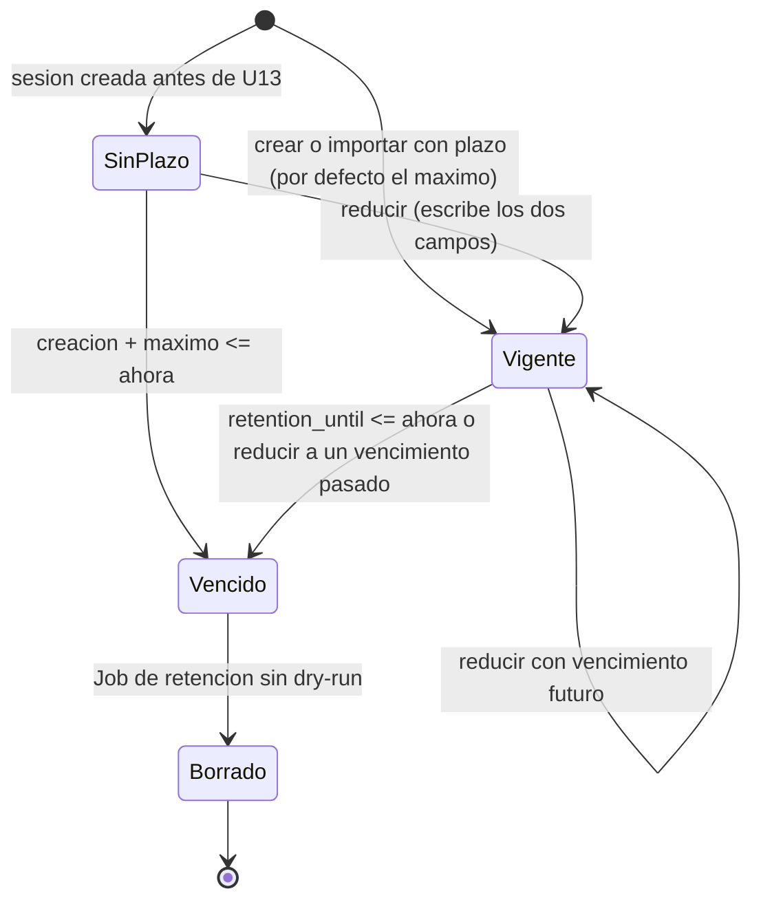
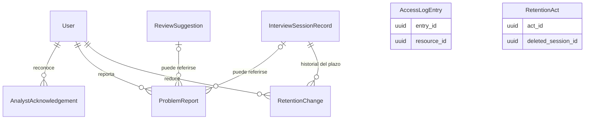

# Especificación funcional — U13 ethics-governance

**Revisión 1 (2026-11-22), primera pasada.** Es una unidad nueva del cambio 01 (DT27) y de la adenda 02, y
no tiene artefactos previos. Se basa en las respuestas P1 = B, P2 = A, P3 = A, P4 = A, P5 = A, P6 = A y
P7 = A, y en los once puntos de la sección 2 de `functional-design-questions.md`, que eran el plan
acordado.

**Insumos.**
- La unidad U13 de `inception/units-generation/unit-of-work.md` (unit-of-work, revisión 3), con UG-01,
  UG-04 y UG-09.
- Su mapa `unit-of-work-story-map.md` (unit-of-work-story-map, revisión 3), con las historias propias
  US15.1, US15.3, US15.6, US15.7 y US15.9, y las que cumple con otras unidades: US15.8 (registro real),
  US5.6 y US8.4.
- FR1.2, FR1.3, NFR10 y NFR11 de `inception/requirements-analysis/requirements.md` (requirements,
  revisión 3); VE-04, VE-11, VE-12, VE-15, VE-16 y A-2 de `requirements-adenda-02.md`.
- EthicsGovernance, ConsoleApi e InterviewSession de `inception/domain-design/components.md` (components,
  revisión 3), con ADR-003, ADR-009, ADR-016 y DD-01 a DD-05.
- C1 (`/acknowledgements`, `/problem-reports`, `/auth/me`), C8, C23, C24 y C25 de
  `inception/contract-design/contract-summary.md` (contract-summary, revisión 3).
- Mockups §11 de `inception/refined-mockups/mockups.md` y sus precisiones de la revisión 3; B13 de
  `inception/delivery-planning/bolt-plan.md`.
- Los diseños de U3 (`construction/identity-access/`: convención de auditoría, usuarios de base de datos,
  actor `retention-job`, flujo F11 del registro de acceso), U4 (`construction/text-flow/`: campos de
  retención vacíos, `purge_session`, incidente que sobrevive), U5 (`construction/human-review/`: su borrado),
  U6 (`construction/session-lifecycle/`: `TranscriptPaste`), U7 (`construction/forensic-report/`:
  exportación con `AccessLog` y su borrado), U8 (`ConductorObservation`) y U9 (`TurnAudio`).

Las entidades están en `entities.md` y las reglas en `rules.md`, que son las fuentes de verdad. Este
documento es la fuente de verdad de los flujos y de las máquinas de estado. Las cifras que no fija la
adenda son de NFR Requirements y aquí solo se nombran.

## 1. Qué hace la unidad

U13 demuestra en la consola la parte del protocolo ético del TG que no es del analizador (ADR-016). No pone
compuertas: nada de lo que agrega impide abrir ni crear sesiones, ni deja la consola inutilizable (DD-01 a
DD-05, punto 4 de B13). Tiene cinco partes:
- **Reconocimiento** (US15.1): el diálogo modal, la fila de solo inserción, el estado calculado en
  `/auth/me` y, con P1 = B, «Más tarde» con una franja persistente.
- **Registro de acceso** (US15.6): el adaptador real del puerto `AccessLog` (C23). ConsoleApi lo cablea en
  lugar del adaptador por defecto de U7, lo que cierra la parte del registro de AC15.8.2 (UG-09).
- **Reporte de problemas** (US15.3): el panel no modal, las seis categorías, la nota opcional y el aviso de
  testimonio, que no rechaza. Admite reportes sin sesión (P6 = A).
- **Retención** (US15.7): el plazo de 1 a 90 días, con el máximo por defecto (P2 = A), contado desde la
  creación (P3 = A) y reducible por el dueño o un `admin` (P4 = A). El `Job` que lanza el humano usa el
  reloj real y tiene `--dry-run` (P5 = A), y deja un acta por borrado.
- **Bienestar** (US15.9): el aviso al abrir M4 y el recordatorio no modal, solo en la consola.

Lo registrado se consulta con un comando de solo lectura que ejecuta el humano (P7 = A). No hay pantallas de
consulta.

**Puertos.** U13 no escribe en tablas ajenas:
- **Hacia ConsoleApi.** EthicsGovernance expone una fachada con cinco operaciones:
  `acknowledgement_state(user)`, `acknowledge(user, text_version)`, `report_problem(...)`,
  `validate_retention_days(days | None)` y `reduce_retention(session, days, actor)`. Además aporta el
  adaptador de `AccessLog`. EthicsGovernance no importa nada de ConsoleApi.
- **Hacia InterviewSession (U4).** El puerto nuevo `EthicsSessionPort` (FD-U13-08) tiene estas
  operaciones:
  - `retention_of(session_id)`;
  - `set_retention(uow, session_id, days, until)`, que sube el `change_cursor`;
  - `expired_sessions(as_of)`;
  - `turn_texts(session_id)`, en memoria y solo durante la petición;
  - `request_cancellation(session_id)`, que usa la clave de Redis de CD-06.
- **Hacia HumanReview (U5).** El resolvedor de sugerencia a sesión que U5 ya aporta a ConsoleApi.
- **Borrado.** `Purgeable.purge_session` de ReviewReport, HumanReview e InterviewSession (C24).

Las dependencias EthicsGovernance → InterviewSession, HumanReview y ReviewReport ya existen en components.
No aparece ninguna arista nueva entre componentes ni entre unidades.

**Frontera AUTONOMIA-04.** Todo corre dentro del clúster: el módulo de `session-api`, sus tablas, el `Job`
de retención (la misma imagen) y el comando de consulta. Nada sale. El único texto libre es la nota de un
reporte de problemas. La nota no va a los logs (BR3.9) y la retención la borra (BR5.5, BR5.8).

**AUTONOMIA-01.** El `Job` es un manifiesto revisable que entra por PR y lanza el humano; nunca es un
`CronJob` (BR5.1). La migración de las tablas de U13 corre como `Job` aparte, en su propio PR (BR9.1).

## 2. Flujos

### F1 — Reconocer las reglas de uso (US15.1)

1. El analista inicia sesión (M0). La consola pide `GET /auth/me`, que trae `acknowledgement` con el
   estado calculado (BR1.2) y la versión vigente del texto.
2. Si el estado no es `valid`, antes de la pantalla de destino se abre el diálogo modal con los tres puntos
   de `usage-rules.v1.yaml` y su versión (BR1.1, BR1.4). Con `expired` o `text_changed` lleva arriba su aviso.
3. **«Reconozco estas reglas».** La consola envía `POST /acknowledgements` con `text_version` y CSRF.
   EthicsGovernance comprueba que es la versión vigente e inserta la fila con usuario, hora del servidor y
   versión (BR1.3). La respuesta es `201` con `valid`, el diálogo se cierra y se anuncia «Reglas
   reconocidas» (BR8.5).
4. **«Más tarde» o Escape.** El diálogo se cierra y aparece la franja «No has reconocido las reglas de
   uso» con «Reconocer» bajo el aviso de VE-01, en todas las pantallas (BR1.5). La consola es usable:
   ninguna ruta rechaza (BR1.6).
5. Si el texto cambió mientras el diálogo estaba abierto, la respuesta es `422`
   `ethics.text_version_outdated`. La consola vuelve a pedir el texto y muestra el nuevo.

### F2 — Comprobar el reconocimiento al abrir una sesión (AC15.1.3)

1. Al abrir M4, la consola vuelve a pedir el estado (`/auth/me`) con el reloj del servidor.
2. Si no es `valid`, la sesión se abre igual. El diálogo aparece encima, antes del aviso de bienestar
   (BR1.4, BR6.1). No hay `403` (BR1.6).
3. Si el analista elige «Más tarde», sigue el aviso de bienestar y, después, la transcripción.

### F3 — Registrar un acceso (US15.6, C23)

1. Al arrancar `session-api`, ConsoleApi cablea el adaptador de EthicsGovernance. `/readyz` deja de
   informar `access_log: not_configured` (BR2.1).
2. Tras un `2xx` en una ruta marcada para registrar el acceso, ConsoleApi llama a
   `AccessLog.record(uow, user_id, resource_type, resource_id)` dentro de la transacción de la petición
   (F11 de U3). En la exportación lo hace la ruta de U7, con `export_sha256`.
3. El adaptador valida la coherencia de `export_sha256` con el tipo de recurso (BR2.2) e inserta la fila
   con la hora del servidor y el *timeout* de E/S.
4. Si la inserción falla, lanza la excepción de registro de acceso, sin reintento (BR2.3). La lectura
   responde igual, con un aviso que solo lleva IDs. La exportación se revierte y responde `503`
   `report.export_not_recorded`. Esas respuestas son de U3 y de U7.

### F4 — Reportar un problema (US15.3)

1. El usuario abre el panel desde la cabecera o desde el menú de una tarjeta de M4 (BR3.2). Desde una
   tarjeta se precargan la sugerencia y la sesión; desde M4 o M5, solo la sesión; desde otra pantalla, nada.
2. Elige una de las seis categorías y, si quiere, escribe una nota (BR3.1, BR3.5). «Enviar» queda
   deshabilitado con su motivo mientras falte la categoría o la nota pase el tope (BR8.4).
3. **Con sesión, en M4.** Antes de enviar, la consola compara la nota con los turnos cargados (BR3.7). Si
   encuentra 8 o más palabras seguidas de un turno, muestra «Quita el texto del testimonio de la nota»,
   marca el tramo y cambia el botón a «Enviar igual».
4. **Sin sesión.** El panel muestra siempre «No incluyas texto del testimonio en la nota» y no compara
   (BR3.8).
5. La consola envía `POST /problem-reports` con CSRF. ConsoleApi aplica el rol (BR3.3). Si llega
   `suggestion_id`, deriva `session_id` con el resolvedor de U5. Si hay desacuerdo, responde `422`
   `problem_report.ids_mismatch`. Si el usuario no puede ver la sesión, responde el mismo `403` o `404` de
   la ruta de la sesión (BR3.4).
6. EthicsGovernance calcula `testimony_warning` con los turnos de la sesión que le da `EthicsSessionPort`
   (BR3.6) e inserta la fila. La respuesta es `201` con `problem_report_id` y `testimony_warning`. Ningún
   log lleva la nota (BR3.9).
7. El panel muestra «Reporte enviado», que se anuncia una vez (BR8.5). Si el servidor marcó `true` y la
   consola no había avisado (por ejemplo, fuera de M4), el aviso aparece tras guardar.

### F5 — Fijar el plazo al crear o importar (AC15.7.1)

1. M3 y M7 muestran «Plazo de retención (días)» relleno con el máximo del catálogo y la ayuda «Máximo <N>
   días. Después solo se puede reducir» (BR4.2).
2. La consola envía `retention_days` en `POST /sessions` o en `POST /sessions/import` (FD-U13-04).
3. Antes de delegar en InterviewSession, ConsoleApi llama a
   `EthicsGovernance.validate_retention_days(days)`. Sin valor, devuelve el máximo. Fuera de rango, responde
   `422` `retention.above_maximum` o `retention.below_minimum` sin filas (BR4.1).
4. InterviewSession crea la sesión con `retention_days` y `retention_until` = creación + días × 24 h, en la
   misma transacción de la creación (BR4.3).

### F6 — Reducir el plazo (AC15.7.3, P4 = A)

1. En la cabecera de M4, el dueño o un `admin` ve «Plazo de retención <N> días (hasta DD/MM/AAAA)» y pulsa
   «Reducir plazo» (BR4.6).
2. El diálogo modal pide el número de días. «Reducir» queda deshabilitado con su motivo si el valor no es
   menor que el plazo efectivo o está fuera de rango (BR8.4).
3. La consola envía `PATCH /sessions/{id}/retention` con `retention_days` y CSRF (FD-U13-05). ConsoleApi
   aplica el rol y la propiedad: el analista dueño o `admin` (BR4.4).
4. EthicsGovernance calcula el plazo efectivo (si está vacío, el máximo; BR4.5) y el nuevo vencimiento. Si
   el nuevo vencimiento no es menor, responde `422` `retention.cannot_extend`.
5. En una transacción, con el orden de bloqueo sesión primero, `EthicsSessionPort.set_retention` guarda los
   dos campos y sube el `change_cursor`. EthicsGovernance inserta `RetentionChange` con el antes, el después,
   el actor y la hora.
6. La respuesta es `200` con el plazo nuevo. La consola anuncia «Plazo reducido a <N> días». Si el
   vencimiento ya pasó, la cabecera dice «Plazo vencido. Se borrará en la próxima ejecución del borrado».

### F7 — Borrar sesiones vencidas (Job de retención, AC15.7.2)

1. El humano aplica el manifiesto del `Job` ya fusionado (AUTONOMIA-01). El `Job` arranca con la imagen de
   `session-api`, el comando de retención y la conexión de `veridicus_retention` (BR5.1). Sin `--dry-run`
   no admite `--as-of`: si llega, termina con código 2 antes de abrir la base (BR5.3).
2. Genera `job_run_id` y fija `as_of` con el reloj real.
3. Pide a `EthicsSessionPort.expired_sessions(as_of)` las sesiones cuyo vencimiento efectivo ya llegó, sea
   cual sea su estado (BR5.2, BR4.5).
4. Por cada sesión candidata, en su propia transacción (BR5.6), hace lo siguiente:
   1. pide `request_cancellation(session_id)`, para que no salga ninguna llamada más (BR5.4);
   2. borra los `ProblemReport` de la sesión, incluidos los ligados por una sugerencia de la sesión, y sus
      `RetentionChange` (BR5.5, paso 1);
   3. llama `ReviewReport.purge_session`, que borra exportaciones y versiones con sus archivos y devuelve
      los SHA-256 con `file_missing`;
   4. llama `HumanReview.purge_session`;
   5. llama `InterviewSession.purge_session`, que borra lo de U4, `TranscriptPaste`, `ConductorObservation`
      y `TurnAudio` (el archivo antes de la fila) y termina en `InterviewSessionRecord`;
   6. inserta el `RetentionAct` con los recibos, la regla, el plazo y el vencimiento aplicados y la hora
      (BR5.7);
   7. confirma la transacción. Si algo falla, revierte esa sesión, la anota como `failed` con su `code` y
      sigue con la siguiente.
5. Después borra en una transacción los reportes sin sesión cuyo `reported_at` + máximo ≤ `as_of`, y
   escribe un acta con `deleted_session_id` nulo (BR5.8).
6. Escribe una línea por candidato y un resumen, solo con IDs, reglas, conteos y `code` (BR5.9). Termina
   con 0 si no hubo ningún `failed` y con 1 si hubo alguno.
7. Lo único que sobrevive de cada sesión es su acta, su registro de acceso y su incidente de anonimización
   (BR5.10).

### F8 — Simular el borrado (`--dry-run`, P5 = A)

1. El humano lanza el `Job` con `--dry-run` y, si quiere, con `--as-of <fecha UTC>` (BR5.3).
2. El `Job` hace los pasos 2, 3 y 5 de F7 con `as_of` como fecha de corte, pero solo cuenta: por candidato,
   el ID, la regla y las filas por tabla que se borrarían (`would_purge`).
3. No cancela corridas, no borra, no escribe actas ni cambia nada. Termina con 0.
4. **Demo de B13 (FD-U13-09).** Primero, `--dry-run --as-of` con una fecha futura, que muestra lo que
   vencería. Después, el borrado real de una sesión sintética creada el día anterior con plazo de 1 día. Al
   final, el acta con el comando de consulta (F10).

### F9 — Avisos de bienestar (US15.9)

1. Al abrir M4, después del diálogo de reconocimiento si corresponde, la consola muestra «Esta sesión
   contiene relatos de violencia. Puedes pausar cuando lo necesites» con «Continuar», antes de la
   transcripción (BR6.1).
2. Al pulsar «Continuar», arranca el reloj del recordatorio con `wellness_reminder_interval_s` del
   catálogo (BR6.2).
3. Al cumplirse el intervalo, aparece el recordatorio no modal «Llevas un rato revisando. Considera una
   pausa», con «Cerrar». No quita el foco ni bloquea nada, y se anuncia una vez (BR8.5).
4. Al cerrarlo, el reloj vuelve a empezar. Al salir de M4, se detiene. Nada de esto llama a la API (BR6.3).

### F10 — Consultar lo registrado (P7 = A)

1. El humano ejecuta el comando de consulta en el pod de `session-api`, por ejemplo el subcomando
   `access-log` con `--session <id>` (BR7.1).
2. El comando abre una transacción de solo lectura con el usuario de la aplicación y lista lo pedido:
   - **accesos:** IDs, tipo y hora;
   - **reportes de problemas:** categoría, IDs, quién, cuándo, `testimony_warning` y nota;
   - **actas:** IDs, regla, hora y SHA-256.
3. La salida va en texto o en JSON y no se guarda en ningún lado. No hay ruta HTTP (BR7.2).

## 3. Máquinas de estado

### `AcknowledgementState` (calculado, por analista)

| Desde | Evento | Hasta | Regla |
|---|---|---|---|
| `missing` | El analista reconoce la versión vigente | `valid` | BR1.3 |
| `valid` | Pasan más de 90 × 24 h desde el último reconocimiento | `expired` | BR1.2 |
| `valid` | Entra por PR una versión nueva del texto | `text_changed` | BR1.2 |
| `expired` | El analista reconoce la versión vigente | `valid` | BR1.3 |
| `text_changed` | El analista reconoce la versión vigente | `valid` | BR1.3 |
| `missing`, `expired`, `text_changed` | El analista pulsa «Más tarde» | Igual (franja visible) | BR1.5 |

Ningún estado cambia la respuesta de las rutas de sesión (BR1.6). `text_changed` gana sobre `expired`
cuando se cumplen los dos.

### Plazo de una sesión (`RetentionTerm`)

<!-- Texto alternativo: una sesión nace con plazo vigente o, si se creó antes de U13, sin plazo, que se lee como creación más el máximo. Se puede reducir, nunca ampliar. Cuando el vencimiento llega, la sesión queda vencida, sin cambiar su estado de sesión, y la borra la siguiente ejecución del Job sin --dry-run. -->

El plazo no es un estado de la sesión de U4. Vigente, sin plazo y vencido se calculan comparando
`retention_until` (o creación + máximo) con el reloj. Borrado significa que ya no queda ninguna fila.

### Una candidata dentro del Job

| Desde | Evento | Hasta | Regla |
|---|---|---|---|
| `selected` | Modo `dry_run` | `would_purge` (fin) | BR5.3 |
| `selected` | Cancelación pedida | `purging` | BR5.4 |
| `purging` | Todos los recibos y el acta en la transacción | `purged` (fin) | BR5.5, BR5.7 |
| `purging` | Cualquier error o *timeout* | `failed` (fin, revertida) | BR5.6 |

### Panel de reporte de problemas

| Desde | Evento | Hasta | Regla |
|---|---|---|---|
| `closed` | Abrir desde la cabecera o una tarjeta | `editing` | BR3.2 |
| `editing` | «Enviar» con coincidencia local | `warned` | BR3.7 |
| `editing` | «Enviar» sin coincidencia | `sending` | BR3.6 |
| `warned` | Quitar el texto y «Enviar» | `sending` | BR3.7 |
| `warned` | «Enviar igual» | `sending` | BR3.7 |
| `sending` | `201` | `sent` | BR3.6 |
| `sending` | `4xx` o `5xx` | `editing` con el error | §9 |
| `sent`, `editing`, `warned` | Cerrar o Escape | `closed` | BR8.2 |

## 4. Vista derivada: entidades y relaciones

Se deriva de `entities.md`; la fuente de verdad es su bloque YAML. `UsageRulesText` es un archivo y
`AcknowledgementState`, `RetentionJobRun`, `RetentionCandidate` y `AccessQuery` son valores. `AccessLogEntry`
y `RetentionAct` guardan IDs sin clave foránea, así que en el diagrama no tienen relaciones.

<!-- Texto alternativo: un usuario hace reconocimientos, reportes de problemas y reducciones de plazo. Un reporte de problemas puede referirse a una sesión y a un hallazgo de esa sesión, o a ninguna. Cada reducción de plazo pertenece a una sesión. El registro de acceso y las actas no tienen claves foráneas: guardan IDs para sobrevivir a la retención. User es de IdentityAccess, InterviewSessionRecord de InterviewSession y ReviewSuggestion de HumanReview. -->

## 5. Vista derivada: reglas

Se deriva de `rules.md`; la fuente de verdad es su bloque YAML.

| Grupo | Reglas | Flujo |
|---|---|---|
| Reconocimiento | BR1.1–BR1.7 | F1, F2 |
| Registro de acceso | BR2.1–BR2.5 | F3 |
| Reporte de problemas | BR3.1–BR3.9 | F4 |
| Plazo de retención | BR4.1–BR4.6 | F5, F6 |
| Job de retención | BR5.1–BR5.10 | F7, F8 |
| Bienestar | BR6.1–BR6.3 | F9 |
| Consulta | BR7.1–BR7.2 | F10 |
| Accesibilidad | BR8.1–BR8.5 | F1, F4, F6, F9 (interfaz, §6) |
| Auditoría | BR9.1–BR9.2 | F1, F3, F4, F6, F7 |

## 6. Interfaz

U13 es de tipo `service` y no produce `frontend-components.md`. Esta sección fija los estados y los textos
que la unidad implementa en `frontend`. Los textos nuevos son propuestas (FD-U13-12), no criterios ya
aprobados, salvo los que citan AC.

### 6.1 Diálogo de reconocimiento y franja

- Título «Reglas de uso de los hallazgos» y la versión «Versión <x.y.z>». Los tres puntos de AC15.1.1 van
  como lista.
- Botones «Reconozco estas reglas» (primario) y «Más tarde» (FD-U13-01, P1 = B).
- Avisos arriba: «Tu reconocimiento venció. Vuelve a leer las reglas de uso» (`expired`) y «Las reglas de
  uso cambiaron» (`text_changed`).
- Franja tras «Más tarde»: icono más «No has reconocido las reglas de uso», con el botón «Reconocer». Va bajo
  el aviso de VE-01, en todas las pantallas del analista.

### 6.2 Panel «Reportar un problema»

- El enlace está en la cabecera de todas las pantallas para `analista` y `admin`, y en el menú «⋯» de cada
  tarjeta de M4 como «Reportar un problema con este hallazgo».
- El panel lateral no es modal. Tiene el título «Reportar un problema», el contexto («Hallazgo de la sesión
  <ID corto>», «Sesión <ID corto>» o «Sin sesión»), un grupo de opciones con las seis categorías y
  «Nota (opcional)» con su contador.
- Avisos: «Quita el texto del testimonio de la nota» (con el tramo marcado) y «No incluyas texto del
  testimonio en la nota» (sin sesión).
- Botones «Enviar» o «Enviar igual», y «Cancelar». Al terminar, «Reporte enviado».

### 6.3 Plazo de retención

- M3 y M7: el campo numérico «Plazo de retención (días)», relleno con el máximo, con la ayuda «Máximo <N>
  días. Después solo se puede reducir».
- Cabecera de M4: «Plazo de retención <N> días (hasta DD/MM/AAAA)» o «<N> días (por defecto)». El dueño y el
  `admin` tienen además el botón «Reducir plazo».
- Diálogo: «Reducir el plazo de retención», con el campo de días, la ayuda «Solo puedes reducirlo. No se
  puede deshacer» y los botones «Cancelar» y «Reducir».
- Tras un vencimiento pasado: «Plazo vencido. Se borrará en la próxima ejecución del borrado».
- Errores: «El plazo no puede pasar de <N> días» (`retention.above_maximum`), «El plazo mínimo es de 1
  día» (`retention.below_minimum`) y «Solo se puede reducir el plazo» (`retention.cannot_extend`).

### 6.4 Bienestar

- El aviso a pantalla completa de la columna de la transcripción dice: «Esta sesión contiene relatos de
  violencia. Puedes pausar cuando lo necesites», con «Continuar» (AC15.9.1).
- El recordatorio es un aviso no modal en la esquina inferior: «Llevas un rato revisando. Considera una
  pausa», con «Cerrar» (AC15.9.2).

### 6.5 Accesibilidad

- Todo lo anterior entra en la suite `axe` de U4 (BR8.1).
- Los diálogos son modales con foco atrapado y devuelto. El panel y el recordatorio no lo atrapan (BR8.2).
- Los avisos llevan icono y texto (BR8.3).
- Los botones deshabilitados son enfocables y dicen su motivo (BR8.4).
- `aria-live` anuncia una vez cada resultado (BR8.5).

## 7. Escenarios de negocio y casos límite

| # | Escenario | Resultado esperado | Reglas |
|---|---|---|---|
| E1 | Analista nuevo inicia sesión | Diálogo con los tres puntos y la versión, antes de la lista de sesiones | BR1.2, BR1.4 |
| E2 | Pulsa «Reconozco estas reglas» (AC15.1.2) | `201`; fila con usuario, hora UTC y versión; «Reglas reconocidas» | BR1.3 |
| E3 | Pulsa «Más tarde» | Franja «No has reconocido las reglas de uso»; puede crear y abrir sesiones | BR1.5, BR1.6 |
| E4 | Reconocimiento de hace 90 días, abre una sesión (AC15.1.3) | Se abre; estado `valid`; sin diálogo | BR1.2 |
| E5 | Reconocimiento de hace 91 días (reloj simulado), abre una sesión | Se abre; el diálogo aparece con «Tu reconocimiento venció…»; sin `403` | BR1.2, BR1.4, BR1.6 |
| E6 | Reconoció la v1 hace 10 días; entra la v2 por PR (AC15.1.4) | `text_changed`; el diálogo vuelve a aparecer | BR1.2 |
| E7 | La versión cambia con el diálogo abierto | `422` `ethics.text_version_outdated`; la consola muestra la v2 | BR1.3 |
| E8 | `admin` o `investigador` inicia sesión | Sin diálogo ni franja; `POST /acknowledgements` da `403` | BR1.7 |
| E9 | `usage-rules.v1.yaml` con dos puntos | `session-api` no arranca; el log nombra el archivo | BR1.1 |
| E10 | El analista abre una sesión, una sugerencia y un reporte (AC15.6.1) | Tres filas con usuario, tipo, ID y hora; sin texto | BR2.2 |
| E11 | Sondeo con `since` | Ninguna fila nueva | BR2.2 (F11 de U3) |
| E12 | Exporta un reporte (AC15.8.2) | Fila `report_export` con el `export_sha256` igual a `sha256sum` del archivo | BR2.1, BR2.2 |
| E13 | `/readyz` con U13 | `200` sin `access_log: not_configured` | BR2.1 |
| E14 | La tabla del registro bloqueada al abrir una sesión | La sesión responde `200`; aviso con IDs; métrica de fallos | BR2.3, BR2.5 |
| E15 | La tabla bloqueada al exportar | `503` `report.export_not_recorded`; no sale ningún byte | BR2.3 |
| E16 | `veridicus_app` intenta `UPDATE` o `DELETE` del registro (AC15.6.2) | Falla | BR2.4, BR9.1 |
| E17 | Reporte desde una tarjeta (AC15.3.2) | Fila con categoría, sesión y hallazgo, quién, cuándo, nota y `testimony_warning` falso | BR3.2, BR3.4, BR3.6 |
| E18 | Nota con 8 palabras seguidas de un turno; envía igual (AC15.3.3) | Aviso; «Enviar igual»; `201` con `testimony_warning` verdadero; sin `422` | BR3.6, BR3.7 |
| E19 | Nota con 7 palabras seguidas de un turno | Sin aviso; `testimony_warning` falso | BR3.6 |
| E20 | Nota con 4 palabras de un turno y 4 del siguiente | Sin aviso (deben ser del mismo turno) | BR3.6 |
| E21 | Nota con las 8 palabras con espacios dobles | Aviso (solo se normalizan espacios) | BR3.6 |
| E22 | Reporte desde M1, sin sesión | Aviso fijo; fila con `session_id` nulo y `testimony_warning` falso | BR3.8 |
| E23 | `session_id` de una sesión y `suggestion_id` de otra | `422` `problem_report.ids_mismatch`; 0 filas | BR3.4 |
| E24 | Analista ajeno reporta sobre una sesión que no es suya | `403` igual que la ruta de la sesión | BR3.4 |
| E25 | `investigador` intenta reportar | `403`; no ve el enlace | BR3.3 |
| E26 | Categoría desconocida | `422` `validation.invalid_request` | BR3.1 |
| E27 | Nota con un canario y un fallo de base | `503`; ni la respuesta ni los logs traen el canario | BR3.9 |
| E28 | Crear sesión con 30 días (AC15.7.1) | `201`; `retention_until` = creación + 30 días | BR4.1, BR4.3 |
| E29 | Crear sesión con 120 días | `422` `retention.above_maximum`; 0 filas | BR4.1 |
| E30 | Crear sesión sin plazo | Se guarda 90 | BR4.2 |
| E31 | Importar con 0 días | `422` `retention.below_minimum` | BR4.1 |
| E32 | El dueño amplía de 30 a 60 (AC15.7.3) | `422` `retention.cannot_extend`; 0 filas | BR4.4 |
| E33 | El dueño reduce de 30 a 10 | `200`; `RetentionChange` con 30 → 10, actor y hora | BR4.4 |
| E34 | Un `admin` reduce el plazo de una sesión ajena | `200`; actor el `admin` | BR4.4 |
| E35 | Otro analista intenta reducir | `403` | BR4.4 |
| E36 | Se reduce a un vencimiento ya pasado | `200`; la cabecera dice «Plazo vencido…»; el próximo Job la borra | BR4.4, BR5.2 |
| E37 | Sesión anterior a U13 (plazo nulo) con creación + 91 días (reloj simulado) | El Job la borra con la regla `session_default_term_expired` | BR4.5, BR5.7 |
| E38 | Finalizar una sesión | `retention_until` no cambia | BR4.3 |
| E39 | Sesión vencida con turnos, hallazgos, dos versiones de reporte, una exportación, audio conservado y dos reportes de problemas (AC15.7.2) | Todo borrado en el orden de C24; acta con IDs, SHA-256 de versiones y audio, regla y hora; solo quedan el acta, el registro de acceso y el incidente | BR5.5, BR5.7, BR5.10 |
| E40 | Sesión vencida que sigue abierta con una corrida en cola | Se cancela la corrida (0 llamadas nuevas) y se borra; un resultado tardío no crea filas | BR5.2, BR5.4 |
| E41 | Sesión no vencida | No se toca | BR5.2 |
| E42 | Fallo inyectado en la segunda de tres sesiones | La 1 y la 3 se borran con su acta; la 2 queda entera; salida 1 | BR5.6 |
| E43 | Archivo de una versión que ya no está | Acta con `file_missing: true`; el borrado sigue | BR5.7 |
| E44 | `--as-of` sin `--dry-run` | Código 2 antes de abrir la base; 0 cambios | BR5.3 |
| E45 | `--dry-run --as-of` con una fecha futura | Lista `would_purge` con conteos; 0 filas borradas; 0 actas | BR5.3 |
| E46 | Reporte sin sesión de hace 91 días y otro de 89 | Se borra el primero con un acta de `deleted_session_id` nulo; el otro queda | BR5.8 |
| E47 | Datos sintéticos con canario en turnos y notas | La salida y los logs del Job no traen el canario | BR5.9 |
| E48 | `veridicus_retention` intenta borrar `AccessLogEntry` o `AnalystAcknowledgement` | Falla | BR9.2 |
| E49 | Buscar un `CronJob` de retención o un `kubectl apply` en scripts y workflows | Ninguno (comprobación de nivel 0) | BR5.1 |
| E50 | Abrir M4 (AC15.9.1) | Aviso de contenido con «Continuar» antes de la transcripción | BR6.1 |
| E51 | Se cumple el intervalo con M4 abierta (AC15.9.2) | Recordatorio no modal; al cerrarlo, el texto de la entrada sigue | BR6.2 |
| E52 | Cerrar el recordatorio | 0 peticiones | BR6.3 |
| E53 | `access-log --session <id>` tras la demo | Lista de accesos solo con IDs, tipo y hora | BR7.1 |
| E54 | Recorrido de los diálogos y el panel con teclado y `axe` | 0 violaciones `serious` o `critical`; foco devuelto | BR8.1, BR8.2 |

## 8. Integración con otras unidades

| Unidad | Qué usa U13 | Qué espera de ella |
|---|---|---|
| U1 contracts | C1, C8, C23, C24, C25, el catálogo de `code` y la jerarquía de excepciones | Las precisiones FD-U13-02 a FD-U13-07 y FD-U13-11 por PR de U1 |
| U3 identity-access | ConsoleApi (rol, propiedad, CSRF, Problem Details, marca de acceso), la convención de auditoría, los dos usuarios de base de datos y el actor `retention-job` | Que cablee el adaptador de U13 y que la prueba común recorra las cinco tablas de U13 |
| U4 text-flow | `InterviewSessionRecord` con sus campos de retención, `purge_session`, la clave de cancelación de CD-06, la base de la consola y la suite `axe` | Que implemente `EthicsSessionPort` (FD-U13-08), que escriba los dos campos al crear (F5) y que la ingesta descarte el resultado de una sesión borrada (FD-U13-13) |
| U5 human-review | El resolvedor de sugerencia a sesión y `purge_session` | Nada nuevo |
| U6 session-lifecycle | Que `purge_session` de InterviewSession incluya `TranscriptPaste`; M7 recibe el campo del plazo | Nada nuevo |
| U7 forensic-report | La interfaz de `AccessLog`, la llamada desde la exportación y `purge_session` con su recibo | Nada nuevo; su prueba con el adaptador por defecto sigue valiendo sin U13 |
| U8, U9 | Que `purge_session` incluya `ConductorObservation` y `TurnAudio` con su SHA-256 | Nada nuevo |
| U2 platform | El manifiesto del `Job` de retención y la referencia al Secret de `veridicus_retention` | Que el Secret lo cree el humano y que el `Job` monte los volúmenes de reportes y de audio (pregunta 4 de §11) |
| U12 research-reports | Ninguna | La retención no toca su tabla |

## 9. Errores y bordes

| Situación | HTTP / salida | `code` | ¿Se escribe algo? |
|---|---|---|---|
| Rol sin permiso en una ruta de U13 | 403 | `auth.forbidden` | No |
| Sin CSRF | 403 | `auth.csrf` | No |
| Versión del texto desactualizada | 422 | `ethics.text_version_outdated` | No |
| Categoría desconocida o cuerpo inválido | 422 | `validation.invalid_request` | No |
| Sesión y sugerencia en desacuerdo | 422 | `problem_report.ids_mismatch` | No |
| Nota sobre el tope | 422 | `limits.exceeded` | No |
| Plazo > máximo / < mínimo / ampliar | 422 | `retention.above_maximum` / `retention.below_minimum` / `retention.cannot_extend` | No |
| Base caída | 503 | `system.unavailable` | No: la transacción se deshace |
| Fallo del registro de acceso | Lo decide quien llama (§F3) | — | La lectura sigue; la exportación se revierte |
| `Job` con `--as-of` sin `--dry-run` | Código 2 | — | No |
| `Job` con una sesión que falla | Código 1 al final | `code` por sesión en la salida | Las otras sesiones sí |
| `usage-rules.v1.yaml` ausente o inválido | `session-api` no arranca | — | — |

Toda E/S lleva su *timeout* explícito. Ninguna ruta de U13 reintenta sola: los reconocimientos y los
reportes son inserciones nuevas, y reducir el plazo dos veces con el mismo valor da `422` la segunda vez.
El `Job` no reintenta una sesión fallida en la misma ejecución: la siguiente ejecución la vuelve a
seleccionar.

## 10. Decisiones que precisan artefactos ya aprobados

No edité ningún artefacto aprobado (regla de `project.md`). En la aprobación decides cuáles se llevan al
original, cada una en su propio commit.

| ID | Artefacto aprobado | Precisión propuesta | Origen |
|---|---|---|---|
| FD-U13-01 | `user-stories/stories-adenda-02.md` (AC15.1.1) | «Salir» pasa a «Más tarde»: cierra el diálogo y deja una franja persistente «No has reconocido las reglas de uso» con «Reconocer». La consola sigue usable | P1 = B; DD-01; B13 (punto 4) |
| FD-U13-02 | `contract-design/contract-summary.md` (C8) | Entra `contracts/integrity/usage-rules.v1.yaml`, con `version` y exactamente tres puntos, como texto excluido del escaneo de vocabulario (`notice_text`), igual que el aviso de VE-01 | Punto 1 de la sección 2; VE-04 |
| FD-U13-03 | `contract-design/contract-summary.md` (C25) | Entran `retention_max_days` (90), `retention_min_days` (1), `acknowledgement_validity_days` (90), `wellness_reminder_interval_s` y `problem_report_note_max_chars`. Las dos últimas cifras las fija NFR Requirements | Punto 2 de la sección 2; VE-04; VE-12; VE-16 |
| FD-U13-04 | `contract-design/contract-summary.md` (C1) | `POST /sessions` y `POST /sessions/import` suman `retention_days` (entero, opcional). `SessionView` suma `retention_days`, `retention_until` y `retention_default` (booleano). `AcknowledgementStatus` suma `current_text_version`. Entran los `code` `retention.above_maximum`, `retention.below_minimum`, `retention.cannot_extend`, `ethics.text_version_outdated` y `problem_report.ids_mismatch` | Punto 8 de la sección 2; P2 = A; BR1.3; BR3.4 |
| FD-U13-05 | `contract-design/contract-summary.md` (C1) y `refined-mockups/mockups.md` (M4 y §11, US15.7) | Ruta nueva `PATCH /sessions/{id}/retention` (`x-veridicus-demo: true`, `x-veridicus-roles: [analista, admin]`, `x-veridicus-owner-only-for-role: analista`, CSRF), con `200`, `403` y `422`. En la cabecera de M4, el plazo y «Reducir plazo» con su diálogo. Cierra el «queda para Functional Design» de §11 | P4 = A; AC15.7.3 |
| FD-U13-06 | `contract-design/contract-summary.md` (C1 `/problem-reports`) | `note` pasa a opcional (`required: [category]`), con `maxLength` del catálogo, como dice AC15.3.1. `category` pasa a `enum` con las seis claves. Se declaran `403`, `404` y `422` | Punto 6 de la sección 2; AC15.3.1; BR3.4 |
| FD-U13-07 | `units-generation/unit-of-work.md` (UG-01), `domain-design/components.md` (ProblemReport, RetentionAct y orden del Job) y C24 | `session_id` es opcional en ProblemReport. Si llega `suggestion_id`, se deriva de la sugerencia (UG-01 sigue para ese caso). Los reportes sin sesión se borran cuando `reported_at` + máximo ≤ `as_of`, con un acta de `deleted_session_id` nulo y la regla `sessionless_problem_report_expired` | P6 = A |
| FD-U13-08 | `domain-design/components.md` (EthicsGovernance, InterviewSession y ConsoleApi), C24 y el Functional Design de U4 | Entidad nueva `RetentionChange` (history, purgable). Puerto nuevo `EthicsSessionPort`, que U4 implementa: `retention_of`, `set_retention`, `expired_sessions`, `turn_texts` y `request_cancellation`. En la interacción EthicsGovernance → InterviewSession se suma «leer y reducir el plazo, listar sesiones vencidas y cancelar sus corridas», y en ConsoleApi → EthicsGovernance, «validar el plazo al crear o importar». No hay aristas nuevas | P3 = A; P4 = A; BR3.6; BR5.4 |
| FD-U13-09 | `delivery-planning/bolt-plan.md` (B13, demo esperada) | La demo usa `--dry-run --as-of` con una fecha futura y el borrado real de una sesión sintética creada el día anterior con plazo de 1 día. El `Job` borra siempre con el reloj real | P5 = A |
| FD-U13-10 | `refined-mockups/mockups.md` (§11, US15.6) y `stories-adenda-02.md` (US15.3) | El registro de acceso, los reportes de problemas y las actas se consultan con un comando de solo lectura de la imagen de `session-api`, que ejecuta el humano. No hay pantalla ni ruta de lectura | P7 = A |
| FD-U13-11 | `contract-design/contract-summary.md` (C23) | El adaptador real lanza la excepción de registro de acceso de la jerarquía común ante un fallo o un *timeout*, y no reintenta. El adaptador no decide la respuesta HTTP | BR2.3 |
| FD-U13-12 | `refined-mockups/interaction-spec.md` (catálogo de mensajes) | Entran los textos `ethics.*` y `retention.*` de §6 (diálogo, franja, panel, plazo, errores). Los de AC15.3.3, AC15.9.1 y AC15.9.2 ya están fijados | Punto 11 de la sección 2 |
| FD-U13-13 | Functional Design de U4 (ingesta de resultados) | Un resultado de la cola de una sesión que ya no existe se confirma (XACK) y se descarta sin filas, con un aviso que solo lleva IDs | BR5.4; P3 = A |

## 11. Preguntas abiertas para NFR Requirements e Infrastructure Design

1. **Cifras.** `wellness_reminder_interval_s` y `problem_report_note_max_chars` (FD-U13-03). La primera,
   con el criterio de bienestar del TG; la segunda, de forma que una nota larga no haga lenta la
   comparación de BR3.6.
2. **Latencia de la comparación de testimonio.** Hay que fijar el p95 de `POST /problem-reports` con una
   sesión del tamaño de `transcript_max_turns`, y el de la comparación local en la consola.
3. **Plazo del adaptador de `AccessLog`.** Es su *timeout* dentro de la petición. Coincide con la pregunta
   abierta de U7 sobre `503 report.export_not_recorded`.
4. **El `Job` (Infrastructure Design).** Hay que fijar `activeDeadlineSeconds`, `backoffLimit: 0` (para no
   relanzar solo un borrado) y `requests`/`limits`. También cómo monta los volúmenes de reportes y de audio
   que ya usa `session-api` (un PVC `ReadWriteOnce` en un solo nodo de Minikube), y el Secret de
   `veridicus_retention`.
5. **Comando de consulta.** Hay que decidir si corre con `kubectl exec` en el pod de `session-api` o como
   un `Job` de solo lectura, y qué tope de filas devuelve por defecto.
6. **Para decidir en la aprobación, no bloquea.** Con P3 = A, una sesión que sigue abierta se borra al
   vencer. Con P5 = A, la demo en vivo necesita una sesión creada el día anterior. Con P6 = A, un reporte
   sin sesión puede traer testimonio durante 90 días.
