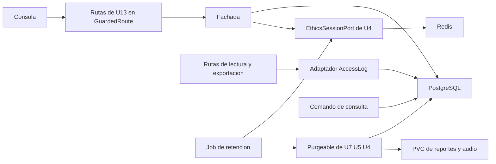

# Componentes lógicos — U13 ethics-governance

**Revisión 1 (2026-11-22): primera pasada.** U13 no despliega un servicio propio: su código corre en la API
de `session-api`, en un `Job` con la misma imagen, en un comando dentro del contenedor de la API y en la
consola. Este documento dice qué pieza aplica cada patrón de NFR y qué recibe de U2 (Infrastructure
Design), U3, U4, U7 y U1.

**Insumos.** `nfr-requirements/security-requirements.md` (security-requirements, frontera §1),
`performance-requirements.md` (performance-requirements), `scalability-requirements.md`
(scalability-requirements), `reliability-requirements.md` (reliability-requirements),
`observability-requirements.md` (observability-requirements) y `tech-stack-decisions.md`
(tech-stack-decisions, D1–D8 y §5) de esta unidad; §1 y §8 de `functional-design/functional-spec.md`
(functional-spec); C1, C12, C23, C24 y C25 de `inception/contract-design/contract-summary.md`
(contract-summary); `logical-components.md` de U3 y de U7.

## 1. Inventario

| Componente | Ruta en `services/session-api/src/session_api/` o en `frontend/` | Proceso | Dentro / fuera | Patrones NFR que aplica |
|---|---|---|---|---|
| Rutas de U13 | `console/routes/ethics.py` (ConsoleApi) | API de `session-api` | Clúster | `GuardedRoute` con tope del cuerpo; propiedad de la sesión del cuerpo con el registro de resolvedores |
| Fachada | `ethics_governance/application/facade.py` | Igual | Igual | Transacción de la petición; reloj inyectado; sin reintentos |
| Estado del reconocimiento y plazo (guardia) | `ethics_governance/domain/acknowledgement.py`, `domain/retention_term.py` | Igual | Igual | Código puro; 100 % de ramas en las partes de BR5.2 y BR5.3 |
| Comparación de testimonio (guardia) | `ethics_governance/domain/testimony.py` | Igual | Igual | Función pura, iterador, sin cachés, 100 % de ramas |
| Logs y rechazos sin la nota (guardia) | `ethics_governance/domain/log_fields.py` | Igual | Igual | Campos de la lista blanca; 100 % de ramas (BR3.9) |
| Reglas de uso | `ethics_governance/adapters/usage_rules.py` | Igual | Igual | Cargador seguro, objeto inmutable, fallo al arrancar |
| Adaptador de `AccessLog` | `ethics_governance/adapters/access_log.py` | Igual | Igual → PostgreSQL | `SET LOCAL` de 500 ms con reposición; sin reintentos; comprobación al arrancar |
| Repositorios | `ethics_governance/adapters/repositories.py` | Igual | Igual → PostgreSQL | `INSERT` y `DELETE … RETURNING`; índices de NFR3.10 |
| `Job` de retención | `ethics_governance/retention.py` y `application/retention_run.py` (orquestación, guardia) | `Job` `veridicus-retention` | Igual → PostgreSQL, Redis, PVC | Bloqueo consultivo, transacción por sesión, claves antes de borrar, plazo por sesión, salida sin texto |
| Comando de consulta | `ethics_governance/query.py` | `kubectl exec` en el contenedor de la API | Igual → PostgreSQL | `READ ONLY`, cursor del servidor, solo `stdout` |
| Migración | `db/migrations/` (cinco tablas, marcas, `CHECK`, índices) | `Job` de migraciones | Igual | Entra por su PR; nunca al arrancar un pod |
| Diálogo, franja, panel, plazo y avisos | `frontend/src/features/ethics-governance/` | Navegador | Máquina del analista | Sin HTML; comparación local por trozos; temporizador sin peticiones; `retry: false` |
| Generador de *fixtures* | `tests/fixtures/make_ethics_fixtures.py` | Solo pruebas | Ninguno | Datos sintéticos |

## 2. Componentes en YAML

```yaml
components:
  - name: ethics-routes
    path: services/session-api/src/session_api/console/routes/ethics.py
    hosts: [session-api-api]
    boundary: inside
    data_out: none
    guard: false
  - name: ethics-facade
    path: services/session-api/src/session_api/ethics_governance/application
    hosts: [session-api-api, retention-job]
    boundary: inside
    data_out: none
    guard: false
  - name: ethics-domain
    path: services/session-api/src/session_api/ethics_governance/domain
    hosts: [session-api-api, retention-job]
    boundary: inside
    data_out: none
    guard: true
  - name: access-log-adapter
    path: services/session-api/src/session_api/ethics_governance/adapters/access_log.py
    hosts: [session-api-api]
    boundary: inside
    data_out: none
    guard: false
  - name: retention-job
    path: services/session-api/src/session_api/ethics_governance/retention.py
    hosts: [retention-job]
    boundary: inside
    data_out: none
    guard: true
  - name: ethics-query
    path: services/session-api/src/session_api/ethics_governance/query.py
    hosts: [session-api-api]
    boundary: inside
    data_out: human_terminal
    guard: false
  - name: ethics-console
    path: frontend/src/features/ethics-governance
    hosts: [browser]
    boundary: analyst_machine
    data_out: none
    guard: true
```

## 3. Dominios de fallo y radio de impacto



<!-- Texto alternativo: la consola llama a las rutas de U13, que pasan por GuardedRoute a la fachada; la fachada usa PostgreSQL y el puerto EthicsSessionPort de U4. Las rutas de lectura y la exportación de otras unidades llaman al adaptador de AccessLog, que escribe en PostgreSQL. El Job de retención usa el puerto de U4, que escribe las claves en Redis, y las purgas de U7, U5 y U4, que borran en PostgreSQL y en los volúmenes de reportes y audio. El comando de consulta solo lee PostgreSQL. -->

| Falla | Radio de impacto | Contención |
|---|---|---|
| PostgreSQL caído o lento | Toda `session-api` (U3); en U13, `503` y 0 filas | Plazos de `reliability-design.md` §1; sin reintentos |
| Tabla del registro bloqueada | Lecturas: ninguno (aviso y métrica). Exportación: esa petición | Punto de guardado de U3; `record_access_strict` de U7 |
| Reglas de uso rotas | El despliegue nuevo de `session-api` no arranca | Fallo al arrancar; prueba de humo y `git revert` |
| Redis caído durante el `Job` | Ninguna sesión se borra en esa ejecución | Fallo cerrado por sesión; relanzar |
| Fallo en la purga de una sesión | Esa sesión | Transacción por sesión; las demás siguen |
| El `Job` se lanza dos veces | Ninguno | Bloqueo consultivo; código 3 |
| El `Job` vence su plazo | Lo que no se confirmó | Relanzar; nada a medias |
| Nota o sesión máxima | Esa petición | Tope del cuerpo; comparación lineal con corte temprano |
| Comparación lenta en la consola | La pestaña del analista | Trozos de 250 turnos con cesión al bucle de eventos |

## 4. Aislamiento y recursos compartidos

| Recurso | Compartido con | Aislamiento |
|---|---|---|
| Proceso de la API de `session-api` | U3–U9, U12 | import-linter (`ethics-governance-no-egress`, `ethics-governance-no-metrics`, fronteras de NFR13.3); nada pesado en memoria |
| Pool de conexiones de la API | Todas las unidades de la API | Una conexión por petición, por milisegundos |
| Base PostgreSQL | Las unidades de `session-api` y los `Job` | Cinco tablas con su marca; permisos derivados; funciones de bloqueo solo para `veridicus_retention` |
| Fila de la sesión | U3–U9 | `change_cursor.bump` primero en la `PATCH`; el `Job` bloquea primero con `lock_for_purge` |
| Redis | Colas de U4, U6, U9 y claves de cancelación | El `Job` solo escribe claves de cancelación a través de `EthicsSessionPort` |
| PVC `veridicus-reports` y `veridicus-audio` | API de `session-api` | El `Job` los toca solo por `purge_session` de U7 y U4; mismo UID y GID |
| Imagen de `session-api` | API, trabajador, `Job` de retención | El `Job` solo ejecuta `python -m session_api.ethics_governance.retention` |

## 5. Lo que se entrega a otras unidades

| Unidad | Qué fija U13 | Qué decide la otra unidad |
|---|---|---|
| U2 (Infrastructure Design) | Forma del `Job` (NFR-U13-07: mismo UID, dos PVC, `backoffLimit: 0`, sin `ttlSecondsAfterFinished`, `activeDeadlineSeconds` medido); `log_error_verbosity: terse` (NFRD-U13-09); comprobación de `VERIDICUS_LIMIT_RETENTION_MAX_DAYS` (NFRD-U13-10); volumen de PostgreSQL con las tablas que no se borran (≤ 40 MiB por cada 150 000 accesos y ≤ 100 MiB por cada 500 actas) | Los valores finales de `requests`/`limits`, el tamaño del volumen y la forma exacta de los dos manifiestos (borrado y simulación) |
| U3 (identity-access) | `retention_insert` en la marca y conjunto de funciones de `veridicus_retention` (NFRD-U13-04); campos de la lista blanca (NFRD-U13-11) | Cómo lo expone en su migración y su formateador |
| U4 (text-flow) | `lock_for_purge` y su función (NFRD-U13-05); `request_cancellation` del `Job` solo con claves y fallo cerrado (NFRD-U13-06); `count_session` (NFRD-U13-08); M4 entra en la suite `axe` y en el escaneo de vocabulario | Su implementación en B4 |
| U7 (forensic-report) | Función de bloqueo de las versiones (NFRD-U13-07); `count_session` (NFRD-U13-08) | Su implementación en B7 |
| U5 (human-review) | `count_session` (NFRD-U13-08) | Su implementación en B5 |
| U9 (voice) | Motivo `retention` en la cancelación, tratado como `withdraw` en la voz (NFRD-U13-06) | Su implementación en B9 |
| U1 (contracts) | C24 v1.1.0 con `count_session` (NFRD-U13-08); `whitespace_code_points` en `testimony-warning-cases.v1.yaml` (NFRD-U13-13) | La forma en los contratos |
| U6, U8, U10, U11, U12 | Nada: ninguna decisión de U13 les afecta | — |

## 6. Cobertura y fronteras (NFR13.1, NFR13.2, NFR13.3)

| Requisito | Pieza | Diseño | Comando |
|---|---|---|---|
| NFR13.1 | Todo el código de U13 | Entra en el 80 % de líneas de `services/session-api` y de `frontend`; sin exclusiones nuevas | `tech-stack-decisions.md` §5 |
| NFR13.2 | `ethics-domain`, `retention-job` (selección, argumentos y orquestación por sesión con su acta), `domain/testimony.py`, `domain/log_fields.py` y `testimony.ts` | Se añaden al `.coveragerc-guards` de U4 y a la configuración de Vitest con `branches: 100`; sus pruebas se escriben primero y en rojo | `pytest --cov-branch --cov-config=.coveragerc-guards`; `npm --prefix frontend run test -- --coverage` |
| NFR13.3 | Contratos de import-linter | `ethics_governance.domain` no importa `adapters` ni `sqlalchemy`; `ethics_governance` no importa ConsoleApi; InterviewSession solo por `EthicsSessionPort`, HumanReview solo por su resolvedor y cada unidad por `Purgeable`; más `ethics-governance-no-egress` (`security-design.md` §2) y `ethics-governance-no-metrics` (`observability-design.md` §4), cada uno con su módulo de control negativo | `lint-imports` |
