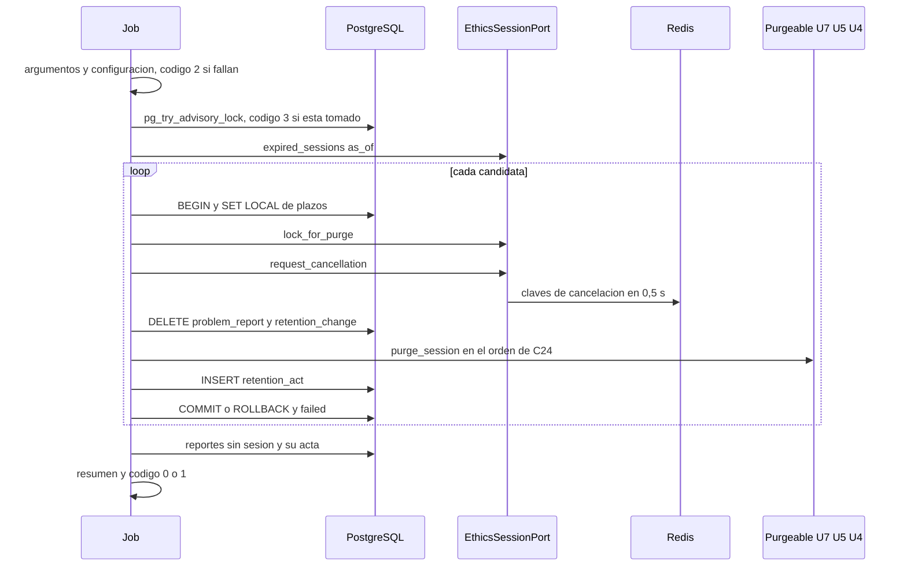

# Diseño de fiabilidad — U13 ethics-governance

**Revisión 1 (2026-11-22): primera pasada.** Todo es nuevo. Las precisiones están en la tabla NFRD-U13-xx de
`security-design.md` §17.

**Insumos.** `nfr-requirements/reliability-requirements.md` (reliability-requirements: NFR10.13–NFR10.21,
NFR11.7, NFR11.8, §2 y §4) y `tech-stack-decisions.md` (tech-stack-decisions, D3, D4 y D7) de esta unidad;
F3, F6, F7, F8, §9 y E14, E15, E39–E46 de `functional-design/functional-spec.md` (functional-spec); C12,
C23, C24 y C25 de `inception/contract-design/contract-summary.md` (contract-summary); §2.4 y §3 de U3
(punto de guardado y arranque); §10 y §11 de U7 (exportación y purga, NFRD-U7-06); §11 y §12 de U4
(cancelación e incidente); §7.2 y §13 de U2 (Redis con AOF y forma del `Job`).

U13 no tiene objetivo de disponibilidad propio: está disponible cuando lo están `session-api` y PostgreSQL.
Este documento fija cómo falla: el registro nunca rompe una lectura, el `Job` borra una sesión entera o no la
toca, nada se reintenta solo y nada arranca con una configuración rota.

## 1. Plazos (NFR10.15)

| Operación | Plazo | Dónde se fija | Al vencer |
|---|---|---|---|
| Sentencias de las rutas | `statement_timeout` 2 s | `session_api/shared/db.py` (U3) | *Rollback*, `503` `system.unavailable` |
| Esperas de bloqueo (`PATCH`, `Job`) | `lock_timeout` 2 s | `db.py` (NFRD-U5-10) | Igual |
| Inserción de `AccessLog` | `VERIDICUS_ACCESS_LOG_TIMEOUT_MS` (500 ms) | Adaptador, con `SET LOCAL` (§2) | Excepción de registro de acceso; la decide quien llama |
| Redis en el `Job` | 0,5 s por operación (`socket_timeout` y `socket_connect_timeout`) | Cliente de `EthicsSessionPort` (U4) | La sesión queda `failed` con `system.unavailable` (§4) |
| Una sesión en el `Job` | `VERIDICUS_RETENTION_SESSION_TIMEOUT_S` (60 s, entre 10 y 300) | Reloj monotónico, comprobado entre pasos y antes del `COMMIT` | *Rollback* de esa sesión, `failed` con `system.unavailable` |
| Inactividad dentro de la transacción del `Job` | `SET LOCAL idle_in_transaction_session_timeout = '15s'` | Primera sentencia de cada transacción por sesión (NFRD-U13-14) | El servidor corta; la sesión queda `failed` y la ejecución termina con 1 |
| Cada archivo de la purga | 5 s | `purge_session` de U7 y U4 | Lo decide la unidad dueña; para U13 es un fallo de la sesión |
| El `Job` entero | `activeDeadlineSeconds` (3 600 s, NFR-U13-07) | Manifiesto de `deploy/jobs/` | Kubernetes mata el pod; §4.5 |
| Comando de consulta | `statement_timeout` 2 s y `--limit` | `db.py`; argumentos | Código 1 y una línea con `code` |

- Configuración inválida o ausente del `Job` (`VERIDICUS_RETENTION_SESSION_TIMEOUT_S`, C25, conexión):
  código 2 antes de abrir la base (`team.md`: la configuración faltante impide arrancar).
- Pruebas de nivel 1: base retenida 3 s en una ruta (`503`); archivo que tarda 6 s en la purga (`failed`);
  Redis con 0,6 s de latencia inyectada (`failed`); `VERIDICUS_RETENTION_SESSION_TIMEOUT_S=10` con una
  sesión que tarda 11 s (`failed` y la sesión entera).

## 2. Registro de acceso que no rompe la lectura (NFR10.13; BR2.3)

```text
# Ilustrativo: adaptador real de AccessLog (C23)
def record(uow, user_id, resource_type, resource_id, export_sha256=None):
    check_coherence(resource_type, export_sha256)            # BR2.2, sin E/S
    prev = uow.scalar("SELECT current_setting('statement_timeout')")
    uow.execute("SELECT set_config('statement_timeout', :ms, true)", ms=f"{timeout_ms}ms")
    try:
        uow.execute(insert_access_log_entry, ...)            # una sola sentencia
    except QueryCanceled as e:  raise AccessLogTimeout() from None
    except DatabaseError as e:  raise AccessLogError() from None
    uow.execute("SELECT set_config('statement_timeout', :prev, true)", prev=prev)
```

- **Dentro de quien llama.** En las lecturas corre dentro del punto de guardado de `record_access` (§2.4
  de U3); en la exportación, dentro de `record_access_strict`, que es la última sentencia antes del
  `COMMIT` de U7. El adaptador no abre transacciones ni puntos de guardado propios.
- **Repone el plazo anterior**, no el valor por defecto: si quien llama ya había fijado otro, lo conserva.
  Si la inserción falla, el plazo corto no sobrevive: el punto de guardado (lectura) o la transacción
  (exportación) se deshacen con él.
- **Sin reintentos.** El código del adaptador no tiene bucles; `from None` corta la cadena para que el
  mensaje de psycopg (que puede citar la fila) no viaje en la excepción.
- **Resultado.** Lectura: `200` con las escrituras del manejador, `WARNING access_log.record_failed` con IDs
  y la métrica de U3 (E14). Exportación: `503` `report.export_not_recorded` sin bytes (E15).
- Pruebas de nivel 1: espera inyectada de 600 ms (excepción en ≤ 600 ms); tabla bloqueada con
  `LOCK … IN ACCESS EXCLUSIVE MODE` desde otra conexión, en una lectura y en una exportación; tras un
  registro correcto, una sentencia de quien llama de 1 s sigue funcionando (su plazo de 2 s no quedó en
  500 ms); comprobación estática de que el adaptador no tiene bucles ni `tenacity`.

## 3. Arranque (NFR10.14, NFR10.24; BR1.1, BR2.1)

| Paso | Qué se comprueba | Si falla |
|---|---|---|
| 1 | Las siete cifras de U13 en C25 con `limits.load` | `session-api` termina con código ≠ 0 antes de abrir el puerto; el log nombra la cifra |
| 2 | `usage-rules.v1.yaml`: carga segura, sin claves repetidas, `version` semántica, exactamente tres puntos no vacíos | Igual; el log nombra el archivo y la regla, nunca el contenido (E9) |
| 3 | Adaptador de `AccessLog`: con `connect_timeout` de 2 s, `to_regclass('access_log_entry')` no es nulo y `has_table_privilege(current_user, 'access_log_entry', 'INSERT')` es verdadero | Igual; el log nombra la tabla y la regla |
| 4 | ConsoleApi cablea el adaptador real una sola vez (F13 de U3) | — |
| 5 | Línea `ethics.startup` con la versión y el SHA-256 de las reglas y `access_log_adapter: ethics_governance` | — |

Como el proceso no abre el puerto, `/readyz` nunca responde `200` con U13 roto; con todo válido responde
`200` sin `access_log: not_configured` (E13). Un despliegue con las reglas rotas no pasa la prueba de humo
de U2 y se revierte con `git revert` (`team.md`). Pruebas: nivel 0 para el archivo (ausente, inválido, dos
puntos, clave repetida); nivel 1 para la tabla sin permiso `INSERT`.

## 4. `Job` de retención (NFR10.17–NFR10.21; F7, F8)

### 4.1 Una ejecución



<!-- Texto alternativo: el Job valida sus argumentos y su configuración y termina con código 2 si fallan. Toma un bloqueo consultivo y termina con código 3 si otra ejecución lo tiene. Pide las sesiones vencidas. Por cada una abre una transacción con sus plazos, bloquea la sesión, escribe las claves de cancelación en Redis con un plazo de 0,5 s, borra los reportes de problemas y el historial del plazo, llama a la purga de cada unidad en el orden de C24, inserta el acta y confirma, o revierte y marca la sesión como fallida. Después borra los reportes sin sesión vencidos con su acta y escribe el resumen con código 0 o 1. -->

1. **Antes de la base.** Lo primero, `job_run_id` (UUID 4) y `as_of` = `clock.now()` en UTC, el mismo para
   todas las candidatas (NFR10.21). Después, `argparse`: `--as-of` sin `--dry-run` → código 2 (E44); en
   `--dry-run --as-of`, esa fecha sustituye a `as_of`. Configuración y C25 → código 2 si fallan.
2. **Una ejecución a la vez** (NFR10.19, D4). Una sola conexión de `veridicus_retention` para toda la
   ejecución, con `pg_try_advisory_lock(<clave fija de U13>)` de sesión (no de transacción): sobrevive a los
   `ROLLBACK` de las sesiones y se libera si el pod muere. Si no se obtiene, código 3 sin borrar ni escribir
   actas (NFR-U13-04). `--dry-run` también lo toma.
3. **Selección.** `EthicsSessionPort.expired_sessions(as_of)` devuelve IDs y plazos efectivos con los
   índices de NFRD-U4-11 (BR5.2).
4. **Por candidata** (§4.2), en su propia transacción.
5. **Reportes sin sesión** (BR5.8): una transacción con `DELETE … WHERE session_id IS NULL AND reported_at
   + retention_max_days ≤ as_of RETURNING problem_report_id` por el índice parcial; si borra alguno, un acta
   con `deleted_session_id` nulo y la regla `sessionless_problem_report_expired`; si no, ningún acta.
6. **Salida.** Una línea por candidata y un resumen (`observability-design.md` §3). Código 0 sin ningún
   `failed`, 1 con alguno.

### 4.2 Una sesión entera o nada (NFR10.17, NFR10.18)

| Paso | Qué hace | Si falla |
|---|---|---|
| a | `BEGIN`; `SET LOCAL idle_in_transaction_session_timeout = '15s'` | — |
| b | `lock_for_purge(session_id)` (función `SECURITY DEFINER`, `security-design.md` §8.2): bloquea la fila de la sesión antes que nada, en el orden sesión primero de la API | `lock_timeout`: `failed` con `system.unavailable`. `None` (ya no existe) no ocurre con una sola ejecución a la vez; si ocurre, `failed` con `system.internal` sin acta, y la siguiente ejecución ya no la selecciona |
| c | Vuelve a calcular el plazo efectivo bajo el bloqueo; es el que va al acta (un plazo solo baja, así que sigue vencida) | — |
| d | `request_cancellation(session_id)`: claves de las corridas no terminales y de la voz, **antes** de borrar (NFRD-U13-06) | Redis caído o > 0,5 s: *rollback*, `failed` con `system.unavailable`, sin borrar ni acta (NFR-U13-05) |
| e | `DELETE problem_report WHERE session_id = :sid RETURNING …` (los ligados por sugerencia ya llevan `session_id`, FD-U13-07) y `DELETE retention_change WHERE session_id = :sid RETURNING …` | *Rollback*, `failed` con el `code` de la excepción |
| f | `ReviewReport.purge_session`, `HumanReview.purge_session`, `InterviewSession.purge_session` (C24) | Igual |
| g | `INSERT retention_act` con los recibos, la regla (`session_term_expired` o `session_default_term_expired`), el plazo, el vencimiento y `executed_at` | Igual |
| h | Comprobación del plazo por sesión; `COMMIT` | *Rollback*, `failed` con `system.unavailable` |

- **Por qué las claves antes del borrado y dentro de la transacción.** Tras el `COMMIT` la sesión ya no
  existe y la reescritura de claves de U4 tras un reinicio de Redis (§11 de U4) no la encontraría. Si la
  transacción se revierte después de escribirlas, las corridas de una sesión vencida quedan canceladas sin
  daño y la siguiente ejecución la borra.
- **Corridas en curso.** Una llamada ya iniciada puede terminar; su resultado no encuentra la sesión y la
  ingesta lo descarta sin filas (FD-U13-13, §12 de U4), y un incidente de anonimización se guarda igual sin
  clave foránea. Las claves viven hasta el plazo de la corrida más `cancel_key_margin_s` y Redis las
  conserva tras un reinicio (AOF de §7.2 de U2).
- **Los archivos.** Un archivo borrado en el paso f de una transacción que después se revierte deja una fila
  sin archivo hasta la siguiente ejecución, que la termina con `file_missing: true` (E43, riesgo aceptado de
  U7).
- **Prueba de E42.** Fallo inyectado en el paso f de la segunda de tres: la 1 y la 3 borradas con su acta,
  la 2 entera en todas las tablas marcadas, código 1 y la línea de la 2 con `failed` y su `code`. Nunca se
  reintenta una sesión dentro de la misma ejecución.
- **Prueba de E40 y NFR10.18.** Con una corrida en cola: la clave existe antes del primer `DELETE` (espía de
  Redis), el *fake* del trabajador registra 0 llamadas nuevas y un `RunResult` tardío no crea filas. Con
  Redis detenido: ninguna sesión borrada, todas `failed`, código 1.

### 4.3 Simulación (`--dry-run`, F8)

- Toma el bloqueo consultivo y abre **una** transacción `REPEATABLE READ READ ONLY` para toda la
  simulación, así los conteos salen de una sola foto de la base.
- Por candidata llama a `Purgeable.count_session` de cada unidad (NFRD-U13-08) y cuenta sus propias filas;
  no bloquea, no escribe claves, no borra, no escribe actas. `outcome` = `would_purge`; código 0.
- Con `--as-of`, esa fecha es el corte de la selección y de los reportes sin sesión.
- Prueba de E45: `--dry-run --as-of` con una fecha futura deja 0 filas borradas, 0 actas y 0 claves de
  cancelación (espía de Redis), y los conteos coinciden con los sembrados.

### 4.4 Relanzar es seguro (NFR10.20)

- Cada sesión confirmada ya tiene su acta; la siguiente ejecución vuelve a seleccionar solo lo que falta y
  nunca da un segundo acta a una sesión borrada (ya no aparece en `expired_sessions`).
- `backoffLimit: 0`: Kubernetes nunca relanza solo (U2). El humano relanza tras leer la salida.
- Prueba de nivel 1: ejecución interrumpida (`SIGKILL` del proceso de prueba) tras confirmar la primera de
  tres; la siguiente termina con código 0, dos actas nuevas y ninguna repetida.

### 4.5 Si vence `activeDeadlineSeconds`

Kubernetes mata el pod: la conexión se cierra, la transacción en curso se revierte y el bloqueo consultivo
se libera. Lo confirmado queda borrado con su acta. Se relanza (§4.4).

## 5. Atomicidad de las rutas (NFR11.7, NFR11.8)

- **Reducir el plazo.** Una transacción de `GuardedRoute`: `change_cursor.bump` (bloqueo de la sesión,
  orden sesión → ronda de `project.md`), `retention_of` bajo el bloqueo, `set_retention` (los dos campos de
  U4) e `INSERT retention_change`. Fallo inyectado después de `set_retention`: `503` `system.unavailable` y
  ni los campos, ni el cursor, ni el historial cambian.
- **Dos reducciones simultáneas.** La segunda espera el bloqueo (≤ `lock_timeout` 2 s), lee el plazo ya
  reducido y responde `422` `retention.cannot_extend`: queda exactamente 1 `retention_change` (NFR3.12).
- **Reconocer y reportar.** Una inserción en la transacción de la petición; con la base caída o un fallo
  antes del `COMMIT`, `503` y 0 filas.
- **Crear con plazo (F5).** `retention_days` y `retention_until` se escriben en la misma transacción que la
  sesión, en el código de U4; una creación fallida no deja una sesión sin plazo.
- **`COMMIT` de resultado desconocido.** Si el `COMMIT` falla por conexión cortada, `GuardedRoute` responde
  `503` (U3). Un reconocimiento o un reporte duplicados por un reintento del usuario son filas válidas; una
  reducción repetida da `422` (no hay dos `retention_change` iguales).

## 6. Sin reintentos (NFR10.16)

- Ninguna ruta, el adaptador ni el `Job` tienen bucles de reintento ni usan `tenacity` o la política de
  reintentos del controlador (comprobación estática de nivel 0 sobre `session_api.ethics_governance` y las
  rutas de U13).
- En la consola, TanStack Query lleva `retry: false` en las tres mutaciones; «Reintentar» solo aparece tras
  un error y lo pulsa el usuario.

## 7. Degradación

| Situación | Comportamiento | Diseño |
|---|---|---|
| Tabla del registro bloqueada o lenta | Las lecturas responden igual, con `WARNING` y la métrica de U3; la exportación responde `503 report.export_not_recorded` sin bytes | §2 |
| PostgreSQL caído | Las rutas de U13 responden `503` sin filas; el diálogo, la franja y los avisos no bloquean la consola (BR1.6) | §1, §5 |
| PostgreSQL caído al arrancar | `session-api` no arranca (paso 3 de §3) y Kubernetes lo reinicia hasta que la base responde | §3 |
| Reglas de uso rotas en un despliegue | `session-api` no arranca; la prueba de humo falla y se revierte | §3 |
| Redis caído durante el `Job` | Ninguna sesión se borra; todas `failed`; código 1; la siguiente ejecución las retoma | §4.2 |
| La API escribe en una sesión que el `Job` está borrando | La petición espera el bloqueo hasta 2 s y responde `503`; tras el `COMMIT` del `Job`, el «no existe» de la sesión | §4.2 |
| El `Job` vence `activeDeadlineSeconds` | Lo confirmado queda; lo demás se revierte; se relanza | §4.5 |
| Dos `Job` a la vez | El segundo sale con código 3 sin tocar nada | §4.1 |

## 8. Pruebas de fiabilidad

| Prueba | Camino feliz | Casos de error |
|---|---|---|
| Registro de acceso | Lectura y exportación registradas | Tabla bloqueada en la lectura; tabla bloqueada en la exportación; adaptador de 600 ms |
| Arranque | Reglas válidas y adaptador conectado | Archivo ausente; archivo con dos puntos; tabla sin permiso `INSERT` |
| Borrado por sesión | Tres sesiones vencidas borradas con su acta | Fallo en la segunda; Redis caído; plazo por sesión vencido |
| Bloqueo sin `UPDATE` | `lock_for_purge` bloquea | `FOR UPDATE` directo con `veridicus_retention` falla; sesión ya borrada devuelve `None` |
| Relanzamiento | Una ejecución completa | Interrumpida a mitad; archivo que ya falta; dos ejecuciones simultáneas |
| Simulación | Conteos iguales a los sembrados | `--as-of` sin `--dry-run`; fecha futura sin cambios |
| Reducir el plazo | Reducción con su historial | Fallo tras `set_retention`; dos reducciones simultáneas; ampliar |

## 9. Riesgos que se deciden en la aprobación

Vienen de la pregunta 6 del Functional Design y de `reliability-requirements.md` §4; el diseño no los
cambia.

| Riesgo | Tratamiento en el diseño |
|---|---|
| Con P3 = A, una sesión abierta se borra al vencer | La cabecera de M4 muestra el vencimiento; el `Job` cancela antes (§4.2); `--dry-run` muestra lo que vencería |
| Con P5 = A, la demo necesita una sesión del día anterior | `--dry-run --as-of` con una fecha futura (§4.3) |
| Con P6 = A, un reporte sin sesión puede traer testimonio 90 días | Aviso fijo de BR3.8 y borrado por antigüedad (§4.1, paso 5) |
| Una purga revertida tras borrar un archivo | `file_missing: true` en la siguiente ejecución (§4.2) |
