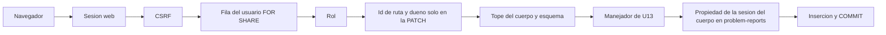

# Diseño de seguridad — U13 ethics-governance

**Revisión 1 (2026-11-22): primera pasada de una unidad nueva del cambio 01 (DT27) y de la adenda 02.**
- **IDs.** Todo es nuevo. Las secciones son §1–§17, las decisiones de diseño DS1–DS12 (§15) y las
  precisiones a artefactos aprobados NFRD-U13-01 a NFRD-U13-14 (§17).
- **Preguntas.** Ninguna: todo lo fijan las fuentes (`nfr-design-questions.md`).
- **Tipo `service`.** Los seis documentos de diseño y `traceability.json`.
- **Demostración (ADR-016).** U13 no pone compuertas. Lo que protege este diseño es lo que U13 guarda (la
  nota, el registro y las actas) y cómo borra, no el acceso a las sesiones.

**Insumos.**
- De esta unidad, en `nfr-requirements/`: `security-requirements.md` (security-requirements: frontera §1,
  amenazas T1–T18, NFR1, NFR10.1–NFR10.12, NFR11.1–NFR11.6, NFR12, NFR14 y tabla NFR-U13-01 a NFR-U13-12),
  `performance-requirements.md` (performance-requirements), `scalability-requirements.md`
  (scalability-requirements), `reliability-requirements.md` (reliability-requirements),
  `observability-requirements.md` (observability-requirements) y `tech-stack-decisions.md`
  (tech-stack-decisions, D1–D8).
- `functional-design/functional-spec.md` (functional-spec: F1–F10, §3, §6, E1–E54, §9 y FD-U13-01 a
  FD-U13-13), `functional-design/rules.md` (BR1.1–BR9.2) y `functional-design/entities.md`.
- C1 (`/acknowledgements`, `/problem-reports`, `PATCH /sessions/{id}/retention`, `/auth/me`), C8, C12,
  C23, C24 y C25 de `inception/contract-design/contract-summary.md` (contract-summary, revisión 3).
- De U3, `construction/identity-access/nfr-design/`: `GuardedRoute` (§2.1), resolvedores de dueño (§2.2),
  cuerpos (§2.3), registro de acceso en un punto de guardado (§2.4), manejador único (§3.3), convención de
  auditoría y usuarios de base de datos (§9) y lista blanca del log (`observability-design.md` §1).
- De U1, `construction/contracts/nfr-design/security-design.md`: C25 v1 (§5), extensiones
  `x-veridicus-max-bytes` y `x-veridicus-owner-only-for-role`, `testimony-warning-cases.v1.yaml` (§4.10) y
  la regla de métricas (NFRD-U1-05). De U2, `construction/platform/nfr-design/security-design.md`:
  `NetworkPolicy` del `Job` (§2), Secrets (§6), PostgreSQL y Redis (§7.1, §7.2), volúmenes (§7.3), Argo CD
  (§7.4), lista de `exec` (§9) y respaldos (§12).
- De U4 (`text-flow/nfr-design/`): `EthicsSessionPort` (NFRD-U4-11, NFRD-U4-12), claves de cancelación
  (`reliability-design.md` §11) e incidente que sobrevive (§12). De U7 (`forensic-report/nfr-design/`):
  `record_access_strict` (§10) y purga (§11, NFRD-U7-06). De U5: `lock_timeout` y `hide_parameters` en
  `db.py` (NFRD-U5-10) y tope del cuerpo por `GuardedRoute` (NFRD-U5-04). De U9: motivo de la cancelación
  (NFRD-U9-08).
- Reglas AUTONOMIA-01..05 de `team.md` y prohibiciones de `project.md`.

Salvo que la fila diga otra cosa, cada control se prueba en **nivel 0** (sin red ni GPU) o en **nivel 1**
(PostgreSQL y Redis reales en contenedor), con datos **sintéticos** del generador de NFR12.1, el *canary*
«CANARIO-7f3a» donde se pide y su control negativo. Los comandos son los de `tech-stack-decisions.md` §5.

## 1. Frontera (AUTONOMIA-04; NFR1.1)

| Componente | Dónde corre | Datos sin seudonimizar | Qué cruza la frontera del clúster | Hacia dónde |
|---|---|---|---|---|
| Diálogo, franja, panel, plazo y avisos de bienestar (AnalystConsole) | Navegador del analista | Los turnos ya cargados en M4, solo para la comparación local de la nota | Nada nuevo: la nota viaja al clúster por el Ingress con TLS, como el resto de la consola | `session-api` |
| Rutas de U13 y validación de `retention_days` (ConsoleApi, `session_api/console/`) | `session-api`, dentro | La nota del reporte | Nada | — |
| Fachada y dominio de EthicsGovernance (`session_api/ethics_governance/application/`, `domain/`) | `session-api`, dentro | La nota y, durante una petición, los turnos de la sesión (`turn_texts`) | Nada: no llama a modelos, al anonimizador ni a internet | — |
| Adaptador real de `AccessLog` (`ethics_governance/adapters/access_log.py`) | `session-api`, dentro | Ninguno: IDs, tipo y `export_sha256` | Nada | PostgreSQL |
| Repositorios de U13 (`ethics_governance/adapters/`) y sus cinco tablas | `session-api` → PostgreSQL (CloudNativePG), dentro | La nota, solo en `problem_report` | Nada | Servicio interno de la base |
| `Job` de retención (`python -m session_api.ethics_governance.retention`) | Pod de la imagen de `session-api`, dentro | Borra testimonio; su salida y sus actas solo llevan IDs, reglas, conteos y SHA-256 | Nada | PostgreSQL, Redis y los PVC `veridicus-reports` y `veridicus-audio` |
| Comando de consulta (`python -m session_api.ethics_governance.query`) | Contenedor `session-api`, por `kubectl exec` del humano | La nota de los reportes de problemas | Su salida llega a la terminal del humano en la máquina local; no se escribe en ningún archivo | Terminal del humano |

La tabla se copia en `services/session-api/src/session_api/ethics_governance/README.md`. Una prueba de
nivel 0 compara sus filas con las de este documento por nombre de componente, y un componente nuevo entra
con su fila en el mismo PR.

## 2. Ningún camino hacia fuera (NFR1.2, NFR1.3)

- Contrato de import-linter `ethics-governance-no-egress`: `session_api.ethics_governance` (fachada,
  dominio, adaptadores, `Job` y comando) no importa `httpx`, `requests`, `urllib.request`, `socket`,
  `libs.model_gateway`, `libs.anonymizer` ni `session_api.console` (BR2.1). Un módulo de control negativo
  en `tests/import_contracts/` los importa y hace fallar el contrato.
- La única E/S de la fachada y del comando es la base. El `Job` suma Redis (la clave de cancelación de
  CD-06, a través de `EthicsSessionPort`) y los dos volúmenes (a través de `purge_session` de U7 y U4); no
  importa el cliente de Redis directamente.
- La `NetworkPolicy` `retention-job` de U2 (§2) solo da salida a `veridicus-pg-rw:5432`, Redis `:6379` y
  DNS. La política estática de U2 falla si el `Job` declara otra salida (NFR1.3).

## 3. Recorrido de las rutas (NFR10.1, NFR10.2, NFR10.3, NFR10.4, NFR10.8)

Las tres rutas que escriben son operaciones de C1 registradas con `GuardedRoute` (§2.1 de U3): no tienen
dependencias de seguridad propias ni cuerpos Pydantic en el manejador. Cada una declara en C1
`x-veridicus-roles`, `x-veridicus-max-bytes: ethics_body_max_bytes` y, la `PATCH`,
`x-veridicus-owner-only-for-role: analista` (NFR-U13-03, FD-U13-05).

<!-- Texto alternativo: la petición resuelve la sesión web, compara el token anti-CSRF, toma la fila del usuario con bloqueo compartido y comprueba el rol. Solo en la PATCH del plazo se interpreta el identificador de ruta y se resuelve el dueño. Después se corta el cuerpo en su tope y se valida con el esquema. El manejador de U13 comprueba, en el reporte de problemas, la propiedad de la sesión que llega en el cuerpo, y por último inserta y confirma. -->

### 3.1 Orden de los controles (NFRD-U13-01)

| Paso | Control | Rechazo | Cuerpo leído |
|---|---|---|---|
| 1 | Cookie `veridicus_session` | `401` `auth.unauthenticated` | No |
| 2 | `X-CSRF-Token` derivado (NFRD-U3-03), comparado en tiempo constante | `403` `auth.csrf` (NFR10.2) | No |
| 3 | `app_user` `FOR SHARE`; rol y `active` de esa fila | `401` si quedó inactivo | No |
| 4 | Rol en `x-veridicus-roles` | `403` `auth.forbidden` | No |
| 5 | Solo `PATCH /sessions/{id}/retention`: `{id}` como UUID y, si el rol es `analista`, el resolvedor de dueño de la sesión (U4) | `422` `validation.invalid_request`; `403` `session.not_owner`; el «no existe» de la sesión | No |
| 6 | `Content-Length` > `ethics_body_max_bytes` → corte; lectura con `request.stream()` que corta al pasar la cifra | `413` `limits.exceeded` | Hasta el tope |
| 7 | Validador compilado de C1 (`additionalProperties: false`, `enum`, `format: uuid`, rangos, `maxLength` en puntos de código) | `422` `validation.invalid_request`; `413` si `note` pasa `problem_report_note_max_chars` (NFR-U13-02) | Sí |
| 8 | Manejador de U13 (§3.2) | Los `422` de dominio y `403`/`404` de propiedad | Sí |

- **Por qué este orden y no el de NFR10.1.** `GuardedRoute` es la única entrada de `/api/v1` y su orden es
  el mismo para todas las unidades. Los dos órdenes dan el mismo resultado de seguridad: un rechazo antes del
  paso 6 deja 0 filas, no llama a `AccessLog` y no lee el cuerpo. Las pruebas por celda de NFR10.1 afirman el
  estado y el `code` de esta tabla (por ejemplo, sin CSRF y con rol `investigador`: `403` `auth.csrf`).
- **`maxLength` en puntos de código.** `jsonschema` cuenta `len(str)` de Python, que son puntos de código.
  La consola cuenta igual (`Array.from(nota).length`), no `string.length` (unidades UTF-16): una nota de
  2 000 emojis habilita «Enviar» y una de 2 001 no (NFR10.3).

### 3.2 Lo que hace cada manejador

| Ruta | Roles | Pasos del manejador | Respuestas |
|---|---|---|---|
| `POST /acknowledgements` | `analista` | `text_version` igual a la versión cargada de `usage-rules.v1.yaml` → `INSERT analyst_acknowledgement` con `actor_user_id` del `Principal` y `at` del reloj inyectado | `201` `valid`; `422` `ethics.text_version_outdated` |
| `POST /problem-reports` | `analista`, `admin` | Si llega `suggestion_id`: resolvedor de U5 → `session_id` derivado; desacuerdo → `422`. Si hay sesión y el rol es `analista`: resolvedor de dueño de la sesión, con el mismo resultado que `GET /sessions/{id}`. Comparación de testimonio (§5). `INSERT problem_report` | `201` `{problem_report_id, testimony_warning}`; `422` `problem_report.ids_mismatch`; `403` `session.not_owner`; el «no existe» de la sesión |
| `PATCH /sessions/{id}/retention` | `analista` dueño, `admin` | `change_cursor.bump` (bloquea la fila de la sesión) → `EthicsSessionPort.retention_of` bajo el bloqueo → plazo efectivo (BR4.5) → nuevo vencimiento menor o `422` → `set_retention` → `INSERT retention_change` | `200`; `422` `retention.cannot_extend`, `retention.above_maximum`, `retention.below_minimum` |
| `POST /sessions`, `POST /sessions/import` (de U4 y U6) | Los suyos | ConsoleApi llama a `validate_retention_days(days)` antes de delegar: función pura sin E/S | `422` `retention.above_maximum` o `retention.below_minimum` sin filas |

- La propiedad en `/problem-reports` la comprueba el manejador de ConsoleApi con el mismo registro de
  resolvedores de §2.2 de U3, porque `session_id` llega en el cuerpo y no en la ruta (ADR-009).
  EthicsGovernance recibe la sesión ya autorizada.
- Todo error sale por el manejador único de U3 como Problem Details de C1, con el estado del catálogo y un
  `detail` de plantilla sin valores de la petición (NFR10.8). La lista de `code` de NFR10.8 suma
  `session.not_owner`, el «no existe» de la sesión y `route.not_found` (NFRD-U13-02). Prueba de nivel 0:
  recorre los `code` de U13 y fuerza cada uno; prueba de nivel 1: cada respuesta valida contra `Problem`.

### 3.3 Esquemas (NFR10.4)

- `category`: `enum` con las seis claves (FD-U13-06). `session_id` y `suggestion_id`: `format: uuid`.
  `retention_days`: `type: integer`. `text_version`: `pattern: ^[0-9]+\.[0-9]+\.[0-9]+$`. Todos los cuerpos
  con `additionalProperties: false`.
- El rango de `retention_days` lo valida `domain/retention_term.py` con `retention_min_days` y
  `retention_max_days` leídos de C25, para responder el `code` de dominio de FD-U13-04
  (`retention.above_maximum` o `retention.below_minimum`) y no `validation.invalid_request`, como pide
  NFR10.4. El esquema no repite el rango, para que no haya dos respuestas posibles al mismo valor.
- Nota en blanco: `note.strip() == ""` (incluye U+00A0 y U+3000) se guarda `NULL`. Prueba de propiedades
  (Hypothesis) con días negativos, decimales, cadenas, `null`, `true` y enteros grandes: siempre `422` y
  0 filas.

## 4. La nota no sale de su columna (NFR10.5)

| Camino | Control |
|---|---|
| Log de la aplicación | El formateador único de U3 solo emite los campos de su lista blanca (NFRD-U13-11); `note` no está en ella. Los casos de uso registran `problem_report_id` y nunca el objeto |
| Excepciones | El objeto del caso de uso declara `note` con `repr=False`; el manejador único nunca registra `str(exc)` (§3.3 de U3); el motor de SQLAlchemy lleva `hide_parameters=True` (NFRD-U5-10) |
| Uvicorn | El acceso de Uvicorn está apagado en `session-api` (`--no-access-log`); `uvicorn.error` solo recibe lo que deja el manejador único |
| Respuestas de error | `detail` de plantilla sin valores (§3.2); el validador no devuelve el `input` de `jsonschema` |
| Métricas | U13 no publica métricas (NFR15.1); las de U3 solo tienen etiquetas de enum |
| Parámetros en PostgreSQL | Enlace en el servidor (psycopg 3, sin `ClientCursor`) y `log_parameter_max_length` y `log_parameter_max_length_on_error` a 0 (NFR-U13-12) |
| `DETAIL` de una violación en PostgreSQL | Una violación de `CHECK` o de `NOT NULL` escribe en el log del servidor «Failing row contains (…)» con la fila entera, nota incluida. `log_error_verbosity = terse` lo omite (NFRD-U13-09). La aplicación valida todo antes de insertar, así que el `CHECK` es solo defensa en profundidad |

Prueba de nivel 1 de NFR10.5: nota con el *canary*; camino feliz, `413`, `422`, `503` (base detenida) y una
violación de `CHECK` provocada con una inserción directa en el repositorio que salta la validación. En los
cinco casos, 0 coincidencias en los logs capturados de la aplicación, `uvicorn.access`, `uvicorn.error`, la
respuesta, `/metrics` y el log del contenedor de PostgreSQL de la prueba, que arranca con los mismos
parámetros de log que U2.

## 5. Comparación de testimonio (NFR10.6; BR3.6, BR3.7)

### 5.1 Servidor

- `domain/testimony.py` define `find_literal_overlap(note: str, turns: Iterable[str], min_words: int) ->
  bool`, función pura y módulo guardia (NFR13.2).
- **Normalización.** Se parte por espacios en blanco Unicode con `str.split()` sin argumentos (los puntos
  de código con `str.isspace()`); nada más se normaliza (regla del piloto). La consola usa la misma lista
  de puntos de código, que trae el archivo de casos compartido (NFRD-U13-13).
- **Algoritmo.** Las secuencias de `min_words` palabras de la nota se guardan como tuplas en un
  `frozenset` (≤ 1 000 con la nota máxima). Cada turno, de los dos papeles y en orden, se recorre con una
  ventana de `min_words` palabras; la función devuelve `True` en la primera coincidencia y deja de consumir
  el iterador. Las palabras de un turno no se unen con las del siguiente (E20).
- **Sin copias.** `turn_texts` es el iterador de `EthicsSessionPort` con `yield_per` (NFRD-U4-12): la
  función solo retiene el turno en curso. El módulo no tiene cachés (`functools.cache`, `lru_cache`) ni
  variables globales mutables: lo comprueba una prueba AST de nivel 0. La respuesta lleva solo
  `problem_report_id` y `testimony_warning`, nunca el tramo ni el turno.
- **Prueba de NFR10.6.** Nivel 1: tras la petición con un turno con *canary*, `gc.collect()` y ningún
  objeto de `gc.get_objects()` del proceso de prueba contiene el *canary*. Nivel 0: los casos de
  `contracts/integrity/testimony-warning-cases.v1.yaml` (8, 7, dos turnos, espacios dobles y cada espacio
  Unicode de la lista).

### 5.2 Consola

- `frontend/src/features/ethics-governance/testimony.ts` define `findLiteralOverlap(note, turns,
  minWords)` con la misma especificación y los mismos casos. Además devuelve los índices del tramo para
  marcarlo (BR3.7); el tramo nunca sale del navegador.
- La función no hace peticiones (Vitest cuenta 0 con `fetch` simulado) y corre sobre los turnos que ya
  tiene TanStack Query para M4.
- El servidor vuelve a calcular `testimony_warning`: la consola no es la autoridad (F4, paso 7).

## 6. Reglas de uso de solo lectura (NFR10.7)

- `contracts/integrity/usage-rules.v1.yaml` se lee al arrancar con el cargador YAML seguro de
  `veridicus_contracts` desde el paquete instalado (`importlib.resources`), sin claves duplicadas. Se
  valida: `version` semántica, exactamente tres puntos, cada uno una cadena no vacía. El resultado es un
  `UsageRulesText` `dataclass(frozen=True)` con una tupla de tres cadenas y su `sha256`.
- Si falla, `session-api` termina antes de abrir el puerto y el log nombra el archivo y la regla, nunca el
  contenido (E9; `reliability-design.md` §6).
- Ninguna ruta lo escribe y C1 no tiene operación que lo cambie (prueba de U3 de configuración solo por PR,
  §10 de U3). En el clúster viene de la imagen, con `readOnlyRootFilesystem`.
- Se excluye del escaneo de vocabulario como `notice_text`, igual que el aviso de VE-01 (FD-U13-02).

## 7. Registro de acceso: qué guarda (NFR11.4; BR2.2)

- `access_log_entry`: `entry_id` (UUID), `actor_kind` = `user`, `actor_user_id` (UUID, `NOT NULL`),
  `actor_system` nulo, `resource_type` (enum de C23), `resource_id` (UUID), `export_sha256`
  (`^[a-f0-9]{64}$` o nulo) y `at` (`timestamptz`, `NOT NULL`). Sin clave foránea: sobrevive a la retención
  (BR5.10).
- `CHECK ((resource_type = 'report_export') = (export_sha256 IS NOT NULL))`. El adaptador valida lo mismo
  antes de insertar y lanza la excepción de registro de acceso si no se cumple (BR2.2).
- `at` lo pone el reloj inyectado de la aplicación (D7), no `now()` de SQL, para que las pruebas con reloj
  simulado sean deterministas. La transacción de la petición es una sola, así que la hora del registro y la
  del acceso coinciden.
- Plazo, punto de guardado y fallo: `reliability-design.md` §2.

## 8. Integridad y auditoría (NFR11.1, NFR11.2, NFR11.3, NFR11.4, NFR11.6)

### 8.1 Marcas de las cinco tablas

| Tabla | `kind` | `purgeable` | Columna del actor persona | Hora | `actor_kind` |
|---|---|---|---|---|---|
| `analyst_acknowledgement` | `history` | `false` | `actor_user_id` | `at` | `user` |
| `access_log_entry` | `history` | `false` | `actor_user_id` | `at` | `user` |
| `problem_report` | `history` (NFRD-U13-03) | `true` | `reported_by` | `reported_at` | `user` |
| `retention_change` | `history` | `true` | `actor_user_id` | `at` | `user` |
| `retention_act` | `history` | `false` | nula | `executed_at` | `system`, `actor_system` = `retention-job` |

- Cada tabla lleva en su `COMMENT` la marca `veridicus-audit` de §9.1 de U3 con `owner_unit: U13`, y las
  columnas de la convención con la restricción `actor_kind`/actor de U3 y el `DOMAIN` de `ActorSystem`.
- `veridicus_apply_audit_grants()` deriva los permisos: `veridicus_app` `SELECT` e `INSERT` en las cinco;
  `veridicus_retention` `SELECT` en las cinco y `DELETE` en `problem_report` y `retention_change`.
- **`INSERT` de `veridicus_retention` en `retention_act`.** La marca de `retention_act` lleva
  `"retention_insert": true` y la función de U3 concede ese `INSERT`. La prueba común exige que
  `veridicus_retention` tenga `INSERT` exactamente sobre `{retention_act}`, igual que el `DELETE` de
  `web_session` (NFRD-U13-04).
- Prueba común de U3 (descubre las tablas por la marca): con `veridicus_app`, `UPDATE` y `DELETE` fallan en
  las cinco (NFR11.1); con `veridicus_retention`, `DELETE` funciona en `problem_report` y `retention_change`
  y falla en las otras tres, `UPDATE` falla en las cinco e `INSERT` solo funciona en `retention_act`
  (NFR11.2, E48).

### 8.2 Bloqueos del `Job` sin permiso `UPDATE` (NFRD-U13-05, NFRD-U13-07)

PostgreSQL exige el permiso `UPDATE` sobre al menos una columna para `SELECT … FOR UPDATE` y `FOR SHARE`, y
`veridicus_retention` nunca tiene `UPDATE` (§9.3 de U3). Sin una solución, el bloqueo de la sesión antes de
borrar fallaría con permiso denegado.

- La migración de U4 crea `veridicus_purge_lock_session(session_id uuid)`, una función `SECURITY DEFINER`
  de `veridicus_owner`, con `SET search_path = pg_catalog, public`, que solo ejecuta
  `SELECT id, retention_until, created_at FROM interview_session WHERE id = $1 FOR UPDATE` y devuelve esa
  fila. `REVOKE EXECUTE … FROM PUBLIC` y `GRANT EXECUTE … TO veridicus_retention`. No escribe nada.
- `EthicsSessionPort.lock_for_purge(uow, session_id) -> RetentionTerm | None` la llama: `None` si la
  sesión ya no existe.
- Se pide a U7 una función igual para su `FOR UPDATE` sobre `report_version` (NFRD-U7-06).
- La prueba común de U3 fija el conjunto de funciones que `veridicus_retention` puede ejecutar. Prueba de
  nivel 1 del supuesto: con `veridicus_retention`, `SELECT … FOR UPDATE` directo sobre `interview_session`
  falla con permiso denegado (control negativo) y la función bloquea (una segunda conexión con `NOWAIT`
  recibe `55P03`).

### 8.3 Quién, cuándo y solo bajar (NFR11.3, NFR11.6)

- Actor y hora con `NOT NULL` en las cinco tablas; la hora la pone el reloj inyectado del servidor. Un
  `INSERT` con el actor o la hora nulos falla (nivel 1).
- `retention_change` lleva `from_days`, `to_days`, `from_until`, `to_until` y
  `CHECK (to_until < from_until)`. Ampliar o igualar responde `422` `retention.cannot_extend` antes de
  insertar (E32).
- El OpenAPI generado no declara `DELETE` ni `PUT` en las rutas de U13, y la única `PATCH` es
  `/sessions/{id}/retention`, que está en la lista de U1 (nivel 0).

### 8.4 Acta sin texto (NFR11.4; BR5.7)

- `retention_act`: `act_id`, `job_run_id`, `deleted_session_id` (UUID o nulo), `rule` (enum de tres
  valores), `term_days` y `effective_until` (o nulos en la tanda sin sesión), `deleted_ids` (`jsonb`: objeto
  de tabla → lista de UUID), `deleted_report_sha256s` (`jsonb`: lista de `{sha256, file_missing}`),
  `deleted_audio` (`jsonb`: lista de `{audio_id, sha256, file_missing}`), `executed_at`, `actor_kind` y
  `actor_system`.
- Las tres columnas `jsonb` se arman desde los `PurgeReceipt` con un modelo Pydantic de tipos cerrados
  (UUID, hex de 64, booleanos y claves de un enum de tablas) y llevan `CHECK (jsonb_typeof(...) = ...)`.
  Sin clave foránea.
- Prueba de nivel 0 sobre la migración: falla si `access_log_entry` o `retention_act` tienen una columna
  `text` o `varchar` sin `CHECK` de patrón o de enum, o una clave foránea. Nivel 1 (E47): con *canary* en
  turnos, notas y nombres de archivo, el acta no lo contiene.

## 9. `Job` de retención: quién lo lanza y con qué (NFR10.11, NFR1.3; AUTONOMIA-01)

| Control | Diseño | Verificación |
|---|---|---|
| Lo lanza el humano | Manifiesto en `deploy/jobs/`, `kind: Job`, nunca `CronJob`; fuera de la `Application` de Argo CD (§7.4 de U2); su lanzamiento solo existe en el runbook | `check-no-cluster-apply.sh` y Kyverno de U2 (E49), nivel 0 |
| Su usuario | `VERIDICUS_DATABASE_URL` del `Job` desde el Secret `veridicus-db-retention` por `secretKeyRef`; el Secret lo crea el humano con el *script* de U2 | Nivel 1: `SELECT current_user` = `veridicus_retention`; Kyverno: ese Secret solo en el `Job` |
| Redis | Contraseña como archivo desde `veridicus-redis-auth` (NFRD-U2-09) | Kyverno de consumidores de U2 |
| Argumentos | `argparse` con `--dry-run` y `--as-of` (ISO 8601 UTC). `--as-of` sin `--dry-run` termina con código 2 **antes** de importar el repositorio o abrir conexiones (E44) | Nivel 0 con un *fake* de conexión que falla si se llama |
| Reloj | `Clock` inyectado (D7). No existe argumento ni variable que cambie la hora del borrado real; `--as-of` solo llega al modo `dry_run` | Prueba AST de nivel 0: `retention.py` no lee `os.environ` para la hora y `as_of` del borrado sale solo de `clock.now()` |
| Misma cifra que la API | `retention_max_days` decide el vencimiento de las sesiones sin plazo y de los reportes sin sesión. Ningún manifiesto puede bajarla solo para un proceso (NFRD-U13-10) | Comprobación estática de U2 sobre el render |
| Identidad del pod | Mismo `runAsUser` y `runAsGroup` que `session-api`, sin root, `readOnlyRootFilesystem`, sin `automountServiceAccountToken` (NFR-U13-07; Kyverno `retention-job-identity` de U2) | Política de manifiestos de U2 |
| Sin reintento de Kubernetes | `backoffLimit: 0`; sin `ttlSecondsAfterFinished`, para que su salida quede en el log del pod hasta que el humano lo borre (observability-requirements §3) | Kyverno `job-shape` de U2 |

## 10. Comando de consulta (NFR10.10, NFR12.2)

- `python -m session_api.ethics_governance.query {access-log|problem-reports|retention-acts}` con
  `--session`, `--user`, `--job-run`, `--limit` (1 000 por defecto, 10 000 como máximo; fuera de rango,
  código 2) y `--format {text,json}`.
- Corre en el contenedor `session-api` con la conexión de `veridicus_app` que ya tiene el proceso, en una
  transacción `READ ONLY` (`SET TRANSACTION READ ONLY` como primera sentencia). Un `INSERT` sembrado en la
  prueba falla con `25006`.
- Lee `--limit` + 1 filas con un cursor del servidor (`yield_per`), escribe las primeras `--limit` en la
  salida estándar y, si hubo una más, termina con una línea `{"truncated": true}`.
- Solo escribe en `sys.stdout`: no tiene opción de archivo y no abre archivos en escritura. Prueba de
  nivel 0 con `open` en modo escritura, `Path.write_text` y `tempfile` sustituidos por funciones que
  fallan.
- El OpenAPI no tiene rutas de lectura del registro, de los reportes ni de las actas (nivel 0).
- La línea `kubectl exec deploy/veridicus-session-api -c session-api -- python -m
  session_api.ethics_governance.query …` está en la lista cerrada de solo lectura de U2 (NFR-U13-08).
- El runbook de `docs/operacion/` dice que la salida del comando y de `--dry-run` no se redirige a
  archivos dentro del repositorio (NFR12.2).

## 11. Consola (NFR10.12, NFR11.5, NFR14.1)

- Los componentes de `frontend/src/features/ethics-governance/` no usan `dangerouslySetInnerHTML`
  (`react/no-danger` como error). Prueba Vitest: el panel con la nota `` y el
  diálogo con ese valor en un punto del *fixture* los muestran como texto.
- Todos los textos salen del catálogo de mensajes (FD-U13-12) y entran en el escaneo de vocabulario de la
  interfaz de U4 con 0 coincidencias; las reglas de uso se excluyen como `notice_text` (FD-U13-02). Ninguna
  de las seis categorías es un rótulo de veracidad.
- Una prueba de nivel 0 falla ante un literal visible fuera del catálogo en un componente de U13 o un
  `detail` que no sea una plantilla del catálogo.

## 12. Datos sintéticos (NFR12.1)

- `services/session-api/tests/fixtures/make_ethics_fixtures.py` genera turnos, notas y sesiones con los
  nombres de `contracts/fixtures/synthetic-names.yaml`; los casos de la comparación viven en
  `contracts/integrity/testimony-warning-cases.v1.yaml` con `synthetic: true` (NFR-U13-10).
- La comprobación `synthetic` de U1 (`veridicus_contracts.checks.synthetic.scan`) corre sobre los dos.
- La sesión de la demo de B13 es sintética (FD-U13-09).

## 13. Dependencias (NFR10.9)

U13 no suma dependencias de ejecución (`argparse` y `hashlib` son de la biblioteca estándar); `psutil` solo
en desarrollo. `uv.lock` y `package-lock.json` con *hashes*; `pip-audit`, `npm audit --audit-level=high` y
Trivy sobre la imagen de `session-api`, que también usa el `Job`, bloqueantes en la CI.

## 14. Amenazas y controles

| # | Amenaza | Control de diseño | Sección |
|---|---|---|---|
| T1 | Un rol sin permiso reconoce, reporta o reduce un plazo | Paso 4 de `GuardedRoute` | §3.1 |
| T2 | CSRF | Paso 2, antes de leer el cuerpo | §3.1 |
| T3 | Un analista actúa sobre una sesión ajena | Resolvedor de dueño en la `PATCH` (paso 5) y en el manejador de `/problem-reports` | §3.1, §3.2 |
| T4 | Cuerpo enorme o nota larga | Tope del cuerpo en `GuardedRoute`, `maxLength` en puntos de código, comparación lineal | §3.1, §5 |
| T5 | La nota en logs, errores, métricas o el log de PostgreSQL | Lista blanca, `repr=False`, `hide_parameters`, parámetros a 0 y `log_error_verbosity = terse` | §4 |
| T6 | La comparación filtra o retiene turnos | Iterador, función pura sin cachés, respuesta sin tramo | §5 |
| T7 | Reglas de uso cambiadas o cargadas de forma insegura | Cargador seguro, objeto inmutable, fallo al arrancar | §6 |
| T8 | Borrado o edición del registro, un reconocimiento o un acta | Permisos derivados de la marca; sin rutas que borren | §8.1 |
| T9 | El `Job` borra lo que no debe o se lanza solo | Orden de C24 por sesión bloqueada, permisos de `veridicus_retention`, sin `CronJob` | §8.2, §9 |
| T10 | Borrado con una fecha falsa | `--as-of` solo con `--dry-run`, reloj inyectado | §9 |
| T11 | Texto en el acta, la salida del `Job` o el registro | Tipos cerrados, `CHECK` y conjunto de claves de la salida | §7, §8.4; `observability-design.md` §3 |
| T12 | El comando deja la nota en un archivo | Solo `stdout`, sin opción de archivo, runbook | §10 |
| T13 | Un plazo se amplía o cambia sin quién y cuándo | `CHECK (to_until < from_until)` y columnas de actor | §8.3 |
| T14 | Una corrida de una sesión vencida llama a un modelo tras el borrado | Clave de cancelación antes del borrado y fallo cerrado si Redis no responde | `reliability-design.md` §4 |
| T15 | Etiqueta de veracidad en un texto de U13 | Escaneo de vocabulario de U4 | §11 |
| T16 | XSS en la consola | Sin HTML | §11 |
| T17 | Camino de red hacia fuera | import-linter y `NetworkPolicy` del `Job` | §2 |
| T18 | Dependencia vulnerable | Auditorías y Trivy | §13 |
| T19 (nuevo) | El `Job` no puede bloquear la sesión y borra mientras la API escribe en ella | Función `SECURITY DEFINER` que solo bloquea | §8.2 |
| T20 (nuevo) | La API y el `Job` calculan distinto el vencimiento de una sesión sin plazo | `retention_max_days` sin rebaja por proceso | §9 |

## 15. Decisiones de diseño y alternativas

| # | Decisión | Alternativas descartadas | Por qué |
|---|---|---|---|
| DS1 | El orden de `GuardedRoute` sobre el de NFR10.1 (NFRD-U13-01) | Una cadena de controles propia de U13 | Una sola entrada para todas las unidades; mismo resultado de seguridad |
| DS2 | Propiedad de `/problem-reports` en el manejador de ConsoleApi con el registro de resolvedores | Marca `owner-only` en C1 (el ID llega en el cuerpo, no en la ruta); comprobarla en EthicsGovernance (importaría ConsoleApi) | ADR-009; ninguna arista nueva |
| DS3 | `ProblemReport` como `history` purgable (NFRD-U13-03) | `mutable` con una lista de permisos aparte (contradice «sin lista paralela» de U3) | Los permisos salen de la marca y coinciden con NFR11.1 |
| DS4 | `INSERT` de `retention_act` como excepción declarada en la marca (NFRD-U13-04) | Conceder a mano en la migración de U13 (la prueba común no lo vería) | Igual que `web_session`; la prueba común fija el conjunto |
| DS5 | Bloqueo de la sesión con una función `SECURITY DEFINER` (NFRD-U13-05) | Dar `UPDATE` de columna a `veridicus_retention` (rompe «nunca `UPDATE`»); bloqueo consultivo por sesión (la API no lo toma); borrar sin bloquear (carrera con la API) | Bloquea igual que la API sin ningún permiso de escritura nuevo |
| DS6 | `str.split()` con la lista de espacios compartida (NFRD-U13-13) | `\s` de cada lenguaje (difieren en U+FEFF y U+0085) | Las dos implementaciones dan lo mismo con los mismos casos |
| DS7 | Tuplas en un `frozenset` y corte en la primera coincidencia | Distancia de edición; *hash* rodante desde el inicio | Lineal y simple; *hashes* enteros solo si la medición lo pide (D2) |
| DS8 | `log_error_verbosity = terse` en PostgreSQL (NFRD-U13-09) | Confiar en que la aplicación valide antes | El `CHECK` existe para cuando la validación falle; ese caso no debe dejar testimonio |
| DS9 | Comando por `kubectl exec` con `veridicus_app` en `READ ONLY` | `Job` de solo lectura con usuario propio (otro Secret y otro rol) | Lo que fijan NFR-U13-08 y NFR-U13-09; el `READ ONLY` lo hace la base |
| DS10 | `retention_max_days` sin rebaja por proceso (NFRD-U13-10) | Leer la cifra de la base (otra fuente); permitir la rebaja (dos vencimientos distintos) | Un solo vencimiento para una sesión sin plazo |
| DS11 | `count_session` de solo lectura en C24 para `--dry-run` (NFRD-U13-08) | Purgar y revertir (los archivos ya se habrían borrado); contar por SQL desde U13 (rompe NFR13.3) | Cada unidad cuenta lo suyo con la misma consulta con la que borra |
| DS12 | `at` del reloj inyectado en las cinco tablas | `now()` de SQL | Pruebas deterministas con reloj simulado (E5, E37, E46) |

## 16. Correspondencia con AUTONOMIA

| Regla | Cómo la cumple U13 |
|---|---|
| AUTONOMIA-01 | El `Job` lo lanza el humano desde un manifiesto fusionado, nunca un `CronJob` ni un *script* (§9). El comando es de solo lectura y está en la lista cerrada de `exec` (§10). Las tablas y las funciones de bloqueo entran por la migración de su PR, que corre como `Job` aparte |
| AUTONOMIA-02 | Cada control nombra su prueba y su nivel; los comandos están en `tech-stack-decisions.md` §5 |
| AUTONOMIA-03 | §11: textos del catálogo con el escaneo de vocabulario; ninguna categoría es una etiqueta de veracidad |
| AUTONOMIA-04 | §1 y §2: nada sale del clúster; la nota no sale de su columna (§4); ninguna llamada más tras la retención (`reliability-design.md` §4) |
| AUTONOMIA-05 | No aplica: U13 no emite hallazgos |

## 17. Precisiones a artefactos ya aprobados (NFRD-U13-xx)

No edité ningún artefacto aprobado (regla de `project.md`). En la aprobación decides cuáles se llevan al
original, cada una en su propio commit. Las marcadas **Petición** piden algo a otra unidad y no se dan por
aplicadas hasta que esa unidad las acepte.

| ID | Artefacto aprobado | Precisión | Origen |
|---|---|---|---|
| NFRD-U13-01 | `nfr-requirements/security-requirements.md` de U13 (NFR10.1, «orden de los controles») | El orden es el de `GuardedRoute` (§2.1 de U3): sesión, CSRF, fila del usuario, rol, dueño de ruta (solo la `PATCH`), tope del cuerpo, esquema y, en el manejador, la propiedad de la sesión del cuerpo. Las pruebas por celda afirman el estado y el `code` de §3.1 | §2.1 de U3; mismo resultado de seguridad; aplicada sin preguntar |
| NFRD-U13-02 | `nfr-requirements/security-requirements.md` de U13 (NFR10.8, lista de `code`) | Suma `session.not_owner`, el «no existe» de la sesión de U4 y `route.not_found` (NFRD-U3-10) | §2.1 y §3.3 de U3; aplicada sin preguntar |
| NFRD-U13-03 | `functional-design/entities.md` de U13 (`ProblemReport.storage`) | `kind: history`, `purgeable: true`, `actor_user_column: reported_by`, `at_column: reported_at`, con `actor_kind` = `user` y `actor_system` nulo. Así `veridicus_app` tiene `SELECT` e `INSERT` y `veridicus_retention` `DELETE`, sin lista de permisos aparte | NFR11.1 («solo `SELECT` e `INSERT`»); §9.1 y §9.3 de U3; aplicada sin preguntar |
| NFRD-U13-04 | **Petición a U3:** `identity-access/nfr-design/security-design.md` §9.3 y la función `veridicus_apply_audit_grants()` | La marca admite `"retention_insert": true`, que concede `INSERT` a `veridicus_retention`; la prueba común exige que ese conjunto sea exactamente `{retention_act}` y que `veridicus_retention` solo pueda ejecutar las funciones de bloqueo de NFRD-U13-05 y NFRD-U13-07 | §9.3 de U3 («`INSERT` solo en `RetentionAct`», sin decir cómo se deriva); BR9.2; igual que NFRD-U3-07 |
| NFRD-U13-05 | **Petición a U4:** Functional Design de U4 (`EthicsSessionPort`) y FD-U13-08 | `EthicsSessionPort` suma `lock_for_purge(uow, session_id) -> RetentionTerm \| None`, que llama a `veridicus_purge_lock_session(uuid)`, una función `SECURITY DEFINER` de `veridicus_owner` que solo hace `SELECT … FOR UPDATE` sobre `interview_session`, con `EXECUTE` solo para `veridicus_retention`. F7 de U13 suma el paso 4.0 «bloquear la sesión», antes de la cancelación | PostgreSQL exige `UPDATE` para `FOR UPDATE`; §9.3 de U3 («nunca `UPDATE`»); orden sesión primero de `project.md` |
| NFRD-U13-06 | **Petición a U4 y U9:** Functional Design de U4 (`EthicsSessionPort.request_cancellation`) y NFRD-U9-08 | En el `Job`, `request_cancellation(session_id)` solo escribe claves de Redis, nunca `UPDATE`: `veridicus:run-cancelled:{run_id}` de cada corrida no terminal con su TTL de §11 de U4, y `veridicus:voice-cancelled:{session_id}` con el TTL de U9. Escribe **antes** del `COMMIT` y lanza la excepción si Redis falla o tarda más de 0,5 s, sin registrar `ERROR` y seguir como las transiciones de la API. El motivo de NFRD-U9-08 suma `retention`, que U9 trata como `withdraw` en la voz | NFR-U13-05; NFR10.18; §11 de U4; NFRD-U9-08 |
| NFRD-U13-07 | **Petición a U7:** `forensic-report/nfr-design/security-design.md` §11 y NFRD-U7-06 | El `FOR UPDATE` sobre las versiones de la sesión en `purge_session` usa `veridicus_purge_lock_report_versions(uuid)`, una función `SECURITY DEFINER` igual a la de NFRD-U13-05, en orden descendente. Sin ella, la purga falla con permiso denegado con `veridicus_retention` | PostgreSQL exige `UPDATE` para `FOR UPDATE`; §9.3 de U3 |
| NFRD-U13-08 | **Petición a U1, U4, U5 y U7:** `contract-summary.md` (C24) | C24 v1.1.0 (cambio menor, aditivo): `Purgeable.count_session(uow, session_id) -> Mapping[str, int]`, solo lectura, con el número de filas por tabla que borraría `purge_session`. Lo usa `--dry-run` (BR5.3). Prueba de conformidad de cada unidad: con el mismo *fixture*, `count_session` antes de la purga coincide con lo que devuelve el `PurgeReceipt` por tabla | BR5.3 («conteos por tabla» sin borrar); C24; NFR13.3 (U13 solo usa cada unidad por `Purgeable`) |
| NFRD-U13-09 | **Petición a U2:** `platform/nfr-design/security-design.md` §7.1 y NFRD-U2-10 | `postgresql.parameters` suma `log_error_verbosity: "terse"`, que quita `DETAIL`, `HINT`, `QUERY` y `CONTEXT` del log del servidor; Kyverno `cnpg-cluster-hardening` lo exige como los otros cuatro parámetros, con su control negativo | NFR10.5 (el log de PostgreSQL en una violación de `CHECK`); NFR-U13-12 |
| NFRD-U13-10 | **Petición a U2:** comprobaciones estáticas del render (`check-*`) | Ningún manifiesto de `deploy/` define `VERIDICUS_LIMIT_RETENTION_MAX_DAYS`: la API y el `Job` leen la misma cifra del catálogo. Control negativo con la variable en el `Job` | BR4.5, BR5.2, BR5.8; regla de `project.md` del catálogo único |
| NFRD-U13-11 | **Petición a U3:** `identity-access/nfr-design/observability-design.md` §1 (lista blanca) | Suma `text_version`, `problem_report_id`, `suggestion_id`, `category`, `testimony_warning`, `from_days`, `to_days`, `usage_rules_version`, `usage_rules_sha256`, `access_log_adapter`, y para el `Job` `job_run_id`, `mode`, `rule`, `effective_until`, `counts` (objeto de tabla → entero), `outcome`, `as_of`, `exit_code` y `duration_ms` (`observability-design.md` §1–§3). `note` nunca entra | NFR10.22, NFR10.23, NFR10.24; igual que NFRD-U12-03 |
| NFRD-U13-12 | `nfr-requirements/scalability-requirements.md` de U13 (NFR3.10) y `entities.md` | Índices nuevos para el comando de consulta: `access_log_entry (at DESC)`, `problem_report (reported_at DESC)` y `retention_act (executed_at DESC)`. Sin ellos, el listado sin filtro haría `Seq Scan`, que NFR3.10 prohíbe | NFR3.7, NFR3.10; aplicada sin preguntar |
| NFRD-U13-13 | **Petición a U1:** `contracts/integrity/testimony-warning-cases.v1.yaml` (NFR-U13-10) | El archivo suma `whitespace_code_points` (la lista de `str.isspace()`) y casos con U+00A0, U+3000, U+FEFF (que no es espacio), tabulador y salto de línea. Las dos suites comprueban que su definición coincide con la lista | BR3.6, BR3.7 («la misma especificación»); riesgo de tech-stack-decisions §6 |
| NFRD-U13-14 | `nfr-requirements/reliability-requirements.md` de U13 (NFR10.15) | El `Job` fija en cada transacción por sesión `SET LOCAL idle_in_transaction_session_timeout = '15s'`, con el parámetro de `db.py` de NFRD-U7-03 si U4 lo acepta, o con la `UnitOfWork` si no | NFRD-U7-06; DS3 de U7 |
