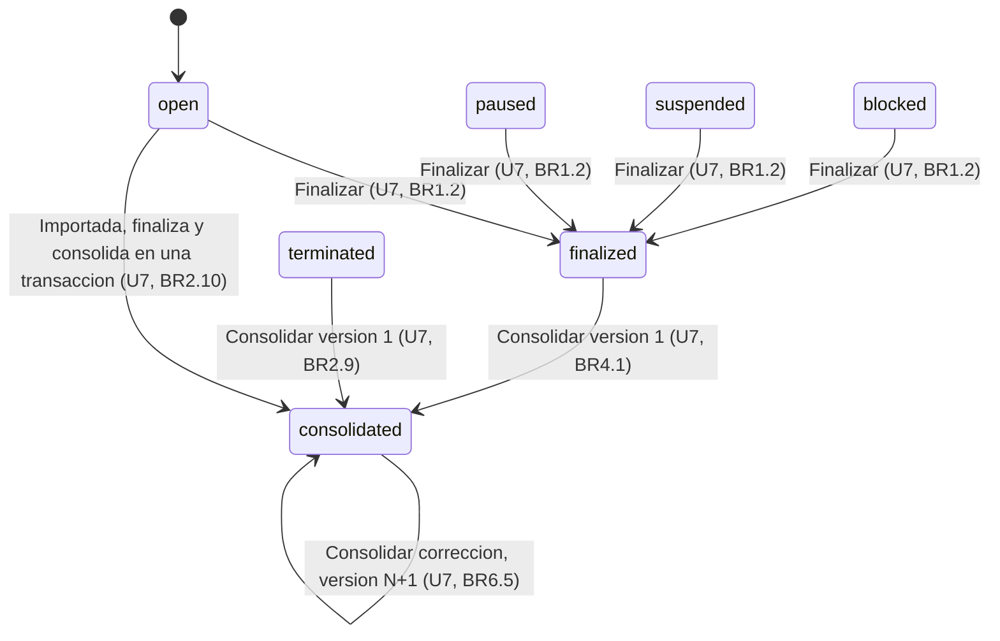
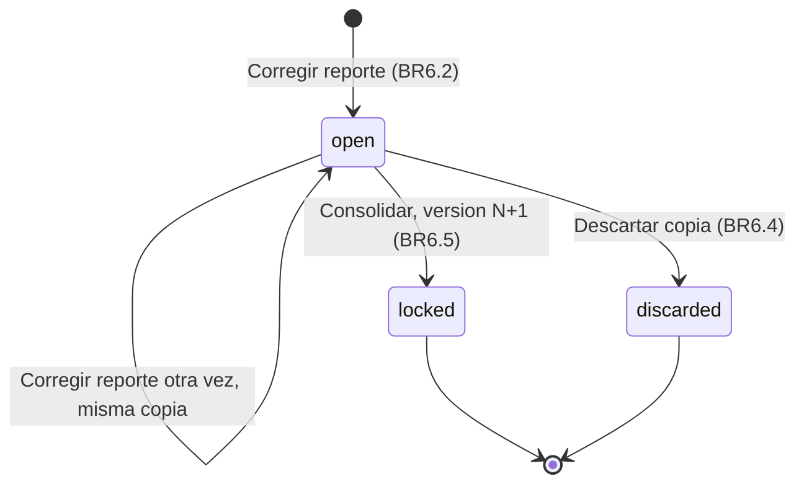
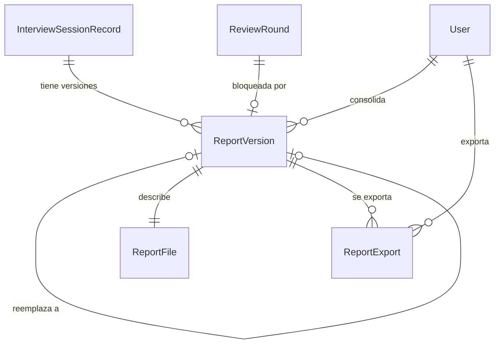

# Especificación funcional — U7 forensic-report (componente ReviewReport)

**Revisión 2 (2026-11-22), segunda pasada por el cambio 01 y la adenda 02** (y las revisiones 3 de
Inception). Sustituye a la revisión 1 del 2026-10-03. El módulo se llama **ReviewReport** (antes
ForensicReport); el producto habla de «reporte de revisión» (VE-03) y el directorio conserva el slug
`forensic-report` (UG-08).
- **Siguen:** F4 (abrir o retomar la copia), F6 (consolidar la copia) y F7 (barrido de huérfanos).
- **Cambian:** F1 (finalizar desde más estados), F2 (precondiciones nuevas, sin escenario ni umbral,
  contenido de FR7.2, aviso), F3 (pasa a ser la lectura de la vista previa, P5 = A) y F5 (descarte por la
  operación que recoge U5).
- **Entran:** F8 (exportar con marca de agua), F9 (borrar por retención) y F10 (consolidar una sesión
  importada o sin modo final posible); escenarios desde **E11**; la tabla de precisiones **FD-U7-01…**.
- **Sale:** todo lo del marco de verdad (escenario, umbral, Hechos No Documentados, paquetes y CoT).

**Unidad.** U7 `forensic-report` (tipo `service`, MUST, L). Entrega finalizar la sesión e iniciar MTTV
(US2.4), consolidar con sus precondiciones, el escaneo y el SHA-256 (US6.1), descargar con comprobación de
integridad (US6.2), exportar con marca de agua, roles y *hash* por exportación (US15.8) y corregir con una
versión nueva (US6.3). Vive en `services/session-api` como el módulo ReviewReport, más sus pantallas en
AnalystConsole (M5 y los diálogos de M4).

**Insumos.** `inception/units-generation/unit-of-work.md` (unit-of-work, revisión 3) y
`unit-of-work-story-map.md` (unit-of-work-story-map); `inception/requirements-analysis/requirements.md`
(requirements: FR1, FR3.5, FR7.1–FR7.5, NFR7) con `requirements-adenda-02.md` (VE-01, VE-02, VE-12,
VE-13, A-1–A-3); `inception/domain-design/components.md` (components: ReviewReport, InterviewSession,
HumanReview, IntegrityPolicy, EthicsGovernance, ConsoleApi); `inception/contract-design/contract-summary.md`
(contract-summary: C1, C11, C23, C24, C25); `inception/refined-mockups/mockups.md` (§6.9, §7, §11); y las
respuestas P1–P8 de `functional-design-questions.md`.

**Fuente de verdad.** Este archivo manda en los flujos y las máquinas de estado. Los datos están en
`entities.md` y las decisiones en `rules.md`; el diagrama ER y el resumen de reglas se derivan de ellos.

**Respuestas de la etapa.** Primera pasada: P1 = A (descarte con estado `discarded`), P2 = A (archivo antes
que fila), P3 = A (IA y analista separados); P4 = A (sin `admin`) queda **superada** por la tabla de roles
de FR1 y VE-13. Segunda pasada: P5 = A (un solo camino para sacar un archivo: la exportación), P6 = A
(páginas por secciones H2 y bloques fijos), P7 = A (la importada se finaliza al consolidar y queda fuera
de MTTV), P8 = A (se exporta cualquier versión, con rótulo de reemplazo).

---

## 1. Componentes y frontera del clúster (AUTONOMIA-04)

| Componente | Dónde corre | Datos que maneja | ¿Cruza la frontera del clúster? |
|---|---|---|---|
| ReviewReport (módulo de `session-api`) | Dentro del clúster | Transcripción, sugerencias, observaciones, notas, reformulaciones y reporte completo | No: no llama a ningún servicio externo, ni a ModelGateway ni al anonimizador |
| Volumen persistente de reportes | Dentro del clúster | Archivos Markdown de las versiones consolidadas; nunca las exportaciones | No |
| PostgreSQL (CloudNativePG) | Dentro del clúster | `ReportVersion` y `ReportExport` (solo IDs, hashes, actor y hora; sin texto del caso) | No |
| Puerto `AccessLog` (adaptador por defecto o el de EthicsGovernance) | Dentro de `session-api` | `user_id`, tipo y ID de recurso, `export_sha256` | No |
| AnalystConsole | Navegador del usuario, servida dentro del clúster | Vista previa y exportación del reporte | La vista previa y la exportación llegan al navegador de un usuario autorizado por C1. Es la entrega prevista, no una salida a internet |

`session-api` sigue bajo la `NetworkPolicy` de salida denegada de U2. U7 no le añade ningún destino.

## 2. Flujos

### F1 — Finalizar la sesión (US2.4) · cambia

1. El dueño pulsa «Finalizar sesión» en una sesión **guiada**. La consola abre el diálogo de BR1.5 con el
   número de corridas en cola o procesando. Las importadas no tienen el botón (F10).
2. Si pulsa «Cancelar», no se envía nada.
3. Con «Finalizar», la consola envía `POST /sessions/{session_id}/finalize` con `X-CSRF-Token`.
4. ConsoleApi comprueba el rol y que el actor sea el dueño (BR1.1, ADR-009).
5. ReviewReport hace `change_cursor.bump` sobre la sesión y lee `SessionReader.snapshot`. Si no está en
   `open`, `paused`, `suspended` ni `blocked`, responde `409 session.finalized` o `409 session.terminated`
   (BR1.2).
6. ReviewReport pide la transición a `finalized` con el actor (`SessionLifecycle.finalize`, FD-U7-02).
   InterviewSession guarda `finalized_at` en UTC y una fila de su historial; `blocked_code` se conserva
   (BR1.3).
7. Responde `200` con la `SessionView`. La consola muestra «Lanzar modo final» (U6), los pendientes y el
   acceso a la primera sugerencia pendiente (BR1.6).
8. Las corridas que seguían en cola o procesando terminan y sus hallazgos se guardan (BR1.4). Mientras
   tanto, `consolidation_blockers` incluye `report.runs_in_progress`.

### F2 — Consolidar la ronda inicial (US6.1) · cambia

1. La consola calcula «Consolidar reporte» con `can_consolidate` y `consolidation_blockers` de la
   `SessionView`. Con bloqueos, el botón queda `aria-disabled`, enfocable y con todos sus motivos en orden
   (BR2.5).
2. Sin bloqueos, el dueño pulsa el botón y ve el diálogo de BR8.1, con el foco en «Cancelar». Con
   «Consolidar», la consola envía `POST /sessions/{session_id}/reports`.
3. ConsoleApi comprueba el rol y que el actor sea el dueño (BR2.1).
4. ReviewReport abre la transacción compartida (`UnitOfWork`), hace `change_cursor.bump` sobre la sesión y
   después `ReviewRounds.open_round(for_update=True)`, que bloquea la ronda (o abre la ronda 1 si la sesión
   no tiene ninguna). Lee `SessionReader.snapshot` (estado, origen, dueño, perfil, turnos, corridas con su
   registro, `blocked_code`, terminación y retirada) y `ReviewRounds.pending_count`.
5. Evalúa la guardia en este orden y responde con el primer bloqueo:
   - sesión guiada no finalizada ni terminada → `409 report.session_not_finalized` (BR2.2; las importadas
     van por F10);
   - sin ninguna corrida final, salvo los casos de BR2.9 → `409 report.final_mode_not_launched` (BR2.8);
   - corridas en curso → `409 report.runs_in_progress` (BR2.3);
   - sesión consolidada sin ronda de corrección → `409 report.conflict` (BR2.7);
   - pendientes > 0 → `409 report.pending_suggestions` (BR2.4, BR2.11).
6. Lee `ReviewRounds.decisions` y arma `ReportContent` (BR3.1, BR11.3). Lee el aviso y su versión de
   IntegrityPolicy (BR11.1). Renderiza el Markdown canónico de `format_version` 2 (BR3.2, BR11.2).
7. Escanea con `scan(text, literal_sources)`, con los textos de todos los turnos como fuente literal y
   excluyendo notas, reformulaciones y el aviso. Si hay una coincidencia, revierte y responde
   `409 report.forbidden_vocabulary` con la ubicación (BR3.3).
8. Genera `report_version_id`, calcula el SHA-256 de los bytes (BR3.4) y escribe el archivo temporal. Lo
   fuerza a disco y lo enlaza a `<report_version_id>.md` (BR4.1).
9. Dentro de la misma transacción:
   - inserta `ReportVersion` con `version_number = 1`, `format_version` 2 y `notice_version`;
   - llama a `ReviewRounds.lock_round(round_id, report_version_id, actor)`;
   - pide la transición a `consolidated` (`SessionLifecycle.mark_consolidated`, FD-U7-02).
10. Confirma. Si la confirmación o `lock_round` fallan, revierte, borra el archivo en el acto y responde
    `409 report.conflict` cuando perdió la carrera, o `500` en otro caso (BR4.2, BR4.3).
11. Responde `201` con la `ReportVersion`. La consola abre M5 con quién y cuándo, el SHA-256 completo,
    «Copiar SHA-256» y «Descargar reporte» (BR8.2).

### F3 — Leer una versión en la vista previa (US6.2, P5 = A) · cambia

1. Un analista (dueño o no) o un `admin` abre M5. La consola pide `GET /sessions/{session_id}/reports`. Un
   investigador o una identidad de servicio recibe `403` (BR5.3).
2. Para la vista previa de la versión elegida (por defecto la vigente), la consola pide
   `GET /reports/{report_version_id}/download`.
3. ReviewReport lee el archivo de `storage_path` y recalcula su SHA-256.
4. Si coincide, responde `200 text/markdown` con `X-Veridicus-SHA256` y `Content-Disposition: inline`. La
   ruta registra el acceso como `report_version` (marca de C1). La consola lo muestra en la página y **no**
   ofrece guardarlo como archivo (BR5.1).
5. Si no coincide o el archivo falta, responde `409 report.integrity_mismatch`, no envía bytes y registra
   un ERROR solo con el `report_version_id`.
6. Si la sesión no tiene versiones, la consola no ofrece M5 ni la descarga; la API responde
   `409 report.not_consolidated` (BR5.2).

### F4 — Abrir o retomar la copia de trabajo (US6.3) · sigue

1. El dueño pulsa «Corregir reporte» en una sesión `consolidated` (BR6.1).
2. ReviewReport llama a `ReviewRounds.open_correction_round(session_id, actor)`.
   - Si no hay ronda abierta, HumanReview abre una de tipo `correction` que hereda de la ronda bloqueada
     por la versión vigente.
   - Si ya hay una, devuelve la misma (BR6.2).
3. La consola abre M4 con «Copia de trabajo de la versión N. Solo puedes cambiar estados y notas» (BR8.3).
4. Las decisiones dentro de la copia usan `POST /suggestions/{id}/decisions` y las reglas de U5. Cambiar
   la transcripción o la salida de la IA responde `422 validation.invalid_request` (BR6.3).

### F5 — Descartar la copia de trabajo (US6.3, P1 = A) · cambia

1. El dueño pulsa «Descartar copia» y confirma en un diálogo modal (BR8.3).
2. La consola envía `POST /sessions/{session_id}/correction-rounds/current/discard` (FD-U7-09).
3. ReviewReport llama a `ReviewRounds.discard_correction_round(session_id, actor)` (precisión de C11 que
   recoge el Functional Design de U5). La ronda pasa a `discarded` con quién y cuándo. Sus decisiones
   quedan como rastro y no cuentan para ninguna versión (BR6.4).
4. Responde `204`. No se crea versión y la vigente no cambia. Sin copia abierta, `409 report.conflict`.

### F6 — Consolidar la copia de trabajo (US6.3) · sigue

1. Usa los pasos de F2 sobre la ronda de corrección abierta, con las mismas precondiciones y el mismo
   escaneo (BR2, BR3). BR2.2 y BR2.8 ya se cumplieron con la versión 1.
2. La nueva fila lleva `version_number = N + 1` y `supersedes_version_id` igual a la vigente (BR6.5).
3. `lock_round` bloquea la ronda de corrección. La sesión sigue `consolidated`.
4. El archivo de la versión anterior no se toca y su SHA-256 sigue igual (BR6.5).
5. La lista de versiones marca la nueva como «vigente». Cada versión conserva los estados de su ronda
   (BR6.6).

### F7 — Barrido de huérfanos al arrancar (P2 = A) · sigue

1. Al arrancar, antes de pasar `/readyz`, ReviewReport lista el volumen.
2. Borra los temporales y los archivos finales sin fila `ReportVersion` más viejos que el margen de NFR
   Design. Por cada uno registra un WARN con el nombre del archivo (BR4.3).
3. Si el volumen no está montado o no se puede escribir, `/readyz` no pasa.

### F8 — Exportar con marca de agua (US15.8, VE-13, A-3) · nuevo

1. En M5, el dueño o un `admin` pulsa «Descargar reporte». Para un analista que no es dueño, el botón está
   `aria-disabled` con su motivo (BR8.6).
2. La consola envía `POST /reports/{report_version_id}/exports` con `X-CSRF-Token`.
3. ConsoleApi comprueba el rol: analista dueño o `admin`; si no, `403` (BR9.1).
4. ReviewReport comprueba que la versión existe (`404 report.not_found`) y recalcula el SHA-256 del archivo;
   si no coincide, `409 report.integrity_mismatch` (BR9.2).
5. Arma los bytes: el archivo de la versión con la marca en la cabecera («Exportado por <usuario> el
   <fecha Colombia> (<UTC>)», «Versión N · SHA-256 de la versión …») y la línea de marca en cada punto de
   página junto al aviso (BR9.3, BR11.2). Si la versión no es la vigente, añade «Reemplazada por la versión
   M el <fecha>» (BR9.4).
6. Calcula `export_sha256` sobre esos bytes (BR9.5).
7. En una transacción: inserta `ReportExport` (con `was_current`) y la ruta de exportación de ConsoleApi
   llama a `AccessLog.record(report_export, report_version_id, export_sha256)` (BR9.5).
8. Si el adaptador real falla, revierte y responde `503 report.export_not_recorded` sin bytes (BR9.6). Con
   el adaptador por defecto, sigue y deja un WARN «registro de acceso no configurado» solo con IDs.
9. Tras el *commit*, responde `201` con `X-Veridicus-Export-SHA256` y los bytes como descarga. Los bytes no
   se guardan (BR9.5).
10. La consola muestra el `export_sha256` junto a la descarga, con «Copiar SHA-256» (BR5.4).

### F9 — Borrar por retención (C24, VE-12) · nuevo

1. El Job de retención de U13, que lanza el humano, llama `Purgeable.purge_session(uow, session_id)` de
   ReviewReport después de borrar los reportes de problemas.
2. Con el usuario de base de la retención, ReviewReport borra las `ReportExport` de la sesión.
3. Por cada `ReportVersion`, de la más nueva a la más antigua: borra el archivo y después la fila. Si el
   archivo ya no está, registra un WARN y marca `file_missing`; si el borrado falla por otro motivo,
   revierte (BR10.2).
4. Devuelve `PurgeReceipt` con los IDs y el SHA-256 de cada versión borrada, para el acta (BR10.1).
5. El Job sigue con HumanReview y luego con InterviewSession.

### F10 — Consolidar una sesión importada o sin modo final posible · nuevo

1. **Importada (P7 = A).** La guardia no evalúa «sesión no finalizada» y la consola no muestra «Finaliza la
   sesión para consolidar». Sí exige el modo final lanzado y terminado (BR2.8, BR2.3) y 0 pendientes.
2. En el paso 9 de F2, `SessionLifecycle.mark_consolidated(..., finalize_first=True)` registra
   `finalized` y después `consolidated` en la misma transacción, con dos filas del historial, actor el
   dueño y la misma hora (BR2.10, FD-U7-08). La sesión queda fuera de MTTV (BR7.1).
3. **Bloqueada, terminada o con retirada (BR2.9).** No se exige el modo final. La guardia sigue con
   «sesión no finalizada» para una bloqueada sin finalizar (se finaliza por F1), corridas en curso y
   pendientes. El reporte declara el incidente, la terminación o la retirada con su hora y los tramos sin
   evaluar (BR11.3).

## 3. Máquinas de estado

### Sesión: transiciones que dispara U7

Los estados son de InterviewSession (U4/U6). U7 dispara las transiciones a `finalized` y a `consolidated`
que U6 deja permitidas.

<!-- Texto alternativo: U7 finaliza una sesión abierta, pausada, suspendida o bloqueada. Consolida desde finalizada o terminada creando la versión 1. Una importada pasa por finalizada y consolidada en la misma transacción. Cada corrección consolidada crea una versión nueva y la sesión sigue consolidada. Las transiciones entre abierta, pausada, suspendida, bloqueada y terminada son de U4 y U6. -->

| Desde | Hacia | Quién | Precondición | Efecto |
|---|---|---|---|---|
| `open` / `paused` / `suspended` / `blocked` | `finalized` | Dueño | BR1.1, BR1.2 | `finalized_at` en UTC; empieza MTTV (solo guiadas); los turnos nuevos responden `409` |
| `finalized` / `terminated` | `consolidated` | Dueño | BR2.1–BR2.9, BR3.3 | Versión 1, ronda bloqueada, archivo y SHA-256 |
| importada `open` / `paused` / `suspended` / `blocked` | `finalized` → `consolidated` | Dueño | BR2.10 y el resto de BR2 | Dos filas de historial con la misma hora; sin muestra de MTTV |
| `consolidated` | `consolidated` | Dueño | Copia abierta, BR2 y BR3 | Versión N+1 que reemplaza a la vigente |

En el diagrama, la transición de la importada se dibuja como `open --> consolidated` por brevedad; en el
historial quedan las dos filas.

### Copia de trabajo (ronda de corrección)

La ronda es de HumanReview (U5). U7 la abre, la bloquea al consolidar y la descarta.

<!-- Texto alternativo: «Corregir reporte» abre la copia o devuelve la misma si ya está abierta. Consolidarla la bloquea y crea la versión nueva. Descartarla la cierra sin versión. Una copia bloqueada o descartada nunca vuelve a abrirse. -->

### Versión del reporte y exportación

`ReportVersion` y `ReportExport` no cambian de estado: se crean inmutables y solo la retención las borra.
Ser la vigente es un valor derivado (la de mayor `version_number`).

## 4. Vista ER derivada (fuente: `entities.md`)

<!-- Texto alternativo: una sesión tiene cero o más versiones del reporte. Cada versión bloquea exactamente una ronda, puede reemplazar a una versión anterior, la consolida un usuario, describe exactamente un archivo y tiene cero o más exportaciones, cada una hecha por un usuario. Ya no hay relación con una versión de escenario. -->

## 5. Resumen de reglas derivado (fuente: `rules.md`)

| Grupo | Reglas | Idea clave |
|---|---|---|
| Finalizar | BR1.1–BR1.6 | Solo el dueño, una vez, desde `open`, `paused`, `suspended` o `blocked`; inicio de MTTV |
| Precondiciones | BR2.1–BR2.11 | Dueño, finalizada o terminada, modo final lanzado, 0 corridas en curso, ronda abierta y 0 pendientes; exentas e importadas |
| Contenido | BR3.1–BR3.4 | FR7.2 sin marco de verdad, IA y analista separados, render canónico, escaneo con los turnos como fuente literal, SHA-256 |
| Persistencia | BR4.1–BR4.5 | Archivo antes que fila, una sola gana, sin huérfanos, solo inserción, sesión bloqueada |
| Lectura y descarga | BR5.1–BR5.4 | Vista previa con integridad, nada antes de consolidar, analistas y `admin` leen, descargar es exportar |
| Corrección | BR6.1–BR6.6 | Una copia por sesión, solo estados y notas, descarte sin versión, versión nueva que conserva la anterior |
| Medición | BR7.1–BR7.2 | MTTV solo en guiadas; registros solo con IDs |
| Consola | BR8.1–BR8.7 | Diálogos, M5, copia rotulada, accesibilidad, solo lectura, botón deshabilitado con motivo, `admin` |
| Exportación | BR9.1–BR9.7 | Dueño y `admin`, integridad, marca, rótulo de reemplazo, *hash* registrado antes de enviar, registro de acceso |
| Retención | BR10.1–BR10.2 | Borrado propio en orden con IDs y SHA-256 para el acta |
| Aviso y avisos | BR11.1–BR11.5 | Aviso versionado, «páginas», avisos de la sesión, vocabulario de VE-02, sin aclaraciones |

## 6. Pantallas: estados y textos (M5 y diálogos de M4)

| Elemento | Dueño | Otro analista | `admin` | Fuente |
|---|---|---|---|---|
| Banner | — | «Sesión de <usuario>. Solo lectura» | El mismo banner | AC5.4.2, BR8.5, BR8.7 |
| «Consolidar reporte» | Habilitado o `aria-disabled` con motivos | No aparece | No aparece | BR2.5, BR8.5 |
| Lista de versiones | SHA-256, quién, cuándo y «vigente» | Igual | Igual | BR6.6 |
| Vista previa | Markdown renderizado, solo lectura | Igual | Igual | BR5.1 |
| «Descargar reporte» | Habilitado: exporta | `aria-disabled`: «Solo el dueño de la sesión o un administrador pueden exportar el reporte» | Habilitado: exporta | BR8.6, BR9.1 |
| «Copiar SHA-256» | Versión y, tras exportar, la exportación | Versión | Versión y exportación | BR8.2, BR5.4 |
| «Corregir reporte» / «Descartar copia» | Sí | No | No | BR6.1, BR8.7 |
| Avisos | Fragmentado, misma familia, «Modo final no completado», incidente, terminación, retirada | Igual | Igual | BR11.3 |

Todas las marcas de hora muestran la hora de Colombia y, entre paréntesis, UTC (mockups P5). Los diálogos
nuevos y M5 entran en la suite `axe` de U4 (BR8.4).

## 7. Errores en la frontera

| Situación | Respuesta | Code |
|---|---|---|
| No es el dueño, es `admin`, investigador o una identidad de servicio (finalizar, consolidar, corregir, descartar) | `403` | `auth.forbidden` |
| Investigador o identidad de servicio lee versiones o vista previa | `403` | `auth.forbidden` |
| Analista no dueño, investigador o identidad de servicio exporta | `403` | `auth.forbidden` |
| Finalizar una sesión ya finalizada o consolidada / terminada | `409` | `session.finalized` / `session.terminated` |
| Consolidar sin finalizar / sin modo final / con corridas en curso / con pendientes | `409` | `report.session_not_finalized` / `report.final_mode_not_launched` (FD-U7-04) / `report.runs_in_progress` / `report.pending_suggestions` |
| Vocabulario prohibido en el reporte | `409` | `report.forbidden_vocabulary` |
| Perder la carrera, consolidar sin ronda abierta o descartar sin copia | `409` | `report.conflict` |
| Leer o exportar con SHA-256 distinto o sin archivo | `409` | `report.integrity_mismatch` |
| Leer, exportar o corregir sin versión consolidada | `409` | `report.not_consolidated` |
| Exportar una versión inexistente | `404` | `report.not_found` (FD-U7-05) |
| El registro de acceso real falla al exportar | `503` | `report.export_not_recorded` (FD-U7-05) |
| Cambiar transcripción o salida de la IA en la copia | `422` | `validation.invalid_request` |
| Fallo de escritura en el volumen o de la base | `500` | code de sistema de la jerarquía de `libs/`; sin filas ni archivo final |

Todos salen como `application/problem+json` con `detail` en español. Toda E/S lleva un *timeout* explícito
(NFR Requirements). Ninguna operación se reintenta sola: consolidar y exportar no son idempotentes y el
usuario decide si repite.

## 8. Escenarios de negocio

| ID | Escenario | Resultado esperado | Reglas |
|---|---|---|---|
| E1 | Camino feliz guiado: finaliza, lanza el modo final, revisa todo y consolida | Versión 1, SHA-256 visible, vista previa que coincide | BR1, BR2, BR3, BR4, BR5.1 |
| E2 | Finaliza con 2 corridas procesando | El diálogo dice 2; los resultados llegan; consolidar espera | BR1.4, BR1.5, BR2.3 |
| E3 | Un tramo incremental quedó en error | No bloquea; «Tramo no evaluado» con su code | BR2.6 |
| E4 | Dos pestañas consolidan a la vez | Una `201` y otra `409 report.conflict`; un solo archivo | BR4.2 |
| E5 | El volumen falla al enlazar | `500`, 0 filas, sin huérfanos | BR4.1, BR4.3 |
| E6 | Alguien altera el archivo en el volumen | Vista previa y exportación responden `409 report.integrity_mismatch` | BR5.1, BR9.2 |
| E7 | Corrige, cambia una decisión y consolida | Versión 2 que reemplaza a la 1; la 1 intacta | BR6.2, BR6.5, BR6.6 |
| E8 | Abre la copia y la descarta | Ronda `discarded`, sin versión nueva | BR6.4 |
| E9 | Otro analista abre la sesión | Lee la lista y la vista previa; «Descargar reporte» deshabilitado con motivo; la API da `403` al exportar | BR5.3, BR8.5, BR8.6, BR9.1 |
| E10 | Un `admin` abre M5 | Lee y exporta; no ve «Corregir reporte» (cambia frente a la revisión 1) | BR5.3, BR8.7, BR9.1 |
| E11 | Sesión guiada finalizada sin modo final | `409 report.final_mode_not_launched`; motivo «Lanza el modo final para consolidar» | BR2.5, BR2.8 |
| E12 | Último modo final en `error` (`tiempo_agotado`) | Consolida; el diálogo ofrece relanzar; el reporte dice «Modo final no completado. Revisión manual requerida» | BR2.6, BR8.1 |
| E13 | Sesión bloqueada por incidente, finalizada, sin modo final | Consolida; el reporte declara el incidente | BR2.9, BR11.3 |
| E14 | Sesión terminada / con retirada del consentimiento | Consolida sin modo final; declara terminación o retirada con su hora | BR2.9, BR11.3 |
| E15 | Sesión importada con modo final terminado | Consolida; dos filas de historial; sin muestra de MTTV | BR2.10, BR7.1 |
| E16 | Llega un hallazgo con el diálogo abierto | `409 report.pending_suggestions`; el diálogo muestra «Quedan N sugerencias pendientes» con N = 1 | BR2.11 |
| E17 | Sesión con 0 hallazgos y modo final terminado | Consolida; «Sin sugerencias de revisión» | BR2.7, BR3.1 |
| E18 | Un turno del compareciente dice «eso es falso, no es prueba de nada» | El escaneo no lo cuenta; consolida | BR3.3 |
| E19 | Un rótulo de la plantilla contiene «prueba» por error | La prueba de nivel 0 falla; con el aviso, no | BR11.4 |
| E20 | El dueño exporta la vigente | `201`; marca en cabecera y en cada página; `sha256sum` = `export_sha256` | BR9.3, BR9.5, BR5.4 |
| E21 | El `admin` exporta la versión 1 con la 2 vigente | `201` con «Reemplazada por la versión 2 el …»; `was_current` false | BR9.4 |
| E22 | Exporta sin U13 (adaptador por defecto) | `201`; WARN con IDs; `/readyz` 200 con `access_log: not_configured` | BR9.6 |
| E23 | El adaptador real falla | `503 report.export_not_recorded`; 0 filas; 0 bytes | BR9.6 |
| E24 | Sesión con modo fragmentado | Reporte con la limitación de AC3.7.1 | BR11.3 |
| E25 | Sesión con aclaraciones aprobadas | El reporte no las lista | BR11.5 |
| E26 | Retención de una sesión con 2 versiones y 3 exportaciones | Se borran 3 exportaciones, la v2 y la v1 con sus archivos; recibo con IDs y 2 SHA-256 | BR10.1 |
| E27 | Retención con el archivo de la v1 ya ausente | WARN; `file_missing` en el recibo; filas borradas | BR10.2 |
| E28 | Reporte de 120 turnos | El aviso se repite tras los turnos 25, 50, 75, 100 y al cerrar «Transcripción» | BR11.2 |

## 9. Integración con otras unidades

| Unidad | Qué usa U7 | Qué le pide U7 |
|---|---|---|
| U1 contracts | C1, C11, C23, C24, C25, la lista de vocabulario versionada y el aviso | Los codes nuevos, las rutas y operaciones de la tabla FD-U7 (PR de contratos antes que el código de U7) |
| U3 identity-access | Mecanismo de rol y dueño (incluido `x-veridicus-owner-only-for-role`), convención de auditoría, marca `x-veridicus-access-log` en la lectura | Que la ruta de exportación no lleve la marca (la exportación llama al puerto ella misma) |
| U4 text-flow | `SessionReader.snapshot` con corridas, registro, modo fragmentado, cobertura del modo final y `blocked_code`; base de accesibilidad | Campos de FD-U7-03 en la instantánea |
| U5 human-review | `open_round` con `for_update` (abre la ronda 1 si falta), `pending_count`, `decisions`, `lock_round`, `open_correction_round`, `discard_correction_round` | Nada nuevo frente a su segunda pasada |
| U6 session-lifecycle | Transiciones permitidas hacia `finalized` y `consolidated`, terminación y retirada | La transición de la importada dentro de la consolidación (FD-U7-08) |
| U8 assistant-extras | — | Nada: las aclaraciones no entran (BR11.5) |
| U11 incoherence-analyzer | `scan(text, literal_sources)` y el texto del aviso (IntegrityPolicy) | Nada nuevo |
| U13 ethics-governance | El adaptador real de `AccessLog` y el Job de retención | Llamar `purge_session` en el orden de C24 |

## 10. Pruebas y módulos guardia

- **Módulo guardia (100 % de ramas):** precondiciones (BR2), persistencia (BR4), corrección (BR6) y
  exportación (BR9).
- **Nivel 0.** Render determinista (BR3.2); escaneo con sus controles (BR3.3, BR11.4, BR9.7); orden de
  bloqueos (BR2.5); registros sin texto (BR7.2); exportación con un doble del puerto y con el adaptador por
  defecto (BR9.5, BR9.6); Vitest de diálogos, M5, botón deshabilitado y `admin` (BR1.5, BR1.6, BR8).
- **Nivel 1** (PostgreSQL y volumen reales en contenedor). Guardia completa con una prueba por motivo y
  por caso exento (BR2.2–BR2.11); importada con dos filas (BR2.10); carrera (BR4.2); fallo entre archivo y
  fila (BR4.3); solo inserción en las dos tablas (BR4.4); integridad (BR5.1, BR9.2); roles de lectura y de
  exportación (BR5.3, BR9.1); marca, rótulo y `export_sha256` contra `sha256sum` (BR9.3–BR9.5); archivo
  dorado de FR7.2 con aviso y avisos (BR3.1, BR11.1–BR11.3); sin aclaraciones (BR11.5); retención con reloj
  simulado (BR10).
- **Nivel 3.** Suite `axe` y recorrido con teclado de M5 y los diálogos (BR8.4); descarga en el navegador
  y comparación del SHA-256 (BR5.4).
- **Arnés de evaluación.** MTTV sobre sesiones guiadas del conjunto sintético (BR7.1).

## 11. Precisiones a artefactos ya aprobados (para decidir en la aprobación)

No edito artefactos aprobados ni el diseño de otra unidad (regla de `project.md`). Tú decides cuáles se
llevan al original, cada una en su propio commit. Cada cambio a C1 o C11 es **menor** (aditivo): sube la
versión menor del contrato y entra por un PR de U1 antes que el código de U7 (cierra R-05).

| ID | Artefacto aprobado | Precisión propuesta | Origen |
|---|---|---|---|
| FD-U7-01 | `contract-summary.md` C1 (`/reports/{id}/download`) y `stories.md` AC6.2.1 | `/download` es la lectura de la vista previa: `Content-Disposition: inline`, roles `analista` y `admin`, marca `report_version`; la consola no ofrece guardar el archivo. «Descargar reporte» llama a `/exports`. AC6.2.1 se lee como «coincide con el registrado para esa exportación» (FR7.3) | P5 = A |
| FD-U7-02 | C11 (`report_ports.py`) | Puerto `SessionLifecycle` (dueño InterviewSession) con `finalize(uow, session_id, actor)` y `mark_consolidated(uow, session_id, report_version_id, actor, finalize_first=False)`, dentro de la transacción compartida. Recoge X2 de la revisión 1 | X2; P7 = A |
| FD-U7-03 | C11 (`SessionSnapshot`) | El docstring declara: origen de la sesión, `blocked_code`, terminación y retirada del consentimiento con su hora, estado del último modo final, perfil con la marca de misma familia. Sale el umbral de X3 | X3 reescrita; cambio 01 |
| FD-U7-04 | C1 `ErrorCode` y `SessionView.consolidation_blockers` | Nuevo `report.final_mode_not_launched`, en el orden de BR2.5 | AC6.1.1, BR2.8 |
| FD-U7-05 | C1 `ErrorCode` y respuestas de `/exports` | Nuevos `report.not_found` (`404`) y `report.export_not_recorded` (`503`); `/exports` documenta `403`, `404`, `409` y `503` | BR9.2, BR9.6 |
| FD-U7-06 | `stories-adenda-02.md` AC15.5.2 y AC15.8.2 | «Página» = cada sección H2 fija del reporte más un bloque de N = 25 turnos o sugerencias; la cifra vive en la plantilla versionada (`format_version`) | P6 = A |
| FD-U7-07 | `stories.md` AC5.5.1 | En el reporte, los textos de todos los turnos se excluyen del escaneo como fuente literal (igual que en el analizador), además de las dos citas, el texto del analista y el aviso. Cierra R-01 | Revisión 1 R-01; VE-02 |
| FD-U7-08 | Functional Design de U6 (tabla de transiciones) y `stories.md` AC6.1.1, NFR7 | Una importada pasa a `finalized` y `consolidated` dentro de la consolidación de U7; su guardia no muestra «Finaliza la sesión para consolidar»; MTTV se mide solo en sesiones guiadas | P7 = A |
| FD-U7-09 | C1 | Ruta `POST /sessions/{session_id}/correction-rounds/current/discard` (dueño, CSRF) → `204`; `409 report.conflict` sin copia. Recoge X6 | X6; P1 = A |
| FD-U7-10 | `domain-design/components.md` (ReviewReport) | ReportVersion suma `notice_version` y `format_version`; ReportExport suma `was_current` | P8 = A; BR11.1 |
| FD-U7-11 | `refined-mockups/mockups.md` §7 y §11 (US15.8) | «Descargar reporte» exporta; para el analista no dueño queda `aria-disabled` con motivo (como AC5.6.4); el `admin` lo tiene habilitado. La vista previa es la lectura de F3 | BR8.6, BR8.7 |
| FD-U7-12 | C24 (`PurgeReceipt`) | El recibo de ReviewReport lleva por versión `report_version_id`, `sha256` y `file_missing` | BR10.2 |
| FD-U7-13 | `stories.md` AC6.1.6 | «Exactamente una responde `200`» se lee como `201`, que es lo que fija C1 para consolidar | C1 |

**Revisión de la tabla X1–X6 de la primera pasada.** X1 (estado `discarded`) la recoge el Functional Design
de U5 (FD-U5-04). X2 → FD-U7-02. X3 → FD-U7-03, sin el umbral. X4 (`report.not_consolidated`) ya está en
C1. X5 (quién lee) la sustituye la tabla de roles de FR1, que C1 ya refleja (`[analista, admin]`). X6 →
FD-U7-09.

**Hallazgos de `reviews/review-01.md`.** R-01 → FD-U7-07 y BR3.3. R-02 y R-03 quedaron cerrados en NFR
Design de U7 (1 réplica con `Recreate`, margen del barrido, `open_round(for_update=True)` y orden
sesión → ronda), y BR4.2 y BR4.3 los citan. R-04 lo cierra el supervisor de corridas de U4 (BR1.4).
R-05 → nota de compatibilidad de esta tabla.

## 12. Preguntas abiertas para NFR Requirements (segunda pasada)

1. Plazo de la exportación de punta a punta y de cada E/S (lectura del archivo, recálculo, `AccessLog`),
   y el tamaño máximo del reporte y de la exportación en `contracts/limits.v1.yaml`, para armar los bytes
   en memoria sin pasar el `limits.memory` de `session-api`.
2. Costo de recalcular el SHA-256 en cada lectura de la vista previa con el tamaño máximo; si hace falta
   limitar o cachear, sin dejar de detectar una alteración.
3. Plazo del adaptador real de `AccessLog` y si `503 report.export_not_recorded` merece una métrica y un
   umbral de aviso.
4. Duración de `purge_session` con el máximo de versiones y exportaciones por sesión, frente al plazo del
   Job de retención.
5. Cómo afecta N = 25 (FD-U7-06) al tamaño del reporte y a la latencia de consolidar.
6. Si NFR7 (MTTV) necesita una nota que diga que solo se mide en sesiones guiadas (FD-U7-08).
