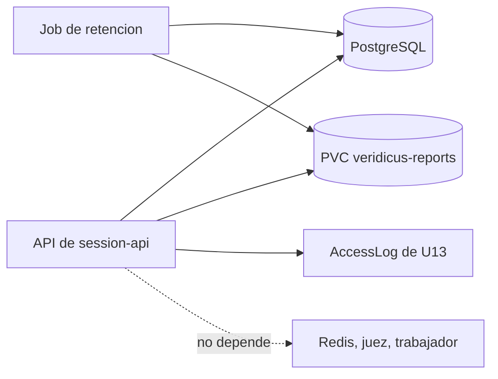

# Componentes lógicos — U7 forensic-report (módulo ReviewReport)

**Revisión 2 (2026-11-22): segunda pasada por el cambio 01, la adenda 02 y el NFR Requirements de U7,
revisión 2.** Sustituye a la revisión 1 del 2026-10-03.
- **Qué cambia.**
  - El paquete pasa a `review_report` y los puertos, a `contracts/python/report_ports.py` (C11 v2, sin
    `ScenarioReader`).
  - Entran la exportación, la purga, el puerto `AccessLog` y la medición del volumen.
  - `verify_store` deja de ser un `Job` y corre por `kubectl exec`.
  - El PVC es de 2 GiB.
- **Numeración.** §1–§5 conservan su número. La tabla de precisiones de §6 queda «Retirado»: sus filas
  están en `security-design.md` §14.

**Insumos.**
- De esta unidad, en `nfr-requirements/`: `performance-requirements.md` (performance-requirements),
  `security-requirements.md` (security-requirements), `scalability-requirements.md`
  (scalability-requirements), `reliability-requirements.md` (reliability-requirements),
  `observability-requirements.md` (observability-requirements) y `tech-stack-decisions.md`
  (tech-stack-decisions: D1–D15, NFR2.1, NFR10.22, NFR13.1–NFR13.3, NFR14.2).
- `functional-design/functional-spec.md` (functional-spec).
- C1, C8, C11, C12, C16, C23, C24 y C25 de `inception/contract-design/contract-summary.md`
  (contract-summary).
- P1 = A y P2 = A, y los demás documentos de esta carpeta.

## 1. Inventario

| Componente lógico | Proceso | Dentro / fuera del clúster | Datos que cruzan su frontera | Patrones de NFR |
|---|---|---|---|---|
| Rutas de U7 (`/finalize`, `/reports`, `/correction-rounds`, descarte, `/download`, `/exports`) | API de `session-api` | Dentro | Peticiones del navegador; `ReportVersion`, vista previa y exportación hacia el navegador | `GuardedRoute` de U3; cuerpo cerrado con `expected_cursor` (P1 = A); sin reintentos |
| `consolidation_guard`, `correction_policy`, `export_policy`, `render`, `mttv` | `review_report/domain` | Dentro (código puro) | Ninguno (sin E/S) | 100 % de ramas; render y marca deterministas |
| `consolidate`, `finalize`, `correct`, `discard`, `export`, `purge` | `review_report/application` | Dentro | Llamadas en proceso a C11, C8, C23 y C24 | Una `UnitOfWork`; orden sesión → ronda; `FOR KEY SHARE` y `FOR UPDATE` por versión (DS5); `SET LOCAL` de 15 s (DS3); reloj único |
| `ReportStore` (`volume_report_store`) | `review_report/adapters` | Dentro | Bytes del reporte hacia y desde el PVC | `O_EXCL`, `fsync`, enlace sin reemplazo, plazo de 5 s, `CancelToken` (P2 = A) |
| `orphan_sweep` y medición del volumen | API, al arrancar y cada 60 s | Dentro | Nombres de archivo, tamaños y filas | Margen de 300 s; candado en proceso; dos *gauges* |
| `verify_store` | Comando por `kubectl exec` en el contenedor `api` | Dentro | IDs y conteos por la salida estándar | `READ ONLY` y `O_RDONLY`; código 0 solo si todo coincide |
| `change_cursor.bump` y `db.py` | `session_api/shared` | Dentro | Fila de la sesión; `SET LOCAL` | Compartidos con U3, U4, U5 y U6 |
| `ReviewRounds`, `SessionReader`, transiciones (C11 v2) | Módulos de U4, U5 y U6 | Dentro | Datos del caso en memoria | Puertos tipados de `report_ports.py` |
| `IntegrityPolicy.scan` y texto del aviso (C8) | `libs/integrity_policy` | Dentro | Texto del reporte en memoria | Antes del SHA-256 |
| `AccessLog` (C23) | Adaptador por defecto o de U13, llamado por la ruta con `record_access_strict` | Dentro | `user_id`, recurso, `export_sha256` | Falla cerrada en 500 ms |
| `Purgeable` de ReviewReport (C24) | `Job` de retención de U13 | Dentro | IDs y SHA-256 en el recibo | `veridicus_retention`; recibo de tipos cerrados |
| `ReportMetrics` | API | Dentro | Contadores al puerto interno | `after_commit`; etiquetas de enum |
| PVC `veridicus-reports` | Volumen | Dentro (`StorageClass` local) | Archivos completos del caso | Montajes acotados; `0700` y `0400`; cuota propia |
| Diálogos, vista previa, lista de versiones, exportación, copia de trabajo | `frontend` (navegador) | Dentro (solo ConsoleApi) | Vista sin HTML; archivo exportado | Cursor congelado; `retry: false`; el sondeo no pide la vista previa |
| Arnés de MTTV | Máquina de desarrollo | Fuera del clúster | Solo marcas de tiempo e IDs, por la API | Nunca decide ni pide reportes |

## 2. Dominios de falla y radio de impacto

<!-- Texto alternativo: la API de session-api, donde vive U7, depende de PostgreSQL, del volumen de reportes y, para exportar, del registro de acceso de U13. El Job de retención usa la misma base y el mismo volumen. U7 no depende de Redis, del juez ni del trabajador. -->

| Falla | Qué deja de funcionar | Qué sigue | Radio |
|---|---|---|---|
| PostgreSQL | Todo U7 | — | Todo el sistema |
| Volumen lleno, sin montar o colgado | Consolidar, ver y exportar (`500` o `503`); `/readyz` en `503` | Nada de la API mientras no esté lista | La API entera (1 réplica) |
| Volumen lento | Consolidaciones de más de 5 s (`503`) | Lecturas de la sesión y decisiones | Consolidación, vista previa y exportación |
| Bloqueo de una sesión retenido | Decisiones y turnos de **esa** sesión (`503` a los 2 s) | Las demás sesiones y la exportación | Una sesión |
| `AccessLog` de U13 caído | Exportar (`503 report.export_not_recorded`) | Todo lo demás, también la vista previa | Exportación |
| Juez, Redis, trabajador | Nada de U7 | Finalizar, consolidar, ver, exportar, corregir | — |
| Prometheus o Grafana | Métricas y panel | Todo U7 | Observabilidad |

## 3. Recursos compartidos

| Recurso | Compartido con | Aislamiento |
|---|---|---|
| Proceso de la API | U3, U4, U5, U6, U8, U12, U13 | Capas e import-linter; `review_report.domain` sin E/S; *executor* propio de 2 hilos para el volumen |
| Fila de la sesión (`change_cursor`) | U4, U5, U6 | Orden único sesión → ronda. La consolidación retiene ≤ 1,5 s en el caso normal y ≤ 8 s en el máximo. El latido no espera (`SKIP LOCKED`). La exportación no toma la sesión |
| Base PostgreSQL | Todas | Solo inserción en `report_version` y `report_export`; borrado solo con `veridicus_retention` |
| Plazo de inactividad | U4, U6 | `SET LOCAL` por transacción: 5 s (U4, U6) y 15 s (U7). Sin valor por conexión (DS3) |
| PVC de reportes | API y `Job` de retención | Política de montajes de nivel 0; el mismo UID |
| `/metrics` | U3, U4, U5 | Prefijos `veridicus_report_*` y `veridicus_session_mttv_seconds` |

## 4. Entrega a Infrastructure Design

Infrastructure Design de U7, revisión 1, ya está aprobado. Esta revisión solo le pide lo que sigue, que
se recoge en `security-design.md` §14:
- **Plazo de inactividad (NFRD-U7-01).** La fila `veridicus-pg` deja de decir «15 s en las conexiones de la
  API». Pasa a decir «15 s con `SET LOCAL` en consolidar y exportar». Se añade la prueba del almacén de
  4,5 s.
- **Lo demás ya está, por NFR-U7-05/06/11 de NFR Requirements.** Salen el `Job` de `verify_store`, su rol y
  su `NetworkPolicy`. La política de montajes admite el `Job` de retención. Siguen el PVC de 2 GiB con
  cuota, `replicas: 1` con `Recreate` y el `limits.memory` de 768 MiB.
- **Tablas.** `report_version` y `report_export`, con sus permisos e índices, entran por el `Job` de
  migración en su propio PR (AUTONOMIA-01).

## 5. Calidad, pruebas y textos (NFR2.1, NFR10.22, NFR13.1, NFR13.2, NFR13.3, NFR14.2)

- **CPU y sin modelos (NFR2.1).** U7 no llama a modelos. Los niveles 0 y 1 corren con PostgreSQL real y un
  directorio real del contenedor. Ninguna prueba exige GPU ni descarga nada.
- **Render y exportación deterministas (NFR10.22).** Pruebas de nivel 0:
  - dos renders iguales;
  - Hypothesis baraja la entrada y obtiene los mismos bytes;
  - dos subprocesos con `PYTHONHASHSEED` distintos dan el mismo SHA-256;
  - `\r\n`, NFD y espacios finales salen normalizados;
  - archivo dorado de `format_version` 2, con el aviso al inicio de cada sección y cada 25 elementos;
  - archivo dorado de la exportación, con usuario y hora fijos.

  El render nunca lee el reloj: recibe `consolidated_at` como dato.
- **Cobertura (NFR13.1).** ≥ 80 % de líneas en `services/session-api` y en `frontend`, bloqueante en la CI.
- **Ramas (NFR13.2).** 100 % con `.coveragerc-guards` en:
  - `domain/consolidation_guard.py` (BR2 y el cursor);
  - `domain/correction_policy.py` y `domain/export_policy.py`;
  - `application/consolidate.py` (cada fallo, la limpieza tras el *rollback*, el `COMMIT` fallido y el
    testigo);
  - `application/export.py` (cada paso de §9 de fiabilidad);
  - `application/purge.py` (`file_missing` y el orden);
  - `application/orphan_sweep.py`;
  - `adapters/volume_report_store.py` (los tres puntos del testigo).

  Comando: `uv run --directory services/session-api pytest tests/review_report --cov-branch
  --cov-config=.coveragerc-guards`.
- **Fronteras (NFR13.3).** import-linter, con control negativo y 0 errores en `lint-imports`:
  - `review_report.domain` no importa `api`, `adapters`, `sqlalchemy` ni otros módulos;
  - ReviewReport usa InterviewSession y HumanReview solo por `report_ports.py`, y `AccessLog` solo por su
    puerto;
  - puede usar `session_api.shared`;
  - `consolidate` solo lo importa la ruta; `purge`, solo el `Job` y las pruebas.
- **Glosario (NFR14.2).** Identificadores: `review_report`, `report_version`, `report_export`,
  `export_watermark`, `purge_receipt`, `consolidation_blocker`, `report_file`, `mttv_sample` y
  `review_suggestion`. Se piden también `cancel_token` y `view_outdated` (NFRD-U7-11). La comprobación de
  glosario da 0 hallazgos y 0 apariciones de `forensic_report` en el código.
