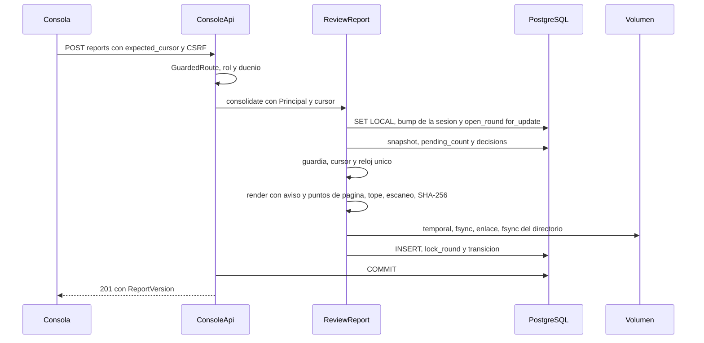

# Diseño de rendimiento — U7 forensic-report (módulo ReviewReport)

**Revisión 2 (2026-11-22): segunda pasada por el cambio 01, la adenda 02 y el NFR Requirements de U7,
revisión 2.** Sustituye a la revisión 1 del 2026-10-03.
- **Qué cambia.**
  - Salen `version_info` del escenario y los paquetes de Hecho No Documentado.
  - El render lleva el aviso y los puntos de página (N = 25).
  - El tope pasa de 2 MiB a `report_max_bytes` = 8 MiB.
  - Entran el caso máximo (NFR3.13), la exportación (NFR3.12) y la purga (NFR3.14).
  - La vista previa ya no es descarga. El sondeo no la pide (NFR3.15).
  - El presupuesto del bloqueo distingue el caso normal del máximo (cierra R-02).
- **Numeración.** §1–§6 conservan su número. Entra §7 (exportación y purga).

**Insumos.**
- De esta unidad, en `nfr-requirements/`: `performance-requirements.md` (performance-requirements: NFR3.1–NFR3.15,
  NFR7.1–NFR7.3, NFR8.1, NFR8.9), `security-requirements.md` (security-requirements),
  `scalability-requirements.md` (scalability-requirements), `reliability-requirements.md`
  (reliability-requirements), `observability-requirements.md` (observability-requirements) y
  `tech-stack-decisions.md` (tech-stack-decisions, D1–D15).
- F1–F10 de `functional-design/functional-spec.md` (functional-spec).
- C1, C8, C11 y C25 de `inception/contract-design/contract-summary.md` (contract-summary).
- P1 = A.
- De otras unidades: el orden sesión → ronda de U5 y el cursor de U4.

Todas las metas se miden en la máquina de desarrollo con el perfil CPU, PostgreSQL real en contenedor y el
volumen como directorio real (nunca `tmpfs`). U7 no llama a modelos ni a la red: su costo es base de datos,
CPU de render y `fsync`.

## 1. Camino crítico de la consolidación (NFR3.2, NFR3.3, NFR3.13, P1 = A)

<!-- Texto alternativo: la consola envía la consolidación con el cursor de la vista que resumió y el token anti-CSRF. ConsoleApi aplica GuardedRoute y delega. ReviewReport fija el plazo de inactividad, incrementa el cursor de la sesión y abre la ronda con bloqueo; lee el estado, aplica la guardia, compara el cursor y toma la hora una sola vez. Renderiza con el aviso y los puntos de página, comprueba el tope, escanea y calcula el SHA-256 en memoria. Escribe el archivo con fsync y enlace sin reemplazo, inserta la versión, bloquea la ronda y aplica la transición. ConsoleApi confirma y responde 201. -->

| Tramo (NFR3.3) | p95, caso de 100 turnos | Diseño |
|---|---|---|
| `bump` + bloqueo de ronda + lecturas de C11 | ≤ 300 ms | Número fijo de sentencias: `SET LOCAL` (1), `bump` (1), ronda `FOR UPDATE` (1), `snapshot` (sesión, turnos, corridas con su registro de modelos: 3), `pending_count` (1), `decisions` con el estado vigente de U5 (1). Sin N+1. Un *listener* de SQLAlchemy cuenta ≤ 10 sentencias (nivel 1) |
| Guardia + cursor | ≤ 1 ms | Función pura. El valor previo sale del `bump` (`m − 1`), sin otra consulta |
| Render | ≤ 400 ms | Funciones puras que añaden fragmentos a una lista y un único `"".join(...).encode("utf-8")`. NFC una vez por texto (D2). El aviso y los puntos de página son cadenas ya preparadas al arrancar. Los tramos literales se registran como desplazamientos al renderizar (D4) |
| Tope de `report_max_bytes` | ≤ 1 ms | `len(data)` frente a la cifra de C25: `413` antes de escanear (NFR8.9) |
| Escaneo | ≤ 200 ms | Una pasada de `scan(text, literal_sources)` con los tramos ya calculados |
| SHA-256 | ≤ 20 ms | `hashlib.sha256` sobre los bytes en memoria, los mismos que se escriben |
| Archivo | ≤ 300 ms | Una sola llamada `write`, un `fsync`, `link` + `unlink` y un `fsync` del directorio (D5), en el hilo del almacén |
| Inserción + `lock_round` + transición + `COMMIT` | ≤ 150 ms | Tres sentencias y el `COMMIT`. La sesión ya está bloqueada por el `bump` |
| **Total** | **≤ 1 500 ms; máximo ≤ 2 000 ms** | `pytest tests/review_report -m perf`, variantes A y B, 30 corridas cada una. El reporte de la prueba registra cada tramo |

**Caso máximo (NFR3.13).** 2 000 turnos, 250 000 caracteres y 500 sugerencias: p95 ≤ 6 s y máximo ≤ 8 s.
Las mismas sentencias, porque el número no depende del tamaño. El tiempo lo llevan el render (≈ 3 s
estimado), el escaneo y el `fsync` de hasta 8 MiB. Prueba `perf` con 10 corridas, que registra cada tramo.
Si el render pasa de 4 s, lo primero es medir por sección antes de tocar la plantilla.

**Bloqueo retenido (cierra R-02).** La fila de la sesión y la de la ronda quedan bloqueadas desde el `bump`
hasta el `COMMIT`. La cifra depende del caso:

| Caso | Duración del bloqueo | Efecto sobre los demás |
|---|---|---|
| Normal | p95 ≤ 1,5 s | Una decisión simultánea de la misma sesión espera y entra después, o recibe `409 review.round_locked` |
| Máximo | Hasta 8 s | Lo que espera más de 2 s recibe `503 system.unavailable` (`lock_timeout`); la consola conserva lo escrito |
| Cota dura | 10 s | La fija el plazo total (`reliability-design.md` §3) |

Otras sesiones nunca esperan. El latido de U6 usa `SKIP LOCKED` y no espera.

**Reloj único.** `consolidated_at` se toma una vez del reloj inyectable, justo después de la guardia, y el
mismo valor va al Markdown y a la fila (NFR7.3). Prueba de nivel 0 con reloj fijo.

## 2. Rechazos baratos (NFR3.6, NFR3.7, NFR8.9)

- **Sin render.** Los `403`, `401` y `422` ocurren en `GuardedRoute`. Los `409` de BR2.2–BR2.9 (incluidos
  `report.runs_in_progress` y `report.final_mode_not_launched`), `report.view_outdated`, `409
  report.not_consolidated`, `404 report.not_found` y `409 session.finalized` se deciden con las lecturas de
  §1 y revierten antes del render. Meta: p95 ≤ 150 ms, 0 filas y 0 archivos. La prueba `perf` lista el
  volumen tras cada rechazo.
- **Vocabulario.** `report.forbidden_vocabulary` renderiza y escanea, pero no escribe: el escaneo va antes
  del SHA-256 y del almacén. Meta: p95 ≤ 1 000 ms.
- **Tamaño.** `413 limits.exceeded` se decide sobre los bytes renderizados, antes del escaneo y del temporal.
  Nivel 1 con `report_max_bytes` bajado a 64 KiB por variable de entorno: 0 filas, 0 archivos y la ronda
  abierta.

## 3. Otras rutas (NFR3.1, NFR3.4, NFR3.5, NFR3.8)

| Ruta | Meta p95 | Diseño |
|---|---|---|
| `POST /finalize` (NFR3.1) | ≤ 200 ms | `bump` + `UPDATE … WHERE status IN ('open','paused','suspended','blocked')` + `INSERT` del historial, y la lectura de la `SessionView` en la misma transacción. Sin render |
| `GET /reports/{id}/download`, vista previa (NFR3.4) | ≤ 250 ms (100 turnos); ≤ 500 ms (8 MiB) | Una consulta por clave primaria. Lectura completa en el hilo del almacén (`O_NOFOLLOW`), SHA-256 sin caché y `hmac.compare_digest` antes de responder (D9). Una `Response` con los bytes ya leídos. Sin *streaming*, porque la comprobación va antes del primer byte. El SHA-256 de 8 MiB cuesta < 50 ms (prueba de nivel 0 aparte) |
| `GET /sessions/{id}/reports` (NFR3.5) | ≤ 100 ms con 10 versiones | Una consulta por el índice `(session_id, version_number)`, sin leer archivos |
| Corregir y descartar (NFR3.8) | ≤ 200 ms | `bump` + la operación de C11 sobre la ronda. Sin render ni archivo |

## 4. Consola (NFR3.9–NFR3.11, NFR3.15)

- **Envío único.** Mutación de TanStack Query con `retry: false` y sin actualización optimista (D11). El
  botón pasa a «Consolidando…» y se deshabilita en el mismo ciclo de render del clic (≤ 100 ms); la mutación
  ignora los clics mientras está `isPending`. Vitest con un servidor *fake* que tarda 2 s: 5 clics, 1
  petición.
- **Cursor del diálogo (P1 = A).** Al abrir el diálogo, la consola congela el cursor de la `SessionView` con
  la que calculó el resumen y lo envía como `expected_cursor`. Ante `409 report.view_outdated`, invalida la
  consulta de la sesión, vuelve a pedirla y reabre el resumen con los datos nuevos y el aviso del catálogo.
- **Botón que se habilita sin recargar (NFR3.10).** Depende de `can_consolidate` y `consolidation_blockers`
  del sondeo de U4: cada 2 s con corridas en curso y cada 15 s sin ellas. Tras una decisión, U5 vuelve a
  pedir la sesión. Playwright: ≤ 3 s y ≤ 1 s.
- **Exportación (NFR3.11).** `POST /exports` con CSRF. El botón queda «Preparando…» deshabilitado. La
  respuesta se entrega como archivo con `Blob` y `URL.createObjectURL`, que se libera al terminar, y la
  consola muestra `X-Veridicus-Export-SHA256` en ≤ 1 s. Playwright compara el SHA-256 del archivo con el
  mostrado y busca la marca del usuario.
- **El sondeo no pide la vista previa ni exporta (NFR3.15).** La vista previa es una consulta con
  `enabled` solo mientras el panel está abierto, `staleTime: Infinity` y sin `refetchInterval`. Vitest con
  M5 abierta 60 s y el sondeo activo: 0 peticiones a `/download` y a `/exports`.
- **Otra pestaña u otro analista.** Cuando el sondeo trae un cambio de `status` o de la ronda, la consola
  invalida `GET /sessions/{id}/reports`.

## 5. MTTV (NFR7.1–NFR7.3)

- `finalized_at` y `consolidated_at` salen del reloj inyectable en la capa de aplicación (§1). La función
  pura `review_report/domain/mttv.py` (`mttv_seconds(origin, finalized_at, versions)`) es la única que calcula
  el MTTV, y la usan el arnés y la métrica.
- Solo las sesiones guiadas dan muestra (P7 = A del Functional Design). El arnés `evaluation/mttv/mttv.py`
  carga todas las transcripciones del conjunto sintético (40 hoy) como sesiones guiadas y solo lee la API;
  nunca decide ni consolida (AUTONOMIA-03). Verificación: `uv run --directory evaluation python -m
  mttv.mttv --run out/level2.json --report out/mttv.json`, con media < 600 s.
- El tiempo de servidor de U7 (p95 de finalizar + p95 de consolidar ≤ 1,7 s) se comprueba con las mismas
  corridas `perf` de §1 y §3 (NFR7.2).

## 6. Memoria (NFR8.1, NFR8.9)

| Operación | Tope añadido al pico de RSS | Diseño |
|---|---|---|
| Consolidación de 100 turnos | ≤ 48 MiB | El Markdown existe una sola vez como `bytes`; la lista de fragmentos se suelta al unirla. Pico ≈ 3 × tamaño del reporte + datos leídos |
| Consolidación del caso máximo | ≤ 64 MiB | Igual. El tope de 8 MiB acota el peor caso |
| 3 consolidaciones máximas simultáneas | ≤ 192 MiB | Sesiones distintas; cada una con su búfer |
| Vista previa o exportación de 8 MiB | ≤ 32 MiB | Archivo leído, marca insertada en una sola copia (`bytearray` con las posiciones conocidas) y respuesta. Sin copias intermedias |

- Todo cabe bajo el `limits.memory` de 768 MiB de la API, con el 20 % de margen de Infrastructure Design
  (NFR-U7-11).
- Verificación: pico de RSS en las pruebas `perf` de NFR3.2, NFR3.4, NFR3.12 y NFR3.13, frente a la misma
  corrida sin ellas.

## 7. Exportación y purga (NFR3.12, NFR3.14)

| Operación | Meta p95 | Diseño |
|---|---|---|
| `POST /reports/{id}/exports` (NFR3.12) | ≤ 500 ms (100 turnos); ≤ 2 000 ms (8 MiB); plazo total de 10 s | `FOR KEY SHARE` (1 sentencia), lectura y SHA-256 (como la vista previa), marca sobre las posiciones de página, SHA-256 de lo armado, `INSERT` (1) y `record_access_strict` (≤ 500 ms). Medido con el adaptador por defecto y con un doble que tarda 100 ms |
| `purge_session` (NFR3.14) | ≤ 2 s con 10 versiones y 100 exportaciones | `FOR UPDATE` de las versiones (1), un `DELETE` de las exportaciones (1) y, por versión, un borrado de archivo (≤ 5 s cada uno) y un `DELETE`. Sin consulta por exportación |

Los puntos de página de N = 25 añaden < 2 % de bytes en los dos casos. Lo comprueba la prueba de tamaño de
NFR8.5 (`scalability-design.md` §3).
