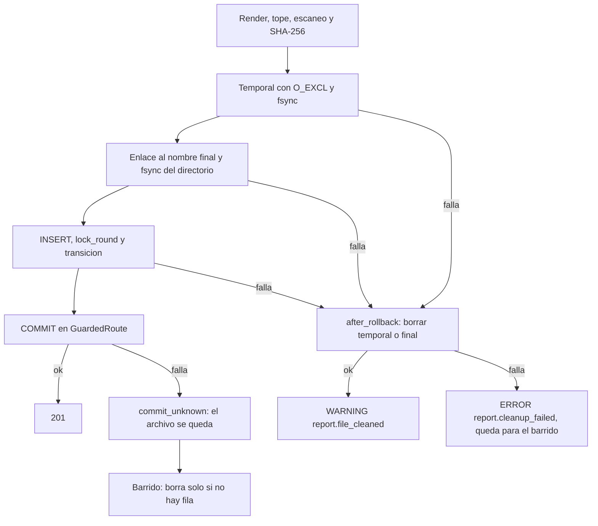

# Diseño de fiabilidad — U7 forensic-report (módulo ReviewReport)

**Revisión 2 (2026-11-22): segunda pasada por el cambio 01, la adenda 02 y el NFR Requirements de U7,
revisión 2.** Sustituye a la revisión 1 del 2026-10-03.
- **Qué cambia.**
  - Finalizar admite `open`, `paused`, `suspended` y `blocked`.
  - La guardia usa `report.runs_in_progress` y `report.final_mode_not_launched`.
  - Un fallo del volumen es `500 system.internal`.
  - La limpieza síncrona corre solo tras un *rollback* cierto (DS4, cierra R-01).
  - El plazo de inactividad se fija con `SET LOCAL` (DS3).
  - Entran la exportación todo o nada (§9) y la purga repetible (§10).
  - El barrido corre también cada 60 s.
  - `verify_store` corre por `kubectl exec`, sin `Job`.
  - Se cierra R-04 con el *executor* colgado (§3).
- **Numeración.** §1–§8 conservan su número; §9 pasa de «Precisiones» a «Exportación». La tabla de
  precisiones antigua queda «Retirado»: sus filas están en `security-design.md` §14. Entra §10.

**Insumos.**
- De esta unidad, en `nfr-requirements/`: `reliability-requirements.md` (reliability-requirements: NFR8.7,
  NFR8.8, NFR10.12–NFR10.21, NFR10.26, NFR10.27), `security-requirements.md` (security-requirements),
  `performance-requirements.md` (performance-requirements), `scalability-requirements.md`
  (scalability-requirements), `observability-requirements.md` (observability-requirements) y
  `tech-stack-decisions.md` (tech-stack-decisions, D5–D8, D13, D14).
- F1–F10 y §7 de `functional-design/functional-spec.md` (functional-spec).
- C1, C11, C12, C16, C23 y C24 de `inception/contract-design/contract-summary.md` (contract-summary).
- P1 = A y P2 = A.
- De otras unidades: el orden sesión → ronda y el `lock_timeout` de U5; el supervisor de corridas de U4;
  los pasos de `GuardedRoute` de U3.

U7 no usa colas ni modelos. Su fiabilidad descansa en tres cosas: una transacción de PostgreSQL con el
orden de bloqueo único de `session-api`, «archivo antes que fila» sobre el volumen, y ninguna operación de
escritura que se reintente sola.

## 1. Orden de bloqueo y atomicidad (NFR10.12–NFR10.14, NFR10.21, P1 = A)

Regla única de `session-api`: usuario → `web_session` → sesión (`change_cursor.bump`) → ronda. Las dos
primeras las toma `GuardedRoute`. U7 nunca emite un `FOR UPDATE` propio sobre `review_round`: lo hace el
repositorio de U5.

| Operación de U7 | Paso 1 (sesión) | Paso 2 (ronda) | Resto en la misma `UnitOfWork` |
|---|---|---|---|
| Finalizar (F1) | `bump` | — | `UPDATE … WHERE status IN ('open','paused','suspended','blocked')`: 1 fila o `409 session.finalized`, más el historial |
| Consolidar (F2, F6) | `bump` (devuelve `m`) | `open_round(for_update=True)` | `SET LOCAL` de DS3, lecturas, guardia y cursor, reloj único, render, tope, escaneo, archivo, `INSERT`, `lock_round` y la transición (solo la versión 1; con la finalización de la importada) |
| Corregir (F4) | `bump` | `open_correction_round` | Devuelve la copia abierta o abre una |
| Descartar (F5) | `bump` | `discard_correction_round` | `discarded` con quién y cuándo |
| Exportar (F8) | — (no cambia la sesión) | — | `report_version` `FOR KEY SHARE` (DS5), lectura, `INSERT report_export`, `record_access_strict` |

- **Todo o nada (NFR10.12).** Una sola `UnitOfWork`, que abre `GuardedRoute`. Las métricas y el log
  `report.consolidated` van en `after_commit`. El fallo se inyecta en cada paso: tras la guardia, el render,
  el escaneo y el temporal; tras el enlace y el `INSERT`; dentro de `lock_round` y de la transición; y en el
  `COMMIT`. En todos los casos: 0 filas, ronda `open`, sesión sin cambios y `change_cursor` sin cambios. Hasta
  el enlace, 0 archivos tras la limpieza (§2). En el `COMMIT`, 0 archivos tras el barrido (DS4, NFRD-U7-12).
- **Una consolidación gana (NFR10.13).** La segunda espera el bloqueo de la sesión; al obtenerlo ya no hay
  ronda abierta y responde `409 report.conflict`. Si la ganadora retiene más de 2 s (el caso máximo, o una
  ganadora frenada 3 s en la prueba), la perdedora recibe `503 system.unavailable` por `lock_timeout` en
  ≤ 2,5 s. La consola vuelve a pedir la sesión, que aparece consolidada. `UNIQUE (session_id,
  version_number)` es la segunda barrera.
- **Nada queda fuera del reporte (NFR10.14).** `decide` de U5 y la ingesta de U4 también empiezan con
  `bump`, así que ninguna escritura visible confirma entre la lectura y el `COMMIT` de la consolidación. Una
  decisión simultánea entra antes (y está en el reporte), o espera y recibe `409 review.round_locked`. Una
  corrida que termina durante la consolidación espera el bloqueo; la guardia ya la vio en curso y responde
  `409 report.runs_in_progress`.
- **Cursor del diálogo (P1 = A).** Como el `bump` serializa todos los cambios visibles de la sesión,
  comparar `n` con `m − 1` no tiene carrera (`security-design.md` §3).
- **Finalizar una sola vez (NFR10.21).** De dos finalizaciones, una da `200` y otra `409
  session.finalized`, con 1 fila de historial. Un turno nuevo simultáneo entra antes o recibe `409`. Las
  corridas colgadas las cierra el supervisor de U4 por su plazo, así que la guardia nunca bloquea para
  siempre.
- **Sin interbloqueos.** Prueba de nivel 1 sobre la misma sesión, con barrera y 50 repeticiones. Hilos: una
  decisión de U5, una ingesta de U4, una consolidación, un descarte y una exportación de U7, y una purga
  desde otro *engine* que simula el `Job`. Resultado esperado: 0 errores `40P01`.

## 2. Archivo antes que fila y limpieza solo tras un *rollback* cierto (NFR10.15; DS4)



<!-- Texto alternativo: tras renderizar, comprobar el tope, escanear y calcular el SHA-256, se escribe el temporal con fsync y se enlaza al nombre final con fsync del directorio. Después se insertan la versión, el bloqueo de la ronda y la transición, y GuardedRoute confirma. Si falla algo antes del COMMIT, la transacción se revierte con certeza y la limpieza registrada en after_rollback borra el archivo, dejando report.file_cleaned, o report.cleanup_failed si el borrado falla. Si falla el propio COMMIT, el resultado es desconocido: el archivo se queda, se registra report.commit_unknown y el barrido lo borra más tarde solo si no existe la fila. -->

- El tope de `report_max_bytes` (`413`), el escaneo y el SHA-256 van antes de tocar el volumen. Un
  rechazo por tamaño o por vocabulario no crea archivo.
- La limpieza se registra con `uow.after_rollback(cleanup)` al crear el temporal (NFRD-U7-05). Si C12 no
  ofrece el gancho, U7 envuelve su manejador en un `try/except` que limpia y vuelve a lanzar. Ese
  `except` solo ve excepciones anteriores al paso 11, porque el `COMMIT` lo hace `GuardedRoute` después de
  volver del manejador: el invariante se mantiene sin depender del gancho.
- Códigos: volumen (`ENOSPC`, `EACCES`, destino existente) → `500 system.internal`; carrera perdida →
  `409 report.conflict`; *timeout* → `503 system.unavailable`; `COMMIT` fallido → `503` (`GuardedRoute`).
- Verificación de nivel 1: sistema de archivos pequeño lleno, directorio sin escritura y fallo antes del
  `COMMIT` dan 0 filas y 0 archivos, sin esperar al barrido. El `COMMIT` inyectado da 0 filas, el archivo
  presente y 0 archivos tras el barrido a +301 s. «`COMMIT` aplicado y conexión cortada»: la fila existe y
  el archivo permanece, y la vista previa responde `200` con su SHA-256.

## 3. Plazos y cancelación cooperativa del almacén (NFR10.17, P2 = A; DS2, DS3)

| E/S | Plazo | Dónde se fija | Al vencer |
|---|---|---|---|
| Sentencia de PostgreSQL | `statement_timeout` 2 s | `session_api/shared/db.py` (U3) | *Rollback*, `503 system.unavailable` |
| Espera de bloqueo | `lock_timeout` 2 s | `db.py` (U5) | *Rollback*, `503` |
| Inactividad dentro de la transacción | 15 s, con `SET LOCAL` en consolidar y exportar | Primera sentencia del manejador (DS3, NFRD-U7-01, NFRD-U7-03) | El servidor corta la conexión; `503` |
| Operación del volumen | 5 s (`VERIDICUS_REPORT_STORAGE_TIMEOUT_SECONDS`), contados desde el envío al *executor* de 2 hilos (D6) | Adaptador `volume_report_store` | Testigo marcado, *rollback*, `503` |
| Consolidación o exportación completa | 10 s (`VERIDICUS_REPORT_CONSOLIDATION_TIMEOUT_SECONDS`), comprobados al final del manejador, antes del `COMMIT` | `application/consolidate.py`, `application/export.py` | *Rollback*, limpieza, `503` |
| `record_access_strict` | 500 ms (U3) | Ruta de exportación | *Rollback*, `503 report.export_not_recorded` |

La regla de arranque `almacén + 2 < consolidación < 15` garantiza el orden: primero vence el almacén,
después el plazo total y nunca el de inactividad en un caso legítimo. Un hueco sin sentencias dura como
mucho el plazo del almacén (5 s) o el render del caso máximo (≈ 3 s), así que los 15 s quedan como
respaldo ante un proceso colgado.

**Cancelación cooperativa (P2 = A).** El hilo del almacén no se puede interrumpir, así que limpia lo suyo:

- `ReportStore.write_new(report_version_id, data, token)` recibe un `CancelToken` (`threading.Event`). El
  hilo lo consulta en tres puntos: antes de crear el temporal, después del `fsync` y antes del enlace. Si
  está marcado, borra lo que haya creado y termina sin enlazar.
- Al vencer el plazo, la aplicación marca el testigo y registra `future.add_done_callback(cleanup)`. La
  limpieza corre cuando el hilo termina, o enseguida si ya terminó. No hay carrera: o el hilo ve el testigo,
  o la limpieza corre después de él.
- **Invariante.** La fila se inserta solo después de que `future.result()` vuelve sin error. Un *timeout*
  nunca deja fila, así que esta limpieza nunca borra un archivo registrado. Prueba de nivel 0 con un almacén
  *fake*.

```python
# application/consolidate.py (ilustrativo)
token = CancelToken()
future = store.submit_write(version_id, data, token)
try:
    future.result(timeout=settings.storage_timeout_s)
except FutureTimeout:
    token.cancel()
    future.add_done_callback(lambda _: store.cleanup(version_id))
    raise StorageUnavailable()  # 503 system.unavailable tras el rollback
```

**Executor colgado (cierra R-04).** Si los 2 hilos quedan bloqueados por un volumen colgado, las
escrituras siguientes esperan en la cola del *executor*. Como el plazo cuenta desde el envío, vencen igual:
`503` en ≤ 5,5 s y nunca una petición colgada. La tarea que sigue en cola tiene su testigo marcado: al
empezar lo ve y no crea nada. La limpieza registrada corre cuando el hilo bloqueado vuelve. Mientras tanto:
- la medición del volumen (60 s) usa el mismo plazo y el mismo testigo;
- si dos pasadas seguidas vencen, `/readyz` responde `503` con `reports_volume: unavailable` (NFR10.19);
- cada vencimiento deja `WARNING` con `reason: storage`.

Prueba de nivel 1 con un almacén que se bloquea hasta que la prueba lo libera:
- 3 consolidaciones responden `503` en ≤ 5,5 s;
- al liberar el almacén, quedan 0 archivos a los 10 s;
- tras dos pasadas de la medición, `/readyz` responde `503`.

**Verificación de los plazos (nivel 1).**

| Caso | Resultado esperado |
|---|---|
| Almacén que tarda 6 s | `503` en ≤ 6,5 s, 0 filas y 0 archivos a los 10 s |
| Testigo marcado antes del enlace | 0 temporales |
| Testigo marcado tras el enlace | 0 finales |
| Base retenida 3 s | `503` en ≤ 2,5 s |
| Consolidación de más de 10 s | `503` en ≤ 10,5 s |
| `AccessLog` de 600 ms | `503` en ≤ 1 s |
| Almacén de 4,5 s con la configuración real de la API | `201`: los 5 s de U4 y U6 no alcanzan a U7 (NFRD-U7-01) |

## 4. Barrido y salud (NFR10.16, NFR10.19)

- **Barrido.** `orphan_sweep` corre en dos momentos: al arrancar, antes de que `/readyz` responda `200`, y
  en cada pasada de la medición del volumen (60 s), bajo un candado en proceso para que nunca se solapen.
  Lista el directorio y borra `<uuid>.md.tmp` y los `<uuid>.md` sin fila con `st_mtime` de más de 300 s. La
  fila se consulta en una transacción nueva y de solo lectura; un archivo con fila nunca se toca. Otros
  nombres solo se registran (`report.unexpected_file`).
- Es el respaldo de `report.cleanup_failed`, del `COMMIT` fallido (DS4) y del hilo que nunca vuelve; no es
  el camino normal. 1 réplica con `Recreate` (NFR8.6).
- Pruebas del barrido:
  - un huérfano viejo se borra;
  - el archivo de 10 s de una consolidación en vuelo queda intacto y su consolidación da `201`;
  - un final con fila queda intacto;
  - el archivo de un `COMMIT` fallido se borra en la pasada siguiente a sus 300 s;
  - con 1 000 archivos, el barrido termina en ≤ 5 s.
- **`/readyz` (C16).** Responde `503` en estos casos:
  - falta la configuración de U7 o es inválida;
  - `reports/` no existe y no se puede crear con `0700`, o tiene otro dueño u otro modo;
  - el directorio no es escribible;
  - quedan menos de `VERIDICUS_REPORT_MIN_FREE_BYTES` libres, o el uso supera
    `VERIDICUS_REPORT_VOLUME_QUOTA_BYTES`;
  - el barrido de arranque no terminó;
  - dos pasadas seguidas de la medición vencieron (§3).

  Con el adaptador por defecto de `AccessLog`, responde `200` con `access_log: not_configured`. Una
  configuración inválida termina el proceso con código distinto de 0 y un log que nombra el ajuste. Pruebas
  de nivel 0 por regla; pruebas de nivel 1 con el volumen sin montar, de solo lectura, con `0755` y casi
  lleno.

## 5. Sin reintentos automáticos (NFR10.18)

- Finalizar, consolidar, corregir, descartar y exportar no son idempotentes. Ni el servidor ni la consola
  los reintentan (`retry: false`, D11). Ante una caída de red, un `500` o un `503`, la consola muestra el
  mensaje del catálogo y vuelve a pedir la sesión. Si la consolidación sí se guardó, aparece `consolidated`,
  y un reenvío manual recibe `409 report.conflict`.
- Ante `409 report.view_outdated`, la consola tampoco reenvía. Vuelve a pedir la sesión y reabre el
  resumen; el analista confirma de nuevo.
- La vista previa es de lectura y se repite solo a mano. Una exportación repetida a mano crea otra
  `ReportExport`, que es lo correcto, porque cada exportación es un artefacto propio.
- Verificación con Vitest y un servidor *fake* que falla, que responde `503`, `409 report.conflict` y `409
  report.view_outdated`, y que responde `503 report.export_not_recorded`. En los cuatro casos sale 1
  petición.

## 6. Verificación del almacén y respaldo (NFR10.20, NFR8.8)

- `python -m session_api.review_report.verify_store` lo ejecuta el humano con `kubectl exec` dentro del
  contenedor `api`, con el mismo UID que escribió los archivos (lista de `exec` de U2, NFR-U7-05). Abre la
  base en una transacción `READ ONLY` y los archivos con `O_RDONLY`. Recalcula cada SHA-256, lista los
  huérfanos e imprime solo IDs y conteos. Sale con 0 solo si hay 0 versiones sin archivo y 0 SHA-256
  distintos.
- Prueba de nivel 1 con un archivo alterado y otro borrado: código 1 y los dos IDs. Otra prueba confirma
  que no escribe (fila y `st_mtime` iguales).
- **NFR8.8.** Tras toda la suite de nivel 1, incluidos los fallos de §1–§3, §9 y §10, se hace una pasada del
  barrido con el reloj a +301 s. `verify_store` informa entonces 0 versiones sin archivo, 0 SHA-256
  distintos y 0 huérfanos, sin reiniciar la API.
- **RPO y RTO.** Respaldo conjunto y a pedido: `scripts/backup-db.sh` más `export_store`. El RPO es el
  último respaldo; el RTO, ≤ 30 min hasta que `verify_store` termine con 0, medido en el ensayo anterior a
  la sustentación. Si la base queda más nueva que el volumen, esas versiones responden `409
  report.integrity_mismatch`; nunca se entrega un archivo distinto del registrado.

## 7. Recuperación y degradación

| Falla | Qué se pierde | Recuperación |
|---|---|---|
| Reinicio de la API a mitad de consolidar o exportar | Nada confirmado | El archivo de una consolidación, si quedó, lo borra el barrido pasado su margen. La exportación no deja archivos. El analista repite la acción |
| `COMMIT` fallido | Nada, o la consolidación sí quedó | DS4: el archivo se queda. Si hay fila, la sesión aparece consolidada; si no, el barrido lo borra |
| Volumen lento o colgado | Nada | `503` y limpieza del propio hilo (§3). Si sigue colgado, `/readyz` responde `503` |
| Volumen lleno o sin escritura | Nada | `500 system.internal`, 0 filas. `/readyz` responde `503` bajo el mínimo libre o sobre la cuota, y antes salta la regla del 80 % |
| PostgreSQL no responde | Nada | `503`. El archivo escrito se limpia (§2) |
| Adaptador real de `AccessLog` caído | Las exportaciones mientras dure | `503 report.export_not_recorded`. La vista previa sigue, porque registra en punto de guardado |
| Archivo alterado o borrado | La vista previa y la exportación de esa versión | `409 report.integrity_mismatch`. Se restaura del respaldo y `verify_store` lo confirma |
| Purga interrumpida | Nada confirmado | La siguiente ejecución termina el borrado (§10) |
| Juez, Redis, trabajador o Prometheus caídos | Nada de U7 | U7 solo necesita PostgreSQL, el volumen y, para exportar con U13, el registro de acceso. Con Redis caído, la consola entera queda fuera de servicio por `/readyz` de U3; no es una dependencia de U7 |

## 8. Objetivo de punta a punta (NFR8.7)

`frontend/e2e/report.spec.ts` recorre el flujo completo:
1. finalizar con 2 corridas en curso, esperar y decidir la última pendiente;
2. consolidar, copiar el SHA-256 y abrir la vista previa, con el aviso en cada página;
3. exportar y comparar `export_sha256` con el archivo bajado;
4. corregir y consolidar la versión 2; exportar la versión 1, con su rótulo de reemplazo;
5. abrir otra copia y descartarla;
6. ver la sesión como otro analista, en solo lectura, y exportarla como `admin`;
7. con dos pestañas, recibir `report.view_outdated` tras decidir en la otra.

Pasa con 0 fallos en cada corrida de nivel 3: `npx --prefix frontend playwright test e2e/report.spec.ts`.

## 9. Exportación todo o nada (NFR10.26; DS5, DS6)

- Una transacción, en este orden:
  1. `SET LOCAL` de DS3;
  2. `report_version` `FOR KEY SHARE`;
  3. lectura y verificación del SHA-256 (5 s);
  4. marca y `export_sha256`;
  5. `INSERT report_export`;
  6. `record_access_strict` (500 ms);
  7. `COMMIT` en `GuardedRoute`, y solo después los bytes.
- Fallo inyectado en cada paso (lectura, verificación, inserción, `AccessLog` que falla, `AccessLog` de
  600 ms, `COMMIT`): 0 `ReportExport` y 0 bytes. La respuesta es `409 report.integrity_mismatch`, `503
  report.export_not_recorded` o `503 system.unavailable`, según el paso.
- Si el `COMMIT` falla con resultado desconocido, la exportación responde `503` y puede haber quedado la
  fila. Es aceptable: la fila registra un intento con su *hash* y no se envió ningún byte (A-3 se cumple por
  exceso).
- Si el cliente corta la conexión después del `COMMIT`, la fila queda y se ve en `INFO report.exported`.
- Dos exportaciones simultáneas de la misma versión dan dos filas, porque `FOR KEY SHARE` no se excluye a
  sí mismo.

## 10. Purga repetible (NFR10.27; DS5)

- Corre dentro de la transacción por sesión del `Job` de U13. Orden: `FOR UPDATE` sobre las versiones →
  `DELETE report_export` → por versión, de la más nueva a la más antigua, archivo (5 s) y después fila
  (`security-design.md` §11).
- Un archivo que ya falta da `file_missing: true` y el borrado sigue.
- Fallo inyectado tras borrar el archivo de la versión 2 de 3: la transacción se revierte, las filas quedan
  y la vista previa de esa versión responde `409 report.integrity_mismatch`. La siguiente ejecución termina
  con `file_missing: true` para esa versión.
- Nunca se reintenta dentro de la misma ejecución.
- La transacción del `Job` no debe cortar por inactividad mientras borra un archivo (NFRD-U7-06, nota para
  U13).
- Prueba de nivel 1 con el usuario `veridicus_retention` y el p95 de NFR3.14.
