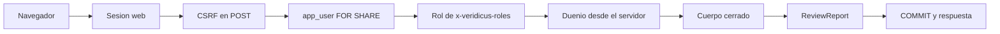
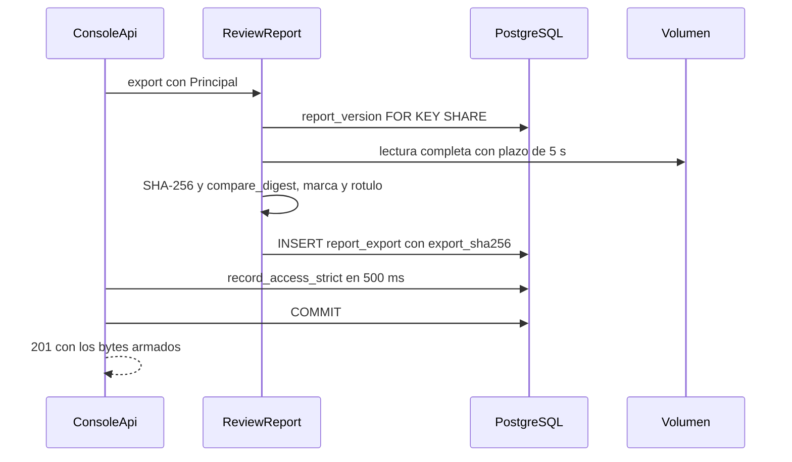

# Diseño de seguridad — U7 forensic-report (módulo ReviewReport)

**Revisión 2 (2026-11-22): segunda pasada por el cambio 01 (DT27), la adenda 02 y el NFR Requirements de U7,
revisión 2.** Sustituye a la revisión 1 del 2026-10-03, que queda en el historial de Git.
- **Qué cambia.** El módulo se llama ReviewReport (paquete `review_report`). Leen versiones y vista previa
  los analistas y el `admin`; exportan el dueño y el `admin` (VE-13). Entra la exportación con marca,
  `export_sha256` y registro de acceso que falla cerrado (§10). Entra la retención por `purge_session` (§11).
  El escaneo suma el vocabulario de VE-02 y excluye el aviso de VE-01. Sale `report.storage_failed`: un
  fallo del volumen es `500 system.internal` (NFR-U7-03). Salen el marco de verdad, la CoT y los pasajes.
  `verify_store` corre por `kubectl exec`, sin `Job` ni rol propios (NFR-U7-05).
- **Se mantienen** P1 = A (cursor de lo revisado) y P2 = A (cancelación cooperativa del almacén). Ninguna
  fuente aprobada las retiró. Como C1 revisión 3 no lleva el cuerpo de P1 = A, se vuelve a pedir en
  NFRD-U7-04.
- **Hallazgos de `reviews/review-01.md`.** R-01 se cierra con DS4 y NFRD-U7-05. R-02 se cierra en
  `performance-design.md` §1. R-03 se cierra en §3 con el cursor de la sesión de NFRD-U4-05. R-04 se cierra
  en `reliability-design.md` §3.
- **Numeración.** §1–§10 conservan su número; §5 pasa a llamarse «Vista previa». Entran §11 (retención),
  §12 (decisiones DSn), §13 (correspondencia con AUTONOMIA) y §14 (tabla NFRD-U7-xx). El antiguo §10 de
  precisiones queda «Retirado»: lo sustituye §14.

**Insumos.**
- De esta unidad, en `nfr-requirements/`: `security-requirements.md` (security-requirements: NFR1, NFR10,
  NFR11, NFR12, NFR14 y la tabla NFR-U7-01..13), `performance-requirements.md` (performance-requirements),
  `scalability-requirements.md` (scalability-requirements), `reliability-requirements.md`
  (reliability-requirements), `observability-requirements.md` (observability-requirements) y
  `tech-stack-decisions.md` (tech-stack-decisions, D1–D15).
- De `functional-design/functional-spec.md` (functional-spec, revisión 2): F1–F10, §7 y FD-U7-01..13. De
  `rules.md`: BR1–BR11.
- C1, C8, C11, C12, C16, C23, C24 y C25 de `inception/contract-design/contract-summary.md`
  (contract-summary).
- Respuestas P1 = A y P2 = A de `nfr-design-questions.md`.
- NFR Design de otras unidades: U1 (catálogos, métricas internas), U2 (`NetworkPolicy`, `Ingress`,
  volúmenes, lista de `exec`), U3 (`GuardedRoute`, `record_access_strict`, formateador), U4 (cursor
  `v1.<session_id>.<n>`), U5 (`lock_timeout`, C11) y U6 (plazos de sus transacciones).

El reporte junta en un solo archivo todo el caso. Por eso se trata como el activo más sensible del sistema,
aunque los datos del MVP sean sintéticos (NFR12).

## 1. Frontera de la unidad (AUTONOMIA-04; NFR1.1, NFR1.2, NFR1.3)

| Componente | Dentro / fuera del clúster | Qué datos cruzan su frontera | Control |
|---|---|---|---|
| Rutas de U7 en ConsoleApi (`/finalize`, `/reports`, `/correction-rounds`, descarte, `/download`, `/exports`) | Dentro: API de `session-api`, con la salida denegada por la `NetworkPolicy` de U2 | Peticiones del navegador. Hacia el navegador de un usuario autorizado, por el `Ingress` con TLS: `ReportVersion`, la vista previa y la exportación. Es entrega prevista, no salida a internet | `GuardedRoute` de U3 (§2) |
| ReviewReport (`review_report`) | Dentro (módulo de la API) | Llamadas en proceso a C11, C8 y C23; filas en PostgreSQL | import-linter: sin `httpx`, `requests`, `urllib`, Redis, `libs.model_gateway` ni `libs.anonymizer`, con control negativo (NFR1.1) |
| PVC `veridicus-reports` (subdirectorio `reports/`) | Dentro, montado en escritura en el contenedor `api` y en el `Job` de retención | Archivos Markdown completos del caso. **Nunca** una exportación | Política Kyverno `veridicus-reports-mounts` sobre `helm template`, con dos controles negativos: otro `Deployment` y un `CronJob` (NFR1.2, NFR-U7-06) |
| PostgreSQL (CloudNativePG) | Dentro | IDs, SHA-256, tamaños, actor y hora. Nunca texto del caso | `veridicus_app` solo con `INSERT`/`SELECT`; `veridicus_retention` con `DELETE` (§4, §11) |
| Puerto `AccessLog` (C23) | Dentro de `session-api` | `user_id`, tipo y ID del recurso, `export_sha256` | `record_access_strict` de U3 (§10) |
| `ingress-nginx` | Dentro (termina TLS) | Ve en tránsito la vista previa y la exportación; no las escribe en disco | `proxy-buffering off` y `proxy-max-temp-file-size 0` en todo `/api/` (U2), con su política de nivel 0 (NFR1.3) |
| `/metrics` | Dentro, puerto interno 8081 (solo Prometheus) | Contadores, histogramas y *gauges* con etiquetas de enum | NFR10.10 |
| Consola (navegador) | Dentro del perímetro de la aplicación: solo habla con ConsoleApi (ADR-004) | Vista previa como texto. La exportación queda en el equipo del usuario | `react/no-danger` en error; `skipHtml` (§5) |
| `Job` de retención (U13) | Dentro, imagen de `session-api` | Llama a `purge_session`; recibe IDs y SHA-256 | §11 |
| Arnés de MTTV | Máquina de desarrollo, contra la API | Solo marcas de tiempo, origen e IDs | Nunca pide reportes |

Ningún componente de U7 llama fuera del clúster ni a un modelo. Verificación de nivel 0: `lint-imports`
con 0 errores; `kyverno apply deploy/policies/` sobre el render, con 0 violaciones; y la política del
`Ingress` de U2 con su control negativo.

## 2. Entrada y autorización (NFR10.1–NFR10.3, NFR10.11, NFR10.23)



<!-- Texto alternativo: la petición pasa por GuardedRoute de U3. Primero se resuelve la sesión web. En los POST se compara el token anti-CSRF y se toma el bloqueo compartido de la fila del usuario. Después se comprueba el rol declarado en C1 y, donde la ruta lo pide, que el actor sea el dueño leído en el servidor. Luego se valida el cuerpo sin campos extra. Solo entonces entra a ReviewReport, y la respuesta sale tras el COMMIT. -->

| Ruta | `x-veridicus-roles` | Dueño | Cuerpo |
|---|---|---|---|
| `POST /sessions/{id}/finalize` | `[analista]` | `owner-only` | Ninguno |
| `POST /sessions/{id}/reports` | `[analista]` | `owner-only` | `{ "expected_cursor": Cursor }` obligatorio (P1 = A, NFRD-U7-04) |
| `POST /sessions/{id}/correction-rounds` y `…/current/discard` | `[analista]` | `owner-only` | Ninguno |
| `GET /sessions/{id}/reports` y `GET /reports/{id}/download` | `[analista, admin]` | No | — |
| `POST /reports/{id}/exports` | `[analista, admin]` | `owner-only-for-role: analista` | Ninguno |

- **Orden y rechazos.** Lo fija `GuardedRoute`: sesión → CSRF → `app_user` `FOR SHARE` → rol → dueño →
  cuerpo, siempre antes de que ReviewReport toque nada. Un rechazo deja 0 filas, 0 archivos, 0 bytes y 0
  llamadas a `AccessLog`. Un rol sin permiso recibe `403` y nunca `422` (paso 7 de U3). Pruebas de nivel 1
  por ruta y por actor (dueño, otro analista, `admin`, `investigador`, identidad de servicio, sin sesión,
  sin CSRF). Cada prueba lista además el volumen y cuenta las llamadas al doble de `AccessLog`.
- **Cuerpos cerrados.** `additionalProperties: false` en el único cuerpo. `consolidated_by`,
  `consolidated_at`, `finalized_at`, `actor_user_id` u otro campo dan `422` `validation.invalid_request`
  (T15). Un cuerpo en una ruta que no lo declara también da `422`.
- **Copia de trabajo (NFR10.11).** Las rutas de corrección solo cambian estados, notas y reformulaciones,
  a través de C10 de U5. Cualquier intento sobre la transcripción, el hecho, el tipo, las citas, los avisos
  o las observaciones da `422`. La prueba de nivel 1 compara el SHA-256 de esos campos y el de los bytes de
  la versión vigente antes y después de corregir y de consolidar la N+1.
- **Exportación (NFR10.23).** El `admin` pasa sin comprobación de dueño; el analista no dueño recibe
  `403` `session.not_owner` antes de que se lea el archivo. La consola deja «Descargar reporte» con
  `aria-disabled` y su motivo, pero la prueba exige el `403` de la API.

## 3. Consolidación explícita y vinculada a lo revisado (AUTONOMIA-03; NFR11.2, NFR10.9, P1 = A)

| Control | Diseño | Verificación |
|---|---|---|
| Única entrada | `review_report.application.consolidate` solo se importa desde la ruta `POST /sessions/{id}/reports`. import-linter lo prohíbe en el trabajador de `session-api`, `semantic-agent`, `evaluation/`, el `Job` de retención y cualquier otro módulo. La importada se finaliza dentro de esa acción (BR2.10) | `lint-imports` con control negativo (nivel 0) |
| Quién y cuándo | `consolidated_by` es el `Principal`. `consolidated_at` sale del reloj inyectable de U3: se toma una sola vez tras la guardia y va igual al Markdown y a la fila (`NOT NULL`) | Nivel 1: la fila y el archivo llevan el mismo actor y la misma hora |
| Lo que el analista vio (P1 = A, cierra R-03) | El cursor es el de la **sesión**: `v1.<session_id>.<n>` en base64url, con `n` = `change_cursor` (NFRD-U4-05). Si el cursor no decodifica, da `422`, y nunca la vista completa que da el sondeo. Si su `session_id` no es el de la ruta, también da `422`. Dentro de la transacción, `change_cursor.bump` devuelve `m`; tras pasar BR2.2–BR2.9, si `n ≠ m − 1`, la respuesta es `409 report.view_outdated`, con *rollback*, 0 filas y 0 archivos | Nivel 1: una decisión confirmada entre el diálogo y la consolidación da `409` en 50 de 50; sin cambios, `201` en 50 de 50. Nivel 0: la tabla de la guardia con 100 % de ramas |
| Sin falsos rechazos | Solo las escrituras visibles hacen `bump`. El latido de U6, la marca de «observaciones consultadas» de U5 y el registro de acceso no lo hacen, así que el cursor solo envejece si cambió algo que el resumen muestra | Nivel 1: 10 latidos, 10 vistas de observaciones y 10 vistas previas entre el diálogo y la consolidación dan `201` |
| Sin etiquetas de veracidad ni vocabulario de VE-02 (NFR10.9) | El Markdown completo pasa por `scan(text, literal_sources)` con la lista de C8 más VE-02, antes del SHA-256. `literal_sources` son los textos de todos los turnos (cubren las dos citas). Se excluyen además las notas, las reformulaciones y la cadena versionada del aviso (A-1). Se escanean los rótulos de `format_version` 2, `hecho`, `observaciones`, los avisos de la sesión y los textos del sistema | Controles de nivel 0 de NFR10.9. Nivel 1: tras el rechazo, 0 filas, 0 archivos y la ronda abierta |

```python
# domain/consolidation_guard.py (ilustrativo)
def evaluate(view: GuardInput) -> Decision:
    blockers = ordered_blockers(view)            # BR2.2–BR2.9, en orden
    if blockers:
        return Blocked(blockers)                 # se listan todos
    if view.expected_seq != view.bumped_seq - 1:
        return Blocked(["report.view_outdated"])
    return Allowed()
```

## 4. Integridad y versiones (NFR11.1, NFR11.3–NFR11.6)

- **Solo inserción.** `report_version` y `report_export` están registradas en `AuditConvention` de U3, con
  `purgeable: true`. `veridicus_app` tiene `INSERT` y `SELECT`; `veridicus_retention` tiene `DELETE` y no
  `UPDATE`. Restricciones:
  - `UNIQUE (session_id, version_number)`, `UNIQUE (round_id)` y `UNIQUE (storage_path)`;
  - `CHECK ((version_number = 1) = (supersedes_version_id IS NULL))`;
  - formato hex de 64 en `sha256` y en `export_sha256`, y `byte_size > 0`;
  - claves foráneas a sesión, ronda, usuario y versión.

  Sale la clave foránea del escenario. Hay una prueba de nivel 1 por restricción, más la prueba común de U3.
- **Archivo inmutable.** El temporal se crea con `O_CREAT | O_EXCL | O_WRONLY | O_NOFOLLOW`, modo `0600`.
  Siguen `fsync`, `os.link` al nombre final (falla si existe), `unlink` del temporal, `fsync` del directorio
  y `chmod 0400`. Si hay un archivo plantado con el nombre de la versión siguiente, la consolidación falla
  con `500 system.internal` (NFR-U7-03) y no toca ese archivo.
- **SHA-256 en cada vista previa y en cada exportación.** Se lee el archivo entero en el hilo del almacén,
  se calcula `hashlib.sha256` y se compara con `hmac.compare_digest`. Si difiere, falta o es un enlace,
  la respuesta es `409 report.integrity_mismatch` sin bytes y sin `ReportExport`, con un `ERROR` que solo
  lleva `report_version_id`. Sin caché del resultado. Si el archivo falta y, al releer la fila, esta ya no
  existe (purga en curso), la vista previa responde `409 report.not_consolidated` y la exportación
  `404 report.not_found`, sin `ERROR` ni métrica de integridad (DS7).
- **Corrección.** La versión N+1 apunta a la vigente en `supersedes_version_id`; la fila y el archivo de la
  N no cambian (mismo `st_mtime` y SHA-256). El descarte pasa la ronda a `discarded` con quién y cuándo,
  mediante `discard_correction_round` (C11 v2). Sin copia abierta, la respuesta es `409 report.conflict`.

## 5. Vista previa (NFR10.4, NFR10.5)

- **Ruta calculada.** `report_version_id` se valida como UUID en el paso 7 de `GuardedRoute`. La ruta es
  `<VERIDICUS_REPORTS_DIR>/<uuid>.md` y debe ser igual a `storage_path`; el valor de la petición nunca se
  concatena. Sin fila, `/download` responde `409 report.not_consolidated` y `/exports` `404
  report.not_found`. Pruebas con `..%2F`, una ruta absoluta y un enlace simbólico plantado: `422`, `404` o
  `409`, nunca otro archivo.
- **Cabeceras de la vista previa.** `200` con:
  - `Content-Type: text/markdown; charset=utf-8` y `Content-Disposition: inline`;
  - `X-Content-Type-Options: nosniff` y `Cache-Control: no-store`;
  - `X-Veridicus-SHA256`.

  Ningún `403`, `404` ni `409` envía bytes ni esa cabecera.
- **Consola.** Muestra el Markdown sin HTML crudo (`skipHtml`, sin enlaces navegables) y nunca con
  `dangerouslySetInnerHTML`. Vitest con `<script>`, `` y `[x](javascript:…)` sembrados en una
  nota: no se ejecutan ni crean enlaces. El sondeo no pide la vista previa (NFR3.15).

## 6. Volumen (NFR10.6)

- El contenedor corre sin root (UID 10001, perfil `restricted` de U2). Fija `umask 077` al arrancar. No
  confía en `fsGroup`, que el aprovisionador hostPath ignora.
- `VERIDICUS_REPORTS_DIR` es el subdirectorio `reports/` del montaje. El proceso lo crea con `0700`; si ya
  existe, exige que sea de su UID y `0700`, o `/readyz` responde `503`. Cada final queda `0400` y cada
  temporal `0600`.
- El `Job` de retención usa el mismo `runAsUser` y `runAsGroup` (política `retention-job-identity` de U2),
  así que puede borrar sin cambiar permisos.
- Pruebas de nivel 1: `stat()` del archivo y del directorio; el subdirectorio en `0755` deja `/readyz` en
  `503`.

## 7. Datos sensibles fuera de logs, errores y métricas (NFR10.7, NFR10.8, NFR10.10)

- **Logs.** Formateador JSON de `libs/` con lista blanca (U3). U7 solo añade los campos de NFR10.7. Nunca
  el nombre de usuario de la marca (NFRD-U7-10). El *engine* usa `hide_parameters=True` (`db.py` común).
- **Errores.** Problem Details con un `code` de C1 y el `detail` del catálogo de U1.
  - `report.forbidden_vocabulary` da la ubicación (sección e ID de turno o de sugerencia); nunca el término
    ni su entorno.
  - `report.view_outdated` no dice qué cambió.
- **Métricas.** Las etiquetas solo toman valores de enum. No hay `session_id`, `report_version_id`,
  `export_id` ni `user_id`.
- **Verificación (nivel 1).** Se siembra una cadena centinela en un turno, un hecho, unas observaciones,
  una nota, una reformulación y el nombre de usuario. Resultado esperado: 0 coincidencias en logs, cuerpos
  de error y `/metrics`. Se recorren todos los caminos: `200`, `201`, `204`, `403`, `404`, cada `409`,
  `413`, `422`, `500` y `503`, más el barrido, la limpieza tardía, `purge_session` y una violación de
  restricción.

## 8. Datos sintéticos e idioma (NFR12.1, NFR14.1)

- *Fixtures*, archivos dorados de `services/session-api/tests/review_report/` e informes del arnés usan
  el catálogo de nombres sintéticos de U1. `evaluation/out/` y `backups/` están en `.gitignore`. La
  comprobación de U1 sobre esas rutas da 0 hallazgos (nivel 0).
- Los textos fijos de la plantilla de `format_version` 2, de la marca, del rótulo de reemplazo, de los
  diálogos y de M5 salen del catálogo de U1, incluido el de `report.view_outdated` (NFRD-U7-04). Una prueba
  de nivel 0 recorre la plantilla y la marca.
- En el reporte, las fechas van en ISO 8601 UTC, con la hora de Colombia entre paréntesis donde las lee
  una persona. En la consola, al revés: hora de Colombia y UTC entre paréntesis.

## 9. Amenazas y controles

| # | Amenaza | Control | Dónde |
|---|---|---|---|
| T1, T15 | Otro actor escribe o suplanta actor y hora | `GuardedRoute`, dueño en el servidor y cuerpo cerrado | §2 |
| T2 | `investigador` o servicio lee reportes | `x-veridicus-roles: [analista, admin]` | §2, §5 |
| T3 | CSRF | Token de U3 en los cinco `POST` | §2 |
| T4 | Consolidación automática | Entrada única e import-linter | §3 |
| T5 | Carrera entre guardia y bloqueo | `bump` de la sesión y después `open_round(for_update=True)` | `reliability-design.md` §1 |
| T6, T7, T8 | Alterar archivo, fila o versión anterior | Solo inserción, `0400`, enlace sin reemplazo, SHA-256 en cada lectura | §4 |
| T9, T10 | Recorrido de rutas; otro proceso lee el volumen | Ruta calculada, `O_NOFOLLOW`, montajes acotados, `0700` | §5, §6 |
| T11 | Texto del caso o nombre de usuario en logs, errores o métricas | Lista blanca y centinela | §7 |
| T12 | Etiqueta de veracidad o vocabulario de VE-02 en el reporte | Escaneo antes del SHA-256 | §3 |
| T13 | Markdown interpretado o en caché | Cabeceras y vista sin HTML | §5, §10 |
| T14 | Cambiar datos de la IA en la copia | `422` y SHA-256 antes y después | §2 |
| T16 | Un no dueño o un `investigador` exporta | `owner-only-for-role: analista` | §2 |
| T17 | Exportación sin marca o con la de otro | Marca armada en el servidor desde el `Principal` | §10 |
| T18 | Exportación sin registro o con otro *hash* | `ReportExport` y `record_access_strict` antes de enviar | §10 |
| T19 | Copias fuera del volumen controlado | Bytes en memoria; `Ingress` sin temporales | §1, §10 |
| T20 | La retención borra lo de otra sesión o deja texto | Filtro por sesión, usuario de retención y recibo de tipos cerrados | §11 |
| T21 | Consolidar un estado que el analista no vio (P1 = A) | `expected_cursor` comparado bajo el bloqueo de la sesión | §3 |
| T22 | Copia del caso sin fila en el volumen tras un *timeout* o un `COMMIT` fallido | Cancelación cooperativa (P2 = A), limpieza solo tras un *rollback* cierto, barrido | `reliability-design.md` §2, §3 |

T21 y T22 eran T16 y T17 en la revisión 1. Toman número nuevo porque NFR Requirements revisión 2 usó
T16–T20.

## 10. Exportación (NFR10.24, NFR10.25, NFR11.7; DS5, DS6)



<!-- Texto alternativo: ConsoleApi delega la exportación con el usuario autenticado. ReviewReport toma un bloqueo de clave compartida sobre la fila de la versión, lee el archivo entero con un plazo de 5 s, verifica su SHA-256 y arma en memoria la marca y, si hace falta, el rótulo de reemplazo. Inserta la fila de exportación con el SHA-256 de lo armado. ConsoleApi registra el acceso con la función estricta de U3 en 500 ms y confirma. Solo después del COMMIT envía la respuesta 201 con los bytes. -->

- **Marca.** Se arma en el servidor con el `username` del `Principal`, nunca con un dato del cliente. Al
  nombre se le aplica el escape de D3. La cabecera lleva «Exportado por…», «Versión N · SHA-256 de la
  versión…» y, si la versión no es la vigente, «Reemplazada por la versión M el…». La línea de marca se
  inserta en cada punto de página que dejó el render: sus desplazamientos se recalculan con la misma
  función del render sobre los bytes verificados, sin volver a renderizar (D13). Los puntos de página tienen
  una forma de línea que el texto escapado no puede producir (NFR10.24).
- **Orden.** Bloqueo, lectura, verificación, armado, `export_sha256`, `INSERT report_export` y
  `record_access_strict`, que es la última sentencia antes del `COMMIT`. Así, el `SET LOCAL
  statement_timeout` de 500 ms del adaptador no alcanza a otra sentencia de U7. Además, la función lo
  repone.
- **Falla cerrada.** Si el adaptador real falla o tarda más de 500 ms, la transacción se revierte entera y
  la respuesta es `503 report.export_not_recorded`, sin bytes. Con el adaptador por defecto de C23:
  `201`, `WARNING report.access_log_not_configured` solo con IDs, y `+1` en
  `veridicus_report_exports_unaudited_total`.
- **Sin copias (NFR10.25).** Los bytes viven en memoria hasta la respuesta. No se escriben en el volumen,
  ni en `/tmp`, ni en una columna, ni en el log. La respuesta es `Response` y no `FileResponse`.
  Cabeceras: `Content-Disposition: attachment; filename="veridicus-reporte-<report_version_id>-<export_id>.md"`,
  `nosniff`, `no-store` y `X-Veridicus-Export-SHA256`.
- **Verificación.** Nivel 0: el archivo dorado de la exportación con usuario y hora fijos coincide byte a
  byte; mismas entradas, mismos bytes; las cadenas de la marca dan 0 coincidencias con C8. Nivel 1, en cada
  caso: `sha256sum` de lo recibido = cabecera = fila = valor que recibe el doble del puerto; un turno con el
  texto exacto del aviso y de la marca da tantas marcas como puntos de página; el adaptador que falla o
  tarda 600 ms da `503`, 0 filas y 0 bytes; tras 20 exportaciones, `reports/` y `/tmp` no cambian.

## 11. Retención (NFR11.8; DS5)

- `purge_session(uow, session_id)` (C24) corre en la transacción por sesión del `Job` de U13, con la
  conexión de `veridicus_retention`. Solo la importan el `Job` y las pruebas (import-linter, NFR13.3).
- **Orden.**
  1. `SELECT … FROM report_version WHERE session_id = :sid ORDER BY version_number DESC FOR UPDATE`. Así
     espera a cualquier exportación en curso, que tiene `FOR KEY SHARE`, y bloquea las nuevas.
  2. `DELETE FROM report_export` de esas versiones.
  3. Por cada versión, de la más nueva a la más antigua: borrar el archivo (5 s) y después la fila.
- Un archivo que ya falta da `file_missing: true` y un `WARNING report.purge_file_missing` solo con IDs.
- `PurgeReceipt` es un modelo Pydantic de tipos cerrados: UUID, hex de 64, booleanos y enteros. Una prueba
  de propiedades comprueba que su serialización no admite otra cosa.
- Pruebas de nivel 1 con dos sesiones: tras purgar una, la otra conserva filas y archivos. Con
  `veridicus_app`, el mismo `DELETE` falla por permisos. Una exportación lanzada durante una purga recibe
  `503` (`lock_timeout`) o `404 report.not_found`, nunca un `201` de una versión borrada.

## 12. Decisiones de diseño

| # | Estado | Decisión | Alternativas descartadas | Consecuencias |
|---|---|---|---|---|
| DS1 | se mantiene (P1 = A) | Cursor de la sesión en el cuerpo de `POST /reports`, comparado tras el `bump` | Sin cuerpo (el reporte sería el estado vigente al consolidar); consolidación en dos pasos con vista previa del SHA-256 | El analista sella lo que vio. Cuesta un `409` y un nuevo resumen si algo cambió. Pide un cambio menor de C1 (NFRD-U7-04) |
| DS2 | se mantiene (P2 = A) | Cancelación cooperativa del hilo del almacén (`CancelToken`) y limpieza en `add_done_callback` | Esperar al barrido; cancelar el hilo a la fuerza | Ningún archivo sin dueño sobrevive al plazo. El barrido periódico queda de respaldo (NFRD-U7-07) |
| DS3 | nuevo | `SET LOCAL idle_in_transaction_session_timeout = '15s'` como primera sentencia de los manejadores de consolidar y exportar. Sin valor por conexión ni por rol | Fijarlo por rol o en el `Cluster` (choca con los 5 s de U4 y U6); no fijarlo (una conexión colgada retendría los bloqueos de la sesión) | Cada transacción lleva su plazo. Los 5 s de U4 y U6 y los 15 s de U7 conviven. Resuelve la contradicción que dejó abierta U12 (NFRD-U7-01, NFRD-U7-02) |
| DS4 | nuevo | La limpieza síncrona del archivo corre solo tras un *rollback* cierto (`after_rollback` de la UoW). Si el `COMMIT` falla, el resultado es desconocido: el archivo se queda y lo resuelve el barrido, que borra solo si no hay fila | Consultar la fila en una conexión nueva tras el fallo (con la base caída, la consulta también falla y hay que decidir sin datos); borrar siempre (rompe «archivo antes que fila») | Nunca se borra el archivo de una fila confirmada. El costo es un archivo sin fila hasta 300 s + 60 s tras un `COMMIT` fallido de verdad. Cierra R-01 (NFRD-U7-05) |
| DS5 | nuevo | La exportación toma `FOR KEY SHARE` sobre su `report_version`. La purga toma `FOR UPDATE` sobre las versiones de la sesión antes de borrar | Sin bloqueo (una exportación podría insertar su fila entre los dos `DELETE` de la purga y hacerla fallar por clave foránea); `FOR SHARE` sobre la sesión (choca con el `bump` de cada decisión y alarga las esperas) | Exportar y purgar se serializan por versión. Exportar no espera a las decisiones ni a la consolidación de la sesión |
| DS6 | nuevo | La exportación se arma en memoria desde los bytes verificados y `record_access_strict` es la última sentencia | Volver a renderizar con la marca; registrar antes de insertar | Lo exportado conserva el texto sellado y su *hash* queda antes de enviar. El plazo de 500 ms del adaptador no toca otras sentencias |
| DS7 | nuevo | Si el archivo falta, se relee la fila antes de declarar `integrity_mismatch` | Declarar siempre `integrity_mismatch` | Una purga concurrente no genera un incidente falso ni un `ERROR` |

## 13. Correspondencia con AUTONOMIA

| Regla | Diseño |
|---|---|
| AUTONOMIA-01 | U7 no aplica nada al clúster. Las tablas y los permisos entran por la migración de su PR; el PVC y sus montajes, por el chart. `verify_store`, `export_store`, `import_store` y la retención los ejecuta el humano |
| AUTONOMIA-02 | Cada control cita su prueba y su comando (`logical-components.md` §5; tech-stack-decisions §5) |
| AUTONOMIA-03 | §3 (entrada única, quién y cuándo, cursor, escaneo), §4 (solo inserción, versiones) y 100 % de ramas en las guardias (`logical-components.md` §5) |
| AUTONOMIA-04 | §1, §6, §7, §10 (sin copias) y `Ingress` sin disco |
| AUTONOMIA-05 | No aplica directamente: el reporte copia los hallazgos ya verificados por U11 y U4, con sus dos citas y avisos, sin reescribirlos |

## 14. Precisiones a artefactos ya aprobados (NFRD-U7-xx)

No edité ningún artefacto aprobado (regla de `project.md`). Decides en la aprobación cuáles se llevan al
original, cada una en su propio commit. Todas se aplicaron sin preguntar porque salen de fuentes aprobadas.
Las que tocan a otra unidad son **peticiones** y no se dan por aplicadas.

| ID | Artefacto aprobado | Precisión | Origen |
|---|---|---|---|
| NFRD-U7-01 | `forensic-report/infrastructure-design/infrastructure-specification.md` §2 (fila `veridicus-pg`, «15 s en las conexiones de la API») y `session-lifecycle/infrastructure-design/infrastructure-specification.md` §2 (fila `veridicus-pg`, «5 s» sin alcance) | El plazo de inactividad nunca se fija por conexión, rol ni `Cluster`; cada unidad lo fija con `SET LOCAL` en sus transacciones. U4 y U6 usan 5 s en la ingesta y en sus transacciones, como ya dicen sus NFR Design. U7 usa 15 s en consolidar y exportar (DS3). No es una contradicción entre fuentes: son alcances distintos. Prueba de nivel 1 nueva: con un almacén que tarda 4,5 s y la configuración real de conexión de la API, la consolidación da `201`. Cierra R-02 de la revisión de Infrastructure Design de U7 | NFR10.17; reliability-design §1 de U6 y de U4 |
| NFRD-U7-02 | `research-reports/nfr-design/reliability-design.md` §1 («5 s o 15 s, según U6 o U7») | Nota para U12, no petición de cambio: ningún valor por defecto alcanza sus transacciones, porque los dos valores son `SET LOCAL` de otras unidades. T3 corre sin plazo de inactividad propio, salvo que U12 decida fijar uno | DS3 |
| NFRD-U7-03 | `session_api/shared/db.py` (NFR Design de U4 y U6, reliability §1) | **Petición a U4 y U6:** la función que aplica los `SET LOCAL` de una transacción acepta el plazo de inactividad como parámetro (`idle_timeout_s`), además del `statement_timeout`. U7 la llama con 15 s y el `statement_timeout` común de 2 s. Si no se acepta, U7 emite su propio `SET LOCAL` mediante la `UnitOfWork`, sin tocar `db.py` | DS3 |
| NFRD-U7-04 | `inception/contract-design/contract-summary.md` C1 (`POST /sessions/{session_id}/reports`, `ErrorCode`), catálogo de U1, `functional-design/rules.md` (BR2, BR8.1) y `nfr-requirements/security-requirements.md` (NFR10.1) | **Petición a U1** (cambio menor de C1, en el PR que precede a B7): cuerpo obligatorio `{ expected_cursor }` con el esquema `Cursor` del parámetro `since` y `additionalProperties: false`; respuestas `409 report.view_outdated` y `422`. `Cursor` declara `maxLength` con `x-veridicus-limit: cursor_max_chars` (128, dueño U4, C25), si U4 no lo declaró ya; al superarlo responde `413`. `detail` en español: «El resumen cambió desde que abriste el diálogo. Revísalo de nuevo antes de consolidar.» BR2 añade la comprobación tras BR2.2–BR2.9; BR8.1 congela el cursor del diálogo. NFR10.1 pasa de «sin cuerpo» a «solo `expected_cursor`». C1 revisión 3 no lo llevó; la respuesta del humano sigue en pie | P1 = A (revisión 1); NFRD-U4-05 |
| NFRD-U7-05 | `identity-access/nfr-design/security-design.md` §2.1 (paso 11) y C12 (`UnitOfWork`) | **Petición a U3:** la `UnitOfWork` ofrece `after_rollback(cb)`, que corre solo tras un `ROLLBACK` cierto (una excepción antes del paso 11), y `after_commit(cb)`, que ya usan U4 y U5. Si el `COMMIT` falla, `GuardedRoute` responde `503` sin ejecutar `after_rollback` y deja un `WARNING` con `code`; U7 registra `report.commit_unknown` con el `report_version_id`. Cierra R-01 (DS4) | R-01 de `reviews/review-01.md`; NFR10.15 |
| NFRD-U7-06 | `forensic-report/functional-design/functional-spec.md` (F8 y F10) | F8 toma `FOR KEY SHARE` sobre `report_version` antes de leer el archivo; F10 toma `FOR UPDATE` sobre las versiones de la sesión, en orden descendente, antes de borrar exportaciones. **Nota para U13:** el `Job` llama a `purge_session` después de bloquear la sesión, y su transacción fija `SET LOCAL idle_in_transaction_session_timeout` ≥ 15 s o ninguno, porque la purga borra archivos (hasta 5 s cada uno) dentro de ella | DS5; NFR10.27 |
| NFRD-U7-07 | `forensic-report/nfr-requirements/tech-stack-decisions.md` (D6 y la fila 1 de §6) | D6 dice que «el hilo vencido no se cancela». Precisión: no se interrumpe, pero se cancela de forma cooperativa en tres puntos y limpia su propio archivo (P2 = A). El barrido periódico de NFR10.16 queda como respaldo de `report.cleanup_failed` y de DS4 | P2 = A; DS2 |
| NFRD-U7-08 | `forensic-report/nfr-requirements/observability-requirements.md` (NFR15.1, NFR15.2) | `veridicus_report_consolidations_total` admite `result="outdated"` (P1 = A). Entra `veridicus_report_files_cleaned_total{reason}`, con `reason` de enum: `rollback` o `timeout` (P2 = A). Entra el evento `WARNING report.commit_unknown` (DS4). Siguen siendo métricas internas, sin C15 | P1 = A, P2 = A; NFR-U7-04 |
| NFRD-U7-09 | `forensic-report/functional-design/functional-spec.md` (F3 y F8, «archivo que falta») | Si el archivo falta, se relee la fila. Si ya no está: `409 report.not_consolidated` en la vista previa y `404 report.not_found` en la exportación, sin `ERROR` (DS7) | DS7; BR5.2, BR9.2 |
| NFRD-U7-10 | `identity-access/nfr-design/observability-design.md` (lista blanca del formateador) | **Petición a U3**, solo para los campos que aún no estén: `export_id`, `export_sha256`, `was_current`, `version_number`, `byte_size`, `sha256`, `file_name`, `reason` y `runs_in_progress`. Todos son IDs, conteos, hex o enums. Nunca `username` | NFR10.7, NFR15.2 |
| NFRD-U7-11 | Glosario de U1 (`contracts/`) | **Petición a U1:** entran `cancel_token` y `view_outdated`. `forensic_report` no aparece en el código (NFR14.2) | P1 = A, P2 = A |
| NFRD-U7-12 | `forensic-report/nfr-requirements/reliability-requirements.md` (NFR10.12, prueba «fallo en el *commit*») | Con DS4, el fallo inyectado en el `COMMIT` exige 0 filas y el archivo presente hasta el barrido; tras el barrido con el reloj a +301 s, 0 archivos (igual que NFR10.15). Se suma el caso «`COMMIT` aplicado y conexión cortada»: la fila existe y el archivo **permanece** | DS4; R-01 |
| NFRD-U7-13 | `forensic-report/nfr-requirements/security-requirements.md` (NFR-U7-07) y NFR Design de U2 §3 | NFR1.3 queda cubierto por las anotaciones del `Ingress` de U2 en todo `/api/` (`proxy-request-buffering off`, `proxy-buffering off`, `proxy-max-temp-file-size 0`). No hace falta otro `Ingress` para U7 | NFR1.3; U2 |
