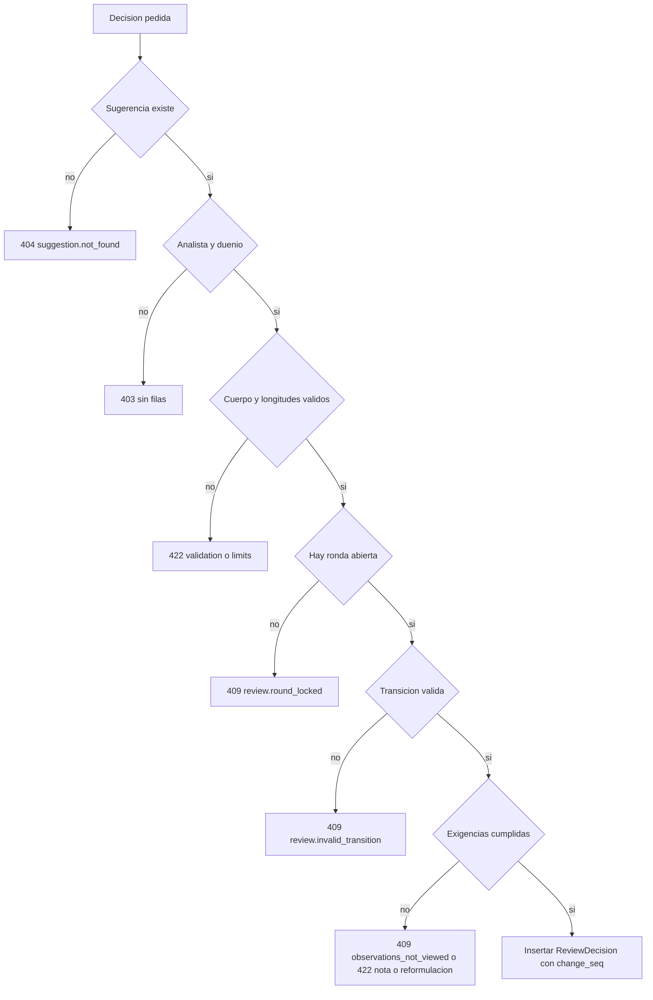
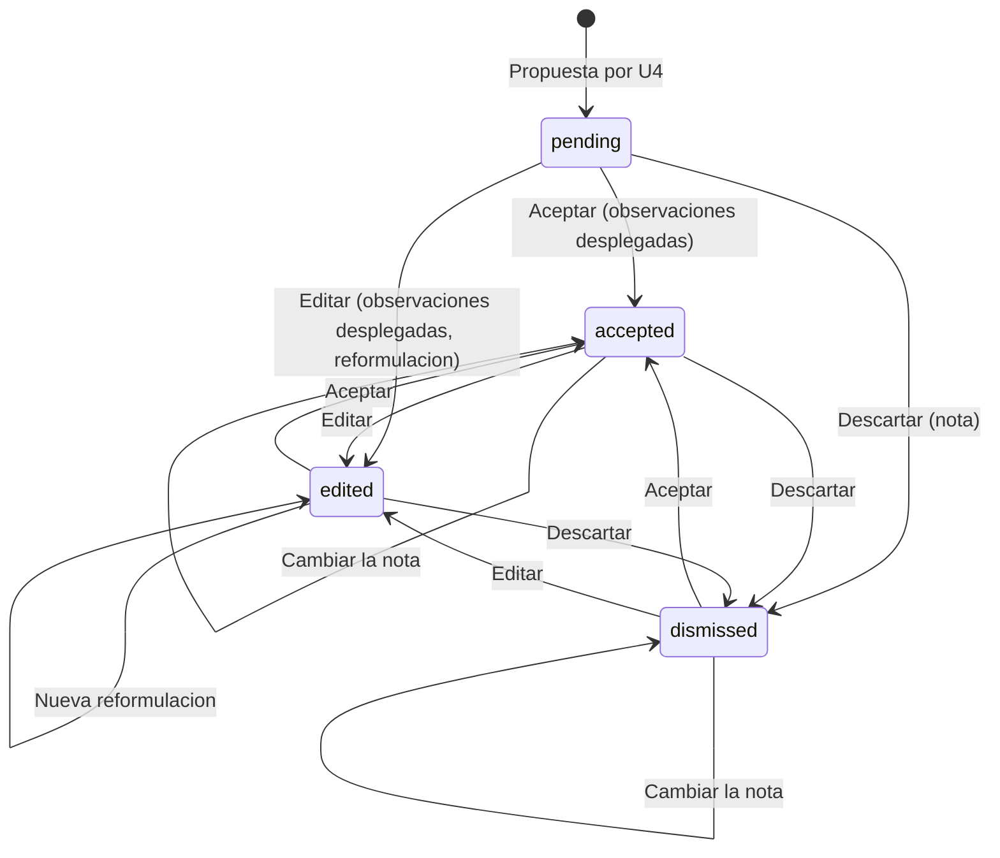
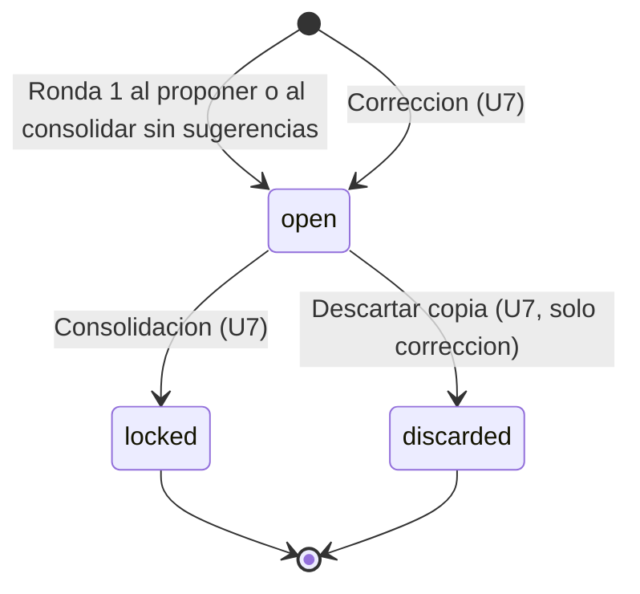
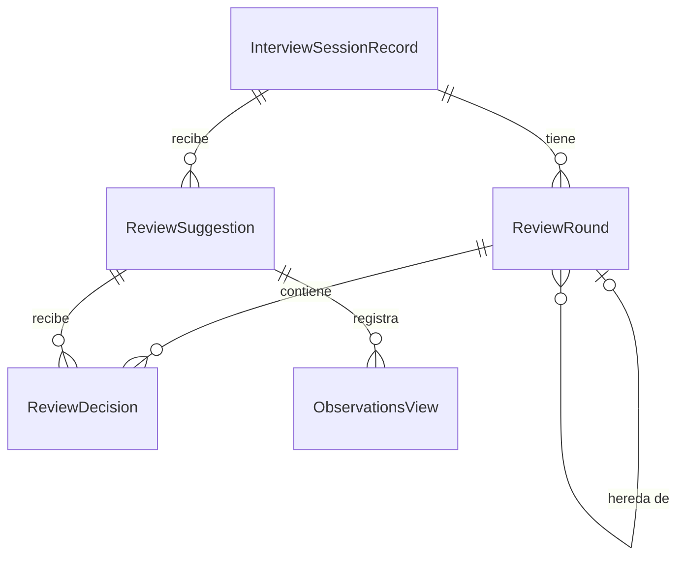

# Especificación funcional — U5 human-review

**Revisión 2 — cambio 01, adenda 02 y revisiones 3 (2026-11-22).** Reemplaza la versión aprobada el
2026-10-02. Para U5 el cambio es menor (`docs/iteracion2.md`, tabla de unidades: «campos protegidos,
observaciones»): la máquina de estados y las rondas siguen. Se conservan F1–F5 y E1–E13; lo nuevo toma
F6, F7 y E14 en adelante; ningún flujo ni escenario sale.

- **Cambian:** F1 (observaciones en lugar de CoT, registro de acceso), F2 (orden de bloqueo, 404,
  límites), F4 (`propose` lo implementa U4), F5 (ronda 1 al consolidar, sin referencia a ReviewReport,
  descarte) y los escenarios E1, E4, E8, E10 y E12.
- **Entran:** F6 (retención, C24), F7 (descartar la copia de trabajo), escenarios E14–E33, §6 con los
  estados y textos de la tarjeta y la tabla §9 FD-U5-01 a FD-U5-10.
- **Hallazgos de la revisión 1:** R-01 se cierra en BR3.5 y F4 (la ingesta de U4 confirma el mensaje);
  R-02 en BR3.1, BR3.2, BR3.8 y E18; R-03 en BR3.6 y E19; R-04 en BR3.7 y E20; R-05 en BR1.4, BR4.1, E14
  y E31.

**Insumos.** Unidad U5 de `inception/units-generation/unit-of-work.md` (unit-of-work, revisión 3) y su
mapa `unit-of-work-story-map.md` (unit-of-work-story-map): US5.1–US5.4 y los cruces US5.5, US5.6, US8.4 y
US15.7. FR1.2, FR6, FR7.2, FR7.5, FR9.3 y NFR11 de `inception/requirements-analysis/requirements.md`
(requirements), con VE-10 y A-2 de `requirements-adenda-02.md`. HumanReview, ConsoleApi, ADR-003,
ADR-007 y ADR-009 de `inception/domain-design/components.md` (components). C1, C7 v2, C10, C11, C15 v2,
C23, C24 y C25 de `inception/contract-design/contract-summary.md` (contract-summary). Tarjeta del hallazgo
de `refined-mockups/mockups.md` §6.6 e `interaction-spec.md` (ReviewSuggestionCard). Functional Design de
U3, U4 y U7 (revisión 1). Respuestas P1, P2 y P3 de `functional-design-questions.md`. Las entidades están
en `entities.md` y las reglas en `rules.md`; este documento es la fuente de verdad de los flujos y de las
máquinas de estado.

## 1. Qué hace la unidad

U5 convierte cada sugerencia de revisión en una decisión humana trazable: el dueño de la sesión acepta,
edita o descarta, con las observaciones desplegadas y la nota que corresponda, y cada cambio queda como
fila nueva en una ronda de revisión (AUTONOMIA-03). Entrega a U7 las operaciones de rondas para consolidar,
corregir y descartar una copia (C11), a U13 el borrado de lo suyo (C24) y a Grafana la razón de descartes
(C15). No reescribe `propose` ni la tabla de sugerencias, que son de U4.

| Componente | Proceso | Dentro / fuera del clúster | Datos que cruzan la frontera |
|---|---|---|---|
| HumanReview | `session-api` | Dentro | Ninguno sale del clúster |
| ConsoleApi (rutas `/suggestions/*`) | `session-api` | Dentro | Sugerencias, observaciones, notas y reformulaciones hacia el navegador del analista, dentro del clúster |
| AnalystConsole (acciones de la tarjeta) | `frontend` | Dentro | Solo habla con ConsoleApi |
| Métricas C15 | `session-api` `/metrics` (puerto interno) | Dentro | `session_id` y enumeraciones; nunca texto |

## 2. Flujos

### F1 — Desplegar las observaciones · cambia

1. El usuario pulsa «Ver observaciones» en la tarjeta.
2. La consola despliega las observaciones y llama `POST /suggestions/{id}/observation-views`.
3. ConsoleApi: rol `analista` o `admin` (el `investigador` recibe `403`); el resolvedor sugerencia → sesión
   de HumanReview da `404` `suggestion.not_found` si no existe (BR1.4).
4. `ReviewCommands.record_observations_view` inserta `ObservationsView` si no había ninguna de ese
   usuario para esa sugerencia; si la había, no inserta (BR1.3). No hace *bump* de la sesión.
5. Responde `204`; ConsoleApi registra la apertura en `AccessLog` con `resource_type: suggestion`.
6. Si el usuario es el dueño, «Aceptar» y «Editar» se habilitan (BR5.1).

### F2 — Decidir sobre una sugerencia (US5.1–US5.3) · cambia

1. El dueño elige «Aceptar» (nota opcional), «Editar» (reformulación y nota opcional) o «Descartar» (nota).
2. `POST /suggestions/{id}/decisions`. ConsoleApi, en la transacción de la petición: sesión web, CSRF,
   bloqueo compartido del usuario, rol `analista` y dueño (BR1.1, BR1.4), cuerpo y longitudes contra C1 y
   C25 (BR2.4, BR2.7).
3. `ReviewCommands.decide`, en la misma transacción:
   1. `change_cursor.bump` sobre la sesión (bloqueo exclusivo de su fila) y ronda `open` con `FOR UPDATE`;
      sin ronda abierta → `409` `review.round_locked` (BR3.1, BR3.8).
   2. Calcula el estado vigente (BR3.2) y valida la transición (BR2.1).
   3. Valida las exigencias: observaciones desplegadas para aceptar o editar (BR2.2), nota para
      descartar (BR2.3), reformulación para editar (BR2.4).
   4. Inserta `ReviewDecision` con estado anterior, nuevo, actor, hora y `change_seq` (BR2.6).
4. Tras el commit, actualiza las métricas (BR4.1) y responde `201` con la sugerencia (C7 v2) y su estado
   vigente. La nota y la reformulación no pasan por el escáner (BR2.8). El estado de la sesión no se
   consulta (BR3.10).

<!-- Texto alternativo: una decisión sobre una sugerencia inexistente recibe 404 suggestion.not_found; si quien decide no es el analista dueño, 403 sin filas; con un cuerpo inválido o demasiado largo, 422; sin ronda abierta, 409 review.round_locked; con una transición inválida, 409 review.invalid_transition; sin observaciones desplegadas, nota o reformulación según el caso, 409 o 422; si todo se cumple, se inserta la decisión con el change_seq de la sesión. -->

### F3 — Cambiar una decisión dentro de la ronda

1. En una tarjeta decidida, el dueño pulsa «Cambiar decisión».
2. Sigue F2 con el estado vigente como estado anterior; las exigencias son las mismas (AC5.1.4) y nunca
   se ofrece «Pendiente».

### F4 — Proponer sugerencias (implementación de U4, C10) · cambia

1. La ingesta de U4 llama `SuggestionProposer.propose` dentro de su transacción, con el orden sesión →
   ronda.
2. Si la sesión no tiene rondas → abre la ronda 1 (`initial`, `opened_by` nulo, actor de sistema
   `analysis-worker`).
3. Si hay ronda `open` → cada par nuevo se guarda `pending` en ella, sin `ReviewDecision`; un par ya
   presente conserva su estado y su historial.
4. Si todas las rondas están `locked` o `discarded` → rechaza con `review.round_locked` y no guarda nada
   (BR3.5). La ingesta deja la corrida en `error` con `analysis.system`, confirma el mensaje y no lo
   reentrega (diseño de U4, cierre de R-01).

### F5 — Rondas para el reporte (las pide U7, C11) · cambia

1. `open_round(session_id, for_update=True)`: con la sesión ya bloqueada, devuelve la ronda `open` con
   `FOR UPDATE`; si la sesión no tiene ninguna ronda, crea la ronda 1 y la devuelve (BR3.7); si todas
   están cerradas, devuelve nada. Con `for_update=False` solo lee.
2. `pending_count(round_id)` cuenta las sugerencias con estado vigente `pending` (BR3.6).
3. `decisions(round_id)` devuelve por sugerencia sus campos protegidos, el estado vigente, su propia nota,
   la reformulación solo si el vigente es `edited`, quién y cuándo (BR3.6).
4. `lock_round(round_id, report_version_id, actor)` pasa la ronda a `locked` con `locked_at`; si ya no
   estaba `open` → `report.conflict` (BR3.4). No guarda `report_version_id`. Tras el commit, retira la
   serie de la razón de descartes de la sesión.
5. `open_correction_round(session_id, actor)` crea la ronda siguiente, que hereda de la última `locked`,
   o retoma la ya abierta (BR3.3). Dentro de ella valen las mismas reglas que en la inicial (BR3.11).

### F6 — Borrar por retención (lo pide U13, C24) · nuevo

1. El Job de retención, que lanza el humano, llama `Purgeable.purge_session(uow, session_id)` de
   HumanReview después de borrar lo de ReviewReport y antes de InterviewSession.
2. Con `veridicus_retention`, borra `ObservationsView`, `ReviewDecision`, `ReviewSuggestion` y
   `ReviewRound` de la sesión, en ese orden (BR6.1).
3. Retira la serie de la razón de descartes y devuelve `PurgeReceipt` con los IDs borrados. Nunca
   devuelve texto. Una sesión sin filas devuelve listas vacías.

### F7 — Descartar la copia de trabajo (lo pide U7) · nuevo

1. El dueño pulsa «Descartar copia» en M5 y confirma (pantalla de U7).
2. ReviewReport llama `ReviewRounds.discard_correction_round(session_id, actor)` (operación propuesta en
   FD-U5-04).
3. Tras el *bump* de la sesión, la ronda de corrección `open` pasa a `discarded` con quién y cuándo;
   sin copia abierta → `report.conflict` (BR3.9).
4. Sus decisiones quedan como rastro y no cuentan: la próxima corrección hereda de la última ronda
   `locked` (BR3.2).

## 3. Máquinas de estado

### Sugerencia (por ronda)

<!-- Texto alternativo: una sugerencia nace pendiente; desde pendiente pasa a aceptada (con observaciones desplegadas), editada (con observaciones desplegadas y reformulación) o descartada (con nota); entre aceptada, editada y descartada se puede cambiar en cualquier dirección con las mismas exigencias; una editada admite una reformulación nueva y aceptada o descartada admiten cambiar su nota; nunca se vuelve a pendiente. Todas las transiciones exigen una ronda abierta y las hace solo el analista dueño. -->

| Desde | Hacia | Quién | Exigencia | Error si falta |
|---|---|---|---|---|
| cualquiera | `pending` | — | Prohibida | `422` `validation.invalid_request` (contrato); en el dominio, `review.invalid_transition` |
| `pending`/`edited`/`dismissed` | `accepted` | Dueño | `ObservationsView` del actor | `409` `review.observations_not_viewed` |
| cualquiera | `edited` | Dueño | `ObservationsView` del actor; reformulación no en blanco | `409` / `422` `validation.invalid_request` |
| `pending`/`accepted`/`edited` | `dismissed` | Dueño | Nota no en blanco | `422` `review.note_required` |
| igual a igual | igual | Dueño | Cambia la nota o la reformulación | `409` `review.invalid_transition` si no cambia nada |
| cualquiera | cualquiera | Dueño | Ronda `open`; texto ≤ `review_text_max_chars` | `409` `review.round_locked` / `422` `limits.exceeded` / `403` |

Cada transición inserta una `ReviewDecision` con `actor_user_id`, `at`, `previous_state`, `state` y
`change_seq`. El estado no se guarda en la sugerencia: es `EffectiveState` (BR3.2).

### Ronda

<!-- Texto alternativo: una ronda nace abierta: la 1 al proponer la primera sugerencia o al consolidar una sesión sin sugerencias, y las de corrección cuando U7 las pide. Una ronda abierta pasa a bloqueada al consolidar o, si es de corrección, a descartada al descartar la copia. Bloqueada y descartada son finales. -->

| Desde | Hacia | Quién (actor) | Pide | Efecto |
|---|---|---|---|---|
| — | `open` (1, `initial`) | Sistema `analysis-worker` (al proponer) o el dueño (al consolidar sin sugerencias) | U4 / U7 | Fila nueva con `opened_at` y `change_seq` |
| — | `open` (`correction`) | Dueño | U7 | `based_on_round_id` = última `locked`; `opened_by` |
| `open` | `locked` | Dueño | U7 | `locked_at`; la serie de la razón se retira |
| `open` (`correction`) | `discarded` | Dueño | U7 | `discarded_by`, `discarded_at`; la serie se retira |

## 4. Vista derivada: entidades y relaciones

Derivada de `entities.md`.

<!-- Texto alternativo: una sesión tiene rondas y recibe sugerencias; una ronda contiene decisiones; una sugerencia recibe decisiones y registra un evento de observaciones por usuario; una ronda de corrección hereda de una ronda bloqueada. Ninguna entidad de U5 referencia a ReviewReport. -->

## 5. Vista derivada: reglas

| Grupo | Reglas | Flujo |
|---|---|---|
| Autorización | BR1.1–BR1.4 | F1, F2 |
| Máquina de estados | BR2.1–BR2.8 | F2, F3 |
| Rondas | BR3.1–BR3.11 | F2, F4, F5, F7 |
| Métricas | BR4.1 | F2, F5, F6 |
| Consola | BR5.1–BR5.8 | F1, F2, F3 |
| Retención | BR6.1–BR6.3 | F6 |

## 6. Estados y textos de la tarjeta (AnalystConsole)

U5 es de tipo `service` y no produce `frontend-components.md`: las acciones viven en la
`ReviewSuggestionCard` de U4 (mockups §6.6, interaction-spec). Los textos sin criterio aprobado que los
fije son propuestas y van a FD-U5-10.

| Estado | Rótulo | Acciones y textos | Regla |
|---|---|---|---|
| Pendiente, observaciones plegadas | ◷ «Pendiente» | «Aceptar» y «Editar» con `aria-disabled` y «Despliega y lee las observaciones para habilitar esta acción» por `aria-describedby`; «Descartar» habilitado | BR5.1, BR5.6 |
| Pendiente, observaciones desplegadas | ◷ «Pendiente» | Las tres acciones; el lector anuncia «Observaciones desplegadas» | BR1.3 |
| Aceptando | — | «Nota (opcional)», «Confirmar aceptación», «Cancelar» | BR2.5 |
| Editando | — | Dos columnas: hallazgo de la IA en solo lectura / «Tu reformulación» y «Nota (opcional)»; «Guardar» con `aria-disabled` y «Escribe tu reformulación para guardar» si está en blanco | BR5.3, BR5.6 |
| Descartando | — | «¿Por qué descartas esta sugerencia?»; vacío: «Escribe por qué descartas esta sugerencia» junto al campo | BR5.4 |
| Aceptada | ✓ «Aceptada» o «Aceptada · con nota» + la nota | «Cambiar decisión» | BR5.7 |
| Editada | ✎ «Editada» + hallazgo de la IA + reformulación, quién y cuándo | «Cambiar decisión» | BR5.7 |
| Descartada | ✕ «Descartada» + nota, quién y cuándo | «Cambiar decisión» | BR5.7 |
| Guardando | — | Acciones deshabilitadas, «Guardando…» | — |
| Error | — | El formulario conserva el texto y muestra el mensaje de su `code` (FD-U5-10) | BR5.7 |
| Bloqueada | 🔒 + estado final | Sin acciones | BR3.1 |
| Solo lectura | Estado | Banner «Sesión de <usuario>. Solo lectura», sin acciones | BR1.2 |

Junto a las acciones, siempre visible: «La IA es un asistente de soporte. Su criterio como analista
prevalece» (BR5.2). La tarjeta, sus formularios y «Cambiar decisión» entran en la suite `axe` y en el
recorrido con teclado de U4 (BR5.5). Todos estos textos van al catálogo de mensajes y pasan el escaneo
de vocabulario (BR5.8).

## 7. Escenarios de negocio y casos límite

| # | Escenario | Resultado esperado | Regla |
|---|---|---|---|
| E1 | Aceptar sin haber desplegado las observaciones | `409` `review.observations_not_viewed`; tras desplegar, `201` | BR2.2 |
| E2 | Descartar sin haber desplegado las observaciones, con nota | `201` | BR2.2, BR2.3 |
| E3 | Descartar con nota «   » (o solo U+00A0) | `422` `review.note_required`; la sugerencia no cambia | BR2.3 |
| E4 | Editar enviando `cita_a` en el cuerpo | `422` `validation.invalid_request`; SHA-256 de los 5 campos igual | BR2.4 |
| E5 | Pedir `pending` | `422` `validation.invalid_request` | BR2.1 |
| E6 | Otro analista decide | `403` `session.not_owner`, 0 filas | BR1.1 |
| E7 | `admin` decide | `403` `auth.forbidden` | BR1.1 |
| E8 | Decidir con la ronda bloqueada y sin corrección | `409` `review.round_locked` | BR3.1 |
| E9 | Corrección: sugerencia sin decisión nueva | Estado vigente = el de la ronda bloqueada | BR3.2 |
| E10 | Corrección: aceptar algo descartado en la ronda 1, con las observaciones desplegadas en la ronda 1 | `201` sin volver a desplegar | BR2.2, P1 = A |
| E11 | Dos consolidaciones simultáneas | Una gana; la otra `report.conflict` | BR3.4 |
| E12 | U4 propone tras consolidar sin corrección abierta | Rechazo `review.round_locked`; 0 sugerencias; corrida `analysis.system` con el mensaje confirmado | BR3.5 |
| E13 | `UPDATE` sobre `ReviewDecision` con `veridicus_app` | Falla por permisos | BR2.6 |
| E14 | Decidir o desplegar sobre un `suggestion_id` inexistente | `404` `suggestion.not_found`; 0 filas; sin entrada de acceso | BR1.4 |
| E15 | El `investigador` despliega observaciones | `403` `auth.forbidden`; 0 filas | BR1.3 |
| E16 | El `admin` despliega observaciones | `204`; `ObservationsView` a su nombre y entrada de acceso; sigue sin poder decidir (E7) | BR1.3 |
| E17 | El dueño despliega dos veces | 1 fila de `ObservationsView`; 2 entradas de acceso | BR1.3 |
| E18 | Decisión y consolidación a la vez | Sin interbloqueo; la decisión entra antes y `pending_count` la cuenta, o después y recibe `409` `review.round_locked` | BR3.1, BR3.8 |
| E19 | `edited` → `accepted` y se consolida | `decisions` devuelve `accepted` con reformulación nula; el reporte muestra el hallazgo de la IA; la reformulación queda en el historial | BR3.6 |
| E20 | Consolidar un relato coherente con 0 sugerencias | `open_round(for_update=True)` crea la ronda 1; `pending_count` 0; `lock_round` la bloquea | BR3.7 |
| E21 | Nota con `review_text_max_chars` + 1 caracteres | `422` `limits.exceeded`; 0 filas | BR2.7 |
| E22 | Reformulación con «miente» | `201`; no la rechaza el escáner; el reporte la muestra en el bloque del analista | BR2.8 |
| E23 | `reformulation` con `state: accepted` | `422` `validation.invalid_request` | BR2.4 |
| E24 | En la corrección, pasar a `edited` con reformulación nueva | `201` | BR3.11, P2 = A |
| E25 | Descartar la copia y volver a corregir | La ronda descartada queda `discarded`; la nueva hereda de la última `locked` | BR3.9, BR3.2 |
| E26 | Descartar sin copia abierta | `report.conflict` | BR3.9 |
| E27 | Decidir en una sesión con el consentimiento retirado, terminada, pausada, suspendida o bloqueada | `201` mientras la ronda esté `open` | BR3.10, P3 = A |
| E28 | `purge_session` de una sesión vencida | Se borran las 4 tablas en orden; recibo solo con IDs; las filas de otra sesión siguen | BR6.1 |
| E29 | `DELETE` en `ReviewSuggestion` con `veridicus_app` | Falla por permisos | BR6.2 |
| E30 | `INSERT` en `ObservationsView` con `user_id` nulo | Falla | BR2.6 |
| E31 | 60 sesiones, 20 consolidadas, con ventana completa | ≤ 40 series de `veridicus_session_dismissal_ratio`; solo `session_id` como etiqueta | BR4.1 |
| E32 | `purge_session` sobre una sesión ya purgada | Listas vacías, sin error | BR6.1 |
| E33 | Repetir la misma decisión con la misma nota | `409` `review.invalid_transition`; 0 filas | BR2.1 |

## 8. Integración con otras unidades

| Unidad | Relación |
|---|---|
| U1 contracts | C1 (rutas y `code`), C7 v2, C10, C11, C15 v2, C24 y C25; las precisiones FD-U5-01 a FD-U5-05 entran por PR de U1 |
| U3 identity-access | Mecanismo de rol y dueño (U5 aporta el resolvedor sugerencia → sesión), CSRF, bloqueo del usuario, `AccessLog` en la apertura de observaciones, convención de auditoría con su prueba común, usuarios `veridicus_app` y `veridicus_retention` |
| U4 text-flow | Crea `ReviewSuggestion` y `ReviewRound` e implementa `propose`; trata el rechazo `review.round_locked`; hace `change_cursor.bump`; aloja la tarjeta y la suite `axe`. U5 suma columnas a `ReviewRound` (FD-U5-08) y las tablas `ReviewDecision` y `ObservationsView` |
| U7 forensic-report | Usa `open_round`, `pending_count`, `decisions`, `lock_round`, `open_correction_round` y `discard_correction_round` (C11); muestra la reformulación como del analista |
| U13 ethics-governance | Llama `purge_session` (C24) y aporta el adaptador real de `AccessLog` |
| U2 platform | Regla de alerta 0.25 sobre `veridicus_session_dismissal_ratio` |

## 9. Precisiones a artefactos ya aprobados

No se edita ningún artefacto aprobado (regla de `project.md`). En la aprobación decides cuáles se llevan
al original, cada una en su propio commit. Las filas de la revisión 1 quedan como registro.

| ID | Estado | Artefacto aprobado | Precisión | Origen |
|---|---|---|---|---|
| — (rev. 1) | Hecho | `contract-summary.md` C10 | `propose` rechaza con `review.round_locked` si todas las rondas están bloqueadas: ya lo dice C10 v2 | BR3.5 |
| — (rev. 1) | Superado | Functional Design de U4 (reintento) | Limitar el reintento en sesiones consolidadas: lo sustituyen `session.consolidated` (FD-U4-05) y el rechazo de `propose` con `analysis.system` (FD-U4-06) | Revisión 1 R-01 |
| — (rev. 1) | Hecho | `domain-design/decisions.md` (ADR-007) | La herencia entre rondas es el estado vigente de BR3.2; ADR-007 revisada deja esa regla a esta etapa y no hace falta editarla | ADR-007 |
| FD-U5-01 | Propuesta | `contract-summary.md` C1 (`ErrorCode`, rutas `/suggestions/*`) y C10 | `code` nuevo `suggestion.not_found` (404) en `observation-views` y `decisions`; el `decide` de C10 suma `suggestion.not_found` y `limits.exceeded` a su lista de errores | Revisión 1 R-05 |
| FD-U5-02 | Propuesta | `contract-summary.md` C25 y C1 (cuerpo de la decisión) | Entradas `review_text_max_chars` (nota y reformulación) y `review_body_max_bytes` (cuerpo), dueño U5; por encima, `422` `limits.exceeded`. Sustituye el `validation.invalid_request` de NFR10.5 de U5 (revisión 1), que se ajusta en su segunda pasada | Lista de la segunda pasada, punto 12 |
| FD-U5-03 | Propuesta | `contract-summary.md` C11 (`open_round`) | Con `for_update=True`, si la sesión no tiene ninguna ronda, abre la ronda 1 y la devuelve; así U7 siempre bloquea una ronda, también con 0 sugerencias | Revisión 1 R-04 |
| FD-U5-04 | Propuesta | `contract-summary.md` C11 y `domain-design/components.md` (HumanReview) | Operación `discard_correction_round(uow, session_id, actor)` y estado `discarded` de la ronda (solo `correction`, con quién y cuándo, sin volver a `open`); sin copia abierta, `report.conflict`. Recoge la propuesta X1 del Functional Design de U7 (revisión 1), que C11 v2 no trae y que AC6.3.2 necesita | AC6.3.2; U7 revisión 1 |
| FD-U5-05 | Propuesta | `contract-summary.md` C11 (`decisions`) | El docstring fija que cada elemento lleva el estado vigente con su propia nota y la reformulación solo si el vigente es `edited`; tras `edited` → `accepted` se consolida el hallazgo de la IA | Revisión 1 R-03 |
| FD-U5-06 | Propuesta | `requirements.md` FR7.5 e `interaction-spec.md` (`report.working_copy`) | «Solo cambian estados y notas» pasa a «estados, notas y reformulaciones»; el banner: «Copia de trabajo de la versión N. Solo puedes cambiar estados, notas y reformulaciones» | P2 = A |
| FD-U5-07 | Propuesta | `requirements-adenda-02.md` (VE-10) y `domain-design/components.md` (InterviewSession) | Tras pausar, terminar o retirar el consentimiento solo se detiene el análisis nuevo: las decisiones sobre los hallazgos existentes siguen, igual que en una sesión bloqueada | P3 = A |
| FD-U5-08 | Propuesta | Functional Design de U4 (`ReviewRound`, convención de auditoría) | U4 crea `ReviewRound` ya con su marca `veridicus-audit` (`mutable`, `purgeable`, `owner_unit: U5`), porque la prueba común falla con una tabla sin marca; la migración de U5 suma `kind`, `based_on_round_id`, `opened_by`, `opened_actor_kind`, `opened_actor_system`, `locked_at`, `discarded_by`, `discarded_at` y `change_seq`, con `initial` y actor de sistema `analysis-worker` en las filas que ya existan, y el disparador de la marca | Lista de la segunda pasada, punto 3 |
| FD-U5-09 | Propuesta | `user-stories/stories.md` AC5.1.2 y AC5.1.4 | AC5.1.2: «y `201` después», porque C1 responde `201` a una decisión. AC5.1.4: volver a `pendiente` responde `422` `validation.invalid_request`, porque el cuerpo de C1 no admite `pending`; `409` `review.invalid_transition` queda para la decisión repetida sin cambios | C1 |
| FD-U5-10 | Propuesta | `refined-mockups/interaction-spec.md` (catálogo de mensajes) | Textos de error de la tarjeta: `review.round_locked` «La revisión de esta sesión ya está consolidada. Abre una corrección para cambiar decisiones.»; `review.observations_not_viewed` «Despliega las observaciones antes de aceptar o editar.»; `limits.exceeded` «El texto supera los N caracteres permitidos.»; `suggestion.not_found` «Esta sugerencia ya no existe.»; `review.invalid_transition` «Esa decisión ya está registrada.» | Sin criterio que los fije (regla de `project.md`) |

## 10. Errores y bordes

- Toda operación corre en la `UnitOfWork` de la petición o del llamante; un fallo no deja una fila a
  medias. Ninguna operación de U5 abre su propia transacción.
- Orden de bloqueo único usuario → sesión → ronda (BR3.8). `record_observations_view` no bloquea la
  sesión.
- Los logs llevan `suggestion_id`, `round_id`, `session_id` y `user_id`, nunca la nota, la reformulación,
  las citas ni las observaciones.
- La comprobación de dueño la hace ConsoleApi (ADR-009); HumanReview recibe el actor autorizado y solo
  registra quién y cuándo.
- Errores de dominio → jerarquía única de `libs/` → Problem Details: `review.observations_not_viewed`
  (409), `review.invalid_transition` (409), `review.round_locked` (409), `review.note_required` (422),
  `suggestion.not_found` (404), `limits.exceeded` (422), `report.conflict` (en C11).

## 11. Preguntas abiertas para NFR Requirements (segunda pasada)

- Cifras de `review_text_max_chars` y `review_body_max_bytes` en C25 (la revisión 1 de NFR usaba 2 000
  caracteres y 64 KiB) y el cambio de `code` a `limits.exceeded`.
- Presupuesto de latencia de `decide` con el *bump* de la sesión y de `purge_session` en el peor caso de
  una sesión.
- Cardinalidad de la razón con el estado `discarded` y la retirada de la serie al purgar.
