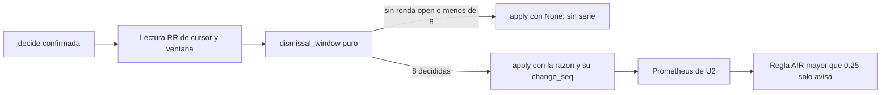

# Diseño de observabilidad — U5 human-review

**Revisión 2 (2026-11-22): segunda pasada por el cambio 01 (DT27), la adenda 02 y el NFR Requirements
revisión 2.** Sustituye a la revisión 1 del 2026-10-03.
- **Qué cambia.** U5 tiene solo las dos métricas de C15 v2; `veridicus_review_rejections_total` queda
  **Retirado**. La ventana son las últimas 8 decididas por `change_seq`, sin «ignoradas». La CoT pasa a
  observaciones. Entran los eventos de descarte de la copia, de purga y de retirada de series, y la
  reconciliación de series (NFRD-U5-01, NFRD-U5-11).
- **Numeración.** §1–§4 conservan su número.

**Insumos.** `nfr-requirements/observability-requirements.md` (observability-requirements: NFR15.1–NFR15.5),
`security-requirements.md` (security-requirements: NFR10.6, NFR10.8), `performance-requirements.md`
(performance-requirements), `reliability-requirements.md` (reliability-requirements),
`scalability-requirements.md` (scalability-requirements) y `tech-stack-decisions.md` (tech-stack-decisions:
D7, D8, D13) de esta unidad; F1–F7 de `functional-design/functional-spec.md` (functional-spec); C15 v2, C16 y
C25 de `contract-summary.md` (contract-summary); NFR Design de U3 (formateador, `request_id`), de U1
(NFRD-U1-05) y de U2 (NFRD-U2-12).

## 1. Logs estructurados (NFR15.5)

- **Formato.** El formateador JSON único de U3 en `libs/`: `timestamp`, `level`, `service`, `event`,
  `request_id` y solo los campos de la lista blanca de NFR10.6 (`security-design.md` §6). Un campo fuera de la
  lista se descarta.
- **Correlación.** Por `request_id` dentro de una petición y por `suggestion_id` y `round_id` entre
  peticiones. No hay trazas distribuidas: U5 vive en un solo proceso por petición.

| Evento | Nivel | Campos | Cuándo |
|---|---|---|---|
| `review.decision_recorded` | `INFO` | `decision_id`, `suggestion_id`, `round_id`, `previous_state`, `state`, `user_id` | `after_commit` de `decide` |
| `review.decision_rejected` | `INFO` | `suggestion_id`, `user_id`, `code` | Tras el *rollback* de un rechazo de U5 (`404`, `409`, `413`, `422`) |
| `review.observations_viewed` | `INFO` | `suggestion_id`, `user_id`, `first` | `after_commit` de `record_observations_view` |
| `review.round_opened` | `INFO` | `round_id`, `session_id`, `kind` | `after_commit` de la creación de una ronda |
| `review.round_locked` | `INFO` | `round_id`, `session_id` | `after_commit` de `lock_round` |
| `review.round_discarded` | `INFO` | `round_id`, `session_id`, `user_id` | `after_commit` de `discard_correction_round` |
| `review.session_purged` | `INFO` | `session_id` y un conteo por tabla | `after_commit` de la transacción del `Job` |
| `review.series_retired` | `INFO` | `session_id`, `cause` (`locked`, `discarded`, `reconciled`) | Al retirar una serie (NFRD-U5-11) |
| *Timeout* de bloqueo o de sentencia | `WARNING` | `code` `system.unavailable`, `duration_ms` | Al vencer |
| `metrics.update_failed` | `WARNING` | `session_id` | Fallo del recálculo tras el *commit* |
| Base sin respuesta | `ERROR` | `code` `system.unavailable` | Al fallar la conexión |

- Nunca nota, reformulación, observaciones, hecho ni citas. Un log de éxito siempre corresponde a una fila
  confirmada, porque se emite en `after_commit`.
- **Verificación (nivel 1).** Una prueba reconstruye la historia de una sugerencia solo con los logs:
  propuesta, observaciones consultadas, aceptada, descartada, ronda bloqueada, corrección descartada y purga.
  La cadena centinela da 0 coincidencias.

## 2. Métricas (NFR15.1–NFR15.4)

| Métrica | Tipo | Etiquetas | Dónde se actualiza |
|---|---|---|---|
| `veridicus_review_decisions_total` | counter | `state` (`accepted`, `edited`, `dismissed`) | `after_commit` de `decide` |
| `veridicus_session_dismissal_ratio` | gauge | `session_id` (UUID) | `apply` tras `decide`; retirada tras `lock_round`, `discard_correction_round` y por la reconciliación |
| `veridicus_review_rejections_total` · **Retirado** | — | — | No entra en C15 v2; los rechazos se cuentan con `review.decision_rejected` |

Las dos métricas están declaradas en `contracts/metrics/review.v2.yaml` (C15 v2); las etiquetas pasan la
comprobación común de U1 (NFRD-U1-05).

<!-- Texto alternativo: tras confirmar una decisión, una lectura en REPEATABLE READ trae el cursor de la sesión y la ventana. La función pura dismissal_window devuelve sin serie si no hay ronda abierta o hay menos de 8 decididas, y entonces apply retira la serie; con 8 decididas, apply fija la razón con su change_seq. Prometheus de U2 la raspa y su regla AIR, por encima de 0,25, solo avisa. -->

- **Ventana (NFR15.2, D8).** *W* = `dismissal_window_w` de C25 (8), sobre la ronda `open` con la herencia de
  BR3.2. Decidida = estado vigente `accepted`, `edited` o `dismissed`, propio o heredado; `pending` nunca
  cuenta. Se ordenan por el `change_seq` de la decisión que da el estado vigente y se toman las 8 mayores. La
  razón es descartadas / 8. Sin 8 decididas, o sin ronda `open`, no hay serie.
- **Consulta de la ventana.** Una sentencia que reutiliza la del estado vigente (`performance-design.md` §2)
  con `ORDER BY change_seq DESC LIMIT 8` sobre las decididas y devuelve también el `change_cursor` de la
  sesión, que es el `seq` de `apply` (`reliability-design.md` §3).
- **Función pura (NFR15.3).** `human_review/domain/dismissal_window.py` recibe la lista con estado vigente y
  `change_seq` y devuelve la razón o «sin publicar». Casos de nivel 0: 7 → sin publicar; 8 con 2 descartes →
  0,25; 8 con 3 → 0,375; 10 → solo las 8 de mayor `change_seq`; una `pending` entre decididas no cuenta;
  pasar de `dismissed` a `accepted` la mueve al final; en una corrección, una sugerencia sin decisión nueva
  usa el estado y el `change_seq` heredados; una ronda `discarded` no aporta. Nivel 1: tras 8 decisiones con
  3 descartes, `/metrics` muestra `0.375`, y tras `lock_round` la serie ya no está.
- **Reconciliación (NFRD-U5-01).** Una tarea del ciclo de vida de la API, cada 60 s, toma los `session_id`
  con serie viva o con entrada en `last_seq` y ejecuta una consulta: `SELECT session_id FROM review_round WHERE
  status = 'open' AND session_id = ANY(:ids)`. Retira con `cause: reconciled` las series de las sesiones que no
  vuelven y borra sus entradas de `last_seq`. Si la consulta falla, deja un `WARNING` y lo intenta en la
  siguiente vuelta. No consulta la base al servir `/metrics` (NFR3.6).
- **Entrega a U2 (NFR15.4).** `services/session-api/tests/human_review/fixtures/air_series.yaml`, con una
  sesión en 0,25 (sin alerta) y otra en 0,375 (con alerta). U2 lo usa en `promtool test rules` junto a sus
  propios *fixtures* (NFRD-U2-12). La regla compara con `> 0.25`, solo avisa y ninguna regla escribe el
  umbral (NFR11.4).

## 3. SLI y objetivos del MVP

| SLI | Fuente | Objetivo |
|---|---|---|
| Latencia de la decisión | p95 de la prueba `perf` de NFR3.1 | ≤ 200 ms |
| Rechazos por observaciones no consultadas | Conteo de `review.decision_rejected` con `code` `review.observations_not_viewed` en los logs | Informativo: > 0 en uso real indica un cliente que no es la consola |
| Señal AIR | `veridicus_session_dismissal_ratio` | Informativo; U2 avisa por encima de 0,25 |
| Esperas por bloqueo | `WARNING` con `system.unavailable` en las rutas de U5 | 0 en la corrida E2E de nivel 3 |

## 4. Panel y alertas

- **Panel de Grafana (SHOULD, lo instala U2 por PR).** Decisiones por estado (`rate` de
  `veridicus_review_decisions_total`) y razón de descartes por sesión, junto al panel de U4. Sale el panel de
  rechazos por `code`.
- **Alertas.** Ninguna avisa a nadie en el MVP; la única regla relacionada es la AIR de U2, que solo avisa.
