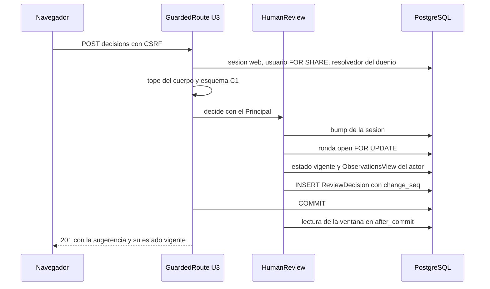

# Diseño de rendimiento — U5 human-review

**Revisión 2 (2026-11-22): segunda pasada por el cambio 01 (DT27), la adenda 02 y el NFR Requirements
revisión 2.** Sustituye a la revisión 1 del 2026-10-03.
- **Qué cambia.** La autorización la hace `GuardedRoute` de U3, con el bloqueo compartido del usuario. La
  CoT pasa a observaciones con registro de acceso. Entran `discard_correction_round` y la latencia de
  `purge_session` (§6, nueva). El escenario de medición pasa a 4 rondas con una descartada.
- **Numeración.** §1–§5 conservan su número; §6 es nueva.

**Insumos.** `nfr-requirements/performance-requirements.md` (performance-requirements: NFR3.1–NFR3.9,
NFR7.1, NFR8.1), `security-requirements.md` (security-requirements), `scalability-requirements.md`
(scalability-requirements), `reliability-requirements.md` (reliability-requirements),
`observability-requirements.md` (observability-requirements) y `tech-stack-decisions.md`
(tech-stack-decisions: D2, D3, D7, D11, D13, D14) de esta unidad; F1, F2, F5–F7 de
`functional-design/functional-spec.md` (functional-spec); C1, C10, C11, C15 v2, C23 y C24 de
`contract-summary.md` (contract-summary); NFR Design de U3 (§2) y de U4 (§3 de performance-design).

U5 no llama a modelos ni a Redis: todo su tiempo es CPU de `session-api` y PostgreSQL. No hay caché: el estado
vigente se calcula siempre desde la base (D2), porque una caché sería una segunda verdad sobre tablas de
auditoría. Las mediciones usan el escenario de performance-requirements §1 (50 sugerencias, 4 rondas: dos
`locked`, una `discarded` y una `correction` abierta) en la máquina de desarrollo, con PostgreSQL real.

## 1. Camino de una decisión (NFR3.1, NFR3.3, NFR3.4)

<!-- Texto alternativo: el navegador envía la decisión con el token anti-CSRF. GuardedRoute de U3 resuelve la sesión web, toma el bloqueo compartido del usuario, consulta el resolvedor del dueño de U5 y valida el tope del cuerpo y el esquema de C1. HumanReview hace el bump de la sesión, bloquea la ronda abierta, calcula el estado vigente con el evento de observaciones del actor e inserta la decisión con su change_seq. GuardedRoute confirma; tras el commit, HumanReview lee la ventana de la razón de descartes y la respuesta 201 vuelve con la sugerencia y su estado vigente. -->

| Tramo | Sentencias de U5 | Presupuesto p95 |
|---|---|---|
| `GuardedRoute` de U3 (sesión web, CSRF, `FOR SHARE`, rol, esquema) | — (presupuesto de U3) | 25 ms |
| Resolvedor `suggestion_owner` | 1 | 10 ms |
| `bump` de la sesión | 1 | 10 ms |
| Ronda `open` `FOR UPDATE` | 1 | 10 ms |
| Estado vigente de **una** sugerencia con `EXISTS` del `ObservationsView` del actor | 1 | 30 ms |
| `state_machine.check` y comprobaciones de texto | 0 | < 1 ms |
| `INSERT` (con el disparador de ronda abierta) y `COMMIT` | 1 | 30 ms |
| `after_commit`: lectura de la ventana y `apply` del *gauge* | 1 | 15 ms |
| Serialización de la respuesta | 0 | 10 ms |
| **Total** | **6 ≤ 7** (NFR3.4, NFRD-U5-09) | **≤ 141 ms** frente al objetivo de **200 ms** (NFR3.1) |

- **Rechazos (NFR3.3, p95 ≤ 100 ms).** `401`, `403` y `404` cortan en `GuardedRoute` sin escribir; `413` y
  `422` cortan antes de `decide`, y el `413` del cuerpo no lee más de `review_body_max_bytes`; los `409`
  cortan después de leer el estado vigente, con *rollback* y 0 filas.
- **Número fijo de sentencias.** Un contador con `before_cursor_execute` envuelve la llamada a
  `suggestion_owner`, a `decide` y al `after_commit`, y comprueba 6 sentencias con 1, 4 y 10 rondas.
- **Verificación.** `uv run --directory services/session-api pytest tests/human_review -m perf`: NFR3.1 con
  200 decisiones alternando aceptar con nota, editar y descartar; NFR3.3 con 50 rechazos por `code`.

## 2. Consultas y número fijo de sentencias (NFR3.4, NFR3.5)

| Consulta | Forma | Índice (NFRD-U5-06) | Meta |
|---|---|---|---|
| Estado vigente de toda la sesión | Una sentencia: rondas de la sesión con `status <> 'discarded'` y `number ≤ :n`, decisiones por `round_id`, `DISTINCT ON (suggestion_id) … ORDER BY suggestion_id, number DESC, change_seq DESC`, `LEFT JOIN` desde `review_suggestion` (sin decisión → `pending`) | `review_round (session_id, number)`; `review_decision (round_id, suggestion_id, change_seq)` | p95 ≤ 50 ms con 50 sugerencias y 10 rondas; ≤ 100 ms con 250 (NFR8.2) |
| Estado vigente de una sugerencia | La misma, filtrada por `suggestion_id` y `LIMIT 1` | `review_decision (suggestion_id, change_seq)` | Dentro del tramo de §1 |
| `changed_since(n)` para el sondeo de U4 | Sugerencias con alguna decisión de `change_seq > n` en las rondas de la sesión; si alguna ronda tiene `change_seq > n`, todas las de la sesión (NFRD-U5-07) | `review_decision (round_id, change_seq)` | Suma ≤ 20 ms al sondeo de U4 (p95 ≤ 200 ms) |
| C11 para la consolidación | `open_round(for_update=True)` → `pending_count` → `decisions` → `lock_round` en la transacción de U7 | Los anteriores y el único parcial de ronda `open` | p95 ≤ 150 ms en total; `open_correction_round` y `discard_correction_round` p95 ≤ 50 ms cada una |

- **Saltar las rondas descartadas no pide índice propio.** El filtro va sobre `review_round`, que tiene ≤ 10
  filas por sesión y se lee por `(session_id, number)`; las decisiones se buscan después por `round_id`.
- La consulta vive en un solo lugar (`human_review/adapters/effective_state_query.py`) y la usan `decide`,
  `changed_since`, la vista de sesión de U4, la ventana de la razón y `decisions` de C11. Una prueba de
  propiedad (Hypothesis) la compara con `domain/effective_state.py` sobre historias aleatorias de hasta 10
  rondas con descartes (D2).

## 3. Rutas ligeras (NFR3.2, NFR3.6)

| Ruta | Diseño | Presupuesto p95 |
|---|---|---|
| `observation-views` | `GuardedRoute` (25 ms) + resolvedor (10 ms) + `INSERT … ON CONFLICT DO NOTHING` sin `bump` ni bloqueo de ronda (15 ms) + registro de acceso en su punto de guardado (20 ms esperado, como mucho 500 ms si el adaptador se cuelga) + `COMMIT` (15 ms) | ≤ 85 ms esperado, frente al objetivo de **150 ms**; igual la primera vez que al repetirla |
| `/metrics` | Valores en memoria de `prometheus-client`, sin consultar la base (D7) | ≤ 100 ms con 60 series |

Un adaptador de acceso que vence su punto de guardado lleva la ruta a ~550 ms sin romperla: es el riesgo
aceptado de U3, visible en su métrica de fallos del registro de acceso.

## 4. Consola (NFR3.7, NFR3.8)

| Interacción | Patrón | Umbral y prueba |
|---|---|---|
| Decidir | Mutación de TanStack Query sin actualización optimista (D11): la tarjeta pinta el estado del cuerpo `201` y se invalida la consulta de la sesión, que vuelve con `since=<cursor>` | Clic → estado visible ≤ 1 s, Playwright nivel 3 |
| Desplegar las observaciones | El texto ya vino con la sesión; el `POST observation-views` va en segundo plano y «Aceptar» y «Editar» se habilitan con el `204` | ≤ 1 s, Playwright; Vitest: siguen con `aria-disabled` si el `POST` falla |

El sondeo de U4 no cambia: 2 s con actividad y 15 s en reposo.

## 5. Contribución al MTTV y recursos (NFR7.1, NFR8.1)

- **MTTV.** 30 aperturas + 30 decisiones ≤ 30 × (200 + 150) ms = 10,5 s de servidor (≤ 1,75 % de los
  10 min). `at` y `viewed_at` salen del reloj inyectable de U3 en UTC (D10), nunca del navegador; U7 las usa
  para el MTTV.
- **Memoria.** Sin modelos ni cachés; los resultados se acotan a una sesión. El estado en memoria es el
  *gauge* y `last_seq` (un entero por sesión con serie). La prueba `perf` de NFR3.1 mide el pico de RSS de la
  API con y sin decisiones: ≤ 32 MiB de diferencia. Infrastructure Design lo suma a los topes de U3 y U4.

## 6. Borrado por retención (NFR3.9) · nuevo

- `purge_session` son cuatro `DELETE … RETURNING` en la transacción del `Job` (`security-design.md` §8).
  Ninguno recorre una tabla entera: `observations_view` por `review_suggestion (session_id, change_seq)` de
  U4 y `(suggestion_id, user_id)`; `review_decision` por `round_id`; `review_suggestion` por `session_id`;
  `review_round` por `(session_id, number)`.
- **Peor caso** (250 sugerencias, 10 rondas, 7 500 decisiones, 250 `ObservationsView`): p95 ≤ 2 s en total
  y ninguna sentencia pasa del `statement_timeout` de 2 s. Cabe holgado en el plazo de 60 s por sesión del
  `Job` de U13.
- **Verificación.** 20 repeticiones con *rollback*, con las filas de otras 99 sesiones cargadas y
  `ANALYZE`; `EXPLAIN` de cada `DELETE` sin `Seq Scan`.
