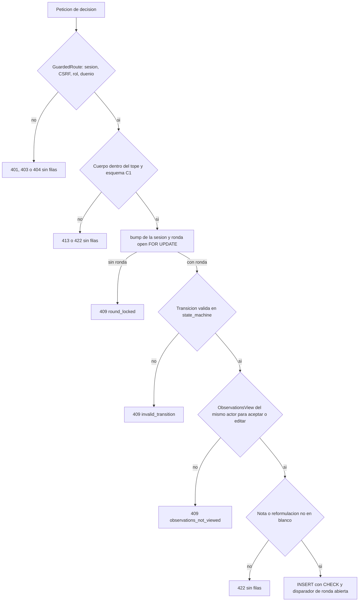

# Diseño de seguridad — U5 human-review

**Revisión 2 (2026-11-22): segunda pasada por el cambio 01 (DT27), la adenda 02 y el NFR Requirements
revisión 2.** Sustituye a la revisión 1 del 2026-10-03, que queda en el historial de Git.
- **Qué cambia.** La CoT pasa a ser observaciones (`observation-views`, `ObservationsView`). Entran la
  matriz de roles con AC5.4.4, el `404` `suggestion.not_found`, el registro de acceso, el estado
  `discarded`, el borrado por retención (C24) y las cifras de C25 con `413` `limits.exceeded`. La
  autorización y el tope del cuerpo los aplica `GuardedRoute` de U3.
- **Numeración.** §1–§7 conservan su número y tema. Lo nuevo empieza en §8. Las decisiones son DS1–DS9 (§9) y
  las precisiones, NFRD-U5-01 a NFRD-U5-11 (§11).
- **Respuesta de esta pasada.** Sin preguntas (`nfr-design-questions.md`, segunda pasada).
- **Hallazgos de la revisión 1 de esta etapa.** R-01 lo cierra NFRD-U4-05 (sondeo en una instantánea) y
  R-02, NFRD-U4-06 (supervisor por sesión); los dos se citan en `reliability-design.md` §1. R-03 se cierra
  en `reliability-design.md` §3 y R-04, en §5 de este documento (NFRD-U5-02).

**Insumos.**
- De esta unidad: `nfr-requirements/security-requirements.md` (security-requirements, amenazas T1–T16,
  tabla NFR-U5-01 a NFR-U5-06), `performance-requirements.md` (performance-requirements),
  `scalability-requirements.md` (scalability-requirements), `reliability-requirements.md`
  (reliability-requirements), `observability-requirements.md` (observability-requirements) y
  `tech-stack-decisions.md` (tech-stack-decisions, D1–D15).
- `functional-design/functional-spec.md` (functional-spec: F1–F7, E1–E33, FD-U5-01 a FD-U5-10),
  `functional-design/rules.md` (BR1–BR6) y `functional-design/entities.md`.
- C1, C7 v2, C10, C11, C15 v2, C16, C23, C24 y C25 de `inception/contract-design/contract-summary.md`
  (contract-summary).
- NFR Design de U1 (§4.3 respuesta a un tope, §4.15 `limits.load`, NFRD-U1-05, NFRD-U1-09), de U2
  (NFRD-U2-12, NFRD-U2-13), de U3 (§2 `GuardedRoute`, §2.4 registro de acceso, §5.4 orden de bloqueo) y de U4
  (NFRD-U4-05, NFRD-U4-06, NFRD-U4-11).
- Reglas AUTONOMIA-01..05 de `team.md` y prohibiciones de `project.md`.

Salvo que se diga otra cosa, cada control se prueba en **nivel 1** con PostgreSQL real y con su control
negativo. Los comandos son los de `tech-stack-decisions.md` §5.

## 1. Frontera (AUTONOMIA-04, NFR1.1)

| Componente | Dónde corre | Qué datos cruzan su frontera | Destinos permitidos |
|---|---|---|---|
| Rutas `decisions` y `observation-views` de ConsoleApi | API de `session-api`, dentro del clúster | Decisión, nota y reformulación desde el navegador; sugerencia con estado vigente hacia el navegador (C1, C7 v2), por el Ingress TLS de U2 | Navegador |
| HumanReview (`human_review/`) | Módulo de `session-api` (API, trabajador y `Job` de retención), dentro | Llamadas en proceso de ConsoleApi (C10), U4 (C10), U7 (C11) y U13 (C24); filas en PostgreSQL | PostgreSQL |
| Puerto `AccessLog` (C23) | API de `session-api`, dentro | Solo `user_id`, `resource_type: suggestion` y `suggestion_id` | PostgreSQL (adaptador de U13) |
| Métricas de C15 v2 | `/metrics` en el puerto interno de la API, dentro | Contadores, valores de enum y `session_id` (UUID) | Prometheus de U2 |
| Tarjeta de la sugerencia (AnalystConsole) | Navegador, servida por `frontend` | Solo habla con ConsoleApi (ADR-004) | ConsoleApi |

- **Ningún componente de U5 llama fuera del clúster ni a un modelo.** El contrato de import-linter
  `human_review_no_network` prohíbe a `session_api.human_review` importar `httpx`, `requests`, `redis`,
  `socket`, `libs.model_gateway` y `libs.anonymizer`, con un control negativo en la CI (nivel 0). La defensa
  de fondo es la `NetworkPolicy` de salida denegada de U2 sobre `session-api`.
- La nota y la reformulación son confidenciales aunque en el MVP todo sea sintético: no salen de
  `session-api` salvo hacia el navegador del dueño y de quien puede leer la sesión (FR1.2).

## 2. Autorización y roles (NFR10.1, NFR10.2, NFR10.19, NFR10.20)

Las dos rutas se registran con `GuardedRoute` de U3. U5 no escribe dependencias de seguridad propias.

| Ruta (C1) | `x-veridicus-roles` | Marcas | Resolvedor de U5 |
|---|---|---|---|
| `POST /suggestions/{suggestion_id}/decisions` | `[analista]` | `x-veridicus-owner-only: true`; cuerpo con `x-veridicus-max-bytes: review_body_max_bytes` | `suggestion_owner` |
| `POST /suggestions/{suggestion_id}/observation-views` | `[analista, admin]` | `x-veridicus-access-log: suggestion` | `suggestion_owner` (para el `404`) |

- **Orden fijo (U3 §2.1).** Sesión web (`401`) → CSRF (`403` `auth.csrf`) → `FOR SHARE` del usuario → rol
  (`403` `auth.forbidden`) → UUID de la ruta y resolvedor → cuerpo (`413`, `422`) → manejador. Un
  `investigador` recibe `403` antes de que el resolvedor revele si el ID existe, y un rol sin permiso nunca
  recibe `413` ni `422` (NFR10.5).
- **Resolvedor `suggestion_owner(uow, suggestion_id) -> UUID | None`.** Un `SELECT` sin bloqueo
  `review_suggestion → interview_session.owner_user_id`. `None` lanza `SuggestionNotFound` (`404`
  `suggestion.not_found`). En `decisions`, otro dueño da `403` `session.not_owner`. En `observation-views`
  el resolvedor solo sirve para el `404`: quien puede leer todas las sesiones recibe `204` (FR1.2, NFR10.20).
  ConsoleApi no arranca si una operación implementada con marca no tiene resolvedor (U3 §3).
- **Actor del servidor.** `ReviewCommands.decide` y `record_observations_view` reciben el `Principal`; el
  cuerpo de C1 es `additionalProperties: false`, así que `actor_user_id`, `at` o `previous_state` dan `422`
  `validation.invalid_request` (T5).
- **Sin vía para la persona entrevistada (VE-09).** El enum `Role` tiene tres valores y ninguna ruta de U5 es
  pública. Una prueba de nivel 0 recorre el OpenAPI y compara los roles de las dos rutas celda por celda con
  la matriz de FR1.2.
- **Verificación.** Otro analista (E6), `admin` (E7), `investigador` (E15) y sin sesión: `403`/`401` con 0
  filas en `ReviewDecision` y `ObservationsView` y 0 entradas de acceso; también dentro de una ronda de
  corrección. ID inexistente (E14): `404` en las dos rutas, 0 filas, sin entrada de acceso. Sin
  `X-CSRF-Token` o con uno distinto: `403` `auth.csrf` en las dos rutas.

## 3. Defensa de AUTONOMIA-03 en capas (NFR10.3, NFR10.4, NFR10.9)



<!-- Texto alternativo: GuardedRoute de U3 comprueba sesión, CSRF, rol y dueño; si falla, 401, 403 o 404 sin filas. Después valida el cuerpo contra su tope y el esquema de C1; si falla, 413 o 422 sin filas. HumanReview hace el bump de la sesión y bloquea la ronda abierta; sin ronda, 409 round_locked. La máquina de estados comprueba la transición; si no vale, 409 invalid_transition. Para aceptar o editar exige un ObservationsView del mismo actor; si falta, 409 observations_not_viewed. Exige nota o reformulación no en blanco; si falta, 422. Solo entonces inserta, con restricciones CHECK y un disparador que exige la ronda abierta como segunda barrera. -->

| Control | Dónde | Requisito | Verificación |
|---|---|---|---|
| Máquina de estados pura | `human_review/domain/state_machine.py`, con la tabla de functional-spec §3 como dato (D1) | BR2.1–BR2.5 | Nivel 0, 100 % de ramas, celda por celda, incluidos «igual a igual sin cambios» y «hacia `pending`» |
| Observaciones desplegadas, comprobadas **en el servidor** | La consulta del estado vigente de `decide` trae `EXISTS (observations_view WHERE suggestion_id = :s AND user_id = :actor)`; un evento de otro usuario, también de un `admin`, no cuenta; uno de la ronda 1 vale en las correcciones | NFR10.3 | Llamada directa sin evento → `409`, 0 filas (E1); tras `observation-views` → `201`; descartar no lo exige (E2); E10 |
| Edición sin tocar lo de la IA | El esquema del cuerpo no tiene `hecho`, `tipo`, `cita_a`, `cita_b` ni `observaciones`; `veridicus_app` no tiene `UPDATE` sobre `review_suggestion` | NFR10.4 | SHA-256 de los 5 campos igual tras 3 ediciones; cuerpo con `cita_a` → `422` (E4); `UPDATE` directo falla |
| Rótulos sin veracidad | Rótulos de estado, recordatorio de BR5.2 y mensajes de FD-U5-10, solo del catálogo de mensajes; `scan(text, literal_sources)` de `libs/integrity_policy` | NFR10.9 | Nivel 0 sobre el catálogo: 0 coincidencias, y un término sembrado en un rótulo hace fallar la prueba. Nivel 3 sobre la interfaz con nota y reformulación como `literal_sources` (E22: «miente» en una reformulación da `201` y no se marca) |

## 4. Entrada acotada (NFR10.5)

- **Cifras de C25 (D15).** `review_text_max_chars` = 2 000 y `review_body_max_bytes` = 65 536, dueño U5, ya
  en el catálogo de U1. Se leen con `limits.load(environ)`: el catálogo empaquetado es el techo y
  `VERIDICUS_LIMIT_REVIEW_TEXT_MAX_CHARS` y `VERIDICUS_LIMIT_REVIEW_BODY_MAX_BYTES` solo bajan (NFRD-U5-03).
- **Tope del cuerpo (D12).** Lo aplica `GuardedRoute`: lee con `request.stream()`, rechaza un
  `Content-Length` mayor antes de leer y corta al pasar la cifra efectiva, con `413` `limits.exceeded`, antes
  de validar (NFRD-U5-04). Ni el cuerpo ni un fragmento llegan a un log.
- **Longitud de la nota y de la reformulación.** C1 declara `maxLength` con `x-veridicus-limit:
  review_text_max_chars`. Un error de `maxLength` en un campo con esa marca responde `413`
  `limits.exceeded` (petición a U3, NFRD-U5-05). Como el entorno puede bajar la cifra por debajo del
  `maxLength` de C1, `decide` vuelve a comprobar `len(texto)` (puntos de código) contra la cifra efectiva y
  lanza `LimitsExceeded` (`413`) antes de tocar la base.
- **«En blanco» (D6).** `str.strip()` de Python es la autoridad: nota en blanco al descartar → `422`
  `review.note_required` (E3); reformulación en blanco con `edited`, o `reformulation` con otro estado →
  `422` `validation.invalid_request` (E23); `pending` → `422` por el enum de C1 (E5).
- **Verificación.** Nivel 0: Hypothesis con cadenas de solo espacios Unicode (U+00A0, U+2003, U+3000…);
  límites con 2 000 y 2 001 caracteres, también de 4 bytes; variable que baja la cifra a 100 → 101
  caracteres dan `413`. Nivel 1: cuerpos de 65 536 y 65 537 bytes; un `investigador` con un cuerpo de 1 MiB
  recibe `403`, no `413`.

## 5. Integridad en la base (NFR11.1–NFR11.6)

| Barrera | Diseño | Verificación |
|---|---|---|
| Solo inserción | `veridicus_app`: `INSERT` y `SELECT` en `review_decision`, `observations_view` y `review_suggestion`; las tres con la marca `veridicus-audit` (`history`, `purgeable: true`, `owner_unit: U5`). Actor y hora `NOT NULL`; la hora sale del reloj de U3 | Prueba común de U3 (`-k audit_convention`): `UPDATE`, `DELETE`, `TRUNCATE` fallan (E13, E29); `user_id` nulo falla (E30) |
| «En blanco» en la base (cierra R-04) | `CHECK (state <> 'dismissed' OR length(btrim(note, :espacios)) > 0)` y lo mismo para `edited` y `reformulation`, donde `:espacios` es la lista exacta de caracteres que `str.isspace()` reconoce (NFRD-U5-02) | Nivel 0: la lista de la migración es igual a la que genera Python sobre todo Unicode. Nivel 1: una inserción directa con solo U+00A0 o U+3000 falla en cada `CHECK` |
| Nada entra en una ronda cerrada (T11) | La aplicación exige la ronda `open` bajo su bloqueo. Además, el disparador `BEFORE INSERT` `review_decision_round_open` rechaza la fila si su ronda no está `open` (DS4) | E8; una inserción directa en una ronda `locked` o `discarded` falla; ninguna decisión con `change_seq` mayor que el de su ronda al bloquearse (consulta de NFR10.12) |
| Ronda definitiva (T12) | `veridicus_app`: `UPDATE` solo sobre `status`, `locked_at`, `discarded_by`, `discarded_at` y `change_seq`; sin `DELETE`. Disparador `BEFORE UPDATE` `review_round_guard`: solo `open` → `locked` (fija `locked_at`) u `open` → `discarded` (solo `correction`, con `discarded_by` y `discarded_at`); rechaza todo `UPDATE` de una fila cerrada y un `change_seq` que baja. Único parcial `(session_id) WHERE status = 'open'` | Volver a `open` desde `locked` y desde `discarded`, descartar la `initial`, cambiar `locked_at` tras bloquear, bajar `change_seq` y abrir una segunda ronda `open`: todo falla |
| Rastro del descarte | `discard_correction_round` fija `discarded_by` y `discarded_at`; las decisiones de esa ronda quedan y el estado vigente las salta (BR3.2) | E25, E26 |
| Borrado solo por retención | `veridicus_retention`: `SELECT` y `DELETE` en las cuatro tablas, nunca `UPDATE`. `review_round` lleva la marca `mutable`, `purgeable: true` | Prueba común de U3: con `veridicus_retention`, `DELETE` funciona y `UPDATE` falla; con `veridicus_app`, `DELETE` falla en las cuatro |
| Umbral intocable | La regla estática de U3 (configuración solo por PR) cubre `human_review`: ningún código escribe el umbral; U5 solo publica métricas | Nivel 0 |

Tablas, permisos, disparadores e índices entran por la migración de U5 en su propio PR y corren como `Job`
aparte, nunca al arrancar el pod (AUTONOMIA-01; prohibición de `project.md`). La migración suma las
columnas de FD-U5-08 a `review_round`, que crea U4 en B3.

## 6. Texto del analista fuera de logs, errores y métricas (NFR10.6–NFR10.8, NFR12.1)

- **Logs.** El formateador de lista blanca de U3 en `libs/` admite de U5 solo `session_id`, `suggestion_id`,
  `round_id`, `decision_id`, `user_id`, `state`, `previous_state`, `code`, `kind`, `first`, `cause`,
  duraciones y conteos (todos con tipo: UUID, enum, booleano o entero). El *engine* usa
  `hide_parameters=True` (D5), así que una violación de `CHECK` no imprime la nota (NFRD-U5-10).
- **Errores.** El manejador único de U3 traduce la jerarquía de `libs/` a Problem Details con el `code` de
  C1, el estado del catálogo de U1 y el `detail` del catálogo de mensajes; nunca interpola el texto recibido
  ni el mensaje de `jsonschema`.
- **Métricas.** Solo `veridicus_review_decisions_total{state}` y `veridicus_session_dismissal_ratio{session_id}`
  (C15 v2). Las etiquetas se validan al registrarlas (enum y UUID).
- **Verificación.** Una cadena centinela sembrada en la nota, la reformulación y las observaciones da 0
  coincidencias en los logs capturados (caminos `201`, `204`, `403`, `404`, `409`, `413`, `422`, violación
  de `CHECK` y `purge_session`), en los cuerpos de error y en `/metrics`. Nivel 0: una prueba recorre las
  series registradas y valida cada etiqueta contra su patrón.
- **Datos sintéticos.** Los *fixtures* de `services/session-api/tests/human_review/` usan el catálogo de
  nombres sintéticos de U1; su comprobación da 0 hallazgos (nivel 0).

## 7. Amenazas y controles

| Amenaza | Control principal | Sección |
|---|---|---|
| T1 IDOR | `GuardedRoute` con `suggestion_owner`; actor del `Principal` | §2 |
| T2 CSRF | Anti-CSRF de U3 en las dos rutas | §2 |
| T3 Aceptar a ciegas | `ObservationsView` del mismo actor comprobado en el servidor | §3 |
| T4 Reescribir lo de la IA | Esquema sin esos campos; sin `UPDATE` | §3 |
| T5 Suplantar actor u hora | `Principal`, reloj del servidor, `additionalProperties: false` | §2 |
| T6 Cuerpos enormes | Tope de `GuardedRoute` y longitudes de C25 | §4 |
| T7, T8 Fugas de texto | Lista blanca, `hide_parameters`, etiquetas validadas | §6 |
| T9 Etiqueta de veracidad | Catálogo y `scan` | §3 |
| T10 Repudio | Solo inserción, actor y hora no nulos | §5 |
| T11 Decidir tras consolidar | Ronda `open` bajo bloqueo y disparador `review_decision_round_open` | §5 |
| T12 Reabrir una ronda cerrada | Permisos por columna, `review_round_guard`, único parcial | §5 |
| T13 AIR cambia el umbral | Regla estática de U3 | §5 |
| T14 Enumerar sugerencias ajenas | `404` solo tras sesión, CSRF y rol; mismo `404` en las dos rutas | §2 |
| T15 El `investigador` lee observaciones | `observation-views` sin el rol; sin rol para la persona entrevistada | §2 |
| T16 Purga incompleta o ajena | `DELETE … WHERE` por `session_id`, en una transacción, contado antes y después | §8 |

## 8. Registro de acceso y borrado por retención (NFR10.21, NFR10.22) · nuevo

**Registro de acceso.** `observation-views` lleva `x-veridicus-access-log: suggestion`. Tras el `204`,
`GuardedRoute` llama `record_access` en el punto de guardado de 500 ms (U3 §2.4) con `resource_id` =
`suggestion_id`. Un fallo o un vencimiento revierte solo el punto de guardado: la respuesta sigue en `204`,
el `ObservationsView` queda y hay un `WARNING` `access_log.record_failed` con IDs (riesgo aceptado de U3).
Un `403` o `404` no registra. Dos aperturas del dueño: 1 `ObservationsView` y 2 entradas (E17).

**`purge_session` (D14).** Corre en la transacción del `Job` de U13, con `veridicus_retention`:

```sql
DELETE FROM observations_view v USING review_suggestion s
  WHERE v.suggestion_id = s.suggestion_id AND s.session_id = :sid RETURNING v.view_id;
DELETE FROM review_decision d USING review_round r
  WHERE d.round_id = r.round_id AND r.session_id = :sid RETURNING d.decision_id;
DELETE FROM review_suggestion WHERE session_id = :sid RETURNING suggestion_id;
DELETE FROM review_round WHERE session_id = :sid RETURNING round_id;
```

- El orden es el de BR6.1 y no depende de cascadas. La autorreferencia `based_on_round_id` es `NO ACTION`,
  que se comprueba al final de la sentencia, así que borrar todas las rondas de la sesión en una sentencia no
  falla.
- `PurgeReceipt` se arma con los ID devueltos y se valida con su esquema estricto (solo UUID y conteos).
  Purgar dos veces da listas vacías (E32).
- La serie de la razón no vive en el proceso del `Job`: la retira la reconciliación de la API (NFRD-U5-01,
  `observability-design.md` §2).
- **Verificación.** E28 con las filas de otras dos sesiones contadas antes y después; la cadena centinela da
  0 coincidencias en el recibo y en los logs; un fallo inyectado tras el segundo `DELETE` revierte todo.

## 9. Decisiones de diseño y alternativas

| # | Decisión | Alternativas descartadas | Consecuencias |
|---|---|---|---|
| DS1 | Autorización y tope del cuerpo en `GuardedRoute` de U3, con marcas de C1 | Dependencias propias de U5 (D12 de la revisión 1) | Un solo orden de controles para toda la consola; U5 solo aporta el resolvedor |
| DS2 | Un resolvedor para las dos rutas; en `observation-views` solo da el `404` | Resolvedores distintos; `403` para inexistente | Respuesta uniforme al ID inexistente sin revelar nada a quien no tiene rol |
| DS3 | Comprobación de la longitud también en `decide` con la cifra efectiva | Solo el `maxLength` de C1 | El entorno puede bajar la cifra sin cambiar el contrato; a cambio, dos sitios comprueban lo mismo |
| DS4 | Disparador `review_decision_round_open` como segunda barrera | Solo la comprobación de la aplicación | Ninguna fila entra en una ronda cerrada aunque falle la aplicación; cuesta una lectura de la ronda por inserción, ya bloqueada |
| DS5 | `btrim` con la lista exacta de `str.isspace()` | `btrim` por defecto (solo ASCII); expresión regular con `[:space:]`, que depende del *locale* | Aplicación y base coinciden en «en blanco»; la lista se comprueba con una prueba |
| DS6 | `purge_session` con cuatro `DELETE … RETURNING` | `ON DELETE CASCADE`; fila por fila | Orden explícito y recibo fiel a lo borrado |
| DS7 | Sin caché de estados ni de permisos | Caché del estado vigente | Una sola verdad sobre tablas de auditoría |
| DS8 | `lock_timeout` y `hide_parameters` en `session_api/shared/db.py` para todos los procesos | Fijarlos en cada operación de U5 | U7 y U13 tienen el mismo `lock_timeout` sin código propio |
| DS9 | Retirada de series por reconciliación periódica en la API | `remove` en el `Job` | La purga retira la serie en ≤ 60 s aunque corra en otro proceso |

## 10. Correspondencia con AUTONOMIA

| Regla | Qué aporta este diseño | Sección |
|---|---|---|
| AUTONOMIA-01 | Migración como `Job` en su PR; la purga la lanza el humano con el `Job` de U13 | §5, §8 |
| AUTONOMIA-02 | Cada control con su prueba y comando (`tech-stack-decisions.md` §5) | Todas |
| AUTONOMIA-03 | Decide solo el dueño, con las observaciones desplegadas, con quién y cuándo; nadie reescribe a la IA ni el historial; dos barreras en la base | §2, §3, §5 |
| AUTONOMIA-04 | Sin salidas; `investigador` sin observaciones; logs y métricas sin texto | §1, §2, §6 |
| AUTONOMIA-05 | No aplica directamente: `propose` (U4) rechaza candidatas sin los 5 campos | — |

## 11. Precisiones a artefactos ya aprobados (NFRD-U5-xx)

No edité ningún artefacto aprobado (regla de `project.md`). En la aprobación decides cuáles se llevan al
original, cada una en su propio commit. Las peticiones a otras unidades no se dan por aplicadas. La tabla §7
de `reliability-design.md` de la revisión 1 queda superada: sus filas ya están en `entities.md`, D3, C11 v2 y
NFRD-U4-05, o pasan a NFRD-U5-06 y NFRD-U5-11.

| ID | Estado | Artefacto aprobado | Precisión | Origen |
|---|---|---|---|---|
| NFRD-U5-01 | Propuesta | `functional-design/functional-spec.md` (F6 paso 3), `rules.md` (BR4.1, BR6.1) y `nfr-requirements/tech-stack-decisions.md` (D7) | El `Job` de retención corre en otro proceso, así que su `remove` no alcanza la serie de la API. La API reconcilia cada 60 s: una consulta sobre los `session_id` con serie viva retira las que ya no tienen ronda `open`. Tras purgar, la serie desaparece en ≤ 60 s y no en el `after_commit` | NFR8.6, NFR15.2; aplicada sin preguntar |
| NFRD-U5-02 | Propuesta | `nfr-requirements/security-requirements.md` (NFR11.1) y `entities.md` (`ReviewDecision`) | Los `CHECK` usan `btrim(texto, :espacios)` con la lista exacta de `str.isspace()`, no `btrim` sin segundo argumento, que solo quita el espacio ASCII | Cierra R-04 de la revisión 1; D6; aplicada sin preguntar |
| NFRD-U5-03 | Propuesta | `nfr-requirements/tech-stack-decisions.md` (§2) | Las variables de C25 se llaman `VERIDICUS_LIMIT_REVIEW_TEXT_MAX_CHARS`, `VERIDICUS_LIMIT_REVIEW_BODY_MAX_BYTES` y `VERIDICUS_LIMIT_DISMISSAL_WINDOW_W`, y pasan por `limits.load`, que solo deja bajar. U5 añade al arrancar sus pisos: 16 384 bytes, 1 carácter y *W* ≥ 2. `VERIDICUS_DB_LOCK_TIMEOUT_MS` no es de C25 y conserva su nombre | NFRD-U1-09 (BR11.1); aplicada sin preguntar |
| NFRD-U5-04 | Propuesta | `nfr-requirements/tech-stack-decisions.md` (D12) | El tope del cuerpo lo aplica `GuardedRoute` de U3 porque `decisions` declara `x-veridicus-max-bytes: review_body_max_bytes`; U5 no escribe una dependencia propia. D6 de U13 («la misma dependencia que U5») se lee igual | U3 §2.3; NFRD-U1-04; aplicada sin preguntar |
| NFRD-U5-05 | Petición a U3 | `identity-access/nfr-design/security-design.md` (§2.3) | Un error de `maxLength` o `maxItems` en un esquema con `x-veridicus-limit` se traduce a `413` `limits.exceeded`; los demás errores del validador siguen en `422`. Sin esto, 2 001 caracteres darían `422` (contra NFR10.5 y U1 §4.3). Si B2 no lo trae, lo añade el PR de B5 con su prueba | NFR10.5; U1 §4.3; NFR10.17 de U3 |
| NFRD-U5-06 | Propuesta | `nfr-requirements/scalability-requirements.md` (NFR8.3) | Se suma `review_decision (round_id, change_seq)` para el sondeo de U4, y `review_decision (suggestion_id)` pasa a `(suggestion_id, change_seq)`. No hace falta un índice parcial para saltar las rondas `discarded`: el filtro va sobre `review_round` (≤ 10 filas por sesión) por `(session_id, number)`. La purga usa además `review_suggestion (session_id, change_seq)` de U4 | Pregunta abierta de NFR Requirements; NFRD-U4-11; aplicada sin preguntar |
| NFRD-U5-07 | Petición a U4 | `text-flow/nfr-design/performance-design.md` (§3) y `reliability-design.md` (§7) | El sondeo usa `changed_since(uow, session_id, n)` de U5, que devuelve las sugerencias con alguna decisión de `change_seq > n` y, si alguna ronda de la sesión tiene `change_seq > n`, todas las de la sesión. Así llega a la consola el descarte de una copia, que revierte estados sin decisión nueva | BR3.2, BR3.9; NFRD-U4-05 |
| NFRD-U5-08 | Propuesta | `nfr-requirements/reliability-requirements.md` (§5) | «Si Redis no está, U5 sigue funcionando» vale para el módulo, no para la consola: con 1 réplica, Redis caído saca el pod del Service por `/readyz` de U3 y toda la consola queda sin servicio. U5 no añade dependencia de Redis | NFR Design de U3 (reliability-design); U4 §6; aplicada sin preguntar |
| NFRD-U5-09 | Propuesta | `nfr-requirements/performance-requirements.md` (NFR3.4) | El tope de 7 sentencias cuenta las de U5 en la petición: resolvedor, `bump`, ronda, estado vigente con `ObservationsView`, `INSERT` y la lectura de la ventana tras el *commit* (6). Las de `GuardedRoute` (sesión web, `FOR SHARE`, actividad) cuentan en el presupuesto de U3 | U3 §2.1; aplicada sin preguntar |
| NFRD-U5-10 | Propuesta | `nfr-requirements/tech-stack-decisions.md` (D3, D5) | `lock_timeout` (`VERIDICUS_DB_LOCK_TIMEOUT_MS`) y `hide_parameters=True` se fijan en `session_api/shared/db.py`, al abrir cada conexión y en el *engine*, para la API, el trabajador y los `Job`s, porque U7 y U13 cuentan con el mismo `lock_timeout` de 2 s. Lo añade B5; antes, el `statement_timeout` de 2 s ya acota la espera | NFR10.13 de U7; NFR10.15 de U13; aplicada sin preguntar |
| NFRD-U5-11 | Propuesta | `nfr-requirements/observability-requirements.md` (NFR15.5) | Se suma el evento `INFO` `review.series_retired` (`session_id`, `cause`: `locked`, `discarded` o `reconciled`), para seguir la cardinalidad de NFR8.6 en los logs | NFR8.6; NFRD-U5-01; aplicada sin preguntar |
