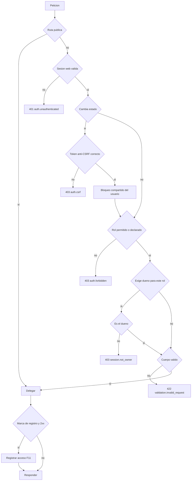
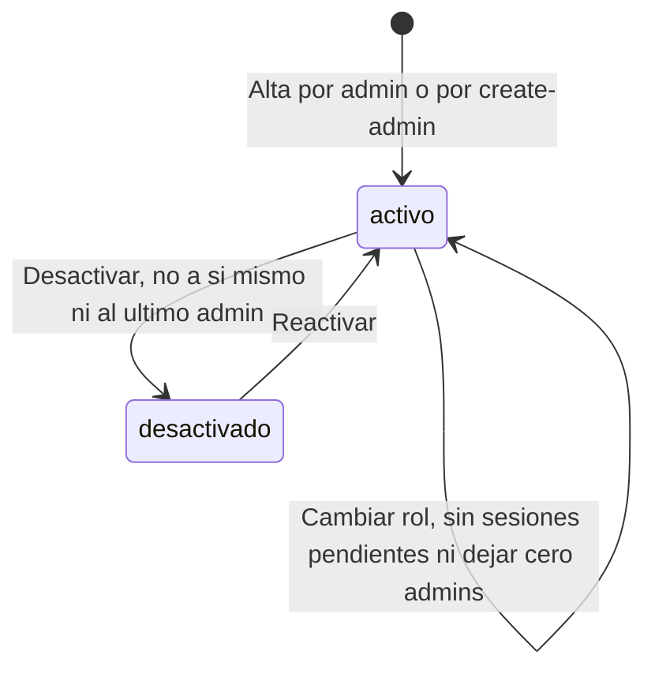
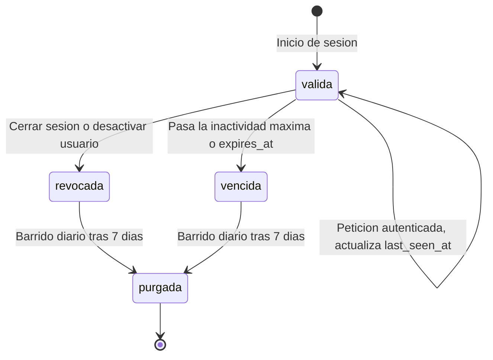
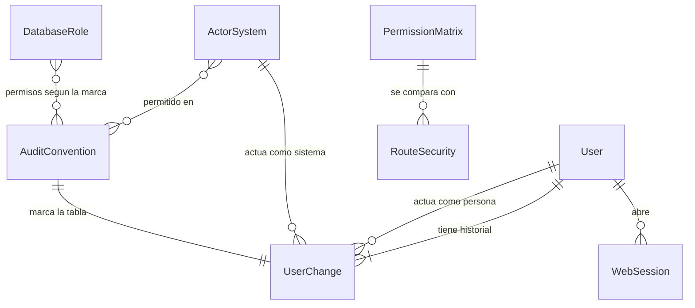

# Especificación funcional — U3 identity-access

**Revisión 2 (2026-11-21), segunda pasada por el cambio 01 (DT27), la adenda 02 y las revisiones 3 de
Inception.** Sustituye a la revisión 1 del 2026-10-02. Los flujos y los escenarios conservan su número;
ninguno sale. Lo nuevo sigue la numeración (regla de `project.md`).
- **Siguen:**
  - F3 y F4, este con el rol `investigador` y la validación de BR2.9.
  - Los escenarios E1–E8, E10, E13 y E15.
- **Cambian:**
  - F1: el `investigador` llega a M8, y está el `429` de NFR10.5 de U3.
  - F2: validación, se niega por defecto, `owner-only-for-role`, `demo` y registro de acceso.
  - F5 y F6: pendientes según P8 = A, desactivación con sesiones pendientes y bloqueos de BR2.12.
  - F7: actor `create-admin` y bloqueo asesor.
  - F8: marca única, actores de sistema y usuario de retención (R-01, R-02, R-08, P6, P7).
  - F9: pasa del umbral a la configuración por PR (FR9.2).
  - Los escenarios E9, E11, E12 y E14.
- **Entran:**
  - F10, el manejador de Problem Details.
  - F11, el registro de acceso (P5 = A).
  - F12, el `PATCH` combinado (R-04).
  - F13, el arranque de ConsoleApi.
  - Los escenarios E16–E43.
- **Retirado:** nada de este documento. En `entities.md` salen tres acciones de `PermissionMatrix`.
- **Hallazgos de la revisión 1:** R-01 y R-04 a R-08 se corrigen sin pregunta; R-02 se cierra con P6 = A
  y R-03 con P8 = A.
- **Precisiones:** las pendientes de la revisión 1 vuelven a §10 como FD-U3-02, FD-U3-04 y FD-U3-06,
  junto con las nuevas.

**Insumos.**
- Unidad U3 de `inception/units-generation/unit-of-work.md` (unit-of-work, revisión 3) y su mapa de
  historias `unit-of-work-story-map.md` (unit-of-work-story-map, revisión 3): US8.1–US8.4, y US5.6 en
  M0 y M6.
- FR1, FR9, FR13.5, NFR10 y NFR11 de `inception/requirements-analysis/requirements.md` (requirements,
  revisión 3), y VE-09, VE-11, VE-13, A-2 y A-3 de `requirements-adenda-02.md`.
- IdentityAccess, ConsoleApi y EthicsGovernance de `inception/domain-design/components.md` (components,
  revisión 3), con ADR-003, ADR-004, ADR-009 y ADR-016 de `decisions.md`.
- C1, C12, C16, C23, C24, CD-11 y las reglas de propiedad de
  `inception/contract-design/contract-summary.md` (contract-summary, revisión 3).
- AC8.1.x–AC8.4.x de `inception/user-stories/stories.md`, AC5.4.4 de `stories-adenda-02.md`, M0, M6 y
  M8 de `inception/refined-mockups/mockups.md`, y B2 de `inception/delivery-planning/bolt-plan.md`.
- §1 y §7–§9 del diseño de U1 (`construction/contracts/functional-design/functional-spec.md`): catálogo
  de `code` en `contracts/errors/` y OpenAPI en `contracts/api/console.v2.yaml`.
- Respuestas P1–P8 de `functional-design-questions.md` y hallazgos de `reviews/review-01.md`.

Las entidades están en `entities.md` y las reglas en `rules.md` (fuentes de verdad). Este documento es la
fuente de verdad de los flujos y las máquinas de estado. Las cifras que menciona (Argon2id, 1 800 s,
43 200 s, 5 intentos en 15 minutos, purga a los 7 días) son de NFR Requirements de U3 y solo se citan.

## 1. Qué hace la unidad

U3 deja la base sobre la que se apoyan las demás unidades:
- **Quién es el usuario:** inicio de sesión y sesión web (US8.1).
- **Quién gestiona usuarios:** el `admin`, con tres roles (US8.2). El primer `admin` nace con
  `create-admin` (P1).
- **Qué puede hacer cada rol.** ConsoleApi aplica la matriz de FR1.2 y las extensiones de C1, y niega por
  defecto (ADR-009).
- **Cómo responde un error:** el manejador único de Problem Details.
- **Cómo se registra una lectura:** la marca `x-veridicus-access-log` sobre el puerto C23 (P5).
- **Cómo se garantiza que ningún historial se reescriba** (US8.4): marca única por tabla, actores de
  sistema y dos usuarios de base de datos.

También fija que perfiles, proveedores, *prompts*, precios y límites nunca se escriben desde la consola
(US8.3).

U3 no aplica la propiedad de cada acción. Cada unidad declara `x-veridicus-owner-only` en sus rutas y
aporta el resolvedor del dueño; U3 entrega el mecanismo (unit-of-work, Límites).

| Componente | Proceso | Dentro / fuera del clúster | Datos que cruzan la frontera |
|---|---|---|---|
| IdentityAccess | `session-api` | Dentro | Ninguno sale del clúster |
| ConsoleApi (autenticación, autorización, errores y registro de acceso) | `session-api` | Dentro | Cookie y respuestas al navegador por el Ingress con TLS, dentro del clúster (C1); al puerto C23 solo IDs |
| AnalystConsole (M0, M6 y la llegada a M8) | `frontend` estático | Dentro (servido por el clúster; corre en el navegador del usuario) | Solo habla con ConsoleApi (ADR-004) |
| Comando `create-admin` | `Job` de `session-api` | Dentro | Lee usuario y contraseña de un Secret; no los imprime ni los registra |
| Convención de auditoría (migración y prueba común) | `Job` de migraciones y suite de nivel 1 | Dentro (en CI, con PostgreSQL en contenedor) | Ninguno; datos sintéticos |

## 2. Flujos

### F1 — Iniciar sesión (US8.1)

1. El usuario envía usuario y contraseña desde M0 (`POST /auth/login`).
2. Si el usuario normalizado o el origen superaron los intentos de NFR10.5 de U3 → `429`
   `auth.too_many_attempts` con `Retry-After`, sin verificar la contraseña (propuesta FD-U3-02).
3. IdentityAccess normaliza el usuario y busca el `User`. Si no existe, verifica contra un hash señuelo;
   si existe, contra su `password_hash`.
4. Si no coincide, si el usuario no existe o si está desactivado → `401` `auth.invalid_credentials`, con
   el mismo cuerpo en los tres casos (BR1.2). M0 muestra «Usuario o contraseña incorrectos.» y lleva el
   foco al mensaje.
5. Si coincide → crea la `WebSession` con su token anti-CSRF y responde `204` con la cookie (BR1.3). La
   cookie solo viaja por HTTPS (BR1.8).
6. Si PostgreSQL o Redis fallan en cualquier paso → `503` `system.unavailable`, nunca `401` (BR8.3).
7. La consola llama `GET /auth/me` para obtener rol y token anti-CSRF.
8. Navega según BR1.7. Vuelve a la ruta guardada si venía de una sesión vencida del mismo usuario
   (AC8.1.5). Si no, el `analista` va a M1, el `admin` a M6 y el `investigador` a M8 (AC8.1.1,
   AC8.2.4).

### F2 — Validar cada petición (ConsoleApi, toda ruta)

Toda la petición corre en una sola transacción (`UnitOfWork` de C12).

1. Si la ruta es pública (`POST /auth/login`, `/healthz`, `/readyz`) → delegar.
2. Resolver la cookie (`Authenticator.resolve`, C12). Sin cookie, revocada, vencida por tiempo total o
   por inactividad, o con el usuario desactivado → `401` `auth.unauthenticated` (BR1.4). La consola
   guarda la ruta actual con el `user_id` y va a M0. Si la sesión es válida, actualiza `last_seen_at`.
3. Si el método cambia estado:
   - compara `X-CSRF-Token`; si no coincide → `403` `auth.csrf` (BR1.5);
   - toma el bloqueo compartido sobre la fila del usuario del principal (BR2.12).
4. Roles:
   - si la ruta declara `x-veridicus-roles` y el rol no está → `403` `auth.forbidden` (BR4.1);
   - si no declara roles y no es de todos los roles autenticados → `403` `auth.forbidden` (BR4.3, se
     niega por defecto).
5. Dueño:
   - si la ruta declara `x-veridicus-owner-only` y el principal no es el dueño → `403`
     `session.not_owner` (BR4.2);
   - si declara `x-veridicus-owner-only-for-role: <rol>`, el principal tiene ese rol y no es el dueño →
     `403` `session.not_owner` (BR4.4).

   La consulta del dueño la aporta la unidad dueña de la ruta.
6. Validar cuerpo y parámetros contra el OpenAPI → si no cumplen, `422` `validation.invalid_request`
   (BR8.4). La validación va después de la autorización.
7. Delegar con el `Principal` ya autorizado.
8. Si la ruta declara `x-veridicus-access-log` y el manejador terminó con 2xx → F11.
9. Ningún rechazo de los pasos 1–6 crea filas. Todo error sale por F10.

<!-- Texto alternativo: una petición a una ruta pública se delega. Si no lo es, sin sesión web válida responde 401. Si cambia estado y el token anti-CSRF no coincide, 403 auth.csrf; si coincide, se bloquea en modo compartido la fila del usuario. Si el rol no está permitido o la ruta no declara roles, 403 auth.forbidden. Si la ruta exige ser el dueño para ese rol y el usuario no lo es, 403 session.not_owner. Si el cuerpo no cumple el esquema, 422 validation.invalid_request. Si todo pasa, se delega; si la ruta lleva la marca de registro de acceso y el manejador terminó bien, se registra el acceso y luego se responde. -->

### F3 — Cerrar sesión

1. `POST /auth/logout` con token anti-CSRF.
2. Se fija `revoked_at` en la `WebSession` y responde `204` (BR1.6). La consola borra la ruta guardada.

### F4 — Crear un usuario (US8.2)

1. El `admin` abre «Crear usuario» en M6 y envía usuario, rol (`analista`, `admin` o `investigador`) y
   contraseña inicial (`POST /users`).
2. F2 autoriza solo a `admin` (BR2.1).
3. Nombre fuera de formato o cuerpo inválido → `422` `validation.invalid_request`. Contraseña fuera de la
   política → `422` `user.weak_password` (BR2.9).
4. Nombre ya existente sin distinguir mayúsculas → `409` `user.duplicate_username` (BR2.3).
5. Guarda el `User` activo con el hash. En la misma transacción inserta `UserChange created` con
   `actor_kind: user` y el `admin` como actor (BR2.2, BR2.8). Responde `201`.

### F5 — Desactivar o reactivar un usuario

1. El `admin` pulsa «Desactivar» en M6. La consola confirma con el número de sesiones sin consolidar que
   trae `pending_sessions` (BR2.10; texto propuesto en §6 y FD-U3-11).
2. `PATCH /users/{user_id}` con `active: false`.
3. F2 autoriza solo a `admin`. Toma el bloqueo exclusivo sobre la fila del usuario objetivo (BR2.12) →
   si no existe, `404` `user.not_found` (BR2.9).
4. Si es el propio principal → `409` `user.self_deactivation` (BR2.5).
5. Si el objetivo es `admin` activo, bajo el bloqueo asesor del conjunto de admins: si es el último
   `admin` activo → `409` `user.last_admin` (BR2.6).
6. Fija `active = false`, revoca sus `WebSession` e inserta `UserChange deactivated` (BR2.4, BR2.8). Sus
   sesiones sin consolidar quedan en solo lectura hasta que se le reactive (BR2.10).
7. Reactivar (`active: true`) inserta `UserChange reactivated`. No restaura sesiones web: el usuario
   vuelve a entrar.

### F6 — Cambiar el rol de un usuario

1. El `admin` elige «Cambiar rol» en M6 (propuesta FD-U3-11). La consola envía
   `PATCH /users/{user_id}` con `role`.
2. Bloqueo exclusivo sobre la fila del objetivo (BR2.12) → `404` si no existe.
3. Si el rol nuevo es el actual → `200` sin filas (BR2.8).
4. Si el objetivo es el último `admin` activo y el rol nuevo no es `admin` → `409` `user.last_admin`,
   bajo el bloqueo asesor (BR2.6).
5. ConsoleApi pregunta al puerto `PendingSessions` de InterviewSession cuántas sesiones del usuario no
   están `consolidated`. Si hay alguna → `409` `user.has_pending_sessions` (BR2.7). La consulta va en
   ConsoleApi, no en IdentityAccess, con el mismo criterio que ADR-009.
6. Cambia el rol e inserta `UserChange role_changed` con el rol anterior y el nuevo (BR2.8). El rol
   nuevo vale desde la petición siguiente, porque el `Principal` se resuelve sin caché.

Mientras U4 no exista, el puerto no tiene tabla que leer y su adaptador por defecto devuelve 0. La
prueba de BR2.7 con sesiones reales entra en el PR de U4 que crea la tabla de sesiones (FD-U3-04).

### F7 — Crear el primer `admin` (P1)

1. El humano crea el Secret con usuario y contraseña desde su `.env` no versionado (team.md, Secrets).
2. Aplica a mano el manifiesto del `Job` `create-admin`, que entró antes por PR (AUTONOMIA-01).
3. El comando valida usuario y contraseña con BR2.9. Si no cumplen → termina con código distinto de 0
   (NFR10.2 de U3).
4. En una transacción, toma el bloqueo asesor del conjunto de admins y comprueba que no hay ningún
   `admin` activo (BR3.1).
5. Si lo hay → termina con código distinto de 0 y no cambia nada.
6. Si no → crea el `admin` e inserta `UserChange created` con `actor_kind: system` y
   `actor_system: create-admin`.
7. El comando no imprime la contraseña ni la escribe en logs (BR1.1).

### F8 — Verificar la convención de auditoría (US8.4, prueba común de nivel 1)

1. La prueba aplica todas las migraciones sobre un PostgreSQL en contenedor y lee del catálogo el
   comentario de cada tabla del esquema de la aplicación.
2. Si una tabla no lleva la marca `veridicus-audit` → rojo (BR6.3). La marca es lo único que se lee.
3. Comprueba que la lista `ActorSystem` coincide con la restricción CHECK de cada tabla `history`
   (BR6.4, nivel 0).
4. Por cada tabla `history`, con las columnas que declara la marca (BR6.6), intenta un `INSERT`:
   - con `actor_kind: user` y el actor persona nulo;
   - con `actor_kind: system` y `actor_system` nulo;
   - con las dos columnas de actor llenas;
   - con la hora nula;
   - con un `actor_system` fuera de la lista.

   Todos fallan. Un caso válido de cada clase de actor entra (BR6.1, BR6.4).
5. Con `veridicus_app`, `UPDATE` y `DELETE` sobre una fila → ambos fallan por permisos (BR6.2).
6. Con `veridicus_retention`:
   - `DELETE` funciona en las tablas purgables y falla en las no purgables;
   - `UPDATE` falla en todas;
   - `INSERT` solo funciona en `RetentionAct` (BR6.5).

### F9 — Cambiar la configuración (US8.3)

1. El humano abre un PR que cambia un perfil, un *prompt*, la tabla de precios o el catálogo de
   límites, que son archivos versionados (FR9.2).
2. La CI corre la regla estática de BR5.2 y la validación del OpenAPI de BR5.1 (con sus controles
   negativos).
3. El autor revisa y fusiona. La fusión en `main` protegida es la aprobación registrada (BR5.3).
4. El humano aplica el artefacto fusionado, o Argo CD sincroniza desde el Módulo 8. Las corridas
   posteriores llevan otra `config_sha256`; las sesiones ya creadas conservan su instantánea (ADR-006).
5. Ningún paso de este flujo lo ejecuta un agente contra el clúster (AUTONOMIA-01).

### F10 — Responder un error (manejador único de Problem Details)

1. Una guardia de F2 o un manejador lanza una excepción.
2. Si pertenece a la jerarquía de U1 → toma su `code`, el `status` del catálogo y el `detail` en
   español del catálogo de mensajes (BR8.1).
3. Si es un timeout o un error de PostgreSQL o Redis → `503` `system.unavailable`. Si es cualquier otra
   cosa → `500` `system.internal` (BR8.3).
4. Revierte la transacción de la petición: ningún error deja filas.
5. Arma el cuerpo `application/problem+json` sin trazas, mensajes de excepción, nombres ni testimonio, e
   `instance` con el identificador de la petición (BR8.2).
6. Escribe un log con el identificador de la petición, el `code` y los IDs del recurso, nunca su
   contenido.

### F11 — Registrar un acceso (marca `x-veridicus-access-log`, P5 = A)

1. Al arrancar, ConsoleApi cablea el adaptador real de C23 si existe (U13). Si no, cablea el de por
   defecto, que no registra, lo avisa en el log y hace que `/readyz` informe
   `access_log: not_configured` con `200` (BR9.5).
2. Tras un 2xx en una ruta marcada, calcula el `AccessRecord` (`user_id` del principal, `resource_type`
   de la marca y `resource_id` del parámetro de ruta) (BR9.1).
3. En `GET /sessions/{session_id}` con `since` (sondeo) no registra; sin `since` (apertura), sí (BR9.4).
4. Llama a `AccessLog.record` dentro de la transacción de la petición, con el *timeout* de E/S.
5. Si falla, la respuesta sale igual, con un log de aviso solo con IDs y la métrica
   `veridicus_access_log_failures_total{resource_type}` (BR9.3).
6. La exportación no usa la marca. La ruta de U7 llama al puerto ella misma con `export_sha256` y, si
   ese registro falla, no entrega el archivo (VE-13, UG-09). U3 solo comprueba que la ruta no lleva la
   marca (BR9.2).

### F12 — `PATCH /users/{user_id}` con `active` y `role` a la vez (R-04)

1. Las guardias corren en este orden, en una sola transacción (BR2.11):
   1. validación (BR2.9);
   2. bloqueo exclusivo del objetivo y existencia (BR2.12, `404`);
   3. autodesactivación, si `active: false` (BR2.5);
   4. último `admin` bajo el bloqueo asesor, si el cambio desactiva a un `admin` o le da otro rol
      (BR2.6);
   5. sesiones pendientes, si cambia el rol (BR2.7).
2. La primera guardia que falla responde y no se aplica nada.
3. Si todas pasan, se aplica todo y se insertan, en este orden, `deactivated` o `reactivated` y después
   `role_changed`. Un campo con el mismo valor que ya tenía no produce fila (BR2.8).
4. Responde `200` con el `User` y su `pending_sessions`.

### F13 — Arrancar ConsoleApi

1. Lee el OpenAPI de `contracts/api/console.v2.yaml` (U1) y construye `RouteSecurity` por operación.
2. Rechaza el arranque con un log que nombra la ruta (BR4.7) si encuentra:
   - una extensión desconocida o un valor no permitido;
   - `owner-only` junto con `owner-only-for-role`;
   - un `owner-only-for-role` fuera de los roles de la ruta;
   - una marca de dueño o de registro sin resolvedor registrado.
3. Comprueba que cada `code` del catálogo tiene `status` y mensaje (BR8.1).
4. Cablea los puertos `PendingSessions` y `AccessLog`, reales o por defecto, y los informa en `/readyz`.
5. Si falta una configuración, el pod no arranca (Code Style de team.md).

## 3. Máquinas de estado

### Usuario

<!-- Texto alternativo: un usuario nace activo por el alta de un admin o por el comando create-admin. Pasa a desactivado si un admin lo desactiva, nunca a sí mismo ni al último admin activo. Vuelve a activo si se le reactiva. Estando activo puede cambiar de rol si no es dueño de sesiones sin consolidar y si el cambio no deja el sistema sin admin activo. -->

| Desde | Hacia | Quién | Guardia | Efecto |
|---|---|---|---|---|
| — | activo | `admin` o `create-admin` | Nombre válido y único; contraseña según la política; `create-admin` solo sin `admin` activo, bajo bloqueo asesor | `UserChange created` (actor persona o `create-admin`) |
| activo | desactivado | `admin` | No es él mismo; no es el último `admin` activo | Revoca sesiones web; `UserChange deactivated`; sus sesiones sin consolidar quedan en solo lectura |
| desactivado | activo | `admin` | — | `UserChange reactivated`; el usuario vuelve a entrar |
| activo | activo (cambio de rol) | `admin` | Rol distinto; no deja cero `admin` activos; sin sesiones no consolidadas | `UserChange role_changed`; vale desde la petición siguiente |

Un usuario desactivado también puede cambiar de rol, con las mismas guardias; el cambio vale cuando se
le reactive.

### Sesión web

<!-- Texto alternativo: una sesión web nace válida al iniciar sesión y cada petición autenticada actualiza su última actividad. Queda revocada al cerrar sesión o al desactivar al usuario, y vencida al pasar la inactividad máxima o su hora de expiración. Las revocadas y las vencidas se borran en el barrido diario siete días después. -->

## 4. Vista derivada: entidades y relaciones

Derivada de `entities.md` (la fuente de verdad es su bloque YAML). `Principal`, `ProblemResponse` y
`AccessRecord` son valores sin almacenamiento y no aparecen.

<!-- Texto alternativo: un usuario tiene uno o más cambios en su historial y abre cero o más sesiones web. Cada cambio lo hace una persona o un actor de sistema de la lista cerrada. La convención de auditoría marca la tabla del historial de usuarios, igual que marca todas las tablas de las demás unidades. Los actores de sistema se permiten por tabla, y los dos usuarios de base de datos reciben sus permisos según la marca. La matriz de permisos se compara con la seguridad declarada en cada ruta. -->

## 5. Vista derivada: reglas

Derivada de `rules.md` (la fuente de verdad es su bloque YAML).

| Grupo | Reglas | Flujo |
|---|---|---|
| Autenticación | BR1.1–BR1.8 | F1, F2, F3 |
| Gestión de usuarios | BR2.1–BR2.12 | F2, F4, F5, F6, F12 |
| Primer `admin` | BR3.1–BR3.2 | F7 |
| Matriz y extensiones | BR4.1–BR4.8 | F2, F13 |
| Configuración por PR | BR5.1–BR5.3 | F9 |
| Auditoría | BR6.1–BR6.6 | F4–F8 |
| Accesibilidad de M0 y M6 | BR7.1–BR7.3 | F1, F4, F5, F6 (interfaz, §6) |
| Problem Details | BR8.1–BR8.4 | F2, F10, F13 |
| Registro de acceso | BR9.1–BR9.5 | F11, F13 |

## 6. Interfaz (M0, M6 y lo que U3 toca de M8)

U3 es de tipo `service` y no produce `frontend-components.md`. Los estados y textos de sus pantallas
quedan aquí. Los textos marcados «propuesto» no los fija un criterio aprobado y van a FD-U3-11.

| Pantalla | Estados y textos | Reglas |
|---|---|---|
| M0 Inicio de sesión | Inicial; Cargando («Entrando…»); Error de credenciales («Usuario o contraseña incorrectos.», con icono, foco al mensaje); Demasiados intentos («Demasiados intentos. Espera 15 minutos e intenta de nuevo.», propuesto); Error del sistema («No se pudo conectar con el servidor. Intenta de nuevo.», también ante `503`); Sesión web vencida (vuelve a la ruta guardada); Entrada correcta (analista → M1, admin → M6, investigador → M8) | BR1.2, BR1.7, BR8.3 |
| M6 Gestión de usuarios | Tabla usuario / rol / estado / acciones con los tres roles; estado con icono y texto («✓ Activo», «✕ Desactivado»); «Crear usuario» (usuario, rol, contraseña inicial) con errores junto al campo; «Desactivar» con confirmación modal: «El usuario no podrá entrar; sus acciones pasadas conservan su autoría.» y, si `pending_sessions` > 0, «Tiene N sesiones sin consolidar, que quedarán en solo lectura hasta que lo reactives.» (propuesto); «Reactivar» y «Cambiar rol» (propuestos); mensajes de los `409` de último `admin`, autodesactivación, nombre duplicado y sesiones pendientes, y del `422` de contraseña débil (propuestos en FD-U3-11); ningún control de perfiles, proveedores, *prompts*, precios ni límites | BR2.1–BR2.11, BR5.1, BR7.1–BR7.3 |
| M8 Reportes de corridas y evaluaciones | U3 solo fija la llegada del `investigador`, su cabecera con «Reportes» y sin «Sesiones» ni «Usuarios», y que un enlace directo a una sesión responda `403` y la consola muestre «No tienes permiso para ver esta página.» (propuesto). El resto de M8 es de U12 | BR1.7, BR4.6 |

M0 y M6 entran en la suite `axe` de U4 (US5.6; BR7.1–BR7.3: 0 violaciones serious o critical, todo
operable con teclado, estados con texto o icono además del color). Sus textos salen del catálogo de
mensajes y pasan el escaneo de vocabulario prohibido.

## 7. Escenarios de negocio y casos límite

| # | Escenario | Resultado esperado | Regla |
|---|---|---|---|
| E1 | Usuario inexistente / contraseña errónea / usuario desactivado | `401`, mismo cuerpo byte a byte | BR1.2 |
| E2 | Contraseña sembrada buscada en todas las columnas de texto y en los logs | 0 coincidencias; prefijo de hash adaptativo | BR1.1 |
| E3 | Cada ruta del OpenAPI salvo login y salud, sin cookie | `401` | BR1.4 |
| E4 | `POST` sin `X-CSRF-Token` | `403` `auth.csrf`, sin filas | BR1.5 |
| E5 | `analista` o `investigador` llama `POST /users` | `403` `auth.forbidden`, sin filas | BR2.1, BR4.1 |
| E6 | Usuario desactivado con cookie vigente | `401`; sus filas de historial siguen con su autoría | BR2.4 |
| E7 | `admin` se desactiva a sí mismo | `409` `user.self_deactivation` | BR2.5 |
| E8 | Dos `admin` desactivan a la vez al otro, siendo los dos únicos | Uno gana, el otro recibe `409` `user.last_admin` | BR2.6 |
| E9 | Cambiar el rol de un analista con una sesión en cada estado distinto de `consolidated` (`open`, `paused`, `suspended`, `finalized`, `terminated`, `blocked`) | `409` `user.has_pending_sessions` en los seis; con solo sesiones `consolidated`, `200` | BR2.7 |
| E10 | `create-admin` con un `admin` activo ya creado | Termina con código distinto de 0; nada cambia | BR3.1 |
| E11 | Copia de control del OpenAPI con `PATCH /profiles/{name}` | Suite de nivel 0 en rojo | BR5.1 |
| E12 | Un módulo fuera del cargador abre para escritura un archivo de perfiles | Regla estática en rojo | BR5.2 |
| E13 | `UPDATE` sobre `UserChange` con el usuario de la aplicación | Falla por permisos | BR6.2 |
| E14 | Migración de control con una tabla sin la marca `veridicus-audit` | Prueba común en rojo | BR6.3 |
| E15 | Sesión web vence con una entrevista abierta; el mismo analista vuelve a entrar | Vuelve a esa sesión sin pérdida | BR1.7 |
| E16 | El `investigador` inicia sesión | Llega a M8; la cabecera no muestra «Sesiones» | BR1.7 |
| E17 | El `investigador` pide `GET /sessions/{id}` o `GET /sessions/{id}/reports` | `403` `auth.forbidden`; no se registra acceso | BR4.6, BR9.1 |
| E18 | El `admin`, o un analista que no es el dueño, abre una sesión ajena | `200` con sus hallazgos; una llamada a `AccessLog` | BR4.6, BR9.1 |
| E19 | Exportar: analista dueño, analista no dueño, `admin`, `investigador` | Pasa, `403` `session.not_owner`, pasa, `403` `auth.forbidden` | BR4.4, BR4.1 |
| E20 | Ruta de control sin `x-veridicus-roles` que no es de todos los roles | `403` en ejecución y rojo en nivel 0 | BR4.3 |
| E21 | OpenAPI con `x-veridicus-owner-only` en una ruta sin resolvedor registrado | ConsoleApi no arranca; el log nombra la ruta | BR4.7 |
| E22 | `PermissionMatrix` dice `deny` donde el OpenAPI deja entrar al rol | Suite de nivel 0 en rojo | BR4.8 |
| E23 | `PATCH` con `active: false` y `role: admin` sobre un analista con una sesión pendiente | `409` `user.has_pending_sessions`; `active` sigue `true`; 0 filas | BR2.11 |
| E24 | Desactivar a un analista con dos sesiones sin consolidar | `200` con `pending_sessions: 2`; nadie puede actuar sobre esas sesiones hasta reactivarlo | BR2.10 |
| E25 | El analista crea una sesión a la vez que el `admin` le cambia el rol | O la sesión se crea primero y el cambio da `409`, o el cambio va primero y la creación da `403` | BR2.12 |
| E26 | Dos `Job` `create-admin` a la vez sin `admin` activo | Uno crea el `admin`; el otro termina con código distinto de 0 | BR3.1 |
| E27 | `INSERT` en `UserChange` con `actor_kind: system` y `actor_system` nulo, o con las dos columnas de actor llenas | Falla | BR6.1 |
| E28 | `INSERT` con `actor_system: cron`, que no está en la lista | Falla | BR6.4 |
| E29 | `veridicus_retention` borra en `UserChange`, en una tabla purgable y hace `UPDATE` | Falla, funciona, falla | BR6.5 |
| E30 | Marca de control que declara `at_column: fecha`, que no existe | Prueba común en rojo | BR6.6 |
| E31 | `POST /users` con un campo de más, por el `admin` y por un analista | `422` `validation.invalid_request` y `403` | BR8.4 |
| E32 | PostgreSQL detenido durante `POST /auth/login` | `503` `system.unavailable`, no `401` | BR8.3 |
| E33 | Excepción de control con un nombre y texto de testimonio en su mensaje | `500` `system.internal` sin ese texto en la respuesta ni en el log | BR8.2, BR8.3 |
| E34 | Alta con contraseña de 7 caracteres, y con nombre «Ab» | `422` `user.weak_password` y `422` `validation.invalid_request` | BR2.9 |
| E35 | `PATCH /users/{id}` con un `user_id` inexistente | `404` `user.not_found` | BR2.9 |
| E36 | `AccessLog.record` falla al abrir una sesión | `200`; log de aviso con IDs; la métrica sube 1 | BR9.3 |
| E37 | Una apertura de sesión y cinco sondeos con `since` | Una sola llamada a `AccessLog` | BR9.4 |
| E38 | ConsoleApi arranca sin el adaptador de U13 | `/readyz` `200` con `access_log: not_configured`; aviso en el log | BR9.5 |
| E39 | Inicio de sesión por la prueba de humo sobre el Ingress | `Set-Cookie` con `Secure`, `HttpOnly` y `SameSite=Strict` sobre HTTPS | BR1.8 |
| E40 | Ruta guardada `//ejemplo.invalid/x` o de otro rol | Se ignora; el usuario va al inicio de su rol | BR1.7 |
| E41 | `POST /acknowledgements` (ruta demo) sin `X-CSRF-Token` | `403` `auth.csrf` | BR4.5 |
| E42 | `PATCH` con `active: true` sobre un usuario ya activo | `200`, 0 filas en `UserChange` | BR2.8 |
| E43 | Pasar a `investigador` al último `admin` activo | `409` `user.last_admin` | BR2.6 |

## 8. Integración con otras unidades

| Unidad | Qué recibe de U3 | Qué aporta a U3 |
|---|---|---|
| U1 contracts | Los `code` nuevos de FD-U3-02 y FD-U3-03, la extensión `x-veridicus-access-log` y el campo `pending_sessions` en el OpenAPI (cambios menores, por PR de U1) | El OpenAPI, el catálogo de `code` con su jerarquía de excepciones y `identity.py` (C12) |
| U4 text-flow | El mecanismo de F2, la convención de auditoría con su prueba común y el actor `analysis-worker` | El puerto `PendingSessions` (FD-U3-04), el resolvedor del dueño de sus rutas y la marca en `GET /sessions/{id}`; sus tablas de corridas y del registro de llamadas como `history` (FD-U3-10) |
| U5, U6, U7, U8, U9, U12 | El mecanismo de F2 para sus rutas y la convención de auditoría | Sus resolvedores, sus marcas y las marcas de sus tablas |
| U7 forensic-report | `x-veridicus-owner-only-for-role` en la exportación, y que la marca no se usa allí | La llamada propia al puerto `AccessLog` con `export_sha256` y la regla de no entregar si falla (VE-13) |
| U13 ethics-governance | El usuario `veridicus_retention`, el actor `retention-job`, la condición de purgable de cada tabla y el cableado del puerto en ConsoleApi | El adaptador real de C23 |
| U2 platform | Los manifiestos del `Job` `create-admin` y las referencias a los Secrets de `veridicus_app` y `veridicus_retention` | El Ingress con TLS (BR1.8) y la `NetworkPolicy` de `session-api` |

## 9. Errores y bordes

- Toda E/S con PostgreSQL y Redis lleva *timeout* explícito. Un fallo responde `503`
  `system.unavailable` y revierte la transacción; en el inicio de sesión nunca se confunde con un `401`
  (BR8.3).
- Un rechazo nunca crea filas: las guardias van antes del manejador y F10 revierte la transacción.
- Los logs llevan `user_id` e IDs de recurso, nunca el nombre de usuario, la contraseña, los tokens ni
  texto de testimonio (NFR10, BR8.2).
- El hash señuelo de BR1.2 evita que el tiempo de respuesta revele si el usuario existe.
- Orden de bloqueo: usuario (compartido en la petición, exclusivo en el `PATCH`) → sesión → ronda
  (BR2.12). Ninguna ruta de U3 bloquea sesiones, así que no hay interbloqueo con las de U4–U7.
- El bloqueo asesor del conjunto de admins lo toman solo `create-admin` y los cambios que pueden dejar
  cero `admin` activos (BR2.6, BR3.1).
- Riesgo aceptado: una desactivación deja las sesiones del usuario sin nadie que las cierre hasta que
  se le reactive. No hay traspaso de dueño en el MVP (P8 = A).
- Riesgo aceptado: el registro de una lectura puede faltar si el puerto falla, porque es una
  demostración (P5 = A). La exportación no tiene ese riesgo (VE-13).

## 10. Decisiones que precisan artefactos ya aprobados

No edité ningún artefacto aprobado (regla de `project.md`). En la aprobación decides cuáles se llevan al
original, cada una en su propio commit.

| ID | Artefacto aprobado | Precisión propuesta | Origen |
|---|---|---|---|
| FD-U3-01 | `user-stories/stories-adenda-02.md` (AC5.4.4) y `requirements-analysis/requirements-adenda-02.md` (criterio de VE-09) | AC5.4.4 pasa a: «Given el rol `investigador`, When pide los hallazgos de cualquier sesión, Then responde `403`. `analista` y `admin` los leen según FR1.2. No existe un rol ni una pantalla para la persona entrevistada. `[N0]`». En el criterio de VE-09, «Ningún rol distinto del dueño de la sesión lee sus hallazgos» pasa a «La persona entrevistada no tiene rol, y el `investigador` no lee los hallazgos». Así coinciden FR1.2, ADR-009, A-3 y VE-11 | P4 = A |
| FD-U3-02 | `contract-design/contract-summary.md` (C1 `ErrorCode` y rutas `/users*`, `/auth/login`) | Entran en el catálogo `user.duplicate_username` (409), `user.self_deactivation` (409), `user.last_admin` (409), `user.has_pending_sessions` (409), `user.not_found` (404), `user.weak_password` (422) y `auth.too_many_attempts` (429, con `Retry-After`). El `409` de `PATCH /users/{user_id}` deja de citar `validation.invalid_request`; `POST /users` suma `409` y `422`, `PATCH` suma `404` y `422`, y `POST /auth/login` suma `429` y `503`. La revisión 1 proponía `user.has_open_sessions`; pasa a `user.has_pending_sessions` porque P8 = A amplió «pendiente» | P2, P3 y P8 = A; R-06; NFR10.2 y NFR10.5 de U3 |
| FD-U3-03 | `contract-design/contract-summary.md` (C1 `ErrorCode`, regla 6) | Entran `system.internal` (500) y `system.unavailable` (503), que usa el manejador único cuando la excepción no es de la jerarquía o falla una dependencia. Sin ellos, un error inesperado no tiene `code` estable | Unit-of-work U3 (manejador); NFR10; BR8.3 |
| FD-U3-04 | `contract-design/contract-summary.md` (C11 o un contrato en proceso nuevo, y C1 `User`) | Puerto en proceso de InterviewSession (U4) hacia ConsoleApi: `PendingSessions.count_pending(uow, owner_user_id) -> int`, que cuenta las sesiones del usuario en cualquier estado distinto de `consolidated`. El adaptador por defecto devuelve 0 hasta que U4 cree la tabla. `User` de C1 suma `pending_sessions` (entero ≥ 0, solo en `GET /users` y en la respuesta del `PATCH`), para la confirmación de M6 | P3 y P8 = A; revisión 1 |
| FD-U3-05 | `contract-design/contract-summary.md` (C1, regla «Cada lectura… pasa por el puerto `AccessLog` antes de responder») | Nueva extensión `x-veridicus-access-log: session \| suggestion \| report_version`. Se declara en `GET /sessions/{session_id}` (`session`, solo sin `since`), `POST /suggestions/{suggestion_id}/observation-views` (`suggestion`, la apertura de sus observaciones) y `GET /reports/{report_version_id}/download` (`report_version`). No se declara en la lista de sesiones, en la lista de versiones ni en la exportación. La regla pasa a: «se registra tras un 2xx y antes de responder; si falla el registro de una lectura, la respuesta sale igual (demostración); la exportación llama al puerto ella misma y no entrega si falla» | P5 = A; VE-11; VE-13; UG-09; propuesta de esta etapa (sondeo) |
| FD-U3-06 | `contract-design/contract-summary.md` (C12) y `domain-design/components.md` (IdentityAccess y «Propiedad de las entidades», UserChange) | `UserChange` pasa de `[user_id, change, actor_user_id, at]` a `[user_id, change, old_value, new_value, actor_kind, actor_user_id, actor_system, at]`. Su actor nunca es nulo, y el alta del primer `admin` lleva `actor_system: create-admin`. Sustituye a la precisión de la revisión 1 «`actor_kind: system` con actor nulo» | P6 = A; R-02 |
| FD-U3-07 | `domain-design/decisions.md` (ADR-003) y `domain-design/components.md` («Historiales de solo inserción») | La convención se realiza con una marca única en el comentario de cada tabla. La marca lleva `veridicus-audit` con `kind` (`history` \| `mutable`), `purgeable`, `owner_unit` y, en `history`, las columnas del actor persona y de la hora (por defecto `actor_user_id` y `at`). Las columnas `actor` y `at` de ADR-003 son esas columnas lógicas: cada tabla conserva los nombres de components, p. ej. `consolidated_by`, y los declara en la marca. Toda tabla `history` suma `actor_kind` y `actor_system`. Sin sufijo de nombre ni lista paralela | R-01; R-08; P6 = A |
| FD-U3-08 | `domain-design/components.md` (InterviewSession y EthicsGovernance) y los Functional Design de U4 y U13 | Lista `ActorSystem` v1 en `db/audit/actor-systems.v1.yaml`: `create-admin` (U3), `retention-job` (U13, en `RetentionAct`) y `analysis-worker` (U4, en las filas de corridas y del registro de llamadas que llegan por C3). Cada unidad usa esos valores o añade el suyo por PR a la lista | P6 = A |
| FD-U3-09 | `requirements-analysis/requirements.md` (NFR11), `requirements-adenda-02.md` (A-2) y `contract-design/contract-summary.md` (C24) | Dos usuarios definidos por la migración de U3: `veridicus_app` (en `history`, `SELECT` e `INSERT`) y `veridicus_retention` (`SELECT` en todo, `DELETE` solo en tablas purgables, `INSERT` solo en `RetentionAct` para escribir el acta, nunca `UPDATE`). No son purgables `User`, `UserChange`, `WebSession`, `AnalystAcknowledgement`, `AccessLogEntry` y `RetentionAct`. El `INSERT` en el acta no lo nombraban P7 ni A-2 | P7 = A; A-2; C24 |
| FD-U3-10 | `domain-design/components.md` (InterviewSession: `AnalysisRun`) y el Functional Design de U4 | AC8.4.2 exige que las filas «de las corridas» no admitan `UPDATE` ni `DELETE` del usuario de la aplicación, pero `AnalysisRun` tiene `status`, `error_code` y `finished_at`, que cambian. Propuesta: U4 marca `AnalysisRun` como `history`, con sus datos de petición inmutables, y registra los cambios de estado de la corrida en una tabla `history` propia (p. ej. `RunStatusChange` con actor `analysis-worker` o la persona que la reintenta). La alternativa, marcar `AnalysisRun` como `mutable`, precisa AC8.4.2 | AC8.4.2; NFR11; esta etapa (convención) |
| FD-U3-11 | `refined-mockups/mockups.md` (§2 M0, §8 M6, §10 M8) | Propuestas de comportamiento y de texto: M6 suma «Reactivar» en las filas desactivadas y «Cambiar rol» (diálogo con los tres roles); la confirmación de «Desactivar» suma «Tiene N sesiones sin consolidar, que quedarán en solo lectura hasta que lo reactives.». Mensajes: `409` último `admin` «No puedes dejar el sistema sin un administrador activo.», autodesactivación «No puedes desactivar tu propio usuario.», nombre duplicado «Ya existe un usuario con ese nombre.», sesiones pendientes «Este usuario tiene N sesiones sin consolidar; no se puede cambiar su rol.», contraseña débil «La contraseña no cumple la política: …» con la condición que falta. M0: «Demasiados intentos. Espera 15 minutos e intenta de nuevo.». M8: «No tienes permiso para ver esta página.» | R-01 de Refined Mockups (textos como propuesta); P8 = A; BR7.2 |
| FD-U3-12 | `construction/identity-access/nfr-requirements/security-requirements.md` (U3, revisión 1) | NFR11.1 («salvo `actor_kind: system` en el alta del primer `admin`») queda superado por BR6.1, y NFR11.2 (umbral) por BR5.2 sobre la configuración. Se actualizan en la segunda pasada de NFR Requirements de U3 | P6 = A; FR9.2 |
| FD-U3-13 | Regla aprendida de NFR Design (`project.md`, «orden único sesión → ronda») | El orden de bloqueo pasa a usuario → sesión → ronda. Toda petición que cambia estado toma primero el bloqueo compartido de la fila del usuario (BR2.12); así un cambio de rol no se cruza con una acción del mismo usuario | R-04; BR2.12 |
