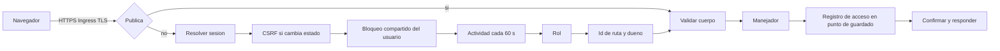

# Diseño de seguridad — U3 identity-access

**Revisión 2 (2026-11-22), segunda pasada por el cambio 01 (DT27), la adenda 02 y NFR Requirements
revisión 2 de U3.** Sustituye a la revisión 1 del 2026-10-03, que queda en el historial de Git.
- **Se mantienen:** frontera (§1), Argon2id y señuelo (§4), `create-admin` (§8, con su `Job` ajustado).
- **Cambian:** defensa en profundidad (§2, ahora una clase de ruta propia), sesión web y anti-CSRF (§5),
  limitador (§6), datos sensibles (§7), integridad del historial (§9).
- **Nuevos:** arranque de ConsoleApi (§3), manejador de Problem Details (§3.3), validación de cuerpos
  (§2.3), registro de acceso (§2.4), usuarios de base de datos (§9.3), configuración solo por PR (§10).
- **Retirado:** el control del umbral de la revisión 1 (§8 de la revisión 1, NFR11.2).
- **Hallazgos de la revisión 1** (`reviews/review-01.md`): R-02 y R-04 se cierran aquí (§5, §2 y §3);
  R-03, R-05 y R-06 en §6; R-07 b en §5.1. R-01, R-07 a, R-07 c y R-08 se cierran en
  `reliability-design.md` y `performance-design.md`.
- **Sin preguntas** en esta pasada (`nfr-design-questions.md`); lo que precisa artefactos aprobados está
  en §12 (NFRD-U3-01 a NFRD-U3-14).

**Insumos.**
- De esta unidad, en `nfr-requirements/` (revisión 2): `security-requirements.md`
  (security-requirements, con NFR-U3-01 a NFR-U3-05), `performance-requirements.md`
  (performance-requirements), `scalability-requirements.md` (scalability-requirements),
  `reliability-requirements.md` (reliability-requirements), `observability-requirements.md`
  (observability-requirements) y `tech-stack-decisions.md` (tech-stack-decisions, D1–D17).
- Flujos F1–F13 y escenarios E1–E43 de `functional-design/functional-spec.md` (functional-spec, revisión
  2), reglas BR1.1–BR9.5 de `rules.md` y entidades de `entities.md`, con la tabla FD-U3-01 a FD-U3-13.
- C1, C12, C16, C23, C24 y C25 de `inception/contract-design/contract-summary.md` (contract-summary).
- NFR Design de U1, revisión 2 (`construction/contracts/nfr-design/security-design.md`): C25 v1, lista
  cerrada de extensiones `x-veridicus-*`, `checks/auth_surface.py` y NFRD-U1-12.
- Lo que piden a U3 los NFR Requirements de U2, U5, U6, U7, U9, U12 y U13 aprobados hoy.
- Respuestas P1–P2 de `nfr-design-questions.md` y prácticas de `team.md` y `project.md`.

## 1. Frontera (AUTONOMIA-04)

| Componente | Dónde corre | Datos que cruzan su frontera |
|---|---|---|
| `IdentityAccess` (`application/`, `domain/`) | `session-api`, namespace `veridicus` | Ninguno sale del clúster |
| `GuardedRoute` y manejador de Problem Details de ConsoleApi (`api/`) | `session-api` | Cookie, anti-CSRF y respuestas al navegador por el Ingress con TLS; al puerto `AccessLog` (C23) solo IDs |
| Adaptadores PostgreSQL y Redis (`adapters/`) | `session-api` hacia servicios internos | Hashes Argon2id, SHA-256 de tokens, claves HMAC y contadores |
| `Job` `create-admin` | Dentro del clúster | Usuario y contraseña desde un Secret; no se imprimen ni se registran |
| Migración de la convención de auditoría | `Job` de migraciones (`veridicus_owner`) | Solo permisos; ninguna contraseña (§9.3) |
| AnalystConsole (M0, M6, llegada a M8) | Navegador, servida por el clúster | Solo habla con ConsoleApi (ADR-004) |

U3 no abre conexiones salvo a PostgreSQL y Redis configurados; la `NetworkPolicy` de U2 niega la salida a
internet de `session-api` (NFR1.1). Todo usuario de las pruebas y de la demostración sale de
`contracts/fixtures/synthetic-names.yaml` y se declara en `mentions` (NFR12.1).

## 2. Defensa en profundidad de una petición (F2)

### 2.1 Una clase de ruta propia

Toda operación de `/api/v1` se registra con `GuardedRoute`, una subclase de `APIRoute` de FastAPI. No hay
dependencias de seguridad por ruta ni cuerpos Pydantic declarados en los manejadores: así ninguna
validación de FastAPI corre antes que la autorización y la confirmación ocurre antes de enviar la
respuesta (cierra R-04).



<!-- Texto alternativo: una ruta pública salta a la validación del cuerpo. Las demás resuelven la sesión web; si la petición cambia estado comparan el token anti-CSRF y toman el bloqueo compartido de la fila del usuario; luego, como mucho cada 60 s, registran la actividad. Después se comprueba el rol, se interpreta el identificador de la ruta y el dueño si la ruta lo pide, se valida el cuerpo, corre el manejador, se registra el acceso en un punto de guardado y por último se confirma la transacción y se responde. -->

| Paso | Qué hace | Rechazo | Regla |
|---|---|---|---|
| 1 | `RouteSecurity` de la operación: pública si su seguridad efectiva en C1 es `security: []` | — | BR1.4 |
| 2 | Resolver la cookie `veridicus_session` (§5.2) | `401` `auth.unauthenticated` | BR1.4 |
| 3 | Si el método es `POST` o `PATCH`: comparar `X-CSRF-Token` (§5.3) | `403` `auth.csrf` | BR1.5 |
| 4 | Si cambia estado: `SELECT … FROM app_user WHERE id = :uid FOR SHARE`, y el rol y `active` se toman de **esa** fila (§5.4) | `401` si quedó inactivo | BR2.12 |
| 5 | Escritura condicional de `last_seen_at` (§5.2) | — | NFR10.3 |
| 6 | Rol: el de la fila está en `x-veridicus-roles`; sin la extensión, solo pasan `POST /auth/logout` y `GET /auth/me` | `403` `auth.forbidden` | BR4.1, BR4.3 |
| 7 | Rutas con marca de dueño o de registro: el identificador de ruta se interpreta como UUID; luego, el resolvedor del dueño de la unidad (§2.2) | `422` `validation.invalid_request`; `403` `session.not_owner`; el «no existe» de la unidad dueña | BR4.2, BR4.4 |
| 8 | Validar cuerpo y parámetros (§2.3) | `413` `limits.exceeded`; `422` `validation.invalid_request` | BR8.4 |
| 9 | Delegar con el `Principal` | — | — |
| 10 | Si hay `x-veridicus-access-log` y el manejador dio 2xx: registro en punto de guardado (§2.4) | Nunca rechaza | BR9.1–BR9.4 |
| 11 | `COMMIT`; solo entonces se devuelve la respuesta | `503` si el `COMMIT` falla | BR8.3 |

Todos los pasos corren en la misma transacción `UnitOfWork` (C12, `READ COMMITTED`), salvo el inicio de
sesión (§4.3). Cualquier rechazo lanza una excepción de la jerarquía de U1 y el manejador único revierte
la transacción (§3.3): un rechazo deja 0 filas y deshace también la escritura de actividad, así que solo
una petición correcta cuenta como actividad (cierra R-02 b).

### 2.2 Dueño: un registro de resolvedores por operación

- Cada unidad registra al arrancar `OwnerResolver` por `operationId`:
  `owner_of(uow, resource_id: UUID) -> UUID | None`. Hace un `SELECT` sin bloqueo, porque el dueño de una
  sesión no cambia en el MVP (P8 = A: sin traspaso).
- `None` significa «no existe»: el resolvedor lanza la excepción de «no existe» de su unidad (`404`). La
  revisión de la forma del identificador ocurre después del rol (paso 7), así que un rol sin permiso
  recibe `403` y nunca `422` (NFR10.18; NFRD-U3-02).
- `x-veridicus-owner-only-for-role: <rol>` solo consulta el resolvedor si el rol del principal es ese
  (BR4.4).

### 2.3 Validación de cuerpos y parámetros (NFR10.18, D13)

- Al arrancar se compila un `Draft202012Validator` por operación, con el verificador de formatos, a
  partir del esquema de C1 que entrega `veridicus_contracts.registry` (sin segundo esquema que pueda
  divergir). Los parámetros de ruta y de consulta se validan con un esquema compuesto de sus `schema`.
- **Cuerpos JSON.** `GuardedRoute` lee el cuerpo en memoria con `request.stream()`. Si la operación
  declara `x-veridicus-max-bytes`, corta al pasar la cifra de C25 y responde `413` `limits.exceeded` sin
  leer el resto; si no la declara, el tope es el `proxy-body-size` del Ingress (Infrastructure Design).
  Un `Content-Length` mayor que la cifra se rechaza antes de leer.
- **Cuerpos `multipart/form-data`.** `GuardedRoute` **nunca** llama a `request.form()` ni a
  `request.body()`, porque Starlette escribe en un archivo temporal por encima de 1 MiB. Autoriza y
  delega: la unidad dueña lee el cuerpo con su analizador en memoria (`python-multipart` de bajo nivel,
  D2 de U12) y valida las partes no binarias con el mismo validador compilado, que `GuardedRoute` le
  pasa (NFRD-U3-08).
- Los errores del validador se traducen a `422` sin el valor de entrada ni el mensaje de `jsonschema`,
  que puede citarlo: el Problem Details lleva solo el `code` y el `detail` del catálogo (§7).
- El manejador recibe un objeto tipado construido tras validar; no vuelve a leer el cuerpo.

### 2.4 Registro de acceso en un punto de guardado (NFR10.21, NFR-U3-05)

```python
def record_access(uow, port, record, timeout_ms):
    started = clock.monotonic()
    try:
        with uow.savepoint():                       # SAVEPOINT veridicus_access_log
            uow.set_local_statement_timeout(timeout_ms)
            port.record(uow, record)
            if (clock.monotonic() - started) * 1000 > timeout_ms:
                raise AccessLogTimeout()            # revierte solo el punto de guardado
        uow.set_local_statement_timeout(settings.db_statement_timeout_ms)
    except (AccessLogTimeout, DatabaseError, AccessLogError):
        metrics.access_log_failures.labels(record.resource_type).inc()
        log.warning("access_log.record_failed", resource_type=..., resource_id=...)
```

- `timeout_ms` = `VERIDICUS_ACCESS_LOG_TIMEOUT_MS` (500, entre 100 y 2 000). El `SET LOCAL` dentro del
  punto de guardado se deshace con él si falla; si funciona, se repone el valor normal.
- `resource_id` sale del parámetro de ruta que corresponde a la marca: `session_id`, `suggestion_id` o
  `report_version_id`. En `GET /sessions/{session_id}`, una petición con `since` no registra (BR9.4).
- La exportación de U7 no lleva la marca (BR9.2). U3 publica la misma función sin el punto de guardado
  (`record_access_strict`), que propaga el fallo para que U7 revierta toda la transacción y responda
  `503` `report.export_not_recorded` (NFR-U7-09).
- Sin adaptador de U13, el adaptador por defecto de C23 no hace E/S, deja un `WARNING` al arrancar y
  `/readyz` informa `access_log: not_configured` (BR9.5).

## 3. Arranque de ConsoleApi (F13, NFR10.16)

### 3.1 Qué se comprueba antes de aceptar peticiones

| Comprobación | Si falla | Regla |
|---|---|---|
| `contracts/api/console.v2.yaml` se lee con el cargador YAML seguro de `veridicus-contracts` desde el paquete instalado (`importlib.resources`), no desde una ruta del disco | No arranca | D14 |
| Cada extensión `x-veridicus-*` está en la lista cerrada de U1 y tiene un valor permitido; `owner-only` y `owner-only-for-role` no van juntos; `owner-only-for-role` está en los roles | No arranca; el log nombra método y ruta | BR4.7 |
| Toda ruta de `/api/v1` registrada en el código existe en C1 (mismo método y plantilla) | No arranca | BR4.3 |
| Toda operación **implementada** con marca de dueño tiene resolvedor, y toda marca de registro tiene su parámetro de ruta | No arranca | BR4.7, NFRD-U3-04 |
| El conjunto público (`security: []`) es subconjunto de `{POST /auth/login, GET /notice}` | No arranca | BR1.4, NFRD-U3-09 |
| Cada `code` con `http: true` del catálogo de U1 tiene estado y un `detail` en español en el catálogo de mensajes de ConsoleApi | No arranca; el log nombra el `code` | BR8.1, NFR14.1 |
| Cifras de C25 por `limits.load` y validaciones propias (§5.1), ajustes de `pydantic-settings`, lista de contraseñas contra su SHA-256 | No arranca; el log nombra el ajuste, nunca su valor | D2, D15, NFR10.13 |
| `PendingSessions` y `AccessLog`: real o por defecto, cableados una vez | Se informa en `/readyz` | F13 |

Las operaciones de C1 que aún no implementa ninguna unidad no se sirven: responden `404` como cualquier
ruta inexistente (§3.3).

### 3.2 Catálogo de mensajes

`services/session-api/src/session_api/messages/problems.es.yaml` lleva un `detail` por `code`. Los textos
de M0 y M6 que muestra la consola salen del mismo catálogo y pasan el escaneo de vocabulario prohibido de
`libs/integrity_policy` (NFR14.1). Ningún `detail` lleva marcadores que se rellenen con datos de la
petición.

### 3.3 Manejador único de Problem Details (F10, NFR10.17)

| Excepción | Estado y `code` |
|---|---|
| De la jerarquía de U1 (`libs/errors/`) | El `code` de la clase y el **estado del catálogo** (un estado por `code`; `limits.exceeded` siempre `413`) |
| `sqlalchemy.exc.OperationalError`, `psycopg.errors.QueryCanceled`, `redis.ConnectionError`, `redis.TimeoutError`, `pool_timeout` | `503` `system.unavailable` |
| Ruta o método inexistente del enrutador | `404` con el `code` que propone NFRD-U3-10 |
| Cualquier otra | `500` `system.internal` |

- Siempre revierte la transacción antes de armar la respuesta (0 filas tras cualquier error).
- Cuerpo `application/problem+json`: `type` (`about:blank`), `title` y `detail` del catálogo, `status`,
  `code` e `instance` = el `request_id` de la petición. Sin trazas, sin `str(exc)`, sin el `input` de
  `jsonschema`.
- El log `ERROR` de un `500` lleva el nombre de la clase de la excepción y una huella de la pila
  (`módulo:línea` de cada marco), nunca el mensaje ni las variables locales (NFR15.2, BR8.2).
- `429` añade `Retry-After: 900`; el `503` del semáforo añade `Retry-After` igual a
  `VERIDICUS_ARGON2_QUEUE_TIMEOUT_S` (cierra R-07 a; NFRD-U3-10).
- Prueba de nivel 0: recorre el catálogo y fuerza una excepción de cada clase; prueba de nivel 1 (E32,
  E33) con la base detenida y con una excepción sembrada con un nombre del catálogo sintético y un texto
  de testimonio sintético: 0 coincidencias en la respuesta y en los logs capturados.

## 4. Contraseñas (NFR10.1, NFR10.2, NFR10.6, NFR8.1, NFR8.4)

### 4.1 Hash y política

| Control | Diseño | Requisito |
|---|---|---|
| Hash | `argon2-cffi` `PasswordHasher(time_cost=3, memory_cost=65536, parallelism=1, hash_len=32, salt_len=16)`, parámetros de la configuración validada (mínimos de OWASP) | NFR10.1 |
| Re-hash | Tras verificar, `check_needs_rehash`; si hace falta, se actualiza el hash en la transacción que crea la sesión web, con la fila tomada `FOR NO KEY UPDATE` en lugar de `FOR SHARE` | NFR10.1 |
| Política | Validador puro en `domain/password_policy.py`: NFC, longitud en puntos de código, clases `Lu`, `Ll`, `Nd` y `P*`/`S*` sin el espacio; lista de D15 cargada en un `frozenset` de SHA-256 de la forma en minúsculas | NFR10.2 |
| Tope | `maxLength` de C1 con `x-veridicus-limit: password_max_chars` (128); el esquema lo rechaza antes de calcular nada | NFR10.2, NFR-U3-01 |

### 4.2 Sin revelar si el usuario existe

- Hash señuelo calculado al arrancar con una contraseña aleatoria y los mismos parámetros.
- Usuario inexistente → señuelo; contraseña errónea → su hash; desactivado → su hash y luego `401`.
  Exactamente una verificación por camino, por el mismo semáforo; un espía sobre el verificador lo
  comprueba (NFR10.6).
- Un único constructor del cuerpo `401` `auth.invalid_credentials` para los tres casos.

### 4.3 Inicio de sesión en dos transacciones (F1; cierra R-07 c)

1. Limitador: reserva atómica (§6).
2. T1: `SELECT` del usuario por `username_normalized`; se confirma y la conexión vuelve al *pool*.
3. Semáforo y verificación Argon2id **sin conexión de base retenida** (performance-design §2).
4. T2: `SELECT … FOR SHARE` (o `FOR NO KEY UPDATE` si hay re-hash) del mismo usuario; si ya no está
   activo o su `password_hash` cambió desde T1, `401` igual que E1. Inserta `WebSession`, aplica el
   re-hash, confirma el éxito en el limitador (§6) y hace `COMMIT`.
5. Responde `204` con `Set-Cookie`.

Partir el inicio de sesión en dos transacciones precisa F2 («toda la petición en una transacción»)
solo para esta ruta pública (NFRD-U3-12).

## 5. Sesión web y anti-CSRF (NFR10.3, NFR10.4, NFR10.10)

### 5.1 Cifras de una sola fuente (cierra R-07 b)

`web_session_idle_s` (1 800) y `web_session_max_s` (43 200) salen de `veridicus_contracts.limits.load`
(C25); el entorno solo puede bajarlas con `VERIDICUS_LIMIT_WEB_SESSION_*`. U3 valida después: inactividad
≥ 300, total ≥ 3 600 y total > inactividad. No hay ajustes `VERIDICUS_SESSION_*` propios. La cookie lleva
`Max-Age` = `web_session_max_s`, igual que `x-veridicus-cookie` de C1 (NFR Design de U1, §4.4).

### 5.2 Validez con una sola fuente de tiempo (cierra R-02)

- El reloj inyectable de `application/` (D12) da `:now` a toda lectura y escritura; ninguna sentencia de
  U3 usa `now()` de SQL.
- Lectura (paso 2 de §2.1), por clave primaria `session_token_hash = sha256(token)`:
  `revoked_at IS NULL AND expires_at > :now AND created_at + :max > :now AND last_seen_at + :idle > :now`
  y el usuario activo. `created_at + :max` hace que bajar la cifra afecte también a las sesiones ya
  abiertas.
- Actividad (paso 5), después del CSRF y del bloqueo del usuario, en una sola sentencia:

```sql
UPDATE web_session SET last_seen_at = :now
 WHERE session_token_hash = :h AND revoked_at IS NULL
   AND last_seen_at <= :now - interval '60 seconds'
   AND last_seen_at + :idle > :now
```

- Si `last_seen_at` es de hace menos de 60 s no hay escritura ni bloqueo de la fila. Pruebas de NFR10.3
  con reloj controlado: 1 799 s válida y 1 801 s vencida; petición a los 30 s (no escribe) y a los 61 s
  (escribe) → vence a los 1 861 s; 43 199 s válida y 43 201 s vencida.
- Sin caché de sesiones ni de principal: desactivar, cambiar el rol o cerrar sesión vale desde la
  petición siguiente.

### 5.3 Token anti-CSRF derivado (NFRD-U3-03)

- Token de sesión: `secrets.token_urlsafe(32)` (256 bits). La base guarda solo `sha256(token)`.
- Token anti-CSRF: `HMAC-SHA256(clave = token de sesión, mensaje = "veridicus-csrf-v1")`, en base64url
  (43 caracteres, ≥ 32 de C1). La base guarda solo `csrf_token_hash = sha256(csrf)`, como fija
  `entities.md`. `GET /auth/me` lo vuelve a calcular desde la cookie: así puede devolverlo sin que la base
  lo guarde en claro, y varias pestañas comparten el mismo token.
- Quien roba la base no obtiene ni la cookie ni el token: los dos son preimágenes de SHA-256 de un valor
  de 256 bits. Quien tiene la cookie ya tiene la sesión.
- Comparación: `hmac.compare_digest(sha256(header), csrf_token_hash)`; sin cabecera o distinta → `403`
  `auth.csrf` (BR1.5, E4, E41).
- `POST /auth/login`, `POST /auth/logout` y `GET /auth/me` responden `Cache-Control: no-store`
  (NFR10.10).

### 5.4 Bloqueos y orden (BR2.12, NFR10.15; NFRD-U3-01)

| Quién | Qué bloquea, en orden |
|---|---|
| Petición que cambia estado | `app_user` del principal `FOR SHARE` → `web_session` (solo si escribe actividad) → sesión → ronda |
| Petición de lectura | `web_session` (solo si escribe actividad) → lo que lea el manejador, sin bloqueo |
| `PATCH /users/{user_id}` | `app_user` objetivo `FOR NO KEY UPDATE` → bloqueo asesor del conjunto de admins (si puede dejar cero) → `web_session` del objetivo (revocación) |
| `create-admin` | Bloqueo asesor del conjunto de admins |

- La actividad se escribe después del bloqueo del usuario y no antes: si la petición tomara primero la
  fila de `web_session` y luego esperara la del usuario, una desactivación (usuario → `web_session`)
  cerraría un ciclo.
- `FOR NO KEY UPDATE` choca con `FOR SHARE` (lo que pide BR2.12) y no con el `FOR KEY SHARE` implícito de
  las claves foráneas, así que no frena las inserciones de historial que nombran al usuario.
- E8: el conteo de `admin` activos se hace tras tomar el bloqueo asesor; en `READ COMMITTED` ve la
  desactivación ya confirmada por el otro `PATCH`, que recibe `409` `user.last_admin`.
- E25: con el `PATCH` primero, el `FOR SHARE` de la creación espera y relee la fila con el rol nuevo →
  `403`; con la creación primero, el `PATCH` espera y `PendingSessions` la ve → `409`.

## 6. Limitador de intentos (NFR10.5; cierra R-03, R-05 y R-06)

| Clave en Redis | Valor | Caducidad |
|---|---|---|
| `veridicus:auth:fail:u:<HMAC-SHA256(usuario normalizado)>` | contador | 900 s desde el primer intento, renovada a 900 s al llegar a 5 |
| `veridicus:auth:fail:ip:<HMAC-SHA256(origen normalizado)>` | contador | ídem |

Tres scripts Lua (`EVAL`, atómicos y sin depender de `EXPIRE NX`, que exige Redis 7):

| Script | Cuándo | Qué hace |
|---|---|---|
| `reserve` | Antes de buscar al usuario | Si algún contador ≥ 5 → `BLOCKED` (`429` `auth.too_many_attempts`, `Retry-After: 900`, sin base ni Argon2id). Si no, `INCR` de los dos; si el valor es 1 o 5, `EXPIRE 900` |
| `succeed` | En T2, antes del `COMMIT` | `DEL` del contador del usuario y `DECR` del de origen si es > 0 |
| `release` | Si la verificación no llegó a correr (semáforo, `503` de NFR8.4) | `DECR` de los dos si son > 0 |

- La reserva cuenta cada intento antes de verificar: 20 intentos fallidos simultáneos del mismo usuario
  producen como máximo 5 verificaciones (prueba de nivel 1 nueva). Un intento en vuelo cuenta como fallo
  hasta que termina bien (NFRD-U3-14).
- Un fallo de Redis en `reserve` o en `succeed` responde `503` `system.unavailable` y revierte T2: el
  inicio de sesión nunca pasa sin limitador, y nunca da `204` ni `401` por esa causa (NFR10.12).
- **Origen.** Si el par TCP está en `VERIDICUS_TRUSTED_PROXY`, se toma de `X-Forwarded-For` la entrada
  más a la derecha que no está en esa lista; si la cabecera falta o ninguna entrada es una dirección
  válida, se usa el par TCP y se escribe un `WARNING`. Si el par no es de confianza, la cabecera se
  ignora. Normalización con `ipaddress`: IPv4 mapeada en IPv6 → IPv4, forma comprimida.
- `VERIDICUS_TRUSTED_PROXY` es obligatorio y no vacío al arrancar; las pruebas pasan un valor explícito
  (NFRD-U3-06). El chart fija el pod CIDR (`project.md`).
- Pruebas de NFR10.5 más dos nuevas: concurrencia (máximo 5 verificaciones) y cabecera ausente desde el
  proxy de confianza (usa el par y deja `WARNING`).

## 7. Datos sensibles fuera de logs, columnas y respuestas (NFR10.7, NFR10.17)

- El formateador JSON único solo emite los campos de `observability-design.md` §1 (lista blanca); un
  campo fuera de la lista se descarta, se llame como se llame.
- El nombre de usuario nunca llega al *logger*: los casos de uso registran `user_id`.
- Errores de validación: ni el `input` de Pydantic ni el mensaje de `jsonschema` llegan a la respuesta
  o al log (§2.3).
- E2 de nivel 1: contraseña, token de sesión y token anti-CSRF sembrados; búsqueda en todas las columnas
  de texto y en los logs capturados: 0 coincidencias.

## 8. `create-admin` (NFR10.8, NFR10.14, AUTONOMIA-01)

`python -m session_api.cli.create_admin` lee `VERIDICUS_BOOTSTRAP_ADMIN_USERNAME` y
`VERIDICUS_BOOTSTRAP_ADMIN_PASSWORD` desde `secretKeyRef`, valida BR2.9 y NFR10.2, y en una transacción
toma `pg_advisory_xact_lock(<clave del conjunto de admins>)`, cuenta los `admin` activos y termina con
código 2 si hay alguno (E10, E26). El alta inserta `UserChange created` con `actor_kind: system` y
`actor_system: create-admin`. Su `Job` vive en `deploy/jobs/` fuera de Argo CD (NFR-U2-09), corre sin
root, con `backoffLimit: 0`, `ttlSecondsAfterFinished: 3600`, `activeDeadlineSeconds` de U2 y sin
`automountServiceAccountToken`. Lo lanza el humano; nunca la CI.

## 9. Integridad del historial (NFR11.1, NFR11.3, NFR11.5)

### 9.1 La marca como única fuente

- Cada tabla de la aplicación lleva en su `COMMENT` una línea `veridicus-audit: ` seguida de un objeto
  JSON con `kind`, `purgeable`, `owner_unit` y, en `history`, `actor_user_column` y `at_column`
  (BR6.3, BR6.6). La prueba común la lee de `pg_description`; no hay sufijo de nombre ni lista paralela.
- Toda tabla `history` lleva `actor_kind`, la columna del actor persona, `actor_system` y la hora, con
  `NOT NULL` en la hora y la restricción:
  `(actor_kind = 'user' AND <actor persona> IS NOT NULL AND actor_system IS NULL) OR
  (actor_kind = 'system' AND actor_system IS NOT NULL AND <actor persona> IS NULL)`.

### 9.2 `ActorSystem` en un `DOMAIN` (NFRD-U3-05)

- `CREATE DOMAIN veridicus_actor_system AS text CHECK (VALUE IN (...))` con la lista v1 de
  `db/audit/actor-systems.v1.yaml`: `create-admin`, `retention-job`, `analysis-worker`, `run-supervisor`,
  `session-supervisor` y `audio-worker` (NFR-U3-04, NFR-U9-06).
- Toda columna `actor_system` usa el dominio. La prueba de nivel 0 compara la lista del YAML con la
  restricción del dominio en las migraciones y comprueba que cada tabla `history` usa el dominio, con
  control negativo (BR6.4, E28). Un actor nuevo entra por un PR que cambia el YAML y el dominio a la vez.

### 9.3 Permisos derivados de la marca y usuarios de base de datos (NFR10.19, NFR11.3)

| Usuario | Lo usa | `history` | `mutable` | `purgeable: true` |
|---|---|---|---|---|
| `veridicus_owner` | Solo el `Job` de migraciones (dueño de las tablas) | Dueño | Dueño | — |
| `veridicus_app` | `session-api`, `create-admin` | `SELECT`, `INSERT` | `SELECT`, `INSERT`, `UPDATE` | Sin `DELETE` |
| `veridicus_retention` | Solo el `Job` de retención | `SELECT` | `SELECT` | `DELETE`; `INSERT` solo en `RetentionAct`; nunca `UPDATE` |

- Una función `veridicus_apply_audit_grants()`, creada por la migración de U3, recorre los comentarios y
  aplica los permisos; cada migración que crea o cambia una tabla la llama al final. Sin
  `ALTER DEFAULT PRIVILEGES`: una tabla sin marca queda sin permisos (falla cerrada) y la prueba común la
  pone en rojo (E14).
- Única excepción: la migración de U3 concede `DELETE` sobre `web_session` a `veridicus_app` para el
  barrido (NFR-U3-02). La prueba común exige que `veridicus_app` tenga `DELETE` exactamente sobre
  `{web_session}` (NFRD-U3-07). Nadie tiene `TRUNCATE`.
- Contraseñas de los usuarios: roles de CloudNativePG `managed.roles` con `passwordSecret` (D16); la
  migración solo concede permisos. Regla estática de nivel 0 sobre `db/migrations/`: falla ante
  `PASSWORD` seguido de un literal, con control negativo; `gitleaks` en pre-commit y CI.

### 9.4 Cambios de usuario completos (NFR11.5)

Alta, desactivación, reactivación y cambio de rol insertan su `UserChange` (con valor anterior y nuevo)
en la transacción del cambio; las guardias de `PATCH` siguen el orden de BR2.11 y las filas salen en el
orden `deactivated`/`reactivated` → `role_changed` (E23, E42).

## 10. Configuración solo por PR y matriz (NFR11.4, NFR10.9, NFR10.20)

- **OpenAPI.** La prueba de nivel 0 de U3 llama a `veridicus_contracts.checks.config_write` sobre
  `console.v2.yaml` y sobre el *fixture* de control con `PATCH /profiles/{name}` (E11): 0 operaciones
  que escriban perfiles, proveedores, *prompts*, precios o límites.
- **Escritura de archivos.** Prueba AST de nivel 0 sobre `services/` y `libs/`: falla si un módulo
  distinto de `config/loader.py` importa las constantes de rutas de configuración, o si una llamada a
  `open` en modo `w`, `a`, `x` o `+`, `Path.write_text`, `Path.write_bytes` o `shutil.copy*` recibe un
  literal que coincide con los patrones de perfiles, *prompts*, precios o `limits` (E12, control
  negativo). En el clúster, `readOnlyRootFilesystem` de U2 lo impide además en ejecución.
- **Huella.** Cambiar un perfil cambia `config_sha256` (prueba de nivel 0 con `canonical.sha256_jcs`).
- **Matriz.** `PermissionMatrix` como datos en `domain/` se compara celda a celda con la matriz derivada
  de las extensiones de C1 (BR4.8, E22); una prueba de nivel 1 por celda «No», «Solo propias» y «Solo
  propias para el rol».
- **VE-09.** Prueba de nivel 0: el enum `Role` tiene exactamente tres valores y ninguna operación pública
  devuelve `SessionView`, `ReviewSuggestion` ni contenido de reporte. `UserDirectory.username_of(user_id)`
  es lo único que U3 expone para `uploaded_by_username` (FD-U12-05): ni rol, ni estado, ni lista.

## 11. Amenazas y controles

| Amenaza (security-requirements) | Controles de este diseño |
|---|---|
| T1 Probar contraseñas | Reserva atómica del limitador §6; Argon2id §4 |
| T2 Ataque fuera de línea | Argon2id con 64 MiB; tokens solo como SHA-256 (§5.3) |
| T3 Robo de la cookie | `HttpOnly`, `Secure`, `SameSite=Strict`, TLS en el Ingress, caducidad doble con una sola fuente de tiempo |
| T4 CSRF | `SameSite=Strict` y token derivado comparado en tiempo constante |
| T5 Enumerar usuarios | Respuesta única, señuelo y contador por usuario exista o no |
| T6 Ruta sin rol o extensión mal escrita | `GuardedRoute`, arranque de §3.1, conjunto público cerrado |
| T7 Usuario desactivado o con otro rol | Rol tomado de la fila bloqueada; sin caché; revocación en la misma transacción |
| T8 Secretos o testimonio en logs y respuestas | Lista blanca del formateador, manejador §3.3, E2 y E33 |
| T9 Reescribir el historial | Permisos derivados de la marca, `DOMAIN`, prueba común |
| T10 Memoria por Argon2id | Semáforo de 2 sin conexión retenida (performance-design §2) |
| T11 Bloqueo inducido y semáforo lleno | Reserva antes de Argon2id; `503` a los 5 s (NFR8.4); riesgo aceptado de NFR |
| T12 El `investigador` lee testimonio | Matriz por celda, prueba de VE-09 (§10) |
| T13 Validación que revela la forma | Validación después del rol (§2.1, paso 7–8) |
| T14 Contraseñas de base en migraciones | `managed.roles`, regla estática y `gitleaks` (§9.3) |
| T15 Configuración desde la consola | §10 |
| T16 `/metrics` desde el navegador | Puerto interno 8081 (observability-design §2) |

## 12. Precisiones a artefactos ya aprobados (NFRD-U3-xx)

No edité ningún artefacto aprobado (regla de `project.md`). En la aprobación decides cuáles se llevan al
original, cada una en su propio commit.

| ID | Artefacto aprobado | Precisión | Origen |
|---|---|---|---|
| NFRD-U3-01 | `functional-design/functional-spec.md` (F2 paso 2) y `rules.md` (BR2.12); regla de `project.md` y FD-U3-13 (orden usuario → sesión → ronda) | `last_seen_at` se escribe después del CSRF y del bloqueo compartido del usuario, no al resolver la sesión, y se deshace con cualquier rechazo. El orden de bloqueo pasa a usuario → `WebSession` → sesión → ronda | Ciclo con la desactivación (usuario → `WebSession`); R-02 de la revisión 1; aplicada sin preguntar |
| NFRD-U3-02 | `functional-spec.md` (F2, pasos 5 y 6) y `rules.md` (BR8.4) | En las rutas con marca de dueño o de registro, el identificador de ruta se interpreta como UUID después del rol y antes del dueño (`422` si no lo es); un recurso inexistente responde con el «no existe» de la unidad dueña. Un rol sin permiso sigue recibiendo `403`, nunca `422` | NFR10.18; aplicada sin preguntar |
| NFRD-U3-03 | `functional-design/entities.md` (`WebSession.csrf_token_hash`) y NFR10.4 («256 bits aleatorios por sesión») | El token anti-CSRF se deriva con HMAC-SHA256 del token de sesión, que es aleatorio de 256 bits; la base guarda su SHA-256 y `GET /auth/me` lo recalcula desde la cookie. Corrige la revisión 1 de este diseño, que lo guardaba en claro contra NFR10.7 | `entities.md` («el valor solo viaja en `GET /auth/me`»); NFR10.7; aplicada sin preguntar |
| NFRD-U3-04 | `rules.md` (BR4.7) y E21 | La comprobación «marca de dueño sin resolvedor» aplica a las operaciones que implementa el servicio en marcha; las de unidades aún no construidas no se sirven. Sin esto, B2 no arrancaría con C1 v2 completo | Orden de Bolts de `bolt-plan.md` (B2 antes que B4–B13); aplicada sin preguntar |
| NFRD-U3-05 | `rules.md` (BR6.4, «la restricción CHECK de cada tabla»), FD-U3-08 y NFR-U3-04 | La lista `ActorSystem` se aplica con un `DOMAIN` con su `CHECK`, que usan todas las columnas `actor_system`. La lista v1 suma `audio-worker` (NFR-U9-06) | NFR-U9-06; aplicada sin preguntar |
| NFRD-U3-06 | `nfr-requirements/tech-stack-decisions.md` §2 (`VERIDICUS_TRUSTED_PROXY`, «vacío solo en pruebas») | Sin valor por defecto: el arranque exige un valor no vacío siempre, y las pruebas lo pasan explícito. Así no hace falta un ajuste que distinga «pruebas» | R-06 de la revisión 1; `team.md` (configuración faltante impide arrancar); aplicada sin preguntar |
| NFRD-U3-07 | `rules.md` (BR6.3, «sin lista paralela») y NFR-U3-02 | Los permisos se derivan de la marca con `veridicus_apply_audit_grants()`; la única excepción es `DELETE` de `veridicus_app` sobre `web_session`, que la prueba común fija como el conjunto `{web_session}` | NFR-U3-02; NFR8.3; aplicada sin preguntar |
| NFRD-U3-08 | `rules.md` (BR8.4) y NFR10.18 | En los cuerpos `multipart/form-data`, ConsoleApi autoriza y la unidad dueña analiza en memoria y valida las partes no binarias con el validador compilado de ConsoleApi. Los cuerpos JSON con `x-veridicus-max-bytes` se cortan al leer (`413`) | NFR-U6-06, NFR-U12-05 (Ingress sin disco), D2 de U12; aplicada sin preguntar |
| NFRD-U3-09 | `rules.md` (BR1.4 y BR4.3, `/notice` entre las rutas de todos los roles) | Con FD-U4-08, `GET /notice` es pública (`security: []`); si no se adopta, declara sus roles, como exige NFRD-U1-12. Las rutas de todos los roles sin extensión quedan en `POST /auth/logout` y `GET /auth/me` | FD-U4-08; NFRD-U1-12; aplicada sin preguntar |
| NFRD-U3-10 | `contract-design/contract-summary.md` (C1 `ErrorCode` y `POST /auth/login`) | Entra `route.not_found` (`404`) para la ruta o el método inexistente, que hoy no tiene `code`. El `503` de `POST /auth/login` documenta `Retry-After` (cola del semáforo). Entran por el PR de U1 que precede a B2 | BR8.1 («todo error con un `code` del catálogo»); P2 = A de la revisión 1; aplicada sin preguntar |
| NFRD-U3-11 | Revisión 1 de este diseño (P1 = A, `VERIDICUS_ARGON2_QUEUE_SECONDS`, `Retry-After` = TTL, `ttlSecondsAfterFinished: 600`) | Quedan superados por NFR10.3, NFR10.5, NFR10.8 y `tech-stack-decisions.md` §2 de la revisión 2: escritura cada 60 s, `VERIDICUS_ARGON2_QUEUE_TIMEOUT_S`, `Retry-After: 900` y 3 600 s. La precisión de la revisión 1 sobre el ajuste del semáforo se retira, porque §2 ya lo trae | NFR Requirements revisión 2; R-03 de la revisión 1 |
| NFRD-U3-12 | `functional-spec.md` (F2, «toda la petición corre en una sola transacción») | `POST /auth/login` usa dos transacciones cortas (búsqueda; creación con relectura bloqueada), para no retener una conexión durante la espera del semáforo | R-07 c de la revisión 1; NFR8.1; aplicada sin preguntar |
| NFRD-U3-13 | Revisión 1 de este diseño (autorización como dependencia global de FastAPI) | Pasa a `GuardedRoute`, porque una dependencia no garantiza validar después de autorizar ni confirmar antes de responder | R-04 de la revisión 1; NFR10.18; NFR10.21 |
| NFRD-U3-14 | NFR10.5 («al quinto fallo») | El limitador cuenta cada intento al reservarlo y lo descuenta si termina bien o no llega a verificar: con intentos simultáneos, el sexto recibe `429` aunque los anteriores aún no hayan fallado. Las pruebas secuenciales de NFR10.5 no cambian | R-05 de la revisión 1; aplicada sin preguntar |
