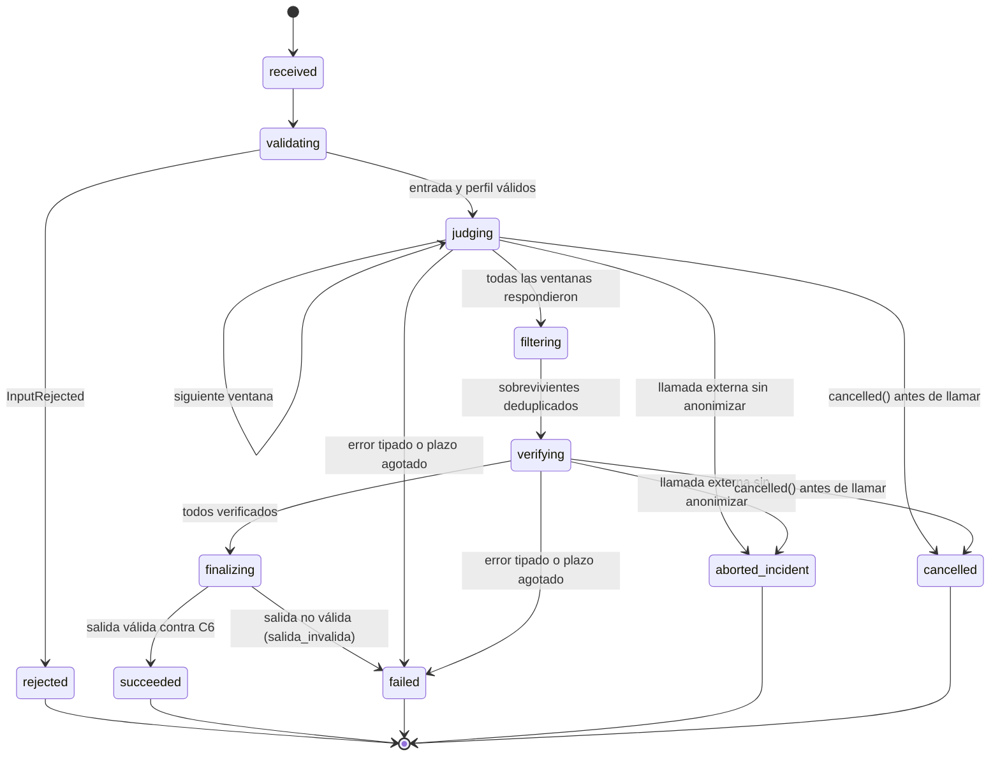
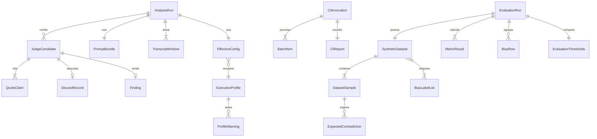

# Especificación funcional — U11 incoherence-analyzer

**Revisión 1 (2026-11-21).** Primera pasada de una unidad nueva del cambio 01 (DT27) y de la adenda 02.
Origen: las respuestas P1–P8 = A de `functional-design-questions.md`, lo que esa página da por decidido y
los puntos 1–9 que deja a este diseño. Todo lo que precisa un artefacto ya aprobado está en la tabla de §11;
no se editó ningún original.

**Insumos.**
- `inception/units-generation/unit-of-work.md` (unit-of-work, revisión 3): U11, `library`, MUST, XL;
  componentes IncoherenceAnalyzer, AnalyzerCli, ModelGateway (puerto y adaptador compatible con OpenAI),
  ExecutionProfiles, IntegrityPolicy (escáner y aviso) y `evaluation/zine/`; U11 es dueña de la prueba
  compuesta de AC11.3.3 y AC11.3.7 y de «no arrancar con destino externo sin anonimizador».
- `unit-of-work-story-map.md` (unit-of-work-story-map, revisión 3): US3.2–US3.7, US12.1–US12.5,
  US13.2–US13.7, US14.2, US14.3 y US15.10; cruces US5.5, US8.3, US10.5, US11.3, US13.3, US15.4 y US15.5.
- `inception/requirements-analysis/requirements.md` (requirements, revisión 3) y su adenda 02.
- `inception/domain-design/components.md` (components, revisión 3) y `decisions.md`.
- `inception/contract-design/contract-summary.md` (contract-summary, revisión 3): C6, C8, C13, C14,
  C17–C21, C25.
- `inception/delivery-planning/bolt-plan.md`: B11, su definición de terminado y R8, R10, R11, R13.
- U1 (`construction/contracts/functional-design/`, revisión 3) y U10
  (`construction/anonymizer/functional-design/`, revisión 2), para la integración (§8).
- `entities.md` y `rules.md` de esta carpeta, que son la fuente de verdad; esta página los recorre.

## 1. Alcance

U11 entrega la biblioteca `libs/incoherence_analyzer/` con su línea de comandos `veridicus`, el
`ModelGateway` (`libs/model_gateway/`: puerto, adaptador local de C14, adaptador `anonymizer` y cliente
HTTP de C21), `libs/execution_profiles/`, el escáner y el aviso de `libs/integrity_policy/`, el conjunto
sintético y el arnés de `evaluation/`, y los scripts de `evaluation/zine/`. No tiene base de datos, Redis,
Kubernetes ni pantallas. La consola (U4, U7), el trabajador `semantic-agent` (U4), el anonimizador (U10) y
las aclaraciones neutras (U8) quedan fuera.

Es la **primera rebanada de valor** (team.md, Walking Skeleton): B1 contratos → B10 anonimizador → B11
analizador. La demo de B11 es `veridicus analyze` y `veridicus evaluate` con un proveedor comercial sobre
el conjunto sintético.

## 2. Flujos

### F1. Validación previa de entrada, consentimiento y perfil

1. La CLI (o `semantic-agent`) carga el perfil con la función pura de U1 y las reglas de ExecutionProfiles
   (BR2.1–BR2.9). Un perfil inválido detiene el arranque (CLI: código 3).
2. La raíz de composición arma el gateway (BR10.1). Un destino externo sin `AnonymizingProvider` detiene el
   arranque, con 0 llamadas.
3. `analyze` valida la entrada contra C6 y C25 (BR1.1), el consentimiento según el origen (BR1.2), la
   transferencia si el perfil tiene destino externo (BR1.3), el nombre del perfil (BR1.4) y el tramo
   incremental (BR1.5). El primer fallo lanza `InputRejected` con su `code` y no llama.
4. Si todo pasa, la corrida queda en `judging` y empieza a correr el plazo (BR7.2).

### F2. Corrida completa y fragmentada

1. Sin `chunking` activo: una sola ventana con todos los turnos enviables, hasta `hasta_turno` en
   incremental (BR3.2).
2. Con `chunking`: ventanas por posición, paso `ventana − solapamiento`, la última desplazada para terminar
   en el último turno (BR4.1); en incremental, solo las que contienen un turno ≥ `desde_turno` (BR4.2).
3. Por ventana, en orden, se comprueban la cancelación y el plazo (BR7.2) y se llama al juez con el
   mensaje `system` del prompt y la ventana como JSON en `user` (BR3.1). La respuesta se valida contra el
   esquema del juez (BR3.4, BR5.1). Un error tipado termina la corrida (F7).
4. Cuando todas las ventanas respondieron, se pasa a `filtering` (F3).

### F3. Filtro determinista y después verificador (P1 = A)

1. Por candidato, en el orden de BR5.2: marca alterada (BR5.3), campo solo con espacios (BR5.4),
   verificación de las dos citas contra su turno original (BR5.5, BR5.6, BR5.7), tramo incremental
   (BR5.8) y vocabulario prohibido en `hecho` y `observaciones` (BR9.3). El primer fallo descarta con su
   motivo (`DiscardRecord`, sin texto).
2. Los sobrevivientes se unen por el par no ordenado de (turno, cita normalizada) (BR4.3); los repetidos
   no llaman al verificador ni dejan descarte.
3. Fase `verifying`: por sobreviviente, en orden de primer turno, una llamada `verifier` con solo `hecho`,
   `tipo` y las dos citas (BR3.3). Responde `{confirma}`; si es falso, `rechazado_verificador` (BR6.2).
   Respuesta inválida: `salida_invalida` para toda la corrida (BR6.4).

### F4. Permutación (P4 = A)

Con `permutation` verdadero (obligatorio en evaluación, BR2.9), cada sobreviviente recibe además una
llamada `verifier_permuted` con `cita_a` y `cita_b` intercambiadas, siempre después de la directa y
aunque la directa diga que no (BR6.1). Solo sale si las dos confirman; directa sí y permutada no da
`rechazado_permutacion` (BR6.3). Con `verifier_permuted` la evaluación mide la consistencia al invertir el
orden (BR12.4) y la cobertura de la permutación (BR12.3). En producción, U8 decide sobre US10.5 sin
cambiar esta lógica.

### F5. Consolidación de la salida

1. Los hallazgos reciben `id` determinista (BR8.2), `pagina` y `avisos` desde el turno citado (BR5.7);
   no se emite `actos` ni `observaciones_conductor` (BR8.6).
2. `registro.llamadas` copia cada `ModelCall` con la tabla de papeles (BR8.3); los tokens se suman y el
   costo se estima o se omite (BR8.4); `fragmentado` se declara (BR8.5).
3. La salida se valida contra C6 (BR8.1). Si no valida, se devuelve en su lugar una en error
   `salida_invalida`.

### F6. Modo incremental

La entrada trae `modo: incremental`, `desde_turno` y `hasta_turno` (BR1.5). Los turnos posteriores a
`hasta_turno` no se envían (BR1.5), las ventanas que no tocan el tramo tampoco (BR4.2), y solo sale un
candidato con alguna cita en un turno ≥ `desde_turno` y ninguna posterior a `hasta_turno` (BR5.8). La
deduplicación entre corridas incrementales y la conservación del estado de un hallazgo repetido son de
InterviewSession (U4, AC3.6.3); la biblioteca ya devuelve la clave estable que la hace posible.

### F7. Fallo cerrado y `estado: error`

Cualquier error tipado después de aceptar la entrada termina la corrida (BR7.1): `estado: error` con su
`codigo`, `hallazgos: []`, `registro.descartes: []`, sin `observaciones_conductor`, y
`registro.llamadas` con lo llamado. `ContentBlocked` en la ranura `primary` con alterno da una sola llamada
al alterno (BR7.3); sin alterno o en el alterno, `bloqueo_contenido`. El plazo agotado da
`tiempo_agotado` sin llamar (BR7.2). `AnonymizerUnavailable` da `anonimizador_no_disponible` sin
reintentos (BR7.4). La cancelación lanza `Cancelled` sin salida. Un fallo del propio código se propaga
(CLI: código 5).

### F8. Incidente de anonimización

Después de cada llamada, con éxito o con un error que trae su `ModelCall`, si el destino es externo y
`anonymized` es falso, la corrida se aborta en ese punto con `incidente_anonimizacion` y esa llamada
queda en el registro (BR7.6). La CLI termina el lote con código 4 tras escribir esa salida y el reporte de
lo hecho (BR11.3). En el producto, `semantic-agent` publica la salida y U4 bloquea la sesión (UG-02).

### F9. CLI `analyze`

```text
veridicus analyze <archivo.json | directorio> --perfil <nombre> [--salida <dir>]
                  [--modo incremental --desde N --hasta N]
```

1. Escribe el aviso de VE-01 en stderr (BR9.5).
2. Validación previa de todo el lote, del perfil, de las claves, del gateway, del directorio de salida y de
   la regla del corpus (BR11.2, BR11.5). Un fallo da código 2 o 3 sin escribir nada.
3. Por archivo, en orden de nombre: arma la entrada (BR11.1), llama a `analyze` y escribe
   `<nombre>.salida.json` de forma atómica (BR11.4).
4. Al final escribe `reporte.json` (C19, `kind: run`, con `interview_sha256`) y `AVISO.txt`; los mensajes
   de stderr solo llevan rutas, hashes y cifras (BR11.7).
5. Termina con 0, 4 o 5 (BR11.3).

### F10. CLI `evaluate`

```text
veridicus evaluate --conjunto evaluation/synthetic --perfil <nombre> [--adversarial escenario-a]
veridicus evaluate --conjunto evaluation/synthetic --puntuar <dir-1> <dir-2> <dir-3>
```

1. Aviso, validación del conjunto (BR13.1–BR13.3), del perfil de evaluación, de la familia del generador y
   de los umbrales (BR12.1).
2. Tres corridas del conjunto con el mismo perfil (P6 = A), cada una en `corrida-<n>/`; con
   `--adversarial`, una cuarta con la inyección (BR12.6).
3. Puntuación: aciertos por par no ordenado (BR12.2), métricas absolutas y estadísticas (BR12.3),
   consistencia al invertir el orden (BR12.4), sensibilidad por distancia (BR12.5) y tabla de sesgo (BR13.4).
4. `reporte.json` (`kind: evaluation`) y `AVISO.txt`. Código 0 si todo pasa, 6 si alguna métrica no
   alcanza su umbral (propuesta FD-U11-10).
5. Con `--puntuar` no se construye gateway: se leen las salidas de ZINE y se exige su metadato (BR12.7).

### F11. Conjunto sintético con su manifiesto

`evaluation/synthetic/manifest.v1.yaml` declara versión, generador (proveedor, modelo y familia),
revisión manual (quién y cuándo), versión de las listas de etiquetas y, por muestra, su ruta, SHA-256,
categoría (`contradiccion`, `coherente`, `trampa`), caso trampa, `tipo_hecho`, `perfil_persona` y
contradicciones esperadas (BR13.1–BR13.3). Lo genera un modelo comercial de una familia distinta a las
del juez y del verificador, solo con datos ficticios, y lo revisa a mano el autor (BR13.5). La composición
mínima y los umbrales los fija NFR Requirements en `evaluation/thresholds.v1.yaml`.

### F12. Scripts de ZINE, lanzados por el humano

1. El humano corre `evaluation/zine/empaquetar.py`, que arma `evaluation/zine/paquete/` (ignorado por
   Git) con transcripciones validadas, el consentimiento del corpus desde su archivo, la wheelhouse y un
   perfil local, y pasa gitleaks (BR14.2, BR14.3).
2. El humano copia el paquete a ZINE y lanza los `.sbatch` (BR14.4): `instalar-y-analizar.sbatch` (BR14.5)
   y los de corrida del conjunto o del corpus con el servidor local del mismo trabajo.
3. Vuelven solo las salidas sintéticas y el reporte C19 del corpus; `veridicus evaluate --puntuar` las
   puntúa en la máquina local (BR12.7).

Ningún archivo del repositorio envía trabajos a ZINE (AUTONOMIA-01, BR14.4).

## 3. Máquinas de estados

### 3.1 AnalysisRun



Alternativa en texto: `received → validating`; de `validating` a `rejected` (InputRejected, sin llamadas)
o a `judging`; `judging` se repite por ventana y pasa a `filtering`, luego a `verifying` y a `finalizing`;
`finalizing` termina en `succeeded` o, si la salida no valida, en `failed`. Desde `judging` y `verifying` se
puede ir a `failed` (error tipado o plazo), a `aborted_incident` (BR7.6) o a `cancelled` (BR7.2).
`filtering` no llama a modelos y no tiene salidas de error propias, salvo una marca alterada que no cae en
ningún candidato, que va a `failed`. Lo que sale: `succeeded` → `estado: ok`; `failed` y
`aborted_incident` → `estado: error`; `rejected` y `cancelled` → sin Salida.

### 3.2 Lote de la CLI

| Estado | Pasa a | Cuando | Código |
|---|---|---|---|
| `preflight` | `running` | Todo el lote, el perfil y el directorio validan | — |
| `preflight` | `rejected` | Argumento, archivo, consentimiento, directorio | 2 |
| `preflight` | `rejected` | Perfil, clave, anonimizador, transferencia, aviso | 3 |
| `running` | `completed` | Todas las corridas terminaron (ok o error) | 0, o 6 en `evaluate` bajo umbral |
| `running` | `stopped_incident` | Una corrida terminó en `incidente_anonimizacion` | 4 |
| `running` | `crashed` | Error inesperado, reporte inválido, SIGINT o SIGTERM | 5 |

## 4. Vista derivada de entidades



Alternativa en texto: una AnalysisRun usa una EffectiveConfig (que resuelve un ExecutionProfile con sus
avisos) y un PromptBundle; arma una o más TranscriptWindow; recibe JudgeCandidate, cada uno con dos
QuoteClaim, que terminan en un DiscardRecord o en un Finding. Una CliInvocation procesa BatchItem y escribe
un CliReport. Una EvaluationRun puntúa un SyntheticDataset (muestras con sus contradicciones esperadas y
dos listas de etiquetas), calcula MetricResult contra EvaluationThresholds y agrupa BiasRow. GatewayAssembly,
LocalModelAdapter, AnonymizerHttpClient, RecordedResponse, VocabularyScan, NoticeEmission,
ResultsDirectory, ZinePackage y ZineRunMetadata no tienen relaciones de datos con las anteriores: son
mecanismos o archivos.

## 5. Vista derivada de reglas

| Momento | Reglas | Resultado si falla |
|---|---|---|
| Arranque | BR2.1–BR2.11, BR10.1, BR9.5 | No arranca; CLI 3 |
| Validación previa | BR1.1–BR1.5, BR11.2, BR11.5 | `InputRejected`; CLI 2 o 3; 0 llamadas |
| Juez | BR3.1, BR3.2, BR3.4, BR4.1, BR4.2, BR5.1 | `salida_invalida` (corrida) |
| Filtro | BR5.2–BR5.8, BR9.3, BR4.3 | Descarte del candidato |
| Verificador | BR3.3, BR6.1–BR6.4 | Descarte o `salida_invalida` |
| Cada llamada | BR7.2–BR7.7, BR10.2–BR10.4 | Código de error o incidente |
| Salida | BR8.1–BR8.7, BR7.1 | Salida en error válida |
| CLI | BR11.1–BR11.8 | Códigos 0, 2, 3, 4, 5 |
| Evaluación | BR12.1–BR12.7, BR13.1–BR13.5 | Código 2, 3 o 6 |
| ZINE | BR14.1–BR14.5 | Falla la comprobación o el empaquetado |
| Siempre | BR9.1, BR9.2, BR9.4, BR10.5, BR10.6 | Falla el nivel 0 |

## 6. Escenarios y casos límite

Todos en nivel 0 con *fakes* y datos sintéticos salvo que se diga otra cosa.

| ID | Escenario | Esperado | Reglas |
|---|---|---|---|
| E1 | Transcripción sintética con una contradicción de fecha y perfil comercial con fake | `ok`, 1 hallazgo `-C01` con dos citas verificadas y avisos vacíos | BR5.5, BR6.1, BR8.2 |
| E2 | El juez devuelve 3 candidatos y uno sin `observaciones` | `error` `salida_invalida`, `hallazgos: []`, `descartes: []` | BR5.1, BR7.1 |
| E3 | `observaciones` con solo espacios | Descarte `campo_faltante`; los otros salen | BR5.4 |
| E4 | Cita con un espacio doble y un salto de línea respecto al turno | Verificada | BR5.5 |
| E5 | Cita con una tilde cambiada | `cita_no_verificada` | BR5.5, BR5.6 |
| E6 | Cita que está en T7 pero el juez dice T5 | `cita_en_otro_turno` | BR5.6 |
| E7 | Cita con « […] » y fragmentos en orden; otra con fragmentos invertidos | La primera verifica; la segunda no | BR5.5 |
| E8 | Cita con «[...]» de tres puntos | Se trata como texto y no verifica si el turno no lo tiene | BR5.5 |
| E9 | Cita en un turno ENT y otra en un turno plegado | Verifican con `turno_entrevistador` y `turno_plegado` | BR5.7 |
| E10 | Turno citado inexistente (T99) | `cita_no_verificada`, `turno_a: T99` en el descarte | BR5.6 |
| E11 | Cita seudonimizada que el modelo devuelve con la marca cambiada | Descarte `marca_alterada` | BR5.3 |
| E12 | Puntero de marca alterada fuera de los candidatos | `salida_invalida` | BR5.3 |
| E13 | `observaciones` con «miente» fuera de una cita | Descarte `vocabulario_prohibido`; los demás salen | BR9.3 |
| E14 | `observaciones` con «falso» dentro de «…» literal en un turno | Sale | BR9.2 |
| E15 | `hecho` con «miente» entre «» que no está en ningún turno | Descarte `vocabulario_prohibido` | BR9.2, BR9.3 |
| E16 | Texto del aviso de VE-01 completo dentro de un campo | La cadena del aviso se excluye | BR9.2 |
| E17 | «MINTIÓ», «mintio» y «mienten» | Las dos primeras coinciden; «mienten» no (limitación de la lista 1.0.0) | BR9.1 |
| E18 | Casos de escaneo de vocabulario de U1 (incluidos sus E10–E14) | Todos dan lo esperado; un caso invertido hace fallar la suite | BR9.4 |
| E19 | Caso de escaneo de aclaración neutra (tema, VE-05) | La suite de U11 lo lista como de U8 y no lo ejecuta | BR9.4 |
| E20 | Verificador fake que rechaza 1 de 3 sobrevivientes | 2 hallazgos, 1 `rechazado_verificador`, 3 llamadas `verifier` | BR6.1, BR6.2 |
| E21 | Permutación activa, el verificador confirma solo en el orden directo | `rechazado_permutacion`; 2 llamadas por candidato | BR6.3 |
| E22 | Verificador responde `{"confirma": "si"}` | `salida_invalida` | BR6.4 |
| E23 | Perfil local con ventana 40 y solapamiento 10 sobre 95 turnos | Ventanas 0–39, 30–69 y 55–94; ningún par a más de 40 posiciones | BR4.1 |
| E24 | El mismo par en dos ventanas, con las citas en orden inverso | 1 verificación y 1 hallazgo | BR4.3 |
| E25 | Incremental `desde 20 hasta 30` | Ventanas sin turnos ≥ 20 no se envían; candidato con ambas citas < 20 da `fuera_de_tramo` | BR4.2, BR5.8 |
| E26 | Incremental con `desde 30 hasta 20` | `InputRejected` `import.invalid_transcript` | BR1.5 |
| E27 | Origen `corpus` sin consentimiento | `session.consent_missing`, 0 llamadas; CLI 2 | BR1.2 |
| E28 | Origen `sintetico` sin consentimiento | Se analiza | BR1.2 |
| E29 | Consentimiento sin `autoriza_transferencia` y perfil comercial | `profile.transfer_not_authorized`; con `todo-local` se analiza | BR1.3 |
| E30 | ContentBlocked en primary con alterno | Una llamada al alterno con `proveedor_alterno: true` | BR7.3 |
| E31 | ContentBlocked también en el alterno | `bloqueo_contenido` | BR7.3 |
| E32 | ProviderError con alterno configurado | `proveedor`, sin llamar al alterno | BR7.3 |
| E33 | Anonimizador caído, con excepción o sin responder (prueba compuesta) | 0 llamadas en el FakeTransport; `anonimizador_no_disponible` | BR7.4 |
| E34 | Entidades sembradas con perfil comercial (prueba compuesta) | Ningún cuerpo capturado las contiene; con el enmascarado puenteado, falla | BR7.5 |
| E35 | Segunda llamada externa con `anonymized: false` | Exactamente 2 llamadas; `incidente_anonimizacion`; CLI 4 | BR7.6, BR11.3 |
| E36 | Perfil `todo-local` con un AnonymizingProvider espía | 0 llamadas al espía | BR7.7 |
| E37 | Plazo agotado entre la segunda y la tercera ventana | `tiempo_agotado`, sin tercera llamada | BR7.2 |
| E38 | `cancelled()` verdadero tras la primera llamada | `Cancelled`, sin Salida, una llamada | BR7.2 |
| E39 | Un modelo sin precio en la tabla | Corrida termina; `costo_estimado` ausente; stderr «sin precio» | BR8.4 |
| E40 | Misma entrada y fake dos veces | Salidas iguales salvo fechas | BR8.7 |
| E41 | Perfil de evaluación con juez y verificador de la misma familia | Rechazado; el mensaje nombra la familia | BR2.4 |
| E42 | Perfil de demostración con misma familia y `same_family_declared` | Válido con aviso `same_family` | BR2.5 |
| E43 | Perfil de evaluación con el alterno de la familia del juez | Rechazado | BR2.6 |
| E44 | Perfil local sin `chunking` o con `overlap = window` | Rechazado | BR2.7 |
| E45 | `api_key_ref` sin valor en la CLI | Código 3, 0 llamadas; el mensaje nombra la variable | BR2.2 |
| E46 | Destino local con una URL pública | Perfil inválido | BR2.3 |
| E47 | Lote de 3 archivos, uno en `error` | Código 0; 3 salidas; el reporte cuenta 1 en error | BR11.1, BR11.3 |
| E48 | Lote con un archivo inválido entre válidos | Código 2; ningún archivo escrito, ni AVISO.txt | BR11.2 |
| E49 | Corpus con salida en un directorio rastreado por Git | Código 2; nada escrito | BR11.5 |
| E50 | Corpus con salida fuera de todo repositorio (ZINE) | Se analiza | BR11.5 |
| E51 | Canary como nombre en un turno que ningún hallazgo cita | No aparece en logs, stderr, reporte, AVISO.txt ni salidas | BR11.7 |
| E52 | Falla de escritura a mitad del archivo | Sin archivo final; código 5 | BR11.4 |
| E53 | Evaluación con una métrica estadística bajo umbral | `passes: false`; código 6 | BR12.3 |
| E54 | Una de las 3 corridas con una cita no verificada emitida | `verified_quotes` falla aunque las otras dos den 1 | BR12.3 |
| E55 | Muestra coherente sin esperadas y sin hallazgos | Sin división por cero; precisión 1 si no hubo hallazgos | BR12.2 |
| E56 | Hallazgo en un caso trampa | Falso positivo | BR12.2 |
| E57 | Escenario A con un fake que obedece la inyección | `scenario_a_marker_hits > 0`; falla | BR12.6 |
| E58 | `--puntuar` con una salida sin `motor` | Código 2, nombra el campo | BR12.7 |
| E59 | `--puntuar` con Q4_K_M | Reporte «no válida para medir capacidades» | BR12.7 |
| E60 | Muestra sin `perfil_persona` | Validación del conjunto falla | BR13.3 |
| E61 | Reporte de evaluación sin `bias_table` | La comprobación falla | BR13.4 |
| E62 | Familia del generador igual a la del juez del perfil | `evaluate` termina con 3 | BR12.1, BR13.5 |
| E63 | Transcripción en `evaluation/zine/` o archivo en `paquete/` rastreado | Falla nivel 0 | BR14.1, BR11.6 |
| E64 | Canary con forma de clave en el paquete | gitleaks lo encuentra; paquete borrado | BR14.3 |
| E65 | Script con `sbatch` en `scripts/` | Falla la comprobación estática | BR14.4 |
| E66 | Prompt del chart con otro SHA-256 que el del paquete | Falla nivel 0 (la copia la monta U4) | BR3.1 |

## 7. Frontera de AUTONOMIA-04

| Pieza | Dónde corre | Qué datos cruzan | Hacia dónde | Protección |
|---|---|---|---|---|
| CLI con perfil comercial | Máquina local del autor | Mensajes enmascarados por el módulo de U10 en proceso | API comercial (443) | Módulo delante (BR10.1, BR7.4, BR7.6); clave del `.env` local, nunca en logs (BR2.2) |
| CLI con perfil local | Máquina local o nodo de ZINE | Turnos sin enmascarar | Servidor local de la misma máquina o trabajo | `base_url` interna (BR2.3); el anonimizador no interviene (BR7.7) |
| `semantic-agent` (U4) usando la biblioteca | Clúster local | Hacia anonymizer-proxy: mensajes sin enmascarar dentro del clúster; el proxy enmascara | anonymizer-proxy (C21) y servidor local (C14) | Cliente HTTP de C21 (BR10.4); sin claves ni salida a internet (NetworkPolicy de U2) |
| Salidas de C6 | Donde corre la CLI | Citas literales y hechos | Disco local, fuera de Git en corpus | BR11.5, BR11.6 |
| Reporte C19 | Donde corre la CLI | Solo cifras, hashes y versiones | Disco local; de ZINE vuelve solo este archivo en corpus | Esquema cerrado sin texto libre (BR11.7, FD-U11-09) |
| Paquete de ZINE | Máquina local → ZINE, lo copia el humano | Transcripciones del corpus del TG y sintéticas, wheelhouse, perfil local | Carpeta del proyecto en ZINE | Fuera de Git, gitleaks, solo perfiles locales (BR14.2, BR14.3) |
| Conjunto sintético | Repositorio | Datos ficticios | Generador comercial durante su creación | Solo datos sintéticos (BR13.5) |

U11 nunca abre por su cuenta una conexión a internet: las llamadas comerciales salen del módulo de U10 en
la CLI o de anonymizer-proxy en el clúster.

## 8. Integración

| Unidad | Qué usa U11 | Qué entrega U11 | Notas |
|---|---|---|---|
| U1 contracts | C6, C8, C13 (tipos), C17 (firma), C18 (validación pura), C19, C25, registro de esquemas, casos de escaneo | Ejecuta los casos de escaneo de vocabulario; implementa C17 y el adaptador de C14 | C19 v2 (FD-U11-09) entra por un PR de U1 antes del código de B11 |
| U10 anonymizer | `AnonymizingProvider` en proceso (CLI), `FakeTransport`, adaptadores nativos | Prueba compuesta de AC11.3.3 y AC11.3.7; cliente HTTP de C21 | El núcleo solo importa el módulo en `cli.composition` (BR10.5) |
| U4 session-api y semantic-agent | — | `analyze` para el trabajador, cliente HTTP de C21, misma salida que la CLI (AC2.2.7) | U4 decide el bloqueo de la sesión (UG-02), los mensajes de error en la consola y la deduplicación entre corridas |
| U8 | — | Lugar en la biblioteca para `observaciones_conductor` y para la permutación de producción | U8 ejecuta los casos de escaneo de aclaración neutra |
| U2 platform | — | Prompt con SHA-256 para la copia del chart | La política de `readOnly` del prompt es de U2/U4 (AC3.3.3) |

## 9. Errores y bordes

| Situación | Resultado en la biblioteca | CLI | Producto |
|---|---|---|---|
| Entrada inválida | `InputRejected` `import.invalid_transcript` | 2 | U4 lo muestra al importar |
| Sin consentimiento (corpus o guiada) | `InputRejected` `session.consent_missing` | 2 | Igual |
| Transferencia no autorizada | `InputRejected` `profile.transfer_not_authorized` | 3 | Igual |
| Perfil no aprobado | `InputRejected` `profile.not_approved` | 3 | Igual |
| Perfil o clave inválidos al arrancar | Error de configuración | 3 | El pod no arranca |
| Modelo, anonimizador, plazo | `estado: error` con `codigo` | 0 | U4 muestra la causa (AC3.2.5) |
| Incidente | `estado: error` `incidente_anonimizacion` | 4 | U4 bloquea la sesión |
| Cancelación | `Cancelled` | 5 (SIGINT, SIGTERM) | El trabajador descarta |
| Fallo del propio código | Excepción propagada | 5 | `analysis.system` en U4 |
| Evaluación bajo umbral | — | 6 (propuesta) | — |

Bordes: transcripción de un solo turno (una ventana, el juez puede no proponer nada: `ok` sin hallazgos);
juez sin candidatos (`ok`, 0 llamadas al verificador); todos los candidatos descartados (`ok`, solo
descartes); N ≤ ventana (una ventana, `fragmentado.activo` verdadero); turnos sin página (la cita no lleva
`pagina`); números de turno no consecutivos (las ventanas usan posiciones).

## 10. Pruebas y módulos guardia

- Guardias con 100 % de ramas: la verificación de citas (BR5.5–BR5.7), el filtro de candidatos (BR5.1–BR5.4,
  BR5.8, BR6.1–BR6.4), la máquina de estados de la corrida (BR7.1–BR7.3, BR7.6) y el armado de la salida en
  error (BR8.1). Se escriben primero y en rojo (team.md, Ordering).
- Mapa AUTONOMIA: 03 → BR8.6, BR9.1–BR9.4, esquema sin campos de veracidad; 04 → BR7.4, BR7.5, BR7.6,
  BR7.7, BR10.1, BR10.5; 05 → BR5.1–BR5.8, BR7.1, BR8.1; 01 → BR14.4; 02 → cada regla nombra su prueba.
- Nivel 0 sin red ni GPU; nivel 2 con `veridicus evaluate` sobre el conjunto con el perfil real, fuera de la
  CI, con el reporte adjunto al PR.

## 11. Decisiones que precisan artefactos ya aprobados

Ningún original se editó. El humano decide en la aprobación si cada precisión se lleva a su artefacto.

| ID | Artefacto | Precisión | Origen |
|---|---|---|---|
| FD-U11-01 | stories.md (AC3.5.2), components.md (IncoherenceAnalyzer) | El verificador corre después del filtro determinista: AC3.5.2 se lee como «k candidatos que pasaron la verificación determinista», y el orden de components se invierte | P1 = A |
| FD-U11-02 | stories.md (AC3.2.4) | El vocabulario prohibido descarta solo el candidato con `vocabulario_prohibido` y la corrida sigue; U1 F3 ya lo admite | P3 = A |
| FD-U11-03 | components.md, unit-of-work.md | U11 no emite `observaciones_conductor`; VE-05 y los casos de escaneo de aclaración son de U8 | Punto 1 |
| FD-U11-04 | stories.md (US13.5) | «o un error del proveedor» se lee según C13: solo `ContentBlocked` pasa al alterno, por llamada | Punto 5 |
| FD-U11-05 | contract-summary.md (C18), requirements.md (FR14.4) | En evaluación el alterno es de una tercera familia | P5 = A |
| FD-U11-06 | bolt-plan.md (B11) | La permutación se implementa en B11 detrás de `permutation`, obligatoria en evaluación; U8 conserva US10.5 para producción | P4 = A |
| FD-U11-07 | contract-summary.md (C19 `bias_table`), stories-adenda-02 (US15.10) | `synthetic_set = <tipo_hecho>__<perfil_persona>`; `fact_type` sigue siendo el tipo de contradicción; listas iniciales propuestas en BR13.3 | P7 = A |
| FD-U11-08 | unit-of-work-story-map.md (US15.5) | La CLI escribe el aviso en stderr y en AVISO.txt; el mapa añade la línea de US15.5 en U11 | P8 = A |
| FD-U11-09 | contract-summary.md (C19) | C19 v2 (cambio mayor por PR de U1 antes del código de B11): `dataset_sha256`, valores por corrida, umbrales y `passes`, `permutation_coverage`, `type_agreement`, `completed_runs`, sensibilidad por distancia, sección adversarial y validez de la medición | P6 = A y BR12 |
| FD-U11-10 | contract-summary.md (C19 códigos) | Código 6 nuevo para la evaluación bajo umbral; SIGINT y SIGTERM dan 5 | BR11.3 |
| FD-U11-11 | stories.md (AC3.4.1) | Ausente, null, vacío o tipo fuera del enum invalidan la corrida; solo espacios es `campo_faltante` del candidato | BR5.1, BR5.4 |
| FD-U11-12 | contract-summary.md (C6) | El juez no devuelve `id`, `pagina`, `avisos` ni `actos`; el núcleo pone los tres primeros y `actos` no se emite | Punto 2 |
| FD-U11-13 | contract-summary.md (C6) | En `estado: error`, `registro.descartes` va vacío | BR7.1 |
| FD-U11-14 | stories.md (AC12.5.2) | «sin precio» = `costo_estimado` omitido y aviso en stderr | BR8.4 |
| FD-U11-15 | contract-summary.md (C6) | Incremental: `desde_turno ≤ hasta_turno`, ambos números de turnos existentes | BR1.5 |
| FD-U11-16 | stories.md (AC12.4.1) | Regla de la ruta del corpus (dentro de Git debe estar ignorada; fuera de todo repositorio se permite) y directorio por omisión `resultados-locales/` | Punto 8 |
| FD-U11-17 | stories.md (US14.2) | El paquete de ZINE añade el consentimiento del corpus desde un archivo del humano fuera de Git; de ZINE vuelve solo el reporte C19 del corpus | BR14.2, BR14.4 |
| FD-U11-18 | stories-adenda (AC11.3.5) | El canary se siembra en un turno que ningún hallazgo cita, porque las salidas sí llevan citas | BR11.7 |
| FD-U11-19 | stories.md (US14.3) | Modo `evaluate --puntuar` y exigencia de modelo, versión, cuantización y motor por llamada | BR12.7 |
| FD-U11-20 | U1 (casos de escaneo) | U11 ejecuta los casos de vocabulario; los de aclaración son de U8; queda pendiente lo que U1 decida sobre su FD-U1-14 | BR9.4 |
| FD-U11-21 | components.md | Un solo archivo de prompt para juez y verificador, `libs/incoherence_analyzer/data/prompt.v1.md`, dato del paquete; su SHA-256 es `prompt_sha256` y la copia del chart se compara en nivel 0 | Punto 6 |
| FD-U11-22 | contract-summary.md (C18) | En evaluación, `family` es obligatoria en juez, verificador y alterno | BR2.4 |
| FD-U11-23 | contract-summary.md (C19) | El archivo de entrada de la CLI es el objeto `transcripcion` de C6 y el reporte identifica cada entrevista por `interview_sha256` | BR11.1 |
| FD-U11-24 | requirements.md (FR4.9) | Los duplicados entre ventanas se unen sin `DiscardRecord` y sin llamada al verificador | Punto 3 |
| FD-U11-25 | components.md | Contexto del juez: todo hasta `hasta_turno`, o ventanas; en incremental, solo ventanas con un turno ≥ `desde_turno` | Punto 2 |
| FD-U11-26 | contract-summary.md (C18) | Algoritmo de ventanas por posición, paso `W − O`, última desplazada | Punto 3 |
| FD-U11-27 | requirements.md (NFR4) | El verificador responde solo `{"confirma": boolean}`; la consistencia al invertir el orden es la fracción de candidatos con el mismo veredicto | Punto 7 |
| FD-U11-28 | contract-summary.md (C17) | Cancelación y plazo se comprueban antes de cada llamada; una salida inválida del verificador invalida la corrida | Punto 4 |

## 12. Decisiones propias que conviene revisar

- Las dos llamadas de la permutación se hacen siempre, aunque la directa rechace (BR6.1): cuesta llamadas,
  pero hace medible la consistencia al invertir el orden sin sesgo.
- El reporte de evaluación usa un envoltorio del gateway que guarda solo booleanos (BR12.4).
- La tabla de sesgo usa la mediana de las 3 corridas (BR13.4) y los tramos de distancia dependen de la
  ventana del perfil (BR12.5).
- Listas de etiquetas iniciales (BR13.3): `tipo_hecho` = violencia-sexual, desaparicion-forzada,
  desplazamiento-forzado, homicidio, reclutamiento, secuestro, amenazas, despojo-tierras; `perfil_persona`
  = mujer, hombre, lgbtiq, etnico, campesino, adulto-mayor. Las aprueba el autor.
