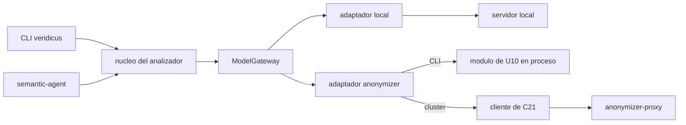

# Componentes lógicos — U11 incoherence-analyzer

**Revisión 1 (2026-11-22): primera pasada.** U11 no despliega nada propio: es código que corre dentro de
otros procesos (la CLI en una máquina local o en un nodo de ZINE, y `semantic-agent` en el clúster). Este
documento dice qué pieza aplica cada patrón de NFR y qué recibe de Infrastructure Design (U2) y de U4.

**Insumos.** `nfr-requirements/security-requirements.md` (security-requirements, frontera §1),
`performance-requirements.md` (performance-requirements), `reliability-requirements.md`
(reliability-requirements) y `tech-stack-decisions.md` (tech-stack-decisions, D1 y §5) de esta unidad; §1,
§7 y §8 de `functional-design/functional-spec.md` (functional-spec); C13, C14, C17, C18, C21 y C25 de
`inception/contract-design/contract-summary.md` (contract-summary). No hay `scalability-requirements` ni
`observability-requirements` para U11.

## 1. Inventario

| Componente | Ruta | Proceso | Dentro / fuera | Patrones NFR que aplica |
|---|---|---|---|---|
| API del analizador (C17) | `libs/incoherence_analyzer/api.py` | CLI o `semantic-agent` | Máquina local, nodo de ZINE o clúster | Validación previa, plazo de la corrida, cancelación |
| Dominio | `libs/incoherence_analyzer/domain/` (`quotes`, `filter`, `windows`, `run_state`, `output`, `ids`) | Igual | Igual | Código puro, 100 % de ramas, fallo cerrado, determinismo |
| Aplicación | `libs/incoherence_analyzer/application/` (`analyze`, `preflight`, `messages`, `deadline`) | Igual | Igual | Reloj inyectado, un solo armado de mensajes |
| *Prompt* y esquemas | `libs/incoherence_analyzer/data/` | Igual | Igual | Huella comprobada al arrancar |
| CLI | `libs/incoherence_analyzer/cli/` (`main`, `composition`, `io_atomic`, `results_dir`, `messages`, `evaluate/`) | Proceso `veridicus` | Máquina local o nodo de ZINE | Escritura atómica, señales, catálogo de mensajes, regla del corpus |
| Puerto y enrutador | `libs/model_gateway/port.py`, `gateway.py` | CLI o `semantic-agent` | Igual | Armado por perfil, registro y latencia por llamada |
| Adaptador local (C14) | `libs/model_gateway/adapters/local_openai.py` | Igual | Habla solo con servidores internos | Plazo, reintento acotado, tope de respuesta, sin redirecciones, `trust_env=False` |
| Adaptador `anonymizer` | `libs/model_gateway/adapters/anonymizing.py` | Igual | Único punto de envío externo | Fallo cerrado, comprobación de `anonymized`, sin reintentos |
| Cliente de C21 | `libs/model_gateway/adapters/anonymizer_http.py` | `semantic-agent` | Dentro del clúster | Margen de 10 s, rechazo por tamaño, traducción de estados |
| *Fakes* | `libs/model_gateway/testing/` | Solo pruebas | Ninguno | Prohibidos fuera de las pruebas |
| Perfiles | `libs/execution_profiles/` | CLI, `semantic-agent`, `session-api` | Igual | Validación pura, piso de 270 s, solo lectura |
| Política de integridad | `libs/integrity_policy/` (`scan`, `notice`) | Igual | Igual | Lista de C8 sin palabras en el código |
| Evaluación | `evaluation/` (`synthetic/`, `adversarial/`, `thresholds.v1.yaml`) | CLI | Repositorio; solo datos sintéticos | Umbrales que no bajan, reanudación por muestras |
| ZINE | `evaluation/zine/` | El humano | Fuera de Git el paquete | Ningún script lanza trabajos |

## 2. Componentes en YAML

```yaml
components:
  - name: incoherence-analyzer-core
    path: libs/incoherence_analyzer
    hosts: [cli, semantic-agent]
    boundary: inside
    data_out: none
    guard: true
  - name: analyzer-cli
    path: libs/incoherence_analyzer/cli
    hosts: [cli]
    boundary: local_machine
    data_out: c6_outputs_and_c19_report_on_local_disk
    guard: false
  - name: model-gateway-local
    path: libs/model_gateway/adapters/local_openai.py
    hosts: [cli, semantic-agent]
    boundary: inside
    data_out: none
    allowed_hosts: [private_ranges, cluster_service_names, loopback]
    guard: false
  - name: model-gateway-anonymizing
    path: libs/model_gateway/adapters/anonymizing.py
    hosts: [cli, semantic-agent]
    boundary: inside
    data_out: via_injected_anonymizing_provider_only
    guard: true
  - name: anonymizer-http-client
    path: libs/model_gateway/adapters/anonymizer_http.py
    hosts: [semantic-agent]
    boundary: inside
    data_out: none
    guard: false
  - name: execution-profiles
    path: libs/execution_profiles
    hosts: [cli, semantic-agent, session-api]
    boundary: inside
    data_out: none
    guard: true
  - name: integrity-policy
    path: libs/integrity_policy
    hosts: [cli, semantic-agent, session-api]
    boundary: inside
    data_out: none
    guard: true
```

## 3. Dominios de fallo y radio de impacto



<!-- Texto alternativo: la CLI y semantic-agent usan el mismo núcleo, que llama al ModelGateway. El gateway elige el adaptador local, que habla con el servidor local, o el adaptador anonymizer. Este usa el módulo de U10 en el mismo proceso cuando corre en la CLI y el cliente de C21 hacia anonymizer-proxy cuando corre en el clúster. -->

| Falla | Radio de impacto | Contención |
|---|---|---|
| Servidor local caído | Las corridas que lo usan terminan en `proveedor` tras 2 reintentos | Reintento acotado por el plazo; ninguna corrida parcial |
| Anonimizador o proxy caído | Las corridas con destino externo terminan en `anonimizador_no_disponible`; `todo-local` sigue | 0 llamadas, sin reintento ni alterno |
| Proveedor comercial con error | Esa corrida (`proveedor`, `bloqueo_contenido`, `tiempo_agotado`) | Sin reintento; el alterno solo ante `ContentBlocked` |
| Llamada externa sin anonimizar | Esa corrida y el lote de la CLI (código 4); en el producto, la sesión (U4) | Aborto inmediato y bloqueo humano |
| Perfil, *prompt* o límites inválidos | Nada arranca | Error de configuración antes de la primera llamada |
| Disco que falla | El archivo en curso | Escritura atómica; CLI 5 |
| Fallo del propio código | Esa ejecución | Se propaga; CLI 5, `analysis.system` en U4 |

## 4. Aislamiento y recursos compartidos

- **Sin estado entre corridas.** Ni caché de resultados ni archivos de trabajo: cada `analyze` recibe entrada,
  configuración, gateway y reloj. Los clientes HTTP se reutilizan dentro del proceso, sin datos de corridas.
- **Claves.** Solo el proceso de la CLI con un perfil comercial las resuelve (en la raíz de composición) y las
  entrega al módulo de U10. `semantic-agent` no tiene ninguna.
- **Recursos de solo lectura.** Catálogo de límites y casos de escaneo de U1, perfiles y precios, *prompt* y
  esquemas del paquete, umbrales y manifiesto del conjunto.
- **Recursos de escritura.** Solo el directorio de salida de la CLI (`--salida` o `resultados-locales/`).
- **Concurrencia.** Una corrida y una llamada a la vez por proceso (`performance-design.md` §6).

## 5. Lo que se entrega a otras unidades

| Unidad | Qué fija U11 | Qué decide la otra unidad |
|---|---|---|
| U2 (Infrastructure Design) | Servidores locales del juez de `todo-local` y del verificador con 1 ranura y la caché de *prompt* activa; `model_call_timeout_s` ≥ 270 s con perfil comercial; `model_response_max_bytes`; copia del *prompt* con su SHA-256 | Modelos y SHA-256 en `deploy/models.lock`, recursos, versión de `llama-server` y `ConfigMap` del *prompt* |
| U4 (`semantic-agent`) | `analyze` (C17), cliente de C21 con `check_ready()`, salida igual a la de la CLI, `batch_only` como dato | Raíz de composición, cancelación por Redis, bloqueo de la sesión ante `incidente_anonimizacion`, métricas desde la `Salida` |
| U9 (voz) | Puerto `ModelGateway` con `generate` en B11 | `transcribe`, `synthesize`, su adaptador y los *fakes* en B9 (NFRD-U11-01) |
| U12 (reportes del investigador) | Reporte C19 v2 cerrado con `origin`, `blocking` y latencia p50 y p95 por papel | Qué guarda y muestra |
| U1 (contratos) | Usa C6, C8, C13, C18, C19 v2, C25 y el cargador seguro | Esquemas y catálogo |
