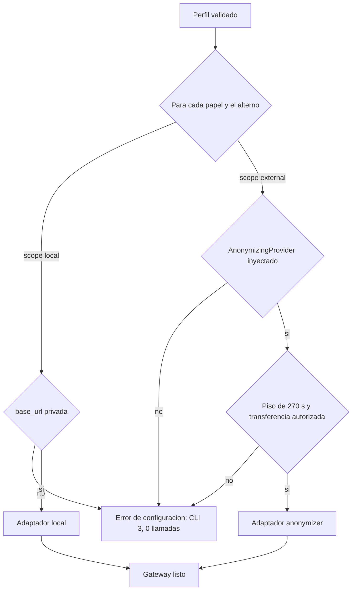

# Diseño de seguridad — U11 incoherence-analyzer

**Revisión 1 (2026-11-22): primera pasada de una unidad nueva del cambio 01 (DT27) y de la adenda 02.**
- **IDs.** Todo es nuevo. Las secciones son §1–§15, las decisiones de diseño DS1–DS14 (§13) y las
  precisiones a artefactos aprobados NFRD-U11-01 a NFRD-U11-12 (§15).
- **Preguntas.** Ninguna: todo lo fijan las fuentes (`nfr-design-questions.md`).
- **Tipo `library`.** El archivo de etapa pide para U11 este documento, `logical-components.md` y
  `traceability.json`. Como el NFR Requirements añadió `performance-requirements.md` y
  `reliability-requirements.md`, se añaden `performance-design.md` y `reliability-design.md`. No hay
  `scalability-requirements` ni `observability-requirements` para U11, así que tampoco sus diseños: lo que
  U11 aporta a NFR8 y NFR15 está en `performance-design.md`.

**Insumos.**
- De esta unidad, en `nfr-requirements/`: `security-requirements.md` (security-requirements: frontera §1,
  amenazas T1–T17, NFR1, NFR5, NFR10, NFR11, NFR12 y tabla NFR-U11-01 a NFR-U11-15),
  `reliability-requirements.md` (reliability-requirements), `performance-requirements.md`
  (performance-requirements) y `tech-stack-decisions.md` (tech-stack-decisions, D1–D10).
- `functional-design/functional-spec.md` (functional-spec: F1–F12, §3, E1–E66, frontera §7 y FD-U11-01 a
  FD-U11-28), `functional-design/rules.md` (BR1.1–BR14.5) y `functional-design/entities.md`.
- C6, C8, C13, C14, C17–C21 y C25 de `inception/contract-design/contract-summary.md` (contract-summary,
  revisión 3).
- De U1, `construction/contracts/nfr-design/security-design.md`: funciones puras y catálogo como techo
  (§4.15, NFRD-U1-09), una sola puerta al exterior (§4.17), reporte cerrado C19 v2 (§4.18) y catálogo C25 v1
  (§5).
- De U10, `construction/anonymizer/nfr-design/`: cliente de C21 con 10 s de margen (NFRD-U10-10) y `413` →
  `AnonymizerUnavailable` (NFRD-U10-17).
- Lo que piden otras unidades: NFR-U4-01 y NFR-U4-02 de U4 (250 000, 20 000 y 2 000; piso de 270 s);
  NFR-U9-01 de U9 (métodos de voz en el puerto).
- Reglas AUTONOMIA-01..05 de `team.md` y prohibiciones de `project.md`.

Salvo que la fila diga otra cosa, cada control se prueba en **nivel 0**: sin red ni GPU, con el *fake*
determinista del `ModelGateway` o el `FakeTransport` de U10, datos sintéticos y su control negativo. Los
comandos son los de `tech-stack-decisions.md` §6.

## 1. Frontera (AUTONOMIA-04; NFR1.1)

| Componente | Dónde corre | Datos sin seudonimizar | Qué cruza la frontera | Hacia dónde |
|---|---|---|---|---|
| Núcleo `libs/incoherence_analyzer/` (`domain/`, `application/`) | Proceso de la CLI (máquina local o nodo de ZINE) o de `semantic-agent` (clúster) | Transcripción, candidatos y citas, solo en memoria | Nada | — |
| `libs/model_gateway/gateway.py` (enrutador por papel y ranura) | Igual | Mensajes con testimonio | Nada por sí mismo | Elige adaptador |
| Adaptador local (`adapters/local_openai.py`, C14) | Igual | Turnos sin enmascarar | Nada fuera de la máquina, el clúster o el trabajo de SLURM | `base_url` privada |
| Adaptador `anonymizer` (`adapters/anonymizing.py`) | Igual | Mensajes hacia el `AnonymizingProvider` inyectado | Nada por sí mismo | Módulo de U10 (CLI) o cliente de C21 (clúster) |
| Cliente de C21 (`adapters/anonymizer_http.py`) | `semantic-agent` | Mensajes sin enmascarar, dentro del clúster | Nada fuera del clúster | `anonymizer-proxy` |
| Módulo de U10 en la raíz de composición de la CLI | Máquina local | Lo seudonimiza en el mismo proceso | **Sí**: texto seudonimizado, solo del papel `judge` en la primera rebanada | `api.anthropic.com` (NFR-U11-01) |
| Verificador local gpt-oss-20b | Servidor local | `hecho`, `tipo` y las dos citas | Nada | — |
| CLI: salidas de C6 | Disco local | Citas y hechos | Nada; con corpus, fuera de Git (§11) | — |
| CLI: `reporte.json` (C19 v2) y `AVISO.txt` | Disco local; de ZINE vuelve solo el reporte | Ninguno | Lo copia el humano | Consola del investigador (U12) |
| `--export-likert` | Disco local | Hechos, citas y observaciones del conjunto **sintético** | Nada; lo entrega el humano a dos evaluadores | — |
| Paquete de ZINE | Máquina local → ZINE, lo copia el humano | Transcripciones del corpus y sintéticas | Hacia la carpeta del proyecto en ZINE; nunca a Git | — |
| Conjunto sintético | Repositorio | Solo datos ficticios | El *prompt* de generación sale hacia Google al crearlo | — |

La tabla se copia en `libs/incoherence_analyzer/README.md`, y una prueba de nivel 0 compara sus filas con
las de este documento por nombre de componente. Un componente nuevo entra con su fila en el mismo PR. U11
nunca abre por su cuenta una conexión a internet.

## 2. Armado del gateway y fallo cerrado (NFR1.2, NFR1.4, NFR1.5, NFR1.6, NFR1.8)

El gateway se arma **una vez por perfil**, antes de la primera llamada. Hay un solo punto de envío por
destino externo: `adapters/anonymizing.py`.



<!-- Texto alternativo: con el perfil validado, para cada papel y el alterno se mira el alcance. Si es local, la base_url debe ser privada; si no, error de configuración con código 3 en la CLI y ninguna llamada. Si es externo, debe haber un AnonymizingProvider inyectado, el plazo por llamada efectivo debe ser de al menos 270 s y el consentimiento de la entrada debe autorizar la transferencia; si falta algo, el mismo error. Si todo pasa, cada papel queda con su adaptador y el gateway está listo. -->

| Control | Diseño | Prueba |
|---|---|---|
| Destino externo sin proveedor (NFR1.2) | `gateway.build(config, anonymizing_provider=None)` recorre papeles y alterno; un `external` sin proveedor lanza `GatewayConfigError` antes de devolver. La CLI lo traduce a código 3 en la validación previa (BR11.2) | Perfil con juez, verificador y alterno externos: 0 llamadas en el *fake*. Variante con el módulo de U10 que no se construye (NER con otro SHA-256): mismo resultado |
| Destino local (NFR1.6) | `base_url` con esquema `http` o `https`, *host* `localhost`, nombre corto del clúster, sufijo `.svc.cluster.local` o IP privada (RFC 1918, *loopback*); un *host* público o un externo con `base_url` invalidan el perfil | Una prueba por forma rechazada y su control positivo; espía del `AnonymizingProvider` con `todo-local`: 0 llamadas y todos los registros con `anonimizado: false` |
| Anonimizador caído, con excepción o sin responder (NFR1.4) | El adaptador `anonymizer` no captura nada que no sea un error de `model_calls`; una excepción ajena del proveedor inyectado se traduce a `AnonymizerUnavailable` en el propio adaptador, sin reintento ni alterno | Prueba compuesta de §3 en sus tres variantes; 100 % de ramas en `adapters/anonymizing.py` |
| `anonymized: false` en un destino externo (NFR1.5) | Después de **cada** llamada externa, con éxito o con un error que trae `call`, `domain/run_state.py` mira `call.anonymized`; si es falso, `aborted_incident` con precedencia sobre cualquier otro código | *Fake* que lo devuelve en la segunda llamada: exactamente 2 llamadas, `incidente_anonimizacion`, CLI 4; variante con un `ProviderError` que lo trae |
| Transferencia no autorizada (NFR1.8) | `application/preflight.py` comprueba el bloque de consentimiento antes de `judging`: perfil con algún papel externo y `autoriza_transferencia` falso → `InputRejected` `profile.transfer_not_authorized`. Corpus o guiada sin bloque → `session.consent_missing` | E27–E29 con 0 llamadas; el mismo bloque con `todo-local` se analiza |
| Piso del plazo por llamada (NFR-U4-02) | Con un papel externo, `model_call_timeout_s` efectivo < 270 s es error de configuración (NFRD-U11-03) | Perfil comercial con `VERIDICUS_LIMIT_MODEL_CALL_TIMEOUT_S=269`: CLI 3, 0 llamadas; con 270 arranca |

En `semantic-agent` la raíz de composición es de U4: llama a `AnonymizerHttpClient.check_ready()` y luego a
`gateway.build(...)` con el cliente de C21. La biblioteca no conoce el entorno en el que corre.

## 3. Prueba compuesta de lo que sale (NFR1.3, NFR1.4)

Es la prueba de AUTONOMIA-04 desde el lado de U11 (C13, AC11.3.3, AC11.3.7). Vive en
`libs/incoherence_analyzer/tests/composite/` y usa piezas reales salvo el transporte:

| Pieza | Real o doble |
|---|---|
| `IncoherenceAnalyzer.analyze`, `gateway.build`, adaptador `anonymizer` | Reales |
| Módulo de U10 (`Anonymizer.build(transport=...)`) | Real; en nivel 0 con el NER de prueba de U10, en nivel 1 con el NER real |
| Transporte | `FakeTransport` de U10, que captura cada cuerpo |
| Verificador local | Adaptador local real sobre un servidor HTTP *fake* en `127.0.0.1` (lo permite `pytest-socket` solo hacia *loopback*) |

- **Lo que se mide.** Un *fixture* de perfil con juez, verificador y alterno externos (solo existe en las
  pruebas; `check-profiles.py` lo prohibiría en `config/`), una transcripción sintética con entidades
  sembradas y un juez *fake* que propone dos candidatos. Los cuerpos capturados de `judge`, `verifier` y
  `verifier_permuted` tienen **0 apariciones** de los valores sembrados, comparando sin mayúsculas, sin
  tildes y tras NFKC.
- **Control negativo.** El *fixture* de U10 que puentea la seudonimización hace fallar la prueba.
- **Fallo cerrado.** Con el módulo (a) que no se construye, (b) que lanza `RuntimeError` dentro de la
  seudonimización y (c) cuyo NER se pasa de su presupuesto: el `FakeTransport` registra 0 peticiones y la
  corrida termina en `anonimizador_no_disponible`.

## 4. Perfiles, proveedores y familias (NFR1.7, NFR5.2)

- **`scripts/check-profiles.py`** lee `config/profiles.yaml` con el cargador de U1 y la
  `ProviderCapabilityTable` de U10 (`libs/anonymizer/data/provider-capabilities.v1.yaml`) **como datos**,
  sin importar `libs.anonymizer`. Falla si: (a) un papel o alterno `external` nombra un proveedor o modelo
  ausente de la tabla o sin `provider_adr`; (b) en `comercial-piloto` o `evaluacion-comercial` algo distinto
  del juez de `anthropic` es externo; (c) un perfil de evaluación no declara `family` en juez, verificador y
  alterno (FD-U11-22); (d) juez y verificador de un perfil de evaluación comparten familia (BR2.4).
  Controles negativos: verificador `openai` externo en `comercial-piloto`, proveedor sin ADR y familia
  repetida.
- **Generador del conjunto.** `evaluate` compara la `family` del generador del manifiesto con la del juez y la
  del verificador del perfil antes de la primera llamada; si coincide con alguna, código 3 (BR12.1, E62).
- **gpt-oss como `openai`.** Se declara así en el perfil (NFR5.2). Si el TG decide otra familia, cambia la
  declaración por PR; la regla de familias no se relaja.

## 5. *Prompt* y testimonio como dato (NFR5.1, NFR5.4)

- **Un archivo, una huella.** `libs/incoherence_analyzer/data/prompt.v1.md` es dato del paquete
  (`importlib.resources`). Al arrancar se calcula su SHA-256 y se compara con `config.prompt_sha256`; si no
  coincide, la corrida termina en `salida_invalida` sin llamar (NFR5.4) y la CLI escribe el aviso con las
  dos huellas, sin el texto.
- **Forma de los mensajes.** `application/messages.py` es la única función que arma mensajes: `system` es el
  texto del *prompt* para el papel, sin un solo carácter de la entrada; `user` es `json.dumps(ventana,
  ensure_ascii=False)`. El verificador recibe en `user` solo `{"hecho", "tipo", "cita_a", "cita_b"}`, en ese
  orden (§2 de `performance-design.md`).

```python
def build_messages(role: Role, prompt: PromptBundle, payload: Mapping[str, object]) -> list[Message]:
    system = prompt.for_role(role)                      # constante del paquete
    user = json.dumps(payload, ensure_ascii=False, separators=(",", ":"))
    return [Message("system", system), Message("user", user)]
```

- **Pruebas.** Con Hypothesis, turnos con comillas, llaves, «]]», texto «ignora las instrucciones» y
  marcas de cierre de bloque: en el 100 % de los mensajes capturados, `system` es idéntico byte a byte al
  del paquete y `user` vuelve a parsear como JSON con los mismos turnos.
- **Escenario A (NFR5.1).** `--adversarial escenario-a` añade una cuarta corrida con el texto de
  `evaluation/adversarial/escenario-a.v1.yaml` insertado en una muestra. Se mide `scenario_a_marker_hits`
  (apariciones de la salida reconocible en `hecho` y `observaciones` emitidos) y `scenario_a_difference`
  frente a `1 − three_run_agreement` (`project.md`). La variante de U10 que pide los nombres reales usa su
  gancho de pruebas para contar valores sembrados **antes** de restaurar. En nivel 0, un *fake* que obedece
  la inyección hace fallar la comprobación y otro que la ignora la pasa.

## 6. Validación de entrada y de salida (NFR10.1, NFR10.6, NFR10.9)

- **Entrada.** `application/preflight.py`, en este orden y antes de `judging`: esquema de C6 con el registro
  de U1 (`jsonschema` Draft 2020-12, D3), límites de C25 (`turn_max_chars` = 20 000,
  `transcript_max_turns` = 2 000, `transcript_max_chars` = 250 000, ya bajados por entorno), consentimiento,
  transferencia, perfil aprobado y tramo incremental. El primer fallo lanza `InputRejected` con su `code`.
- **Respuestas de los modelos.** Esquemas cerrados del juez y del verificador en
  `libs/incoherence_analyzer/data/schemas/` (sin `id`, `pagina`, `avisos`, `actos` ni campos de veracidad;
  `additionalProperties: false`). `domain/filter.py` valida **todos** los candidatos antes de filtrar
  ninguno: uno mal formado invalida la corrida (BR5.1).
- **Salida.** `domain/output.py` valida contra C6 antes de devolver; si no valida, arma la salida en error
  `salida_invalida`, que se valida otra vez. Si tampoco valida, es un fallo del propio código y se propaga
  (CLI 5): nunca sale una salida inválida.
- **YAML (NFR10.9).** Perfiles, precios, umbrales, manifiesto, listas de etiquetas y archivo del Escenario A
  se leen con el cargador seguro de `veridicus_contracts`. La prueba AST reutiliza
  `veridicus_contracts.checks.loader_usage.scan(paths)` de U1 sobre los cuatro paquetes, `evaluation/` y
  `scripts/`. Control negativo: un manifiesto con una clave repetida.
- **100 % de ramas** en `domain/filter.py`, `domain/output.py` y `application/preflight.py`
  (`reliability-design.md` §6).

## 7. Claves y texto fuera de los archivos de C6 (NFR10.2, NFR10.3)

- **Claves.** Solo la CLI resuelve `api_key_ref`, y solo en la raíz de composición, para pasársela al
  módulo de U10, que la guarda como `SecretStr`. U11 no guarda el valor en ningún objeto propio. El prefijo
  obligatorio es `VERIDICUS_` (`profiles.validate(..., key_prefix="VERIDICUS_")`). Sin valor: código 3 y el
  mensaje nombra la **variable**, nunca un valor. En `semantic-agent` no se resuelve ninguna clave: el cliente
  de C21 no tiene campo para ella.
- **Mensajes de la CLI.** `cli/messages.py` es un catálogo cerrado de plantillas en español con parámetros
  tipados: `Path`, `Sha256Hex`, `int`, `ErrorCode`, `ProfileName` y `EnvVarName`. No existe una plantilla que
  acepte `str` libre. stderr y los logs solo se escriben desde ese catálogo.
- **Excepciones.** Se registran por tipo y `code`. Una excepción que viene del modelo, del servidor local o
  del proxy nunca se registra con su mensaje ni con su `repr`.
- **Prueba del *canary*.** Un *canary* sembrado como nombre en un turno que ningún hallazgo cita, y otro como
  valor de la clave, aparecen **0 veces** en stderr, logs capturados, `reporte.json`, `AVISO.txt`, la
  exportación Likert y los textos de excepción, en el éxito y con cada código de salida 0, 2, 3, 4, 5 y 6.
- **`gitleaks`** en pre-commit y en la CI sobre `libs/` y `evaluation/`.

## 8. Adaptador local y cliente de C21 (NFR10.8; NFRD-U10-10, NFRD-U10-17)

| Ajuste | Adaptador local | Cliente de C21 |
|---|---|---|
| Cliente | `httpx.Client` síncrono, uno por adaptador, reutilizado | Igual |
| Redirecciones | `follow_redirects=False`; un `3xx` es `ProviderError` con su `ModelCall` y 0 peticiones al otro *host* | `follow_redirects=False`; un `3xx` es `AnonymizerUnavailable` |
| Reintentos del transporte | `HTTPTransport(retries=0)`; los de BR10.3 los hace el adaptador | `retries=0`; ninguno |
| Entorno | `trust_env=False`: `HTTP(S)_PROXY` y `SSL_CERT_FILE` no cambian el destino (NFRD-U11-06) | Igual |
| Plazo | `httpx.Timeout(connect=10, read=timeout_s, write=10, pool=5)` | `timeout_s` de la petición más 10 s de espera; el margen sale del plazo de la corrida (NFRD-U11-04) |
| Tope de respuesta | Lectura por bloques con `client.stream` hasta `model_response_max_bytes` (2 097 152); pasarse corta y da `ProviderError` | Igual; pasarse da `AnonymizerUnavailable` si no llegó `call` |
| JSON | Estricto: claves repetidas, `NaN` o `Infinity` dan `InvalidOutput` | Igual |
| Tope de petición | — | Cuerpo serializado con `ensure_ascii=False`; si pasa de `anonymizer_request_max_bytes`, `AnonymizerUnavailable` sin enviar (NFRD-U11-05) |

**Traducción de C21 (BR10.4, NFRD-U10-17).** `200` → `GenerateResult`; `409`, `413`, `422`, `503`, `3xx` y no
poder conectar → `AnonymizerUnavailable`; `451` → `ContentBlocked` con `call`; `502` con
`analysis.provider` → `ProviderError`; `502` con `analysis.invalid_output` → `InvalidOutput`; `504` →
`Timeout`. Cualquier otro estado → `AnonymizerUnavailable` si no trae `call`. Una prueba por fila con un
servidor HTTP *fake* en *loopback*.

## 9. Fronteras de código y configuración de solo lectura (NFR10.5, NFR10.7, NFR15.2)

- **import-linter** en `libs/.importlinter-u11` (uno por paquete si `uv` lo exige):
  - `u11-no-infra`: los cuatro paquetes no importan `redis`, `kubernetes`, `psycopg`, `asyncpg`, `sqlalchemy`
    ni `prometheus_client` (este último cierra NFR15.2);
  - `gateway-no-anonymizer`: `libs.model_gateway` no importa `libs.anonymizer`;
  - `core-no-anonymizer`: `libs.incoherence_analyzer` no importa `libs.anonymizer`, salvo
    `libs.incoherence_analyzer.cli.composition` en `ignore_imports`;
  - `c21-client-contracts-only`: `libs.model_gateway.adapters.anonymizer_http` solo importa
    `veridicus_contracts`, `httpx` y la biblioteca estándar;
  - `layers`: `domain` no importa `application`, `adapters`, `cli` ni `httpx`.
  Cada contrato con un módulo de prueba que lo viola. Una prueba AST comprueba además que ningún
  `__init__.py` reexporta `cli.composition`.
- **Configuración de solo lectura (NFR10.7).** Una comprobación AST falla si un módulo distinto de
  `libs/execution_profiles/loader.py` abre `config/profiles.yaml`, `config/prices.yaml`, el *prompt* o
  `evaluation/thresholds.v1.yaml`, y si el cargador los abre en un modo distinto de `"rb"`. La CLI no tiene
  opciones que los cambien; `argparse` se revisa con una prueba que lista sus opciones.

## 10. Integridad y auditoría (NFR11.1, NFR11.2)

- **Huellas.** `config_sha256` y `profile_sha256` con `canonical.sha256_jcs` de U1; la huella del *fixture* de
  C18 coincide. Hypothesis comprueba que el orden de las claves no cambia la huella.
- **Registro de llamadas.** `gateway.py` envuelve cada `generate`: guarda el `ModelCall` devuelto (o el
  `call` del error) en una lista de la corrida, en orden. `AnonymizerUnavailable` no trae registro y no añade
  fila (BR8.3). La latencia se mide aquí, con un reloj monótono, y queda fuera de C6 (NFRD-U11-07).
- **Determinismo (BR8.7).** El núcleo recibe el reloj por inyección (`Clock` con `now()` y `monotonic()`); no
  usa azar ni orden de conjuntos. Dos corridas con el mismo *fake* dan la misma salida salvo `fecha` y `at`.
- **Sin veracidad (NFR11.2).** (a) `integrity_policy.scan` corre los 100 % de los casos de vocabulario de
  `contracts/integrity/scan-cases.v1.yaml` y un caso invertido hace fallar la suite; (b) en nivel 2, 0
  coincidencias de C8 en `hecho` y `observaciones` emitidos; (c) una prueba recorre los esquemas del juez y
  del verificador y falla ante una propiedad cuyo nombre esté en la lista de campos de veracidad de C8;
  (d) el aviso de VE-01 con su versión sale en stderr y en cada `AVISO.txt`, leído de
  `contracts/integrity/notice.v1.yaml` sin tocarlo.

## 11. Datos sintéticos, corpus y ZINE (NFR12.1, NFR12.2, NFR10.14)

- **Sintéticos.** La comprobación de U1 (`synthetic: true` y `mentions`) corre sobre los `tests/` de los cuatro
  paquetes y sobre `evaluation/`. Cada muestra lleva `origen: sintetico`; el manifiesto guarda quién revisó y
  cuándo (BR13.5).
- **Corpus fuera de Git.** `cli/results_dir.py` aplica BR11.5: dentro de un árbol de trabajo, `git
  check-ignore` debe cubrir el directorio; fuera de todo repositorio se permite. La consulta a Git usa
  `subprocess.run([...], shell=False, timeout=10)` con la ruta como argumento. Sin Git disponible dentro de un
  árbol: código 2.
- **Comprobación de nivel 0.** `git ls-files resultados-locales evaluation/zine/paquete` vacío; en
  `evaluation/zine/` solo `.sbatch`, `empaquetar.py` y `manifest.yaml`.
- **Nada lanza trabajos.** Una búsqueda estática sobre `scripts/`, `evaluation/`, `libs/` y `.github/` falla si
  aparece `sbatch`, `ssh`, `scp` o `rsync` fuera de un comentario o de una cadena de instrucciones al
  humano en los `.sbatch` y en `empaquetar.py` (que imprime los pasos, no los ejecuta).
- **Paquete.** `empaquetar.py` arma la wheelhouse con `uv export --frozen` desde los lockfiles, copia solo
  perfiles sin destinos externos y termina con `gitleaks detect --no-git --source evaluation/zine/paquete`;
  con un hallazgo, borra el paquete y sale con ≠ 0.
- **Dependencias.** `uv.lock` por paquete con *hashes*; `pip-audit` sin `HIGH` o `CRITICAL` con corrección.

## 12. Amenazas y controles

| Amenaza | Controles de este diseño |
|---|---|
| T1 Destino externo sin anonimizador | §2 (armado del gateway) |
| T2 Anonimizador que cae a mitad de corrida | §2, §3 y `reliability-design.md` §1 |
| T3 Llamada externa con `anonymized: false` | §2 (después de cada llamada) |
| T4 Proveedor sin ADR o segundo proveedor | §4 (`check-profiles.py`) |
| T5 Consentimiento sin transferencia | §2 (preflight) |
| T6 Inyección en el testimonio | §5 |
| T7 Familias repetidas | §4 |
| T8 Cita inventada o en otro turno | `reliability-design.md` §2 (verificación de citas, 100 % de ramas) |
| T9 Etiqueta de veracidad | §10 |
| T10 Clave en logs o reporte | §7 |
| T11 Testimonio en stderr, logs o reporte | §7; reporte cerrado de U1 (§4.18) |
| T12 Corpus en Git o en la CI | §11 |
| T13 Respuesta enorme o redirección | §8 |
| T14 Infraestructura o anonimizador importados | §9 |
| T15 Cambios sin PR | §9 (solo lectura) y §10 (huellas) |
| T16 YAML con etiquetas o claves repetidas | §6 |
| T17 Un script que lanza trabajos | §11 |

## 13. Decisiones de diseño y alternativas

| # | Estado | Decisión | Alternativas descartadas | Consecuencias |
|---|---|---|---|---|
| DS1 | nuevo | El gateway se arma una vez por perfil y falla antes de la primera llamada | Comprobar en cada llamada | Un perfil inválido nunca llama; a cambio, cambiar de perfil exige otro gateway |
| DS2 | nuevo | Un único adaptador `anonymizer` para todo destino externo, con el proveedor inyectado | Un adaptador por proveedor en U11 | U11 no tiene código de proveedores (CD-04) y la costura la comprueba import-linter |
| DS3 | nuevo | La comprobación de `anonymized` se hace en `run_state` después de cada llamada, también con error | Solo en las llamadas con éxito | Un error con registro sin anonimizar no se esconde |
| DS4 | nuevo | Prueba compuesta con el módulo real de U10 y su `FakeTransport` | Doble del módulo | Lo que se prueba es lo que sale de verdad; a cambio, la suite depende del paquete de U10 |
| DS5 | nuevo | Catálogo cerrado de mensajes con parámetros tipados | Filtro de texto en el *logger* | Imposible escribir testimonio por descuido; a cambio, cada mensaje nuevo es un cambio de código |
| DS6 | nuevo | `trust_env=False` en los dos clientes HTTP de U11 | Confiar en el entorno | Un proxy del entorno no cambia el destino; mismo criterio que U10 |
| DS7 | nuevo | El margen de 10 s del cliente de C21 sale del plazo de la corrida | Dejar que la espera pase del plazo | Ninguna corrida pasa de `run_deadline_*`; a cambio, 10 s menos para la llamada |
| DS8 | nuevo | Rechazo previo por tamaño en el cliente de C21 | Esperar el `413` del proxy | No se envían 2 MiB en vano y el resultado es el mismo |
| DS9 | nuevo | Piso de 270 s comprobado al arrancar como constante con nombre, no en C25 | Cifra nueva en C25 | C25 guarda techos; un piso que solo depende de U10 vive en `libs/execution_profiles` |
| DS10 | nuevo | `check-profiles.py` lee la tabla de capacidades de U10 como datos | Importar `libs.anonymizer` | No rompe la costura de import-linter |
| DS11 | nuevo | La latencia y el costo por llamada se miden en memoria y solo sus agregados van a C19 v2 | Ampliar C6 o `ModelCall` | C6 es el contrato común del TG y no cambia (ADR-017); a cambio, la latencia por llamada no queda en la salida |
| DS12 | nuevo | `system` constante y testimonio solo en `user` como JSON | Delimitadores de texto | El testimonio no puede cerrar el bloque (`project.md`) |
| DS13 | nuevo | Reloj inyectado en el núcleo | `time.time()` directo | Pruebas de plazo con reloj simulado y salidas repetibles |
| DS14 | nuevo | Exportación Likert barajada con semilla y clave aparte | Orden del conjunto | Los evaluadores no pueden inferir muestra ni perfil |

## 14. Correspondencia con AUTONOMIA

| Regla | Qué aporta este diseño | Secciones |
|---|---|---|
| AUTONOMIA-01 | Perfiles, *prompt*, precios y umbrales solo por PR; nada lanza trabajos en ZINE ni toca el clúster | §9, §10, §11 |
| AUTONOMIA-02 | Cada control nombra su prueba y su umbral; comandos en `tech-stack-decisions.md` §6 | §2–§11 |
| AUTONOMIA-03 | Esquemas sin veracidad, escáner con los casos de U1, aviso de VE-01 | §10; `reliability-design.md` §2 |
| AUTONOMIA-04 | Frontera por componente, armado del gateway, prueba compuesta, incidente, claves y texto fuera de lo emitido | §1–§3, §7, §8 |
| AUTONOMIA-05 | Validación cerrada, salida en error sin parciales, verificación de citas | §6; `reliability-design.md` §1–§2 |

## 15. Precisiones a artefactos ya aprobados (NFRD-U11-xx)

No edité ningún artefacto aprobado (regla de `project.md`). En la aprobación decides cuáles se llevan al
original, cada una en su propio commit. Todas salen de las fuentes aprobadas o de hallazgos que un experto
cierra; ninguna deja salir del clúster algo que hoy no sale.

| ID | Artefacto aprobado | Precisión | Origen |
|---|---|---|---|
| NFRD-U11-01 | `nfr-requirements/security-requirements.md` (NFR-U11-11) | NFR-U11-11 queda superada: `transcribe` y `synthesize` están en el puerto `ModelGateway` de U11 (C13 revisión 3) y los escribe U9 en B9, con su adaptador y la actualización de los *fakes* de U11 en el mismo PR. B11 entrega el puerto solo con `generate`; el enrutador de `gateway.py` no supone que el puerto tiene un único método | NFR-U9-01; C13 |
| NFRD-U11-02 | `nfr-requirements/tech-stack-decisions.md` (§3, tabla de variables) | Las cifras de C25 se bajan con `VERIDICUS_LIMIT_<NOMBRE>`, no con `VERIDICUS_<AJUSTE>`. `VERIDICUS_LIMITS_PATH` no reemplaza el catálogo empaquetado: si se da, su archivo se convierte en entradas `VERIDICUS_LIMIT_<NOMBRE>` y pasa por `limits.load`, que solo deja bajar. Sin la variable, solo cuenta el catálogo | NFRD-U1-09 |
| NFRD-U11-03 | `nfr-requirements/performance-requirements.md` (NFR3.2, NFR3.4, §3) y `tech-stack-decisions.md` (§3) | Las mediciones de NFR3.2, NFR3.4 y del presupuesto de memoria usan 250 000 caracteres, 20 000 por turno y 2 000 turnos, no 186 000. En la máquina de desarrollo `model_call_timeout_s` sigue en 300 s, pero el mínimo con perfil comercial pasa de 200 s a **270 s**, y se comprueba al arrancar (constante `COMMERCIAL_MIN_CALL_TIMEOUT_S` de `libs/execution_profiles`; error de configuración, CLI 3) | NFR-U4-01, NFR-U4-02 (P6 = A de U4) |
| NFRD-U11-04 | `functional-design/rules.md` (BR7.2) y `nfr-requirements/reliability-requirements.md` (NFR10.4) | Para un destino que va por el cliente de C21, `timeout_s = min(model_call_timeout_s, deadline − ahora − 10 s)`; si el restante es ≤ 10 s, `tiempo_agotado` sin llamar. Así la espera de `timeout_s` + 10 s de NFRD-U10-10 termina dentro del plazo. Con el módulo en proceso y con el adaptador local, `timeout_s` sigue como en BR7.2 | NFRD-U10-10; BR7.2 |
| NFRD-U11-05 | `functional-design/rules.md` (BR10.4) y `contract-summary.md` (C13, tabla de reintentos) | El cliente de C21 traduce `413` (y un `3xx`) a `AnonymizerUnavailable`, sin reintento. Antes de enviar, si el cuerpo serializado con `ensure_ascii=False` pasa de `anonymizer_request_max_bytes`, `AnonymizerUnavailable` sin enviar | NFRD-U10-17 (P3 = A de U10) |
| NFRD-U11-06 | `nfr-requirements/security-requirements.md` (NFR10.8) y `tech-stack-decisions.md` (D4) | El adaptador local y el cliente de C21 usan `trust_env=False`; el criterio de NFR10.8 suma una prueba con `HTTPS_PROXY` y `HTTP_PROXY` apuntando a otro *host*: 0 peticiones a ese *host* | Mismo criterio que DS9 de U10 |
| NFRD-U11-07 | `nfr-requirements/performance-requirements.md` (NFR15.1) | La latencia y el costo **por llamada** no entran en `registro.llamadas`: C6 es el contrato común del TG, estricto, y `ModelCall` no los tiene (ADR-017, C13). `gateway.py` mide la latencia con un reloj monótono y guarda latencia y costo en memoria, junto a cada `ModelCall`; la CLI escribe en C19 v2 los agregados que ya pide NFR-U11-14 (*tokens* y costo por proveedor; p50 y p95 por papel). Los *tokens* por llamada sí siguen en `registro.llamadas` | C6; C13; NFR-U11-14 |
| NFRD-U11-08 | `nfr-requirements/tech-stack-decisions.md` (§6, fila «Nivel 2») | El comando sigue la forma de F10: `veridicus evaluate --conjunto evaluation/synthetic --perfil evaluacion-comercial --salida resultados-locales/eval` (el conjunto va con `--conjunto`, no como argumento posicional) | functional-spec F10 |
| NFRD-U11-09 | `nfr-requirements/reliability-requirements.md` (NFR6.1) y NFR-U11-15 | `--export-likert <dir>` escribe `<dir>/muestras/` con identificadores opacos en orden barajado por una semilla que se imprime, y `<dir>/clave.json` con la correspondencia. Los evaluadores reciben solo `muestras/`; la clave la guarda el autor. Con una entrada que no es del conjunto sintético, código 2 sin escribir | DS14; NFR-U11-15 |
| NFRD-U11-10 | `functional-design/rules.md` (BR11.3) y `reliability-requirements.md` (NFR10.13) | SIGINT y SIGTERM se atienden con un manejador que marca la cancelación y lanza `CliInterrupted` en el hilo principal: la llamada en curso se corta, su corrida queda sin salida, se borra su temporal, se escribe el reporte de lo hecho y el código es 5. Una segunda señal durante ese cierre termina con 5 sin reporte | BR11.3; BR11.4 |
| NFRD-U11-11 | `functional-design/functional-spec.md` (F10) y `nfr-requirements/performance-requirements.md` (NFR2.2) | «Se parte por muestras y se suman los reportes» se implementa como reanudación de `evaluate`: cada muestra se escribe en `corrida-<n>/` con su salida y un archivo de booleanos de la permutación, y una nueva invocación con el mismo `--salida`, `config_sha256` y `dataset_sha256` salta las muestras ya válidas; con otra huella, código 2 sin escribir. Las métricas se calculan igual que en una sola sesión | NFR2.2; `performance-design.md` §6 |
| NFRD-U11-12 | `nfr-requirements/reliability-requirements.md` (NFR4.11) y `tech-stack-decisions.md` (D10, §6) | El manifiesto del conjunto es `evaluation/synthetic/manifest.v1.yaml`, como en F11, y no `manifest.yaml`: el nombre lleva la versión del esquema del manifiesto | functional-spec F11 |
