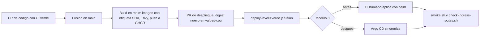

# Pipeline de CI/CD — U2 platform

**Revisión 2 (2026-11-23).** Sustituye a la revisión 1 del 2026-10-03, que queda en el historial de Git. Las
secciones conservan su número; lo que sale queda «Retirado».

**Insumos.**
- Imágenes, Secrets, dónde se aplican las políticas, nada aplica cambios al clúster, red, Ingress,
  observabilidad y respaldos de `nfr-design/security-design.md` revisión 2 (security-design §2–§13).
- U2 es `packaging` y no tiene performance-design, scalability-design, reliability-design,
  observability-design ni logical-components propios; lo que esos documentos de otras unidades piden a U2
  llega por la tabla NFRD de cada `security-design.md` y está en `infrastructure-specification.md`.
- Comandos de verificación y D3–D17 de `nfr-requirements/tech-stack-decisions.md`; NFR1.1–NFR15.2 de
  `nfr-requirements/security-requirements.md`.
- C1 y C14–C16 de `inception/contract-design/contract-summary.md` (contract-summary); procesos desplegables
  de `inception/domain-design/components.md` (components); functional-spec de otras unidades solo a través
  de las tablas de NFR Requirements.
- `infrastructure-specification.md` y `monitoring-design.md` revisión 2 de esta carpeta; respuestas P1–P8 de
  `infrastructure-design-questions.md`.
- `## Way of Working`, `## Testing Posture`, `## Deployment` y `## Code Style` de `team.md`.

Este documento cubre lo que es de la plataforma: la validación de `deploy/` y `scripts/`, cómo llega una
imagen ya construida al clúster, el orden de despliegue y la reversión. La construcción y las pruebas de cada
servicio las define su unidad.

## 1. Principios

- **La CI no despliega.** Ningún *workflow* tiene `kubeconfig` ni credenciales del clúster; todos declaran
  `permissions: contents: read` y fijan cada acción por SHA. Solo los *jobs* de *build* de imágenes tienen
  `packages: write` (team.md).
- **La fusión en `main` protegida es la aprobación humana registrada** (AUTONOMIA-01). Antes del módulo 8,
  el humano aplica lo fusionado; desde el módulo 8, lo sincroniza Argo CD. `deploy/jobs/` nunca se
  sincroniza: lo aplica el humano.
- **Todo despliegue es un artefacto revisable**: un cambio de chart, de valores (digest de imagen), de
  `models.lock`, de `network-ranges.yaml`, del `Corefile` o de migraciones, cada uno en su PR con la
  evidencia de su verificación.
- **Nada se envía a ZINE.** Los *scripts* `sbatch` los lanza el humano; `check-no-cluster-apply.sh` rechaza
  `sbatch`, `ssh`, `scp` y `rsync` hacia ZINE.

## 2. *Workflows* de la plataforma

| *Workflow* | Se dispara con | Pasos en orden | Bloquea la fusión |
|---|---|---|---|
| `deploy-level0.yml` | PR que toca `deploy/**`, `scripts/**`, `config/**`, `contracts/limits.v1.yaml`, `libs/anonymizer/data/**` o `.github/**` | 1 `yamllint deploy/` · 2 `helm lint deploy/veridicus` · 3 `helm dependency build` contra `Chart.lock` · 4 `helm template` con `values-cpu.yaml`, con `models.todoLocalJudge.enabled=false` y de `deploy/jobs` · 5 `kubeconform -strict -schema-location deploy/schemas` (Kubernetes v1.31 y CRD de CloudNativePG, Prometheus Operator y Argo CD copiadas en el repositorio) · 6 `kyverno apply deploy/policies/` sobre cada render y `kyverno test deploy/policies/tests/` · 7 los *scripts* `check-*` (tabla siguiente) · 8 `promtool test rules` · 9 `hadolint` de los `Dockerfile` cambiados · 10 `uv run pytest deploy/tests/level0` | Sí (comprobación obligatoria) |
| `deploy-level1.yml` | Ídem | `uv run pytest deploy/tests/level1 -m platform`: `verify-model` con un archivo correcto (sale 0) y uno alterado en un byte (sale distinto de 0); Redis real con el mismo `redis.conf` (las 10 entradas sobreviven al reinicio, y con `appendonly no` se pierden); captura de logs con el *canary*. Usa `fetch-models.sh --only ner` con caché de la CI | Sí |
| `secrets-scan.yml` | Todo PR | `gitleaks` sobre el repositorio completo (NFR10.3, NFR12.1) | Sí |
| `semgrep.yml` | Todo PR | Semgrep | No (solo avisa) |
| Dependabot | Semanal | `github-actions`, `docker` y los ecosistemas de cada servicio | No (abre PR) |

El render con `values-gpu.yaml` está **Retirado** (sin GPU); la política `no-gpu-requests` falla si
cualquier render pide `nvidia.com/gpu`.

| Puerta | Comando | Umbral | Requisitos |
|---|---|---|---|
| Esquemas | `kubeconform -strict` | 0 recursos inválidos | NFR8.1, NFR10.2 |
| Políticas | `kyverno apply` / `kyverno test` | 0 violaciones; cada control negativo falla como se espera | NFR1.1–NFR1.3, NFR1.5–NFR1.7, NFR2.1, NFR10.1–NFR10.4, NFR10.6–NFR10.14, NFR10.16, NFR10.17, NFR11.1, NFR12.2 |
| Red cruzada | `scripts/check-network-deps.sh deploy/network-deps.yaml <render>` | Termina en 0 | NFR10.18 |
| CoreDNS | `scripts/check-coredns-domains.sh` | Igualdad exacta con la lista del anonimizador más la de infraestructura | NFR1.4 |
| Ingress sin disco | `scripts/check-ingress-limits.sh deploy/ingress-limits.yaml contracts/limits.v1.yaml <render>` | Tres anotaciones y tope + margen en cada `Ingress` hacia `veridicus-session-api` | NFR10.14 |
| Redis | `scripts/check-redis-conf.sh <render>` | Las siete directivas con su valor | NFR10.6, NFR11.2 |
| Catálogo de límites | `scripts/check-limits-env.sh <render>` | Ninguna `VERIDICUS_LIMIT_*` por encima del catálogo; ninguna `VERIDICUS_LIMIT_RETENTION_MAX_DAYS` | NFR10.16 |
| Datos sintéticos | `scripts/check-no-data.sh <render>` | Solo claves permitidas en los `ConfigMap` | NFR12.1 |
| Copias de configuración | `scripts/check-config-copy.sh` | `profiles.yaml`, `prices.yaml` y el panel del anonimizador con el mismo SHA-256 que su original | NFR10.15 |
| AUTONOMIA-01 | `scripts/check-no-cluster-apply.sh` | 0 apariciones fuera de `readonly-exec-allowlist.yaml` | NFR10.5 |
| Sin descargas en pods | `scripts/check-no-downloads.sh <render> services/*/Dockerfile` | 0 apariciones | NFR1.2 |
| Respaldos | `uv run pytest deploy/tests/level0 -k backup_prune` | Solo se borra el volcado de 91 días | NFR12.1 |
| Reglas | `promtool test rules` | Casos por debajo y por encima pasan, con los *fixtures* de U2 y de U5 | NFR15.1 |
| Verificación de modelos y AOF | `deploy-level1.yml` | Correcto 0, alterado ≠ 0; 10 de 10 entradas | NFR10.4, NFR11.2 |
| Logs sin datos | `deploy-level1.yml` | 0 apariciones del *canary* | NFR10.19 |

Todo corre sin red hacia un clúster ni a internet, más allá de descargar las herramientas fijadas. Las
excepciones viven en `.trivyignore`, `.gitleaksignore` y `deploy/image-exceptions.yaml`, con motivo y fecha
de caducidad.

## 3. De la imagen al clúster (promoción)

<!-- Texto alternativo: un PR de código con la CI en verde se fusiona en main; en main, el job de build crea la imagen con la etiqueta del SHA, la escanea con Trivy y la sube a GHCR; luego un PR de despliegue cambia el digest en values-cpu.yaml; con deploy-level0 en verde se fusiona; antes del módulo 8 el humano aplica el chart con helm y después lo sincroniza Argo CD; en ambos casos termina con smoke.sh y check-ingress-routes.sh. -->

1. El PR de código pasa la CI de su servicio y se fusiona (squash) en `main`.
2. En `main`, el *job* de *build* construye la imagen, la escanea con Trivy (bloquea `HIGH`/`CRITICAL` con
   corrección), la publica en GHCR con la etiqueta del SHA y escribe el digest en el resumen del *job*.
3. Un **PR de despliegue** cambia solo el digest en `values-cpu.yaml`, con el enlace al *job* de *build*
   como evidencia. `deploy-level0.yml` vuelve a validar el render.
4. Al fusionarlo, se aplica (§4) y se ejecutan las pruebas de humo.

Separar el PR de despliegue del de código mantiene la regla de que cada cambio al clúster sea un artefacto
revisado, y evita que un *bot* con permisos de escritura abra PR que la CI no revisaría.

## 4. Despliegue

### 4.1 Antes del módulo 8 (aplicación manual)

El humano sigue `docs/operacion/instalacion.md`, que lista los comandos en orden; ningún *script* los
ejecuta (AUTONOMIA-01, security-design §9).

| Paso | Qué hace el humano | Una sola vez |
|---|---|---|
| 0 | Crea `.wslconfig` (especificación §1.1), ejecuta `wsl --shutdown` y comprueba en WSL2 que hay 20 procesadores y unos 55 GiB | Sí |
| 1 | `scripts/fetch-models.sh` en WSL2 hacia `/srv/veridicus/models` (verifica contra `models.lock`) | Sí y al cambiar `models.lock` |
| 2 | `scripts/cluster-up.sh` (Minikube 50 GiB y 16 CPU, Calico, ingress y metrics-server); copia la IP del nodo a `network-ranges.yaml` si cambió | Sí |
| 3 | Operador de CloudNativePG con su chart oficial en `cnpg-system`; `Corefile` de `deploy/coredns/` | Sí |
| 4 | `scripts/create-secrets.sh`: escribe los manifiestos en `~/.local/share/veridicus/secrets/` con modo `0600` y termina con error si falta alguna clave de una `api_key_ref` externa; el humano los revisa, los aplica y borra el archivo | Sí (y al rotar) |
| 5 | Chart `deploy/veridicus` con `values-cpu.yaml` y `services.enabled=false`: base, Redis, modelos, red, Ingress y `migrations-job`; espera a que el `Job` termine | En cada cambio de esquema |
| 6 | El mismo *release* con `services.enabled=true`: `veridicus-session-api`, `semantic-agent`, `audio-worker`, `anonymizer-proxy` y `frontend` | En cada PR de despliegue |
| 7 | `deploy/jobs/create-admin` (una vez) | Sí |
| 8 | En WSL2, `kubectl -n ingress-nginx port-forward svc/ingress-nginx-controller 8443:443`; luego `scripts/smoke.sh https://veridicus.local:8443` y `scripts/check-ingress-routes.sh https://veridicus.local:8443` | En cada despliegue |

Instalar en dos pasos (5 y 6) asegura que la base y el esquema existen antes de que arranquen los servicios,
porque Helm no ordena recursos que no son *hooks* (cierra R-04). `smoke.sh` comprueba además `/readyz` de cada
servicio con `kubectl port-forward`, que no cambia el clúster.

### 4.2 Desde el módulo 8 (Argo CD, SHOULD)

- Una `Application` apunta a `deploy/veridicus` en `main` con `values-cpu.yaml` y `syncPolicy.automated` con
  `prune: false` y `selfHeal: true`. El `Cluster` de CloudNativePG, sus PVC, `veridicus-redis-data`,
  `veridicus-reports` y `veridicus-audio` llevan `argocd.argoproj.io/sync-options: Prune=false` (NFR11.1).
- Ondas: base y Redis (−2), `migrations-job` como *hook* `Sync` en la onda −1 con
  `hook-delete-policy: BeforeHookCreation`, servicios (0), `Ingress` (1).
- `deploy/jobs/` (retención y `create-admin`) queda fuera de la `Application`; una `Application` cuyo `path`
  lo incluye falla en Kyverno.
- Argo CD lee el repositorio con una *deploy key* de solo lectura; `argocd-repo-server` solo sale por 22 y
  443, y solo `github.com` resuelve.

### 4.3 Estrategia por componente

Las estrategias (`Recreate` para los modelos, `RollingUpdate` sin indisponibilidad para los servicios, `Job`
versionado para las migraciones) están en `infrastructure-specification.md` §5. No hay *blue-green* ni
*canary*: un solo nodo y una sola réplica no los justifican.

## 5. Migraciones

- Las escribe cada unidad dueña de tablas con Alembic en `services/session-api/`; corren solo en
  `migrations-job` con el rol `veridicus_owner`, nunca al arrancar un pod (prohibición de `project.md`;
  política `no-migrations-in-deployments`).
- Cada cambio de esquema entra en **su propio PR** antes del PR que despliega el código que lo usa, y sigue
  *expand–contract*.
- El nombre del `Job` lleva la revisión de Alembic; en la ruta manual lleva `ttlSecondsAfterFinished: 3600`.

## 6. Reversión

| Qué falló | Cómo se revierte |
|---|---|
| `smoke.sh` o `check-ingress-routes.sh` fallan tras un PR de despliegue | `git revert` del commit de despliegue en un PR, fusión y nueva aplicación o sincronización (team.md) |
| Una imagen nueva rompe un servicio | El mismo `git revert` vuelve al digest anterior |
| Una migración | Las migraciones solo avanzan; se corrige con una migración nueva |
| Un modelo nuevo da peores resultados | `git revert` de `models.lock`, `fetch-models.sh` y reinicio del servidor de modelos |
| Presión de memoria en el nodo | PR que apaga el monitoreo o `models.todoLocalJudge.enabled`; el humano lo aplica |
| Se borró el clúster | `backup-db.sh` previo, pasos 2–7 de §4.1 y restauración del último volcado |

## 7. Entornos y promoción

| Entorno | Qué es | Valores |
|---|---|---|
| CI | Solo render y políticas; sin clúster | `values-cpu.yaml` (con y sin el juez de `todo-local`) y `deploy/jobs` |
| Equipo de desarrollo y demostración | Minikube con 50 GiB y 16 CPU sobre WSL2; todo el sistema en CPU | `values-cpu.yaml` |
| Máquina GPU (opcional) | **Retirado** | — |
| ZINE | Evaluación por lotes de modelos locales con la CLI; no es un entorno del chart | Scripts `sbatch` que revisa y lanza el humano |

No hay *staging* ni producción (team.md). No se usan *feature flags*: las partes SHOULD y COULD se encienden
con valores del chart (`voice.enabled`, `monitoring.enabled`, `keda.enabled`,
`models.todoLocalJudge.enabled`), cada cambio en su PR.

## 8. Secretos en CI/CD

| Secreto | Dónde vive | Quién lo usa |
|---|---|---|
| `GITHUB_TOKEN` con `packages: write` | GitHub Actions, solo en los *jobs* de *build* | Publicar imágenes en GHCR |
| Token de solo lectura de paquetes | `.env` del humano → Secret `ghcr-pull` | El nodo de Minikube |
| *Deploy key* de solo lectura | Secret de Argo CD creado por el humano | Argo CD (módulo 8) |
| Claves de los proveedores comerciales | `.env` → `veridicus-provider-keys` | Solo `anonymizer-proxy` (NFR10.12) |
| Contraseñas de la base y de Redis, `veridicus-auth`, `veridicus-bootstrap-admin`, `LLAMA_API_KEY`, certificado TLS | `.env` del humano → `create-secrets.sh` → Secrets | Solo los consumidores de `secret-consumers.yaml` (NFR10.13) |

Ningún secreto vive en el repositorio ni en variables de la CI; `gitleaks` corre en *pre-commit* y en cada
PR. `create-secrets.sh` no aplica nada.
