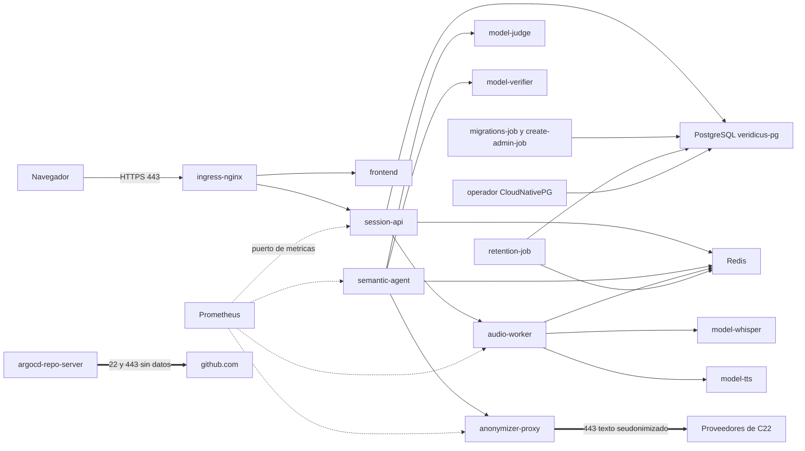

# Diseño de seguridad — U2 platform

**Revisión 2 (2026-11-22). Segunda pasada por el cambio 01 (DT27), la adenda 02 y las revisiones 3 de
Inception.** Sustituye a la revisión 1 del 2026-10-03, que queda en el historial de Git. Las secciones §1–§10
conservan su número; lo nuevo empieza en §11. Las precisiones nuevas son NFRD-U2-01 en adelante (§16), y §15
cierra los hallazgos R-01 a R-08 de `reviews/review-01.md`.

**Insumos.**
- Requisitos NFR1.1–NFR15.2, amenazas T1–T16 y precisiones NFR-U2-01 a NFR-U2-17 de
  `nfr-requirements/security-requirements.md` (security-requirements, revisión 2).
- Decisiones D1–D17, estructura de `deploy/`, tabla de dependencias de red y comandos de
  `nfr-requirements/tech-stack-decisions.md` (tech-stack-decisions, revisión 2).
- C1 (`/api/v1`), C14–C16, C21, C22, C25, CD-04, CD-06 y CD-07 de `inception/contract-design/contract-summary.md`
  (contract-summary, revisión 3); catálogo C25 v1 de `contracts/nfr-design/security-design.md` (U1).
- Lo que piden a U2 las NFR Requirements y los Functional Design aprobados hoy: NFR-U6-06 (U6),
  NFR-U7-05 a NFR-U7-07 y NFR15.5 (U7), NFR-U9-05, NFR10.2, NFR10.4 y NFR10.24 (U9), NFR-U10-10, NFR1.8,
  NFR3.3 y NFR15.1 (U10), NFR-U11-07 y NFR-U11-10 (U11), NFR-U12-05 (U12), NFR-U13-07 a NFR-U13-12 (U13),
  NFR10.8 y NFR10.23 (U3) y NFR15.4 (U5). U2 no tiene `functional-spec` propio; los `functional-design/`
  de U3, U9, U10 y U13 (F7, D4, F9, BR5.1) llegan a través de esas tablas.
- U2 no produjo performance-requirements, scalability-requirements, reliability-requirements ni
  observability-requirements propios (su NFR Requirements de tipo `packaging` concentra todo en
  security-requirements). Lo que piden a U2 los reliability-requirements de U4, U5, U9, U12 y U13 (AOF,
  RPO de la copia, `backoffLimit: 0`), los observability-requirements de U4–U7, U9 y U10 (raspado,
  paneles, reglas sin Alertmanager), los performance-requirements de U10 (arranque ≤ 60 s) y los
  scalability-requirements de U10 (pico de 1,5 GiB, 1 réplica) se diseña en §5, §7, §11, §12 y §13.
- Respuestas P1 = A y P2 = A de `nfr-design-questions.md` y la sección de la segunda pasada («Sin
  preguntas»); `## Deployment`, `## Forbidden` y `## Mandated` de `team.md` y `project.md`.

U2 es `packaging`: entrega el chart, las políticas y los *scripts* revisables. Por su tipo, esta etapa solo
produce este documento y `traceability.json`; lo que otras unidades piden a U2 de persistencia, respaldos y
métricas se diseña aquí (§7, §11–§13). Cada control lleva su comando, su umbral y su **control negativo**
(un manifiesto o archivo que debe fallar). Todo corre en nivel 0, sin red ni clúster, salvo lo marcado como
nivel 1 (contenedores locales), nivel 3 (tras el despliegue) o manual. Ningún paso aplica cambios al clúster
(AUTONOMIA-01). Los valores concretos (tamaños, `requests`/`limits`, rangos de red, el juez de `todo-local`)
los fija Infrastructure Design.

## 1. Zonas de confianza y frontera (AUTONOMIA-04)



<!-- Texto alternativo: el navegador entra por HTTPS al ingress, que reparte a frontend y session-api. session-api habla con PostgreSQL, Redis y audio-worker (ruta interna de síntesis). semantic-agent habla con Redis, el juez, el verificador y anonymizer-proxy. audio-worker habla con Redis, Whisper y TTS. Los Jobs de migraciones y create-admin van a PostgreSQL; el de retención a PostgreSQL y Redis. El operador de CloudNativePG alcanza las instancias. Prometheus raspa solo el puerto de métricas de los cuatro servicios. Solo dos flechas salen del clúster: anonymizer-proxy por 443 con texto seudonimizado hacia los proveedores de C22, y argocd-repo-server por 22 y 443 hacia github.com, sin datos. Todos los pods alcanzan kube-dns y los operadores y las instancias alcanzan el API server; esas flechas se omiten. -->

El diagrama coincide fila por fila con §2.1 (cierra R-01 a). La tabla Dentro/Fuera por componente es la de
§1 de security-requirements y no se repite.

| Zona | Componentes | Datos sin seudonimizar | Salida fuera del clúster |
|---|---|---|---|
| Navegador | Consola del analista | Sí, por HTTPS | — |
| `veridicus` | Servicios, base, Redis, servidores de modelos, `Job` | Sí | Solo `anonymizer-proxy`, con texto seudonimizado (§2) |
| Operadores | `ingress-nginx`, `cnpg-system`, `monitoring`, `keda`, `argocd` | `ingress-nginx` ve el testimonio en tránsito y no lo escribe (§3) | Solo `argocd-repo-server`, sin datos |
| Anfitriona | `fetch-models.sh`, `create-secrets.sh`, `mkcert`, `backup-db.sh` | Solo los respaldos (§12) | Solo para descargar modelos verificados |
| CI y GHCR | *Build*, políticas, Trivy | No | Sí, sin `kubeconfig` |

## 2. Red: negar todo y abrir por dependencia (NFR1.1, NFR1.5–NFR1.7, NFR10.6–NFR10.8, NFR10.18)

### 2.1 Tabla de dependencias (`deploy/network-deps.yaml`)

Es la tabla §3 de tech-stack-decisions más las filas que marca NFRD-U2-03 y NFRD-U2-04. Todos los pods
alcanzan `kube-dns` por 53 UDP/TCP.

| Origen | Destino | Puerto |
|---|---|---|
| `ingress-nginx` (ns `ingress-nginx`, `app.kubernetes.io/name: ingress-nginx`) | `frontend`, `session-api` | 8080 |
| `session-api` | `veridicus-pg` (primaria), Redis, `audio-worker` (síntesis) | 5432, 6379, 8080 |
| `semantic-agent` | Redis, `model-judge`, `model-verifier`, `anonymizer-proxy` | 6379, 8080, 8080, 8080 |
| `audio-worker` | Redis, `model-whisper`, `model-tts` | 6379, 8080, 8080 |
| `anonymizer-proxy` | `0.0.0.0/0` con `except` de los rangos privados y del clúster | 443 |
| `migrations-job`, `create-admin-job` | `veridicus-pg` | 5432 |
| `retention-job` | `veridicus-pg`, Redis | 5432, 6379 |
| Operador CloudNativePG | Instancias (`cnpg.io/cluster: veridicus-pg`) | 8000, 5432 |
| Instancias de PostgreSQL y operadores | API server (rango de `network-ranges.yaml`) | puerto del API server |
| Prometheus (`monitoring`) | Puerto `metrics` de `session-api`, `semantic-agent`, `audio-worker`, `anonymizer-proxy` | puerto interno |
| Prometheus | `kubelet` del nodo (métricas de CPU y memoria de los pods) | 10250 |
| Tráfico interno de cada namespace de operador (Grafana → Prometheus, componentes de Argo CD entre sí) | Mismo namespace | Puertos del chart oficial |
| KEDA (`keda`, COULD, apagado por defecto) | Redis | 6379 |
| `argocd-repo-server` | `0.0.0.0/0` con el mismo `except` | 22, 443 |

Los rangos del clúster (pod CIDR, service CIDR y dirección del API server) viven en
`deploy/network-ranges.yaml`, que fija Infrastructure Design, y no en el texto de cada política (cierra R-02).

### 2.2 Forma de las políticas

- En cada namespace (`veridicus`, `ingress-nginx`, `cnpg-system`, `monitoring`, `argocd` y, si se activa,
  `keda`), una `NetworkPolicy` `*-default-deny` con `podSelector: {}`, `policyTypes: [Ingress, Egress]` y
  ninguna regla.
- Una `NetworkPolicy` por *workload* que abre **solo** sus filas de §2.1. Los selectores son por etiqueta:
  `app.kubernetes.io/name` en los pods propios, `cnpg.io/cluster` en los de la base y
  `namespaceSelector` con `kubernetes.io/metadata.name` para otro namespace.
- Entrada a `anonymizer-proxy`: `semantic-agent` en el puerto 8080 y Prometheus solo en el puerto de
  métricas (NFRD-U2-03). Entrada a los servidores de modelos: solo su cliente en 8080; Prometheus no los
  alcanza (NFR10.8).
- Ninguna regla admite entrada desde `argocd` hacia `veridicus` (NFR1.7).

| Comprobación | Qué rechaza | Control negativo en `deploy/policies/tests/` |
|---|---|---|
| Kyverno `egress-peers-explicit` | Regla de salida sin `to`, un `to` vacío, `podSelector: {}` o `namespaceSelector: {}` como destino | Una regla de `semantic-agent` sin `to`; otra con `namespaceSelector: {}` |
| Kyverno `deny-external-egress` | `ipBlock` fuera de `network-ranges.yaml`, salvo los dos pods de la lista cerrada. En ellos, `0.0.0.0/0` exige el `except` completo y solo los puertos 443 (proxy) o 22 y 443 (`argocd-repo-server`) | `semantic-agent` con `0.0.0.0/0`; el proxy con el puerto 80; el proxy sin `except`; `argocd-server` con salida externa |
| Kyverno `restrict-datastore-ingress` | Entrada a Redis, PostgreSQL o un servidor de modelos desde un origen que no figura en §2.1 | `frontend` hacia Redis; `semantic-agent` hacia 5432; Prometheus hacia `model-judge` |
| `scripts/check-network-deps.sh deploy/network-deps.yaml <render>` | Dependencia sin regla, regla sin dependencia o namespace sin su `default-deny` (comprobación sobre el render completo, que Kyverno CLI no resuelve entre recursos) | Una regla de más; una dependencia sin regla; un render sin `veridicus-default-deny` |
| Kyverno `internal-model-urls` | `VERIDICUS_JUDGE_URL`, `VERIDICUS_VERIFIER_URL`, `VERIDICUS_WHISPER_URL` o `VERIDICUS_TTS_URL` que no terminan en `.svc.cluster.local` (NFR1.3) | `VERIDICUS_JUDGE_URL=https://api.openai.com` |

Umbral de todo el bloque: `kyverno apply` con 0 violaciones en el render y `kyverno test` con cada control
negativo fallando como se espera; `check-network-deps.sh` termina en 0.

### 2.3 CoreDNS (NFR1.4)

`deploy/coredns/Corefile` reenvía hacia fuera solo la unión de `libs/anonymizer/data/allowed-domains.v1.yaml`
y `deploy/coredns/infra-domains.yaml` (cada dominio con su motivo; hoy solo `github.com`). El resto responde
`NXDOMAIN`. `scripts/check-coredns-domains.sh` quita la lista de infraestructura y pasa el resto a
`compare_with_corefile` de U10 (F9), que exige igualdad exacta; además rechaza un dominio de infraestructura
que esté en la lista del anonimizador. Tres controles negativos: un dominio de más, un dominio de
infraestructura sin motivo y `github.com` en la lista del anonimizador. El Corefile lo aplica el humano tras
la fusión (D14).

### 2.4 Verificación manual en el clúster (AC9.1.2, NFR1.1, NFR1.7)

Antes de la sustentación, y con salida registrada en el PR de la entrega:
- Desde cada pod de `veridicus` distinto del proxy, una petición a `https://example.com` con un plazo de
  5 s falla. Las imágenes Python usan `python -c` con `urllib` y `timeout=5`. Las que no traen intérprete ni
  `curl` (Redis, PostgreSQL, servidores de modelos) se comprueban con `kubectl debug` y una imagen de `curl`
  fijada por digest, que comparte la red del pod. Lo ejecuta el humano y no vive en ningún *script* (cierra
  R-08).
- El mismo pod alcanza su dependencia (control positivo).
- Desde `argocd-repo-server`, `git ls-remote` al repositorio responde y `example.com` falla.

## 3. HTTPS y el Ingress sin disco (NFR10.14; NFR-U6-06, NFR-U7-07, NFR-U12-05)

### 3.1 TLS (P1 = A)

- Todo `Ingress` lleva `spec.tls` con el Secret `veridicus-tls` (NFR10.14), `ssl-redirect: "true"` y HSTS.
- `scripts/create-secrets.sh` corre en la **máquina donde se despliega** (desarrollo o demostración). Usa
  `mkcert` para crear una CA local y un certificado para `veridicus.local`, y escribe la clave y el
  certificado en `~/.local/share/veridicus/tls/` con modo `0600`, fuera del repositorio (cierra R-05).
- Al navegador de otra máquina solo se copia `rootCA.pem`, nunca `rootCA-key.pem`. El nombre resuelve con
  una línea en `/etc/hosts` que apunta a `minikube ip`. El *script* imprime el `notAfter` del certificado, y
  el runbook pide reemitirlo antes de esa fecha.
- `VERIDICUS_TRUSTED_PROXY` es el pod CIDR de `network-ranges.yaml` (`project.md`), porque solo
  `ingress-nginx` alcanza el puerto 8080 (cierra R-07).
- Kyverno `require-ingress-tls`: control negativo con un `Ingress` sin `tls`.

### 3.2 Ningún cuerpo toca el disco del *ingress*

ingress-nginx guarda en un archivo temporal todo cuerpo de petición de más de 16 KiB y las respuestas que no
caben en sus búferes (`project.md`). El diseño aplica un **patrón único** a todo `Ingress` cuyo destino es
`session-api`:

| Anotación | Valor | Efecto |
|---|---|---|
| `nginx.ingress.kubernetes.io/proxy-request-buffering` | `"off"` | La petición pasa por trozos a `session-api`, que la lee en memoria |
| `nginx.ingress.kubernetes.io/proxy-buffering` | `"off"` | La respuesta (vista previa, exportación, sondeo, audio sintetizado) pasa sin archivo temporal |
| `nginx.ingress.kubernetes.io/proxy-max-temp-file-size` | `"0"` | Defensa adicional: aunque se encienda el *buffering*, nada va a disco |
| `nginx.ingress.kubernetes.io/proxy-body-size` | El tope de su grupo (tabla siguiente) | El `413` del Ingress solo llega por encima del tope de C25 más su margen; por debajo, lo da `session-api` como Problem Details |

| `Ingress` | Rutas | Tope de cuerpo (bytes) | Cálculo | Origen |
|---|---|---|---|---|
| `veridicus-web` | `/` → `frontend`; `/api/` → `session-api` | 2 113 536 | `import_file_max_bytes` + 16 KiB | NFR-U6-06 (importación, transcripción); cubre el sondeo de U4 y las respuestas de U7 |
| `veridicus-voice` | `^/api/v1/sessions/[0-9a-f-]{36}/voice-turns$` | 6 065 536 | `audio_max_bytes` + 64 KiB | NFR10.2 de U9 |
| `veridicus-research-reports` | `^/api/v1/research-reports$` | 8 454 144 | `research_report_max_bytes` + 64 KiB | NFR-U12-05 |

- La respuesta `GET /api/v1/conductor-observations/{id}/audio` queda en `veridicus-web`: ya no necesita su
  propio `Ingress`, porque el patrón apaga el *buffering* de respuesta en todo `/api/` (NFRD-U2-06).
- `/metrics` no se enruta: vive en un puerto que ningún `Service` del Ingress publica, y `/api/metrics`
  responde `404` (NFR10.23 de U3).
- `use-regex` vale para todo el *host*, así que el enrutamiento se prueba de verdad (§3.3; cierra R-04 de
  la revisión de Infrastructure Design de U9).

### 3.3 Comprobaciones del Ingress

| Comprobación | Umbral | Control negativo |
|---|---|---|
| `scripts/check-ingress-limits.sh deploy/ingress-limits.yaml contracts/limits.v1.yaml <render>` (nivel 0) | Cada `Ingress` hacia `session-api` lleva las tres anotaciones sin disco y un `proxy-body-size` igual a tope + margen; 0 `Ingress` fuera de la tabla | Un `Ingress` sin `proxy-request-buffering: "off"`; un tope de voz de `7m`; un `Ingress` nuevo sin grupo |
| `scripts/check-ingress-routes.sh <url-base>` (nivel 3, tras cada despliegue, junto a `smoke.sh`) | Con la cookie del usuario de humo, por cada grupo: un cuerpo de tope + 1 byte de C25 recibe `413` con `application/problem+json` (lo da `session-api`, no nginx); `/` sirve la consola y `/api/v1/healthz` llega a `session-api` | Un tope de Ingress menor que el de C25 da `413` en HTML y el *script* falla |
| Manual, tras subir un audio de 6 000 000 bytes y un reporte de 8 388 608 bytes | `find /tmp/nginx -type f` en el pod del controlador devuelve 0 archivos (solo lectura, lo ejecuta el humano) | — |

## 3b. Forma de `deploy/ingress-limits.yaml`

La tabla de grupos de §3.2 vive en este archivo. No guarda cifras: las lee de `contracts/limits.v1.yaml`
(catálogo único de `project.md`), y `check-ingress-limits.sh` calcula tope + margen.

```yaml
schema_version: 1
groups:
  veridicus-web:               { limit: import_file_max_bytes,     margin_bytes: 16384 }
  veridicus-voice:             { limit: audio_max_bytes,           margin_bytes: 65536 }
  veridicus-research-reports:  { limit: research_report_max_bytes, margin_bytes: 65536 }
no_disk_annotations: [proxy-request-buffering, proxy-buffering, proxy-max-temp-file-size]
```

## 4. Imágenes y cadena de suministro (NFR10.1, NFR1.2, NFR10.4, NFR10.11)

| Control | Diseño | Comprobación y control negativo |
|---|---|---|
| Digest | Imágenes propias como `ghcr.io/…@sha256:…`; el *build* publica con la etiqueta del SHA y el chart usa el digest | Kyverno `require-image-digest`: falla con `:latest` y con una etiqueta sin digest |
| Terceros | Versión exacta en `Chart.yaml` y `Chart.lock` versionado; digest cuando el chart lo admite. Cada excepción en `deploy/image-exceptions.yaml` con motivo y caducidad (D17) | Kyverno lee el archivo como contexto: falla una imagen sin digest fuera de la lista y una excepción vencida |
| Vulnerabilidades | Trivy en el *job* de *build* | 0 `HIGH`/`CRITICAL` con corrección; `.trivyignore` con motivo y caducidad |
| Modelos | `fetch-models.sh` en la anfitriona contra `deploy/models.lock` (URL, revisión, `sha256`), incluidos el juez de `todo-local` (NFR-U11-07), el verificador, Whisper, la voz Piper y el NER del proxy | `scripts/check-no-downloads.sh <render> services/*/Dockerfile`: 0 `curl`, `wget` ni `huggingface-cli` en comandos de contenedores; control negativo con un `initContainer` que descarga |
| Montaje | `PersistentVolume` estático `veridicus-models` (`ReadOnlyMany`) y su PVC, siempre con `readOnly: true`; nunca `hostPath` en el pod | Kyverno `no-hostpath` y `models-readonly`: fallan un volumen `hostPath` y el PVC montado en escritura |
| Al arrancar | `initContainer` `verify-model` en cada servidor local: `sha256sum -c` con la línea de `models.lock` | Kyverno `require-model-verify` sobre `model-*`. **Nivel 1**: `uv run pytest deploy/tests/level1 -m platform` arranca `verify-model` con un archivo alterado en un byte y el contenedor termina con código ≠ 0 (cierra R-03) |

## 5. Endurecimiento de pods (NFR10.2, NFR10.9, NFR8.1, NFR2.1, NFR10.17)

- `veridicus` y `argocd` con `pod-security.kubernetes.io/enforce: restricted`; los namespaces de
  operadores con `baseline` como mínimo y cada desvío con su motivo en el chart.
- Un *helper* `_securityContext.tpl` que todos los subcharts usan: `runAsNonRoot`,
  `allowPrivilegeEscalation: false`, `capabilities.drop: [ALL]`, `seccompProfile: RuntimeDefault` y
  `readOnlyRootFilesystem: true`.
- Escrituras permitidas (NFR-U9-05 c y e, NFR-U10-10): `/tmp` como `emptyDir` con `medium: Memory` y
  `sizeLimit` en `audio-worker`, `model-whisper`, `model-tts` y `anonymizer-proxy`. Ninguno de los cuatro
  monta un PVC en escritura. Como un `emptyDir` en memoria cuenta en el `limit` del contenedor,
  Infrastructure Design suma su `sizeLimit` al dimensionar.
- `automountServiceAccountToken: false` en todo pod propio de `veridicus`; exentos, con su motivo, los
  pods de instancia de CloudNativePG y los operadores de terceros (NFR10.9; cierra R-01 d).
- Sondas (NFR10.17): `livenessProbe` `/healthz` y `readinessProbe` `/readyz` en el puerto interno.
  `anonymizer-proxy` y los servidores de modelos llevan además un `startupProbe` que tolera ≥ 90 s, porque
  el proxy tarda hasta 60 s en cargar el NER (NFR3.3 de U10) (NFRD-U2-08).

| Política Kyverno | Qué rechaza | Control negativo |
|---|---|---|
| `restricted-security-context` | Contenedor sin cualquiera de los campos del *helper* | `session-api` con `readOnlyRootFilesystem: false` |
| `memory-only-tmp` | `emptyDir` sin `medium: Memory` o sin `sizeLimit` en los cuatro pods de arriba, o un PVC en escritura en ellos | `model-whisper` con `/tmp` en disco; `audio-worker` montando `veridicus-audio` |
| `no-sa-token` | Pod propio con `automountServiceAccountToken` distinto de `false`; `Role` o `ClusterRole` propios | `session-api` con el token montado |
| `require-resources` | Contenedor o `initContainer` sin `requests` o `limits` de CPU y memoria, `Job` incluidos | `verify-model` sin `limits` |
| `gpu-only-in-gpu-values` | `nvidia.com/gpu` en el render de `values-cpu.yaml` | El juez con GPU en `values-cpu.yaml` |
| `require-probes` | Uno de los cuatro servicios sin `livenessProbe` o `readinessProbe`; el proxy sin `startupProbe` | `audio-worker` sin `readinessProbe` |

## 6. Secretos (NFR10.3, NFR10.12, NFR10.13)

- 0 objetos `Secret` con `data` o `stringData` en `deploy/` (Kyverno `no-inline-secrets`; control negativo
  con un `Secret` en línea). `gitleaks` sin hallazgos.
- `scripts/create-secrets.sh` lee el `.env` no versionado y escribe los manifiestos de Secret en
  `~/.local/share/veridicus/secrets/secrets-<fecha>.yaml` con modo `0600`, fuera del repositorio (y
  `secrets*.yaml` está en `.gitignore`). El humano los revisa, los aplica y borra el archivo; el *script* no
  aplica nada (cierra R-06).
- `llama-server` recibe su clave por la variable `LLAMA_API_KEY` desde `secretKeyRef`, nunca por
  `--api-key` en los argumentos, para que no aparezca en la línea de comandos del proceso (cierra R-06).
  La contraseña de Redis llega como archivo (§7.2), por la misma razón.
- `deploy/policies/secret-consumers.yaml` es la tabla cerrada de NFR10.13 más la contraseña de Redis
  (`veridicus-redis-auth`, solo en Redis, `session-api`, `semantic-agent`, `audio-worker`, el `Job` de
  retención y, si se activa, KEDA) y `veridicus-tls` (solo el Ingress) (NFRD-U2-09). Kyverno falla ante
  cualquier otra referencia. Controles negativos: `veridicus-provider-keys` en `semantic-agent` (NFR10.12)
  y `veridicus-db-retention` en `session-api`.

## 7. Datos persistentes (NFR10.6, NFR10.7, NFR10.10, NFR11.1, NFR11.2)

### 7.1 PostgreSQL (CloudNativePG)

- `Cluster` `veridicus-pg` de 1 instancia con la imagen oficial por digest, **sin `pgvector`**,
  `enableSuperuserAccess: false` y TLS `verify-full` para los clientes.
- `managed.roles` con exactamente `veridicus_owner`, `veridicus_app` y `veridicus_retention`, cada uno con
  su Secret. No existe `veridicus_judge_ro` (C9 «Retirado») ni `veridicus_report_ro` (NFR-U7-05).
- `postgresql.parameters`: `log_parameter_max_length: "0"` y `log_parameter_max_length_on_error: "0"`
  (NFR-U13-12), más `log_min_duration_statement: "-1"` y `log_statement: "none"`, para que ni una consulta
  lenta ni una de definición dejen texto en el log (NFRD-U2-10).
- Migraciones solo en `migrations-job`, en su propio archivo y su propio PR (NFR10.10).

| Comprobación | Qué rechaza | Control negativo |
|---|---|---|
| Kyverno `cnpg-cluster-hardening` | `enableSuperuserAccess` distinto de `false`; `vector` en `postInitSQL` o en las extensiones; roles distintos de los tres; falta de alguno de los cuatro parámetros de log | Un `Cluster` con `enableSuperuserAccess: true`; otro con `veridicus_judge_ro` |
| Kyverno `no-migrations-in-deployments` | `alembic` en un `Deployment` o un `initContainer` | Un `initContainer` de `session-api` con `alembic upgrade` |

### 7.2 Redis (NFR10.6, NFR11.2, NFR-U9-05 b)

`StatefulSet` `veridicus-redis` de 1 réplica con un `redis.conf` desde un `ConfigMap`:

| Directiva | Valor | Por qué |
|---|---|---|
| `appendonly` / `appendfsync` | `yes` / `everysec` | Las colas sobreviven a un reinicio; se pierde como mucho 1 s (NFR11.2) |
| `save` | `""` | Sin RDB: el audio en tránsito no queda en una segunda copia (NFR10.4 de U9) |
| `auto-aof-rewrite-percentage` / `auto-aof-rewrite-min-size` | `100` / `16mb` | Cota del rastro del audio en el AOF (NFR10.4 de U9) |
| `dir` | `/data`, sobre el PVC `veridicus-redis-data` | Persistencia |
| `protected-mode` | `yes` | NFR10.6 |
| `include` | `/etc/redis/auth/requirepass.conf`, montado de `veridicus-redis-auth` | La contraseña no va en la línea de comandos ni en el `ConfigMap` |
| `rename-command` | `FLUSHALL`, `FLUSHDB`, `DEBUG` y `CONFIG` a `""` | Ningún cliente borra ni reconfigura; `INFO persistence` sigue disponible para la prueba de U9 |

| Comprobación | Umbral | Control negativo |
|---|---|---|
| `scripts/check-redis-conf.sh <render>` (nivel 0) | Las siete filas presentes con su valor exacto (cierra R-03) | `appendonly no`; `save "900 1"`; sin `include` |
| `uv run pytest deploy/tests/level1 -m platform` (nivel 1, Redis real con el mismo `redis.conf`) | Tras escribir 10 entradas en un *stream* y reiniciar el contenedor, siguen las 10 | La misma prueba con `appendonly no` pierde las entradas (verifica que la prueba distingue) |

### 7.3 Volúmenes de la aplicación (NFR-U7-05, NFR-U7-06, NFR-U9-05 d, NFR10.24 de U9, NFR-U13-07)

| PVC | Tamaño | Lo montan | *Prune* |
|---|---|---|---|
| Datos de `veridicus-pg` | Infrastructure Design | La instancia de CloudNativePG | Desactivado |
| `veridicus-redis-data` | Infrastructure Design | Redis | Desactivado |
| `veridicus-reports` | El que fija U7 | Contenedor `api` de `session-api` y `retention-job`, en escritura | Desactivado |
| `veridicus-audio` | ≥ 1,2 × `audio_store_max_bytes` = 2 576 980 378 bytes; se pide `3Gi` | Contenedor `api` de `session-api` y `retention-job`, en escritura | Desactivado |
| `veridicus-models` (estático) | El de los archivos de `models.lock` | `model-*` y `anonymizer-proxy` (NER), en solo lectura | — |

- `deploy/policies/volume-consumers.yaml` es la tabla cerrada de arriba. Kyverno `volume-consumers`
  (generaliza `veridicus-reports-mounts` de U7) falla ante cualquier otro montaje, incluso en lectura.
  Controles negativos: `audio-worker` con `veridicus-audio`, un `CronJob` con `veridicus-reports` y
  `frontend` con `veridicus-models`.
- `reports/` y `audio/` son subdirectorios `0700` que crea el proceso, porque el aprovisionador de Minikube
  ignora `fsGroup` (`project.md`). Por eso el `Job` de retención corre con el **mismo `runAsUser` y
  `runAsGroup`** que `session-api`. Kyverno `retention-job-identity` compara los dos valores en el render
  (control negativo: UID distinto).
- Los dos PVC son `ReadWriteOnce` y los comparten dos pods: vale porque hay un solo nodo (riesgo en §14).

### 7.4 Argo CD y lo que no sincroniza (NFR11.1, NFR10.16)

- `argocd.argoproj.io/sync-options: Prune=false` en el `Cluster`, sus PVC, `veridicus-redis-data`,
  `veridicus-reports` y `veridicus-audio`. Kyverno `no-prune-on-data`: control negativo con
  `veridicus-audio` sin la anotación.
- La `Application` apunta a `deploy/veridicus`. `deploy/jobs/` (retención y `create-admin`) queda fuera y lo
  aplica el humano. Control negativo: una `Application` cuyo `path` incluye `deploy/jobs`.
- *Deploy key* de solo lectura (AC10.7.1).

## 8. Dónde se hacen cumplir las políticas (P2 = A)

| Lugar | Qué corre | Cuándo |
|---|---|---|
| Máquina de desarrollo | `helm lint`, `yamllint`, `helm template` → `kubeconform` → `kyverno apply`, `kyverno test` y los *scripts* `check-*` | Antes del PR |
| CI (*job* `deploy-level0`) | Lo mismo con `values-cpu.yaml`, `values-gpu.yaml` y `deploy/jobs`, sin red ni `kubeconfig`, con los esquemas de Kubernetes y de las CRD en `deploy/schemas` | Cada PR; bloquea la fusión |
| Clúster | Solo Pod Security `restricted` | En cada admisión |

## 9. Nada aplica cambios al clúster (NFR10.5, AUTONOMIA-01)

`scripts/check-no-cluster-apply.sh` (cierra R-04):
- **Normaliza antes de buscar**: une las líneas terminadas en `\`, colapsa espacios y quita comentarios.
- **Alcance**: `.github/`, `scripts/`, `deploy/`, `Makefile`, `frontend/e2e/` y todo `*.sh`.
- **Verbos prohibidos**: los de NFR10.5 (`kubectl` con `apply`, `create`, `replace`, `patch`, `delete`,
  `edit`, `scale`, `rollout`, `set` o `annotate`; `helm` con `install`, `upgrade`, `uninstall` o
  `rollback`; `terraform apply` o `destroy`; `alembic upgrade`; `kubeconfig` en un *workflow*; `kind:
  CronJob`; `sbatch`, `ssh`, `scp` o `rsync` hacia ZINE), más `kubectl exec`, `kubectl cp`, `kubectl debug`
  y `argocd app sync` (NFRD-U2-11).
- **Única excepción**: `deploy/policies/readonly-exec-allowlist.yaml`, una lista cerrada de líneas
  `kubectl exec` de solo lectura con su motivo: el `pg_dump` de `backup-db.sh` (§12), la consulta de U13
  (`python -m session_api.ethics_governance.query`, NFR-U13-08) y `verify_store` de U7 (NFR-U7-05).
  `export_store` e `import_store` de U7 y el lanzamiento del `Job` de retención solo existen en el runbook,
  nunca en un *script*.
- Un control negativo por patrón en `deploy/policies/tests/no-apply/`, incluidos un `helm upgrade --install`
  partido en dos líneas y un `kubectl exec` fuera de la lista. Umbral: 0 apariciones.

Los *workflows* declaran `permissions: contents: read` y no tienen `kubeconfig`.

## 10. Datos sintéticos (NFR12.1, NFR12.2)

- `scripts/check-no-data.sh <render>`: cada `ConfigMap` solo tiene claves de la lista permitida
  (`profiles.yaml`, `prices.yaml`, el *prompt*, `Corefile`, `redis.conf`, la configuración y los paneles
  de Grafana) y ningún archivo de `deploy/` trae el marcador de transcripción del conjunto sintético.
  Control negativo: un `ConfigMap` con una clave `transcript`.
- Ningún volumen apunta a rutas del piloto ni a `evaluation/` (Kyverno `no-corpus-mounts`; control
  negativo con un `hostPath` o PV a `evaluation/`).
- `scripts/check-config-copy.sh`: `deploy/veridicus/files/profiles.yaml` y `prices.yaml` tienen el mismo
  SHA-256 que `config/` (NFR10.15); control negativo con un byte distinto.

## 11. Observabilidad de la plataforma (NFR15.1, NFR15.2, NFR10.19, NFR8.3)

- **Raspado.** Un `ServiceMonitor` por servicio apunta al puerto `metrics` de `session-api`,
  `semantic-agent`, `audio-worker` y `anonymizer-proxy` (NFR15.2, NFR-U9-05 a, NFR15.1 de U10). Ni el
  puerto de la API ni los servidores de modelos se raspan; la CPU y la memoria de cada pod salen de `kubelet`
  (§2.1). `scripts/check-network-deps.sh` exige que cada `ServiceMonitor` tenga su fila en §2.1 (control
  negativo: un `ServiceMonitor` de `model-judge`).
- **Regla AIR** (`PrometheusRule` `veridicus-air`): `veridicus_session_dismissal_ratio > 0.25`, una
  fracción que U5 calcula sobre las *W* = 8 decisiones de `dismissal_window_w` (C25 v1). Solo anota una
  revisión por PR; no propone umbral ni cambia un perfil o un *prompt* (AUTONOMIA-03). `promtool test rules`
  usa los *fixtures* de U2 (0,25 = 5 de 20, sin alerta; 0,30 = 6 de 20, con alerta) y el archivo de U5
  `services/session-api/tests/human_review/fixtures/air_series.yaml` (0,25 sin alerta; 0,375 con alerta)
  (NFRD-U2-12). El render falla si `dismissal_window_w` falta en el catálogo.
- **Otras reglas informativas** de las unidades viven en el mismo subchart con su prueba `promtool`, por
  ejemplo `increase(veridicus_report_exports_total{result="not_recorded"}[10m]) > 0` (NFR15.5 de U7). Sin
  Alertmanager: ninguna notifica a nadie.
- **Paneles.** Uno por unidad, como `ConfigMap` versionado en `charts/monitoring-rules/dashboards/`. Grafana
  con `check_for_updates: false`, sin *plugins* en ejecución y sin análisis de uso (NFR1.6).
- **Logs.** Sin Loki: los del contenedor quedan en el nodo. En nivel 1, `deploy/tests/level1` captura los
  logs de todos los contenedores tras el turno con *canary* que siembra U4 y exige 0 apariciones
  (NFR10.19). `llama-server`, Whisper y Piper corren con un nivel de log que no imprime cuerpos (NFR-U9-05 c),
  y esa misma captura lo comprueba.
- **Humo.** `scripts/smoke.sh <url-base>` exige `200` en `/healthz` de los cuatro servicios y que pase
  `frontend/e2e/smoke.spec.ts` con *N* = 300 s (NFR-U11-10); luego corre `check-ingress-routes.sh` (§3.3).

## 12. Respaldos (NFR-U13-11; RPO de U5 y U12)

- `scripts/backup-db.sh` lo ejecuta el humano antes de la sustentación o de un cambio de esquema. Hace un
  `pg_dump -Fc` dentro de la instancia por `kubectl exec` (de la lista cerrada de §9) hacia
  `backups/veridicus-<fecha UTC>.dump`, con el directorio `0700`, el archivo `0600` y `umask 077`.
- Antes de escribir, **borra todo volcado de `backups/` con más de `retention_max_days` días** (90, leído de
  `contracts/limits.v1.yaml`) y lista lo que borró. Así ningún respaldo vive más que el plazo máximo de
  retención (VE-12).
- No arranca si `git check-ignore backups/` no confirma que el directorio está ignorado. El *script* no
  tiene opción para copiar fuera de la máquina; `check-no-cluster-apply.sh` ya rechaza `scp` y `rsync`, y
  el runbook prohíbe sacar un volcado con datos reales de la máquina local.
- Prueba de nivel 0 `uv run pytest deploy/tests/level0 -k backup_prune`: en un directorio temporal con
  volcados de 89, 90 y 91 días (por `mtime`), solo se borra el de 91; control negativo con un directorio no
  ignorado, que hace terminar el *script* con código ≠ 0.
- **RPO y RTO.** Sin copia continua (P4 = A de Infrastructure Design revisión 1): el RPO es el último volcado
  manual y la recuperación es un `pg_restore` manual del runbook. U5 y U12 heredan esa cifra (NFRD-U2-13).

## 13. Recursos que piden otras unidades (NFR8.1, NFR8.2)

U2 declara los `requests`/`limits` con los valores que fija Infrastructure Design a partir de estas cifras
aprobadas: el pico de 1,5 GiB del proxy (NFR8.3 de U10), el `Job` de retención (`requests` 250m y 256 MiB,
`limits` 1 CPU y 512 MiB, `activeDeadlineSeconds` 3 600; NFR-U13-07) y el `sizeLimit` de los `/tmp` en
memoria (§5). Los `Job` llevan `backoffLimit: 0`; `create-admin` además `ttlSecondsAfterFinished: 3600`
(NFR10.8 de U3). Kyverno `job-shape`: control negativo con `backoffLimit: 1`. El 98 % de NFR8 lo mide Build
and Test (NFR8.2).

## 14. Riesgos residuales

| Riesgo | Por qué queda | Tratamiento |
|---|---|---|
| `anonymizer-proxy` y `argocd-repo-server` pueden conectar por 443 a una IP literal | Una `NetworkPolicy` no filtra por dominio | El módulo y Argo CD solo usan sus nombres; CoreDNS no resuelve otros (§2.3). Aceptado (P5 = A) |
| Un manifiesto aplicado a mano o un `values` local que relaja las políticas | Sin Kyverno en el clúster (P2 = A) | Solo se aplica lo fusionado en `main`; Pod Security `restricted` sigue activo |
| El tráfico dentro de `veridicus` va sin TLS, salvo el de PostgreSQL | No hay malla de servicios en el MVP | La `NetworkPolicy` de entrada limita cada destino a sus clientes; los datos son sintéticos (NFR12) |
| El AOF, los reportes, el audio y los respaldos quedan sin cifrar en disco | Volúmenes locales del nodo | Permisos `0700`/`0600`, cotas de U9 y U13, y datos sintéticos; cifrar el disco queda fuera del MVP |
| Un volcado tomado el día 89 de una sesión conserva su testimonio hasta 90 días más | La cota de NFR-U13-11 es la edad del volcado, no la de cada sesión | Volcados solo cuando hacen falta (§12) y nunca fuera de la máquina local |
| Dos pods comparten PVC `ReadWriteOnce` | Vale en un solo nodo | Con más nodos, el `Job` de retención necesitaría afinidad con `session-api` |
| La CA de `mkcert` queda instalada en el navegador de la demostración | Necesaria para HTTPS local | Un perfil de navegador dedicado a la demostración |
| El CNI no hace cumplir las `NetworkPolicy` | Depende de la máquina | Calico (Infrastructure Design) y la verificación manual de §2.4 |

## 15. Cierre de los hallazgos de la revisión 1

| Hallazgo | Dónde se cierra |
|---|---|
| R-01 (red real, *ingress controller*, CloudNativePG, `no-sa-token`) | §1, §2.1, §2.2, §5 |
| R-02 (reglas de salida evadibles; comprobación entre recursos) | §2.1 (`network-ranges.yaml`), §2.2 (`egress-peers-explicit`, `check-network-deps.sh`) |
| R-03 (controles negativos; Redis; CloudNativePG; nivel 1 de `verify-model`) | §4, §5, §6, §7.1, §7.2 |
| R-04 (verbos y líneas partidas en `check-no-cluster-apply.sh`) | §9 |
| R-05 (`mkcert` con dos máquinas) | §3.1 |
| R-06 (salida de `create-secrets.sh`; `--api-key` en argumentos) | §6 |
| R-07 (tope de cuerpo del *ingress*; red de `VERIDICUS_TRUSTED_PROXY`) | §3.1, §3.2, §3.3 |
| R-08 (riesgos sin declarar; herramienta de la verificación manual) | §2.4, §14 |

## 16. Precisiones y decisiones aplicadas (NFRD-U2-xx)

Ninguna fila requirió pregunta: todas salen de fuentes aprobadas. «Precisa» nombra el artefacto aprobado que
la fila matiza; «—» indica que solo se aplica la fuente. No edité ningún original: decides en la aprobación si
alguno se actualiza.

| ID | Precisa | Qué | Dónde | Origen |
|---|---|---|---|---|
| NFRD-U2-01 | `nfr-requirements/security-requirements.md` revisión 2 (NFR10.14) | El Secret TLS se llama `veridicus-tls` en todo el chart; sale `veridicus-ingress-tls` de la revisión 1 de este documento y de Infrastructure Design de U2 y U9 | §3.1 | NFR10.14 |
| NFRD-U2-02 | `nfr-requirements/tech-stack-decisions.md` §3 | Los rangos del clúster viven en `deploy/network-ranges.yaml` y las reglas hacia el API server usan esos rangos | §2.1 | R-02 |
| NFRD-U2-03 | `nfr-requirements/security-requirements.md` (NFR1.5, NFR15.2) | Prometheus raspa también `audio-worker` y `anonymizer-proxy`, solo en el puerto de métricas. La entrada al proxy en 8080 sigue siendo solo de `semantic-agent` | §2.1, §2.2, §11 | NFR-U9-05 (a); NFR1.9 «Retirado» y NFR15.1 de U10 |
| NFRD-U2-04 | `nfr-requirements/tech-stack-decisions.md` §3 | Filas nuevas: Prometheus → `kubelet` (10250) y el tráfico interno de cada namespace de operador, para que NFR10.18 cruce todas las reglas | §2.1 | NFR1.6; observabilidad de U4 y U9 (CPU y memoria) |
| NFRD-U2-05 | `platform/infrastructure-design/infrastructure-specification.md` revisión 1 (§3, `allow-prometheus`) | Prometheus no alcanza `llama-server` ni el exportador de PostgreSQL: entraría por el puerto de la API del juez, que NFR10.8 reserva a `semantic-agent` | §2.2, §11 | NFR10.8 |
| NFRD-U2-06 | `voice/infrastructure-design/infrastructure-specification.md` revisión 1 (§4) | Patrón único sin disco en todo `/api/`; `veridicus-voice` conserva solo la subida, con la ruta `/api/v1/...` de C1 y un tope de 6 065 536 (antes `7m`); el audio sintetizado pasa a `veridicus-web`. Nuevo `veridicus-research-reports` con 8 454 144 | §3.2, §3b | NFR-U6-06, NFR-U7-07, NFR-U12-05, NFR10.2 de U9; C1 |
| NFRD-U2-07 | `platform/infrastructure-design/infrastructure-specification.md` revisión 1 (§2.1) | El `proxy-body-size` deja de ser «el mayor tamaño de C1»: es por grupo, tope de C25 más margen, y lo comprueba `check-ingress-limits.sh` con la ruta real en nivel 3 | §3.2, §3.3 | NFR-U6-06, NFR-U12-05; R-04 de la revisión de Infrastructure Design de U9 |
| NFRD-U2-08 | `nfr-requirements/security-requirements.md` (NFR10.17) | `startupProbe` de ≥ 90 s en `anonymizer-proxy` y en los servidores de modelos | §5 | NFR3.3 de U10 |
| NFRD-U2-09 | `nfr-requirements/security-requirements.md` (NFR10.13) | La tabla de consumidores suma `veridicus-redis-auth` (con el `Job` de retención, que escribe la clave de CD-06) y `veridicus-tls` | §6 | NFR10.6, NFR10.16, CD-06 |
| NFRD-U2-10 | — | Además de los dos parámetros de NFR-U13-12, `log_min_duration_statement: "-1"` y `log_statement: "none"` | §7.1 | NFR-U13-12 (mismo motivo) |
| NFRD-U2-11 | `nfr-requirements/security-requirements.md` (NFR10.5) | `kubectl exec`, `kubectl cp`, `kubectl debug` y `argocd app sync` también se rechazan en *scripts* y *workflows*, salvo la lista cerrada de `exec` de solo lectura | §9 | NFR-U13-08, NFR-U7-05; R-04 |
| NFRD-U2-12 | `nfr-requirements/security-requirements.md` (NFR15.1) | `promtool` usa los *fixtures* de U2 y los de U5 a la vez, con *W* = 8 de C25 v1 | §11 | NFR15.4 de U5; C25 v1 de U1 |
| NFRD-U2-13 | `human-review` y `research-reports` (RPO «por fijar» o «el de la copia de U2») | El RPO es el último volcado manual y el RTO el de una restauración manual | §12 | P4 = A de Infrastructure Design de U2 revisión 1 |
| NFRD-U2-14 | `nfr-requirements/security-requirements.md` (NFR10.6) y `tech-stack-decisions.md` §3 | KEDA (COULD) va apagado por defecto. Su regla hacia Redis y su referencia a `veridicus-redis-auth` solo aparecen en el render si se activa, así que NFR10.6 vale tal cual en el render por defecto | §2.1, §6 | D4 (KEDA COULD) |
| NFRD-U2-15 | — | `veridicus-audio` es un PVC propio, de ≥ 1,2 × `audio_store_max_bytes` (se pide `3Gi`), con *prune* desactivado y montado solo por `session-api` y el `Job` de retención | §7.3, §7.4 | NFR-U9-05 (d), NFR10.24 de U9, NFR-U13-07 |
| NFRD-U2-16 | — | Los respaldos se podan en cada ejecución de `backup-db.sh` a partir de `retention_max_days`, sin copia fuera de la máquina | §12 | NFR-U13-11, VE-12 |
