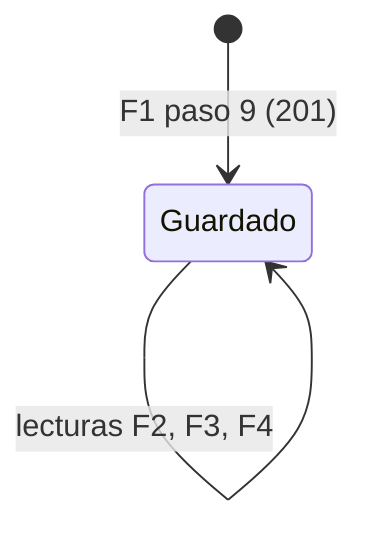
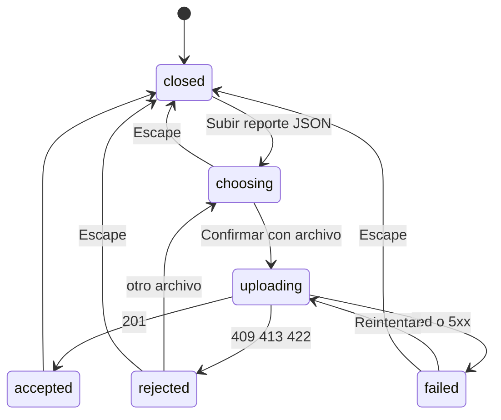
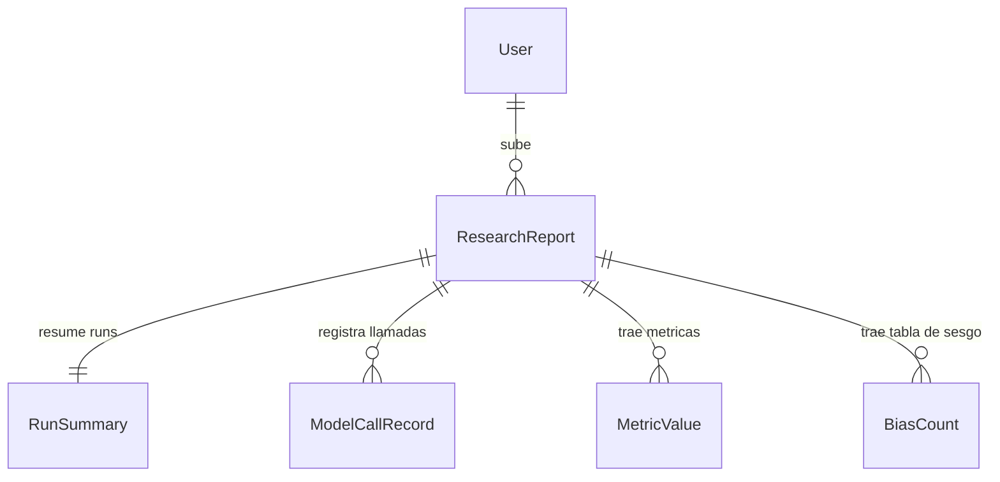

# Especificación funcional — U12 research-reports

**Revisión 1 (2026-11-22), primera pasada.** Unidad nueva del cambio 01 (DT27); no hay artefactos previos.
Se basa en las respuestas P1 = A, P2 = A y P3 = A, y en los doce puntos de la sección 2 de
`functional-design-questions.md`, que eran el plan acordado.

**Insumos.**
- Unidad U12 de `inception/units-generation/unit-of-work.md` (unit-of-work, revisión 3) y su mapa
  `unit-of-work-story-map.md` (unit-of-work-story-map, revisión 3): US12.6, US12.7 y US5.6 en M8.
- FR1.2, FR1.3, FR9.2, FR13.5 y NFR12 de `inception/requirements-analysis/requirements.md`
  (requirements, revisión 3).
- ResearchReports, ConsoleApi e IntegrityPolicy de `inception/domain-design/components.md` (components,
  revisión 3), con CD-03 y ADR-014.
- C1, C18, C19 y C25 de `inception/contract-design/contract-summary.md` (contract-summary, revisión 3).
- M8 §10.1–§10.3 de `inception/refined-mockups/mockups.md`, el catálogo `research.*` de
  `interaction-spec.md`, y B12 y DP-01 de `inception/delivery-planning/bolt-plan.md`.
- Diseños de U1 (`construction/contracts/`, FD-U1-03 y FD-U1-05), U3 (`construction/identity-access/`:
  rol `investigador`, destino M8, convención de auditoría), U4 (`construction/text-flow/`: base de la
  consola y suite `axe`) y U11 (`construction/incoherence-analyzer/`: `CliReport`, FD-U11-07 y FD-U11-09).

Las entidades están en `entities.md` y las reglas en `rules.md` (fuentes de verdad). Este documento es la
fuente de verdad de los flujos y las máquinas de estado. Las cifras de tope (bytes, profundidad) son de
NFR Requirements y solo se nombran.

## 1. Qué hace la unidad

U12 da al investigador del TG un lugar en la consola donde reunir las cifras de las corridas y
evaluaciones de la CLI, sin que entre testimonio a la base. Tiene tres partes:
- el módulo **ResearchReports** de `session-api`, que valida, guarda, lista y entrega reportes;
- las rutas `/research-reports*` de **ConsoleApi** (rol `investigador`);
- la pantalla **M8** de AnalystConsole: lista, diálogo de subida, detalle y comparación.

**Cómo se cierra AC12.6.1 frente a CD-03 (FD-U1-05, DP-01).** AC12.6.1 esperaba `201` y que el texto «se
descartó». CD-03 decidió rechazar. Esta unidad aplica CD-03 sin excepción: un reporte con el *canary*
«CANARIO-7f3a» responde `422` `research.invalid_report`, deja 0 filas, y el *canary* no aparece en la
respuesta, en ninguna columna ni en los logs capturados. Eso vale en todos los lugares donde pueda venir:
- **en un hallazgo** o en cualquier campo que C19 no tiene: lo rechaza el esquema (BR2.4);
- **como nombre de un campo desconocido**: el `detail` dice «campo no permitido» en el objeto padre y
  nunca repite el nombre (BR4.1);
- **como palabra suelta en un campo con patrón**, el caso abierto de R-06: `profile_name`, `model`,
  `version`, `engine`, `effort_or_quantization`, `price_table_version` y `synthetic_set` se contrastan
  con lo versionado y, si no coinciden, se rechazan con «valor no reconocido en <campo>» (BR3.1–BR3.5,
  P1 = A);
- **como nombre del archivo** del multipart: no se guarda ni se registra (BR4.2).

La redacción de AC12.6.1 (FD-U12-01) y la de `research.upload_ok` (FD-U12-02, DP-01) van a la tabla de
precisiones.

**Frontera AUTONOMIA-04.** ResearchReports, ConsoleApi y su tabla corren dentro del clúster, y M8 en el
navegador del investigador. El archivo entra al clúster desde ese navegador y nada sale. U12 no llama a
ningún modelo ni a ningún proveedor.

**AUTONOMIA-03.** M8 no muestra hallazgos ni citas, y por tanto ninguna calificación del testimonio.
«Cumple» y «no cumple» se refieren a una métrica frente a su umbral, nunca a la persona. Los textos de M8
salen del catálogo y pasan por el escaneo de vocabulario de la interfaz de U4 (BR6.7).

## 2. Flujos

### F1 — Subir un reporte (US12.6)

1. En M8, el investigador pulsa «Subir reporte JSON», elige el archivo y confirma.
2. La consola envía `POST /research-reports` (`multipart/form-data`, campo `file`) con el token CSRF.
3. ConsoleApi autentica, aplica la matriz (BR1.1) y comprueba el CSRF (BR1.3). Lee el cuerpo y lo corta
   si pasa `research_report_max_bytes`: responde `413` `limits.exceeded` (BR2.2).
4. ConsoleApi entrega a ResearchReports los bytes, el `user_id` y el `ReferenceCatalog`. No entrega el
   nombre del archivo (BR4.2).
5. ResearchReports calcula `source_sha256`. Si ya existe, responde `409` `research.duplicate` (BR2.8).
6. Comprueba la codificación y el JSON estricto (BR2.3). Si falla, responde `422` con el problema.
7. Valida contra el esquema C19 vigente con el registro de U1 (BR2.4), y luego la coherencia por tipo
   (BR2.5), las llamadas locales (BR2.6), el contraste con lo versionado (BR3.1–BR3.5) y la validez de la
   medición (BR2.7). Recoge todos los problemas de estos pasos.
8. Si hay al menos un problema, responde `422` `research.invalid_report` con el primero en el orden del
   archivo, el total y el SHA-256, sin ningún valor del archivo (BR4.1). No escribe nada.
9. Si no hay problemas, calcula `RunSummary` (BR5.2), toma `origin` (BR5.4) y escribe la fila con sus
   listas en una sola transacción, con `uploaded_by` y `uploaded_at` (BR5.3). Si la unicidad de
   `source_sha256` falla en ese momento (subida simultánea), responde `409` (BR2.8).
10. Responde `201` con `ResearchReportDetail` armado desde lo guardado (BR5.1) y deja la línea de log
    (BR4.3).
11. La consola anuncia el resultado una vez (BR8.4), cierra el diálogo si se aceptó, devuelve el foco a
    «Subir reporte JSON» y pone el reporte nuevo al principio de la lista.

Pseudocódigo del orden de validación (ilustrativo):

```text
validar(bytes, catalogo):
  sha = sha256(bytes)
  si existe(sha): devolver 409 research.duplicate
  doc = json_estricto(utf8(bytes))           # corta con 422 al primer fallo
  problemas = esquema_c19_vigente(doc)
  si no problemas: problemas += coherencia(doc) + locales(doc)
                              + contraste(doc, catalogo) + validez(doc)
  si problemas: devolver 422 (primero, total, sha)   # sin valores
  guardar_en_una_transaccion(resumir(doc), sha)
```

### F2 — Listar los reportes

1. M8 pide `GET /research-reports`. ConsoleApi aplica BR1.1.
2. ResearchReports devuelve todos los reportes, del más reciente al más antiguo por `uploaded_at`, con
   `uploaded_by_username` (FD-U12-05) y los campos de `ResearchReportSummary` (BR6.5).
3. La consola aplica los filtros Tipo, Perfil y Origen sobre la lista recibida. El filtro Origen ofrece
   «CLI local», «ZINE» y «No informado» (BR5.4).

### F3 — Ver el detalle

1. M8 pide `GET /research-reports/{research_report_id}`. Si no existe, responde `404`
   `research.not_found` (BR6.5).
2. La consola muestra la cabecera, el aviso de cuantización si toca (BR6.3), las métricas con «No
   informado» para las ausentes (BR6.1) y «cumple» o «no cumple» con el umbral del reporte (BR6.2), el
   registro de modelos agrupado (BR6.4) y, en una evaluación, las tres tablas de sesgo (BR6.6). Una
   corrida muestra en su lugar el resumen de corridas.

### F4 — Comparar dos reportes (US12.7, SHOULD)

1. El investigador marca dos reportes en la lista. El botón se habilita solo con exactamente dos (BR7.1).
2. La consola pide `GET /research-reports/compare?a=<id1>&b=<id2>`, en el orden en que se marcaron.
3. ConsoleApi aplica BR1.1, y ResearchReports aplica BR7.2: `422` si son el mismo, `404` si falta uno y
   `409` `research.not_comparable` si son de tipo distinto. En ese caso, M8 muestra «Reportes de tipo
   distinto: no se pueden comparar» y no dibuja la tabla.
4. Con `200`, la consola decide si el conjunto coincide (BR7.3) y arma las filas con su marca y su
   diferencia (BR7.4). Si no coincide, solo hay filas de metadatos y el aviso de conjuntos distintos.

### F5 — Arrancar `session-api` con el catálogo de referencia

1. El cargador de configuración de ConsoleApi lee `config/profiles.yaml` (validado por
   ExecutionProfiles), `config/prices.yaml` y las dos listas de etiquetas del conjunto sintético.
2. Si falta o no valida alguno, el arranque falla con un log que nombra el archivo (BR3.6). Si cargan,
   arma el `ReferenceCatalog` y registra su `catalog_sha256`.
3. El catálogo no cambia en ejecución. Un cambio entra por PR y llega con el siguiente despliegue (FR9.2).

### F6 — Rechazar sin eco

Se aplica a cada respuesta `409`, `413` y `422` de F1.
1. El manejador único de Problem Details recibe de ResearchReports solo el `code`, la regla, la ruta, el
   total y el SHA-256.
2. Arma el `detail` con el texto fijo de la regla (§6.2), nunca con el mensaje del analizador de JSON ni
   el del validador (BR4.1).
3. Registra la línea de BR4.3. La excepción interna se registra solo con su clase y el `code`, sin su
   texto ni su traza de valores (BR4.2).

## 3. Máquinas de estado

### `ResearchReport`

Un reporte no tiene ciclo de vida. Existe desde la transacción de F1 paso 9 y no cambia nunca (BR1.4).
No hay ni borrado ni retención.



<!-- Texto alternativo: un reporte pasa a estar guardado cuando la subida se acepta, y a partir de ahí solo se lee; no hay transición de salida. -->

### Diálogo de subida (M8)

| Estado | Entra por | Sale a |
|---|---|---|
| `closed` | Inicio; aceptado; Escape o «Cancelar» | `choosing` al pulsar «Subir reporte JSON» |
| `choosing` | Abrir el diálogo; elegir otro archivo tras un rechazo | `uploading` al confirmar con un archivo elegido; `closed` con Escape |
| `uploading` | Confirmar | `accepted` (201), `rejected` (409, 413, 422), `failed` (red, 5xx) |
| `accepted` | 201 | `closed` en el mismo paso, con el anuncio de BR8.4 |
| `rejected` | 409, 413 o 422 | `choosing` al elegir otro archivo; `closed` con Escape |
| `failed` | Error del sistema | `uploading` con «Reintentar»; `closed` con Escape |



<!-- Texto alternativo: el diálogo empieza cerrado; al abrirlo se elige un archivo; al confirmar se sube; si se acepta, el diálogo se cierra; si se rechaza, se puede elegir otro archivo o cerrar; si falla el sistema, se puede reintentar o cerrar. Durante la subida, «Confirmar» queda deshabilitado con su motivo. -->

## 4. Vista derivada: entidades y relaciones

Derivada de `entities.md` (la fuente de verdad es su bloque YAML). `UploadOutcome`, `ValidationProblem`,
`ComparisonView` y `ReferenceCatalog` son valores sin almacenamiento y no aparecen.



<!-- Texto alternativo: un usuario investigador sube cero o más reportes. Cada reporte tiene un resumen de sus corridas y cero o más llamadas, métricas y filas de la tabla de sesgo. El usuario es de IdentityAccess; lo demás es de ResearchReports. -->

## 5. Vista derivada: reglas

Derivada de `rules.md` (la fuente de verdad es su bloque YAML).

| Grupo | Reglas | Flujo |
|---|---|---|
| Acceso | BR1.1–BR1.4 | F1–F4 |
| Validación de la subida | BR2.1–BR2.8 | F1 |
| Contraste con lo versionado | BR3.1–BR3.6 | F1, F5 |
| Sin eco | BR4.1–BR4.3 | F1, F6 |
| Qué se guarda | BR5.1–BR5.4 | F1 |
| Lista y detalle | BR6.1–BR6.7 | F2, F3 |
| Comparación | BR7.1–BR7.4 | F4 |
| Accesibilidad | BR8.1–BR8.4 | F1–F4 (interfaz, §6) |

## 6. Interfaz (M8)

U12 es de tipo `service` y no produce `frontend-components.md`. Esta sección fija los estados y los
textos de M8 que la unidad implementa en `frontend`. Los textos nuevos o cambiados son propuestas
(FD-U12-02 y FD-U12-03), no criterios ya aprobados.

### 6.1 Lista (§10.1)

| Estado | Qué se ve |
|---|---|
| Cargando | Esqueleto de la tabla con «Cargando reportes…» para el lector de pantalla |
| Vacío | «Aún no hay reportes. Sube el JSON que produce la línea de comandos» + «Subir reporte JSON» (`research.empty`) |
| Con reportes | Columnas Tipo, Origen, Perfil, Huella, Conjunto, Fecha (Colombia) y Subido por; casilla por fila; icono y «no válida» si `measurement_valid` es falso |
| Comparar | Habilitado solo con 2 marcados; si no, `aria-disabled` con «Marca dos reportes para compararlos» (`research.compare_needs_two`) |
| Error | Error del sistema + «Reintentar» |

- La columna Origen muestra «CLI local», «ZINE» o «No informado».
- La columna Conjunto muestra `dataset_version` en una evaluación y «—» en una corrida.

### 6.2 Diálogo de subida

| Resultado | Texto | Clave |
|---|---|---|
| Aceptado (`201`) | «Reporte subido. Solo contiene metadatos y cifras.» | `research.upload_ok` (nueva redacción, FD-U12-02) |
| Duplicado (`409`) | «Este reporte ya está subido» | `research.duplicate` |
| Demasiado grande (`413`) | «El archivo supera el tamaño máximo de N MB» | mensaje de `limits.exceeded` |
| Falta un campo de llamada local | «Falta el campo <campo>», con la ruta | `research.missing_field` |
| Valor no reconocido | «Valor no reconocido en <ruta>. Debe coincidir con los perfiles, la tabla de precios y las etiquetas aprobados por PR» | `research.value_not_recognized` (FD-U12-03) |
| Otro problema de esquema | «El reporte no cumple el esquema: <ruta>: <texto de la regla>. Hay N problemas más» | `research.invalid_report` (FD-U12-03) |
| Error del sistema | Error del sistema + «Reintentar» | — |

`<ruta>` y `<campo>` solo llevan nombres del esquema e índices (BR4.1). Un campo desconocido aparece como
«<objeto padre>: campo no permitido». Debajo de cada rechazo, en tamaño secundario, aparecen «Código:
<code>» y «SHA-256 del archivo: <12 caracteres>».

Textos fijos por regla:
- `encoding`: «no es UTF-8 válido»;
- `json_syntax`: «JSON no válido en la línea L, columna C»;
- `json_duplicate_key`: «clave repetida»;
- `json_non_finite`: «número no finito»;
- `json_depth`: «demasiados niveles de anidamiento»;
- `schema_version`: «versión de esquema no admitida»;
- `not_allowed_field`: «campo no permitido»;
- `missing_field`: «falta el campo»;
- `type_mismatch`: «tipo no válido»;
- `out_of_range`: «valor fuera de rango»;
- `pattern_mismatch`: «formato no válido»;
- `kind_mismatch`: «no corresponde al tipo de reporte»;
- `value_not_recognized`: «valor no reconocido»;
- `inconsistent_counts`: «datos incoherentes entre sí»;
- `inconsistent_validity`: «la validez declarada no coincide con las llamadas».

### 6.3 Detalle (§10.2)

- **Título:** «<Evaluación | Corrida> · <CLI local | ZINE | Origen no informado> · <fecha>».
- **Cabecera:**
  - perfil, huella de `config_sha256` con «Copiar» y huella de `prompt_sha256`;
  - versión del analizador, versión del esquema, conjunto (`dataset_version` y, si viene, huella de
    `dataset_sha256`);
  - «subido por <usuario> el <fecha>».
- **Aviso** «⚠ Cuantización <valor>: no válida para medir capacidades» si toca (BR6.3).
- **Métricas** (solo evaluación): se muestran las 7 de C19 v1, y las 3 de v2 si la versión vigente es v2.
  Cada una lleva su cifra o «No informado», y «cumple» o «no cumple» con el umbral del reporte, si lo
  trae. Si el reporte trae `overall_passes`, una línea «Resultado global del reporte: cumple / no cumple».
- **Resumen de corridas:** corridas, `ok`, `error` (con el conteo por código), hallazgos en total y citas
  rechazadas por motivo. Solo hay números, sin texto ni hashes de entrevistas.
- **Registro de modelos:** filas por papel y proveedor, con modelo, versión, cuantización o esfuerzo,
  motor, llamadas y *tokens* de entrada y salida. La fila Total lleva el costo o «sin precio» (BR6.4).
- **Tabla de sesgo** (solo evaluación): tres tablas de conteos esperados y encontrados (BR6.6).
- No se muestran el modo ni las ventanas: C19 no los trae y no se inventan (FD-U12-09).

### 6.4 Comparación (§10.3)

- Columnas: Campo · Reporte 1 · Reporte 2 · Marca (`=` o `≠`) · Diferencia (con signo, «0» o «—»).
- Filas de metadatos: tipo, origen, perfil, `config_sha256`, `prompt_sha256`, analizador y conjunto.
- Filas de cifras, solo si el conjunto coincide (BR7.3):
  - en una evaluación: las métricas;
  - en una corrida: corridas, `error`, hallazgos y citas rechazadas;
  - en las dos: *tokens* de entrada, de salida y totales, y costo.
- Avisos:
  - «Conjuntos distintos: las métricas no son comparables» (`research.not_comparable`);
  - «Reportes de tipo distinto: no se pueden comparar» (`research.not_comparable_kind`, FD-U12-03).

### 6.5 Accesibilidad

- M8 entra en la suite `axe` de U4 (BR8.1). Todo se usa con teclado, y el diálogo devuelve el foco al
  cerrarse (BR8.2).
- Los estados se dan por texto o icono además del color (BR8.3).
- `aria-live` anuncia una vez el resultado de una subida, «SHA-256 copiado» y los avisos de comparación
  (BR8.4).
- El diálogo de subida no es una confirmación irreversible, pero es modal porque bloquea la lista
  mientras se elige el archivo. Escape lo cierra.

## 7. Escenarios de negocio y casos límite

| # | Escenario | Resultado esperado | Reglas |
|---|---|---|---|
| E1 | El investigador sube el reporte de evaluación de B11 (perfil `comercial-piloto`) | `201`, «Reporte subido. Solo contiene metadatos y cifras.», aparece primero en la lista | BR2.1, BR5.1 |
| E2 | Reporte con un objeto `hallazgos` que trae «CANARIO-7f3a» (AC12.6.1) | `422` `research.invalid_report`, «runs[0]: campo no permitido», 0 filas, 0 apariciones del *canary* en respuesta, columnas y logs | BR2.4, BR4.1 |
| E3 | «CANARIO-7f3a» como nombre de un campo en la raíz | `422`, «(raíz): campo no permitido»; el nombre no aparece en ningún lado | BR2.4, BR4.1 |
| E4 | «CANARIO-7f3a» en `model` de una llamada | `422`, «Valor no reconocido en runs[0].calls[1].model»; 0 filas; 0 apariciones | BR3.2, BR4.1 |
| E5 | «CANARIO-7f3a» en `profile_name`, `price_table_version` o `synthetic_set` | `422` con la ruta de cada campo; 0 filas; 0 apariciones | BR3.1, BR3.4, BR3.5 |
| E6 | «CANARIO-7f3a» como nombre del archivo subido | Se acepta o se rechaza por su contenido; el nombre no aparece en columnas ni en logs | BR4.2 |
| E7 | El mismo archivo dos veces (AC12.6.2) | La segunda da `409`, «Este reporte ya está subido», 0 filas nuevas | BR2.8 |
| E8 | Dos subidas simultáneas del mismo archivo | Una `201` y otra `409`; exactamente 1 fila | BR2.8 |
| E9 | El mismo reporte con un espacio más (otro SHA-256) | Se acepta como un reporte distinto; se ven dos filas con la misma huella de configuración | BR2.8 |
| E10 | `analista` o `admin` llaman a cualquier ruta de reportes (AC12.6.3) | `403` `auth.forbidden`; en la consola no ven «Reportes» | BR1.1, BR1.2 |
| E11 | Subida sin token CSRF | `403` `auth.csrf`, sin leer el archivo | BR1.3 |
| E12 | Archivo de `research_report_max_bytes` + 1 | `413` `limits.exceeded`; no se calcula el SHA-256 | BR2.2 |
| E13 | JSON con una clave repetida, con `NaN` o con BOM | `422` con la regla correspondiente | BR2.3 |
| E14 | `schema_version` de una versión que no es la vigente | `422`, «schema_version: versión de esquema no admitida» | BR2.4 |
| E15 | Llamada `local` sin `engine` | `422`, «Falta el campo runs[2].calls[0].engine» | BR2.6 |
| E16 | Llamada `local` con `Q4_K_M` que coincide con su perfil | `201`; detalle con «⚠ Cuantización Q4_K_M: no válida para medir capacidades»; «no válida» en la lista | BR2.7, BR6.3 |
| E17 | C19 v2 con la validez en verdadero y una llamada con `Q4_K_M` | `422`, «la validez declarada no coincide con las llamadas» | BR2.7 |
| E18 | Reporte de un perfil que todavía no entró por PR (p. ej. uno nuevo de ZINE) | `422`, «Valor no reconocido en profile_name»; hay que fusionar el perfil y desplegar antes de subirlo | BR3.1 |
| E19 | Reporte de un perfil que cambió de modelo por PR después de la corrida | `422` en el `model` de las llamadas; costo declarado de P1 = A (§11) | BR3.2 |
| E20 | Llamada comercial con `version: <model>-2025-08-06` y perfil sin `version` | Se acepta | BR3.3 |
| E21 | Llamada comercial con `version: <model>-Maria` | `422`, «Valor no reconocido en …version» | BR3.3 |
| E22 | Corrida (`run`) que trae `metrics` | `422`, «metrics: no corresponde al tipo de reporte» | BR2.5 |
| E23 | Evaluación sin `precision` (AC12.6.4) | Detalle: «Precisión · No informado», nunca 0 | BR6.1 |
| E24 | Evaluación con `precision: 0` | Detalle: «0,00» | BR6.1 |
| E25 | Métrica con `passes: false` cuyo valor cumple el umbral actual | «no cumple (umbral del reporte …)»; no se recalcula | BR6.2 |
| E26 | Reporte C19 v1 sin `origin` | Origen «No informado» en la lista, el filtro y el título | BR5.4, BR6.1 |
| E27 | Corrida de 10 entrevistas, 2 con `tiempo_agotado` | Resumen: 10 corridas, 8 `ok`, 2 `error` (`tiempo_agotado`: 2); ningún `interview_sha256` en la base | BR5.2 |
| E28 | Reporte sin `estimated_cost` | Total «sin precio»; en la comparación, Marca «≠» y Diferencia «—» frente a uno con costo | BR6.4, BR7.4 |
| E29 | 0, 1 o 3 marcados (AC12.7.1) | «Comparar seleccionados» enfocable, deshabilitado con su motivo; con 2, habilitado | BR7.1 |
| E30 | Una corrida y una evaluación marcadas | Botón habilitado; al comparar, `409` y «Reportes de tipo distinto: no se pueden comparar» | BR7.1, BR7.2 |
| E31 | Dos evaluaciones con distinto `dataset_version` (AC12.7.2) | Solo filas de metadatos y «Conjuntos distintos: las métricas no son comparables» | BR7.3 |
| E32 | Dos evaluaciones con el mismo `dataset_version` y distinto `dataset_sha256` (v2) | No comparables, como E31 | BR7.3 |
| E33 | Dos corridas sobre las mismas entrevistas en otro orden | Misma huella de entradas; se comparan las cifras | BR5.2, BR7.3 |
| E34 | Dos evaluaciones comparables (AC12.7.3) | Precisión 0,81 → 0,69: «≠» y «−0,12»; conjunto «=»; *tokens* con signo | BR7.4 |
| E35 | `compare?a=X&b=X` | `422` `validation.invalid_request` | BR7.2 |
| E36 | Detalle de un ID que no existe | `404` `research.not_found` | BR6.5 |
| E37 | Falta una lista de etiquetas al arrancar `session-api` | No arranca; el log nombra el archivo | BR3.6 |
| E38 | Un investigador abre un reporte que subió otro | Lo ve, con «subido por <otro>» | BR6.5 |
| E39 | Se intenta `DELETE /research-reports/{id}` | La ruta no existe en el OpenAPI; la prueba de nivel 0 lo comprueba | BR1.4 |
| E40 | Recorrido de M8 solo con teclado y con `axe` | 0 violaciones `serious` o `critical`; foco visible; Escape cierra el diálogo | BR8.1, BR8.2 |

## 8. Integración con otras unidades

| Unidad | Qué usa U12 | Qué espera de ella |
|---|---|---|
| U1 contracts | C19 (v1 o v2 vigente), `model-call.v1.yaml`, registro de esquemas, C1 (`/research-reports*`), C25 (`research_report_max_bytes`), catálogo de `code` y de mensajes | Que `veridicus_contracts` publique una sola versión vigente de C19 (BR2.4); las precisiones FD-U12-03 a FD-U12-07 y FD-U12-12 entran en el PR de U1 que ya lleva C19 v2 |
| U3 identity-access | Rol `investigador`, matriz de ConsoleApi, CSRF, destino M8, convención de auditoría, manejador de Problem Details | Que el manejador registre solo `code` e IDs (BR4.2); la prueba común de auditoría recorre la tabla de U12 |
| U4 text-flow | Base de la consola, catálogo de mensajes, formato de fecha, suite `axe`, escaneo de vocabulario de la interfaz | Que la suite `axe` y el escaneo incluyan M8 (BR6.7, BR8.1) |
| U11 incoherence-analyzer | `ExecutionProfiles` (validación del archivo de perfiles), listas de etiquetas del conjunto sintético; la CLI que escribe C19 | Que la CLI escriba `origin` (FD-U12-07), llene las llamadas comerciales según la forma de BR3.3 (FD-U12-11) y use la cuantización exacta `Q8_0` o `BF16` |
| U10 anonymizer | Ninguna dependencia de código | Que el `version` que informa el proveedor tenga la forma de BR3.3 (FD-U12-11) |
| U13 ethics-governance | Ninguna | La retención no toca la tabla de U12 (BR1.4) |

ResearchReports solo depende de IntegrityPolicy (registro de esquemas), como dice components. El
`ReferenceCatalog` lo arma ConsoleApi, que ya depende de ExecutionProfiles. Por eso no aparece ninguna
arista nueva entre unidades.

## 9. Errores y bordes

| Situación | HTTP | `code` | Se escribe algo |
|---|---|---|---|
| Rol distinto de `investigador` | 403 | `auth.forbidden` | No |
| Sin CSRF o CSRF inválido | 403 | `auth.csrf` | No |
| Archivo de más | 413 | `limits.exceeded` | No |
| Mismo SHA-256 | 409 | `research.duplicate` | No |
| Codificación, JSON, esquema, coherencia, campos locales, valor no reconocido, validez | 422 | `research.invalid_report` | No |
| Comparar un reporte consigo mismo | 422 | `validation.invalid_request` | No |
| ID inexistente (detalle o comparación) | 404 | `research.not_found` (FD-U12-04) | No |
| Tipos distintos al comparar | 409 | `research.not_comparable` | No |
| Base caída al escribir | 503 | `system.unavailable` (propuesto por U3) | No: la transacción se deshace |
| Catálogo de referencia ausente o inválido | — | — | `session-api` no arranca |

Toda E/S de la subida lleva su *timeout* explícito, y ninguna se reintenta sola: el investigador vuelve a
subir el archivo, y la unicidad de `source_sha256` hace segura la repetición.

## 10. Decisiones que precisan artefactos ya aprobados

No edité ningún artefacto aprobado (regla de `project.md`). En la aprobación decides cuáles se llevan al
original, cada una en su propio commit.

| ID | Artefacto aprobado | Precisión propuesta | Origen |
|---|---|---|---|
| FD-U12-01 | `user-stories/stories.md` (AC12.6.1) | AC12.6.1 pasa a: «Given un reporte JSON que incluye el texto *canary* «CANARIO-7f3a» en un hallazgo, como nombre de un campo, como valor de un campo con patrón (`profile_name`, `model`, `version`, `engine`, `price_table_version`, `synthetic_set`) o como nombre del archivo, When el investigador lo sube, Then la respuesta es `422` `research.invalid_report` (o `201` si solo el nombre del archivo lo trae), no se crea ninguna fila con el *canary*, y una búsqueda de «CANARIO-7f3a» en la respuesta, en todas las columnas de texto y en los logs capturados da 0 coincidencias. `[N1]`». Cierra FD-U1-05 y R-06 | CD-03; FD-U1-05; P1 = A |
| FD-U12-02 | `refined-mockups/interaction-spec.md` (`research.upload_ok`) y `mockups.md` M8 §10.1 | El texto pasa a «Reporte subido. Solo contiene metadatos y cifras.», porque un reporte con texto ya no se acepta. Cierra DP-01. La frase introductoria de §10 («ese texto se descarta antes de guardar») pasa a «se rechaza sin guardar nada» | DP-01; CD-03 |
| FD-U12-03 | `refined-mockups/interaction-spec.md` (catálogo `research.*`) | Entran `research.invalid_report` («El reporte no cumple el esquema: <ruta>: <texto>. Hay N problemas más»), `research.value_not_recognized` («Valor no reconocido en <ruta>…», §6.2) y `research.not_comparable_kind` («Reportes de tipo distinto: no se pueden comparar»), con los textos fijos por regla de §6.2 | Puntos 1, 8 y 11 de la sección 2; P1 = A |
| FD-U12-04 | `contract-design/contract-summary.md` (C1 `ErrorCode` y rutas `/research-reports*`) | Entra `research.not_found` (404) en `GET /research-reports/{id}` y en `compare`; `compare` suma `404` y `422` (`validation.invalid_request` si `a` = `b`); las cuatro rutas declaran `403` | BR6.5; BR7.2 |
| FD-U12-05 | `contract-design/contract-summary.md` (C1 `ResearchReportSummary` y `ResearchReportDetail`) | `ResearchReportSummary` suma `schema_version`, `origin` (`local` \| `zine`, opcional), `dataset_sha256` (opcional), `measurement_valid`, `uploaded_by_username` (lo resuelve ConsoleApi con IdentityAccess, porque el investigador no puede leer `/users`) y `report_created_at`. `ResearchReportDetail` suma `run_summary` (P2 = A), `price_table_version`, `currency`, `overall_passes`, y en `metrics` el `threshold` y el `passes` de cada métrica cuando el reporte los trae. `bias_table` se devuelve con `story_fact_type` y `persona_profile` ya separados. Entra en el PR de U1 que lleva C19 v2 (punto 12) | P2 = A; P3 = A; puntos 4, 5 y 12 de la sección 2 |
| FD-U12-06 | `domain-design/components.md` (ResearchReports y ConsoleApi) | En ResearchReports, `model_log` pasa a `model_calls`, y entran `run_summary`, `origin`, `measurement_valid`, `schema_version` y `dataset_sha256`. ConsoleApi suma la interacción «pasar el catálogo de referencia (perfiles, precios y etiquetas) en cada subida», sin arista nueva. La tabla es `history`, no purgable y con `owner_unit` U12 | P1 = A; P2 = A; P3 = A |
| FD-U12-07 | `contract-design/contract-summary.md` (C19) y FD-U11-09 | C19 v2 suma `origin` (`enum: [local, zine]`, obligatorio). La CLI escribe `zine` cuando corre bajo SLURM (variable `SLURM_JOB_ID`) o con `evaluate --puntuar` sobre salidas de ZINE, y `local` en los demás casos | P3 = A |
| FD-U12-08 | `refined-mockups/mockups.md` (M8 §10.1 y §10.3) | (a) Dos reportes de tipo distinto: el botón se habilita igual y, al comparar, `409` con «Reportes de tipo distinto: no se pueden comparar», sin tabla (C1 manda sobre §10.3). (b) La comparación separa la columna Marca (`=` o `≠`, siempre) de la columna Diferencia (con signo, «0» o «—»), para que cada fila marque «=» o «≠» (AC12.7.3) y el costo «sin precio» dé «—» | Punto 8 de la sección 2; AC12.7.3 |
| FD-U12-09 | `refined-mockups/mockups.md` (M8 §10.2) | (a) El costo se muestra solo en la fila Total, porque C19 no trae el costo por llamada y recalcularlo duplicaría la fórmula de U11. (b) No se muestran el modo ni las ventanas, porque C19 no los trae. (c) Una corrida muestra el conteo por estado y por código, los hallazgos y las citas rechazadas por motivo, agregados (P2 = A), no por entrevista | Punto 10 de la sección 2; P2 = A |
| FD-U12-10 | `refined-mockups/mockups.md` (M8 §10.1) | La lista suma la columna «Subido por» (punto 5), y Origen y su filtro admiten «No informado» para los reportes de C19 v1 | Puntos 5 y 10 de la sección 2; P3 = A |
| FD-U12-11 | Functional Design de U10 (registro de la llamada comercial) y de U11 (adaptadores) | El `version` de una llamada comercial es el que declara el perfil o, si no declara ninguno, el que informa el proveedor, con la forma «modelo» o «modelo» seguido de segmentos que empiezan por `-`, `@` o `.` y un dígito (BR3.3). Un `version` con otra forma impide subir el reporte a M8 | P1 = A |
| FD-U12-12 | `contract-design/contract-summary.md` (C25) | El catálogo de límites suma `research_report_max_json_depth` (niveles de anidamiento). La cifra la fija NFR Requirements, como la de `research_report_max_bytes` | BR2.3; regla de `project.md` sobre el catálogo único de límites |

## 11. Preguntas abiertas para NFR Requirements e Infrastructure Design

1. **Cifras de tope.** `research_report_max_bytes` y `research_report_max_json_depth` (FD-U12-12). Hay
   que dimensionarlas con el reporte de una evaluación de 3 corridas sobre el conjunto sintético y con el
   de una corrida sobre las 10 entrevistas del piloto.
2. **Volumen de la lista.** C1 no pagina `GET /research-reports`. Hace falta un tope o una paginación si
   se esperan cientos de reportes.
3. **Latencia.** Hay que fijar el p95 de la subida (validación, contraste y escritura) y del detalle.
4. **Empaquetado (Infrastructure Design).** Las listas de etiquetas viven en `evaluation/labels/`.
   `session-api` tiene que leerlas en solo lectura desde su imagen o un ConfigMap, junto con
   `config/profiles.yaml` y `config/prices.yaml` (BR3.6).
5. **Costo de P1 = A para decidir en la aprobación** (no bloquea el diseño). Hoy solo se acepta un reporte
   del perfil y de la tabla de precios **vigentes**. Un reporte hecho antes de cambiar un perfil o los
   precios por PR ya no se puede subir (E18, E19). Hay dos formas de mitigarlo:
   - subir los reportes antes de fusionar el cambio;
   - que un cambio de modelo cree un perfil con otro nombre.
   Si eso no basta, una revisión futura podría guardar las versiones anteriores de los perfiles y los
   precios. Sería una precisión a C18.
