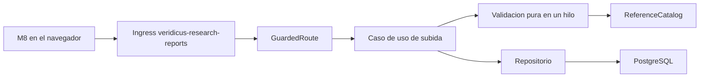

# Componentes lógicos — U12 research-reports

**Revisión 1 (2026-11-22): primera pasada.** U12 no despliega nada propio: su código corre en la API de
`session-api` y en la consola. Este documento dice qué pieza aplica cada patrón de NFR y qué recibe de U2
(Infrastructure Design), U3 y U1.

**Insumos.** `nfr-requirements/security-requirements.md` (security-requirements, frontera §1),
`performance-requirements.md` (performance-requirements), `scalability-requirements.md`
(scalability-requirements), `reliability-requirements.md` (reliability-requirements),
`observability-requirements.md` (observability-requirements) y `tech-stack-decisions.md`
(tech-stack-decisions, D1–D7 y §5) de esta unidad; §1 y §8 de `functional-design/functional-spec.md`
(functional-spec); C1, C12, C16, C19 y C25 de `inception/contract-design/contract-summary.md`
(contract-summary); `logical-components.md` de U3.

## 1. Inventario

| Componente | Ruta en `services/session-api/src/session_api/` o en `frontend/` | Proceso | Dentro / fuera | Patrones NFR que aplica |
|---|---|---|---|---|
| Rutas `/research-reports*` | `research_reports/api/routes.py` | API de `session-api` | Clúster | `GuardedRoute` con «autoriza y confirma» (NFRD-U12-01), tipo y tope previo |
| Lector `multipart` | `research_reports/api/multipart_reader.py` | Igual | Igual | En memoria, tope mientras se lee, plazo de lectura, `filename` descartado |
| Caso de uso de subida | `research_reports/application/upload.py` | Igual | Igual | *Bulkhead* de 2, tres transacciones, validación en un hilo, sin reintentos |
| Consultas | `research_reports/application/queries.py` | Igual | Igual | Columnas mínimas, índices, `orjson` |
| Validación (guardia) | `research_reports/domain/validation/` (`encoding`, `depth`, `strict_json`, `schema`, `coherence`, `local_calls`, `validity`, `ranges`) | Igual | Igual | Código puro, 100 % de ramas, sin eco |
| Contraste (guardia) | `research_reports/domain/contrast.py` | Igual | Igual | Igualdad con el catálogo inmutable |
| Rechazos sin eco (guardia) | `research_reports/domain/problems.py` | Igual | Igual | `ValidationProblem` sin valores |
| Resumen | `research_reports/domain/summary.py` | Igual | Igual | Huella de entradas, agregados de `runs[]` |
| Repositorio | `research_reports/adapters/repository.py` | Igual | Igual → PostgreSQL | Inserción en bloque, traducción de `23505` a `409`, `statement_timeout` |
| `ReferenceCatalog` | `console/reference_catalog.py` (cargador de ConsoleApi) | Igual | Igual | Solo lectura, inmutable, fallo al arrancar |
| Migración | `db/migrations/` (cuatro tablas, `CHECK`, marca de auditoría) | `Job` de migraciones | Igual | Entra por su PR; nunca al arrancar un pod |
| M8 | `frontend/src/features/research-reports/` | Navegador | Máquina del investigador | Filtros en memoria, virtualización, `AbortController`, sin HTML |
| Generador de *fixtures* | `tests/fixtures/make_research_reports.py` | Solo pruebas | Ninguno | Datos sintéticos |

## 2. Componentes en YAML

```yaml
components:
  - name: research-reports-api
    path: services/session-api/src/session_api/research_reports/api
    hosts: [session-api-api]
    boundary: inside
    data_out: none
    guard: false
  - name: research-reports-upload
    path: services/session-api/src/session_api/research_reports/application/upload.py
    hosts: [session-api-api]
    boundary: inside
    data_out: none
    guard: false
  - name: research-reports-validation
    path: services/session-api/src/session_api/research_reports/domain
    hosts: [session-api-api]
    boundary: inside
    data_out: none
    guard: true
  - name: research-reports-repository
    path: services/session-api/src/session_api/research_reports/adapters/repository.py
    hosts: [session-api-api]
    boundary: inside
    data_out: none
    guard: false
  - name: reference-catalog
    path: services/session-api/src/session_api/console/reference_catalog.py
    hosts: [session-api-api]
    boundary: inside
    data_out: none
    guard: false
  - name: research-reports-console
    path: frontend/src/features/research-reports
    hosts: [browser]
    boundary: investigator_machine
    data_out: c19_report_into_cluster
    guard: false
```

## 3. Dominios de fallo y radio de impacto



<!-- Texto alternativo: M8 envía la subida al Ingress de reportes, que la pasa a GuardedRoute en session-api. El caso de uso de subida valida en un hilo con el catálogo de referencia y escribe con el repositorio en PostgreSQL. -->

| Falla | Radio de impacto | Contención |
|---|---|---|
| PostgreSQL caído o lento | Toda `session-api` (U3); en U12, `503` y 0 filas | Plazos de `reliability-design.md` §1; sin reintentos |
| Subida patológica (tamaño, profundidad, números) | Esa petición | Topes y analizador acotado (`security-design.md` §3, §4) |
| Varias subidas máximas | Sin contención: memoria de la API de todas las unidades | *Bulkhead* de 2 huecos: la tercera recibe `503` |
| Cliente lento | Un hueco durante ≤ 30 s | Plazo de lectura; ninguna conexión retenida |
| Validación lenta por el GIL | Latencia de las demás rutas de la API | Hilo propio con limitador; plan B de proceso aparte (`performance-design.md` §2) |
| Catálogo roto | El despliegue nuevo de `session-api` no arranca | Fallo al arrancar; prueba de humo y `git revert` |
| Fallo del propio código | Esa petición (`500` `system.internal`) | Manejador único de U3; 0 filas |

## 4. Aislamiento y recursos compartidos

| Recurso | Compartido con | Aislamiento |
|---|---|---|
| Proceso de la API de `session-api` | U3–U9, U13 | import-linter (`research-reports-no-egress`, `research-reports-no-metrics`); hilo y limitador propios de la validación; *bulkhead* de 2 |
| Pool de conexiones de la API | Todas las unidades de la API | Tres usos cortos por subida; como mucho 2 conexiones en T3 |
| Base PostgreSQL | Las unidades de `session-api` y los `Job` | Cuatro tablas `history` no purgables; permisos derivados de la marca |
| Catálogo de referencia y C25 | ConsoleApi y U4 (perfiles) | Solo lectura, cargado una vez |
| Ingress | `session-api` | Grupo propio `veridicus-research-reports` (NFRD-U2-06) |

## 5. Lo que se entrega a otras unidades

| Unidad | Qué fija U12 | Qué decide la otra unidad |
|---|---|---|
| U2 (Infrastructure Design) | `limits.memory` de la API de `session-api` con 512 MiB más (dos subidas máximas, NFR3.8) y el 20 % de margen de U4; ≤ 1,5 GiB de volumen de PostgreSQL por cada 1 000 reportes (NFR3.11); catálogo de referencia de solo lectura (NFR-U12-06) | El valor final de `requests`/`limits`, el tamaño del volumen, la imagen o el `ConfigMap` del catálogo |
| U3 (identity-access) | Variante «autoriza y confirma» de `GuardedRoute` para la subida (NFRD-U12-01); campos y `cause` nuevos de la lista blanca (NFRD-U12-03, NFRD-U12-04) | Cómo la expone en su código |
| U1 (contracts) | `research_report_read_timeout_s` = 30 en C25 (NFRD-U12-02), en el mismo PR que las cifras de NFR-U12-01 | La forma en el catálogo |
| U4 (text-flow) | M8 entra en la suite `axe` y en el escaneo de vocabulario de la interfaz; reutiliza su virtualización de listas | — |
| U11 (incoherence-analyzer) | Acepta C19 v2 con `origin`, `blocking` y latencia p50 y p95 por papel | Cómo los escribe la CLI |
| U8, U5, U6 | Nada: ninguna decisión de U12 les afecta | — |
