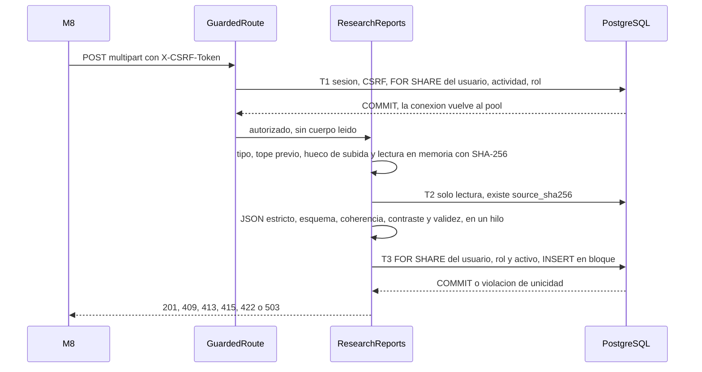

# Diseño de seguridad — U12 research-reports

**Revisión 1 (2026-11-22): primera pasada de una unidad nueva del cambio 01 (DT27).**
- **IDs.** Todo es nuevo. Las secciones son §1–§14, las decisiones de diseño DS1–DS10 (§12) y las
  precisiones a artefactos aprobados NFRD-U12-01 a NFRD-U12-07 (§14).
- **Preguntas.** Ninguna: todo lo fijan las fuentes (`nfr-design-questions.md`).
- **Tipo `service`.** Los seis documentos de diseño y `traceability.json`.

**Insumos.**
- De esta unidad, en `nfr-requirements/`: `security-requirements.md` (security-requirements: frontera §1,
  amenazas T1–T16, NFR1, NFR10, NFR11, NFR12, NFR14 y tabla NFR-U12-01 a NFR-U12-07),
  `performance-requirements.md` (performance-requirements), `scalability-requirements.md`
  (scalability-requirements), `reliability-requirements.md` (reliability-requirements),
  `observability-requirements.md` (observability-requirements) y `tech-stack-decisions.md`
  (tech-stack-decisions, D1–D7).
- `functional-design/functional-spec.md` (functional-spec: F1–F6, §3, §6, E1–E40, §9 y FD-U12-01 a
  FD-U12-12), `functional-design/rules.md` (BR1.1–BR8.4) y `functional-design/entities.md`.
- C1 (`/research-reports*`), C12, C15, C16, C18, C19 y C25 de `inception/contract-design/contract-summary.md`
  (contract-summary, revisión 3).
- De U3, `construction/identity-access/nfr-design/`: `GuardedRoute` (§2.1), validación de cuerpos
  `multipart` (§2.3, NFRD-U3-08), inicio de sesión en dos transacciones (§4.3, NFRD-U3-12), bloqueos (§5.4),
  manejador único (§3.3), lista blanca del log (`observability-design.md` §1) y convención de auditoría
  (§9).
- De U1, `construction/contracts/nfr-design/security-design.md`: C25 v1 (§5), C19 v2 cerrado (§4.18),
  `415` de toda `multipart` (§4.3) y catálogo de errores. De U2, `construction/platform/nfr-design/`:
  Ingress sin disco (§3.2, NFRD-U2-06) y respaldos (§12, NFRD-U2-13).
- Reglas AUTONOMIA-01..05 de `team.md` y prohibiciones de `project.md`.

Salvo que la fila diga otra cosa, cada control se prueba en **nivel 0** (sin red ni GPU) o en **nivel 1**
(PostgreSQL real en contenedor), con reportes **sintéticos** del generador de NFR12.3 y su control negativo.
Los comandos son los de `tech-stack-decisions.md` §5.

## 1. Frontera (AUTONOMIA-04; NFR1.1)

| Componente | Dónde corre | Datos sin seudonimizar | Qué cruza la frontera del clúster | Hacia dónde |
|---|---|---|---|---|
| M8 (pantalla de AnalystConsole) | Navegador del investigador | Ninguno: cifras, hashes, versiones y nombres versionados | El archivo C19 **entra** al clúster desde la máquina del investigador | `session-api`, por el Ingress `veridicus-research-reports` |
| Rutas `/research-reports*` (`session_api/research_reports/api/`) | `session-api`, dentro del clúster | Ninguno | Nada | — |
| Módulo ResearchReports (`domain/`, `application/`) | `session-api`, dentro del clúster | Ninguno | Nada: no llama a modelos, al anonimizador ni a internet | — |
| Repositorio de reportes (`adapters/`) | `session-api` → PostgreSQL (CloudNativePG) | Ninguno | Nada | Servicio interno de la base |
| `ReferenceCatalog` (cargador de ConsoleApi) | Memoria de `session-api`, de archivos de solo lectura | Ninguno | Nada | — |

La tabla se copia en `services/session-api/src/session_api/research_reports/README.md`. Una prueba de
nivel 0 compara sus filas con las de este documento por nombre de componente, y un componente nuevo entra
con su fila en el mismo PR.

## 2. Ningún camino hacia fuera (NFR1.2)

- Contrato de import-linter `research-reports-no-egress`: `session_api.research_reports` no importa
  `httpx`, `requests`, `urllib.request`, `socket`, `libs.model_gateway` ni `libs.anonymizer`. Un módulo de
  control negativo en `tests/import_contracts/` los importa y hace fallar el contrato.
- La única E/S del módulo es la base, a través del puerto `ResearchReportRepository` y de la `UnitOfWork`
  de C12. La `NetworkPolicy` de U2 no cambia por U12.

## 3. Recorrido de una subida en tres transacciones cortas (NFR10.1, NFR10.2, NFR10.3, NFR10.4, NFR10.10)

`GuardedRoute` corre toda la petición en una sola transacción (§2.1 de U3). En la subida eso dejaría una
conexión inactiva dentro de la transacción, con la fila del usuario tomada `FOR SHARE`, mientras llega el
cuerpo por trozos (el Ingress ya no lo almacena: NFRD-U2-06) y mientras se valida un archivo de hasta
8 MiB (NFR3.2: p95 ≤ 12 s). El plazo de inactividad de la base vale 5 s o 15 s según el artefacto (U6
frente a U7), y con los dos una subida legítima podría cortarse. Por eso `POST /research-reports` usa tres
transacciones cortas, con el mismo criterio que el inicio de sesión de U3 (NFRD-U3-12), y ninguna conexión
queda retenida mientras se lee o se valida (NFRD-U12-01).

<!-- Texto alternativo: M8 envía la subida con el token anti-CSRF. GuardedRoute abre la primera transacción: resuelve la sesión, compara el token, toma la fila del usuario, registra la actividad, comprueba el rol y confirma, devolviendo la conexión. ResearchReports comprueba el tipo y el tope declarado, toma un hueco de subida y lee el cuerpo en memoria calculando el SHA-256. En una segunda transacción de solo lectura comprueba si el SHA-256 ya existe. Valida el archivo en un hilo sin conexión. En la tercera transacción vuelve a tomar la fila del usuario, comprueba rol y estado activo e inserta todo; responde con el resultado. -->

| Fase | Qué hace | Rechazo | Conexión |
|---|---|---|---|
| T1 (`GuardedRoute`, pasos 1–7 de U3) | Sesión web, CSRF, `app_user` `FOR SHARE`, actividad, rol `investigador`. Confirma **antes** de leer un solo byte del cuerpo | `401`; `403` `auth.csrf` o `auth.forbidden` con 0 bytes leídos (NFR10.1, NFR10.2) | Sí, milisegundos |
| Tipo | `Content-Type` debe ser `multipart/form-data` con `boundary` | `415` `research.invalid_type` (NFR10.10) | No |
| Tope previo | `Content-Length` > `research_report_max_bytes` + 64 KiB | `413` `limits.exceeded` sin leer (NFR10.3) | No |
| Hueco | Toma uno de los 2 huecos de subida (§3 de `scalability-design.md`); espera ≤ 5 s | `503` `system.unavailable`, `cause: upload_slots`, sin leer el cuerpo (NFRD-U12-04) | No |
| Lectura | `request.stream()` → `MultipartParser` de bajo nivel (D2); la parte `file` va a un `bytearray` y al `hashlib.sha256` incremental; el `filename` se descarta en el *callback* de cabeceras; otra parte o falta de `file` corta. Plazo total `research_report_read_timeout_s` (NFRD-U12-02) | `413` al pasar el tope mientras se lee; `422` `validation.invalid_request` por las partes; `503` al vencer el plazo de lectura | No |
| T2 | `SELECT 1 FROM research_report WHERE source_sha256 = :sha`, solo lectura, plazo de 2 s | `409` `research.duplicate` (BR2.8) | Sí, milisegundos |
| Validación | §4 y §6, función pura en un hilo (`performance-design.md` §2) | `422` `research.invalid_report` | No |
| T3 | `app_user` `FOR SHARE` de nuevo: rol `investigador` y `active`; `SET LOCAL statement_timeout` = `research_report_write_timeout_s`; inserción en bloque; `COMMIT` | `403`/`401` si el rol o el estado cambiaron; `409` por la unicidad; `503` por la base | Sí, ≤ 15 s |

- **Por qué T3 relee el usuario.** Entre T1 y T3 un `admin` pudo cambiar el rol o desactivar al
  investigador. T3 toma la fila con `FOR SHARE` (el orden de bloqueos de §5.4 de U3 no cambia) y aplica la
  misma comprobación que `GuardedRoute`, como la T2 del inicio de sesión. Prueba de nivel 1: un `PATCH` que
  quita el rol entre T1 y T3 (barrera) deja `403` y 0 filas.
- **Sin disco.** Ni `request.form()`, ni `request.body()`, ni `UploadFile` (NFRD-U3-08). Prueba de NFR10.4:
  `tempfile.SpooledTemporaryFile`, `tempfile.NamedTemporaryFile` y `open` en modo escritura sustituidos por
  funciones que fallan; un archivo de 8 MiB responde `201`. El `readOnlyRootFilesystem` de `session-api`
  (`logical-components.md` de U3, §4) es la segunda barrera.
- **Tope mientras se lee.** El contador suma los bytes de la parte `file` y el total del cuerpo; corta a tope
  + 64 KiB del cuerpo o a tope de la parte. Casos de NFR10.3 en nivel 1, con un espía del flujo que cuenta
  los bytes consumidos (≤ tope + 64 KiB en todos).

## 4. JSON estricto y acotado (NFR10.5, NFR10.6)

Orden único, sin construir objetos hasta el paso 3:

1. **Codificación.** BOM (`EF BB BF`) al inicio o `str(buf, "utf-8")` que falla → `encoding`. La
   decodificación lee el `bytearray` sin copia intermedia y después se suelta (`del`).
2. **Profundidad.** Un recorrido lineal con una expresión regular compilada que salta cadenas enteras
   (`"(?:[^"\\]|\\.)*"`) y solo cuenta `[`, `]`, `{` y `}`. Se detiene en cuanto la profundidad pasa de
   `research_report_max_json_depth` (8) → `json_depth`. El archivo de 8 MiB de `[` termina en el noveno
   carácter.
3. **Análisis.** `json.loads` con `object_pairs_hook` que rechaza claves repetidas (`json_duplicate_key`),
   `parse_constant` que rechaza `NaN`, `Infinity` y `-Infinity`, `parse_float` que rechaza el resultado
   infinito (`1e400`; `json_non_finite`) y `parse_int` que rechaza más de 4 300 cifras antes de convertir
   (`out_of_range`). Un `JSONDecodeError` da `json_syntax` con su línea y columna, y su mensaje se descarta.
4. **Esquema.** El `Draft202012Validator` de C19 vigente, compilado una vez al arrancar desde
   `veridicus_contracts.registry`, con `iter_errors`. De cada error se guarda solo `(path, rule)` y el
   objeto del error se suelta enseguida; así un archivo con miles de problemas no crece en memoria. Los
   rangos de NFR10.6 ya están en C19 v2 (NFRD-U1-06); U12 repite la comprobación en `domain/ranges.py`
   para no depender de una versión menor que los quite.

Pruebas de nivel 0: un *fixture* por regla de BR2.3, el de 8 MiB de `[` en ≤ 1 s sin `RecursionError`, un
entero de 4 301 cifras con `out_of_range` y nunca `500`, y el control de la clave repetida con el
*canary*.

## 5. Rechazos sin eco y logs sin contenido (NFR10.7, NFR10.8, NFR14.1)

- `ValidationProblem` tiene solo `rule` (enum cerrado de §6.2 del Functional Design), `path` (tupla de
  nombres del esquema e índices), `line` y `column` (D6). Un campo desconocido se nombra como «campo no
  permitido» en su objeto padre: el `path` se corta antes del nombre desconocido.
- La excepción `ResearchReportInvalid` de la jerarquía de U1 lleva `rule`, `path`, `total` y
  `source_sha256`, y su `detail` lo arma el manejador único de U3 con la plantilla del catálogo
  (`messages/problems.es.yaml`). Prueba de nivel 0: recorre todos los `rule` y comprueba que el `detail` es
  una plantilla del catálogo con huecos solo para ruta, total, línea y columna.
- El `filename` nunca se copia: el *callback* de cabeceras de la parte lo ignora. La línea de log de la
  subida (`observability-design.md` §1) solo lleva enums, enteros, UUID y el SHA-256.
- El acceso de Uvicorn se desactiva en `session-api` (`--no-access-log`); el `request_id` y el estado ya van
  en la línea del formateador único de U3. Prueba de nivel 1 de NFR10.8 con el *canary* como nombre del
  archivo, como contenido inválido y dentro de una excepción sembrada del validador: 0 coincidencias en
  la aplicación, `uvicorn.error` y las columnas.
- Los textos de M8 salen del catálogo de mensajes de la consola y una prueba de nivel 0 falla ante un
  literal visible fuera de él (NFR14.1).

## 6. Contraste con lo versionado y catálogo de referencia (NFR10.9)

- El `ReferenceCatalog` (D5) lo arma el cargador de configuración de ConsoleApi al arrancar, con los
  cargadores YAML seguros de `veridicus_contracts` y `profiles.validate` de U1. Es un
  `dataclass(frozen=True)` con `MappingProxyType` y `frozenset`: no hay forma de cambiarlo en ejecución.
- Solo el cargador abre `config/profiles.yaml`, `config/prices.yaml` y `evaluation/labels/*.v1.yaml`, en
  modo `rb`. Una comprobación AST de nivel 0 falla si otro módulo abre esos archivos.
- BR3.1–BR3.5 son funciones puras de `domain/contrast.py` sobre el documento ya validado por el esquema y
  el catálogo. Comparan por igualdad con lo versionado: lo que no coincide es `value_not_recognized`, sin
  repetir el valor.
- En el clúster los archivos llegan de solo lectura desde la imagen o un `ConfigMap` (NFR-U12-06, lo fija
  Infrastructure Design) y `catalog_sha256` sale en el log de arranque (§2 de `observability-design.md`).

## 7. Qué se guarda (NFR12.1, NFR12.2, NFR12.3, NFR12.4)

- **Solo filas tipadas.** `research_report` y las tablas hijas `research_report_model_call`,
  `research_report_metric` y `research_report_bias_count` (D4). El documento JSON se suelta al armar las
  filas y nunca llega a una columna.
- **`CHECK` por columna** (NFR12.4, NFR-U12-07): hashes `^[a-f0-9]{64}$`, versiones semánticas, enums, y
  para los nombres contrastados longitud ≤ 128 y `!~ '\s'`. Los mapas de `run_summary` en `jsonb` llevan
  `CHECK` sobre sus claves (enum) y valores (enteros ≥ 0). Prueba de nivel 0 sobre la migración: toda
  columna `text`, `varchar` o `jsonb` de U12 tiene su `CHECK`; prueba de nivel 1: «dos palabras» falla con
  `veridicus_app`.
- **Huella de entradas** (BR5.2): `inputs_fingerprint` se calcula en `domain/summary.py` y la lista de
  `interview_sha256` se suelta antes de T3. Prueba de nivel 1: ninguno de los 10 aparece en ninguna
  columna.
- **Matriz del *canary*** (NFR12.1): nivel 1, con la búsqueda en todas las columnas de texto de
  `session-api` enumeradas desde `information_schema.columns`, en la respuesta y en los logs capturados.
- **Datos sintéticos** (NFR12.3): `tests/fixtures/make_research_reports.py` genera todos los *fixtures*
  con los perfiles y etiquetas de prueba; la comprobación `synthetic: true` de U1 corre sobre ellos.

## 8. Integridad y auditoría (NFR11.1, NFR11.2, NFR11.3)

- Las cuatro tablas llevan la marca `veridicus-audit` de U3 (§9.1) con `kind: history`,
  `purgeable: false` y `owner_unit: U12`, y las columnas de la convención: `actor_kind` (`user`),
  `uploaded_by` como columna del actor persona, `actor_system` nulo y `uploaded_at` como hora, con
  `NOT NULL` y la restricción de U3. Las hijas copian los valores del padre (NFRD-U12-05).
- `veridicus_apply_audit_grants()` deriva los permisos de la marca: `veridicus_app` solo `SELECT` e
  `INSERT`, `veridicus_retention` nada. Lo comprueba la prueba común de auditoría de U3, que descubre las
  tablas por la marca.
- `uploaded_at` lo da el reloj inyectable de `application/` (D12 de U3), no `now()` de SQL.
- El OpenAPI generado no declara `PUT`, `PATCH` ni `DELETE` bajo `/research-reports` (nivel 0, E39).

## 9. M8 (NFR10.12, NFR11.5)

- Sin `dangerouslySetInnerHTML` (`react/no-danger` como error); los valores se pintan como texto. Prueba
  Vitest con `` en el `profile_name` del *fixture* del componente.
- M8 no tiene componentes para hallazgos, citas ni observaciones. Todos sus textos entran en el escaneo de
  vocabulario de la interfaz de U4; «cumple» y «no cumple» solo aparecen junto a una métrica y su umbral.

## 10. Dependencias (NFR10.13)

`python-multipart` fijada en `services/session-api/uv.lock` con *hashes* (ya la trae FastAPI); `psutil`
solo en desarrollo. `pip-audit`, `npm audit --audit-level=high` y Trivy sobre la imagen de `session-api`,
bloqueantes en la CI. La prueba de NFR10.4 detecta un cambio de `python-multipart` que vuelva a escribir en
disco.

## 11. Amenazas y controles

| # | Amenaza | Control de diseño | Sección |
|---|---|---|---|
| T1 | Otro rol usa las rutas | T1 de `GuardedRoute` y relectura del rol en T3 | §3 |
| T2 | CSRF | Comparación en T1, antes de leer el cuerpo | §3 |
| T3 | Testimonio guardado | Esquema cerrado, contraste, `CHECK` por columna | §4, §6, §7 |
| T4 | Eco del valor ofensivo | `ValidationProblem` sin valores; plantillas del catálogo | §5 |
| T5 | `filename` con testimonio | Descartado en el *callback*; acceso de Uvicorn apagado | §5 |
| T6 | Cuerpo en disco | Analizador en memoria; Ingress sin *buffering*; raíz de solo lectura | §3 |
| T7 | Cuerpo enorme o `Content-Length` falso | Tope previo y tope mientras se lee | §3 |
| T8 | JSON patológico | Profundidad antes de construir; *hooks* de `json.loads` | §4 |
| T9 | Números fuera de rango | Rangos de C19 v2 y de `domain/ranges.py` | §4 |
| T10 | Edición o borrado | Permisos derivados de la marca; sin rutas de escritura | §8 |
| T11 | Repudio | `uploaded_by`, `uploaded_at` y la línea de log | §8 |
| T12 | Catálogo cambiado en ejecución o YAML inseguro | Cargadores de U1, catálogo inmutable, comprobación AST | §6 |
| T13 | XSS en M8 | Sin HTML; patrones sin `<` | §9 |
| T14 | Etiqueta de veracidad en M8 | Escaneo de vocabulario; sin hallazgos | §9 |
| T15 | Camino de red hacia fuera | import-linter `research-reports-no-egress` | §2 |
| T16 | Dependencia vulnerable | Lockfile con *hashes*, auditorías y Trivy | §10 |
| T17 (nuevo) | Cliente lento que retiene recursos | Plazo de lectura; sin conexión retenida; hueco con espera acotada | §3 |
| T18 (nuevo) | Varias subidas máximas a la vez agotan la memoria de la API de todas las unidades | *Bulkhead* de 2 huecos | §3; `scalability-design.md` §3 |

## 12. Decisiones de diseño y alternativas

| # | Decisión | Alternativas descartadas | Por qué |
|---|---|---|---|
| DS1 | Tres transacciones cortas en la subida (NFRD-U12-01) | Una sola transacción de `GuardedRoute` (corte por inactividad y conexión retenida con un cliente lento); subir el plazo de inactividad (afecta a todas las unidades) | Ninguna conexión inactiva dentro de una transacción; el rol se vuelve a comprobar con la fila bloqueada |
| DS2 | Plazo de lectura de 30 s en C25 (NFRD-U12-02) | Sin plazo (contra `team.md`); plazo fijo en el código (contra el catálogo único) | 8 MiB en 30 s exige ≥ 280 KiB/s, holgado en la red local; el entorno solo puede bajarlo |
| DS3 | *Bulkhead* de 2 huecos con espera de 5 s (NFRD-U12-04) | Sin límite (OOM del proceso de la API de todas las unidades); cola larga | NFR3.8 mide dos subidas; el proceso es compartido; mismo patrón que Argon2id de U3 |
| DS4 | Profundidad con una expresión regular que salta cadenas y corta en el nivel 9 | Bucle de Python byte a byte (≈ 1 s con 8 MiB); `json.loads` con `sys.setrecursionlimit` | Corte inmediato del caso patológico y recorrido en C del caso válido |
| DS5 | `iter_errors` guardando solo `(path, rule)` | `list(iter_errors)` (memoria por error); cortar en el primer error (sin total) | Total exacto con memoria acotada |
| DS6 | Contraste por igualdad con el catálogo inmutable | Expresiones permisivas | Una palabra suelta no cabe (P1 = A) |
| DS7 | `CHECK` por columna además del esquema | Solo el esquema | Defensa en profundidad de NFR12.4 |
| DS8 | Validación en un hilo con `anyio.to_thread.run_sync` y su propio limitador de 2 | Validar en el bucle de eventos (bloquea la API); proceso aparte desde el inicio (más memoria) | La API sigue atendiendo; el proceso aparte queda como plan B medido (`performance-design.md` §2) |
| DS9 | Acceso de Uvicorn apagado y una sola línea del formateador de U3 | Filtrar el acceso de Uvicorn | El acceso no puede llevar el cuerpo ni cabeceras si no existe |
| DS10 | Tablas hijas con la convención de auditoría completa | Solo la fila padre como `history` | La prueba común de U3 recorre toda tabla por su marca |

## 13. Correspondencia con AUTONOMIA

| Regla | Cómo la cumple U12 |
|---|---|
| AUTONOMIA-01 | No aplica cambios al clúster. La migración de las cuatro tablas entra por su `Job` y su PR (`project.md`); el catálogo de referencia y las cifras de C25 cambian solo por PR |
| AUTONOMIA-02 | Cada control nombra su prueba y su nivel; los comandos están en `tech-stack-decisions.md` §5 |
| AUTONOMIA-03 | §9: M8 sin hallazgos ni etiquetas de veracidad, con el escaneo de vocabulario de U4 |
| AUTONOMIA-04 | §1 y §2: nada sale del clúster; el archivo que entra no lleva testimonio (§4, §6, §7) |
| AUTONOMIA-05 | No aplica: U12 no emite hallazgos |

## 14. Precisiones a artefactos ya aprobados (NFRD-U12-xx)

No edité ningún artefacto aprobado (regla de `project.md`). En la aprobación decides cuáles se llevan al
original, cada una en su propio commit. Las peticiones a U3 y a U1 son para artefactos ya aprobados; ninguna
toca a U8, U5 ni U6, que se diseñan en paralelo.

| ID | Artefacto aprobado | Precisión | Origen |
|---|---|---|---|
| NFRD-U12-01 | `identity-access/functional-design/functional-spec.md` (F2, «toda la petición en una transacción») y `identity-access/nfr-design/security-design.md` §2.1 | `POST /research-reports` usa tres transacciones: T1 de `GuardedRoute` (pasos 1–7, con la actividad) que confirma antes de leer el cuerpo; T2 de solo lectura para el duplicado; T3 de escritura que vuelve a tomar `app_user` `FOR SHARE` y comprueba rol y `active` como la T2 del inicio de sesión. `GuardedRoute` ofrece a una operación `multipart` registrada la variante «autoriza y confirma» sin cambiar el orden de bloqueos de §5.4. Sin esto, la conexión queda inactiva en la transacción hasta 12 s o más con un cliente lento | NFR3.2, NFR10.14; `idle_in_transaction_session_timeout` de 5 s (U6) o 15 s (U7); NFRD-U2-06; mismo criterio que NFRD-U3-12; aplicada sin preguntar |
| NFRD-U12-02 | `contract-summary.md` (C25) y U1 (catálogo C25 v1, §5 de su NFR Design) | Entra `research_report_read_timeout_s = 30` (`s`), plazo total de la lectura del cuerpo. Al vencer: `503` `system.unavailable` con `cause: upload_read_timeout`, sin filas. Va en el PR de U1 que ya lleva las cifras de NFR-U12-01 | `team.md` (toda E/S con plazo explícito); regla de `project.md` del catálogo único; NFR-U12-01 |
| NFRD-U12-03 | `identity-access/nfr-design/observability-design.md` §1 (lista blanca) y `nfr-requirements/observability-requirements.md` de U12 (NFR10.17) | La lista blanca suma `outcome` (`accepted`, `rejected`, `aborted`), `rule`, `problem_count`, `source_sha256` y `source_bytes` para la línea de la subida, y `catalog_sha256`, `price_table_version`, `profile_count` y `c19_version` para la de arranque (`observability-design.md` §1 y §2). En NFR10.17, `http_status` es el `status` común y `research_report_id` es `resource_id` con `resource_type: research_report`; los campos comunes del formateador (`timestamp`, `level`, `service`, `request_id`, `route`, `method`) van siempre. La línea `research_report.upload` cubre lo que pasa desde el hueco de subida; los `401` y `403` de T1 quedan en la línea genérica de U3, como en las demás rutas. `aborted` es el corte del cliente durante la lectura | NFR10.17; §1 de `observability-design.md` de U3 |
| NFRD-U12-04 | `functional-spec.md` §9 de U12 y `identity-access/nfr-design/observability-design.md` §1 (`cause`) | Fila nueva en §9: tercera subida simultánea → `503` `system.unavailable` con `Retry-After: 10`, sin leer el cuerpo ni escribir. `cause` suma `upload_slots` y `upload_read_timeout` | NFR3.8; DS3; mismo patrón que el semáforo de Argon2id de U3 |
| NFRD-U12-05 | `entities.md` de U12 (`ResearchReport` y tablas hijas) y NFR11.2 | Las tres tablas hijas llevan también la marca `veridicus-audit` (`history`, `purgeable: false`, `owner_unit: U12`) y las columnas `actor_kind` = `user` y `actor_system` nulo, además de `uploaded_by` y `uploaded_at` copiados del padre, con la restricción de U3 | §9.1 de U3; NFR11.1, NFR11.2 |
| NFRD-U12-06 | `functional-spec.md` §3 de U12 (diálogo de subida) | En `uploading`, «Cancelar» y Escape abortan la petición (`AbortController`) y pasan a `closed`; al cerrar se vuelve a pedir la lista. Si el servidor ya confirmó T3, el reporte queda guardado y aparece en la lista; una nueva subida del mismo archivo da `409` | NFR3.7 (pide que respondan durante la subida; la tabla de §3 no tenía esa salida) |
| NFRD-U12-07 | `nfr-requirements/reliability-requirements.md` de U12 (NFR10.14) | El plazo de las lecturas que NFR10.14 dejaba a esta etapa es el `statement_timeout` común de 2 s (U3); T2 usa el mismo. Cada consulta del detalle y de la comparación cabe en él (`performance-design.md` §3) | NFR10.11 de U3; NFR10.14 |
