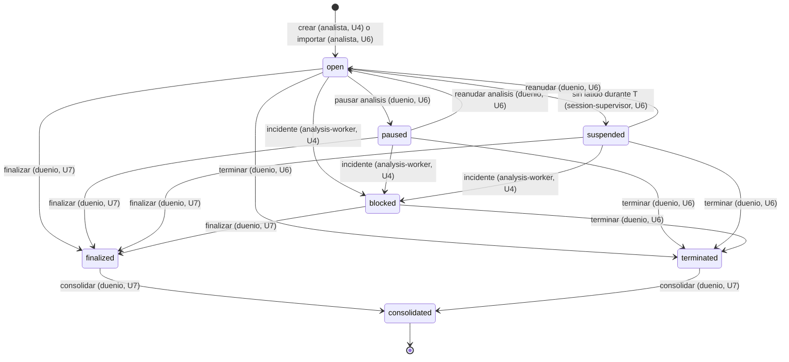
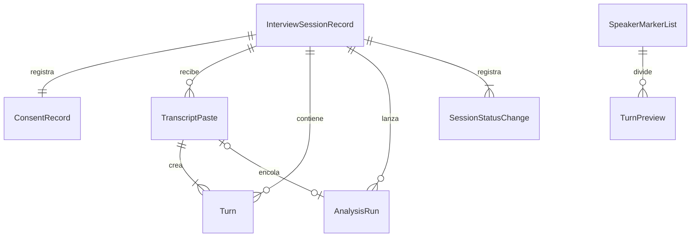

# Especificación funcional — U6 session-lifecycle

**Revisión 2 (2026-11-22), segunda pasada por el cambio 01 (DT27), la adenda 02 y las revisiones 3 de
Inception.** Sustituye a la revisión 1 del 2026-10-02. Conserva los números de flujos, escenarios y
secciones que siguen; los que salen quedan «Retirado» sin renumerar (regla de `project.md`).
- **Se mantienen** (cambian): F2 (pegar), F3 (lista), F4 (latido y suspensión), F5 (reanudar) y F6
  (progreso); escenarios E4–E14.
- **Salen** (`Retirado`): F1 (versión nueva de un escenario) y los escenarios E1–E3 (US1.2, cambio 01).
- **Entran:** F7 (importar), F8 (modo final) y F9 (pausa, terminación y retirada del consentimiento); la
  máquina de estados completa con las transiciones de U6; los escenarios E15–E47; §10 (pantallas, estados
  y textos, porque U6 es de tipo `service` y no produce `frontend-components.md`); las precisiones
  FD-U6-01 a FD-U6-24.
- **Hallazgos de `reviews/review-01.md`:** R-01 (re-suspensión y latido nulo) → BR4.2, BR4.5; R-02
  (publicación tras el commit) → BR2.5, sin *outbox*; R-03 (codes fuera de C1) → caduco, los codes de la
  revisión 3 de C1 ya existen (BR2.3, BR4.3); R-04 (marca libre y estado de la sesión) → BR2.1, BR2.7;
  R-05 (`pending_suggestions` y `version_number`) → BR3.5 y caduco con `ScenarioVersion`.

**Insumos.**
- Unidad U6 de `inception/units-generation/unit-of-work.md` (unit-of-work, revisión 3) e historias de
  `unit-of-work-story-map.md` (unit-of-work-story-map): US2.3, US2.5, US2.6, US2.7, US7.1, US15.2, US10.1
  y US11.2, con los cruces US5.4, US5.6 y US8.4.
- FR3.1–FR3.7, FR4.9, FR8, FR10.1 y FR11.2 de `inception/requirements-analysis/requirements.md`
  (requirements); VE-10 (con DD-06) y A-4 de `requirements-adenda-02.md`.
- InterviewSession, ConsoleApi y AnalystConsole de `inception/domain-design/components.md` (components),
  con ADR-002, ADR-003, ADR-009 y UG-03, UG-05.
- C1 (rutas de U6, `ErrorCode`, `SessionStatus`, `Turn`, `Run`, `SessionSummary`, `SessionView`), C2
  (cancelación y plazo), C3 (ingesta), C6 (entrada), C11, C18 y C25 de
  `inception/contract-design/contract-summary.md` (contract-summary, revisión 3), con CD-06.
- `refined-mockups/mockups.md` (M1, M4 §6.2, §6.7 y §6.8, M7, precisiones de la revisión 3); B7 de
  `delivery-planning/bolt-plan.md`.
- Respuestas de `functional-design-questions.md`: P4 = A, P5 = A, P6 = A y P7 = B de la segunda pasada,
  con sus tres secciones («lo ya decidido», «cómo se registra la revisión 2», «lo que el diseño resolverá
  sin preguntar»). P1–P3 de la primera pasada quedan superadas.
- Functional Design de U4 (máquina de la sesión y de la corrida, tubería de corridas, FD-U4-01, FD-U4-05,
  FD-U4-07, FD-U4-18 y FD-U4-19), U3 (convención de auditoría, `ActorSystem`, orden usuario → sesión →
  ronda), U11 (armado de ventanas, FD-U11-26) y U1 (contratos).

Las entidades están en `entities.md` y las reglas en `rules.md`. Este documento es la fuente de verdad de
los flujos y de la máquina de estados de la sesión.

## 1. Qué hace la unidad

U6 completa el ciclo de vida alrededor de la tubería de corridas de U4: pegar un bloque de turnos,
importar una transcripción con turnos y páginas, lanzar y relanzar el modo final, listar sesiones,
suspender una sesión cuando la consola deja de latir y reanudarla sin perder ni duplicar nada, pausar o
terminar el análisis, registrar la retirada del consentimiento y mostrar el progreso de cada corrida.

Lo que no es de U6: crear la sesión guiada y enviar un turno (U4), las corridas, el trabajador y la
ingesta (U4 y U11), las decisiones humanas (U5), finalizar y consolidar (U7: U6 solo deja permitidas las
transiciones en su máquina) y la retención (U13).

### Frontera AUTONOMIA-04 por componente

| Componente | Proceso | Dentro / fuera del clúster | Datos que cruzan la frontera |
|---|---|---|---|
| ConsoleApi (rutas de U6) | `session-api` | Dentro | Testimonio pegado o importado desde el navegador del analista, dentro del clúster (C1); nada sale |
| InterviewSession (pegado, importación, modo final, latido, suspensión, pausa, terminación, retirada) | `session-api` | Dentro | Mensajes C2 y la clave de cancelación por Redis interno; nada sale |
| Supervisor de sesiones (`session-supervisor`) | `session-api` | Dentro | Ninguno |
| AnalystConsole (M1, M7, diálogos, franja del modo final, historial lateral) | `frontend` | Dentro | Solo habla con ConsoleApi (ADR-004) |
| Corrida (incremental o final) | `semantic-agent` (U4) y `anonymizer-proxy` (U10) | La única salida posible, con el anonimizador delante | Texto seudonimizado hacia un proveedor comercial solo si el perfil lo tiene; la pausa, la terminación y la retirada impiden toda llamada nueva (CD-06) |

## 2. Flujos

### F1 — Cargar una versión nueva de un escenario · Retirado

Sale US1.2 con TruthFrame (cambio 01).

### F2 — Pegar un bloque de turnos (US2.3) · cambia

1. En M4 (sesión guiada, abierta o en pausa), el dueño pulsa «Pegar transcripción» y pega el texto.
2. «Continuar» divide el texto en la consola con BR2.1 y `SpeakerMarkerList`, y muestra la vista previa:
   «Se detectaron N turnos» y cada turno con su número, su hablante y sus primeras líneas (BR2.4).
3. Si se supera una cifra del catálogo, la vista previa lo dice y marca los turnos; «Confirmar» queda
   deshabilitado (enfocable) con su motivo (BR2.3, BR6.2).
4. «Volver a editar» regresa al texto para escribir una marca; «Cancelar» o Escape cierran sin llamar a
   la API.
5. «Confirmar» envía `POST /sessions/{id}/transcript` con `text` y `client_request_id`.
6. ConsoleApi aplica rol y dueño (BR10.1). Con el orden usuario → sesión, InterviewSession comprueba el
   consentimiento y el estado en el orden del rechazo de turnos de U4 (BR2.7) y las cifras del catálogo
   (BR2.3). Un rechazo responde 409 o 413 sin filas.
7. Si `client_request_id` ya existe, responde los mismos turnos y la misma corrida (BR2.5).
8. Divide otra vez con la misma regla (el servidor es la autoridad) y, en una transacción, numera los
   *k* turnos *n*..*n+k−1* con `origin: pasted`, guarda `TranscriptPaste` y, si hay algún turno TEST y la
   sesión no está en pausa, crea **una** corrida incremental con `desde_turno = n` y `hasta_turno` = el
   último TEST del bloque (BR2.5, FD-U6-07).
9. Tras confirmar, publica C2 por la tubería de U4 y responde 202 con `turns` y `run` (sin `run` en
   pausa o sin turnos TEST).

### F3 — Ver la lista de sesiones e historial lateral (US2.5, US11.2) · cambia

1. M1 pide `GET /sessions` (con `status` si se filtra) y muestra entrevista, origen, perfil, dueño,
   fecha en hora de Colombia y estado con texto e icono, por fecha descendente (BR3.1, BR9.7).
2. «Solo las mías» filtra en la consola; con más de 25 filas, paginación (BR3.4).
3. Sin sesiones, el estado vacío; con un filtro sin resultados, «Quitar filtros» (BR3.2).
4. El analista ve «Nueva sesión» e «Importar transcripción»; el admin, todo en solo lectura; el
   investigador recibe 403 (BR3.4).
5. Si el analista tiene sesiones suspendidas, se abre el diálogo de reanudación (F5).
6. En M4, «Mis sesiones» abre el historial lateral con la misma ruta (BR3.3, COULD).

### F4 — Latido y suspensión (US7.1) · cambia

1. Mientras M4 está abierta, cada sondeo del dueño (`GET /sessions/{id}`) cuenta como latido; sin
   corridas en proceso, la consola mantiene el sondeo lento o `POST /heartbeat` (BR4.1).
2. El supervisor de sesiones de `session-api` revisa cada intervalo las sesiones `open` (guiadas o
   importadas) y pasa a `suspended` las que llevan más de *T* sin latido, tomando `created_at` si
   `last_heartbeat_at` es nulo; inserta el cambio con `session-supervisor` (BR4.2).
3. Las corridas en cola o en proceso siguen y sus resultados se ingieren (BR4.3). Un turno, un bloque, el
   modo final o la pausa responden 409 `session.suspended`; terminar y registrar la retirada sí se
   admiten.
4. Una sesión en pausa no se suspende.

### F5 — Reanudar una sesión interrumpida (US7.1) · cambia

1. El dueño entra a M1, o abre una sesión suya `suspended`, y aparece el diálogo de reanudación con la
   más reciente (BR4.4).
2. «Más tarde» cierra el diálogo y la sesión sigue «Suspendida»; se reanuda después desde su fila.
3. «Reanudar» envía `POST /sessions/{id}/resume`. ConsoleApi aplica dueño (403 a otro analista). Si la
   sesión ya no está suspendida, 409 `session.not_suspended` (BR4.5).
4. La sesión vuelve a `open`, `last_heartbeat_at` toma la hora del servidor y se inserta el cambio con el
   dueño como actor; nada se reencola ni se duplica (BR4.5).
5. M4 se abre con los turnos tal como quedaron: los que terminaron mientras tanto, «Analizado» o con su
   error y sus hallazgos.

### F6 — Progreso de una corrida (US10.1, SHOULD) · cambia (P7 = B)

1. Cada corrida en proceso muestra su etapa: «En cola» o «Analizando contradicciones…» («Procesando
   audio…» en un turno de voz, U9) y un cronómetro mm:ss desde su última transición (BR5.1).
2. En el modo final con ventanas, la franja añade «N ventanas», calculado por `session-api` con la
   ventana y el solapamiento de la configuración efectiva (BR5.3). No hay «ventana N de M»: el trabajador
   no escribe en la base y C3 no trae avance (FD-U6-09).
3. La región `aria-live` anuncia una vez el inicio, el cambio de etapa, el fin y el error de cada
   corrida; nunca el cronómetro ni el estado de cada turno (BR5.1, BR6.2).
4. Al vencer el plazo, la corrida termina en error con su causa y se ofrece «Reintentar tramo» o
   «Relanzar modo final» (BR5.2).

### F7 — Importar una transcripción (US2.6) · nuevo

1. En M1, el analista pulsa «Importar transcripción» y llega a M7.
2. Elige un archivo. La consola lo valida con el mismo esquema versionado que el servidor: tipo (BR7.1),
   cifras del catálogo (BR7.2), esquema de entrada de C6 con el primer problema y el total (BR7.3) y
   origen y consentimiento (BR7.4). Con un problema no hay vista previa.
3. Con un archivo válido, muestra el resumen y los primeros turnos (BR7.7) y el paso 2 con el selector de
   perfil, sin preselección. Sin bloque en una transcripción sintética, avisa que no se registra
   consentimiento.
4. «Cancelar» no llama a la API. «Importar» envía `POST /sessions/import` (multipart con `file` y
   `profile_name`).
5. El servidor repite todas las validaciones y las del perfil (BR7.5); un rechazo responde 413, 415 o 422
   sin filas.
6. En una transacción crea la sesión `open` cerrada a turnos nuevos, el consentimiento, los turnos tal
   cual y el cambio de estado inicial, sin ninguna corrida (BR7.6). Responde 201.
7. La consola abre M4 en la sesión importada (§6.2 de `mockups.md`): sin entrada de turnos, «Pegar
   transcripción» ni «Finalizar sesión» (BR7.8), con «Lanzar modo final».
8. El archivo no se guarda tal cual y los logs llevan solo IDs (BR7.9).

### F8 — Lanzar o relanzar el modo final (US2.7) · nuevo

1. En la franja del modo final de M4, el dueño pulsa «Lanzar modo final» (o «Relanzar modo final»).
2. ConsoleApi aplica dueño. InterviewSession, con el orden usuario → sesión y el bloqueo exclusivo de la
   fila de la sesión, comprueba el estado en el orden de BR8.1; si la última corrida final está en cola o
   en proceso, 409 `run.final_in_progress` (BR8.2).
3. Crea la corrida final sobre toda la transcripción con quién y cuándo y su plazo (`run_deadline_final_s`)
   y, tras confirmar, la publica por la tubería de U4 (BR8.3). Responde 202 con `Run`.
4. Mientras procesa, la sesión se lee y se decide con normalidad (BR8.5); la franja muestra el estado y el
   progreso (BR5.1, BR8.7).
5. Al terminar, la ingesta de U4 une los hallazgos por par sin duplicar y lo decidido conserva su estado
   (BR8.4). En una importada, el estado de cada turno sale de la última corrida final (U4).
6. Si termina en error, la franja muestra la causa y «Relanzar modo final»; la corrida anterior queda en
   «Corridas» (BR8.6).

### F9 — Pausar, terminar y registrar la retirada del consentimiento (US15.2, VE-10) · nuevo

**Pausar análisis.**
1. En la barra de M4, el dueño pulsa «Pausar análisis» (`PATCH /sessions/{id}/analysis` con
   `paused: true`). Solo desde `open` (BR9.1).
2. En una transacción: la sesión pasa a `paused` con su cambio de estado y cada corrida en cola o en
   proceso a `cancelled`; tras confirmar se escriben las claves de cancelación (BR9.6). El *fake* no
   registra ninguna llamada nueva.
3. Mientras dura la pausa, un turno o un bloque se guardan y responden 202 sin corrida (BR9.2, BR2.7); el
   modo final y el reintento responden 409 `session.paused`.

**Reanudar análisis.**
4. El dueño pulsa «Reanudar análisis» (`paused: false`). La sesión vuelve a `open` con su cambio de estado.
5. En una guiada, si hay turnos TEST sin analizar por la pausa (su última corrida que los cubre está
   `cancelled`, o no tienen ninguna), se encola **una** corrida incremental desde el primero de ellos
   hasta el último TEST (BR9.2, FD-U6-15). Un tramo en error conserva su «Reintentar tramo». En una
   importada no se encola nada: la franja ofrece «Relanzar modo final».

**Terminar sesión.**
6. El dueño pulsa «Terminar sesión»; el diálogo modal dice «El análisis se detendrá y no podrás agregar
   turnos» con «Cancelar» y «Terminar sesión».
7. Al confirmar (`POST /terminate`), desde `open`, `paused`, `suspended` o `blocked`: la sesión pasa a
   `terminated`, se cierra a turnos nuevos, se cancela lo encolado y se conserva `blocked_code` (BR9.3,
   BR9.6). Después, todo turno, bloque, modo final o reintento responde 409 `session.terminated`. U7 la
   puede consolidar.

**Registrar la retirada del consentimiento.**
8. El dueño pulsa «Registrar retirada del consentimiento» (en la barra de M4, FD-U6-16); el diálogo modal
   explica que es irreversible (§10.5).
9. Al confirmar (`POST /consent-withdrawal`, sin cuerpo), en cualquier estado salvo `consolidated`:
   `ConsentRecord.withdrawn_at` toma la hora del servidor y `withdrawn_by` el dueño, la sesión se cierra a
   turnos nuevos y se cancela lo encolado, incluida una corrida final; el estado no cambia (BR9.4, BR9.6).
10. Desde ahí no se encola ni se analiza ninguna corrida: turnos y bloques, modo final, reintento y
    reanudación del análisis responden 409 `session.consent_withdrawn` (BR9.5, P6 = A). Lo ya analizado
    se conserva; la sesión se puede terminar, finalizar y consolidar, y el reporte declara la retirada.
11. Un segundo registro responde 409 `session.consent_withdrawn` sin filas.

## 3. Máquina de estados de la sesión (completa)

*Texto alternativo:* la sesión nace `open`, al crearla (U4) o al importarla (U6). Desde `open`, el dueño la
pausa (`paused`) y la reanuda, y el supervisor la suspende por falta de latido (`suspended`) hasta que el
dueño la reanuda. Un incidente de anonimización la bloquea (`blocked`) desde `open`, `paused` o
`suspended` (U4). Desde `open`, `paused`, `suspended` o `blocked`, el dueño la termina (`terminated`, U6)
o la finaliza (`finalized`, ruta de U7). `finalized` y `terminated` se consolidan (U7). `consolidated` es
el único estado final; una corrección crea una versión nueva del reporte sin cambiar el estado (U7).

| Desde | Hacia | Quién (`actor_kind` / actor) | Unidad | Guardia | Efecto |
|---|---|---|---|---|---|
| null | `open` | persona: el analista | U4 (crear), U6 (importar) | Consentimiento y perfil válidos | Importada: `closed_to_new_turns` true, `last_heartbeat_at` = ahora, sin corridas (BR7.6) |
| `open` | `paused` | persona: el dueño | U6 | Sin retirada | Cancela lo encolado (BR9.1, BR9.6) |
| `paused` | `open` | persona: el dueño | U6 | Sin retirada | Una corrida para lo pendiente, solo en guiadas (BR9.2) |
| `open` | `suspended` | sistema: `session-supervisor` | U6 | Sin latido durante *T* | Las corridas siguen (BR4.2, BR4.3) |
| `suspended` | `open` | persona: el dueño | U6 | Estado `suspended` | `last_heartbeat_at` = ahora; nada más (BR4.5) |
| `open`/`paused`/`suspended` | `blocked` | sistema: `analysis-worker` | U4 | Incidente | `blocked_code` fijo; cancela lo encolado |
| `open`/`paused`/`suspended`/`blocked` | `terminated` | persona: el dueño | U6 | Diálogo confirmado | `closed_to_new_turns` true; cancela lo encolado; conserva `blocked_code` (BR9.3) |
| `open`/`paused`/`suspended`/`blocked` | `finalized` | persona: el dueño | U7 | La de U7 | Empieza MTTV (U7); U6 solo la permite (BR9.8, FD-U4-18, FD-U6-12) |
| `finalized`/`terminated` | `consolidated` | persona: el dueño | U7 | La de U7 | Versión del reporte (U7) |

**La retirada del consentimiento no es un estado:** fija `ConsentRecord.withdrawn_at` y `withdrawn_by` y
`closed_to_new_turns`, en cualquier estado salvo `consolidated`, y desde ahí ninguna corrida se encola
(BR9.4, BR9.5). `blocked_code` nunca vuelve a nulo; `closed_to_new_turns` tampoco vuelve a false.

**Qué admite cada estado** (cierra la pregunta abierta del diario de U4 sobre la pausa y la suspensión):

| Estado | Turno escrito o bloque | Modo final | Reintento | Pausar / reanudar análisis | Terminar | Retirada |
|---|---|---|---|---|---|---|
| `open` guiada | Sí, con corrida | 409 `session.not_finalized` | Sí | Pausar | Sí | Sí |
| `open` importada | 409 `session.closed_to_new_turns` | Sí | Según U4 | Pausar | Sí | Sí |
| `paused` | 202 sin corrida | 409 `session.paused` | 409 `session.paused` | Reanudar | Sí | Sí |
| `suspended` | 409 `session.suspended` | 409 `session.suspended` | Según U4 | 409 `session.suspended` | Sí | Sí |
| `finalized` | 409 `session.finalized` | Sí | Sí | 409 `session.finalized` | 409 `session.finalized` | Sí |
| `terminated` | 409 `session.terminated` | 409 `session.terminated` | 409 `session.terminated` | 409 `session.terminated` | 409 `session.terminated` | Sí |
| `blocked` | 409 `session.blocked` | 409 `session.blocked` | 409 `session.blocked` | 409 `session.blocked` | Sí | Sí |
| `consolidated` | 409 `session.finalized` | 409 `session.consolidated` | 409 `session.consolidated` | 409 `session.consolidated` | 409 `session.consolidated` | 409 `session.consolidated` |
| Con retirada (cualquiera) | 409 `session.consent_withdrawn` | 409 `session.consent_withdrawn` | 409 `session.consent_withdrawn` | 409 `session.consent_withdrawn` | Sí | 409 `session.consent_withdrawn` |

El orden de las comprobaciones sigue el rechazo de turnos de U4: bloqueo, retirada, terminación,
finalización o consolidación, cierre por importación, suspensión y pausa. La fila «Con retirada» gana
sobre las demás salvo sobre `blocked`, que se comprueba antes. El reintento en `suspended` y en `open` lo
decide U4; U6 no lo cambia.

## 4. Vista derivada: entidades y relaciones

Derivada de `entities.md`.

*Texto alternativo:* una sesión tiene un consentimiento (que puede llevar la retirada), recibe bloques
pegados que crean turnos y, a lo sumo, una corrida cada uno; contiene turnos (escritos, pegados o
importados) y corridas (incrementales o finales), y registra sus cambios de estado. La lista versionada
de marcas divide el texto pegado en turnos de la vista previa. `ImportPreview`, `ImportProblem`,
`SessionListItem` y `RunProgress` son valores que no se guardan.

## 5. Vista derivada: reglas

Derivada de `rules.md`.

| Grupo | Reglas | Flujo |
|---|---|---|
| BR1 Versiones | BR1.1–BR1.4 (Retirado) | F1 (Retirado) |
| BR2 Bloque pegado | BR2.1, BR2.3–BR2.7 (BR2.2 Retirado) | F2 |
| BR3 Lista | BR3.1–BR3.5 | F3 |
| BR4 Latido y reanudación | BR4.1–BR4.6 | F4, F5 |
| BR5 Progreso | BR5.1–BR5.3 | F6, F8 |
| BR6 Accesibilidad | BR6.1–BR6.2 | F2, F3, F5, F7, F8, F9 |
| BR7 Importación | BR7.1–BR7.9 | F7 |
| BR8 Modo final | BR8.1–BR8.7 | F8 |
| BR9 Pausa, terminación y retirada | BR9.1–BR9.8 | F9, §3 |
| BR10 Solo el dueño | BR10.1–BR10.2 | Todos |

## 6. Escenarios de negocio y casos límite

Todos con transcripciones sintéticas.

| # | Escenario | Resultado esperado | Regla |
|---|---|---|---|
| E1 | Retirado | Versión corregida de un escenario (US1.2, cambio 01) | — |
| E2 | Retirado | `DELETE` sobre un pasaje (cambio 01) | — |
| E3 | Retirado | Documento idéntico a una versión (cambio 01) | — |
| E4 | «TEST: …», línea vacía, «ENT: …», «Compareciente: …» | 3 turnos: TEST, ENT y TEST (alias) | BR2.1 |
| E5 | Línea «Entonces dijo: que no» o «Hora: 14:30» dentro de un turno | No son marcas: quedan en el texto | BR2.1 |
| E6 | Bloque de `transcript_max_turns` + 1 turnos | 413 `limits.exceeded`, 0 filas; con el número exacto, 202 | BR2.3 |
| E7 | Un turno de `turn_max_chars` + 1 caracteres en la vista previa | Marcado; «Confirmar» deshabilitado con «El turno K tiene N caracteres; el máximo es M» | BR2.3 |
| E8 | Cancelar en la vista previa | 0 llamadas a la API, 0 turnos | BR2.4 |
| E9 | El navegador reenvía la confirmación | Mismos turnos y misma corrida, sin duplicar | BR2.5 |
| E10 | La misma transcripción escrita, pegada e importada | Mismos n, hablante y texto en las tres | BR2.6 |
| E11 | Consola cerrada más de *T* | «Suspendida» en ≤ *T* + intervalo, con `session-supervisor` como actor | BR4.2 |
| E12 | Latido cortado a mitad del análisis; reanudar | Turnos, corridas, sugerencias y decisiones iguales; `SessionStatusChange` + 2 | BR4.5 |
| E13 | Corridas en cola durante la suspensión | Terminan; al reanudar se ven «Analizado» o con su error | BR4.3 |
| E14 | Otro analista intenta reanudar | 403 `session.not_owner`, 0 filas | BR4.5, BR10.1 |
| E15 | Bloque «ENT: ¿Qué pasó?», «ENTREVISTADOR: ¿Y luego?» | 2 turnos ENT (alias sin distinguir mayúsculas ni tildes); 202 sin corrida | BR2.1, BR2.5 |
| E16 | Bloque TEST, TEST, ENT que empieza en el turno 8 | Turnos 8–10; una corrida `desde_turno = 8`, `hasta_turno = 9` | BR2.5 |
| E17 | Bloque sin ninguna marca | Un turno por párrafo, todos TEST | BR2.1 |
| E18 | Bloque sobre una sesión suspendida | 409 `session.suspended`, 0 filas | BR2.7 |
| E19 | Corte entre la confirmación del bloque y la publicación de C2 | La corrida queda en error con `analysis.system` al vencer el plazo; «Reintentar tramo» | BR2.5 |
| E20 | Sesión creada hace más de *T* sin ninguna consulta (`last_heartbeat_at` nulo) | Se suspende tomando `created_at` | BR4.2 |
| E21 | Reanudar y la siguiente revisión del supervisor llega enseguida | No vuelve a suspender | BR4.5 |
| E22 | Sesión en pausa sin latido más de *T* | Sigue en pausa | BR4.2 |
| E23 | Dos sesiones suspendidas del mismo analista | El diálogo muestra la más reciente; la otra se reanuda desde M1 | BR4.4 |
| E24 | Importar un archivo `corpus` válido con 312 turnos y 6 plegados | Sesión `open` cerrada a turnos nuevos, 0 corridas, turnos iguales campo a campo | BR7.6 |
| E25 | Importar un archivo de texto plano | 415 `import.invalid_type` | BR7.1 |
| E26 | Archivo con 4 problemas, el primero en el turno 37 | 422 «Turno 37: falta el hablante. Hay 3 problemas más»; 0 sesiones | BR7.3 |
| E27 | `corpus` sin bloque `consentimiento` | 422 «Falta el bloque de consentimiento» | BR7.4 |
| E28 | `sintetico` sin bloque | Sesión con `ConsentRecord` de tipo `sintetico`; M7 avisa | BR7.4 |
| E29 | `perfil` del archivo distinto del elegido | 422 `import.profile_mismatch`, 0 filas | BR7.5 |
| E30 | Archivo en el límite exacto de turnos y en el límite + 1 | 201 y 413 | BR7.2 |
| E31 | Turno o bloque sobre una importada | 409 `session.closed_to_new_turns`; M4 no ofrece esas acciones | BR7.8 |
| E32 | Importar con un *canary* en un turno | El *canary* no aparece en los logs | BR7.9 |
| E33 | Modo final en una guiada abierta | 409 `session.not_finalized` | BR8.1 |
| E34 | Dos `POST /final-runs` simultáneos | Un 202 y un 409 `run.final_in_progress`; una sola corrida | BR8.2 |
| E35 | El modo final repite un hallazgo incremental ya aceptado | Una sola sugerencia, sigue aceptada con su historial | BR8.4 |
| E36 | Modo final bloqueado por un *fake*; el analista decide un hallazgo | `GET` y decisión 200 antes de liberarlo | BR8.5 |
| E37 | Modo final termina en error y se relanza | Dos corridas finales en «Corridas»; cuenta la última | BR8.6 |
| E38 | Modo final en una sesión consolidada | 409 `session.consolidated` | BR8.1 |
| E39 | Pausar con dos corridas en cola | Ambas `cancelled`, claves escritas, 0 llamadas nuevas; un turno nuevo, 202 sin corrida | BR9.1, BR9.2, BR9.6 |
| E40 | Reanudar el análisis tras dos turnos TEST escritos en pausa | Una sola corrida desde el primero de ellos hasta el último | BR9.2 |
| E41 | Terminar una sesión bloqueada | `terminated`, conserva `blocked_code`; un turno nuevo, 409 `session.terminated` | BR9.3 |
| E42 | Retirada con un modo final en cola; luego «Relanzar modo final» | La corrida queda `cancelled`; el relanzamiento, 409 `session.consent_withdrawn` | BR9.4, BR9.5 |
| E43 | Segunda retirada, o retirada en una consolidada | 409 `session.consent_withdrawn` o `session.consolidated`, 0 filas | BR9.4 |
| E44 | Demo de B7: importar, lanzar el modo final, cerrar el navegador, volver | La sesión aparece «Suspendida»; el modo final siguió; al reanudar se ve terminado, sin duplicados | BR4.2, BR4.3, BR4.5 |
| E45 | Modo final de 312 turnos con ventana 40 y solapamiento 8 | La franja dice «10 ventanas» | BR5.3 |
| E46 | El investigador pide `GET /sessions` | 403 | BR3.4 |
| E47 | El admin abre M4 de una sesión ajena | Solo lectura, sin acciones del ciclo de vida | BR10.2 |

## 7. Integración con otras unidades

| Unidad | Qué usa de U6 o qué aporta |
|---|---|
| U1 contracts | Aporta C1, C2, C6 (esquema de entrada), C25 y los ejemplos versionados; recibe la lista de marcas `speaker-markers.v1.yaml` con sus ejemplos de división (FD-U6-08) y los codes nuevos (FD-U6-01, FD-U6-02) |
| U3 identity-access | Aporta rol, dueño, CSRF, la convención de auditoría y su prueba común, y la lista `ActorSystem`, que suma `session-supervisor` (FD-U6-13); U6 toma el orden usuario → sesión → ronda |
| U4 text-flow | Aporta la sesión, los turnos, la tubería de corridas (C2, trabajador, ingesta, plazos, deduplicación) y la clave de cancelación; U6 reutiliza el rechazo de turnos por estado (cierra su pregunta abierta: en pausa 202 sin corrida, suspendida 409 `session.suspended`), acepta FD-U4-18 y amplía `ConsentRecord` (FD-U6-05), `Turn` (FD-U6-06) y la máquina (FD-U6-12) |
| U5 human-review | Recibe los hallazgos del modo final por `propose` (deduplicación por par); aporta `ReviewRounds.pending_count` para la lista (BR3.5, FD-U6-20) |
| U7 forensic-report | Ejecuta finalizar y consolidar sobre las transiciones que U6 deja permitidas; consolida una sesión terminada o con la retirada sin exigir un modo final terminado (FD-U6-11) y declara en el reporte la terminación, la retirada y los tramos sin evaluar; lee de `SessionReader.snapshot` `consent_withdrawn_at` (FD-U6-21) |
| U9 voice | Su turno de voz entra en pausa sin corrida igual que uno escrito; su etapa «Procesando audio…» la muestra el progreso de U6 |
| U10 anonymizer | Ninguna dependencia directa: las corridas de U6 salen por la tubería de U4 con el anonimizador delante |
| U11 incoherence-analyzer | Aporta el armado de ventanas cuya cuenta repite BR5.3 con los mismos ejemplos |
| U13 ethics-governance | El Job de retención borra también `TranscriptPaste` por `purge_session` (FD-U6-22) y lo ya analizado de una sesión con la retirada |

## 8. Errores y bordes

- El servidor es la autoridad de la división del bloque y de la validación del archivo; la consola usa la
  misma especificación con los mismos ejemplos solo para la vista previa.
- Todo rechazo es Problem Details con un `code` de C1 y un `detail` en español, y no crea filas.
- Toda escritura que cambia la sesión toma el orden usuario → sesión → ronda y sube `change_cursor`
  antes de cualquier ronda; el latido no sube `change_cursor`.
- Toda E/S lleva su *timeout* de C25. No hay reintentos automáticos en U6: la publicación de C2 que falla
  tras confirmar se resuelve por el plazo y «Reintentar tramo» (BR2.5), y la clave de cancelación que no
  se pudo escribir, en la reconexión a Redis (BR9.6).
- Los logs llevan `session_id`, `run_id`, `paste_batch_id`, tamaños y `code`; nunca texto pegado,
  importado ni mensajes con texto del testimonio.
- La tarea de suspensión es idempotente y no toca sesiones que no estén `open`.
- Límite declarado: la importación no lleva `client_request_id` (C1); un doble envío crearía dos
  sesiones, y M7 lo evita deshabilitando «Importar» mientras crea (FD-U6-23).
- Límite declarado: una llamada a un modelo que ya salió cuando se pausa, se termina o se registra la
  retirada no se deshace; la clave impide las siguientes y la ingesta descarta su resultado (CD-06).
- Límite declarado: el total de ventanas es una cuenta previa; si la biblioteca cambia su armado sin
  cambiar los ejemplos compartidos, la prueba de BR5.3 falla.

## 9. Decisiones que precisan artefactos ya aprobados

No edité ningún artefacto aprobado. En la aprobación decides cuáles se llevan al original, cada uno en su
propio commit. Las filas de la revisión 1 quedan como registro, marcadas «Superado».

| ID | Estado | Artefacto aprobado | Precisión | Origen |
|---|---|---|---|---|
| — (rev. 1) | Superado | `contract-summary.md` C1 `ErrorCode` | `transcript.too_large` (422). Lo sustituye `limits.exceeded` (413, C25) | P3 de la primera pasada; C1 revisión 3 |
| — (rev. 1) | Superado | `contract-summary.md` C1 `Turn` | `speaker` y `role`. Los sustituye `hablante` `ENT`/`TEST` | P1 y P2 de la primera pasada; cambio 01 |
| — (rev. 1) | Superado | Functional Design de U4 (turnos del entrevistador) | Turnos `interviewer` sin encolar. Lo cubre el turno ENT de U4 (FD-U4-01) | P2 de la primera pasada |
| FD-U6-01 | Propuesta | `contract-summary.md` C1 `ErrorCode` y `PATCH /analysis` | Code nuevo `session.not_paused` (409) para «Reanudar análisis» sobre una sesión que no está en pausa; simétrico de `session.not_suspended` | BR9.2 |
| FD-U6-02 | Propuesta | `contract-summary.md` C1 `ErrorCode` y `/final-runs` | Code nuevo `session.not_finalized` (409) para el modo final en una guiada sin finalizar (AC2.7.1 pide 409 sin code) | BR8.1 |
| FD-U6-03 | Propuesta | `contract-summary.md` C1 `/sessions/import` | El archivo es solo JSON (AC2.6.2 y M7); la mención a YAML de la descripción sale; otro tipo responde 415 `import.invalid_type` | BR7.1 |
| FD-U6-04 | Propuesta | `user-stories/stories.md` AC2.6.2 | Se lee «`origen` fuera de {`corpus`, `sintetico`}» | P5 = A |
| FD-U6-05 | Propuesta | Functional Design de U4 (`ConsentRecord`) y `stories.md` US2.6 | `ConsentRecord.kind` suma `sintetico` (transferencia autorizada; voz, audio y mandato en false); la entrada de C2 va con `origen: sintetico` y sin bloque, y la guardia de transferencia la admite; M7 dice «Transcripción sintética: no corresponde a una persona real; no se registra consentimiento» y el reporte (U7) lo declara | P5 = A; A-4 |
| FD-U6-06 | Propuesta | Functional Design de U4 (`Turn`, «sin huecos») | La numeración sin huecos vale para las guiadas; en una importada `n` es el del archivo, único, con huecos posibles | BR7.6; AC2.6.1 («iguales campo a campo») |
| FD-U6-07 | Propuesta | `user-stories/stories.md` AC2.3.3 | `hasta_turno` es el último turno TEST del bloque (si termina en ENT, esos turnos esperan al siguiente TEST como contexto); un bloque sin turnos TEST no crea corrida, como un turno ENT (FD-U4-01) | BR2.5; restricción de U4 «en incremental `to_turn` es TEST» |
| FD-U6-08 | Propuesta | `contract-summary.md` (catálogo de `contracts/`) | Archivo nuevo `contracts/transcript/speaker-markers.v1.yaml` (U1): marcas literales, alias («Entrevistador», «Analista» → ENT; «Testimonio», «Compareciente» → TEST) y los ejemplos versionados de división, sintéticos | P4 = A; AC2.3.2 |
| FD-U6-09 | Propuesta | `user-stories/stories.md` AC10.1.1 y `refined-mockups/mockups.md` §6.8 y regla de anuncios | En el modo final se muestra la etapa, el cronómetro y el total de ventanas («N ventanas»), sin «van N»; «ventana 5 de 8» pasa a «8 ventanas» y el anuncio del avance cada 30 s sale | P7 = B |
| FD-U6-10 | Propuesta | `stories-adenda-02.md` AC15.2.3 | Tras la retirada no hay modo final ni reintento: «When lanzo el modo final o llega un turno posterior, Then el modo final y el turno responden 409 `session.consent_withdrawn` y no se encola ninguna corrida» | P6 = A; VE-10 (a) |
| FD-U6-11 | Propuesta | `stories.md` AC6.1.1 y Functional Design de U7 | Una sesión terminada o con la retirada se consolida sin exigir un modo final terminado (como la bloqueada de FD-U4-19); el reporte declara la terminación o la retirada con su hora y los tramos sin evaluar | P6 = A; C1 `/terminate` |
| FD-U6-12 | Propuesta | Functional Design de U4 (máquina de la sesión) y `domain-design/components.md` | Finalizar es la ruta de U7 (tabla «Ruta de cada unidad» de C1), no de U6; se suman `paused`/`suspended` → `finalized`, `paused`/`suspended`/`blocked` → `terminated` y `terminated` → `consolidated`; `terminated` deja de ser final | Lista de la segunda pasada, punto 5; C1 |
| FD-U6-13 | Propuesta | Lista `ActorSystem` v1 (FD-U3-08) | Valor nuevo `session-supervisor` para la suspensión por falta de latido | BR4.2 |
| FD-U6-14 | Propuesta | `user-stories/stories.md` AC7.1.3 | «Filas de historial» se lee sin contar las dos filas de `SessionStatusChange` de la suspensión y la reanudación: turnos, corridas, sugerencias y decisiones iguales, y el historial de estados crece exactamente en 2 | BR4.5 |
| FD-U6-15 | Propuesta | `stories-adenda-02.md` AC15.2.1 | «Reanudar análisis» encola una sola corrida desde el primer turno TEST cuya última corrida que lo cubre está `cancelled` (o no tiene ninguna) hasta el último TEST; un tramo en error conserva su reintento; en una importada no se encola nada | Lista de la segunda pasada, punto 6, con el tramo en error excluido |
| FD-U6-16 | Propuesta | `refined-mockups/mockups.md` (M1, M4 §6.8, barra de M4) y `stories.md` AC2.5.1 | Rótulos nuevos «Análisis en pausa», «Sesión terminada», «Bloqueada» y «· consentimiento retirado»; estado «Modo final cancelado» en la franja; «Registrar retirada del consentimiento» en la barra de M4 junto a «Terminar sesión», con su diálogo modal (§10.5); los motivos de los botones deshabilitados de BR8.7 | Lista de la segunda pasada, puntos 7 y 8 |
| FD-U6-17 | Propuesta | `contract-summary.md` C1 (`PATCH /analysis`, `/terminate`, `/consent-withdrawal`, `/final-runs`) | Los 409 de estas rutas usan el code de la situación de la tabla de §3 (incluidos `session.suspended` de FD-U4-07 y `session.consolidated` de FD-U4-05) | §3 |
| FD-U6-18 | Hecho | Functional Design de U4 (FD-U4-18) | U6 acepta que una sesión `blocked` se finalice (ruta de U7) y conserve `blocked_code`, y añade que también se termine | BR9.3, BR9.8 |
| FD-U6-19 | Hecho | Functional Design de U4 (pregunta abierta del diario) | Pausa y ruta de turnos: en pausa el turno y el bloque se guardan con 202 sin corrida, y una suspendida responde 409 `session.suspended` (acepta FD-U4-07); el modo final y el reintento responden 409 en los dos | §3; BR2.7, BR4.3, BR9.2 |
| FD-U6-20 | Propuesta | `contract-summary.md` C11 (`ReviewRounds`) | ConsoleApi también consume `pending_count` para llenar `SessionSummary.pending_suggestions` de la lista | BR3.5; R-05 de la revisión 1 |
| FD-U6-21 | Propuesta | `contract-summary.md` C11 (`SessionSnapshot`) | La instantánea suma `consent_withdrawn_at` (solo la hora, sin datos del consentimiento) y conserva el estado `terminated`, para que el reporte los declare | FD-U6-11 |
| FD-U6-22 | Propuesta | `contract-summary.md` C24 y Functional Design de U4 (`purge_session`) | `purge_session` borra también `TranscriptPaste`, antes de `Turn` | BR4.6 (marca `purgeable`) |
| FD-U6-23 | Propuesta | `contract-summary.md` C1 `/sessions/import` | Sin `client_request_id`: un doble envío crea dos sesiones; se acepta como límite declarado y M7 deshabilita «Importar» mientras crea | §8 |
| FD-U6-24 | Propuesta | `unit-of-work.md` UG-03 | Ya registrada en Units Generation: ConsoleApi registra la retirada en InterviewSession (BR9.4); no añade nada | UG-03 |

## 10. Pantallas: estados y textos

U6 es de tipo `service` y no produce `frontend-components.md`; los estados y textos de sus pantallas
quedan aquí. Los textos nuevos son propuesta de esta etapa (FD-U6-16) y no los fija un criterio aprobado.

### 10.1 M1 — Lista de sesiones

| Estado | Qué se ve |
|---|---|
| Cargando | Esqueleto de 5 filas |
| Vacío | «Aún no hay sesiones», con «Nueva sesión» e «Importar transcripción» para el analista |
| Filtro sin resultados | «No hay sesiones con este filtro» y «Quitar filtros» |
| Error | «No se pudo cargar la lista de sesiones.» y «Reintentar» |
| Poblado | Tabla nativa con entrevista, origen, perfil, dueño, fecha y estado (BR9.7); «Mostrando 1–25 de N» con más de 25 |
| Investigador | No llega a M1 (403); su entrada es M8 |

### 10.2 Diálogo de reanudación

Modal, con el foco en «Reanudar» y Escape equivalente a «Más tarde»: «Se detectó una interrupción
inesperada en la sesión. ¿Desea reanudar desde el último turno registrado?», la línea «<entrevista> ·
<perfil> · <fecha> · N turnos», «Más tarde» y «Reanudar». Si la reanudación falla con 409, «La sesión ya
no está suspendida» y se recarga M4.

### 10.3 Pegar transcripción (M4, guiadas)

Área «Pega los turnos», con la ayuda «Empieza cada turno con ENT: o TEST: o sepáralos con una línea
vacía». «Continuar» → vista previa (BR2.4) con «Volver a editar», «Cancelar» y «Confirmar»; los límites de
BR2.3; en pausa, «El análisis está en pausa: los turnos se guardarán sin analizar hasta que lo reanudes».

### 10.4 M7 — Importar transcripción

Los estados de `mockups.md` §9 (inicial, no JSON, fuera del esquema, supera un límite, válido, creando,
error del servidor, creado), más el aviso de la transcripción sintética sin bloque (BR7.4) y el selector
de perfil de M3 que solo ofrece perfiles locales si el bloque no autoriza la transferencia.

### 10.5 Barra de M4 y diálogos del ciclo de vida

- Barra (dueño): «Pausar análisis» o «Reanudar análisis», «Terminar sesión», «Registrar retirada del
  consentimiento», junto a «Finalizar sesión» (U7). Cada botón que no aplica al estado queda deshabilitado
  (enfocable) con su motivo (BR6.2).
- «Terminar sesión»: modal «El análisis se detendrá y no podrás agregar turnos», con «Cancelar» y
  «Terminar sesión».
- «Registrar retirada del consentimiento»: modal «La persona retiró su consentimiento. Desde ahora no se
  analiza ningún turno ni se lanza el modo final, y no podrás agregar turnos. Lo ya analizado se conserva
  hasta que venza la retención. Esta acción no se puede deshacer», con «Cancelar» y «Registrar retirada».
  La hora la pone el servidor.
- Cabecera: el estado de BR9.7 con texto; con retirada, «Consentimiento retirado el <fecha y hora>. No se
  analiza nada más en esta sesión».
- Solo lectura (sesión ajena o admin): «Sesión de <usuario>. Solo lectura», sin ninguno de esos botones
  (BR10.2).

### 10.6 Franja del modo final

Los estados de BR8.7, con el progreso de BR5.1 y BR5.3 y «Lanzado por <usuario> el <fecha>»; «Corridas»
sigue siendo la lista de U4.

### 10.7 Historial lateral (COULD)

«Mis sesiones» en M4 abre un panel lateral no modal con las sesiones del analista por fecha y su estado;
vacío: «Aún no tienes otras sesiones».

## 11. Preguntas abiertas para NFR Requirements

| Pregunta | Bloquea |
|---|---|
| *T* (`heartbeat_timeout_s`), el intervalo del supervisor de sesiones y el sondeo lento (`poll_interval_s`) | BR4.1, BR4.2 |
| Si el latido escribe en cada sondeo o a lo sumo una vez por intervalo, para no cargar la fila de la sesión | BR4.1 |
| `transcript_max_turns`, `transcript_max_chars`, `turn_max_chars` e `import_file_max_bytes`, con margen sobre la entrevista más larga del piloto | BR2.3, BR7.2 |
| `run_deadline_final_s` para una transcripción importada del tamaño máximo con el perfil local en CPU | BR5.2, BR8.3 |
| Carga de NFR8 (50 sesiones sintéticas en tandas de 3 con el modo final) y si la lista necesita paginación en el servidor | BR3.4; B7 (definición de terminado 4) |
| `cancel_key_margin_s` frente al desfase de relojes entre `session-api` y `semantic-agent` | BR9.6 |
