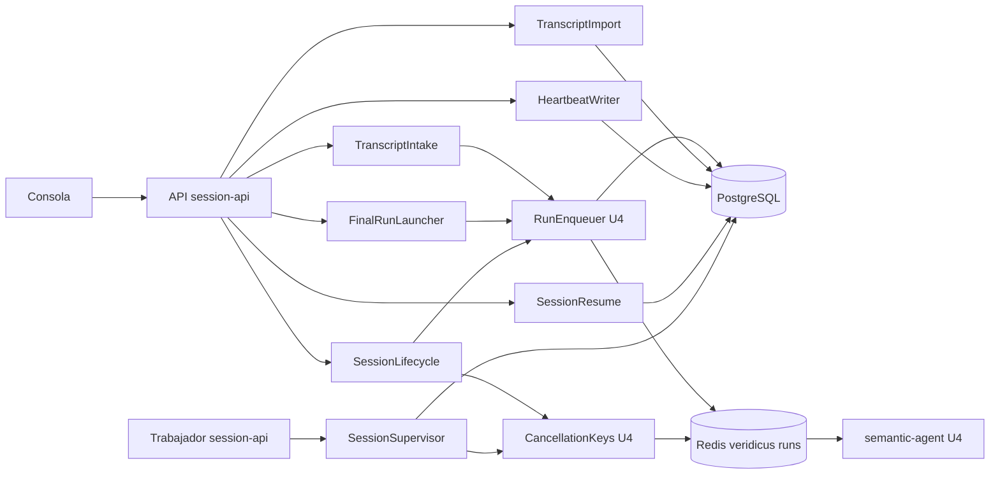

# Componentes lógicos — U6 session-lifecycle

**Revisión 2 (2026-11-22): segunda pasada por el cambio 01 (DT27), la adenda 02 y el NFR Requirements
revisión 2.** Sustituye a la revisión 1 del 2026-10-03.
- **Qué cambia.** Salen `ScenarioVersionUpload`, la marca de lote en Redis, `noeviction` por esa marca y
  la vista de pendientes de U5. `SuspensionSweeper` pasa a `SessionSupervisor`, en su propio hilo.
  Entran `TranscriptImport`, `FinalRunLauncher`, `SessionLifecycle`, `RunAdmission`,
  `SessionTransitions` y el lector `multipart` en memoria. U6 suma dos módulos guardia.
- **Numeración.** §1 (inventario) se mantiene; el YAML de componentes toma §6, con su propio H2.

**Insumos.** `nfr-requirements/performance-requirements.md` (performance-requirements),
`security-requirements.md` (security-requirements), `scalability-requirements.md`
(scalability-requirements), `reliability-requirements.md` (reliability-requirements),
`observability-requirements.md` (observability-requirements) y `tech-stack-decisions.md`
(tech-stack-decisions: D1–D13, NFR2.1, NFR2.2, NFR13.1, NFR13.2, NFR14.1, NFR14.2);
`functional-design/functional-spec.md` (functional-spec); C1, C2, C11, C15 y C25 de
`inception/contract-design/contract-summary.md` (contract-summary); los demás documentos de diseño de esta
carpeta y los componentes lógicos de U4 y de U12.

## 1. Inventario · cambia

Todos corren **dentro del clúster** (AUTONOMIA-04); ningún componente de U6 tiene destino externo.

| Componente lógico | Proceso | Responsabilidad | Patrones de NFR |
|---|---|---|---|
| Rutas de U6 en ConsoleApi | API de `session-api` | Las nueve rutas de `security-design.md` §3 | `authorize` de U3; cuerpo acotado; Problem Details |
| `TranscriptSplit` | `interview/domain/` (Python) y consola (TypeScript) | BR2.1 y D6 con `speaker-markers.v1.yaml` | Código puro; mismos ejemplos en las dos suites |
| `SessionTransitions` | `interview/domain/session_transitions.py` | Tabla de §3 del Functional Design | Guardia, 100 % de ramas |
| `RunAdmission` | `interview/domain/run_admission.py` | Si se encola y qué se cancela | Guardia, 100 % de ramas |
| `TranscriptIntake` | API | Pegado | Trabajo de CPU fuera del bloqueo; `bump`; `RunEnqueuer` de U4 |
| `TranscriptImport` | API | Importación | Lector en memoria; JSON estricto; una transacción |
| `MultipartMemoryReader` | `session_api/shared/` (API) | Parte `file` a un `bytearray` acotado, sin `filename` | Sin disco; compartido con U12 (NFRD-U6-10) |
| `FinalRunLauncher` | API | Modo final | Entrada armada fuera del bloqueo; BR8.2 bajo el bloqueo |
| `SessionLifecycle` | API | Pausa, reanudación del análisis, terminación y retirada | `bump`; cancelación en la transacción; `CancellationKeys` de U4 |
| `HeartbeatWriter` | API | Latido tras el sondeo de U4 y en `/heartbeat` | `SKIP LOCKED`; sin cursor (P2 = A) |
| `SessionResume` | API | `suspended → open` | `bump`; `UPDATE` condicional; historial |
| `SessionList` | API | `GET /sessions` | Dos sentencias; `pending_counts` de C11 |
| `SessionSupervisor` | Trabajador de `session-api`, hilo 4 | `open → suspended` cada 30 s y reescritura de claves | `bump` sin esperar; idempotente; supervisión de hilos de U4 |
| M1, M7, diálogos de pegado, reanudación, terminación y retirada, franja del modo final, historial lateral | `frontend` | Consola de U6 | Vista previa local; Web Worker de validación; catálogo de textos; axe |



<!-- Texto alternativo: la consola llama a la API de session-api. TranscriptIntake, FinalRunLauncher y SessionLifecycle crean o cancelan corridas por RunEnqueuer de U4, que escribe en PostgreSQL y publica en Redis veridicus:runs; SessionLifecycle escribe además las claves de cancelación con CancellationKeys de U4. TranscriptImport, HeartbeatWriter y SessionResume solo escriben en PostgreSQL. El trabajador de session-api ejecuta SessionSupervisor, que escribe en PostgreSQL y reescribe las claves. semantic-agent de U4 consume la cola. -->

## 2. Dominios de falla y radio de impacto · cambia

| Falla | Qué deja de funcionar en U6 | Qué sigue | Radio |
|---|---|---|---|
| Redis | Todas las rutas (`/readyz` de U3, NFRD-U6-08) | Revisión de suspensión en el trabajador | La consola; las corridas confirmadas sin publicar terminan por plazo |
| Trabajador de `session-api` | Revisión de suspensión (y lo de U4) | Todas las rutas | Las suspensiones se retrasan hasta que reinicia; ninguna se pierde |
| `semantic-agent` o los modelos | Análisis de las corridas (U4) | Todo U6 | Las corridas esperan o vencen por plazo |
| PostgreSQL | Todo | — | Todo el sistema |
| Consola cerrada | — | Todo el servidor | Esa sesión pasa a `suspended` en 165–210 s |

## 3. Recursos compartidos · cambia

| Recurso | Compartido con | Aislamiento |
|---|---|---|
| Fila `interview_session` | U4 (encolar, ingerir, plazos), U5 (decidir), U7 (finalizar), U13 | Latido y revisión nunca esperan (`SKIP LOCKED`); el resto espera con `lock_timeout` de 2 s y bloqueo corto (`reliability-design.md` §10) |
| `change_cursor` | U4, U5, U7, U9 | Primitiva única `bump`; el latido no la toca |
| Redis | U3, U4, U8, U9 | Solo C2 y las claves de cancelación de U4; ningún prefijo nuevo de U6 |
| Trabajador de `session-api` | U4 | Hilo 4 con su conexión; *pool* de 4 (NFRD-U6-05) |
| `MultipartMemoryReader` | U12 | Cada ruta pasa su propio tope |
| `pending_counts` de C11 | U5 (dueña) | Solo lectura por el puerto; U6 no lee tablas de U5 |

## 4. Entrega a Infrastructure Design · cambia

- Sin `Deployment` nuevos: API y trabajador de `session-api` de U4. El *pool* del trabajador sube a 4 y
  `/healthz` exige los cuatro hilos (NFRD-U6-05).
- Sin ajustes de U6 en el `ConfigMap` salvo las `VERIDICUS_LIMIT_<NOMBRE>` que bajan una cifra; las cifras
  viven en C25.
- `Job` de migraciones con `TranscriptPaste`, las columnas nuevas, los disparadores, el CHECK de la máquina,
  el índice único (`session_id`, `client_request_id`) y el índice parcial de expresión.
- El Ingress `veridicus-web` sin disco y con tope de 2 113 536 bytes ya lo define U2 (NFRD-U6-11).
- Topes de memoria: los de U4; U6 añade ≤ 100 MiB de pico a la API (`performance-design.md` §7).

## 5. Calidad, pruebas y textos (NFR2.1, NFR2.2, NFR13.1, NFR13.2, NFR14.1, NFR14.2) · cambia

- **Dobles y CPU.** Los modelos son el *fake* de C17; PostgreSQL y Redis reales en contenedor; ninguna
  prueba de niveles 0 y 1 descarga un modelo ni pide GPU. NFR3.17 y NFR4.1 (nivel 2) se miden en CPU con
  scripts que el humano lanza.
- **Reloj.** La hora de la base y el reloj inyectable de U3 permiten probar los bordes de 165, 179, 180 y
  210 s sin esperar.
- **Cobertura.** ≥ 80 % de líneas en `services/session-api` y `frontend` con U6 incluido, en CI y
  bloqueante. **100 % de ramas** en `session_transitions.py` y `run_admission.py`, que se añaden a la
  configuración de módulos guardia (NFR13.1).
- **División idéntica.** `pytest` y Vitest leen los mismos ejemplos de `speaker-markers.v1.yaml` y pasan el
  100 %; Hypothesis comprueba que dividir el texto armado desde turnos válidos devuelve esos turnos.
- **Textos y accesibilidad.** Solo cadenas del catálogo de U1, fechas en `America/Bogota`;
  `@axe-core/playwright` en nivel 3 sobre M1, M7, los diálogos y la franja del modo final con 0
  violaciones `serious` o `critical`; cada flujo completo solo con teclado; la región `aria-live` anuncia
  cada cambio de etapa una vez.

## 6. Componentes en YAML

```yaml
components:
  - name: session-lifecycle-routes
    path: services/session-api/src/session_api/api
    hosts: [session-api-api]
    boundary: inside
    data_out: none
    guard: false
  - name: session-transitions
    path: services/session-api/src/session_api/interview/domain/session_transitions.py
    hosts: [session-api-api, session-api-worker]
    boundary: inside
    data_out: none
    guard: true
  - name: run-admission
    path: services/session-api/src/session_api/interview/domain/run_admission.py
    hosts: [session-api-api]
    boundary: inside
    data_out: none
    guard: true
  - name: transcript-split
    path: services/session-api/src/session_api/interview/domain/transcript_split.py
    hosts: [session-api-api]
    boundary: inside
    data_out: none
    guard: false
  - name: multipart-memory-reader
    path: services/session-api/src/session_api/shared/multipart_memory.py
    hosts: [session-api-api]
    boundary: inside
    data_out: none
    shared_with: [U12]
    guard: false
  - name: session-supervisor
    path: services/session-api/src/session_api/worker/session_supervisor.py
    hosts: [session-api-worker]
    boundary: inside
    data_out: none
    guard: false
  - name: session-lifecycle-console
    path: frontend/src/features/session-lifecycle
    hosts: [browser]
    boundary: inside
    data_out: none
    guard: false
```
