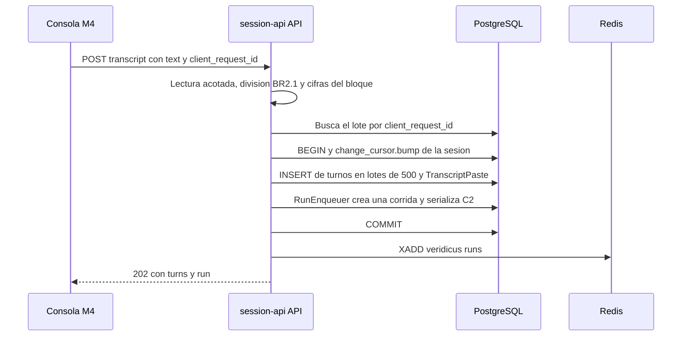

# Diseño de rendimiento — U6 session-lifecycle

**Revisión 2 (2026-11-22): segunda pasada por el cambio 01 (DT27), la adenda 02 y el NFR Requirements
revisión 2.** Sustituye a la revisión 1 del 2026-10-03.
- **Qué cambia.** El pegado sube de 200 turnos a 2 000 y crea una sola corrida; el plazo por turno sale
  (lo calcula U4). §5 (versiones de escenario) queda «Retirado». Lo nuevo: importación (§8), modo final
  (§9) y pausa, terminación y retirada (§10).
- **Hallazgo R-02 de la revisión 1** (margen nulo del turno 60): desaparece con NFR3.10 y NFR3.11
  «Retirado».

**Insumos.** `nfr-requirements/performance-requirements.md` (performance-requirements: NFR3.1–NFR3.17,
NFR8.1), `security-requirements.md` (security-requirements), `scalability-requirements.md`
(scalability-requirements), `reliability-requirements.md` (reliability-requirements),
`observability-requirements.md` (observability-requirements) y `tech-stack-decisions.md`
(tech-stack-decisions: D1–D6, D9–D12); flujos F2–F9 de `functional-design/functional-spec.md`
(functional-spec) y BR5.3 de `functional-design/rules.md`; C1, C2, C11 y C25 de
`inception/contract-design/contract-summary.md` (contract-summary); NFR Design de U4 (sondeo, *pool*,
`RunEnqueuer`, carga completa) y de U1 (C25 v1).

Todas las metas se diseñan para el **perfil CPU** (NFR2.2) en la máquina de desarrollo, con PostgreSQL y
Redis reales y el *fake* de C17. Las pruebas `perf` de nivel 1 miden con `time.perf_counter` alrededor de
la llamada HTTP en proceso. U6 no llama a ningún modelo.

## 1. Pegar un bloque (NFR3.1) · cambia



<!-- Texto alternativo: la consola envía el texto con su client_request_id. La API lee el cuerpo con tope, divide con BR2.1 y comprueba las cifras del bloque sin tocar la base. Busca si el lote ya existe. Luego abre la transacción con change_cursor.bump de la sesión, inserta los turnos en lotes de 500 y el TranscriptPaste, y RunEnqueuer crea una sola corrida y serializa su mensaje C2. Confirma, publica en veridicus:runs y responde 202 con los turnos y la corrida. -->

| Tramo | Presupuesto con el bloque máximo (2 000 turnos, 250 000 caracteres) | Técnica |
|---|---|---|
| Lectura del cuerpo | ≤ 60 ms | Lectura por bloques con corte en `transcript_body_max_bytes` |
| División y validación | ≤ 200 ms | Código puro en `interview/domain/transcript_split.py`; un recorrido por líneas sin expresiones con retroceso; la normalización de D6 solo sobre la cabecera candidata de cada línea |
| Búsqueda del lote | ≤ 10 ms | Índice único (`session_id`, `client_request_id`) |
| Bajo el bloqueo de la sesión | ≤ 1 000 ms | `bump`, comprobaciones, 4 `INSERT … VALUES` de 500 filas, `TranscriptPaste`, corrida y C2 con `orjson` (DS1) |
| `XADD` | ≤ 150 ms | Un mensaje, *timeout* 0,5 s |
| Respuesta | ≤ 150 ms | Turnos creados serializados desde memoria con `orjson`, sin releerlos |

Con 60 turnos el mismo camino queda en ≤ 300 ms (meta p95 ≤ 500 ms). La prueba `perf` mide además el
tiempo entre `bump` y `COMMIT` (p95 ≤ 1 000 ms), del que depende `reliability-design.md` §10.

**Plazo (NFR3.10 Retirado).** U6 no calcula plazos: el de la corrida lo pone `RunEnqueuer` con
`domain/deadline.py` de U4.

## 2. Latido dentro del sondeo (NFR3.3, NFR3.8; P2 = A) · cambia

El sondeo `GET /sessions/{id}?since` de U4 lee en su transacción `REPEATABLE READ READ ONLY`. Después de
leer, si quien llama es el dueño, `HeartbeatWriter` ejecuta en una transacción corta aparte:

```sql
UPDATE interview_session s SET last_heartbeat_at = now()
 WHERE s.id = (SELECT id FROM interview_session
                WHERE id = :session_id AND owner_user_id = :user_id AND status = 'open'
                  AND (last_heartbeat_at IS NULL
                       OR last_heartbeat_at <= now() - make_interval(secs => :write_min_s))
                FOR UPDATE SKIP LOCKED);
-- Sin change_cursor: el latido no cambia nada visible (D1).
```

- `now()` es la hora de la base; en pruebas, la del reloj inyectable (D3).
- Fila ocupada: el latido se omite y el sondeo responde igual; nunca espera, así que su p95 ≤ 200 ms no
  depende de un pegado en curso. Sin condición cumplida, la sentencia lee el índice primario y no escribe.
- `POST /sessions/{id}/heartbeat` ejecuta la misma sentencia y responde `204`; meta p95 ≤ 100 ms.
- Prueba `perf`: 200 sondeos del dueño cada 2 s con reloj controlado → ≤ 1 escritura cada 15 s; variante
  con otra transacción que retiene la fila 3 s → p95 del sondeo ≤ 200 ms y ese latido omitido.

## 3. Revisión de suspensión (NFR3.7, NFR3.9) · cambia

- **Índice parcial de expresión**: `CREATE INDEX … ON interview_session ((COALESCE(last_heartbeat_at,
  created_at)), id) WHERE status = 'open'`. La lectura de candidatos solo recorre las sesiones abiertas:
  p95 ≤ 100 ms con 500 sesiones y 50 abiertas (prueba `perf`).
- **Por sesión vencida**, una transacción de ≤ 20 ms (`reliability-design.md` §3). Una vuelta con 50
  vencidas (peor caso) dura ≤ 1 s, muy por debajo del intervalo de 30 s.
- **Bordes.** Con *T* = 180 s y revisión cada 30 s, una sesión pasa a `suspended` entre 180 y 210 s después
  de `coalesce(last_heartbeat_at, created_at)`; con 179 s no; una `paused` nunca. Desde el último sondeo
  real, entre 165 y 210 s por la escritura acotada del latido (NFR3.8). Prueba de nivel 1 con reloj
  controlado en los bordes.

## 4. Lista de sesiones y reanudación (NFR3.2, NFR3.4) · cambia

| Operación | Diseño | Meta |
|---|---|---|
| `GET /sessions` | Sentencia 1: sesiones con `JOIN` al dueño y `LEFT JOIN` al consentimiento (retirada), filtro `status` opcional, `ORDER BY created_at DESC` sobre el índice `(created_at DESC)`. Sentencia 2: `pending_counts(uow, session_ids)` de C11 por lotes (NFRD-U6-04). `SessionSummary` cerrado, serializado con `orjson` | p95 ≤ 300 ms y ≤ 200 KB con 500 sesiones; una prueba cuenta ≤ 2 sentencias SQL en la ruta (la sesión web de U3 vive en Redis) |
| `POST /sessions/{id}/resume` | `bump` → `UPDATE … WHERE status = 'suspended'` → historial → `COMMIT`. Responde la `SessionView` con lo que cambió desde el cursor previo a la transición: estado, la fila del historial y el cursor nuevo (NFRD-U6-19). La consola la aplica como *upsert* y luego pide la vista completa | p95 ≤ 300 ms con una sesión de 2 000 turnos, porque no serializa los turnos |

## 5. Versiones nuevas de un escenario · Retirado

Sale US1.2 con el marco documental (cambio 01; NFR3.5 y NFR9.1 Retirado).

## 6. Consola: vista previa, validación del archivo y progreso (NFR3.6, NFR3.14, NFR3.12) · cambia

- **Vista previa del pegado (NFR3.6).** La división en TypeScript recorre el texto una vez por líneas con
  `speaker-markers.v1.yaml` y las cifras de `contracts/ts/`: ≤ 300 ms para 250 000 caracteres (Vitest con
  `performance.now()`). La lista se virtualiza a partir de 200 filas, como la de turnos de U4: 2 000
  turnos se pintan en ≤ 1 s. 0 peticiones al pulsar «Continuar», «Volver a editar» y «Cancelar».
- **Validación del archivo (NFR3.14, D12).** Un Web Worker comprueba `file.size` frente a
  `import_file_max_bytes` antes de leer (un archivo mayor se rechaza sin leerlo), lo decodifica, lo analiza
  y lo valida con ajv compilado de `contracts/ts/`, con la misma tabla de mensajes que el servidor. Con
  2 MiB y 2 000 turnos: ≤ 1 500 ms fuera del hilo principal; un temporizador de 50 ms del hilo principal
  no se retrasa más de 100 ms. 0 peticiones hasta «Importar».
- **Progreso (NFR3.12).** El cronómetro mm:ss es un temporizador local de 1 s por corrida visible, sin
  peticiones; la etapa llega con el sondeo de `poll_interval_active_s` (2 s). «N ventanas» se calcula en la
  consola con `Run.fragmentado` (ventana y solapamiento que `session-api` fija al crear la corrida final,
  NFRD-U6-18) y la misma función de cuenta que U11, probada con los mismos ejemplos: ninguna llamada
  extra. Meta ≤ 3 s del cambio en el servidor a la pantalla (Vitest con temporizadores falsos y Playwright
  de nivel 3 con el *fake* de C17).

## 7. Recursos (NFR8.1) · cambia

| Aspecto | Diseño | Verificación |
|---|---|---|
| RSS de la API | El cuerpo se lee una vez; la división produce la lista de turnos sin copiar el texto entero más de una vez; el archivo vive en un `bytearray` que se suelta tras el `COMMIT` | Pico ≤ +100 MiB durante NFR3.1 y NFR3.13 con el máximo |
| RSS del trabajador | `SessionSupervisor` solo guarda identificadores | El tope del trabajador que fija U4 se mantiene en la corrida de NFR8 |

El pegado de 60 turnos con cola vacía de la revisión 1 (NFR3.11) queda «Retirado»: un bloque es una
corrida y la duración del modo final la mide NFR3.17.

## 8. Importación (NFR3.13) · nuevo

| Tramo | Presupuesto con 2 MiB y 2 000 turnos | Técnica |
|---|---|---|
| Rechazo por tamaño | ≤ 500 ms con un cuerpo de 10 MB | `Content-Length` frente a `import_body_max_bytes` antes de leer; sin él, corte del lector; RSS ≤ +20 MiB |
| Lectura `multipart` | ≤ 100 ms | Lector en memoria de bajo nivel (`security-design.md` §10) |
| UTF-8, JSON, claves y profundidad | ≤ 150 ms | `json.loads` con `object_pairs_hook` y recorrido iterativo |
| Esquema de C6 con todos los problemas | ≤ 800 ms | Validador compilado de `veridicus_contracts`; `iter_errors` una sola vez |
| Consentimiento y perfil | ≤ 20 ms | Registro de perfiles en memoria |
| Transacción | ≤ 800 ms | Sesión, consentimiento, 4 `INSERT … VALUES` de 500 turnos y estado inicial |
| Respuesta `201` | ≤ 300 ms | `SessionView` completa desde las filas en memoria con `orjson`, sin releer |

Meta p95 ≤ 3 000 ms con el máximo y ≤ 1 000 ms con 312 turnos (E24); 20 importaciones de cada tamaño con
archivos sintéticos distintos.

## 9. Modo final (NFR3.15, NFR3.17) · nuevo

- **Lanzar (NFR3.15).** Lectura de la transcripción en `REPEATABLE READ READ ONLY` y armado de la entrada
  de C6 con `orjson` fuera del bloqueo (≤ 400 ms con 2 000 turnos); bajo el bloqueo, comprobaciones,
  plazo y filas (≤ 150 ms); `XADD` de ≈ 1,35 MB (≤ 150 ms). Meta p95 ≤ 1 000 ms. No depende del
  trabajador: la variante con el *fake* de C17 bloqueado da la misma cifra.
- **Medir la duración (NFR3.17).** `evaluation/session_lifecycle/final_run_max.py`, que lanza el humano a
  demanda: importa el archivo sintético máximo, lanza el modo final con `comercial-piloto` y con
  `todo-local`, espera cada corrida hasta su fin y escribe un reporte JSON con una sección por perfil
  (duración, ventanas, estado final y `run_deadline_final_s` efectivo). El script falla si falta una sección
  (control negativo). La revisión humana compara duración y plazo y decide (NFR-U6-07).

## 10. Pausa, terminación y retirada (NFR3.16) · nuevo

- Una transacción: `bump`, tabla de transiciones, estado o retirada, y un solo `INSERT … VALUES` con los
  `RunStatusChange` de todas las corridas vigentes (≤ 50 ms con 20).
- Tras `COMMIT`, las claves de cancelación en **una** canalización de Redis sin `MULTI` (`CancellationKeys`
  de U4): 20 `SET` en una ida y vuelta, ≤ 50 ms.
- Respuesta con lo que cambió desde el cursor previo (NFRD-U6-19). Meta p95 ≤ 500 ms por ruta con 20
  corridas; la misma prueba comprueba que las 20 claves existen al llegar la respuesta.
