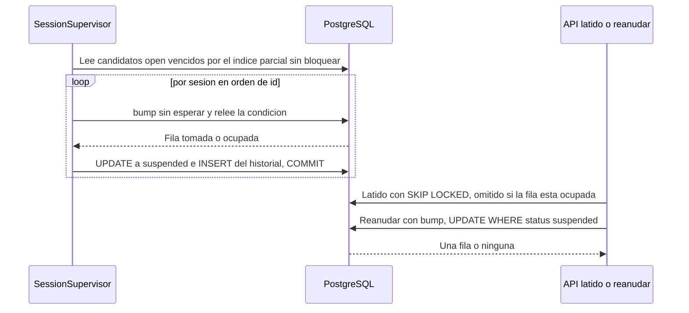

# Diseño de fiabilidad — U6 session-lifecycle

**Revisión 2 (2026-11-22): segunda pasada por el cambio 01 (DT27), la adenda 02 y el NFR Requirements
revisión 2.** Sustituye a la revisión 1 del 2026-10-03.
- **Qué cambia.** El pegado ya no publica con marca de lote: crea una corrida por `RunEnqueuer` y, si la
  publicación falla, la cierra el supervisor de U4 (§2). La revisión de suspensión usa
  `change_cursor.bump` y corre en su propio hilo (§3). §5 (versiones de escenario) queda «Retirado» y §7
  (precisiones de la revisión 1) queda «Superado». Lo nuevo: importación (§8), modo final (§9),
  transiciones concurrentes (§10), cancelación (§11) y recuperación (§12).
- **Hallazgos de la revisión 1 de esta etapa.** R-03 se cierra en §10, R-04 en §2 y R-05 en §1.

**Insumos.** `nfr-requirements/reliability-requirements.md` (reliability-requirements: NFR4.1,
NFR8.8–NFR8.13, NFR10.9–NFR10.18), `performance-requirements.md` (performance-requirements),
`security-requirements.md` (security-requirements), `scalability-requirements.md`
(scalability-requirements), `observability-requirements.md` (observability-requirements) y
`tech-stack-decisions.md` (tech-stack-decisions: D1–D4, D7, D13); flujos F2, F4, F5, F7, F8 y F9, máquina
de §3 y §8 de `functional-design/functional-spec.md` (functional-spec); C1, C2, C11 y C25 de
`inception/contract-design/contract-summary.md` (contract-summary), con CD-06; NFR Design de U4
(`reliability-design.md` §1, §4, §10, §11; NFRD-U4-02, NFRD-U4-05, NFRD-U4-06, NFRD-U4-17), de U5
(`change_cursor.bump`, `lock_timeout`) y de U3 (Redis caído).

## 1. *Timeouts* y configuración (NFR10.9, NFR10.10; cierra R-05) · cambia

| Llamada | *Timeout* | Dónde se fija |
|---|---|---|
| Consulta a PostgreSQL | 2 s (`statement_timeout` por conexión) | Configuración de U4 |
| Espera de un bloqueo de fila | 2 s (`lock_timeout`, `VERIDICUS_DB_LOCK_TIMEOUT_MS`) | Configuración de U5 |
| Transacciones de U6 (pegado, importación, modo final, pausa, reanudación del análisis, terminación, retirada, reanudación) | 5 s (`SET LOCAL statement_timeout` e `idle_in_transaction_session_timeout`) | `session_api/shared/db.py`, la misma función que usa la ingesta de U4 |
| Revisión de suspensión, por sesión | 2 s | Igual |
| Operación de Redis (`XADD`, `SET` de la clave) | 0,5 s (`socket_timeout`) | Configuración de U4 |
| Latido y revisión frente a una fila ocupada | 0 s: `SKIP LOCKED`, nunca esperan (P2 = A) | Sentencia |

Al vencer: *rollback*, `503` `system.unavailable`, 0 filas y `WARNING` con `code`. U6 no añade
*timeouts* propios.

**Cifras de U6 al arrancar.** `heartbeat_timeout_s`, `session_sweep_interval_s`, `heartbeat_write_min_s` e
`import_file_max_bytes` salen de `limits.load` (C25); una `VERIDICUS_LIMIT_<NOMBRE>` solo baja
(NFRD-U1-09). Además, en API y trabajador: *T* ≥ 4 × `poll_interval_s`, `session_sweep_interval_s` ≤ *T*/2
y 1 ≤ `heartbeat_write_min_s` ≤ *T*/4. Un valor fuera de regla termina el proceso **antes de abrir el
puerto**, con código ≠ 0 y un log que nombra el ajuste sin su valor: el pod nunca pasa a listo, que es lo
que NFR10.10 pide con «`/readyz` `503`» (NFRD-U6-09). Nivel 0: una prueba por regla, con su control
positivo, que comprueba el código de salida.

## 2. Pegado todo o nada y publicación (NFR8.10, NFR10.11; cierra R-04) · cambia

**Antes de la transacción** (sin bloqueos): corte del cuerpo, esquema, autorización, búsqueda del lote
por (`session_id`, `client_request_id`), división con BR2.1 y cifras del bloque. Si el lote existe, se
responden sus turnos y su corrida con `202`, **sin publicar** (BR2.5), sea cual sea el estado actual de la
sesión (DS2).

**Transacción** (`TranscriptIntake.paste`):

1. `change_cursor.bump(session_id)`: bloquea la fila de la sesión (orden usuario → sesión) y sube el
   cursor una vez.
2. Vuelve a buscar el lote: si otro envío igual confirmó mientras esperaba, toma el camino de reenvío. La
   restricción única (`session_id`, `client_request_id`) es la segunda barrera.
3. `run_admission` y la tabla de transiciones en el orden de U4: retirada, terminación, finalización,
   cierre por importación, suspensión; en pausa se guarda sin corrida (BR2.7, BR9.2).
4. Totales con `turn_count` y `char_count` (NFR-U6-02); si no caben, `413`.
5. `INSERT … VALUES` de los turnos en lotes de 500 con `origin: pasted` y el `change_seq` del paso 1,
   `TranscriptPaste`, y suma de los contadores.
6. Si hay algún turno TEST y no está en pausa, `RunEnqueuer` crea **una** corrida incremental (plazo con
   `domain/deadline.py`, espera de publicación si aplica, mensaje C2 serializado y comparado con
   `run_message_max_bytes`).
7. `COMMIT` y, después, `XADD` a `veridicus:runs` con *timeout* de 0,5 s y sin reintento.

**Si el `XADD` falla.** `202` con las filas confirmadas, `ERROR` `run.publish_failed` con `session_id` y
`run_id`, y el supervisor de U4 deja la corrida en `error` con `analysis.system` antes de `deadline_at` +
30 s (E19); M4 ofrece «Reintentar tramo». Si el `XADD` llegó pero su respuesta venció, la entrega doble la
absorbe la ingesta idempotente por (`run_id`, `attempt`) (NFRD-U4-02).

Pruebas de nivel 1: fallo inyectado tras el turno 1 000 → 0 turnos, 0 lotes, 0 mensajes; reenvío → mismos
turnos y corrida, 0 filas nuevas, 0 `XADD`; dos envíos simultáneos → un lote; reenvío tras suspender la
sesión → `202` idempotente; Redis detenido tras `COMMIT` → `202`, una línea `ERROR` y la corrida en `error`
a tiempo; la misma corrida publicada dos veces → un resultado.

## 3. Suspensión y reanudación sin competir (NFR8.9, NFR10.12) · cambia

<!-- Texto alternativo: el supervisor de sesiones lee sin bloquear, por el índice parcial, las sesiones abiertas vencidas. Por cada una, en orden de id, intenta change_cursor.bump sin esperar y vuelve a comprobar la condición; si la fila está libre, la pasa a suspendida, inserta su historial y confirma; si está ocupada, la deja para la vuelta siguiente. El latido usa SKIP LOCKED y se omite si la fila está ocupada. Reanudar hace bump, que sí espera, y actualiza solo si la sesión sigue suspendida, así que afecta una fila o ninguna. -->

- **Candidatos.** `SELECT id FROM interview_session WHERE status = 'open' AND COALESCE(last_heartbeat_at,
  created_at) < now() − T ORDER BY id`, sobre el índice parcial de expresión `WHERE status = 'open'`. La
  hora es la de la base o la inyectada en pruebas (D3).
- **Por sesión.** Una transacción con `change_cursor.bump(…, skip_locked=True)` (NFRD-U6-03). Si devuelve
  `None`, otra escritura está en curso y la sesión está activa: se revisa en la vuelta siguiente (≤ 30 s
  más). Si toma la fila, relee la condición (otra transacción pudo reanudar o latir), pone `suspended` e
  inserta `SessionStatusChange` (`open → suspended`, `session-supervisor`, `change_seq` del `bump`). No
  escribe `suspended_at` (retirado en `entities.md`).
- **Idempotente.** Una sesión ya `suspended`, `paused` u otra no cumple la condición: 0 filas, 0 historial
  (E22). Dos supervisores a la vez: el segundo no obtiene la fila o ya no cumple la condición.
- **Reanudar** (`SessionResume`). `bump` (espera, acotado por `lock_timeout`) → `UPDATE … SET status =
  'open', last_heartbeat_at = now() WHERE id = :id AND status = 'suspended'`; 0 filas → `409`
  `session.not_suspended`; 1 fila → historial con el dueño (BR4.5). La revisión siguiente no vuelve a
  suspender porque relee `last_heartbeat_at` bajo el bloqueo (E21).
- **El latido nunca sube el cursor**; la revisión y la reanudación sí, para que la consola vea el estado
  en su siguiente sondeo (NFRD-U4-05).
- **Fallos (NFR10.12).** Si PostgreSQL no responde, la vuelta registra `ERROR`, cuenta
  `veridicus_session_sweep_seconds{outcome="error"}` y espera al intervalo siguiente; como la condición se
  evalúa sobre el estado, ninguna suspensión se pierde. Un error al escribir el latido registra `WARNING` y
  el sondeo responde 200. Si el hilo termina por una excepción no controlada, el proceso termina y
  Kubernetes lo reinicia (supervisión de hilos de U4).

Pruebas de nivel 1 con reloj controlado: dos supervisores en hilos distintos → 1 fila; supervisor y
reanudación a la vez → estado final coherente con exactamente las filas aplicadas; dos reanudaciones
seguidas → la segunda `409` y 1 fila; base detenida dos intervalos → la sesión se suspende en la primera
vuelta con base.

## 4. La suspensión no detiene lo encolado (NFR8.11) · cambia

- La ingesta y el supervisor de U4 no miran si la sesión está suspendida: las corridas en `queued` o
  `processing` terminan y se ingieren (E13).
- Con la sesión `suspended`, la tabla de transiciones responde `409` `session.suspended` con 0 filas a un
  turno, un bloque, el modo final y la pausa; terminar y registrar la retirada sí se admiten.

## 5. Versiones de escenario · Retirado

Sale US1.2 con el marco documental (cambio 01; NFR8.12 Retirado).

## 6. Reanudar sin pérdida y equivalencia de entradas (NFR8.8, NFR4.1) · cambia

- **Sin pérdida ni duplicados.** Con reloj controlado y el *fake* de C17: bloque de 15 turnos y su
  corrida; el dueño deja de sondear; la sesión pasa a `suspended`; la corrida termina y se ingiere; el
  dueño reanuda. Mismos turnos (número, hablante y texto), corridas, sugerencias y decisiones más lo que
  terminó mientras tanto, sin duplicados, y exactamente 2 filas nuevas de `SessionStatusChange`
  (FD-U6-14). Al reanudar, la consola pide la vista completa (cursor nulo). Variante E44 con una
  importación y el modo final.
- **Equivalencia.** Escribir, pegar e importar la misma transcripción producen los mismos turnos porque
  los tres caminos terminan en la misma función de dominio que construye `Turn` (`n`, hablante, texto) y
  el pegado usa la misma división en servidor y consola (D5). Prueba sobre cada ejemplo de
  `speaker-markers.v1.yaml` y una transcripción del conjunto de U11: 100 % de turnos iguales.

## 7. Precisiones de la revisión 1 · Superado

La tabla de la revisión 1 (marca de lote, `WATCH`, `noeviction`, vista de pendientes de U5, `change_seq`
con SQL propio) queda «Superado». Las precisiones vigentes están en `security-design.md` §15.

## 8. Importación todo o nada (NFR10.15) · nuevo

- Lectura, JSON, esquema, consentimiento y perfil **antes** de la transacción
  (`security-design.md` §10). La transacción no bloquea filas ajenas: la sesión es nueva.
- Una transacción crea `InterviewSessionRecord` (`open`, `closed_to_new_turns` true, `last_heartbeat_at`
  = ahora, contadores), `ConsentRecord`, los turnos en lotes de 500 con su `n` y su página, y el
  `SessionStatusChange` inicial con la persona; **0 corridas** (BR7.6, E24).
- Prueba: fallo inyectado tras el turno 1 000 → 0 sesiones y 0 turnos. Doble envío: dos sesiones
  (límite declarado FD-U6-23); M7 deshabilita «Importar» mientras crea.

## 9. Modo final sin duplicados (NFR10.16) · nuevo

1. **Fuera del bloqueo.** En una transacción `REPEATABLE READ READ ONLY`: estado, `closed_to_new_turns`,
   contadores y turnos; si el estado admite el modo final (importada abierta o `finalized`), la
   transcripción ya no puede cambiar y se arma la entrada de C6 completa (DS7).
2. **Bajo el bloqueo.** `bump` → tabla de transiciones (BR8.1) → última corrida final en `queued` o
   `processing` → `409` `run.final_in_progress` (BR8.2) → contadores iguales a los leídos (si no, se
   vuelve a leer bajo el bloqueo) → `RunEnqueuer` con la entrada ya serializada (NFRD-U6-06), plazo
   `run_deadline_final_s` y quién y cuándo → `COMMIT` → `XADD`.
3. Dos `POST /final-runs` simultáneos: el segundo espera el `bump`, ve la corrida del primero y responde
   `409` (E34); una sola corrida nueva.

## 10. Transiciones concurrentes y orden de bloqueo (NFR10.17; cierra R-03) · nuevo

- **Un solo camino al cursor.** Toda escritura de U6 que cambia la sesión empieza con
  `change_cursor.bump`; solo el latido no lo usa, porque no cambia nada visible. Orden único usuario →
  sesión → corrida → ronda, igual que la ingesta, el supervisor de U4 y `decide` de U5.
- **Bloqueo corto.** El pegado y el modo final hacen el trabajo de CPU fuera del bloqueo (DS1, DS7):
  con el bloque máximo, el bloqueo dura p95 ≤ 1 000 ms, por debajo del `lock_timeout` de 2 s de U5.
- **Pares a la vez** (barrera, 50 repeticiones cada uno): pausar y suspender, terminar y bloquear (U4),
  retirar y lanzar el modo final, pausar y pegar un bloque, **pegar el bloque máximo y decidir una
  sugerencia (U5)**. En cada caso: el estado final está en la tabla de §3, el historial tiene exactamente
  las filas aplicadas, ninguna corrida queda `queued` en una sesión que no las admite, 0 errores `40P01` y
  la decisión responde `201` (no `503`).

## 11. Cancelación frente a Redis y relojes (NFR10.18) · nuevo

- **(a) Redis falla al escribir la clave.** La transición ya confirmada se mantiene y responde igual;
  `ERROR` `run.cancel_key_failed` y `veridicus_run_cancellations_total{outcome="key_deferred"}`. La clave
  la reescribe U4 al reconectar el trabajador y `SessionSupervisor` en cada vuelta (NFRD-U6-07); mientras
  tanto, `semantic-agent` cuenta como cancelado todo `EXISTS` que falla y el plazo detiene la corrida.
  Prueba: Redis cortado al escribir la clave → tras la reconexión, la clave existe y el *fake* registra 0
  llamadas nuevas.
- **(b) Relojes.** TTL = `deadline_at` − ahora + `cancel_key_margin_s` (120 s), calculado con la hora de la
  base. Con el reloj del trabajador 110 s atrasado, el *fake* sigue registrando 0 llamadas nuevas
  (NFR-U6-08). En Minikube de un nodo los pods comparten reloj.

## 12. Recuperación y degradación (NFR8.13) · nuevo

| Falla | Qué se pierde | Cómo se recupera |
|---|---|---|
| Navegador cerrado o sin red | Nada | `suspended` entre 165 y 210 s después del último sondeo real; las corridas siguen; el dueño reanuda (E44) |
| Reinicio del trabajador de `session-api` | Nada | El supervisor de sesiones no tiene estado: la vuelta siguiente suspende lo pendiente |
| Reinicio de la API a mitad de un pegado o una importación | Lo no confirmado | *Rollback*; el navegador reenvía el pegado con el mismo `client_request_id`; la importación se vuelve a pedir |
| Redis cae tras confirmar un bloque, un modo final o una reanudación del análisis | Nada visible salvo la espera | La corrida termina en `analysis.system` por plazo y se reintenta a mano |
| Redis cae al cancelar | Nada | §11 (a) |
| Redis caído | Todas las rutas de U6 | `/readyz` de U3 saca la API del servicio; la revisión de suspensión sigue en el trabajador (NFRD-U6-08) |
| Relojes distintos entre pods | Nada | Latido, revisión y TTL con la hora de la base |

**Sin trabajador de corridas o sin modelos**, U6 sigue respondiendo: se pega, se importa, se lanza el modo
final (queda en cola hasta su plazo), se lista, se pausa, se termina, se retira, se suspende y se reanuda.

**En la prueba de NFR8 (NFR8.13)**, cada sesión entra como un bloque pegado y corre su modo final: las
rutas `/transcript` y `/final-runs` dan 0 respuestas 5xx y 0 rechazos inesperados, y la revisión no
suspende ninguna sesión que la prueba sondea (cada sondeo del dueño es un latido). Se comprueba en el
reporte de `evaluation/load/run_batches.py` de U4.
