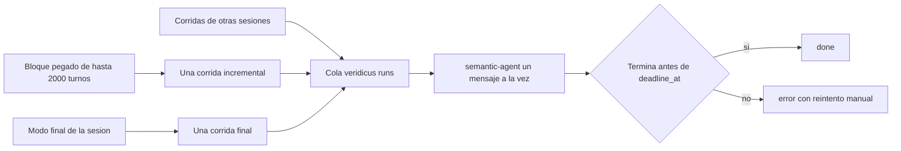

# Diseño de escalado — U6 session-lifecycle

**Revisión 2 (2026-11-22): segunda pasada por el cambio 01 (DT27), la adenda 02 y el NFR Requirements
revisión 2.** Sustituye a la revisión 1 del 2026-10-03.
- **Qué cambia.** Sale la marca de lote en Redis y el plazo por turno (NFR8.4 Retirado). Las cifras pasan
  a las de C25 v1 (2 000 turnos, 250 000 caracteres). La revisión de suspensión corre por sesión. Entra la
  importación. §6 es nueva (NFR8.14).
- **Numeración.** §1–§5 conservan su tema.

**Insumos.** `nfr-requirements/scalability-requirements.md` (scalability-requirements: NFR8.2, NFR8.3,
NFR8.5–NFR8.7, NFR8.14), `performance-requirements.md` (performance-requirements),
`security-requirements.md` (security-requirements), `reliability-requirements.md`
(reliability-requirements), `observability-requirements.md` (observability-requirements) y
`tech-stack-decisions.md` (tech-stack-decisions); flujos F2–F4, F7 y F8 de
`functional-design/functional-spec.md` (functional-spec); C1, C2, C11 y C25 de
`inception/contract-design/contract-summary.md` (contract-summary); modelo de capacidad y prueba de carga
de U4.

## 1. Sin estado en los procesos (NFR8.2) · cambia

| Elemento | Réplicas en el MVP | Qué garantiza que dos instancias no se pisen |
|---|---|---|
| API de `session-api` (pegado, importación, modo final, latido, reanudación, pausa, terminación, retirada, lista) | 1 | `change_cursor.bump` sobre la fila de la sesión; restricción única (`session_id`, `client_request_id`); `UPDATE … WHERE status = 'suspended'` en la reanudación; BR8.2 bajo el bloqueo en el modo final |
| Trabajador de `session-api` (`SessionSupervisor`) | 1 | `bump` sin esperar y condición releída bajo el bloqueo (`reliability-design.md` §3) |
| Consola | — | Vista previa y validación locales; el estado vive en el servidor |

Ningún latido, lote, importación ni temporizador de sesión vive en memoria del proceso: el latido es una
columna, la revisión no guarda estado entre vueltas y el lote es una fila. Prueba de nivel 1 con dos
instancias de la aplicación y dos supervisores en hilos distintos: cada transición, cada lote y cada
corrida final quedan una sola vez.

## 2. Tamaño de un bloque o un archivo (NFR8.3) · cambia

- **Cifras de una sola fuente.** `transcript_max_turns` = 2 000, `transcript_max_chars` = 250 000,
  `turn_max_chars` = 20 000, `import_file_max_bytes` = 2 097 152 y los dos topes de cuerpo de NFRD-U6-01,
  leídos de `contracts/limits.v1.yaml` con `limits.load` en Python y `contracts/ts/` en la consola. Prueba
  de nivel 0: las dos lecturas dan los mismos valores.
- **Totales de la sesión.** `turn_count` y `char_count` bajo el bloqueo (NFR-U6-02): ningún camino suma
  más turnos que el catálogo, y la entrada del modo final nunca pasa de `run_message_max_bytes`.
- **Plazo por turno (NFR8.4).** Retirado: un bloque es una sola corrida con el plazo de U4.

<!-- Texto alternativo: un bloque pegado de hasta 2000 turnos crea una sola corrida incremental y el modo final crea una corrida final. Las dos comparten la cola veridicus:runs con las corridas de otras sesiones, que semantic-agent atiende de a una. Cada corrida termina en done si acaba antes de su plazo, o en error con reintento manual si no. -->

## 3. Lista sin paginar (NFR8.5) · cambia

`GET /sessions` devuelve todas las sesiones con **dos** sentencias: la lista y `pending_counts` por lotes
(`performance-design.md` §4; NFRD-U6-04). Con ≤ 500 sesiones la respuesta queda ≤ 200 KB; la consola pagina
de 25 en 25 (BR3.4). El disparador para paginar es medible: más de 1 000 sesiones en la base o NFR3.2 en
rojo; entonces se añade paginación por cursor sobre (`created_at`, `session_id`) como cambio menor de C1
en un PR propio.

## 4. Escrituras del latido y crecimiento (NFR8.6, NFR8.7) · cambia

- **Latido acotado.** ≤ 1 `UPDATE` efectivo cada 15 s por sesión abierta: con 50 sesiones, ≤ 200 escrituras
  por minuto. Los latidos omitidos por `SKIP LOCKED` solo bajan esa cifra. Prueba de nivel 1 que cuenta
  sentencias efectivas con reloj controlado.
- **La revisión no crece con el total.** El índice parcial solo contiene sesiones `open` (≤ 50): el costo de
  cada vuelta no depende de las 500 sesiones totales.
- **Tablas.** `TranscriptPaste` y `SessionStatusChange` son de solo inserción y las borra solo la retención
  (U13, `purge_session`); < 5 MB con ≤ 500 sesiones. Los turnos importados son lo que más crece: ≈ 150 MB de
  texto en el peor caso teórico (500 sesiones de 250 000 caracteres) y < 50 MB con el tamaño típico.
  Infrastructure Design dimensiona el volumen con el peor caso. Redis no guarda nada de U6 salvo las claves
  de cancelación de U4, que expiran.

## 5. Señales para escalar · cambia

| Señal | Umbral | Acción, en este orden, por PR con medición |
|---|---|---|
| `veridicus_run_queue_depth` (U4) | > 10 durante 10 minutos | Perfil GPU para la demostración; ajustar el perfil o el plazo por PR (U11); limitar la demostración a transcripciones más cortas |
| Duración del modo final (NFR3.17) | Más larga que `run_deadline_final_s` efectivo | Igual que arriba; nunca subir una cifra de C25 en silencio |
| Sesiones en la base | > 1 000 o NFR3.2 en rojo | Paginación por cursor en `GET /sessions` |
| `veridicus_session_sweep_seconds` p95 | > 100 ms | Revisar el índice parcial; no alargar el intervalo en silencio |

## 6. Tres sesiones a la vez en la prueba de NFR8 (NFR8.14) · nuevo

- `evaluation/load/run_batches.py` de U4 añade, por sesión: un bloque pegado del conjunto sintético, sondeo
  del dueño cada 2 s y el modo final al terminar la corrida del bloque.
- El reporte suma una sección de U6 con el p95 de `POST /transcript` (NFR3.1), del sondeo (NFR3.3) y de
  `POST /final-runs` (NFR3.15) medidos durante la corrida, más el conteo de respuestas 5xx y de
  suspensiones (NFR8.13). El script falla si falta la sección (control negativo).
- Con 3 sesiones, las escrituras que compiten por fila son de sesiones distintas: no hay contención de
  bloqueo entre ellas; la única competencia es la de la cola, que no cambia las metas de las rutas de U6.
