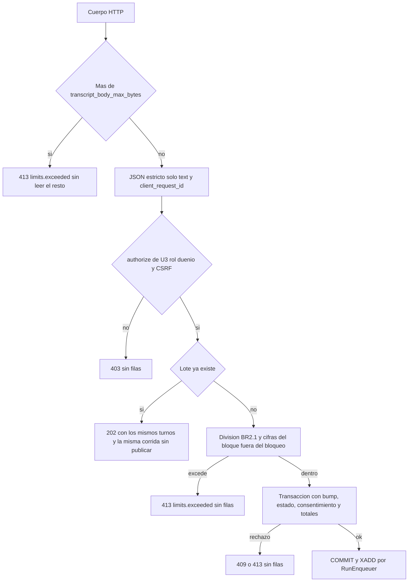
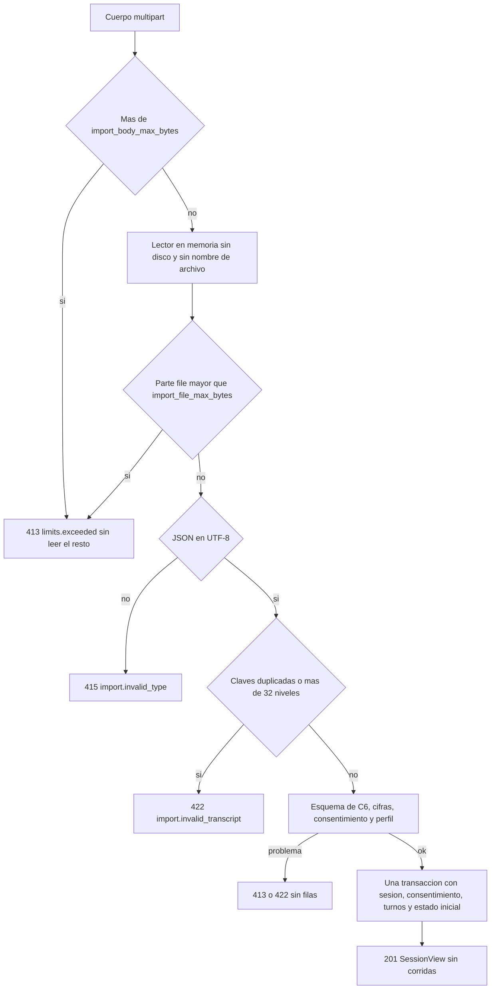
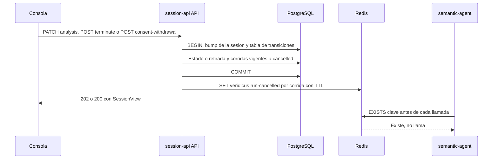

# Diseño de seguridad — U6 session-lifecycle

**Revisión 2 (2026-11-22): segunda pasada por el cambio 01 (DT27), la adenda 02 y el NFR Requirements
revisión 2.** Sustituye a la revisión 1 del 2026-10-03, que queda en el historial de Git.
- **Qué cambia.** Sale la versión nueva de un escenario. El pegado ya no publica un mensaje por turno con
  marca de lote: crea **una** corrida incremental por la tubería de U4. Entran la importación (§10), la
  cancelación tras pausar, terminar o registrar la retirada (§11) y los errores con `code` de C1 (§12).
- **Numeración.** §1–§8 conservan su número y tema. §9 (precisiones de la revisión 1) queda «Superado».
  Lo nuevo empieza en §10. Las decisiones de diseño son DS1–DS12 (§13) y las precisiones, NFRD-U6-01 a
  NFRD-U6-19 (§15).
- **Hallazgos de la revisión 1 de esta etapa** (`reviews/review-01.md`). R-01 queda caduco: los codes
  existen en C1 revisión 3 o entran con FD-U6-01 y FD-U6-02. R-02 desaparece con el plazo por turno. R-03 se
  cierra en `reliability-design.md` §10. R-04 se cierra en §2 y en `reliability-design.md` §2. R-05 se
  cierra en `reliability-design.md` §1.
- **Preguntas.** Ninguna en esta pasada: todo lo fijan las fuentes (sección de segunda pasada de
  `nfr-design-questions.md`).

**Insumos.**
- De esta unidad: `nfr-requirements/security-requirements.md` (security-requirements, amenazas T1–T13,
  tabla NFR-U6-01 a NFR-U6-12), `reliability-requirements.md` (reliability-requirements),
  `performance-requirements.md` (performance-requirements), `scalability-requirements.md`
  (scalability-requirements), `observability-requirements.md` (observability-requirements) y
  `tech-stack-decisions.md` (tech-stack-decisions, D1–D13).
- `functional-design/functional-spec.md` (functional-spec: F2–F9, máquina de §3, E4–E47, §8, FD-U6-01 a
  FD-U6-24), `functional-design/rules.md` (BR2–BR10) y `functional-design/entities.md`.
- C1 (rutas de U6), C2, C6, C11, C15, C18, C24 y C25 de `inception/contract-design/contract-summary.md`
  (contract-summary), con CD-06.
- NFR Design de hoy: U1 (C25 v1, marcas `x-veridicus-*`, métricas en archivos propios, NFRD-U1-05,
  NFRD-U1-09, NFRD-U1-10), U2 (Ingress sin disco, §3), U3 (Redis caído, anti-CSRF, NFRD-U3-08) y U4
  (`RunEnqueuer`, plazo, `CancellationKeys`, supervisor, NFRD-U4-02, NFRD-U4-05, NFRD-U4-06, NFRD-U4-17).
- Respuestas P1 = A y P2 = A de la revisión 1 en `nfr-design-questions.md`. Reglas AUTONOMIA-01..05 de
  `team.md` y prohibiciones de `project.md`.

Salvo que se diga otra cosa, cada control se prueba en **nivel 1** con PostgreSQL y Redis reales y el
*fake* de C17, y con su control negativo. Los comandos son los de `tech-stack-decisions.md` §5.

## 1. Frontera (AUTONOMIA-04; NFR1.1, NFR1.2) · cambia

| Componente | Dónde corre | Qué cruza su frontera | Destinos permitidos |
|---|---|---|---|
| Rutas de U6 en ConsoleApi (`/transcript`, `/sessions/import`, `/final-runs`, `/heartbeat`, `/resume`, `/analysis`, `/terminate`, `/consent-withdrawal`, `GET /sessions`) | API de `session-api`, dentro del clúster | Testimonio pegado o importado desde el navegador por el Ingress TLS de U2; `SessionSummary` y `SessionView` hacia el navegador | Navegador por `veridicus-web` |
| `TranscriptIntake`, `TranscriptImport`, `FinalRunLauncher`, `SessionLifecycle` | API de `session-api`, dentro | Turnos en PostgreSQL; mensajes C2 y claves de cancelación hacia Redis interno, siempre por `RunEnqueuer` y `CancellationKeys` de U4 | PostgreSQL, Redis |
| `HeartbeatWriter`, `SessionResume`, `SessionList` | API de `session-api`, dentro | Identificadores, horas y conteos | PostgreSQL |
| `SessionSupervisor` (`session-supervisor`) | Trabajador de `session-api`, dentro | Identificadores y horas | PostgreSQL; Redis solo para reescribir claves (§11) |
| M1, M7, diálogos, franja del modo final, historial lateral | Navegador | La vista previa del pegado y la validación del archivo se calculan en el navegador; solo habla con ConsoleApi (ADR-004) | ConsoleApi |
| Corridas que lanza U6 | `semantic-agent` (U4) y `anonymizer-proxy` (U10) | La única salida, por la tubería de U4 con el anonimizador delante, solo con un papel comercial y transferencia autorizada | La lista de U10 |

**Ningún componente de U6 llama fuera del clúster** ni añade reglas de salida: los dos `Deployment` de
`session-api` siguen bajo la `NetworkPolicy` de salida denegada de U2. U6 no añade dependencias de
ejecución (revisión del PR y `pip-audit`). Verificación: los `/readyz` de API y trabajador pasan con la
política aplicada (nivel 1 en Minikube y verificación manual de U2). La vista previa del pegado y la
validación del archivo hacen 0 peticiones hasta «Confirmar» o «Importar» (Vitest de NFR3.6 y NFR3.14;
NFR1.2).

## 2. Entrada del pegado (NFR10.1; T1, T2) · cambia

<!-- Texto alternativo: el cuerpo HTTP se corta al pasar transcript_body_max_bytes y responde 413 limits.exceeded sin leer el resto. Dentro del tope, el JSON solo admite text y client_request_id. La autorización de U3 exige rol analista, dueño y token anti-CSRF; si falla, 403 sin filas. Si el lote con ese client_request_id ya existe, se responde 202 con los mismos turnos y la misma corrida, sin publicar de nuevo. Si no, el servidor divide el texto con BR2.1 y compara las cifras del bloque fuera de cualquier bloqueo; si excede, 413. Luego abre la transacción con change_cursor.bump, comprueba estado, consentimiento y totales de la sesión; un rechazo da 409 o 413 sin filas. Si todo pasa, confirma y publica C2 por RunEnqueuer. -->

- **Lectura acotada.** Lector por bloques sobre el *stream* que corta al pasar
  `transcript_body_max_bytes` = 1 004 096 (4 × `transcript_max_chars` + 4 096), con nombre en C25
  (NFRD-U6-01). Prueba con 5 MB: `413` y RSS ≤ +20 MiB.
- **Esquema estricto.** C1 con `additionalProperties: false`: la consola no tiene campo donde mandar roles
  ni su división (T2).
- **El servidor divide.** `interview/domain/transcript_split.py` aplica BR2.1 con
  `contracts/transcript/speaker-markers.v1.yaml` (D5, D6). El hablante sale de las marcas, nunca del
  cliente.
- **Cifras de una sola fuente.** `transcript_max_turns`, `transcript_max_chars` y `turn_max_chars` salen de
  `limits.load` (C25). Una prueba de nivel 0 recorre el código de U6 y falla ante un número de límite
  literal. Cada cifra en el límite exacto da `202` y en el límite + 1 da `413` (E6, E7), con 0 filas y 0
  mensajes en C2.
- **Totales de la sesión (NFR-U6-02).** Bajo el bloqueo, `turn_count + k ≤ transcript_max_turns` y
  `char_count + Σ ≤ transcript_max_chars`, con los contadores de NFRD-U4-17; si no, `413`.
- **Orden del reenvío (cierra R-04).** El lote se busca por (`session_id`, `client_request_id`) **antes**
  de comprobar el estado: un reenvío tras confirmar recibe la respuesta idempotente aunque la sesión ya se
  haya suspendido o terminado (NFRD-U6-16).

## 3. Autorización y latido del dueño (NFR10.2, NFR10.3; T3, T12) · cambia

| Ruta | `x-veridicus-roles` | `x-veridicus-owner-only` | Anti-CSRF |
|---|---|---|---|
| `POST /sessions/{id}/transcript` | `[analista]` | `true` | Sí |
| `POST /sessions/{id}/final-runs` | `[analista]` | `true` | Sí |
| `POST /sessions/{id}/heartbeat` | `[analista]` | `true` | Sí |
| `POST /sessions/{id}/resume` | `[analista]` | `true` | Sí |
| `PATCH /sessions/{id}/analysis` | `[analista]` | `true` | Sí |
| `POST /sessions/{id}/terminate` | `[analista]` | `true` | Sí |
| `POST /sessions/{id}/consent-withdrawal` | `[analista]` | `true` | Sí |
| `POST /sessions/import` | `[analista]` | — | Sí |
| `GET /sessions` | `[analista, admin]` | — | No (lectura) |

- Todas pasan por la dependencia `authorize` de U3 y el token anti-CSRF derivado de la sesión web (NFR
  Design de U3). La comprobación del dueño la hace ConsoleApi (ADR-009) **antes** de abrir la transacción
  de la unidad.
- Pruebas `403` con 0 filas: otro analista en cada ruta de dueño (`session.not_owner`, E14); `admin` e
  `investigador` en cada ruta de escritura (`auth.forbidden`); `investigador` en `GET /sessions` (E46); cada
  escritura sin anti-CSRF.
- **El latido es del dueño.** La sentencia del latido (`performance-design.md` §2) lleva el dueño en su
  condición: el sondeo de otro usuario o del `admin` no escribe. Prueba: solo sondea otro usuario y la
  sesión se suspende a tiempo (NFR3.7).
- **Lista cerrada.** `GET /sessions` serializa `SessionSummary` con un modelo Pydantic cerrado: entrevista,
  origen, perfil, dueño, fecha, estado, retirada y pendientes; ningún campo con texto de turnos. Prueba
  sobre las claves exactas de la respuesta.

## 4. Datos sensibles en logs, errores y Redis (NFR10.4, NFR10.5; T5) · cambia

- **Logs.** El formateador tipado de `libs/` (U3) con la lista blanca de U4 más `paste_batch_id`,
  `origin`, tamaños en bytes, `turn_count`, `char_count`, `problem_count`, `idle_seconds`,
  `cancelled_runs` y `code`. Las excepciones de U6 se registran con su tipo y `code`, nunca con su mensaje.
  Lo que un campo no admite, el formateador lo descarta y cuenta.
- **Errores.** Los Problem Details de U6 llevan `detail` del catálogo de U1; ninguno se arma con texto
  recibido. `limits.exceeded` dice la cifra y el número de turno, no su contenido.
- **Prueba centinela.** Una cadena centinela en un bloque aceptado y en uno rechazado, en un turno de un
  archivo aceptado y en uno rechazado por esquema, en el **nombre del archivo** y en `constancia` del
  bloque de consentimiento: 0 apariciones en los logs capturados de API y trabajador y en el `detail` de
  los Problem Details (E32).
- **Redis.** Las corridas de U6 usan C2 tal cual por `RunEnqueuer`, con el `XACK` + `XDEL` de U4 tras el
  efecto. Tras una corrida de un bloque y una final, `XRANGE` de `veridicus:runs` y `veridicus:results` no
  contiene el texto. La clave `veridicus:run-cancelled:{run_id}` solo lleva `1`. Ya no existe la marca de
  lote de la revisión 1.

## 5. Estado, inmutabilidad y auditoría (NFR10.6, NFR11.1, NFR11.2; T4, T6, T7) · cambia

- **Tabla de transiciones pura.** `interview/domain/session_transitions.py` contiene la tabla de §3 del
  Functional Design: por cada acción y estado, la transición permitida o el `code` del `409`, en el orden de
  comprobación de U4 (bloqueo, retirada, terminación, finalización o consolidación, cierre por importación,
  suspensión, pausa). Es código puro con 100 % de ramas (NFR13.1) y una prueba por transición prohibida
  (`terminated → open`, `paused → suspended`, `consolidated → terminated` y las demás de la tabla).
- **Sin rutas peligrosas.** La comprobación del OpenAPI de C1 (nivel 0) falla si un cuerpo de U6 acepta
  `status`. `open → suspended` solo existe en `SessionSupervisor`.
- **Disparadores.** `closed_to_new_turns` solo pasa de false a true; `withdrawn_at` y `withdrawn_by` solo
  de nulo a valor, juntos; `blocked_code` nunca vuelve a nulo. Un `UPDATE` directo que intenta revertir
  cada uno falla (NFR11.1).
- **Solo inserción.** `TranscriptPaste` y `SessionStatusChange` llevan la marca `veridicus-audit`; la prueba
  común de U3 las recorre y `UPDATE`/`DELETE` fallan con `veridicus_app`. Solo `veridicus_retention` borra,
  por `purge_session` (FD-U6-22).
- **Actor de cada cambio (NFR11.2).** Suspensión con `actor_kind = system` y `actor_system =
  session-supervisor` (FD-U6-13, NFR-U3-04). Importación, pausa, reanudación del análisis, reanudación y
  terminación con la persona; las corridas canceladas, con la misma persona en su `RunStatusChange`.
- **Migraciones (AUTONOMIA-01).** `TranscriptPaste`, las columnas nuevas de `ConsentRecord`, `Turn` e
  `InterviewSessionRecord`, los disparadores, el CHECK de la máquina y el índice parcial de la revisión
  entran por el `Job` de migraciones en su propio PR, aditivas; nada se aplica al arrancar un pod.

## 6. Guardias del análisis y vocabulario (NFR10.7, NFR10.8; T8, T11) · cambia

- **AUTONOMIA-05 sin atajos.** Las corridas de un bloque, del modo final y de «Reanudar análisis» se crean
  solo con `RunEnqueuer` de U4 y se ingieren por `ResultIngestor`, con la verificación de citas y la
  deduplicación por par. Un contrato de import-linter prohíbe a los módulos de U6 importar la biblioteca de
  U11, la ingesta o `veridicus:results`. Prueba: un hallazgo con una cita alterada en la salida *fake* de un
  modo final no crea sugerencia.
- **AUTONOMIA-03.** Los rótulos de M1, M7, los diálogos de pegado, reanudación, terminar y retirada, la
  franja del modo final y el historial lateral salen del catálogo de U1 y pasan `scan(text,
  literal_sources)` en nivel 0 (catálogo) y en nivel 3 (interfaz renderizada), con 0 coincidencias y un
  control negativo por término.

## 7. Datos sintéticos (NFR12.1) · se mantiene

Bloques pegados, archivos de importación (también los que declaran `corpus`) y los ejemplos de
`speaker-markers.v1.yaml` usan el catálogo de nombres y las marcas de U1. La comprobación de U1 corre en
nivel 0 sobre `services/session-api/tests/`, `frontend/src/**/__tests__/`, `frontend/e2e/` y el archivo de
marcas, con 0 hallazgos; `gitleaks` en la CI. Las entrevistas del piloto solo se importan en el Minikube
local, nunca en Git ni en la CI (`project.md`).

## 8. Amenazas y controles · cambia

| Amenaza | Controles de este diseño |
|---|---|
| T1 Pegado o archivo enorme, o JSON muy anidado | §2 y §10: corte por bytes antes de leer, profundidad ≤ 32 |
| T2 División o turnos manipulados | §2: el servidor divide; cuerpo estricto |
| T3 Acción sobre una sesión ajena | §3 |
| T4 Forzar un estado o reabrir | §5: tabla pura y disparadores |
| T5 Testimonio en logs, métricas, errores, Redis o disco | §4, §10 y `observability-design.md` §2 |
| T6 Reescribir historial, retirada o bloque | §5 |
| T7 Suspensión sin autor | §5: `session-supervisor` |
| T8 Llamada tras pausar, terminar o retirar | §11 |
| T9 Importación sin consentimiento o sin transferencia | §10 |
| T10 Real declarada `sintetico` | §10 (log y métrica por `origin`); riesgo aceptado de security-requirements §5 |
| T11 Etiqueta de veracidad en textos de U6 | §6 |
| T12 Lista que expone de más | §3 |
| T13 Claves duplicadas leídas distinto | §10 |

## 9. Precisiones de la revisión 1 · Superado

La tabla de la revisión 1 (límites `transcript_max_testimony_turns`, `transcript_body_max_bytes` con
`422`, archivo `transcript-split.v1.json` y campos del formateador) queda «Superado» por C25 v1, FD-U6-08 y
§4. Las precisiones vigentes están en §15.

## 10. Importación leída en memoria (NFR10.13, NFR1.4; T1, T9, T10, T13) · nuevo

<!-- Texto alternativo: el cuerpo multipart se corta al pasar import_body_max_bytes y responde 413. Dentro del tope, un lector en memoria separa las partes sin escribir en disco y sin conservar el nombre del archivo; si la parte file pasa de import_file_max_bytes, 413. Si el contenido no es JSON en UTF-8, 415 import.invalid_type. Si tiene claves duplicadas o más de 32 niveles, 422 import.invalid_transcript. Después se validan el esquema de C6, las cifras, el consentimiento y el perfil; un problema da 413 o 422 sin filas. Si todo pasa, una transacción crea la sesión, el consentimiento, los turnos y el estado inicial, y responde 201 sin corridas. -->

- **Tope antes de leer (a).** `import_body_max_bytes` = 2 113 536 (`import_file_max_bytes` + 16 384 del
  sobre `multipart`), con nombre en C25 (NFRD-U6-01) y el mismo tope en el Ingress `veridicus-web` (U2). El
  `Content-Length` mayor se rechaza sin leer; sin él, el lector corta al pasar el tope.
- **Nunca en disco (b, f).** Lector `multipart` de bajo nivel con *callbacks* que copia la parte `file` a un
  `bytearray` acotado y descarta `filename` sin guardarlo (DS9, NFRD-U6-10); nunca `request.form()` ni
  `SpooledTemporaryFile`. Prueba que vigila el directorio temporal del proceso durante una importación de
  2 MiB: 0 archivos nuevos. El Ingress no guarda el cuerpo (NFR-U6-06, atendido por U2).
- **Por el contenido (c).** Se decodifica como UTF-8 estricto y se analiza como JSON sea cual sea el tipo
  declarado (NFR-U6-12, NFRD-U1-10): `application/octet-stream` o sin tipo se aceptan; lo que no es JSON en
  UTF-8 da `415` `import.invalid_type`.
- **JSON estricto (d).** `json.loads` con `object_pairs_hook` que rechaza claves duplicadas y una
  comprobación iterativa de profundidad ≤ 32 antes de validar (D11, NFR-U6-11): `422`
  `import.invalid_transcript`, contados en el total de BR7.3.
- **Mensajes sin el valor (e).** El validador compilado de `veridicus_contracts` recorre `iter_errors`
  ordenado por posición; cada problema se traduce con una tabla propia (ruta JSON y palabra clave → texto en
  español con la posición y el campo). El mensaje del validador nunca sale. Prueba con un *canary* en cada
  campo de un turno: no aparece en la respuesta ni en los logs.
- **Consentimiento y transferencia (NFR1.4).** Después del esquema, en este orden: `corpus` sin bloque →
  `422` «Falta el bloque de consentimiento»; `perfil` distinto de `profile_name` → `422`
  `import.profile_mismatch`; perfil no aprobado → `422` `profile.not_approved`; bloque que no autoriza la
  transferencia con un perfil con papel comercial → `422` `profile.transfer_not_authorized`. Todos con 0
  filas (E27, E29). `sintetico` sin bloque crea `ConsentRecord` `sintetico` con quién y cuándo (E28).
- **Auditable (T10).** El evento `session.imported` lleva `origin` y `user_id`, y la métrica
  `veridicus_session_imports_total{origin}` cuenta las importaciones sintéticas
  (`observability-design.md` §2).

## 11. Ninguna llamada tras pausar, terminar o retirar (NFR1.3, NFR11.3; T8) · nuevo

<!-- Texto alternativo: la consola pide pausar, terminar o registrar la retirada. La API abre la transacción, hace change_cursor.bump de la sesión y consulta la tabla de transiciones; cambia el estado o fija la retirada, pasa a cancelled cada corrida vigente en cola o en proceso y confirma. Después escribe en Redis la clave de cancelación de cada corrida, con su TTL, y solo entonces responde. semantic-agent comprueba la clave antes de cada llamada y, como existe, no llama. -->

- **Decisión de admitir o cancelar** (`interview/domain/run_admission.py`, guardia, 100 % de ramas,
  NFR13.1): dado el estado, la retirada y el tipo de corrida, devuelve si se puede encolar y qué corridas se
  cancelan. La usan el pegado, el modo final, «Reanudar análisis», la pausa, la terminación y la retirada.
- **Orden.** `change_cursor.bump` → tabla de transiciones → cambio de estado o retirada con su
  `SessionStatusChange` → cada corrida vigente en `queued` o `processing` (y en espera de publicación) a
  `cancelled` con su `RunStatusChange` → `COMMIT` → `CancellationKeys.write(run_id)` de U4 con TTL = plazo
  restante + `cancel_key_margin_s` → respuesta. Una corrida en espera no tiene plazo ni mensaje: no necesita
  clave, y `HoldReleaser` no la publica porque su estado vigente ya no es `queued` (NFRD-U6-15).
- **Verificación (E39, E42).** Para cada una de las tres acciones, con dos corridas en cola y una final en
  proceso: el *fake* del `ModelGateway` registra 0 llamadas nuevas después de la respuesta y las claves
  existen al responder. Tras la retirada, turno, bloque, modo final, reintento y «Reanudar análisis»
  responden `409` `session.consent_withdrawn` con 0 filas.
- **Retirada fijada por el servidor (NFR11.3).** La ruta no tiene cuerpo; `withdrawn_at` es la hora de la
  base y `withdrawn_by` el dueño autenticado. Una segunda retirada responde `409`
  `session.consent_withdrawn` con 0 filas (E43). `SessionSnapshot` solo expone la hora (FD-U6-21).
- **Si Redis falla al escribir la clave.** La transición confirmada se mantiene y responde igual; se
  registra `ERROR` y `veridicus_run_cancellations_total{outcome="key_deferred"}`. La clave se reescribe en
  la reconexión del trabajador (U4) y en cada vuelta del supervisor de sesiones (NFRD-U6-07); mientras
  tanto, el trabajador cuenta como cancelado todo `EXISTS` que falla y el plazo detiene la corrida
  (`reliability-design.md` §11).
- **Límite declarado (CD-06).** Una llamada ya en curso no se deshace; su resultado se descarta en la
  ingesta.

## 12. Errores con `code` de C1 (NFR10.14) · nuevo

| Situación | Respuesta |
|---|---|
| Cuerpo, archivo, bloque o totales sobre su cifra | `413` `limits.exceeded` (nunca `422`, regla de U1) |
| Archivo que no es JSON en UTF-8 | `415` `import.invalid_type` |
| Archivo fuera del esquema, claves duplicadas o profundidad > 32 | `422` `import.invalid_transcript` |
| Perfil del archivo distinto, no aprobado o sin transferencia | `422` `import.profile_mismatch`, `profile.not_approved`, `profile.transfer_not_authorized` |
| Acción no admitida en el estado | `409` con el `code` de la tabla de §3 del Functional Design, incluidos `session.not_paused` y `session.not_finalized` (FD-U6-01, FD-U6-02, por PR de U1) |
| Modo final en curso | `409` `run.final_in_progress` |
| Base o Redis sin respuesta en su *timeout*, o bloqueo no obtenido en `lock_timeout` | `503` `system.unavailable` |

Un solo manejador traduce la jerarquía de excepciones de `libs/` a Problem Details con `detail` en español,
sin trazas, SQL ni testimonio. Nivel 0: la suite de U1 (`checks/error_codes.py`) comprueba que cada `code`
existe con su estado; nivel 1: una prueba por fila.

## 13. Decisiones de diseño y alternativas

| # | Estado | Decisión | Alternativas descartadas | Consecuencias |
|---|---|---|---|---|
| DS1 | nuevo | División, validación y armado de filas **antes** de tomar el bloqueo de la sesión; bajo `bump` solo comprobaciones e inserciones | Todo dentro de la transacción | El bloqueo dura ≤ 1 s con el bloque máximo y no hace fallar una decisión de U5 por `lock_timeout` (cierra R-03); a cambio, las cifras del bloque se comprueban dos veces (fuera y dentro) |
| DS2 | nuevo | El reenvío busca el lote antes de comprobar el estado | Estado primero (revisión 1) | Un reenvío siempre recibe la respuesta idempotente (cierra R-04) |
| DS3 | cambia | Sin marca de lote ni republicación; la publicación fallida se cierra por plazo (NFR-U6-10) | Marca con `WATCH` (P1 = A de la revisión 1); tabla *outbox* | Un fallo de Redis tras confirmar cuesta un reintento manual del analista; sin estado extra en Redis |
| DS4 | nuevo | Supervisor de sesiones como cuarto hilo del trabajador, con su conexión | Dentro del bucle de `RunSupervisor`; `pg_cron` | Un supervisor de corridas lento no retrasa la suspensión; a cambio, una conexión más (NFRD-U6-05) |
| DS5 | cambia | Revisión de suspensión por sesión con `change_cursor.bump` sin esperar | Un `UPDATE` de conjunto que sube el cursor por su cuenta (revisión 1) | Un solo camino para el cursor; a cambio, una transacción corta por sesión vencida |
| DS6 | se mantiene | Latido en transacción aparte tras la lectura, con `SKIP LOCKED` y sin cursor (P2 = A) | Esperar el bloqueo; tabla de latidos | El sondeo nunca espera; un latido omitido no importa con *T* = 180 s |
| DS7 | nuevo | La entrada de C6 del modo final se arma fuera del bloqueo, porque la sesión ya está cerrada a turnos | Armarla bajo el bloqueo | El bloqueo dura milisegundos; los contadores se comparan bajo el bloqueo como defensa |
| DS8 | nuevo | Cancelación en la transacción y claves tras `COMMIT`, reescritas en la reconexión y en cada vuelta del supervisor | Solo en la reconexión; reintento dentro de la petición | Una falla breve de Redis deja la clave escrita en ≤ 30 s, sin reintentos en la petición (§8 del Functional Design) |
| DS9 | nuevo | Lector `multipart` de bajo nivel en memoria, compartido con U12 | `request.form()` | El archivo no toca el disco y el nombre no se conserva |
| DS10 | nuevo | JSON estricto con claves únicas, profundidad ≤ 32 y mensajes de una tabla propia (D11) | Mensajes del validador; YAML | El testimonio no sale en un error; consola y servidor leen el mismo objeto |
| DS11 | nuevo | Topes de cuerpo con nombre en C25 (`transcript_body_max_bytes`, `import_body_max_bytes`) | Cifra derivada escrita en el código | Sin literales de límite (NFR10.1); el Ingress y C1 leen la misma cifra |
| DS12 | se mantiene | Validación del archivo en un Web Worker con ajv de `contracts/ts/` (D12) | Hilo principal; pedirla al servidor | La consola no se congela con 2 MiB y no envía nada antes de «Importar» |

## 14. Correspondencia con AUTONOMIA

| Regla | Qué aporta este diseño | Secciones |
|---|---|---|
| AUTONOMIA-01 | Migraciones en su `Job` y PR; cifras nuevas de C25 por PR de U1; U6 no aplica nada al clúster | §5, §15 |
| AUTONOMIA-02 | Cada control nombra su prueba y su umbral; comandos en `tech-stack-decisions.md` §5 | §1–§12 |
| AUTONOMIA-03 | Textos del catálogo con el escáner; historial con actor y hora; retirada con quién y cuándo | §5, §6, §11 |
| AUTONOMIA-04 | Frontera por componente, ningún destino nuevo, importación sin disco, consentimiento y transferencia, cero llamadas tras pausar, terminar o retirar | §1, §4, §10, §11 |
| AUTONOMIA-05 | Las corridas de U6 solo por `RunEnqueuer` y la ingesta de U4 | §6 |

## 15. Precisiones a artefactos ya aprobados (NFRD-U6-xx)

No edité ningún artefacto aprobado (regla de `project.md`). En la aprobación decides cuáles se llevan al
original, cada una en su propio commit. Ninguna sale de una pregunta: todas salen de las fuentes o de
hallazgos que un experto cierra, y ninguna deja salir del clúster algo que hoy no sale. Las marcadas
**Petición** son para unidades que se diseñan en paralelo (U5, U12) y no se dan por aplicadas.

| ID | Estado | Artefacto aprobado | Precisión | Origen |
|---|---|---|---|---|
| — (rev. 1) | Superado | Tablas de precisiones de la revisión 1 (security-design §9, reliability-design §7, observability-design §5) | Límites de 60 y 200 turnos, marca de lote con `WATCH`, `noeviction` por la marca, vista `human_review.session_pending_suggestions`, métricas de publicación y de latidos, versiones de escenario. Las superan el cambio 01, C25 v1, BR2.5 revisión 2 y NFR-U6-04 | Cambio 01 |
| NFRD-U6-01 | Propuesta | C25 de `contract-summary.md` y catálogo de U1 (§5 de su NFR Design); C1 `/transcript` y `/sessions/import` | Dos cifras derivadas con dueño U6: `transcript_body_max_bytes` = **1 004 096** (`bytes`, `derived_from: transcript_max_chars`) e `import_body_max_bytes` = **2 113 536** (`bytes`, `derived_from: import_file_max_bytes`), con la relación `import_file_max_bytes` < `import_body_max_bytes`. Los dos `requestBody` declaran `x-veridicus-max-bytes` con ellas; el campo `text` del pegado queda cubierto por la marca del cuerpo, como la parte binaria de un `multipart`, y `profile_name` usa el patrón de nombre de perfil de C18. Entran por PR de U1 antes de B7 | NFR10.1, NFR10.13; §4.3 y §4.4 del NFR Design de U1 |
| NFRD-U6-02 | Hecho | `contract-summary.md` C1 (`PATCH /sessions/{id}/analysis`) | `202` con `SessionView` como única 2xx, decidido en la puerta de NFR Requirements (NFR-U6-03) y recogido en §4.6 del NFR Design de U1 | NFR-U6-03 |
| NFRD-U6-03 | Petición (U5) | Primitiva `change_cursor.bump` (NFR Design de U5) | Variante `bump(uow, session_id, skip_locked=True) -> int \| None`: devuelve `None` si la fila está bloqueada, sin esperar. La usa la revisión de suspensión. Mientras no exista, U6 toma la fila con `SELECT … FOR UPDATE SKIP LOCKED` y llama a `bump` enseguida, que ya no espera | DS5; NFR8.9 |
| NFRD-U6-04 | Petición (U5) | C11 (`ReviewRounds`) | Diseñar `pending_counts(uow, session_ids) -> dict[UUID, int]` de NFR-U6-04: una consulta para 500 sesiones con la regla de `pending_count` (estado vigente `pending`, 0 sin ronda). Sin ella, `GET /sessions` no cumple «≤ 2 sentencias» de NFR3.2 | NFR-U6-04; NFR3.2 |
| NFRD-U6-05 | Propuesta | NFR Design de U4 (`performance-design.md` §3 y §5, `reliability-design.md` §6, `logical-components.md` §1) | El trabajador de `session-api` suma un cuarto hilo, `SessionSupervisor`, con su conexión: el *pool* del trabajador pasa de 3 a 4 y `/healthz` exige señal de los cuatro hilos en los últimos 45 s | DS4; NFR3.7 |
| NFRD-U6-06 | Propuesta | NFR Design de U4 (`RunEnqueuer`, `performance-design.md` §9) | Para el modo final, `RunEnqueuer` acepta la entrada de C6 ya serializada fuera del bloqueo y sigue comparando su tamaño con `run_message_max_bytes` antes del `COMMIT` | DS7; NFR3.15 |
| NFRD-U6-07 | Propuesta | NFR Design de U4 (`reliability-design.md` §11) | La reescritura de claves de las corridas canceladas o terminales con plazo vigente, que U4 hace al arrancar y en cada reconexión, también la llama `SessionSupervisor` en cada vuelta (30 s). Es un `SET` idempotente sobre una consulta indexada por estado | DS8; NFR10.18 (a) |
| NFRD-U6-08 | Propuesta | `nfr-requirements/reliability-requirements.md` (§4, «Sin Redis») | Sin Redis, todas las rutas de U6 quedan fuera de servicio por `/readyz` (NFR Design de U3: sin Redis no hay sesión web). Solo la revisión de suspensión, en el trabajador, sigue. Un pegado o un modo final ya confirmados terminan por plazo | NFR Design de U3 |
| NFRD-U6-09 | Propuesta | `nfr-requirements/reliability-requirements.md` (NFR10.10) y `tech-stack-decisions.md` (§2) | Una configuración fuera de regla termina el proceso antes de abrir el puerto: el pod nunca pasa a listo, que es lo que pide «`/readyz` responde `503`». La prueba de nivel 0 comprueba el código de salida y el log | R-05 de la revisión 1 de esta etapa |
| NFRD-U6-10 | Petición (U12) | NFR Requirements de U12 (D2) | El lector `multipart` en memoria vive en `session_api/shared/multipart_memory.py`, lo escribe U6 en B7 y U12 lo reutiliza en B12 con su propio tope | DS9; D11 de U6; D2 de U12 |
| NFRD-U6-11 | Hecho | NFR-U6-06 (Ingress de U2) | Atendido por el NFR Design de U2 §3: `veridicus-web` sin *buffering* a disco y tope de 2 113 536 en `/api/` | NFR Design de U2 |
| NFRD-U6-12 | Hecho | NFR-U6-09 (métricas en C15) | Van en `contracts/metrics/session-lifecycle.v1.yaml`, con `origin` ya en la lista cerrada de etiquetas | NFRD-U1-05 |
| NFRD-U6-13 | Hecho | NFR-U6-10 (publicación fallida) | Igual que NFRD-U4-02: `202`, `ERROR` `run.publish_failed` y cierre por el supervisor de U4 | NFRD-U4-02 |
| NFRD-U6-14 | Propuesta | `nfr-requirements/tech-stack-decisions.md` (D2) | La revisión de suspensión lee los candidatos sin bloquear por el índice parcial y abre una transacción corta por sesión con `bump` sin esperar, en vez de un `UPDATE` de conjunto. No escribe `suspended_at`, retirado en `entities.md`: la hora queda en `SessionStatusChange.at` | DS5; `entities.md` revisión 2 |
| NFRD-U6-15 | Propuesta | NFR Design de U4 (`HoldReleaser`, `performance-design.md` §8) | Al liberar una espera, `HoldReleaser` relee el estado vigente de la corrida bajo el bloqueo de la sesión y no la publica si ya está `cancelled`. Prueba de nivel 1 en U6: pausar con una corrida en espera → 0 `XADD` tras la liberación | §11; NFR1.3 |
| NFRD-U6-16 | Propuesta | `functional-design/functional-spec.md` (F2, pasos 6 y 7) | El reenvío con el mismo `client_request_id` (paso 7) se resuelve antes de las comprobaciones de estado del paso 6 | DS2; R-04 de la revisión 1 |
| NFRD-U6-17 | Propuesta | `nfr-requirements/observability-requirements.md` (§1) | Los fallos de publicación y de clave usan los eventos de U4 (`run.publish_failed`, `run.cancel_key_failed`), con `session_id` y `run_id`; U6 no crea eventos paralelos | NFR15.4; NFR Design de U4 |
| NFRD-U6-18 | Propuesta | `functional-design/rules.md` (BR5.3) y C1 `Run.fragmentado` de `contract-summary.md` | `session-api` llena `Run.fragmentado` (`activo`, `ventana`, `solapamiento`) al crear la corrida final con la configuración efectiva; al ingerir el resultado lo sustituye la copia de C6, con los mismos valores. La consola cuenta «N ventanas» con esa ventana y ese solapamiento, con la misma función y los mismos ejemplos que U11 y `session-api`. Así no hace falta un campo nuevo en C1 ni una llamada extra | NFR3.12; FD-U6-09 |
| NFRD-U6-19 | Propuesta | `functional-design/functional-spec.md` (F4 y F9) | La respuesta de reanudar, pausar, reanudar el análisis, terminar y registrar la retirada es la `SessionView` con lo que cambió desde el cursor previo a la transición: `turns` vacío si no cambiaron, estado, historial y cursor nuevo. La consola la aplica como en el sondeo. Una sesión de 2 000 turnos no se serializa entera en cada transición | NFR3.4; NFR3.16 |
