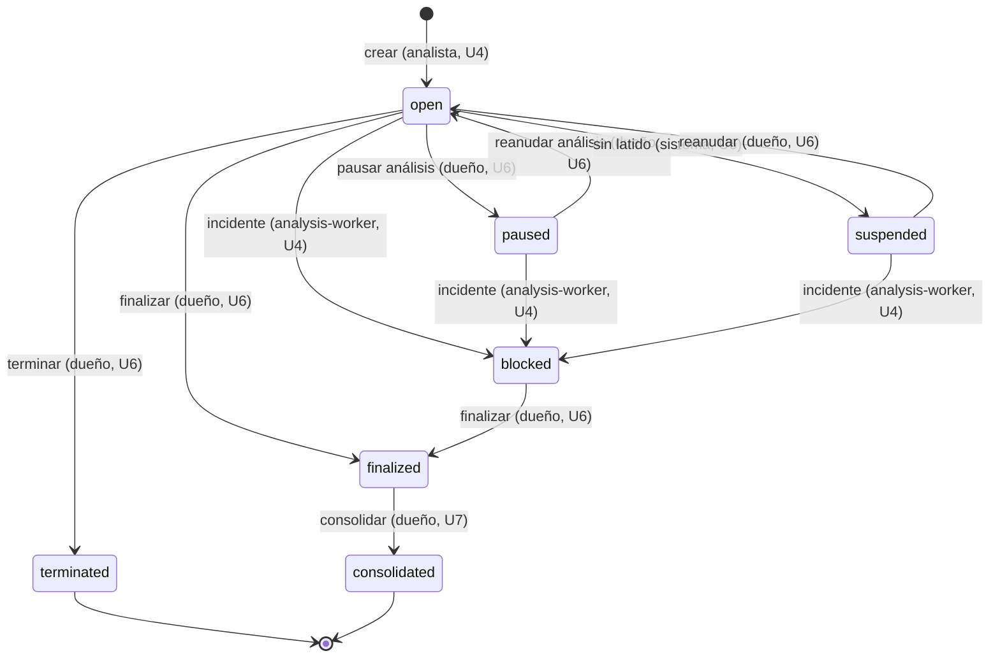
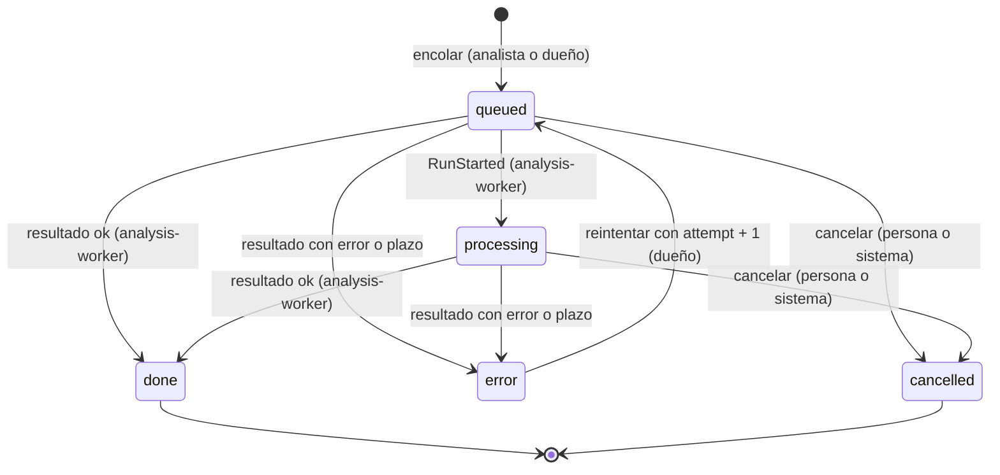
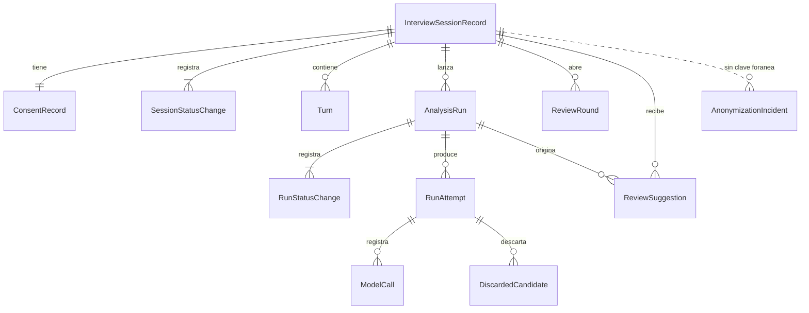

# Especificación funcional — U4 text-flow

**Revisión 2 (2026-11-21), segunda pasada por el cambio 01 (DT27), la adenda 02 y las revisiones 3 de
Inception.** Sustituye a la revisión 1 del 2026-10-03. Conserva los números de flujos y escenarios que
siguen; los que salen quedan «Retirado» sin renumerar (regla de `project.md`).
- **Se mantienen** (cambian): F3 (crear sesión), F4 (enviar turno), F5 (corrida en el trabajador), F6
  (ingesta), F7 (plazo y reintento), F8 (sugerencias y su presentación) y F10 (escaneo). Escenarios E5,
  E6, E7, E8, E9, E14, E16, E17, E18 y E23.
- **Salen** (`Retirado`): F1 (cargar escenario), F2 (indexar) y F9 (paquete de traspaso); escenarios E1–E4,
  E10–E13, E15 y E19–E22. Origen: cambio 01 (sale el marco documental, el umbral y el Hecho No
  Documentado).
- **Entran:** F11 (incidente y bloqueo, P7 y P8), F12 (modo incremental y final con el tramo cubierto,
  P11), F13 (aviso de propósito limitado), F14 (arranque de `semantic-agent`) y F15 (registro de modelos
  de una corrida); escenarios E24–E55; las máquinas de estado de la sesión y de la corrida con actor y
  hora; la tabla FD-U4-01 a FD-U4-22.

**Insumos.**
- Unidad U4 de `inception/units-generation/unit-of-work.md` (unit-of-work, revisión 3) e historias de
  `unit-of-work-story-map.md` (unit-of-work-story-map): US2.1, US2.2, US3.1, US5.5, US5.6, US13.1,
  US15.4 y US15.5, y los cruces US3.2, US3.6, US3.7, US8.4, US11.3 (AC11.3.8), US11.6 (AC11.6.4), US12.5,
  US13.3, US15.2 y US15.7.
- FR3, FR4, FR13–FR15 de `inception/requirements-analysis/requirements.md` (requirements) y VE-01,
  VE-06, VE-10 y VE-14 de `requirements-adenda-02.md`.
- Componentes InterviewSession, AnalysisWorker, HumanReview, ConsoleApi, IntegrityPolicy y AnalystConsole
  de `inception/domain-design/components.md` (components), con ADR-002, ADR-003, ADR-006, ADR-009 y
  ADR-013.
- Contratos C1–C3, C6–C8, C10, C11, C13, C17, C18, C21, C24 y C25 de
  `inception/contract-design/contract-summary.md` (contract-summary, revisión 3), con CD-01, CD-02, CD-04,
  CD-06 y CD-11.
- `refined-mockups/mockups.md` (M3, M4 §6.1–§6.10) y `interaction-spec.md`; B3 de
  `delivery-planning/bolt-plan.md`.
- Respuestas P6–P11 de la segunda pasada de `functional-design-questions.md`. P1–P4 quedan retiradas y P5
  pasa a C25 y NFR Requirements.
- Functional Design de U1 (F2, F3, FD-U1-08, FD-U1-09), U3 (FD-U3-04, FD-U3-07, FD-U3-08, FD-U3-10,
  FD-U3-13), U10 (FD-U10-03, FD-U10-16) y U11 (F1–F8, FD-U11-01 a FD-U11-20).

Las entidades están en `entities.md`, las reglas en `rules.md` y los componentes de la consola en
`frontend-components.md`. Este documento es la fuente de verdad de los flujos y las máquinas de estado.

## 1. Qué hace la unidad

U4 deja de evaluar y pasa a orquestar. Lleva el flujo del producto de punta a punta sobre la biblioteca
de U11: el analista crea la sesión con su consentimiento y su perfil, escribe los turnos, y cada turno
del testimonio encola una corrida incremental. `AnalysisWorker` (en `semantic-agent`) toma la corrida,
llama a la biblioteca (C17) y publica la salida del contrato común. `InterviewSession` la valida otra vez,
guarda el registro de modelos, pasa los hallazgos a HumanReview como sugerencias de revisión (C10) y, si
detecta un incidente de anonimización, bloquea la sesión. La consola muestra cada hallazgo con sus dos
citas, sin juicio sobre la persona y con el aviso de propósito limitado en todas las pantallas.

Lo que no es de U4: las reglas del analizador (U11), el anonimizador (U10), las decisiones humanas (U5),
la consolidación (U7), y la importación, el modo final, pausar, terminar, retirar el consentimiento y
reanudar (U6). U4 entrega la tubería de corridas que U6 reutiliza.

### Frontera AUTONOMIA-04 por componente

| Componente | Proceso | Dentro / fuera del clúster | Datos que cruzan la frontera |
|---|---|---|---|
| ConsoleApi | `session-api` | Dentro | Testimonio, hallazgos y registro hacia el navegador del analista, dentro del clúster (C1); nada sale |
| InterviewSession | `session-api` | Dentro | Mensajes C2/C3 y la clave de cancelación por Redis interno; nada sale |
| HumanReview (propose) | `session-api` | Dentro | Ninguno |
| AnalysisWorker | `semantic-agent` | Dentro, bajo la `NetworkPolicy` de salida denegada | Solo dentro de la llamada de C17: hacia los servidores locales (C14) o hacia `anonymizer-proxy` (C21). No resuelve claves ni tiene adaptadores comerciales (BR15.8) |
| IncoherenceAnalyzer (U11, en el proceso del trabajador) | `semantic-agent` | Dentro | Igual que AnalysisWorker; con perfil comercial, todo pasa por el ModelGateway con su adaptador `anonymizer` |
| `anonymizer-proxy` (U10) | propio | Único pod con salida (443 y DNS) | Texto seudonimizado hacia los proveedores comerciales (C22); la tabla de correspondencia no sale de su memoria |
| AnalystConsole (M3, M4) | `frontend` | Dentro | Solo habla con ConsoleApi (ADR-004) |
| PostgreSQL y Redis | servicios del clúster | Dentro | Ninguno; `ModelCall` y `AnonymizationIncident` no tienen texto |

Un perfil con destino externo exige el anonimizador delante: sin la dirección de `anonymizer-proxy`, o si
`check_ready()` falla, `semantic-agent` no arranca (BR14.9, BR15.7). Un registro de llamada externa sin
anonimizar es un incidente que bloquea la sesión (BR16.4).

## 2. Flujos

### F1 — Cargar un escenario · Retirado

Sale con TruthFrame (cambio 01).

### F2 — Indexar una versión · Retirado

Salen los *embeddings* (cambio 01).

### F3 — Crear la sesión con consentimiento y perfil (US13.1, US15.4, US2.1) · cambia

1. El analista abre «Nueva sesión» (M3). La consola pide `GET /profiles` y `GET /notice`; ningún perfil
   viene preseleccionado (BR14.7).
2. Escribe la entrevista (un identificador) y registra el consentimiento: «Consentimiento de la persona» o
   «Constancia de la autoridad que lo exime», la versión del texto, si autoriza la transferencia a un
   proveedor comercial, la voz y conservar el audio, y si la persona es compareciente o tercero civil
   (entonces la constancia del mandato). Si no autoriza la transferencia, solo se ofrecen perfiles
   locales (BR14.5).
3. Elige el perfil y pulsa «Crear sesión» (`POST /sessions`). ConsoleApi aplica rol (BR4.2) y CSRF.
4. InterviewSession valida el consentimiento (BR14.1), el perfil (BR14.4) y la transferencia (BR14.5).
   Un fallo responde 422 y no crea filas.
5. En una transacción guarda `InterviewSessionRecord` (`open`, `origin: guiada`, `profile_name`,
   `effective_config`, `config_sha256`, `retention_days` y `retention_until` vacíos), `ConsentRecord`
   (`recorded_by` el analista y `recorded_at` la hora del servidor, BR14.2) y `SessionStatusChange`
   (null → `open`, actor el analista, hora).
6. Responde 201 con `SessionView`. M4 se abre sin turnos con el estado vacío (BR13.6) y la cabecera de
   BR14.8.

### F4 — Enviar un turno ENT o TEST (US2.2) · cambia (P10 = B)

1. En M4 el analista elige el hablante (`TEST` por defecto) y escribe; el contador muestra «X / M
   caracteres» (BR5.1). Pulsa «Enviar turno» (`POST /sessions/{id}/turns`, con `client_request_id`).
2. ConsoleApi aplica rol y dueño (BR4.2, BR4.3). Con el orden de bloqueo de BR19.2, InterviewSession
   comprueba consentimiento (BR14.3) y estado (BR5.5). Un rechazo responde 409 o 413 y no crea filas.
3. Si `client_request_id` ya existe, responde lo ya creado (BR5.3).
4. Numera el turno bajo el bloqueo de la sesión (BR5.2) y lo guarda con `submitted_by` y `submitted_at`.
5. **Turno ENT:** responde 202 con `turn` y sin `run`; la consola lo muestra sin estado (BR15.1).
6. **Turno TEST con la sesión en pausa:** responde 202 sin `run` (BR5.5; la pausa es de U6).
7. **Turno TEST:** en la misma transacción crea `AnalysisRun` incremental (`desde_turno = hasta_turno =
   n`) y `RunStatusChange` (null → `queued`, attempt 1, `deadline_at`, actor el analista). Al confirmar,
   arma C2 con la entrada de C6 (turnos 1..n con su hablante, el bloque `consentimiento` y
   `modo: incremental`), lo valida (BR5.6) y lo publica en `veridicus:runs`. Responde 202 con `turn` y
   `run` sin esperar (BR5.4).

### F5 — Correr una corrida en AnalysisWorker (C2 → C17 → C3) · cambia

1. El trabajador lee `veridicus:runs` en el grupo `semantic-agent` (una sola cola FIFO, BR15.10). Un
   mensaje que no cumple C2 va a `veridicus:runs:failed` con XACK (BR5.6).
2. Comprueba el plazo y la clave `veridicus:run-cancelled:{run_id}`; si alguno saltó, XACK sin llamar ni
   publicar (BR15.4).
3. Publica `RunStarted` (`run_id`, `attempt`, `started_at`) en `veridicus:results` (BR15.3).
4. Llama a `analyze(entrada, effective_config, gateway, cancelled)` (C17, BR9.1). `cancelled` repite la
   comprobación del paso 2 antes de cada llamada a un modelo.
5. Según el resultado (BR15.5):
   - `Salida` (`ok` o `error`) → publica `RunResult` (C3) y después XACK (BR15.6);
   - `Cancelled` → XACK sin publicar;
   - `InputRejected` → el mensaje va a fallidos; la corrida terminará en `analysis.system` (F7).
6. Si el trabajador muere, otro reclama el mensaje con `XAUTOCLAIM` y repite la corrida entera (BR5.7,
   BR15.11).

```yaml
# RunStarted en veridicus:results (precisión FD-U4-02, cambio menor de C3 → 2.1.0)
RunStarted:
  required: [schema_version, kind, message_id, run_id, attempt, started_at]
  properties:
    kind: { const: run_started }      # RunResult lleva kind: run_result (opcional, por defecto)
    run_id: { type: string, format: uuid }
    attempt: { type: integer, minimum: 1 }
    started_at: { type: string, format: date-time }
```

### F6 — Ingerir el resultado (`session-api`, C3) · cambia

1. InterviewSession lee `veridicus:results` en el grupo `session-api`. Un `RunStarted` sigue BR15.3.
2. Para un `RunResult`, primero revisa el `registro` en busca de un incidente (BR16.4), **también** si
   después lo va a descartar (FD-U4-11).
3. Si el intento es viejo, la corrida está `cancelled` o ya está en `error` por plazo, o ya existe ese
   `RunAttempt`: XACK y 0 filas de resultado (BR16.1, BR5.7).
4. Valida la salida contra C6 y la regla 2 de C6 (BR8.1), los campos obligatorios (BR8.5) y el
   vocabulario de `hecho` y `observaciones` (BR8.4). Cualquier fallo: la corrida entera es
   `analysis.invalid_output`, sin sugerencias.
5. En una transacción, con el orden sesión → ronda (BR19.2): guarda `RunAttempt`, cada `ModelCall`, cada
   `DiscardedCandidate` (BR16.2), `anonymized` (BR16.3) y `RunStatusChange` (→ `done` o → `error` con el
   code de BR8.2, actor `analysis-worker`, hora). Con `estado: ok`, llama a `propose` (F8).
6. Si `propose` rechaza, la corrida queda en `error` con `analysis.system` y sin sugerencias (BR16.8).
7. XACK solo después de confirmar la transacción (BR11.1).

### F7 — Plazo, error y reintento (US3.2) · cambia (P6 = A)

1. Un supervisor periódico de `session-api` (actor `run-supervisor`, FD-U4-16) pasa a `error` con
   `analysis.system` toda corrida `queued` o `processing` con `deadline_at` vencido, y escribe su clave de
   cancelación (BR5.8). Lo mismo cuando el mensaje llega a `run_max_deliveries` o a fallidos.
2. Una salida `error` deja la corrida en `error` con su code y su registro (BR11.3). Con
   `anonimizador_no_disponible` (o un 409/422 del proxy), solo falla la corrida; la sesión sigue igual
   (BR16.7).
3. M4 muestra «⚠ Tramo no evaluado» sobre el grupo de turnos, con la causa, el mensaje de FR4.2 y el code
   (BR13.3), salvo que lo cubra el modo final (F12).
4. El dueño pulsa «Reintentar tramo» (`POST /sessions/{id}/runs/{run_id}/retry`). InterviewSession
   comprueba el estado vigente (`run.not_in_error`, BR5.9) y si la sesión admite corridas (BR15.2,
   BR16.9). Si sí, `RunStatusChange` (`error` → `queued`, attempt + 1, `deadline_at` nuevo, actor el
   dueño) y publica C2 con el mismo tramo. También en una sesión finalizada.

### F8 — Sugerencias por C10 y su presentación (US3.1, US3.6) · cambia

1. `SuggestionProposer.propose(uow, session_id, run_id, hallazgos)` calcula `pair_key` por hallazgo y
   guarda solo los pares nuevos, como pendientes, copiando los campos tal cual (BR8.6, BR11.2). Un par ya
   presente, decidido o no, no cambia.
2. Si la sesión no tiene ronda, abre la ronda 1 en la misma transacción. Con todas las rondas bloqueadas
   rechaza con `review.round_locked` (F6, paso 6).
3. La consola sondea `GET /sessions/{id}?since=<cursor>` (el cursor sube con `change_cursor`, BR19.2).
   Cada sugerencia nueva entra en su lugar del orden, sin modal ni sonido y sin mover el foco (BR13.1),
   con su rótulo (BR12.4), sus dos citas y sus avisos (BR13.2, BR17.5) y las observaciones plegadas.
4. La región `aria-live` anuncia un mensaje por corrida (BR13.1). Las acciones Aceptar, Editar y
   Descartar son de U5.

### F9 — Paquete de Contexto de Traspaso · Retirado

Sale con el Hecho No Documentado (cambio 01).

### F10 — Escaneo de vocabulario prohibido en la salida y la interfaz (US5.5) · cambia

1. **Salida:** en la ingesta (F6, paso 4), el escáner de U11 revisa `hecho` y `observaciones` de cada
   hallazgo con las dos citas como fuentes literales; una coincidencia invalida la corrida entera
   (BR8.4).
2. **Interfaz:** en nivel 0, el escáner recorre el catálogo de mensajes, los rótulos y las plantillas de
   la consola; en nivel 3, el texto renderizado de M3 y M4. Excluye las dos citas, el texto del analista
   y la cadena versionada del aviso (BR12.2). Un *fixture* por término hace fallar la suite.
3. **Nivel 2:** lo mide la CLI de U11 sobre el conjunto sintético y vale para el trabajador por la prueba
   de equivalencia (BR12.3, BR15.9).

### F11 — Incidente de anonimización y bloqueo de la sesión (VE-14, P7 = A, P8 = A) · nuevo

1. En la ingesta (F6, paso 2), InterviewSession encuentra `error.codigo: incidente_anonimizacion`, o una
   `ModelCall` con `external` verdadero y `anonimizado: false` (BR16.4).
2. En una transacción:
   - guarda `AnonymizationIncident` (sesión, corrida, intento, llamada si la hay, code, hora, actor
     `analysis-worker`);
   - fija `blocked_code = anonymizer.incident`; si la sesión estaba `open`, `paused` o `suspended`, pasa
     a `blocked` con `SessionStatusChange` (code `anonymizer.incident`, actor `analysis-worker`, hora);
     si ya estaba `finalized` o `terminated`, conserva su estado;
   - deja la corrida en `error` con `anonymizer.incident` y no guarda ninguna sugerencia de ella.
3. Marca `cancelled` las demás corridas `queued` o `processing` de la sesión y escribe sus claves
   (BR16.5, BR15.4).
4. Desde ahí, toda corrida nueva (turno TEST, reintento, bloque pegado, modo final) y todo turno nuevo
   responden 409 `session.blocked`. Lectura, decisiones de U5, finalizar (U6) y consolidar (U7) siguen.
   No hay desbloqueo en el MVP.
5. Solo se bloquea esa sesión (BR16.6). M4 muestra en la cabecera «Sesión bloqueada por un incidente de
   anonimización. No se lanzan corridas nuevas», en la corrida la causa de AC3.2.5 con «Código:
   anonymizer.incident», y «Reintentar tramo» y «Lanzar modo final» deshabilitados (enfocables) con ese
   motivo. El reporte (U7) declara el incidente.

### F12 — Modo incremental y modo final con el tramo cubierto (US3.6, US3.7, P11 = A) · nuevo

1. **Incremental:** cada turno TEST encola su corrida (F4). La entrada lleva la transcripción hasta
   `hasta_turno` y `desde_turno = n`; U11 solo devuelve hallazgos con una cita en un turno `>= n`, y la
   ingesta lo comprueba otra vez (BR8.1). La sesión deduplica por par (BR11.2).
2. **Final:** U6 lo lanza con `POST /sessions/{id}/final-runs` cuando la sesión está finalizada o es
   importada; U4 aporta la corrida (`mode: final`, toda la transcripción, `run_deadline_final_s`), el
   trabajador, la ingesta y la deduplicación. En una sesión importada, el estado de cada turno sale de la
   última corrida final (BR17.1).
3. **Tramo cubierto:** cuando la última corrida final lanzada termina `done`, cada corrida incremental en
   `error` se muestra solo en «Corridas» con su error y «Cubierto por el modo final», sin «Tramo no
   evaluado» ni «Reintentar tramo», y `SessionReader.snapshot` la marca `covered_by_final` para que el
   reporte no la liste como no evaluada (BR17.2). Si se relanza el modo final, o el último termina en
   error o cancelado, la cobertura se pierde hasta que otro termine bien.
4. **Modo fragmentado:** si la corrida trae `fragmentado.activo`, M4 muestra la franja con la ventana y el
   solapamiento registrados (BR17.3).

### F13 — Aviso de propósito limitado (US15.5) · nuevo

1. Al cargar cualquier pantalla, incluido el inicio de sesión, la consola pide `GET /notice` (pública,
   FD-U4-08), que lee `text` y `version` de `contracts/integrity/notice.v1.yaml` en ejecución.
2. Muestra una franja fija bajo la cabecera con el texto, sin botón de cerrar y sin copia en la consola
   (BR18.1). Si la petición falla, la franja muestra el error del sistema y no inventa el texto.
3. Una prueba de nivel 0 falla si el texto servido pierde la frase base (BR18.2). El escáner excluye solo
   esa cadena (BR12.2).

### F14 — Arranque de `semantic-agent` · nuevo

1. Carga el archivo de perfiles y el catálogo de límites; un perfil inválido termina el proceso con
   código ≠ 0 sin mostrar valores (BR14.9).
2. Si algún perfil aprobado tiene un papel comercial y falta la dirección de `anonymizer-proxy`, termina
   igual; si la tiene, llama a `check_ready()` de C21 antes de construir el gateway (BR15.7). Sin éxito,
   no pasa `/readyz` y no consume la cola.
3. La imagen no contiene `libs-anonymizer` ni sus adaptadores; lo comprueban en nivel 0 el contrato
   `semantic-agent-no-anonymizer` de import-linter, el lockfile, la imagen y `sys.modules` (BR15.8).

### F15 — Registro de modelos de una corrida (US12.5) · nuevo

1. En «Corridas» de M4, cada fila es un botón. Al desplegarla, la consola pide
   `GET /sessions/{id}/runs/{run_id}/model-calls`.
2. Muestra en solo lectura papel, proveedor, modelo, versión, cuantización o esfuerzo, motor, llamadas,
   *tokens* y costo estimado, con su total; «sin precio» para un modelo sin precio; «Aún no hay llamadas
   registradas» si no hay filas (BR17.4). Nunca muestra texto enviado ni recibido.

## 3. Máquinas de estado

### Sesión



*Texto alternativo:* la sesión nace `open` al crearla el analista. U6 la lleva a `paused`, `suspended`,
`finalized` o `terminated` y de vuelta a `open` cuando corresponde. U4 solo escribe dos transiciones: la
creación y el bloqueo, que pasa a `blocked` desde `open`, `paused` o `suspended` cuando la ingesta
detecta un incidente. Una sesión `blocked` se puede finalizar y después consolidar. `terminated` y
`consolidated` son finales.

| Transición | Quién | Unidad | Registro |
|---|---|---|---|
| null → `open` | Analista (persona) | U4 | `SessionStatusChange` con `actor_user_id` y `at` |
| `open`/`paused`/`suspended` → `blocked` | `analysis-worker` (sistema) | U4 | `SessionStatusChange` con `code: anonymizer.incident`; `blocked_code` fijo |
| `finalized`/`terminated` con incidente | `analysis-worker` (sistema) | U4 | Sin cambio de estado; `blocked_code` fijo y `AnonymizationIncident` |
| `blocked` → `finalized` | Dueño | U6 | Precisión FD-U4-18 |
| Las demás | Dueño o sistema | U6, U7 | Su Functional Design |

La retirada del consentimiento no es un estado: fija `ConsentRecord.withdrawn_at` y
`closed_to_new_turns` (U6). `blocked_code` nunca vuelve a nulo.

### Corrida



*Texto alternativo:* una corrida nace `queued`. Pasa a `processing` cuando llega su `RunStarted`, y a
`done` o `error` cuando se ingiere su resultado; puede pasar directo de `queued` a `done` o `error` si el
resultado se ingiere antes que `RunStarted`. El supervisor la pasa a `error` si vence el plazo. Pausar,
terminar, retirar el consentimiento o bloquear la sesión la cancelan. Solo una corrida en `error` se
reintenta, y vuelve a `queued` con el intento siguiente. `done` y `cancelled` son finales.

| Transición | Actor (`actor_kind` / `actor_system`) | Regla |
|---|---|---|
| null → `queued` | persona: el analista (turno) o el dueño (modo final, U6) | BR5.4 |
| `queued` → `processing` | sistema / `analysis-worker` | BR15.3 |
| → `done`, → `error` (por resultado) | sistema / `analysis-worker` | BR11.1, BR11.3, BR16.4, BR16.8 |
| → `error` (`analysis.system` por plazo o entregas) | sistema / `run-supervisor` | BR5.8 |
| → `cancelled` | persona (pausar, terminar, retirar; U6) o sistema / `analysis-worker` (bloqueo) | BR15.4, BR16.5 |
| `error` → `queued` | persona: el dueño | BR5.9 |

Cada transición es una fila de `RunStatusChange` con su intento y su hora; el estado vigente es la
última. Un `RunStarted` o un resultado que no corresponde al estado vigente se descarta sin filas.

## 4. Vista derivada: entidades y relaciones



*Texto alternativo:* cada sesión tiene un consentimiento, un historial de estados, sus turnos y sus
corridas. Cada corrida tiene su historial de estados y un resultado por intento ingerido, con sus
llamadas a modelos y sus descartes. Las sugerencias y las rondas (de HumanReview) cuelgan de la sesión, y
cada sugerencia recuerda la primera corrida que la propuso. Los incidentes guardan el ID de la sesión sin
clave foránea, para sobrevivir a la retención.

## 5. Vista derivada: reglas

| Tema | Reglas | Flujos |
|---|---|---|
| Sesión, consentimiento y perfil | BR4.1–BR4.3, BR14.1–BR14.9 | F3, F14 |
| Turnos y encolado | BR5.1–BR5.6, BR15.1, BR15.2 | F4 |
| Trabajador | BR5.7, BR9.1, BR15.3–BR15.11 | F5, F14 |
| Ingesta y validación | BR8.1, BR8.2, BR8.4–BR8.6, BR11.1–BR11.4, BR16.1–BR16.3, BR16.8 | F6 |
| Plazo, error y reintento | BR5.8, BR5.9, BR16.7, BR16.9, BR13.3 | F7 |
| Sugerencias y consola | BR11.2, BR12.4, BR13.1, BR13.2, BR13.4, BR13.6, BR13.7, BR17.1, BR17.5 | F8 |
| Vocabulario | BR8.4, BR12.1–BR12.3 | F10 |
| Incidente y bloqueo | BR16.4–BR16.6 | F11 |
| Modo final y fragmentado | BR17.2, BR17.3 | F12 |
| Aviso | BR18.1, BR18.2 | F13 |
| Registro de modelos | BR16.2, BR17.4 | F15 |
| Puertos | BR19.1–BR19.4 | F4, F6, §7 |
| Retiradas | BR1.x–BR3.x, BR6.x, BR7.x, BR8.3, BR9.2, BR10.x, BR13.5 | F1, F2, F9 (Retirado) |

## 6. Escenarios de negocio y casos límite

Todos usan transcripciones sintéticas y *fakes* del `ModelGateway`; ninguno usa datos reales.

| # | Situación | Resultado esperado | Reglas |
|---|---|---|---|
| E1–E4 | Carga e indexación de escenarios | Retirado (cambio 01) | — |
| E5 | 10 envíos concurrentes de turnos TEST | Turnos 1..10 sin huecos ni duplicados; 10 corridas | BR5.2 |
| E6 | Turno de exactamente `turn_max_chars` / uno más / vacío | 202 / 413 `limits.exceeded` / 422; 0 filas en los rechazos | BR5.1 |
| E7 | *Fake* bloqueado; se envía otro turno y se consulta un hallazgo | 202 y 200 antes de liberar el *fake* | BR5.4 |
| E8 | El trabajador muere a mitad de la corrida | Otro la repite; un solo `RunAttempt`; `ModelCall` solo de la entrega que publica | BR5.7, BR15.11 |
| E9 | Sesión S1 con el perfil X; PR que cambia X; reinicio y turno en S1 | La corrida registra la huella de S1; S2 nueva guarda la huella nueva | BR4.1, BR9.1 |
| E10–E13 | Umbral, calificaciones y paquete | Retirado (cambio 01) | — |
| E14 | *Fake*: (a) no JSON, (b) sin campo, (c) tipo fuera del enum, (d) uno de tres mal formado, (e) *timeout*, (f) bloqueo, (g) proveedor, (h) anonimizador caído | Corrida en error con `analysis.invalid_output` en (a)–(d), `analysis.timeout`, `analysis.content_blocked`, `analysis.provider`, `analysis.anonymizer_unavailable`; 0 sugerencias | BR8.1, BR8.2, BR11.3 |
| E15 | Pasaje no recuperado en la CoT | Retirado (cambio 01) | — |
| E16 | Observaciones «el compareciente miente» / «falso» dentro de una cita / «miente» entre «» fuera de las citas | Corrida entera `analysis.invalid_output` / válida / `analysis.invalid_output` | BR8.4 |
| E17 | Hallazgo con `observaciones` de solo espacios o sin `cita_b` | Corrida entera `analysis.invalid_output`; la base rechaza un INSERT directo | BR8.5 |
| E18 | Reintentar dos veces un tramo en error | Mismo tramo, attempt 2 y 3; sin hallazgos duplicados | BR5.9, BR11.2 |
| E19–E22 | Paquete, inyección del Escenario A, umbral y *prompt* montados | Retirado (cambio 01; la inyección la mide U11) | — |
| E23 | `admin` o `investigador` crea sesión o envía un turno | 403, 0 filas; no ve «Nueva sesión» | BR4.2 |
| E24 | Turno ENT y después turno TEST | ENT: 202 sin `run`, sin estado; TEST: una corrida cuya entrada incluye el ENT | BR15.1 |
| E25 | Crear sin consentimiento / autoridad sin constancia / mandato sin constancia | 422 y 0 filas en los tres | BR14.1 |
| E26 | Consentimiento sin transferencia y perfil comercial | M3 no lo ofrece; la API responde 422 `profile.transfer_not_authorized` | BR14.5 |
| E27 | Perfil que no está en el archivo aprobado | 422 `profile.not_approved` | BR14.4 |
| E28 | La petición trae `registrado_en` de ayer | Se ignora; `recorded_at` es la hora del servidor | BR14.2 |
| E29 | *Fixture* de sesión sin `ConsentRecord`; turno nuevo | 409 `session.consent_missing`, 0 filas | BR14.3 |
| E30 | `RunStarted` dos veces / de un intento viejo | Una sola transición a `processing` / descartado | BR15.3 |
| E31 | Corrida en cola y el analista pausa (U6) | `cancelled`, clave escrita, el *fake* registra 0 llamadas; turnos nuevos 202 sin corrida | BR15.4, BR5.5 |
| E32 | Consentimiento retirado; turno nuevo y modo final | Turno 409 `session.consent_withdrawn`; el modo final no incluye turnos posteriores a la retirada | BR15.2 |
| E33 | Plazo vencido con la corrida en cola; el resultado llega después | `error` `analysis.system` por `run-supervisor`; el resultado se descarta | BR5.8, BR16.1 |
| E34 | `anonimizador_no_disponible` | Corrida `analysis.anonymizer_unavailable`; sesión sigue `open`; el reintento responde 202 | BR16.7 |
| E35 | El proxy responde 409 `anonymizer.profile_mismatch` o 422 `anonymizer.destination_rejected` | Igual que E34 | BR16.7 |
| E36 | Registro inyectado con una llamada comercial `anonimizado: false` y dos hallazgos | Sesión `blocked`, incidente con IDs, 0 sugerencias; turno nuevo, reintento y modo final 409 `session.blocked`; GET y decisiones 200 | BR16.4, BR16.5 |
| E37 | El incidente llega en el resultado de un intento viejo | Se descarta el resultado, pero la sesión se bloquea igual | BR16.1, BR16.4 |
| E38 | Incidente en S1; S2 usa el mismo perfil | Solo S1 se bloquea | BR16.6 |
| E39 | `propose` rechaza con `review.round_locked` | Corrida `analysis.system`, XACK, 0 sugerencias | BR16.8 |
| E40 | Reintento sobre una sesión consolidada | 409 `session.consolidated` | BR16.9 |
| E41 | Tramo incremental en error y luego el modo final termina bien; después se relanza | «Cubierto por el modo final»; al relanzar vuelve «Tramo no evaluado» hasta que termine bien | BR17.2 |
| E42 | Perfil local con fragmentado (ventana 40, solapamiento 8) | Franja «Análisis por ventanas de 40 turnos (solapamiento de 8)…» | BR17.3 |
| E43 | Registro con un modelo sin precio / corrida en cola | «sin precio» sin detener nada / «Aún no hay llamadas registradas» | BR17.4 |
| E44 | Dos corridas proponen el mismo par; el primero ya está aceptado | Una sola sugerencia, sigue aceptada | BR11.2 |
| E45 | Corrida incremental desde el turno 7 con un hallazgo de citas en 2 y 5 | Corrida `analysis.invalid_output` (segunda línea) | BR8.1 |
| E46 | `import libs.anonymizer` sembrado en `semantic-agent` | La CI falla; en la imagen, `ModuleNotFoundError` | BR15.8 |
| E47 | Perfil comercial y proxy detenido al arrancar `semantic-agent` | No pasa `/readyz`; no consume la cola | BR15.7, BR14.9 |
| E48 | `GET /notice` sin cookie / PR que recorta la frase base | 200 con texto y versión / la prueba falla | BR18.1, BR18.2 |
| E49 | «prueba» dentro del aviso / en otra cadena | Pasa / falla el escaneo | BR12.2 |
| E50 | La misma transcripción por la CLI y por el trabajador, mismo *fake* | Salidas iguales salvo fechas | BR15.9 |
| E51 | Incidente en una sesión ya finalizada | Sigue `finalized`, `blocked_code` fijo; el modo final responde 409 `session.blocked` | BR16.4, BR16.5 |
| E52 | Redis se reinicia con una corrida `cancelled` de plazo vigente | La clave se reescribe al reconectar; 0 llamadas | BR15.4 |
| E53 | Cita con aviso `turno_plegado` y otra en un turno ENT | Los dos avisos con texto e icono | BR17.5 |
| E54 | Turno sobre una sesión `suspended` | 409 `session.suspended` | BR5.5 |
| E55 | Ingesta y decisión de U5 a la vez sobre la misma sesión | Sin interbloqueo; el sondeo trae los dos cambios | BR19.2 |

## 7. Integración con otras unidades

| Unidad | Qué usa de U4 o qué aporta |
|---|---|
| U1 contracts | Aporta C1–C3, C6 (con sus *fixtures*), C7, C8 (lista, aviso), C18, C25 y el catálogo de rótulos. U4 valida en sus fronteras con esas copias; en la ingesta aplica la regla de U1 (F3): vocabulario prohibido en la salida invalida la corrida entera |
| U3 identity-access | Aporta la autenticación, la matriz de roles, el resolvedor de dueño, la convención de auditoría y su prueba común, y la lista `ActorSystem`. U4 implementa `PendingSessions.count_pending` (BR19.1), toma el orden usuario → sesión → ronda (BR19.2), registra sus tablas como `history` (BR11.4) y entra M3 y M4 en la suite `axe` |
| U10 anonymizer | Aporta `anonymizer-proxy` y el cliente HTTP de C21 con `check_ready()`. U4 no importa `libs-anonymizer` (BR15.8) y traduce sus rechazos a `analysis.anonymizer_unavailable` (BR16.7) |
| U11 incoherence-analyzer | Aporta C17, el escáner de C8, la CLI y el nivel 2. U4 llama a C17 sin tocar sus reglas, repite en la ingesta la validación de C6 como segunda línea y prueba la equivalencia CLI–trabajador (BR15.9). Donde U11 descarta un candidato con vocabulario prohibido (FD-U11-02), U4, si aun así lo recibe, invalida la corrida entera |
| U5 human-review | Recibe `ReviewSuggestion` y `ReviewRound` por `propose` (C10); construye decisiones y `ObservationsView` sobre la tarjeta de U4; sigue decidiendo en una sesión bloqueada |
| U6 session-lifecycle | Reutiliza F4 (bloque pegado, una corrida), F5–F7 y la clave de cancelación para pausar, terminar y retirar el consentimiento; lanza el modo final por la tubería de U4 (F12); finaliza una sesión bloqueada (FD-U4-18) |
| U7 forensic-report (ReviewReport) | Lee `SessionReader.snapshot` (BR19.4) con `covered_by_final`, el registro de modelos y `blocked_code`; declara el incidente en el reporte y consolida una sesión bloqueada (FD-U4-19) |
| U2 platform | `NetworkPolicy`, el `Secret` de proveedores solo en `anonymizer-proxy` (la otra mitad de AC11.6.4) y la persistencia AOF de Redis |
| U8, U9, U13 | U8 añade `ConductorObservation` en la ingesta; U9 entra en F4 con `origin: voice` y la guardia de consentimiento (BR14.3); U13 llama a `purge_session` (BR19.3) y añade el campo de retención |

## 8. Errores y bordes

- Toda E/S (PostgreSQL, Redis, C21) lleva *timeout* explícito de C25. Los reintentos automáticos se
  limitan a la reentrega de colas, que es idempotente (BR5.7). El trabajador nunca reintenta por su
  cuenta; los reintentos ante 502/503/504 del juez son de U11.
- Todo error de la API es Problem Details con un `code` estable de C1 y un `detail` en español. Un
  rechazo no crea filas.
- Los logs llevan solo `session_id`, `run_id`, `attempt`, `message_id` y `code`; nunca texto de turnos,
  citas, hallazgos ni constancias.
- Un fallo a mitad de la ingesta revierte la transacción y deja el mensaje pendiente; nunca hay filas
  sueltas ni sugerencias de una corrida en error.
- Una configuración faltante (perfiles, límites, dirección del proxy) impide arrancar el pod (BR14.9).
- Límite declarado: tras la muerte de un trabajador, las llamadas de la entrega muerta no quedan en el
  registro, así que el costo registrado puede quedar por debajo del real (BR15.11).
- Límite declarado: un incidente cuya llamada ya salió no se deshace; el bloqueo evita las siguientes y el
  registro deja constancia (VE-14).

## 9. Decisiones que precisan artefactos ya aprobados

No edité ningún artefacto aprobado. En la aprobación decides cuáles se llevan al original, cada uno en su
propio commit. Las filas de la revisión 1 quedan como registro, marcadas «Superado».

| ID | Estado | Artefacto aprobado | Precisión | Origen |
|---|---|---|---|---|
| — (rev. 1) | Superado | `contract-summary.md` C1 `ErrorCode` | `turn.too_long` y `session.not_open`. Lo sustituyen `limits.exceeded` (C25) y FD-U4-07 | P5 de la primera pasada; cambio 01 |
| — (rev. 1) | Superado | `contract-summary.md` C2 | `top_k` en `TurnToEvaluate`. C2 se reescribió | P4 de la primera pasada; cambio 01 |
| — (rev. 1) | Superado | `contract-summary.md` C3 | Campos del paquete de traspaso. Sale el paquete | cambio 01 |
| — (rev. 1) | Superado | `contract-summary.md` C1 `ScenarioVersion` | Lista de documentos. Sale TruthFrame | cambio 01 |
| — (rev. 1) | Superado | Functional Design de U1 | El escáner en `libs/integrity_policy` implementado por U4. Pasa a U11 (FD-U1-09, unit-of-work) | unit-of-work revisión 3 |
| FD-U4-01 | Propuesta | `user-stories/stories.md` AC2.2.3 | Se lee «Given el turno *n* **del testimonio** enviado»: un turno ENT se guarda sin corrida y el TEST siguiente lo lleva como contexto. El pegado (U6) no cambia | P10 = B |
| FD-U4-02 | Propuesta | `contract-summary.md` C3 | Cambio menor (2.1.0): mensaje `RunStarted` (`kind: run_started`, `run_id`, `attempt`, `started_at`) en `veridicus:results`; `RunResult` admite `kind: run_result`, opcional. Con su prueba de contrato en U1 | P9 = A; revisión 1 R-01 (b) |
| FD-U4-03 | Propuesta | `domain-design/components.md` (InterviewSession, `AnalysisRun`) | Responde a FD-U3-10: `AnalysisRun` guarda solo la petición (`history`); el estado pasa a `RunStatusChange` y el resultado de cada intento a `RunAttempt`, ambas `history`. Así AC8.4.2 se cumple sin precisarlo | FD-U3-10; AC8.4.2 |
| FD-U4-04 | Propuesta | `refined-mockups/mockups.md` §6.4 | El estado del turno se deriva de la última corrida incremental que lo cubre (o de la final en una importada); el modo final se ve en su franja y no en cada turno. Texto nuevo para una corrida cancelada: «Análisis cancelado» | Sin pregunta (lista de la segunda pasada) |
| FD-U4-05 | Propuesta | `contract-summary.md` C1 `ErrorCode` y la ruta `retry` | Code nuevo `session.consolidated` (409) para un reintento o una corrida sobre una sesión consolidada; la ruta `retry` suma a su lista de 409 el `session.paused` que C1 ya tiene | Sin pregunta; revisión 1 R-02 |
| FD-U4-06 | Propuesta | `contract-summary.md` C3 (Ingesta) | Si `propose` rechaza en la ingesta (p. ej. `review.round_locked`), la corrida pasa a `error` con `analysis.system`, se hace XACK y no se guarda ninguna sugerencia; prueba de nivel 1 | Sin pregunta; revisión 1 R-02 |
| FD-U4-07 | Propuesta | `contract-summary.md` C1 `ErrorCode` | `session.suspended` (409) para un turno sobre una sesión suspendida, que antes no tenía code | BR5.5 |
| FD-U4-08 | Propuesta | `contract-summary.md` C1 `/notice` | `GET /notice` pasa a pública (`security: []`) para que el aviso se vea también en el inicio de sesión (AC15.5.1, «cualquier pantalla») | Sin pregunta |
| FD-U4-09 | Propuesta | `contract-summary.md` C2 | Una sola cola FIFO para corridas incrementales y finales, sin prioridad por modo | Sin pregunta |
| FD-U4-10 | Propuesta | `requirements.md` FR15.4 y `contract-summary.md` C6 `registro` | Tras la muerte de un trabajador la corrida se repite entera y el registro guarda solo las llamadas de la entrega que publica; el costo registrado puede quedar por debajo del real (limitación declarada) | Sin pregunta |
| FD-U4-11 | Propuesta | `contract-summary.md` C3 (Ingesta) | Un resultado que se descarta (intento viejo, cancelada, vencida) se revisa igual en busca de un incidente antes de descartarlo: si lo hay, se registra y la sesión se bloquea | Decisión propia (AUTONOMIA-04, VE-14) |
| FD-U4-12 | Propuesta | `contract-summary.md` C24 (orden del Job) | `AnonymizationIncident` no se borra con la sesión: queda sin clave foránea, solo con IDs, como `RetentionAct` y el registro de acceso | Decisión propia (VE-14) |
| FD-U4-13 | Propuesta | `user-stories/stories.md` AC3.2.5 (catálogo de causas) | Causa para `analysis.system`: «El análisis no terminó a tiempo o no se pudo completar. Revisión manual requerida» | Sin pregunta |
| FD-U4-14 | Hecho | Functional Design de U3 (FD-U3-04) | U4 implementa `PendingSessions.count_pending` sobre su tabla de sesiones y entra en su PR la prueba con sesiones reales | Pedido de U3 |
| FD-U4-15 | Hecho | Functional Design de U3 (FD-U3-13) y `project.md` | U4 adopta el orden usuario → sesión → ronda con `change_cursor.bump` sobre la sesión antes de la ronda; la ingesta, sin usuario, empieza por la sesión | Pedido de U3 |
| FD-U4-16 | Propuesta | Lista `ActorSystem` v1 (FD-U3-08) | Valor nuevo `run-supervisor` para el supervisor de plazos de `session-api`; `analysis-worker` sigue para lo que llega por C3 | BR5.8 |
| FD-U4-17 | Propuesta | `user-stories/stories.md` AC3.1.4 | Aviso de turno plegado: «Cita en un turno plegado: en la versión analizada, las partes de este turno que no tratan los hechos centrales se resumieron como [pasaje plegado: N palabras]. La cita está en la parte visible del turno» (según D52 y D53 de la matriz del TG) | AC3.1.4 deja la redacción a esta etapa |
| FD-U4-18 | Propuesta | `domain-design/components.md` (máquina de la sesión) y Functional Design de U6 | Una sesión `blocked` se puede finalizar (`blocked` → `finalized`, por el dueño) y conserva `blocked_code`; un incidente sobre una sesión `finalized` o `terminated` no cambia su estado y solo fija `blocked_code` | P7 = A |
| FD-U4-19 | Propuesta | `user-stories/stories.md` AC6.1.1 y Functional Design de U7 | Una sesión bloqueada no puede lanzar el modo final, así que su consolidación no exige un modo final terminado; el reporte declara el incidente y los tramos sin evaluar | P7 = A («se puede finalizar y consolidar») |
| FD-U4-20 | Propuesta | `contract-summary.md` C1 `Run` | `Run` suma `anonymized` (booleano, opcional): verdadero solo si todas las llamadas externas pasaron por el anonimizador, ausente si la corrida fue solo local | Sin pregunta; AC11.3.8 |
| FD-U4-21 | Propuesta | `user-stories/stories-adenda-02.md` AC15.4.4 | «Sin ella, la sesión no habilita la captura» se cumple rechazando la creación con 422; `session.consent_missing` en los turnos queda como guardia defensiva probada con un *fixture* | Sin pregunta |
| FD-U4-22 | Propuesta | `user-stories/stories-adenda-02.md` AC15.7.1 y C24 | U4 crea `retention_days` y `retention_until` vacíos; el campo del formulario y su validación llegan con U13. U4 implementa `Purgeable.purge_session` (BR19.3) | Sin pregunta |
