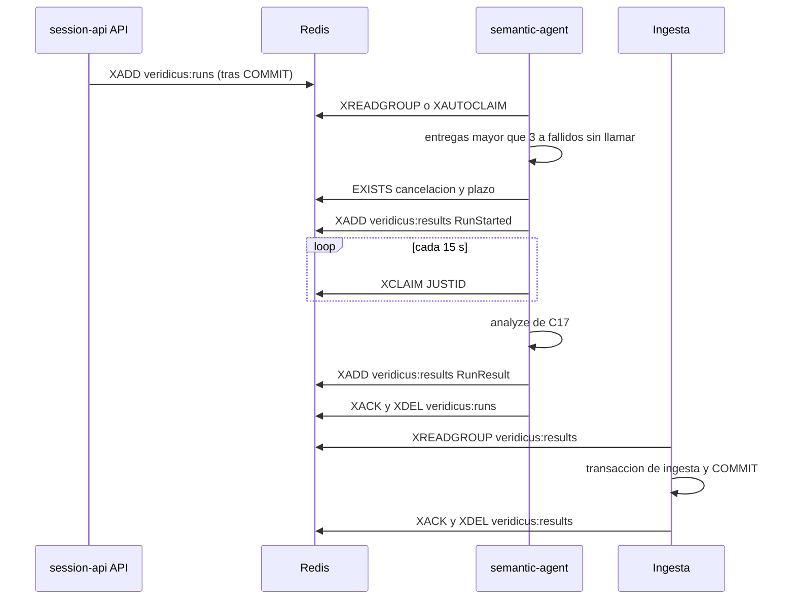

# Diseño de fiabilidad — U4 text-flow

**Revisión 2 (2026-11-22): segunda pasada por el cambio 01 (DT27), la adenda 02 y el NFR Requirements
revisión 2.** Sustituye a la revisión 1 del 2026-10-03.
- **Qué cambia.** Sale el juez de U4 (§2, §5 y §8 quedan «Retirado»). La entrega de C2 gana la renovación
  del reclamo y el tope de entregas coherente con U10 (§3). El supervisor recorre por sesión (§4). Lo nuevo:
  publicación fallida (§10), cancelación (§11), ruta mínima del incidente (§12) y límites (§13).
- **Hallazgos de la revisión 1 de esta etapa que cierra.** R-02 (§7 y `performance-design.md` §3), R-03
  (§4) y R-05 (§3). La tabla de precisiones de la revisión 1 (§9 antigua) queda «Superado»; las precisiones
  vigentes están en `security-design.md` §15.

**Insumos.** `nfr-requirements/reliability-requirements.md` (reliability-requirements: NFR8.5, NFR8.6,
NFR10.14–NFR10.23, NFR4.6), `performance-requirements.md` (performance-requirements: NFR3.5, NFR3.6,
NFR3.13), `scalability-requirements.md` (scalability-requirements), `observability-requirements.md`
(observability-requirements), `security-requirements.md` (security-requirements), `tech-stack-decisions.md`
(tech-stack-decisions: D11, D12, D17, D19, D20), `functional-design/functional-spec.md` (functional-spec:
F4–F15, E30–E55), `functional-design/rules.md` (BR5, BR15, BR16, BR19), C2, C3, C11, C16, C17 y C21 de
`contract-summary.md` (contract-summary); NFRD-U10-14, NFRD-U10-17, NFRD-U11-03 a NFRD-U11-05; NFR-U6-10 y
NFR-U9-07.

## 1. *Timeouts* (NFR10.14)

| E/S | *Timeout* | Dónde se fija | Al vencer |
|---|---|---|---|
| Consulta de PostgreSQL | 2 s (`statement_timeout` por sesión de conexión) | `session_api/shared/db.py` | Error de dependencia: `503` `system.unavailable` en la API; en la ingesta, *rollback* y el mensaje queda pendiente |
| Transacción de ingesta | 5 s (`SET LOCAL statement_timeout` y `idle_in_transaction_session_timeout`) | `interview/application/ingest.py` | *Rollback* y mensaje pendiente (§3) |
| Operación de Redis | 0,5 s (`socket_timeout`, `socket_connect_timeout`) | `redis_client.py` de cada servicio | Igual; en el sondeo, `503` |
| `XREADGROUP` bloqueante | `BLOCK 5000` con `socket_timeout` 6 s | Bucles consumidores | Vuelta del bucle |
| `check_ready()` de C21 | 2 s | U11; lo llama la raíz de composición | `/readyz` `503` |
| Conexión HTTP | 2 s | U11 | — |
| Llamadas a modelos | `min(model_call_timeout_s, restante − 10 s)` de C21 y C13 | U11 (NFRD-U11-04) | U11 devuelve `estado: error` con su `code` |

Todos los valores salen de la configuración validada al arrancar (NFR10.25); una cifra de límite literal en
el código de U4 hace fallar una prueba de nivel 0.

## 2. Fallos del juez · Retirado

P1 = A de la revisión 1 pierde su objeto: los reintentos de transporte son de U11 (C13). U4
trata cada `estado: error` de C17 con su `code` y sin reintento automático (NFR10.16, §9). El reintento es
una acción del analista que crea `attempt + 1` (BR5.9).

## 3. Entrega al menos una vez sin efectos dobles (NFR10.15; cierra R-05)

<!-- Texto alternativo: la API publica la corrida en veridicus:runs después de confirmar. semantic-agent la lee con XREADGROUP o la reclama con XAUTOCLAIM; si el mensaje ya superó 3 entregas lo manda a fallidos sin llamar. Comprueba la clave de cancelación y el plazo, publica RunStarted, renueva el reclamo cada 15 s con XCLAIM JUSTID mientras corre analyze de C17, publica RunResult y solo entonces confirma y borra el mensaje de C2. La ingesta lee veridicus:results, confirma su transacción y después confirma y borra el mensaje de C3. -->

- **Confirmación después del efecto.** El trabajador hace `XACK` y `XDEL` de C2 en un mismo *pipeline*
  solo después de publicar `RunResult`; la ingesta, solo después del `COMMIT`. Un fallo entre medias deja el
  mensaje pendiente y la repetición no tiene efecto doble (NFR10.22).
- **Renovación del reclamo (D17).** Un hilo hace `XCLAIM veridicus:runs analysis-worker <consumidor> 0 <id>
  JUSTID` cada 15 s mientras dura la corrida. `JUSTID` reinicia el tiempo inactivo **sin sumar una
  entrega**, así que un modo final de horas no gasta entregas. Solo el bucle consumidor de `semantic-agent`
  reclama con `XAUTOCLAIM`; no hay otro reclamador (R-05).
- **Dos renovaciones fallidas seguidas** (Redis no responde): el hilo marca una cancelación local, que hace
  que el `cancelled()` de C17 devuelva verdadero; el trabajador no publica `RunResult`, registra `WARNING`
  `run.claim_lost` y deja el mensaje pendiente. Si otra instancia lo reclamó, la ingesta descarta lo que
  llegue tarde por intento (NFRD-U4-16).
- **Tope de entregas coherente con U10 (NFRD-U4-01).** Tras `XAUTOCLAIM`, el trabajador lee el contador de
  entregas del mensaje (`XPENDING … IDLE`, campo de entregas). Con `run_max_deliveries` = 3, si el contador
  pasa de 3 el mensaje va a `veridicus:runs:failed` (solo IDs y `code` `analysis.system`), se confirma y se
  borra **sin ninguna llamada**. La entrega 3 que también falla termina igual en la siguiente vuelta. Así un
  mismo mensaje se procesa como mucho 3 veces y el mismo cuerpo seudonimizado sale como mucho 3 veces
  (NFRD-U10-14); el supervisor cierra la corrida al vencer su plazo (§4).
- **Prueba de nivel 1.** Matar al trabajador a mitad de la corrida con un *fake* lento: un solo
  `RunAttempt` por intento; el *fake* cuenta ≤ 3 invocaciones del mismo mensaje; la renovación no sube el
  contador de entregas (comprobado con `XPENDING`).

## 4. Ninguna corrida queda en curso (NFR3.5, NFR3.6, NFR10.17; cierra R-03)

- **Plazo** (`domain/deadline.py`, guardia, 100 % de ramas). Al encolar y al reintentar:
  `deadline_at = enqueued_at + plazo propio + min(Σ plazos propios por delante, run_queue_wait_max_s)`. «Por
  delante» son las corridas en `queued` o `processing` de todo el sistema con `enqueued_at` menor, leídas en
  la misma transacción que crea la corrida. Una corrida en espera (`RunPublicationHold`) no tiene
  `deadline_at` hasta que se libera; al liberarla se calcula con la hora de liberación como `enqueued_at`.
  Las cuatro filas de la tabla de NFR3.5 son casos de nivel 0.
- **Supervisor** (`run-supervisor`, hilo del trabajador de `session-api`, cada 15 s):
  1. Lee sin bloquear los `session_id` con alguna corrida vencida, un turno de voz en `transcribing` con
     `voice_deadline_at` pasado, o una espera que dependa de ellos, en orden ascendente de `session_id`.
  2. Por cada sesión abre una transacción: `change_cursor.bump(session_id)` (bloquea la sesión), después
     relee el estado vigente de cada corrida y solo cambia las que siguen en `queued` o `processing`
     (`error`, `analysis.system`, `actor_system` = `run-supervisor`), escribe su clave de cancelación tras
     el `COMMIT` y suma `veridicus_runs_total{outcome="error"}`.
  3. En la misma transacción vence los turnos de voz con `analysis.timeout` y libera o termina las esperas
     que dependían de ellos (NFR-U9-07, FD-U9-07). Ese código lo escribe U9 en B9 sobre este supervisor.
- **Orden de bloqueo único.** Sesión → corrida → ronda, igual que la ingesta, `propose`, `decide` y las
  transiciones de sesión: sin interbloqueos y sin escrituras con un `change_seq` viejo.
- **Holgura.** Con un ciclo de 15 s y una transacción de ≤ 2 s por sesión, una corrida vencida cambia como
  mucho 17 s después de `deadline_at`, dentro de los 30 s de NFR3.6.
- **Pruebas de nivel 1 con reloj controlado:** corrida huérfana (mensaje borrado a mano), Redis reiniciado,
  carrera entre la ingesta de un resultado y el supervisor (gana quien bloquea primero; el otro no cambia
  nada), espera que nunca se libera (termina en `error` por el turno de voz vencido).

## 5. Indexación todo o nada · Retirado

Sale el escenario con el cambio 01 (NFR10.18 Retirado).

## 6. Procesos y salud (NFR10.19, C16)

| Proceso | `/healthz` | `/readyz` responde `503` si | Arranque |
|---|---|---|---|
| API de `session-api` | Proceso vivo | PostgreSQL o Redis no responden en su *timeout* | Termina con código ≠ 0 si falta configuración, límites o perfiles, o si un perfil externo no cumple el piso de 270 s (NFRD-U4-09) |
| Trabajador de `session-api` | Los tres hilos han dado señal en los últimos 45 s | Igual que la API | Igual |
| `semantic-agent` | Bucle consumidor con señal en los últimos 45 s (o corrida en curso con renovación viva) | Perfiles o límites inválidos, Redis caído, `check_ready()` falla con un perfil externo habilitado, o U11 informa un servidor local caído | Igual; además `VERIDICUS_ANONYMIZER_PROXY_URL` debe ser interna (`security-design.md` §10) |

Mientras `/readyz` de `semantic-agent` falla, el bucle no lee la cola; los mensajes esperan y el plazo los
cubre. Con Redis caído, la consola queda fuera de servicio por `/readyz` de U3 (decisión de U3), y el
sondeo de M4 sigue el reintento de §7.

## 7. Consola ante cortes y sondeo sin pérdidas (NFR10.20; cierra R-02)

- **Lectura en una instantánea.** `GET /sessions/{id}?since=<cursor>` corre en una sola transacción
  `REPEATABLE READ READ ONLY`. Lee primero `change_cursor` de la sesión y después las filas con
  `change_seq > n` (turnos, cambios de estado de sesión y corrida, intentos, sugerencias y decisiones de U5);
  todas ven la misma instantánea, así que el cursor devuelto nunca adelanta a una fila que la consola no
  recibió. Como las escrituras de una sesión van en serie tras `change_cursor.bump`, ninguna confirma después
  con un número menor que uno ya entregado.
- **Cursor inválido.** El cursor es `v1.<session_id>.<n>` en base64url. Uno mal formado, de otra sesión o
  mayor que el `change_cursor` actual se trata como ausente: vista completa, sin código nuevo en C1. La
  consola aplica toda respuesta como *upsert* por ID estable, así que una vista completa nunca duplica
  (NFRD-U4-05, DS10).
- **Cortes.** TanStack Query conserva los datos mostrados; ante red o 5xx reintenta a 2, 4, 8, 16 y 30 s y
  vuelve al intervalo de NFR3.7 al primer éxito, con el último cursor recibido. Vitest con un servidor *fake*
  que falla 3 veces y comprueba que no se pierde ningún cambio.
- **Registro de acceso.** El sondeo con `since` no registra acceso (E11 de U13); la carga completa sí.

## 8. Determinismo y calidad de la IA · Retirado

NFR4.1, NFR4.2, NFR4.4, NFR4.5 y NFR6.1 salen de U4 (cambio 01): el umbral desaparece y la repetibilidad,
el formato, la permutación y la legibilidad son de U11. U4 conserva NFR4.6 (§14).

## 9. Tratamiento de cada fallo de la corrida (NFR10.16, NFR10.22)

| Origen | Estado de la corrida | `code` de C1 | Sesión | Sugerencias |
|---|---|---|---|---|
| `estado: error` de C17 (`salida_invalida`, `bloqueo_contenido`, `tiempo_agotado`, `proveedor`) | `error` | El de la tabla única de BR8.2 | Sin cambio | 0 |
| `anonimizador_no_disponible`, incluidos `413` y `3xx` de C21 | `error` | `analysis.anonymizer_unavailable` | Sin cambio (NFRD-U4-07) | 0 |
| `incidente_anonimizacion` o llamada externa sin anonimizar | `error` | `anonymizer.incident` | `blocked` (BR16.4, BR16.5) | 0 |
| Salida que no pasa la segunda línea | `error` | `analysis.invalid_output` | Sin cambio | 0 |
| Cancelación (clave o plazo) | `cancelled` o `error` por plazo | — o `analysis.system` | Según la acción | 0 |
| Mensaje a fallidos, plazo vencido, publicación fallida | `error` | `analysis.system` | Sin cambio | 0 |

- **Ingesta idempotente.** Clave única `run_attempt (run_id, attempt)`; un segundo `RunResult` choca y se
  confirma sin efectos. Un `RunStarted` o `RunResult` para una corrida terminal se confirma sin cambiar su
  estado, salvo el registro del incidente (§12).
- **Prueba de nivel 0 por caso** con el *fake* de C17, y prueba de nivel 1 con dos consumidores de C3.

## 10. Publicación fallida tras confirmar (NFR-U6-10, NFRD-U4-02, NFRD-U4-03)

- **En `session-api`.** Las filas del turno y de la corrida se confirman primero y después se hace `XADD`
  a `veridicus:runs`. Si el `XADD` falla, la respuesta sigue siendo `202`, se registra `ERROR`
  `run.publish_failed` con `run_id` y el supervisor cierra la corrida con `analysis.system` al vencer su
  plazo. Sin tabla *outbox* y sin republicación: un reenvío con el mismo `client_request_id` devuelve la
  corrida existente. La corrida en espera se publica al liberarse con el mismo tratamiento.
- **En `semantic-agent`.** `XADD` de `RunStarted` y `RunResult` se reintenta hasta `VERIDICUS_PUBLISH_RETRIES`
  = 3 veces (0,5 s, 1 s y 2 s), sin volver a llamar a modelos y con el reclamo renovado; es idempotente en la
  ingesta. Si sigue fallando, el mensaje queda pendiente y vuelve por §3.
- **Prueba de nivel 1** con Redis detenido justo después del `COMMIT`: `202`, una línea `ERROR` y la corrida
  en `error` antes de `deadline_at + 30 s`.

## 11. Cancelación que llega antes de la siguiente llamada (NFR1.6, NFR10.21)

- **Escritura.** Pausar, terminar, retirar el consentimiento, bloquear o vencer el plazo escribe
  `SET veridicus:run-cancelled:{run_id} 1 EX <plazo restante + cancel_key_margin_s>` tras el `COMMIT` y
  antes de responder. Si Redis falla, la acción ya confirmada responde igual y registra `ERROR`; el plazo
  detiene la corrida (E52).
- **Consulta.** El trabajador comprueba `EXISTS` y `now > deadline_at` antes de publicar `RunStarted` y en
  cada `cancelled()` de C17, que U11 llama antes de cada llamada. Un fallo de Redis en `EXISTS` cuenta como
  cancelado: ninguna llamada sale sin poder comprobar.
- **Reinicio de Redis.** Al arrancar el trabajador de `session-api` y tras cada reconexión, reescribe la
  clave de toda corrida cancelada o terminal cuyo plazo aún no venció (consulta indexada por estado).
- **Límite declarado.** Una llamada ya en curso puede terminar después; su resultado se descarta en la
  ingesta (BR16.1) y la detección de incidente corre igual.

## 12. Incidente que no se pierde (NFR1.5, NFR11.4, NFRD-U4-04)

- La ingesta detecta el incidente **antes** de comprobar la vigencia, sobre la salida ya parseada.
- Si el resultado completo no se puede ingerir (C6 inválido, sesión borrada, corrida terminal), la ingesta
  confirma una transacción mínima: `AnonymizationIncident` (sin clave foránea), y si la sesión existe,
  `change_cursor.bump`, `blocked_code`, la transición a `blocked` y la cancelación de sus corridas. Después
  confirma o manda el mensaje a fallidos.
- La ingesta no consume C3 mientras PostgreSQL no responde (comprobación previa en cada vuelta), así que un
  corte de la base no gasta entregas de un resultado con incidente.
- Pruebas de nivel 1: E36, E37, E51 y un incidente en un resultado de una sesión purgada.

## 13. Límites antes de encolar (NFR10.23)

Turno, número de turnos, caracteres y tamaño del mensaje C2 se validan al recibir el turno
(`performance-design.md` §9). El trabajador no recorta ni parte la transcripción; lo que U11 no puede
procesar vuelve como `estado: error`. Prueba de nivel 1 con la transcripción máxima (2 000 turnos y
250 000 caracteres) que termina `completed` con el *fake*.

## 14. Paridad con la CLI y objetivos de punta a punta (NFR4.6, NFR8.5, NFR8.6)

- **Paridad.** `AnalysisWorker` construye el `AnalyzerInput` con la misma función de U11 que usa la CLI y
  llama `analyze` sin transformar la salida. Prueba de nivel 0 y 1: misma entrada, perfil y *fake* →
  salida idéntica campo a campo por las dos vías; con `estado: error`, 0 sugerencias.
- **NFR8.5.** `evaluation/load/run_batches.py` corre 50 sesiones sintéticas con `comercial-piloto` en
  tandas de 3; registra `config_sha256` por sesión y falla si un perfil tiene `permutation: false`
  (NFRD-U4-13). Lo lanza el humano.
- **NFR8.6.** La prueba de humo usa los *endpoints* de salud de §6 y el *spec* de NFR3.10.
