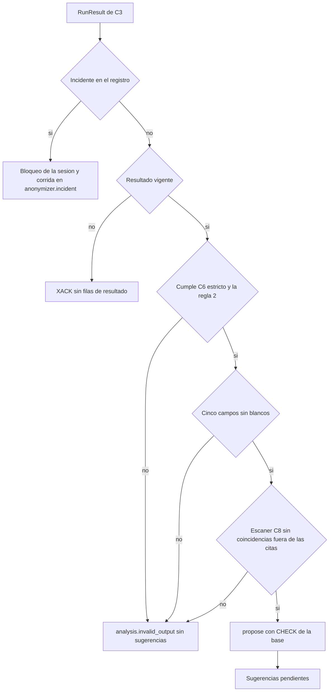

# Diseño de seguridad — U4 text-flow

**Revisión 2 (2026-11-22): segunda pasada por el cambio 01 (DT27), la adenda 02 y el NFR Requirements
revisión 2.** Sustituye a la revisión 1 del 2026-10-03, que queda en el historial de Git.
- **Qué cambia.** La revisión 1 diseñaba un evaluador propio (juez, *embeddings*, umbral, escenarios y
  paquete de traspaso). Ahora U4 orquesta las corridas de la biblioteca de U11 (C17): sesión con
  consentimiento y perfil, cola C2, `AnalysisWorker`, ingesta de C3 con el registro de modelos, bloqueo por
  incidente y consola M3–M4.
- **Numeración.** §1–§9 conservan su número y tema cuando siguen. §3 (*prompt* inmutable) y §4 (inyección)
  quedan «Retirado» y nombran a su nuevo dueño. Lo nuevo empieza en §10. Las decisiones son DS1–DS10 (§13) y
  las precisiones, NFRD-U4-01 a NFRD-U4-17 (§15).
- **Hallazgos de la revisión 1 de esta etapa.** R-01, R-04, R-08 y R-09 desaparecen con el juez de U4. R-02
  se cierra en `performance-design.md` §3 y `reliability-design.md` §7; R-03 en `reliability-design.md` §4;
  R-05 en `reliability-design.md` §3; R-06 en §12; R-07 en §6.

**Insumos.**
- De esta unidad: `nfr-requirements/security-requirements.md` (security-requirements, amenazas T1–T19,
  tabla NFR-U4-01 a NFR-U4-13), `reliability-requirements.md` (reliability-requirements),
  `performance-requirements.md` (performance-requirements), `scalability-requirements.md`
  (scalability-requirements), `observability-requirements.md` (observability-requirements) y
  `tech-stack-decisions.md` (tech-stack-decisions, D9–D20).
- `functional-design/functional-spec.md` (functional-spec: F3–F15, máquinas de estado, E5–E55, FD-U4-01 a
  FD-U4-22), `functional-design/rules.md` (BR4–BR19) y `functional-design/entities.md`.
- C1–C3, C6–C8, C10, C11, C13, C15–C18, C21, C24 y C25 de `inception/contract-design/contract-summary.md`
  (contract-summary), con CD-01, CD-02, CD-04, CD-06 y CD-11.
- Lo que fijaron hoy en NFR Design U1 (C25 v1, NFRD-U1-05, NFRD-U1-07, NFRD-U1-09), U2 (red, Ingress,
  Redis), U3 (autorización, formateador, `/readyz`), U10 (NFRD-U10-14, NFRD-U10-17) y U11 (NFRD-U11-03 a
  NFRD-U11-07).
- Lo que piden otras unidades a U4: NFR-U6-10, NFR-U8-06, NFR-U9-07, NFR-U13-06 y NFR-U13-12.
- `nfr-design-questions.md` (segunda pasada, sin preguntas). Reglas AUTONOMIA-01..05 de `team.md` y
  prohibiciones de `project.md`.

Salvo que se diga otra cosa, cada control se prueba en **nivel 0** o **nivel 1** con los *fakes* de C17 y
del `ModelGateway`, PostgreSQL y Redis reales y datos sintéticos, con su control negativo. Los comandos son
los de `tech-stack-decisions.md` §5.

## 1. Frontera (AUTONOMIA-04)

| Componente | Dónde corre | Datos con testimonio | Qué cruza su frontera | Destinos permitidos |
|---|---|---|---|---|
| Rutas de U4 en ConsoleApi | Proceso API de `session-api`, dentro | Turnos, hallazgos, consentimiento | Hacia el navegador por el Ingress `veridicus-web` (C1) | Navegador |
| InterviewSession (turnos, encolado, ingesta, supervisor, liberación) | API y trabajador de `session-api`, dentro | Turnos y salida de C6 | Mensajes C2 y C3 y la clave de cancelación | Redis y PostgreSQL |
| HumanReview `propose` (C10) | Trabajador de `session-api`, dentro | Hallazgos | Nada | PostgreSQL |
| AnalysisWorker | `semantic-agent`, dentro, con salida denegada (U2) | Transcripción en memoria durante la corrida | Lo que hace la llamada de C17 | Redis; servidores locales (C14) y `anonymizer-proxy` (C21), solo dentro de C17 |
| IncoherenceAnalyzer (U11) | Proceso de `semantic-agent` | Igual | Igual | Igual |
| `anonymizer-proxy` (U10) | Pod propio, único con salida con datos | El cuerpo que recibe por C21 | Texto seudonimizado por HTTPS 443 | Proveedores de C22 |
| AnalystConsole M3, M4 | Navegador | Lo que muestra | Solo habla con ConsoleApi (ADR-004) | ConsoleApi |
| PostgreSQL, Redis | Servicios del clúster | Turnos, sugerencias; mensajes hasta su `XDEL` | Nada | — |

**Ningún componente de U4 abre una conexión fuera del clúster.** Lo único que sale es lo que `anonymizer-proxy`
envía, ya seudonimizado, cuando el perfil de la sesión tiene un papel comercial y el consentimiento autoriza
la transferencia (§11). Con P6 = A una llamada puede llevar hasta 250 000 caracteres seudonimizados, y la
reentrega de C2 puede repetir ese mismo cuerpo hasta 3 veces (NFRD-U10-14, `reliability-design.md` §3).

## 2. Cadena de defensa de la salida (AUTONOMIA-03 y AUTONOMIA-05)

U11 produce la salida con su verificación de citas, su filtro y su escáner (primera línea). U4 la valida
otra vez en la ingesta (segunda línea) y `propose` la valida al guardar (tercera línea).

<!-- Texto alternativo: un RunResult de C3 se revisa primero en busca de un incidente de anonimización; si lo hay, la sesión se bloquea y la corrida queda en anonymizer.incident. Si no, se comprueba si el resultado es vigente; si no lo es, se confirma sin filas de resultado. Si es vigente, se valida contra C6 estricto y la regla 2; luego que los cinco campos obligatorios no estén en blanco; luego el escáner de vocabulario prohibido fuera de las dos citas. Cualquier fallo deja la corrida en analysis.invalid_output sin sugerencias. Si todo pasa, propose guarda las sugerencias pendientes con las restricciones CHECK de la base. -->

| Paso | Módulo | Control | Requisito |
|---|---|---|---|
| Detección de incidente | `session_api/interview/domain/incident.py` (guardia, 100 % de ramas) | Función pura sobre `error.codigo` y `registro.llamadas[*]`: `incidente_anonimizacion`, o una llamada con `external` verdadero y `anonimizado` falso. Corre antes del descarte (FD-U4-11) | NFR1.5, NFR11.4 |
| Vigencia | `domain/run_currency.py` (guardia) | Intento viejo, `cancelled`, `error` por plazo o `RunAttempt` ya existente → XACK y 0 filas (BR16.1) | NFR10.22 |
| C6 y regla 2 | `domain/output_check.py` (guardia) | Validador `jsonschema` Draft 2020-12 compilado una vez desde `contracts/analyzer/v1/` (D9); citas en turnos de la entrada; en incremental, al menos una cita en un turno ≥ `desde_turno`; `estado: error` con hallazgos falla (BR8.1) | NFR10.4 |
| Campos obligatorios | `domain/output_check.py` | `hecho`, `tipo`, `cita_a.cita`, `cita_a.turno`, `cita_b.cita`, `cita_b.turno` y `observaciones` sin blancos tras quitar espacios (BR8.5) | NFR10.4 |
| Vocabulario | Escáner de U11 (`scan(text, literal_sources)`) | Sobre `hecho` y `observaciones`, con las dos citas como fuentes literales; una coincidencia invalida la corrida entera (BR8.4). U4 no copia la lista (BR12.1) | NFR10.5 |
| Tercera línea | `propose` de C10 | Restricciones `CHECK` de los cinco campos; copia tal cual (BR8.6) | NFR10.4 |

La traducción de `error.codigo` a `code` de C1 vive en un único módulo de `domain/` (BR8.2). Ninguna rama
deja sugerencias de una corrida en error (BR11.3, NFR4.6). Pruebas: E14 (a)–(h), E16, E17, E36, E37 y E45,
cada una con su *fixture* sintético de U1.

## 3. *Prompt* inmutable y modelos fijados · Retirado

Pasa a U11 (*prompt* versionado y registro por llamada) y a U2 (`deploy/models.lock`). U4 solo guarda `prompt_sha256` y
`analyzer_version` de cada intento (§8, BR9.1).

## 4. Inyección de instrucciones · Retirado

Pasa a U11 (Escenarios A, B y C de su *red-teaming*), dueña del *prompt* y del juez. La defensa de U4 es
la segunda línea de §2: aunque un modelo obedezca una inyección, una salida con una cita en otro turno, un
campo en blanco o vocabulario prohibido no llega a la consola.

## 5. Mínimo privilegio en datos

| Identidad | Permisos | Requisito |
|---|---|---|
| `semantic-agent` | **Ninguna** credencial de PostgreSQL (U2 no la monta) y ninguna clave de proveedor; solo el Secret de Redis | NFR10.6, NFR1.3 |
| `veridicus_app` (API y trabajador de `session-api`) | `INSERT` y `SELECT` sobre las tablas `history` de U4; `UPDATE` solo de las columnas que permiten los disparadores de `InterviewSessionRecord` y `ConsentRecord`; sin `DELETE` | NFR11.1, NFR11.2 |
| `veridicus_retention` (Job de U13) | `DELETE` en las tablas purgables de U4 por `purge_session` (BR19.3); nunca en `AnonymizationIncident` | NFR11.2, NFR11.4 |
| Redis | Contraseña del Secret `veridicus-redis-auth` de U2; claves con prefijo `veridicus:` | NFR10.9 |

La prueba común de U3 recorre las tablas de U4 con `veridicus_app` y con `veridicus_retention` (NFR11.3 de
U3).

## 6. Datos sensibles en tránsito y en reposo (NFR10.7, NFR10.9; cierra R-07)

- **Logs.** El formateador JSON único de `libs/` (U3) con la lista blanca de NFR10.7: `session_id`, `run_id`,
  `turn_id`, `attempt`, `message_id`, `code`, `duration_ms`, `size_bytes` y `count`. Las excepciones se
  registran con su tipo y su `code`, nunca con su mensaje: el manejador de `semantic-agent` y del trabajador
  usa `logger.error(event, exc_type=type(e).__name__, code=...)` y prohíbe `exc_info` en los módulos que tocan
  testimonio (regla de Ruff y prueba AST). Prueba de nivel 1 con un *canary* en un turno, en `constancia`, en
  `constancia_mandato` y en `observaciones` del *fake*: 0 apariciones en los logs de los tres procesos,
  también en las rutas de error. U2 aporta la captura de todos los contenedores (NFR10.19 de U2).
- **Redis.** `XACK` y `XDEL` en el mismo *pipeline*, siempre después del efecto (publicar C3, o confirmar la
  transacción). Las entradas de `veridicus:runs:failed` y `veridicus:results:failed` usan el esquema
  estricto de NFRD-U1-07 (solo `message_id`, `run_id`, `attempt` y `code`) con `XADD … MAXLEN ~ 1000`. La
  clave de cancelación vale `1`. Prueba de nivel 1: tras una corrida, `XRANGE` de los dos *streams* y
  `XPENDING` no contienen el *canary*.
- **Rastro en disco.** El AOF de Redis guarda los mensajes hasta la siguiente reescritura, que U2 acota con
  `auto-aof-rewrite-min-size` = 16mb; PostgreSQL no registra parámetros (`log_parameter_max_length` = 0 y
  `log_parameter_max_length_on_error` = 0, NFR-U13-12). Todo queda dentro del clúster; el disco sin cifrar es
  un riesgo aceptado por U2.
- **Memoria.** `semantic-agent` suelta la entrada y la salida al terminar cada corrida; no hay caché de
  transcripciones entre corridas.

## 7. Entrada, autorización y cargas (NFR10.1, NFR10.10, NFR10.11, NFR10.13)

- **Autorización.** Cada ruta de U4 usa la dependencia `authorize` de U3 con `x-veridicus-roles` y, si
  aplica, `x-veridicus-owner-only`; el resolvedor de dueño lo aporta InterviewSession. Las de escritura
  exigen `X-CSRF-Token`. `GET /notice` es la única pública (FD-U4-08). Pruebas `403` de NFR10.10 con 0 filas.
- **Corte del cuerpo.** `POST /sessions/{id}/turns` lee el cuerpo por trozos y se detiene al pasar
  4 × `turn_max_chars` + 4 096 bytes (84 096 con C25 v1): `413` `limits.exceeded` antes de parsear. El
  Ingress no escribe en disco y su tope es mayor (U2, `veridicus-web`), así que el `413` siempre lo da
  `session-api` como Problem Details.
- **Validación antes de crear filas.** Turno de 1 a `turn_max_chars` caracteres tras quitar los bordes
  (vacío `422`, uno más `413`). Totales de la sesión (`transcript_max_turns`, `transcript_max_chars`) y
  tamaño del mensaje C2 (`run_message_max_bytes`) antes de confirmar (`performance-design.md` §9).
  Consentimiento y perfil según BR14.1–BR14.5, con los perfiles `batch_only` fuera de la consola
  (NFRD-U4-10).
- **Colas.** C2 se valida al publicar y al consumir; C3 al ingerir. Un mensaje inválido o de versión mayor
  desconocida va a `<cola>:failed` sin filas (BR5.6).
- **Errores.** Un solo manejador de `libs/` traduce la jerarquía única a Problem Details con `code` de C1 y
  `detail` del catálogo en español, sin SQL, trazas ni texto del modelo; `limits.exceeded` siempre `413`.

## 8. Integridad, configuración y auditoría (NFR10.24, NFR10.25, NFR11.1–NFR11.5, NFR12.1)

- **Sesión ligada a su perfil.** Un disparador impide cambiar `profile_name`, `effective_config` y
  `config_sha256`. `config_sha256` = `canonical.sha256_jcs(effective_config)` de U1, calculado al crear la
  sesión. El OpenAPI de C1 no tiene rutas que escriban perfiles, límites, precios ni *prompts* (prueba sobre
  C1). E9 prueba que una sesión conserva su huella tras un PR que cambia su perfil.
- **Configuración al arrancar.** `limits.load(os.environ)` de U1 sobre el catálogo empaquetado y
  `profiles.validate` de U11 en `session-api` y en `semantic-agent`. Una cifra subida por entorno, un archivo
  ausente o inválido, o un perfil con papel externo y `model_call_timeout_s` efectivo menor que
  `COMMERCIAL_MIN_CALL_TIMEOUT_S` (270 s, constante de `libs/execution_profiles`) terminan el proceso con
  código ≠ 0 y un log que nombra el ajuste sin su valor (NFRD-U4-09). Una prueba de nivel 0 recorre el código
  de U4 y falla ante un número de límite literal.
- **Auditoría.** Las tablas `history` de U4 se registran en `AuditConvention` de U3 con `actor_kind` y
  `actor_system` (`analysis-worker`, `run-supervisor`); un reintento crea filas con `attempt + 1`. Cada
  `RunAttempt` guarda `config_sha256`, `prompt_sha256` y `analyzer_version`. `ConsentRecord.recorded_at` es
  la hora del servidor (E28).
- **Incidente perdurable.** `AnonymizationIncident` no tiene clave foránea a la sesión, guarda solo IDs,
  `code` y hora, y sobrevive a `purge_session` (NFR11.4).
- **Datos sintéticos.** Los *fixtures* usan el catálogo y las marcas de U1; la comprobación de U1 corre sobre
  las carpetas de pruebas de U4 con 0 hallazgos. El script de P7 corre fuera de Git y solo imprime dos cifras.

## 9. Amenazas y controles

| Amenaza | Controles de este diseño |
|---|---|
| T1, T2 *Prompt* | Retirado (U11); §4 |
| T3 Cita inventada o en otro turno | §2 (regla 2 de C6 en la ingesta); la verificación literal es de U11 |
| T4 Etiqueta de veracidad | §2 (escáner en la ingesta) y escaneo de M3, M4, catálogo y plantillas en niveles 0 y 3 (`logical-components.md` §5) |
| T5 Sugerencia parcial o sin campos | §2 (tres líneas) y `reliability-design.md` §12 |
| T6 Trabajador con base | §5 y §10 |
| T7 Texto en logs o colas | §6 |
| T8 Destino externo sin anonimizador | §10 y §11 |
| T9 Sesión ajena o rol indebido | §7 |
| T10 Petición enorme | §7 |
| T11 Mensaje mal formado | §7 y §12 |
| T12 Inundar la cola | Riesgo aceptado; `veridicus_run_queue_depth` y su regla informativa |
| T13 Cambio silencioso de perfil, límites o *prompt* | §8 |
| T14 Reescribir historial | §5 y §8 |
| T15 `semantic-agent` con `libs-anonymizer` | §10 |
| T16 Llamada sin anonimizar inadvertida | §11 y `reliability-design.md` §12 |
| T17 Llamada tras cancelar | §11 y `reliability-design.md` §11 |
| T18 Perfil comercial sin transferencia | §11 |
| T19 Configuración faltante o límite subido | §8 |

## 10. Fronteras de `semantic-agent` (NFR1.1, NFR1.2, NFR1.3, NFR10.6)

- **import-linter** en `services/semantic-agent/.importlinter`: `semantic-agent-no-anonymizer` prohíbe
  `libs.anonymizer` y `libs.anonymizer.providers`; `semantic-agent-no-db` prohíbe `psycopg`, `sqlalchemy` y
  `asyncpg`; `semantic-agent-layers` impone `worker/` → `application/` → `domain/`, con `adapters/` detrás de
  los puertos. Cada contrato con un módulo de prueba que lo viola.
- **Lockfile e imagen.** `scripts/check_lock_no_anonymizer.py` falla si `uv.lock` de `semantic-agent` nombra
  `libs-anonymizer`; en la imagen construida, `python -c "import libs.anonymizer"` debe terminar en
  `ModuleNotFoundError`, y tras arrancar `sys.modules` no contiene `libs.anonymizer` (E46).
- **Dirección del proxy.** La raíz de composición acepta en `VERIDICUS_ANONYMIZER_PROXY_URL` solo
  `http://veridicus-anonymizer-proxy:<puerto>` o un *host* que termine en `.svc.cluster.local`
  (NFR-U1-06); cualquier otra forma impide arrancar. Las `base_url` locales las valida U11.
- **Sin salida.** `/readyz` de `semantic-agent` y de `session-api` pasa con la `NetworkPolicy` de U2
  aplicada; nada de U4 descarga en ejecución. Verificación manual en el clúster antes de la sustentación.

## 11. Soberanía: anonimizador delante, transferencia, cancelación e incidente (NFR1.4–NFR1.7, NFR11.4)

| Control | Diseño | Prueba |
|---|---|---|
| Anonimizador delante (NFR1.4) | La raíz de composición de `semantic-agent` (F14) carga límites y perfiles; si algún perfil aprobado tiene un papel `external` y falta la dirección del proxy, termina; si la tiene, llama a `AnonymizerHttpClient.check_ready()` de U11 (*timeout* 2 s) antes de `gateway.build(...)`. Sin éxito, `/readyz` responde `503` y el bucle no consume la cola. Con solo perfiles locales no se llama | E47 con el proxy detenido; control positivo con el proxy *fake* sano |
| Transferencia (NFR1.7) | `GET /profiles` solo lista perfiles locales si el consentimiento no autoriza; `POST /sessions` responde `422` `profile.transfer_not_authorized` con 0 filas. U11 lo repite en su validación previa | E26 (nivel 1 y Vitest) |
| Cancelación (NFR1.6) | Clave `veridicus:run-cancelled:{run_id}` escrita antes de responder; el trabajador consulta la clave y `deadline_at` antes de empezar y en cada `cancelled()` de C17 (`reliability-design.md` §11) | *Fake* con 0 llamadas nuevas tras pausar, terminar, retirar, bloquear, vencer y reiniciar Redis (E31, E52) |
| Incidente (NFR1.5) | Detección pura de §2 y transacción de bloqueo de BR16.4 y BR16.5; nunca se pierde aunque el resultado no se pueda ingerir entero (`reliability-design.md` §12) | E36, E37, E51; 100 % de ramas |
| Incidente perdurable (NFR11.4) | §8 | Prueba de nivel 1 tras `purge_session` |

Un incidente cuya llamada ya salió no se deshace: el bloqueo evita las siguientes y el registro deja
constancia (límite declarado del Functional Design).

## 12. Mensajes de cola forjados (cierra R-06)

C2 lleva `effective_config` y el bloque de consentimiento. Un proceso con la contraseña de Redis podría
publicar una corrida con otra configuración. Controles:
- `semantic-agent` comprueba al consumir que `config_sha256` = `canonical.sha256_jcs(effective_config)`; si
  no, el mensaje va a `veridicus:runs:failed` con `analysis.system` y sin llamar. Una configuración manipulada
  sin rehacer la huella no corre.
- La validación previa de U11 rechaza un perfil externo sin `autoriza_transferencia` (`InputRejected`).
- La ingesta solo acepta resultados de corridas que existen en la base con ese `run_id` y ese intento
  (BR16.1); un resultado inventado se descarta sin filas, salvo un incidente, que se registra igual.

**Riesgo residual aceptado.** Un pod comprometido con la contraseña de Redis puede forjar un mensaje con una
huella recalculada. La contraseña solo llega a cuatro *workloads* (U2), la `NetworkPolicy` limita quién
alcanza Redis y la salida externa sigue pasando por el anonimizador. Usuarios de Redis con ACL por prefijo
quedan fuera del MVP.

## 13. Decisiones de diseño y alternativas

| # | Estado | Decisión | Alternativas descartadas | Consecuencias |
|---|---|---|---|---|
| DS1 | nuevo | Segunda línea de C6 en la ingesta, con la detección de incidente antes del descarte | Confiar en la primera línea de U11 | Defensa en profundidad de AUTONOMIA-05 y AUTONOMIA-04; a cambio, validar dos veces la misma salida |
| DS2 | nuevo | Validación con `jsonschema` sobre los esquemas de U1 (D9) | Modelos Pydantic a mano | Un solo origen de verdad; a cambio, mensajes de error menos tipados |
| DS3 | nuevo | `semantic-agent` sin base, sin claves y sin `libs-anonymizer`, comprobado en código, lockfile, imagen y proceso | Revisión manual del PR | Control negativo automático; a cambio, cuatro comprobaciones que mantener |
| DS4 | nuevo | Cancelación por clave de Redis que solo lee el trabajador (D19, CD-06) | Columna en la base | El trabajador sigue sin base; a cambio, la clave se reescribe tras un reinicio de Redis |
| DS5 | nuevo | Huella de la configuración comprobada al consumir C2 | Firmar los mensajes con HMAC | Sin secreto nuevo; a cambio, no protege frente a quien recalcula la huella (riesgo aceptado, §12) |
| DS6 | nuevo | Excepciones registradas por tipo y `code`, sin `exc_info` en módulos con testimonio | Trazas completas | Un mensaje de excepción no filtra testimonio; a cambio, depurar exige reproducir con datos sintéticos |
| DS7 | nuevo | Corte del cuerpo de un turno por bytes antes de parsear | Confiar en el tope del Ingress | `413` como Problem Details y memoria acotada; a cambio, una lectura por trozos propia |
| DS8 | nuevo | Piso de 270 s comprobado también en `session-api` con la constante de U11 | Solo en `semantic-agent` | Una sesión nunca nace con un perfil que el trabajador no podría correr; a cambio, dos raíces que lo comprueban |
| DS9 | nuevo | Ruta mínima del incidente en la ingesta | Mandar a fallidos un resultado que no se pudo ingerir | El bloqueo nunca se pierde; a cambio, una segunda transacción pequeña |
| DS10 | nuevo | Vista completa ante un cursor inválido, aplicada como *upsert* por ID | Código de error nuevo en C1 | Sin cambio de contrato y sin pérdida de cambios; a cambio, una respuesta más grande en ese caso |

## 14. Correspondencia con AUTONOMIA

| Regla | Qué aporta este diseño | Secciones |
|---|---|---|
| AUTONOMIA-01 | U4 no aplica nada al clúster; perfiles, límites y *prompt* cambian solo por PR; el script de P7 y la prueba de carga los lanza el humano | §8 |
| AUTONOMIA-02 | Cada control nombra su prueba y su umbral; comandos en `tech-stack-decisions.md` §5 | §2–§12 |
| AUTONOMIA-03 | Escáner en la ingesta y en la interfaz; sugerencias pendientes que solo cambia una persona (U5) | §2, §8 |
| AUTONOMIA-04 | Frontera por componente, trabajador sin claves ni anonimizador, proxy obligatorio, transferencia, cancelación e incidente | §1, §6, §10, §11, §12 |
| AUTONOMIA-05 | Segunda línea de C6, campos obligatorios, error sin sugerencias | §2 |

## 15. Precisiones a artefactos ya aprobados (NFRD-U4-xx)

No edité ningún artefacto aprobado (regla de `project.md`). En la aprobación decides cuáles se llevan al
original, cada una en su propio commit. Todas salen de las fuentes o de hallazgos que un experto cierra; se
aplicaron sin preguntar. Ninguna deja salir del clúster algo que hoy no sale.

| ID | Estado | Artefacto aprobado | Precisión | Origen |
|---|---|---|---|---|
| — (rev. 1) | Superado | `reliability-requirements.md` NFR10.16 y `tech-stack-decisions.md` §2 (reintento del juez y sus ajustes) | Los reintentos de transporte son de U11 (C13) | Cambio 01 |
| — (rev. 1) | Superado | `functional-design/entities.md` (`change_seq` de la revisión 1) | Lo sustituye NFRD-U4-05 con el `change_cursor` de U3 y U5 | FD-U3-13 |
| NFRD-U4-01 | Propuesta | `contract-summary.md` (C2, «Entrega y fallos») y `reliability-requirements.md` (NFR10.15) | La renovación del reclamo usa `XCLAIM … JUSTID`, que no suma entregas. Al reclamar con `XAUTOCLAIM`, el trabajador lee el contador de entregas del mensaje; si pasa de `run_max_deliveries`, lo manda a `veridicus:runs:failed` sin llamar a nada. Así un mismo mensaje se procesa como mucho 3 veces y el mismo cuerpo seudonimizado sale como mucho 3 veces | NFRD-U10-14; NFR10.15 |
| NFRD-U4-02 | Propuesta | `functional-spec.md` (F4 paso 7, F7 paso 4) y `rules.md` (BR5.4, BR5.9) | Si la publicación de C2 falla después de confirmar, la respuesta sigue siendo `202` (las filas existen), se registra `ERROR` `run.publish_failed` y el supervisor cierra la corrida al vencer su plazo con `analysis.system`; el reenvío con el mismo `client_request_id` no republica. Igual que U6 | NFR-U6-10 |
| NFRD-U4-03 | Propuesta | `rules.md` (BR15.6) | El trabajador reintenta él mismo la publicación de `RunStarted` y `RunResult` (`XADD`), que es idempotente en la ingesta: hasta 3 veces, a 0,5 s, 1 s y 2 s, sin volver a llamar a modelos y renovando el reclamo. Solo si sigue fallando deja el mensaje pendiente. «No reintenta por su cuenta» se lee como «no repite llamadas a modelos» | `team.md` (reintentos solo idempotentes); §11 |
| NFRD-U4-04 | Propuesta | `rules.md` (BR16.4, BR5.7) y `contract-summary.md` (C3, «Entrega y fallos») | **Ruta mínima del incidente.** Si un `RunResult` con incidente no se puede ingerir entero, antes de mandarlo a `veridicus:results:failed` la ingesta confirma una transacción solo con `AnonymizationIncident`, `blocked_code`, la transición de la sesión y la cancelación de sus corridas (BR16.5). La ingesta no consume C3 mientras PostgreSQL no responde, así que un corte de la base no gasta entregas | AUTONOMIA-04; VE-14; FD-U4-11 |
| NFRD-U4-05 | Propuesta | `functional-design/entities.md` (`Turn`, `SessionStatusChange`, `RunStatusChange`, `RunAttempt`, `ReviewSuggestion`) y `contract-summary.md` (C1, `cursor`) | Cada fila de U4 que cambia la vista lleva `change_seq` = el `change_cursor` de la sesión tras `change_cursor.bump` (primitiva compartida de U5), fijado al insertar. El sondeo lee en una sola transacción `REPEATABLE READ READ ONLY` y devuelve como cursor el `change_cursor` leído en esa instantánea, codificado como `v1.<session_id>.<n>` en base64url. Un cursor mal formado, de otra sesión o mayor que el actual se trata como ausente (vista completa); la consola aplica toda respuesta como *upsert* por ID | R-02 de la revisión 1; P2 = A de la revisión 1; reliability-design de U5 |
| NFRD-U4-06 | Propuesta | `functional-spec.md` (F7 paso 1) y `rules.md` (BR5.8) | El supervisor recorre las corridas vencidas por sesión, en orden de `session_id`, una transacción por sesión con el orden sesión → corrida (`change_cursor.bump` primero), y solo cambia una corrida si su estado vigente sigue en `queued` o `processing`. En la misma pasada vence los turnos de voz en `transcribing` con `voice_deadline_at` pasado y libera las esperas que dependían de ellos; ese código lo escribe U9 en B9 sobre el mismo supervisor | R-03 de la revisión 1; NFR-U9-07 |
| NFRD-U4-07 | Propuesta | `rules.md` (BR16.7) y `functional-spec.md` (E35) | Los `413` y `3xx` de C21 también llegan como `anonimizador_no_disponible` y dejan la corrida en `analysis.anonymizer_unavailable` con la sesión sin cambios | NFRD-U10-17; NFRD-U11-05 |
| NFRD-U4-08 | Propuesta | `observability-requirements.md` (§2) y NFR-U4-08 | Las métricas de U4 van en `contracts/metrics/text-flow.v1.yaml`, no en C15, y suman `veridicus_runs_total`, que la lista de NFR-U4-08 omite. Valores de enum: `mode` (`incremental`, `final`); `outcome` de corrida (`completed`, `error`, `cancelled`; `completed` es el estado `done`); `outcome` de ingesta (`ok`, `discarded`, `invalid_output`, `rolled_back`); `error_code` del catálogo; `provider` y `role` de C18 | NFRD-U1-05 |
| NFRD-U4-09 | Propuesta | `reliability-requirements.md` (NFR10.14) y `tech-stack-decisions.md` (§2) | `session-api` también comprueba al arrancar el piso de 270 s sobre cada perfil aprobado con un papel externo, con `COMMERCIAL_MIN_CALL_TIMEOUT_S` de `libs/execution_profiles`; `semantic-agent` lo recibe de `gateway.build`. Un perfil por debajo impide arrancar | NFRD-U11-03; §4.4 del NFR Design de U1 |
| NFRD-U4-10 | Propuesta | `rules.md` (BR14.4, BR14.7) | `GET /profiles` no lista los perfiles con `batch_only: true`, y `POST /sessions` con uno de ellos responde `422` `profile.not_approved` con 0 filas | NFR Design de U11 (`performance-design.md` §5) |
| NFRD-U4-11 | Propuesta | `functional-design/entities.md` (índices) | Índices de U4: `run_status_change (run_id, attempt, at DESC)`, `run_status_change (at) WHERE status = 'queued'`, `turn (session_id, n)`, `turn (session_id, change_seq)`, `run_status_change (session_id, change_seq)`, `run_attempt (session_id, change_seq)`, `review_suggestion (session_id, change_seq)`, `interview_session (retention_until)` y `interview_session (created_at) WHERE retention_until IS NULL` | NFR3.2, NFR3.3, NFR3.5; NFR-U13-06 |
| NFRD-U4-12 | Hecho | NFR Requirements de U13 (NFR-U13-06) | `EthicsSessionPort.expired_sessions(as_of)` usa los índices de NFRD-U4-11 y devuelve solo IDs y plazos; `turn_texts(session_id)` devuelve un iterador en orden con `yield_per`, dentro del `statement_timeout` de 2 s | NFR-U13-06 |
| NFRD-U4-13 | Hecho | NFR Requirements de U8 (NFR-U8-06) | `evaluation/load/run_batches.py` registra `config_sha256` por sesión y falla si una sesión usa un perfil con `permutation: false` | NFR-U8-06 |
| NFRD-U4-14 | Propuesta | `tech-stack-decisions.md` (§2) | Ajustes nuevos: `VERIDICUS_RELEASE_POLL_MS` (500, entre 100 y 1 000) y `VERIDICUS_PUBLISH_RETRIES` (3, entre 0 y 5); fuera de rango impide arrancar | NFR3.13; NFRD-U4-03 |
| NFRD-U4-15 | Propuesta | `contract-summary.md` (C2) | `semantic-agent` comprueba al consumir que `config_sha256` coincide con `canonical.sha256_jcs(effective_config)`; si no, el mensaje va a fallidos sin llamar | R-06 de la revisión 1 |
| NFRD-U4-16 | Propuesta | `reliability-requirements.md` (§4) y `tech-stack-decisions.md` (§6, riesgo de la renovación) | Si dos renovaciones seguidas fallan, el trabajador marca su propia cancelación local (el `cancelled()` de C17 devuelve verdadero), no publica y deja el mensaje pendiente; la reentrega cuenta como una entrega más (NFRD-U4-01) | Tech-stack §6; NFR10.15 |
| NFRD-U4-17 | Propuesta | `functional-design/entities.md` (`InterviewSessionRecord`) | La fila de la sesión suma `turn_count` y `char_count`, que se actualizan en la misma transacción que crea el turno (tras `change_cursor.bump`), para comprobar `transcript_max_turns` y `transcript_max_chars` sin sumar los turnos en cada envío | NFR3.2; NFR10.1 |
