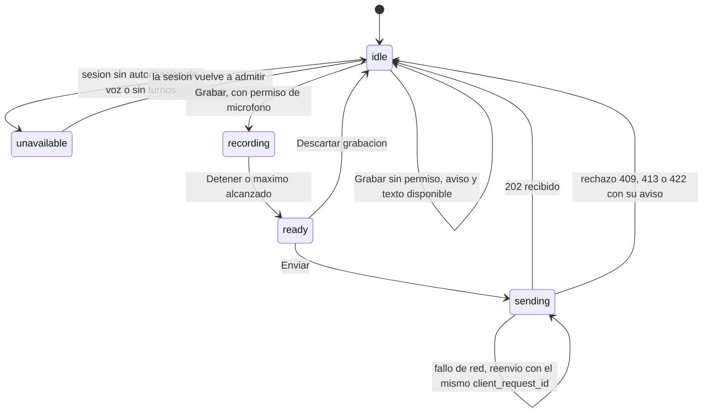
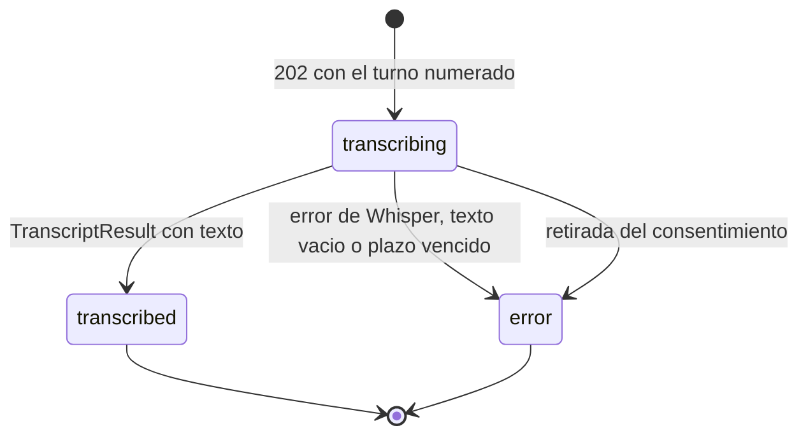
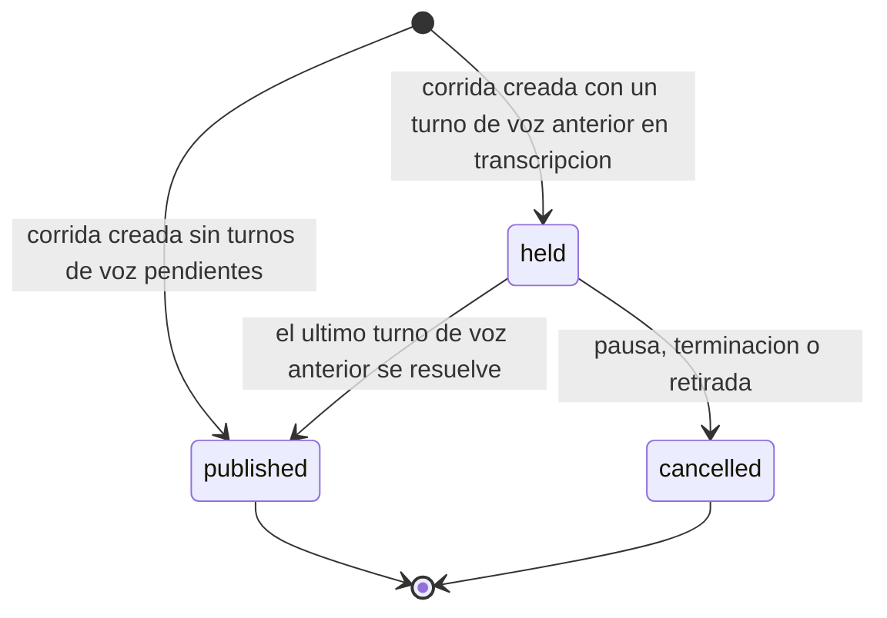
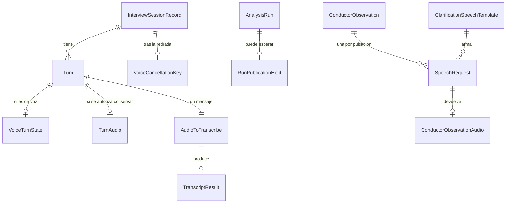

# Especificación funcional — U9 voice

**Revisión 2 (2026-11-22), segunda pasada por el cambio 01 (DT27) y la adenda 02.** Sustituye a la revisión
1 del 2026-10-03.
- **Sigue:** grabar un turno por voz y transcribirlo con Whisper en CPU dentro del clúster (US10.2), con las
  respuestas P1–P3 de la primera pasada.
- **Sale (Retirado):** la voz de la pregunta sugerida (F4 de la revisión 1); la pregunta salió con el
  Paquete de Contexto de Traspaso.
- **Entra:** escuchar la **aclaración aprobada** (US10.4, F5), la autorización de voz (AC15.4.3), el audio
  conservado con autorización (AC10.2.4, F6), el rechazo del TTS a otro texto (AC10.4.2), la espera en
  orden de las corridas (F7) y el encaje con la pausa, la terminación y la retirada (F8).

**Respuestas de la etapa.** P1 = A (120 s), P2 = A (sin reintento de la transcripción), P3 = A (sin
corrección), P4 = A (audio conservado al recibirlo y sin uso), P5 = B (las corridas esperan a los turnos de
voz anteriores), P6 = C (se transcribe tras terminar; no tras la retirada), P7 = A (frase fija versionada con
el tema).

**Fuentes.** `unit-of-work.md` y `unit-of-work-story-map.md` (U9, revisión 3), `requirements.md` y
`requirements-adenda-02.md` (FR10.2, FR10.4, VE-06, VE-08, VE-09, VE-10, VE-12), `components.md`
(SpeechProcessing, InterviewSession, TurnAudio), `contract-summary.md` (C1, C5, C8, C13, C14, C25),
`mockups.md` §6.11 y las decisiones de NFR Requirements de U9 (D3, D4, D7) que cerraron R-01, R-03 y R-04.

**Fuente de verdad.** Este archivo manda en los flujos y las máquinas de estado. Los datos están en
`entities.md` y las decisiones en `rules.md`; las secciones 4 y 5 son vistas derivadas.

## 1. Componentes y frontera del clúster (AUTONOMIA-04)

| Componente | Dónde corre | Datos que maneja | ¿Cruza la frontera del clúster? |
|---|---|---|---|
| AnalystConsole (grabación y «Escuchar audio») | Navegador del analista | Audio crudo durante la grabación; audio sintetizado al reproducirlo | Va al clúster por C1 (HTTPS, mismo origen). Nunca a un tercero; no se guarda en el navegador |
| `session-api` (ConsoleApi, InterviewSession) | Dentro del clúster | Audio en tránsito, texto transcrito, tema de la aclaración | No |
| Directorio de audio de `session-api` (volumen de InterviewSession) | Dentro del clúster | Audio conservado, solo con `autoriza_conservar_audio` | No |
| Redis (`veridicus:audio`, `veridicus:transcripts`, claves de cancelación y de entrega doble) | Dentro del clúster | Audio en base64 hasta confirmarlo; texto; claves con IDs | No |
| `audio-worker` (SpeechProcessing) | Dentro del clúster, pod con datos sin anonimizar | Audio, texto, tema y frase compuesta | No: salida denegada; solo alcanza Redis y `model-whisper` y `model-tts`; recibe la ruta interna de síntesis desde `session-api` |
| `model-whisper` y `model-tts` | Dentro del clúster | Audio y frase de la aclaración | No: los despliega U2 sin salida a internet |

Ningún componente de U9 llama a un servicio externo; por eso no aplica el anonimizador (U10). La
transcripción y la síntesis no son llamadas a un proveedor comercial y no pasan por `anonymizer-proxy`.

## 2. Flujos

### F1 — Grabar y enviar un turno de voz (US10.2) · cambia

1. En M4 el dueño elige el hablante (`TEST` por defecto). Si la sesión no autoriza la voz o no admite
   turnos, «Grabar» está deshabilitado con su motivo (BR7.2). Si el navegador niega el micrófono, aparece el
   aviso de BR1.1 y el texto sigue disponible.
2. Pulsa «Grabar»: «● Grabando mm:ss», anunciado (BR1.2). En los últimos 15 s se ve el tiempo restante y al
   llegar al máximo se detiene sola (BR1.3).
3. Pulsa «Detener y enviar». La consola codifica a WAV mono de 16 kHz (BR1.4), genera `client_request_id`
   y envía `POST /sessions/{id}/voice-turns` (multipart, con `X-CSRF-Token`).
4. ConsoleApi aplica rol y dueño (BR2.1). Bajo el bloqueo de la sesión, InterviewSession aplica las guardias
   en el orden de BR2.2: consentimiento, estado, autorización de voz (BR8.1) y audio (BR2.3). Un rechazo
   deja 0 filas, 0 archivos y 0 mensajes.
5. Si `client_request_id` ya existe, responde el turno ya creado (BR2.4).
6. Si la sesión autoriza conservar el audio, escribe el archivo y su sha256 (BR8.2, F6).
7. En una transacción numera el turno (`origin: voice`, su hablante) y crea VoiceTurnState con
   `voice_status: transcribing` y `voice_deadline_at`; si aplica, la fila TurnAudio. No crea corrida (BR2.5).
8. Tras confirmar, publica `AudioToTranscribe` (`attempt: 1`, `retain_audio`, `deadline_at`) y responde
   `202` con el turno sin `run`.
9. La consola muestra el turno con «Procesando audio…» y permite seguir grabando o escribiendo (BR1.5). Si
   la red falla antes del `202`, reenvía con el mismo `client_request_id` (BR2.4).

### F2 — Transcribir en el audio-worker · cambia

1. El trabajador del grupo `audio-worker` lee `AudioToTranscribe`.
2. Si existe `veridicus:voice-cancelled:{session_id}`, confirma y borra el mensaje sin llamar a Whisper ni
   publicar (BR9.6). Fin.
3. Si existe `veridicus:transcribed:{turn_id}:{attempt}`, confirma y borra sin llamar (BR3.6). Fin.
4. Si el mensaje llegó después de `deadline_at`, publica `error` con `analysis.timeout` sin llamar (BR3.4).
5. Si no, llama a `ModelGateway.transcribe` con `language: es` y el *timeout* efectivo (BR3.1).
6. Escribe la clave de entrega doble y publica `TranscriptResult` (BR3.2, BR3.3, BR3.4):
   - texto no vacío → `transcribed` con texto y `model_digest`;
   - texto vacío → `error` con `analysis.invalid_output`;
   - *timeout* → `analysis.timeout`; conexión rechazada, 5xx o respuesta mal formada → `analysis.system`.
7. Confirma (`XACK`) y borra (`XDEL`) el mensaje de audio (BR3.5). El trabajador nunca guarda el audio.

### F3 — Ingerir la transcripción en session-api · cambia

1. El grupo `session-api` lee `TranscriptResult`.
2. Si el turno ya no está en `transcribing` (plazo vencido, retirada o resultado anterior), descarta y
   confirma (BR4.3).
3. Con `transcribed`, en una transacción con el orden sesión → ronda: guarda el texto, `voice_status:
   transcribed`, `transcribed_at` y `model_digest` (BR4.1).
   - Turno TEST, sesión que admite corridas y ninguna corrida que ya lo cubra (BR9.3): crea la corrida
     incremental `desde_turno = hasta_turno = n` como un turno escrito, sujeta a la espera (BR9.1).
   - Turno ENT, sesión en pausa (BR9.7) o terminada (BR9.4): sin corrida.
4. Con `error`: `voice_status: error` con su code, sin corrida. La consola muestra «No se pudo transcribir el
   audio» con «Grabar de nuevo» y «Escribir el turno», que crean un turno nuevo (BR4.2).
5. En la misma transacción libera las corridas en espera que ya no tienen turnos de voz anteriores sin
   resolver (BR9.2, F7).
6. Confirma el resultado solo después de confirmar la transacción.
7. Un turno de voz muestra siempre «Turno por voz (transcripción automática)» y no se edita (BR1.6, BR4.4).

### F4 — Escuchar la pregunta aprobada · Retirado

Retirado (cambio 01): la pregunta sugerida salió con el Paquete de Contexto de Traspaso. Lo sustituye F5.

### F5 — Escuchar la aclaración aprobada (US10.4) · nuevo

1. Una aclaración aprobada (U8) muestra «Escuchar audio». En pendiente o descartada no aparece (BR5.1).
2. El dueño pulsa «Escuchar audio». La consola pide `GET /conductor-observations/{id}/audio`.
3. ConsoleApi comprueba el dueño de la sesión (BR5.4), que la aclaración exista y esté aprobada (BR5.1) y
   que la sesión esté abierta o en pausa (BR5.7). Un rechazo no llama a `audio-worker`.
4. ConsoleApi llama a la ruta interna de `audio-worker` con `SpeechRequest` (`observation_id`, `tema`,
   `template_version`) (BR5.3).
5. `audio-worker` arma la frase con la plantilla versionada (BR5.5) y la valida con la regla de DT23 y el
   escaneo de vocabulario (BR5.6). Si no pasa, responde `422` y ConsoleApi devuelve
   `409 speech.text_rejected`, sin llamar al TTS.
6. Si pasa, llama a `ModelGateway.synthesize` en CPU con *timeout* y devuelve `audio/wav`, que no se guarda.
   La consola lo reproduce.
7. Si el TTS falla o vence su *timeout*, `503 speech.unavailable` y la consola muestra el aviso de BR5.3.
8. Si nadie pulsa «Escuchar audio», el TTS no recibe ninguna llamada (BR5.2).

### F6 — Conservar el audio autorizado (VE-08, P4 = A) · nuevo

1. Con `authorizes_audio_retention` en el ConsentRecord, al recibir el audio (F1 paso 6) `session-api`
   escribe el archivo en su directorio de audio con el `audio_id` como nombre y permisos solo del proceso,
   y calcula su sha256 (BR8.2).
2. Solo si el archivo quedó escrito, la transacción de F1 paso 7 crea la fila TurnAudio con
   `retained_until` igual al plazo de retención de la sesión. Si la escritura falla, `503` sin turno.
3. El archivo se queda sea cual sea el resultado de la transcripción, y no lo usa nada: ni reintento, ni
   escucha, ni descarga (BR8.4).
4. Al arrancar, `session-api` borra los archivos sin fila (BR8.5).
5. Al vencer la retención, el Job de retención borra el archivo y después la fila, y lo anota en el acta
   (BR8.6).
6. Sin la autorización, no se escribe nada: tras confirmar la transcripción no queda audio en el volumen ni
   en la cola (BR8.3).

### F7 — Espera en orden de las corridas (P5 = B) · nuevo

1. Al crear una corrida incremental (turno escrito, ingesta de un texto o «Reanudar análisis»),
   InterviewSession busca turnos de voz con número menor que `hasta_turno` en `transcribing` (BR9.1).
2. Si hay alguno, la corrida queda `queued` sin `deadline_at` y sin publicar, con RunPublicationHold
   apuntando al más antiguo; la consola muestra «En cola · esperando la transcripción del turno n».
3. Cuando una ingesta (F3) o el vencimiento del plazo de un turno de voz resuelve el último turno de voz
   anterior, en la misma transacción se liberan las corridas en espera en orden de `hasta_turno` (BR9.2):
   reciben `deadline_at` con la fórmula del flujo de texto y su entrada de C6 se arma en ese momento con los
   turnos que tienen texto. Los turnos de voz en error no entran.
4. Tras confirmar, se publican en `veridicus:runs` en ese orden.
5. Al pausar, terminar o registrar la retirada, las corridas en espera se cancelan junto con las encoladas
   (BR9.4, BR9.5, BR9.7).

### F8 — Terminación, retirada y pausa con turnos de voz en curso (P6 = C) · nuevo

1. **Terminar sesión.** Las corridas encoladas y en espera se cancelan. Los turnos de voz en `transcribing`
   siguen: `audio-worker` los transcribe y la ingesta guarda el texto sin corrida, con «Transcrito · sin
   análisis» (BR9.4).
2. **Registrar la retirada.** En la misma transacción, cada turno de voz en `transcribing` pasa a `error`
   con `session.consent_withdrawn` y las corridas en espera se cancelan. Tras confirmar se escribe
   `veridicus:voice-cancelled:{session_id}` (BR9.5).
3. `audio-worker` encuentra la clave y borra cada audio de esa sesión sin llamar a Whisper (BR9.6). Si una
   llamada ya había salido, su resultado se descarta en la ingesta y el texto no se guarda (BR4.3).
4. **Pausar análisis.** Las corridas en espera se cancelan con las encoladas; los turnos de voz se siguen
   aceptando y su texto se guarda sin corrida; «Reanudar análisis» los cubre con una sola corrida que respeta
   la espera y evita una segunda corrida para el mismo turno (BR9.7, BR9.3).

## 3. Máquinas de estado

### Grabación en la consola

<!-- Texto alternativo: la grabación empieza inactiva. Si la sesión no autoriza la voz o no admite turnos queda no disponible hasta que vuelva a admitirlos. Con permiso de micrófono pasa a grabando; sin permiso sigue inactiva con el aviso. Al detener o llegar al máximo queda lista. Al enviar pasa a enviando y, con el 202 o un rechazo, vuelve a inactiva. Si falla la red, reenvía con el mismo identificador. -->

### Transcripción del turno de voz (`voice_status`)

<!-- Texto alternativo: el turno de voz nace en transcripción. Con texto pasa a transcrito y desde ahí su estado de análisis se deriva de su corrida, como un turno escrito. Si Whisper falla, el texto sale vacío, vence el plazo o se registra la retirada, termina en error. Ningún estado vuelve atrás y no hay reintento. -->

| `voice_status` | Qué ve el analista | Acciones |
|---|---|---|
| `transcribing` | «Procesando audio…» con cronómetro (progreso de U6) | Ninguna; puede seguir grabando o escribiendo |
| `transcribed` | Texto con «Turno por voz (transcripción automática)» y el estado de su corrida | Las de un turno escrito; en una sesión terminada, «Transcrito · sin análisis» |
| `error` (`analysis.*`) | «No se pudo transcribir el audio» y su code | «Grabar de nuevo», «Escribir el turno» |
| `error` (`session.consent_withdrawn`) | «No se transcribió: se retiró el consentimiento» | Ninguna |

Un turno de voz transcrito cuya corrida falla admite «Reintentar tramo» como cualquier turno escrito: su
texto ya está guardado y el reintento no necesita el audio.

### Espera de una corrida (RunPublicationHold)

<!-- Texto alternativo: una corrida que se crea con un turno de voz anterior en transcripción queda en espera; sin turnos pendientes se publica enseguida. Cuando el último turno de voz anterior se transcribe o falla, la corrida en espera se publica con su plazo. Si se pausa, se termina o se retira el consentimiento, se cancela. -->

## 4. Vista derivada: entidades y relaciones

Derivada de `entities.md` (el YAML de allí manda).

<!-- Texto alternativo: una sesión tiene turnos. Un turno de voz tiene su estado de transcripción, un mensaje de audio y, si se autoriza, un audio conservado. El mensaje produce como mucho un resultado. Una corrida puede tener una espera. Tras la retirada, la sesión tiene una clave de cancelación. Cada pulsación de «Escuchar audio» sobre una aclaración es una petición de síntesis armada con la plantilla, que devuelve como mucho un audio. -->

## 5. Vista derivada: reglas

Derivada de `rules.md`.

| Grupo | Reglas | Flujos |
|---|---|---|
| Grabación | BR1.1–BR1.6 | F1 |
| Recepción | BR2.1–BR2.5 | F1 |
| Transcripción | BR3.1–BR3.6 | F2 |
| Ingesta | BR4.1–BR4.4 | F3 |
| Voz de la aclaración | BR5.1–BR5.7 | F5 |
| Frontera y registros | BR6.1–BR6.4 | Todos |
| Accesibilidad | BR7.1–BR7.3 | F1, F3, F5 |
| Consentimiento y audio conservado | BR8.1–BR8.6 | F1, F6 |
| Orden y ciclo de vida | BR9.1–BR9.7 | F3, F7, F8 |

## 6. Errores en la frontera

| Situación | Respuesta | Code |
|---|---|---|
| No es el dueño (enviar voz o escuchar) | `403` | `auth.forbidden` |
| Sin consentimiento | `409` | `session.consent_missing` |
| Sesión bloqueada, con retirada, terminada, finalizada o consolidada, importada o suspendida | `409` | `session.blocked`, `session.consent_withdrawn`, `session.terminated`, `session.finalized`, `session.closed_to_new_turns`, `session.suspended` |
| Sin autorización de voz | `409` | `session.voice_not_authorized` |
| Formato, contenido o hablante inválidos | `422` | `validation.invalid_request` |
| Tamaño o duración por encima del catálogo | `413` | `limits.exceeded` |
| No se pudo escribir el audio autorizado | `503` | `analysis.system` |
| Aclaración inexistente | `404` | `conductor_observation.not_found` |
| Aclaración no aprobada | `409` | `conductor_observation.not_approved` |
| Frase rechazada por la regla de DT23 o el vocabulario | `409` | `speech.text_rejected` (FD-U9-02) |
| TTS caído o con *timeout* | `503` | `speech.unavailable` (FD-U9-02) |
| Transcripción con *timeout*, error o texto vacío | Turno con `voice_status: error` | `analysis.timeout`, `analysis.system`, `analysis.invalid_output` (FD-U9-01) |
| Turno en transcripción al registrar la retirada | Turno con `voice_status: error` | `session.consent_withdrawn` |

Todo error sale como `application/problem+json` con `detail` en español. Las llamadas a Whisper, al TTS, a
la ruta interna y a Redis llevan un *timeout* explícito de la configuración validada al arrancar. Ninguna
llamada a un modelo se reintenta sola. Una configuración faltante, la plantilla de voz ausente o una URL de
modelo externa al clúster impiden arrancar el pod (BR6.2).

## 7. Escenarios de negocio

Los escenarios de la revisión 1 toman E1–E12 en su orden; lo nuevo empieza en E13.

| ID | Escenario | Resultado esperado | Reglas |
|---|---|---|---|
| E1 | Graba 20 s y envía | `202`; el texto llega y el turno se evalúa como uno escrito | BR2.5, BR3.2, BR4.1 |
| E2 | El transcriptor *fake* tarda 12 s | La consola acepta otro turno mientras tanto | BR1.5 |
| E3 | Micrófono negado | Aviso y campo de texto disponible | BR1.1 |
| E4 | Graba sin parar | Se corta a los 120 s con su aviso | BR1.3 |
| E5 | Envía por la API un archivo mayor que el catálogo | `413 limits.exceeded`, sin turno | BR2.3 |
| E6 | Se cae la red justo tras enviar | El reenvío devuelve el mismo turno | BR2.4 |
| E7 | Silencio total | Turno en error con `analysis.invalid_output`; graba de nuevo | BR3.3, BR4.2 |
| E8 | Whisper caído | Turno en error con `analysis.system`; el audio ya no está en la cola | BR3.4, BR3.5 |
| E9 | Whisper confunde un nombre | El analista escribe un turno aclaratorio; los dos quedan en el reporte | BR1.6, BR4.4 |
| E10 | Aclaración aprobada y «Escuchar audio» | Se oye la frase con el tema, sintetizada en el clúster | BR5.1, BR5.3, BR5.5 |
| E11 | Aclaración sin aprobar | `409 conductor_observation.not_approved` y 0 llamadas al TTS | BR5.1, BR5.2 |
| E12 | *Canary* en el audio *fake* | No aparece en ningún log | BR6.3 |
| E13 | Sesión sin autorización de voz | «Grabar» deshabilitado con su motivo; por la API, `409 session.voice_not_authorized` y 0 filas; el turno escrito se acepta | BR7.2, BR8.1 |
| E14 | Sesión sin consentimiento | `409 session.consent_missing` antes que cualquier otra guardia | BR2.2 |
| E15 | Con autorización de conservar, graba y transcribe bien | Archivo en el volumen con el sha256 del audio enviado y fila TurnAudio; el *stream* queda vacío | BR8.2, BR3.5 |
| E16 | Con autorización de conservar, Whisper caído | El archivo se queda; el turno en error no ofrece reintento | BR8.2, BR8.4, BR4.2 |
| E17 | Sin autorización de conservar | Tras la ingesta no hay archivo, fila ni mensaje | BR8.3 |
| E18 | Archivo huérfano tras una caída entre archivo y fila | Se borra al arrancar `session-api` | BR8.5 |
| E19 | Vence la retención de una sesión con audio conservado | El Job borra archivo y fila; el acta lleva `audio_id` y sha256 | BR8.6 |
| E20 | Turno de voz *n* lento y turno escrito *n+1* | La corrida de *n+1* espera «esperando la transcripción del turno *n*» y sale después de la de *n*, con el texto de *n* en su entrada | BR9.1, BR9.2 |
| E21 | Turno de voz *n* falla y *n+1* esperaba | La corrida de *n+1* se libera sin *n* | BR9.2, BR4.2 |
| E22 | Turno de voz *n* vence su plazo y *n+1* esperaba | *n* en error con `analysis.timeout`; *n+1* se libera | BR9.2 |
| E23 | Turno de voz ENT lento y turno TEST siguiente | La corrida del TEST espera al ENT, que entra como contexto | BR9.1 |
| E24 | Terminar con un audio en cola | Se transcribe, se guarda «Transcrito · sin análisis» y no se crea corrida | BR9.4 |
| E25 | Retirada con dos audios en cola | Los dos turnos en error con `session.consent_withdrawn`; Whisper *fake* con 0 llamadas | BR9.5, BR9.6 |
| E26 | Retirada con una llamada a Whisper ya en curso | El resultado se descarta y el turno queda sin texto | BR9.6, BR4.3 |
| E27 | Pausa con un turno de voz en cola y «Reanudar análisis» | El texto se guarda sin corrida; la reanudación crea una sola corrida que lo cubre | BR9.7, BR9.3 |
| E28 | Frase con «antes dijo» inyectada en la ruta interna | `422` en `audio-worker`, `409 speech.text_rejected` en C1, 0 llamadas al TTS | BR5.6 |
| E29 | «Escuchar audio» en una sesión terminada | `409 session.terminated`, 0 llamadas al TTS | BR5.7 |
| E30 | TTS caído | `503 speech.unavailable` y el aviso en la consola | BR5.3 |
| E31 | MP3 de tasa variable que dura 130 s con cabecera de 60 s | `413 limits.exceeded` por la duración decodificada | BR2.3 |
| E32 | Diez turnos de voz cambian de estado | `aria-live` no anuncia ninguno; se leen al enfocarlos | BR7.3 |

## 8. Pruebas que exige el diseño

Primero, en rojo, las de contrato de los mensajes de C5 y de `SpeechRequest`, y las guardias de VE-08 y
VE-09 (Testing Posture de team.md).

- **Nivel 0.** Vitest de grabación: permiso negado, indicador anunciado, corte al máximo, WAV generado,
  rótulo, «Grabar» con `aria-disabled` y motivo, sin anuncios por turno (BR1, BR7.2, BR7.3). TTS *fake*
  con 0 llamadas sin pulsar (BR5.2). Composición de la frase con la plantilla (BR5.5) y un caso por regla
  de DT23 y de vocabulario con control negativo (BR5.6). Codes de la transcripción con el Whisper *fake*
  (BR3.3, BR3.4). Configuración: URL internas y plantilla presente (BR6.2). Política de manifiestos para
  `audio-worker` con control negativo (BR6.1). Manifiesto de modelos con `sha256` (BR6.4). import-linter:
  `audio-worker` no importa el módulo de TurnAudio (BR8.4).
- **Nivel 1** (Redis y PostgreSQL reales en contenedor, Whisper y TTS *fakes*). Camino feliz y equivalencia
  con el turno escrito (BR4.1). Una prueba por guardia de BR2.2 y BR8.1. Límites y duración decodificada
  (BR2.3). *Fake* lento de 12 s (BR1.5). Entrega doble (BR3.6). Resultado tardío (BR4.3). *Stream* vacío
  tras cada resultado (BR3.5). Ciclo de vida del audio con y sin autorización, también con la
  transcripción fallida (BR8.2, BR8.3). Huérfano al arrancar (BR8.5). Espera, liberación y una sola corrida
  por turno (BR9.1–BR9.3). Terminación, retirada y pausa con audios en cola (BR9.4–BR9.7). Ruta interna de
  síntesis y estados de la sesión al escuchar (BR5.3, BR5.7). *Canary* (BR6.3). Deduplicación por
  `client_request_id` (BR2.4).
- **Nivel 1 de U13.** Borrado del audio conservado por el Job de retención con reloj simulado (BR8.6).
- **Nivel 3 y manual.** Suite `axe` y recorrido con teclado (BR7.1). `curl -m 5` desde `audio-worker` a un
  host público (BR6.1).
- **Perfil GPU, a demanda.** Calidad de Whisper con modelos más grandes. Nada de los niveles 0 y 1 exige GPU.

## 9. Integración con otras unidades

| Unidad | Qué usa U9 o qué aporta |
|---|---|
| U1 contracts | C1, C5, C8 y C25; recibe el archivo de la plantilla de voz con sus casos (FD-U9-05) y los codes nuevos (FD-U9-01, FD-U9-02) |
| U2 platform | Despliega `audio-worker`, `model-whisper` y `model-tts` sin salida; la política de manifiestos cubre el pod |
| U3 identity-access | Rol, dueño, CSRF y el mecanismo de autorización por dueño en ConsoleApi |
| U4 text-flow | Turno, guardia de consentimiento, orden de rechazo por estado, corrida incremental, supervisor de plazos y estado derivado; recibe la espera de corridas (FD-U9-07) |
| U6 session-lifecycle | Pausa, terminación, retirada y «Reanudar análisis»; recibe la cancelación de corridas en espera y el paso de los turnos de voz a error en la retirada (FD-U9-08) |
| U7 forensic-report | Declara en el reporte los turnos de voz no transcritos y los transcritos sin análisis (FD-U9-10) |
| U8 assistant-extras | Aporta la aclaración aprobada y su validación; U9 construye «Escuchar audio» y la ruta de audio |
| U11 incoherence-analyzer | Aporta el puerto `ModelGateway` (`transcribe`, `synthesize`) y el escáner de vocabulario |
| U13 ethics-governance | El Job de retención borra TurnAudio y lo anota en el acta (FD-U9-09) |

## 10. Decisiones que precisan artefactos ya aprobados

No edité ningún artefacto aprobado. En la aprobación decides cuáles se llevan al original, cada uno en su
propio commit. Las filas de la revisión 1 quedan como registro.

| ID | Estado | Artefacto aprobado | Precisión | Origen |
|---|---|---|---|---|
| X1 (rev. 1) | Superado | `contract-summary.md` C5 | `turn.error.invalid_output`. Lo sustituye FD-U9-01 con el prefijo de C5 | P2 = A |
| X2 (rev. 1) | Superado | `contract-summary.md` C1 | `turn.audio_unavailable` en el reintento. En el cambio 01 el reintento es de corridas y un turno con la transcripción fallida no tiene corrida | P2 = A; cambio 01 |
| X3 (rev. 1) | Superado | `contract-summary.md` C1 | `speech.unavailable` en `/questions/{id}/audio`. Lo sustituye FD-U9-02 sobre la ruta de la aclaración | BR5.3 |
| X4 (rev. 1) | Superado | `contract-summary.md` C1 | Solo el dueño escucha. C1 revisión 3 ya marca la ruta `x-veridicus-owner-only` | BR5.4 |
| X5 (rev. 1) | Superado | NFR Requirements | Tamaño máximo del audio. Lo fijaron NFR Requirements de U9 y el catálogo de C25 | P1 = A |
| FD-U9-01 | Propuesta | `contract-summary.md` C5 `TranscriptResult.error_code` | Suma `analysis.invalid_output` al enum (versión menor 1.2.0) para la transcripción vacía; la prueba de contrato es de U1 | P2 = A, BR3.3 |
| FD-U9-02 | Propuesta | `contract-summary.md` C1 (`ErrorCode` y `/conductor-observations/{id}/audio`) | Suma `speech.unavailable` (`503`) y `speech.text_rejected` (`409`); la ruta lista también `403`, `404 conductor_observation.not_found` y los `409` de estado de la sesión de BR5.7 | BR5.1, BR5.3, BR5.6, BR5.7; revisión 1 R-06 |
| FD-U9-03 | Propuesta | `contract-summary.md` C1 `Turn` | Suma `voice_error_code` (los codes de C5 y `session.consent_withdrawn`), solo en turnos de voz, junto al `voice_status` que ya tiene | BR4.2, BR9.5 |
| FD-U9-04 | Propuesta | `contract-summary.md` (C16 o contrato nuevo) | Documenta la ruta interna `POST /internal/v1/speech` de `audio-worker` (cuerpo `observation_id`, `tema`, `template_version`; `200 audio/wav`; `422` con el ID de la regla; `503`), que hoy solo está en NFR Requirements de U9 (D4) | BR5.3, BR5.5, BR5.6 |
| FD-U9-05 | Propuesta | `contract-summary.md` C8 y catálogo de `contracts/` (U1) | Archivo nuevo `contracts/integrity/clarification-speech.v1.yaml` con un único marcador `{tema}`. Frase propuesta: «¿Podría contarnos un poco más sobre {tema}?». Pasa la regla de DT23 y el escaneo con un caso positivo y uno negativo; solo cambia por PR | P7 = A, BR5.5 |
| FD-U9-06 | Propuesta | `contract-summary.md` C5 | Dos claves de Redis: `veridicus:voice-cancelled:{session_id}` (la escribe InterviewSession al registrar la retirada; `audio-worker` solo la lee) y `veridicus:transcribed:{turn_id}:{attempt}` (entrega doble). Los TTL los fija NFR Requirements | P6 = C, BR3.6, BR9.5, BR9.6 |
| FD-U9-07 | Propuesta | Functional Design de U4 (publicación de la corrida incremental, supervisor de plazos y estado del turno) y `mockups.md` §6.4 | Una corrida incremental de una sesión guiada puede quedar en espera (RunPublicationHold): `queued` sin `deadline_at` ni mensaje; el supervisor de plazos no la toca; su entrada de C6 se arma al liberarla. Texto nuevo del estado: «En cola · esperando la transcripción del turno n» | P5 = B, BR9.1, BR9.2 |
| FD-U9-08 | Propuesta | Functional Design de U6 (pausa, terminación, retirada y «Reanudar análisis») | Pausar, terminar y registrar la retirada cancelan también las corridas en espera; la retirada pasa a `error` con `session.consent_withdrawn` los turnos de voz en `transcribing` y escribe la clave de FD-U9-06; la corrida de «Reanudar análisis» respeta la espera y la ingesta no crea otra corrida para un turno ya cubierto | P5 = B, P6 = C, BR9.3–BR9.7 |
| FD-U9-09 | Propuesta | Functional Design de U13 y `contract-summary.md` C24 (orden del Job) | `purge_session` borra cada archivo de TurnAudio antes de su fila y el acta lleva `audio_id` y sha256 | VE-12, AC10.2.4, BR8.6 |
| FD-U9-10 | Propuesta | Functional Design de U7 | El reporte declara los turnos de voz no transcritos (número y code, sin texto) y los transcritos sin análisis tras la terminación | P2 = A, P6 = C |
| FD-U9-11 | Propuesta | `domain-design/components.md` (TurnAudio) | TurnAudio suma `audio_format`, `byte_size` y `created_at`; `storage_path` es relativa al directorio de audio y usa el `audio_id` | BR8.2 |
| FD-U9-12 | Propuesta | `contract-summary.md` C5 (texto tras el bloque) | Se aclara que InterviewSession escribe el audio al recibirlo (P4 = A) y que `retain_audio` es informativo para el trabajador; la forma no cambia | P4 = A |
| FD-U9-13 | Propuesta | `stories-adenda-02.md` AC10.2.4 | «Cuando confirmo su transcripción» se lee como la ingesta del `TranscriptResult` (no hay paso de confirmación del analista, P3 = A); «con la autorización, el audio se conserva» vale también si la transcripción falla | P3 = A, P4 = A |
| FD-U9-14 | Propuesta | `refined-mockups/mockups.md` §6.11 | Textos nuevos: motivo de «Grabar» deshabilitado «La sesión no autoriza grabar la voz»; «Transcrito · sin análisis»; «No se transcribió: se retiró el consentimiento»; «No se pudo generar el audio; puedes leer la aclaración en pantalla»; «Escuchar audio» solo con la sesión abierta o en pausa | BR5.7, BR7.2, BR9.4, BR9.5 |

## 11. Preguntas abiertas para NFR Requirements

- **Espera de corridas (P5 = B).** Cuánto añade a la latencia del turno siguiente y si NFR3 necesita una cifra
  propia para el turno escrito que espera a uno de voz (hoy hasta unos 2 min en CPU).
- **Audio conservado en disco.** Permisos, cifrado en reposo o no, cuota del directorio de audio, su
  volumen (¿el mismo que los reportes?) y cómo se concilia con la regla de «sin *spool* a disco» de U9, que
  ahora vale solo sin la autorización.
- **TTL de las claves de FD-U9-06** frente al plazo máximo de la transcripción.
- **Latencia de la síntesis** con la frase de la plantilla (la cifra de la revisión 1 se medía sobre la
  pregunta de 300 caracteres) y la concurrencia del TTS (un audio a la vez por réplica).
