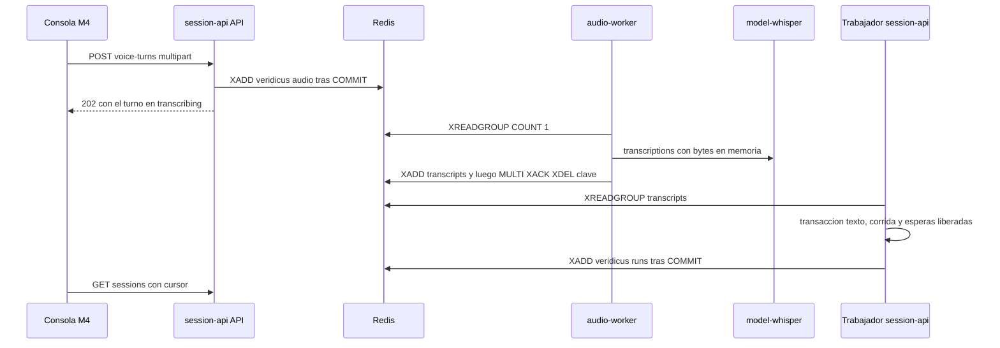

# Diseño de rendimiento — U9 voice

**Revisión 2 (2026-11-22).** Sustituye a la revisión 1 del 2026-10-03. Las secciones conservan número y
tema; lo nuevo es §8 (espera de corridas) y §9 (audio conservado). Cambian las cifras: plazo base de 360 s,
2 entregas, *timeouts* de C25 (NFR-U9-02), meta del turno completo derivada del tramo incremental de U11
(NFR3.3) y síntesis de la aclaración en lugar de la pregunta. R-05 de la revisión 1 se cierra en §2.

**Insumos.** `nfr-requirements/performance-requirements.md` (performance-requirements, NFR3.1–NFR3.16 y
NFR8.1–NFR8.4), `security-requirements.md` (security-requirements), `scalability-requirements.md`
(scalability-requirements), `reliability-requirements.md` (reliability-requirements),
`observability-requirements.md` (observability-requirements) y `tech-stack-decisions.md`
(tech-stack-decisions, D1–D16) de esta unidad; F1–F8 y E1–E32 de `functional-design/functional-spec.md`
(functional-spec) y BR1–BR9 de `functional-design/rules.md`; C1, C5, C13, C14, C15 y C25 de
`inception/contract-design/contract-summary.md` (contract-summary); NFR Design de U4 (plazo, sondeo,
`HoldReleaser`), U6 (lector `multipart`) y U11 (tramo incremental de p95 ≤ 180 s, *N* = 300 s);
P1 = A y P2 = A de `nfr-design-questions.md`.

Todas las metas se diseñan y se miden en la **máquina de desarrollo con el perfil CPU** (NFR2.2). El perfil
GPU solo puede acortar tiempos y ninguna meta depende de él.

## 1. Camino crítico de un turno de voz (NFR3.1, NFR3.2, NFR3.3, NFR3.15)

<!-- Texto alternativo: la consola envía el audio; la API valida, guarda el turno y, tras confirmar, publica el audio en base64 y responde 202. audio-worker lo lee de uno en uno, lo manda a Whisper desde memoria, publica la transcripción y en una transacción de Redis confirma, borra el audio y fija la clave de entrega doble. El trabajador de session-api ingiere el texto, crea la corrida y libera las esperas en una transacción, y publica las corridas en la cola de U4. La consola lo ve en su siguiente sondeo. -->

| Tramo (clip de 30 s) | Presupuesto | Técnica |
|---|---|---|
| Recepción, validación, archivo (si aplica) y `XADD` | ≤ 0,5 s | §2 |
| Espera en la cola de audio | 0 s con la cola vacía | Un audio a la vez (NFR8.5) |
| Lectura del *stream* | ≤ 0,5 s | `XREADGROUP BLOCK 5000 COUNT 1`; *timeout* de socket de 7 s para ese comando (§3) |
| Whisper `base` int8 | ≤ 10 s | D1: voraz (`beam_size = 1`), VAD, `condition_on_previous_text = false`, `cpu_threads = 4`, idioma `es` |
| Publicar, ingerir, guardar y crear la corrida | ≤ 1 s | `XADD` del texto, `MULTI` de cierre, una transacción del trabajador |
| Tramo incremental (U11) | p95 ≤ 180 s | Sin cambios: el texto entra a C2 como un turno escrito (NFR3.6) |
| Llegar a la consola | ≤ 3 s | Sondeo de U4 de 2 s con trabajo en curso (NFR3.11) |

- **NFR3.1 y NFR3.2.** La transcripción (`202` → `voice_status = transcribed`) tiene p95 ≤ 12 s para 30 s y
  ≤ 40 s para 120 s; el único tramo que crece con la duración es Whisper.
- **NFR3.3 (derivada).** p95 ≤ 192 s y ≤ 220 s: NFR3.1 y NFR3.2 más el tramo incremental de U11. Si se
  incumple, el reporte de la corrida de voz atribuye por tramo con las marcas `submitted_at`, `transcribed_at`,
  la liberación de la espera (si la hubo) y el fin del tramo incremental.
- **NFR3.15 (mixta).** La misma meta de 12 s con un tramo incremental de U11 en curso. `model-whisper` y el juez
  se separan por `limits.cpu` (Infrastructure Design, `scalability-design.md` §4); si falla, es un hallazgo
  sobre `cpu_threads` o `limits.cpu`, nunca sobre la meta.
- **Calentamiento.** Al arrancar, `audio-worker` transcribe un clip sintético de 1 s empaquetado en la imagen
  (registrado en `evaluation/voice/manifest.json`) y sintetiza una palabra; `/readyz` responde `200` solo
  después. El primer turno real no paga la carga del modelo.

## 2. Recepción de la subida en `session-api` (NFR3.4, NFR8.4; P1 = A; cierra R-05)

Orden de `security-design.md` §3. Para el rendimiento importan tres cosas:

1. **Sin bloqueo durante la lectura.** Las guardias previas usan una transacción corta de lectura y la
   conexión vuelve al *pool* antes de leer el cuerpo; el bloqueo de la sesión solo se toma en la transacción
   final, que dura ≤ 50 ms (inserciones y `bump`).
2. **Copias del audio, contadas.**

| Copia | Tamaño con 6 MB | Vida |
|---|---|---|
| `bytearray` del lector `multipart` | 6 MB | Hasta responder |
| Validación de cabecera y duración | 0 (trabaja sobre un `memoryview`) | — |
| Archivo conservado | 0 (`os.write` desde el `memoryview`, `sha256` incremental) | — |
| `base64.b64encode(memoryview)` | 8 MB | Hasta el `XADD` |
| Empaquetado del `XADD` en `redis-py` | 0: los argumentos de más de 6 000 bytes se envían como trozos propios, sin concatenarlos | — |

   Pico ≈ 14 MB por subida (antes 20 MB, sin contar la copia del cliente de Redis, R-05), bajo los 32 MiB de
   NFR8.4. Tras el `XADD` se sueltan las referencias (`del`) antes de responder. La prueba `perf` confirma con
   `tracemalloc` que no aparece una tercera copia de 6 MB o más.
3. **Escritura conservada.** `fsync` de ≤ 3,84 MB en el disco local: ≤ 100 ms medido en la prueba.

**Verificación (`pytest -m perf -k voice`, nivel 1, PostgreSQL y Redis reales):**
- p95 del `202` ≤ 500 ms en 50 envíos de un WAV de 3,84 MB, con el Whisper *fake* bloqueado y con
  `autoriza_conservar_audio`;
- crecimiento ≤ 32 MiB por subida de 6 MB y diferencia ≤ 32 MiB de RSS entre la 1.ª y la 20.ª subida.

## 3. Plazos y *timeouts* (NFR3.5–NFR3.8, NFR3.13)

| Elemento | Diseño | Verificación |
|---|---|---|
| Plazo del audio (NFR3.5) | En la transacción del paso 8 de `security-design.md` §3: `voice_deadline_at = ahora + voice_deadline_base_s × (1 + m)`, tope `voice_deadline_max_s`, con `m` = `COUNT` de `voice_turn_state` en `transcribing` de todo el sistema, servido por el índice parcial `voice_turn_state (voice_deadline_at) WHERE voice_status = 'transcribing'`. Función pura `domain/voice_deadline.py` | Nivel 0: `m` = 0, 2 y 10 → 360, 1 080 y 1 800 s |
| Plazo de la corrida (NFR3.6) | La corrida que crea la ingesta usa el plazo de U4; una corrida en espera recibe el suyo al liberarse (NFR-U4-10). Los dos plazos son sucesivos | Nivel 1 |
| Vencimiento (NFR3.7) | El `run-supervisor` de U4 (cada 15 s, NFRD-U4-06): en la transacción por sesión pasa a `error` con `analysis.timeout` los turnos con `voice_deadline_at` < ahora y libera las esperas (§8). Holgura: ≤ 17 s tras el plazo, dentro de los 30 s | Nivel 1 con reloj controlado; un `TranscriptResult` posterior se descarta (BR4.3) |
| *Timeout* de Whisper (NFR3.8) | `min(transcription_timeout_s, voice_deadline_at − ahora)`; ≤ 0 → sin llamada y `analysis.timeout` | Nivel 0 con reloj y Whisper *fake* |
| Síntesis (NFR3.13) | `audio-worker` → `model-tts`: `tts_timeout_s` (12 s); `session-api` → `audio-worker`: `speech_route_timeout_s` (15 s); conexión 2 s; espera del semáforo = `speech_route_timeout_s − tts_timeout_s − 1` (2 s, NFRD-U9-13), que el arranque exige ≥ 1 s | Nivel 0 |
| Redis | 0,5 s por operación; `XADD` de `veridicus:audio` con 2 s; `XREADGROUP BLOCK 5000` con *timeout* de socket de 7 s (el bloqueo más 2 s). Es el único valor de *socket* largo; cierra la discrepancia 2 s / 7 s de R-05 | Nivel 0 sobre la configuración |

## 4. Consola (NFR3.9, NFR3.10, NFR3.11)

- **Codificación fuera del hilo principal (NFR3.10).** `decodeAudioData` y `OfflineAudioContext` a 16 kHz
  mono; el `Float32Array` pasa al Web Worker `wavEncoder.worker.ts` como `Transferable` (sin copia) y vuelve
  un `ArrayBuffer` WAV PCM 16 bits también transferido. Meta: ≤ 1,5 s para 120 s y 0 tareas largas de más de
  200 ms (`PerformanceObserver` de `longtask`, Playwright de nivel 3).
- **Envío no bloqueante (NFR3.9).** Mutación de TanStack Query independiente del formulario de texto y de la
  grabación siguiente; el turno aparece con «Procesando audio…» desde el `202`. Meta: < 1 s por interacción
  con un turno de voz en curso (Playwright con Whisper *fake* de 12 s y Vitest con temporizadores falsos).
- **Visibilidad (NFR3.11).** La ingesta hace `change_cursor.bump` y fija `change_seq` en la fila del turno
  (NFRD-U4-05); el sondeo de U4 la trae en su siguiente vuelta. Meta ≤ 3 s (nivel 3).

## 5. Síntesis de la aclaración (NFR3.12)

- Camino D4: ConsoleApi (rol, dueño, aprobación, estado y tema en una transacción de lectura,
  `security-design.md` §4) → `POST /internal/v1/speech` con un cliente `httpx` persistente (conexión
  reutilizada, sin TLS interno) → composición y validación (`speech_text.py`, microsegundos más el escáner de
  C8) → `ModelGateway.synthesize` → `model-tts`.
- Piper con 2 hilos y la voz cargada al arrancar `model-tts`; calentamiento de una palabra antes de `/readyz`.
- La respuesta (≤ `speech_audio_max_bytes`) se lee por trozos en memoria y se devuelve con `Content-Length` y
  `Cache-Control: no-store`; no se guarda.
- **Metas.** p95 ≤ 5 s con frases de 60 a 400 caracteres y la voz Piper real (corrida de voz, 20 frases);
  sobrecarga de la ruta p95 ≤ 300 ms con el TTS *fake* instantáneo (prueba `perf` de nivel 1), que incluye el
  escáner de C8.

## 6. Humo y E2E de voz (NFR3.14)

- `scripts/smoke.sh <url-base>` usa el *N* = 300 s de U11 y no cambia sus casos; U9 solo añade
  `audio-worker` a la comprobación de salud (C16) y no consume tiempo del *N*.
- `frontend/e2e/voice.spec.ts` (nivel 3, antes de etiquetar una entrega): clip sintético de 20 s con
  `--use-file-for-fake-audio-capture`; el texto aparece con su rótulo en ≤ 15 s y el turno queda en un tramo
  incremental terminado en ≤ 192 s.

## 7. Recursos (NFR8.1–NFR8.4)

| Pod | Tope medido | Cómo se respeta en el diseño |
|---|---|---|
| `model-whisper` | ≤ 1 GiB con 120 s | `base` int8; una transcripción a la vez; `/tmp` en memoria de 64 Mi |
| `audio-worker` | ≤ 256 MiB | Un mensaje a la vez; el base64 (8 MB) se decodifica a `bytes` (6 MB) y se suelta antes de llamar a Whisper; síntesis con concurrencia 1 y respuesta ≤ 4 MiB |
| `model-tts` | ≤ 512 MiB | Una voz `medium`, 2 hilos, ≤ 400 caracteres |
| API de `session-api` | ≤ 32 MiB por subida, sin acumulación | §2 |

El pico de RSS de cada pod sale de la corrida de voz; Infrastructure Design fija `limits.memory` con ≥ 20 %
sobre el pico. Un pico sobre su tope es un hallazgo que se corrige por PR.

## 8. Espera de corridas (NFR3.16) · nuevo

- **Creación.** Al crear una corrida incremental (turno escrito, ingesta o «Reanudar análisis»), en la misma
  transacción se busca el menor `n` de un turno de voz en `transcribing` con `n < hasta_turno` (índice
  `voice_turn_state` parcial de §3 más `turn (session_id, n)`); si existe, se crea `RunPublicationHold` y no se
  publica.
- **Liberación inmediata.** La transacción que resuelve un turno de voz (ingesta, supervisor) llama a
  `hold_release.release_ready(session_id, now)`: libera en orden de `hasta_turno` las esperas sin turnos de voz
  anteriores en `transcribing`, fija `released_at`, `outcome = released` y `deadline_at` con la hora de
  liberación, y arma la entrada de C6. Tras `COMMIT` se publican en ese orden. Liberación en ≤ 0,2 s desde el
  fin del turno, dentro de 1 s.
- **Red de seguridad.** El `HoldReleaser` de U4 (cada 500 ms) llama a la misma función para las esperas sin
  liberar cuyos turnos ya están resueltos; en uso normal no encuentra ninguna (NFRD-U9-01).
- **Cota.** La espera extra de un turno escrito posterior es como mucho `voice_deadline_at + 30 s` del turno de
  voz más antiguo de la sesión; con un turno de 30 s en uso normal, ≤ NFR3.1.
- **Pruebas de nivel 1** con reloj controlado: liberación tras texto, tras error, tras vencimiento y tras
  retirada (cancelada, sin publicar); 50 liberaciones con p95 ≤ 1 s. Se mide con
  `veridicus_run_hold_wait_seconds`.

## 9. Audio conservado (NFR3.4, NFR8.12) · nuevo

- El contador de la cuota (`security-design.md` §12) se lee en memoria: la comprobación cuesta microsegundos.
- Al arrancar, la suma de tamaños recorre el directorio con `os.scandir` (≈ 2 200 archivos en el peor caso de
  NFR8.12, < 1 s) antes de `/readyz`.
- La escritura conservada entra en el presupuesto de NFR3.4 (§2).
