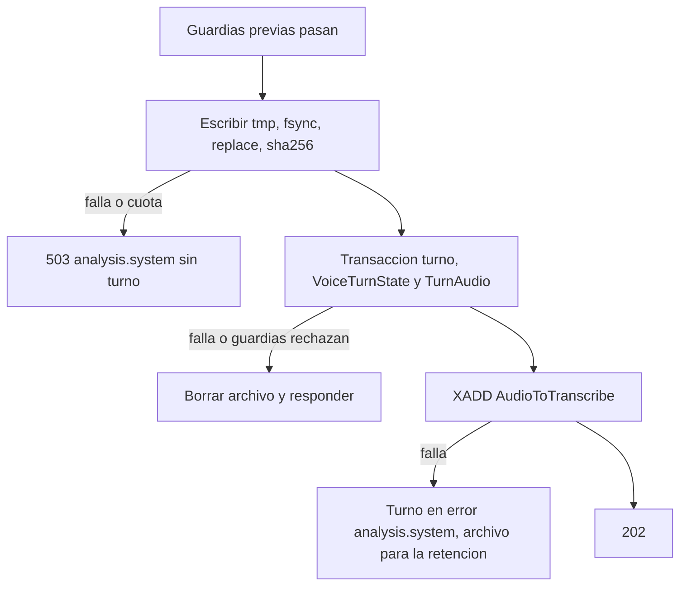

# Diseño de fiabilidad — U9 voice

**Revisión 2 (2026-11-22).** Sustituye a la revisión 1 del 2026-10-03. Las secciones conservan número y
tema; lo nuevo es §11 (espera de corridas), §12 (transiciones de la sesión) y §13 (audio conservado).
Cambian: codes `analysis.*` de C5 (FD-U9-01), 2 entregas, cifras de C25 y la clave de entrega doble con TTL
`voice_key_ttl_s`. R-01 de la revisión 1 se cierra en §4 y R-03 con el supervisor de U4 (§3).

**Insumos.** `nfr-requirements/reliability-requirements.md` (reliability-requirements, NFR8.10, NFR8.11,
NFR10.13–NFR10.21, NFR10.26, NFR10.27, NFR4.1–NFR4.4), `performance-requirements.md`
(performance-requirements), `security-requirements.md` (security-requirements), `scalability-requirements.md`
(scalability-requirements), `observability-requirements.md` (observability-requirements) y
`tech-stack-decisions.md` (tech-stack-decisions) de esta unidad; F1–F8 y §3 de
`functional-design/functional-spec.md` (functional-spec) y BR3, BR4, BR8 y BR9 de
`functional-design/rules.md`; C5, C13, C14, C16 y C25 de `inception/contract-design/contract-summary.md`
(contract-summary); NFR Design de U4 (supervisor, `HoldReleaser`, `CancellationKeys`, NFRD-U4-01 y
NFRD-U4-02) y de U6 (`SessionSupervisor`, §11); P1 = A y P2 = A de `nfr-design-questions.md`.

## 1. *Timeouts* (NFR10.13)

| Llamada | *Timeout* | Origen |
|---|---|---|
| Whisper | `min(transcription_timeout_s, voice_deadline_at − ahora)` | C25 (90 s) |
| TTS (`audio-worker` → `model-tts`) | `tts_timeout_s` | C25 (12 s) |
| Síntesis (`session-api` → `audio-worker`) | `speech_route_timeout_s` | C25 (15 s) |
| Conexión HTTP | 2 s | `httpx.Timeout(connect=2)` |
| Redis | 0,5 s por operación; `XADD` de `veridicus:audio` 2 s; `XREADGROUP BLOCK 5000` con *socket* de 7 s; `BGREWRITEAOF` 0,5 s (solo pide) | Cliente con *timeout* por comando |
| PostgreSQL | `statement_timeout` 2 s, `lock_timeout` de U5 | `session_api/shared/db.py` |
| Escritura del audio conservado | 5 s (escritura y `fsync` en un hilo con plazo) | NFR10.13 |

Verificación: nivel 0 sobre la configuración validada y nivel 1 con dependencias lentas *fake*.

## 2. Ciclo del mensaje de audio (NFR10.14, NFR10.15, NFR10.20)

Un único módulo, `services/audio-worker/.../application/audio_lifecycle.py` (100 % de ramas, NFR13.2), decide
el resultado y garantiza que el audio se borra en todos los caminos:

```python
def handle(msg, deliveries, now):
    if deliveries > limits.audio_max_deliveries:
        return close(msg, publish=error(msg, "analysis.system"), dead_letter=True)
    if voice_cancelled(msg.session_id):              # fallo de Redis = cancelado
        return close(msg, publish=None)
    if dedup.exists(msg.turn_id, msg.attempt):
        return close(msg, publish=None)
    if now >= msg.deadline_at:
        return close(msg, publish=error(msg, "analysis.timeout"))
    return close(msg, publish=transcribe_once(msg, now))   # sin reintento

def close(msg, publish, dead_letter=False):
    if publish: transcripts.xadd(publish)            # primero el efecto
    with redis.pipeline(transaction=True) as p:      # MULTI
        p.xack(AUDIO, GROUP, msg.id); p.xdel(AUDIO, msg.id)
        p.set(dedup.key(msg), 1, ex=limits.voice_key_ttl_s)
        if dead_letter: p.xadd(AUDIO_FAILED, ids_only(msg), maxlen=1000)
        p.execute()
    aof.mark_dirty()
```

| Resultado de `transcribe_once` | Publica | `outcome` / `error_code` |
|---|---|---|
| Texto no vacío y ≤ `turn_max_chars` | `transcribed` con `model_digest` | `transcribed` / `none` |
| Vacío o solo espacios | `error` | `failed` / `analysis.invalid_output` |
| Más de `turn_max_chars` (NFR10.20) | `error` | `failed` / `analysis.invalid_output` |
| *Timeout* | `error` | `failed` / `analysis.timeout` |
| Conexión rechazada, 5xx o respuesta mal formada | `error` | `failed` / `analysis.system` |

- **Clave de entrega doble después de publicar** (NFR10.14, NFRD-U9-04): si el proceso cae entre el `XADD` del
  resultado y el `MULTI`, la segunda entrega vuelve a transcribir y la ingesta descarta el segundo resultado
  por (`turn_id`, `attempt`) (BR4.3). Ningún resultado se pierde.
- **Tope de entregas.** El contador sale de `XPENDING` del mensaje reclamado (como NFRD-U4-01). Con 2 entregas:
  90 s + 120 s de reclamo + 90 s = 300 s < 360 s de base.
- **Sin reintento ante Whisper caído.** El turno termina en segundos y el analista graba de nuevo o escribe
  (BR4.2, `project.md`): reintentar obligaría a conservar el audio crudo más tiempo.
- **Reclamo.** `XAUTOCLAIM` con `audio_claim_idle_ms` (120 000) en cada vuelta del bucle; como el *timeout* de
  Whisper es de 90 s, un mensaje en curso nunca se reclama mientras el consumidor vive.
- **Ingesta.** La de `veridicus:transcripts` sigue las reglas de U4 (reclamo, 3 entregas,
  `veridicus:transcripts:failed`) y hace `XACK` + `XDEL` tras confirmar su transacción, también del resultado
  descartado.

Verificación: una prueba de nivel 0 por fila y por rama de `handle`; nivel 1 que mata al trabajador a mitad de
una transcripción → un solo texto por turno, el audio borrado al final y la segunda entrega dentro del plazo.

## 3. Ningún turno queda en «Procesando audio…» (NFR10.16)

- El supervisor de U4 (NFRD-U4-06) vence los turnos en `transcribing` con `voice_deadline_at` pasado, con
  `analysis.timeout` y `actor_system = run-supervisor`, y libera las esperas (§11). El turno de voz no tiene
  corrida en `transcribing` (la crea la ingesta), así que la condición es sobre `voice_turn_state` y no sobre
  `status` de una corrida (cierra la ambigüedad de R-03).
- Cubre también la sesión suspendida, en pausa o terminada (P6 = C) y el mensaje perdido (Redis reiniciado,
  NFR10.4).
- En la misma vuelta recorta `veridicus:audio` por `MINID` (`security-design.md` §2, NFRD-U9-05).

Verificación de nivel 1 con reloj controlado: mensaje borrado a mano, `audio-worker` apagado y sesión en cada
estado → `error` antes de `voice_deadline_at + 30 s`.

## 4. Salud de `audio-worker` (NFR10.17; cierra R-01)

| Sonda | Responde `503` si… |
|---|---|
| `/healthz` (*liveness*) | El hilo consumidor terminó por una excepción no controlada, o el latido está vencido (abajo) |
| `/readyz` | Configuración inválida; Redis, `model-whisper` o `model-tts` no responden (cada uno con su nombre en `checks`, resultado guardado 5 s); la plantilla de voz no cargó; el calentamiento no terminó |

**Latido independiente de la duración del procesamiento.** El bucle guarda dos valores: `last_beat` (cada
vuelta, como mucho cada 7 s por el `BLOCK 5000`) y `busy_until`, que al empezar un mensaje vale inicio +
*timeout* efectivo de la llamada (≤ 90 s) y se borra al terminar. El latido está vencido solo si
`ahora − last_beat > 45 s` **y** (`busy_until` vacío **o** `ahora > busy_until + 15 s`). Así una transcripción
de 120 s de audio (≈ 48 s de Whisper) no reinicia el pod, y un hilo colgado más allá de su *timeout* sí. El
proceso no se mata a sí mismo: lo reinicia el `livenessProbe` de U2.

- El bucle consumidor no depende de `/readyz`: con `model-tts` caído la transcripción sigue.
- Configuración inválida o plantilla ausente → el proceso termina al arrancar con código ≠ 0 y el log que
  nombra el ajuste.

Verificación de nivel 1: cada dependencia caída; hilo forzado a fallar; **Whisper *fake* de 60 s → 0
reinicios** y `/healthz` en `200` durante la llamada; Whisper *fake* colgado 120 s → `/healthz` en `503`
pasados 105 s.

## 5. Fallos de la síntesis (NFR10.18)

TTS caído, *timeout*, semáforo ocupado más de 2 s, `audio-worker` no preparado, `401` por token mal
configurado o respuesta mayor que `speech_audio_max_bytes` → `503` `speech.unavailable`; la consola muestra «No
se pudo generar el audio; puedes leer la aclaración en pantalla» y vuelve a habilitar «Escuchar audio». Sin
reintento automático; la aclaración, su decisión y los turnos no cambian. Verificación: nivel 1 con TTS *fake*
caído y lento (13 s) y Vitest.

## 6. Envío desde la consola ante cortes (NFR10.19)

La mutación conserva el WAV **en memoria** y reintenta con el mismo `client_request_id` tras 1, 2, 4 y 8 s ante
error de red o `5xx` (no ante `4xx`). Si sigue fallando: «Reintentar envío» y «Descartar». El servidor
deduplica por (`session_id`, `client_request_id`) con la restricción única de U4 y responde el mismo turno,
con un solo mensaje en C5 y un solo archivo conservado (el duplicado se detecta antes de escribir,
`security-design.md` §3 paso 5). Verificación: Vitest con un servidor *fake* que falla 3 veces y nivel 1 con
dos envíos iguales (1 fila, 1 `XADD`, 1 archivo).

## 7. Configuración (NFR10.20, NFR10.21)

- Las cifras salen de `limits.load` de C25 al arrancar; `VERIDICUS_LIMIT_<NOMBRE>` solo baja (NFRD-U1-09).
  `turn_max_chars` también.
- Un `BaseSettings` de Pydantic por servicio con validadores cruzados: URL internas;
  `audio_claim_idle_ms` > `transcription_timeout_s`; `voice_deadline_base_s` ≥ 2 × `transcription_timeout_s` +
  `audio_claim_idle_ms`; `voice_key_ttl_s` ≥ `voice_deadline_max_s`; espera del semáforo
  `speech_route_timeout_s − tts_timeout_s − 1` ≥ 1 s (NFRD-U9-13); `VERIDICUS_WHISPER_MODEL_SHA256` de 64 hexadecimales igual a
  `models.lock`; `VERIDICUS_SPEECH_TOKEN` de ≥ 32 bytes; plantilla con un solo `{tema}`;
  `VERIDICUS_AUDIO_DIR` presente y escribible en `session-api`; `VERIDICUS_AOF_REWRITE_MIN_INTERVAL_SECONDS`
  entre 10 y 600 (NFRD-U9-06).
- Un fallo impide arrancar con un log que nombra el ajuste sin su valor. Una prueba de nivel 0 por regla.

## 8. Calidad de la transcripción (NFR4.1–NFR4.4)

| Requisito | Diseño | Verificación (corrida de voz) |
|---|---|---|
| WER ≤ 20 % (NFR4.1) | D1; normalización común `evaluation/voice/normalize.py` (minúsculas, sin puntuación, números en palabras) con `jiwer`; nombres propios sintéticos como cifra informativa | Clips con habla |
| Silencio sin texto (NFR4.2) | `vad_filter = true`; vacío → `analysis.invalid_output` (§2) | 3 clips de silencio o ruido, 0 textos |
| Repetible (NFR4.3) | `temperature = 0`, `beam_size = 1`, idioma fijo, sin condicionar al texto previo | Dos pasadas, 100 % de textos iguales |
| La voz no rebaja al analizador (NFR4.4) | El texto entra a C2 como un turno escrito; las citas se verifican contra el texto transcrito | 10 relatos sintetizados: 100 % de citas verificadas contra lo transcrito, 0 % de error de formato; comparación informativa con el texto original; control negativo con una cita alterada |

El reporte JSON registra la versión del conjunto, el `sha256` de Whisper, de la voz y de la plantilla, el
perfil (CPU) y las métricas por sección.

## 9. Objetivos de punta a punta (NFR8.10, NFR8.11)

En la corrida de voz: 100 % de los turnos con habla terminados `transcribed` o en `error` antes de
`voice_deadline_at + 30 s`, ≥ 98 % `transcribed`, 0 corridas en espera tras el fin de su turno de voz (§11) y 0
`OOMKilled` en `audio-worker`, `model-whisper` y `model-tts`. En `scripts/smoke.sh`, 0 fallos atribuibles a U9
(`/healthz` de `audio-worker` en `200`). Un fallo es un hallazgo con su `code` en el reporte, no una corrida
repetida.

## 10. Recuperación

| Falla | Qué se pierde | Cómo se recupera |
|---|---|---|
| Reinicio de `audio-worker` a mitad | Nada | `XAUTOCLAIM` a los 120 s; el `AofRewriteRequester` queda sucio y pide la reescritura al volver |
| `audio-worker` caído mucho tiempo | Los turnos de voz de ese intervalo | Vencen por plazo y liberan sus esperas; el supervisor recorta el audio por `MINID` |
| Caída de `model-whisper` | Los audios de ese intervalo | `analysis.system` en segundos, audio borrado, esperas liberadas |
| Caída de `model-tts` | Nada | `503` `speech.unavailable` |
| Redis pierde ≤ 1 s | Audios de ese segundo | Plazo (§3); se graba de nuevo |
| Redis se reinicia tras una retirada | La clave de voz | `CancellationKeys` la reescribe al reconectar; mientras tanto el `EXISTS` que falla cuenta como cancelado |
| Reinicio de `session-api` en una subida | La subida y, con autorización, un archivo sin fila | Reenvío con el mismo `client_request_id`; barrido de huérfanos (§13) |
| Publicación de una corrida liberada falla | La publicación | Como NFRD-U4-02: `ERROR` `run.publish_failed` y el supervisor cierra la corrida al vencer |

## 11. Espera de corridas (NFR10.26; BR9.1–BR9.4) · nuevo

- **Un solo módulo**, `interview/domain/hold_release.py` (100 % de ramas, NFR13.2), con dos funciones puras
  sobre el estado leído bajo el bloqueo: `hold_for(new_run, voice_turns)` y `release_ready(holds, voice_turns,
  now)`. Lo usan la ingesta, el supervisor, la función de cancelación de §12 y el `HoldReleaser` de U4
  (NFRD-U9-01).
- **Fines cubiertos**, cada uno en su propia transacción con orden sesión → corrida → ronda: texto (ingesta),
  `error` del trabajador (ingesta), vencimiento (supervisor), retirada (§12, cancela) y resultado tardío
  descartado (la ingesta igual llama a `release_ready`, por si el turno ya se había resuelto por otra vía).
- **Escritura única.** `released_at` y `outcome` pasan de nulo a valor una vez (disparador de NFR11.1);
  `waiting_on_turn_n` solo crece (NFRD-U9-02). Tras la retirada, la corrida queda `cancelled` y no se publica.
- Pruebas de nivel 1, una por fin, contando publicaciones en `veridicus:runs` y comprobando que ninguna espera
  queda sin `released_at` tras el fin de su turno.

## 12. Transiciones de la sesión (NFR10.25; BR9.4, BR9.5, BR9.7) · nuevo

La función de cancelación de corridas de InterviewSession (U4), que llaman las transiciones de U6 dentro de
su transacción, recibe el motivo (NFRD-U9-08). U9 la amplía en B9:

| Motivo | Esperas | Turnos de voz en `transcribing` | Tras `COMMIT` |
|---|---|---|---|
| `pause` | `cancelled` | Siguen; la ingesta guarda el texto sin corrida (BR9.7) | Clave de corridas (U4) |
| `terminate` | `cancelled` | Siguen; texto sin corrida, «Transcrito · sin análisis» (BR9.4) | Clave de corridas |
| `withdraw` | `cancelled` | `error` con `session.consent_withdrawn` | Clave de corridas y `veridicus:voice-cancelled:{session_id}` |
| `block` | `cancelled` | Siguen; la ingesta guarda el texto sin corrida | Clave de corridas |

Pruebas de nivel 1 por motivo, con un turno de voz en cola y una espera: estado final, 0 corridas publicadas y,
con `withdraw`, 0 llamadas al Whisper *fake*.

## 13. Audio conservado todo o nada (NFR10.27; BR8.2, BR8.5) · nuevo

Archivo antes que fila (`security-design.md` §12):



<!-- Texto alternativo: si las guardias previas pasan, se escribe el archivo temporal, se sincroniza, se renombra y se calcula su sha256; si falla o se pasa la cuota, 503 sin turno. Después, una transacción crea el turno, su estado de voz y la fila del audio; si falla o las guardias bajo bloqueo rechazan, se borra el archivo. Luego se publica el audio; si eso falla, el turno queda en error y el archivo se queda para la retención. Si todo va bien, 202. -->

Al arrancar, `TurnAudioSweeper` borra los `.tmp` y los archivos sin fila con más de 10 minutos, y rehace el
contador de la cuota antes de `/readyz`. Pruebas de nivel 1 con fallo inyectado en cada paso.
